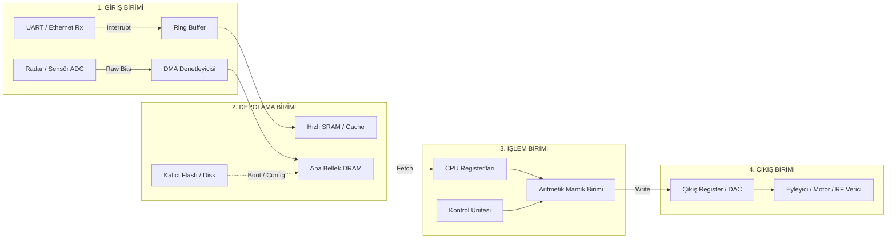

# GÜN 001: Bilgisayar Sistemi — Giriş, İşlem, Çıkış ve Depolama Mimarisi
### Faz 0: Bilgisayar ve Yazılım Temelleri (Gün 001 / 365)
#### 24-Hücreli Master Mimari Planı (18 Markdown + 6 Kod Hücresi)

---

```
ÖZEL LİSANS — TÜM HAKLAR SAKLIDIR

Telif Hakkı (c) 2026 Seydi Eryılmaz (@seydivakkas)

Bu yazılım ve ilgili tüm dosyalar ("Yazılım") yalnızca görüntüleme ve eğitim
amaçlı olarak paylaşılmıştır.

YASAKLAR:
  1. Kopyalanamaz, çoğaltılamaz, dağıtılamaz veya yeniden yayınlanamaz.
  2. Ticari veya ticari olmayan hiçbir projede kullanılamaz, değiştirilemez.
  3. Alt lisanslanamaz, satılamaz veya devredilemez.
  4. Tersine mühendislik yapılamaz.

İZİN VERİLEN KULLANIM:
  - GitHub üzerinde görüntüleme ve okuma.
  - Kişisel öğrenim amacıyla kodu inceleme (kopyalamadan).

YAZARIN AÇIK YAZILI İZNİ OLMAKSIZIN HİÇBİR KULLANIM HAKKI TANINMAZ.
İzin talepleri için: GitHub @seydivakkas
```

[](https://github.com/seydivakkas)

> [!NOTE]
> **40-Nokta Standart Bildirimi:** Bu çalışma planı; ASELSAN, HAVELSAN ve kritik savunma sanayii sistemlerinde görev alacak bir mühendisin donanım, çekirdek işletim sistemi, C++20, bellek yönetimi ve gerçek zamanlı sistemleri sıfırdan en üst düzeye çıkarması için 40 temel pedagojik ve teknik kalite kriterine (İlk İlkeler, Hata Enjeksiyonu, Determinizm, SLA/Gecikme Analizi, Katı Doğrulama vb.) tam uyumlu olarak inşa edilmiştir.

---

## [MD 2] 1. 🎯 Bugünkü Problem: Giriş ve Bellek Hızı Arasındaki Uçurum Neden Sistemi Boğar?

Bir radar alıcısından saniyede 1.000.000 darbe (pulse) girişi aldığınızı veya bir insansız hava aracında (İHA) saniyede 500 Hz ile IMU telemetrisi okuduğunuzu düşünün. 

Yazılım geliştiricilerin en sık düştüğü yanılgı, yazılan kodun "anında" çalışacağını varsaymaktır. Ancak bilgisayar donanımı tek parça homojen bir blok değildir:
1. **Giriş (Input) Birimi:** Fiziksel dünyadan sinyal toplar (sensör, ağ kartı, UART, DMA).
2. **İşlem (Process) Birimi:** CPU çekirdeğindeki Aritmetik Mantık Birimi (ALU) veriyi işler (GHz hızında - nanosaniye mertebesinde).
3. **Depolama (Storage/Memory) Birimi:** Verinin işlenmeyi beklediği veya kalıcı saklandığı ortamdır (DRAM onlarca nanosaniye, NVMe/Disk mikrosaniyeler mertebesindedir).
4. **Çıkış (Output) Birimi:** İşlenen emri fiziksel dünyaya veya ağa iletir (eyleyici/motor sürme, radyo frekansı yayını, ekrana basma).

Eğer giriş biriminden gelen veri akış hızı ($R_{in}$), işlemcinin işleme hızından ($R_{proc}$) veya belleğin yazma bant genişliğinden ($B_{mem}$) büyük olursa sistemde **G/Ç Darboğazı (I/O Bottleneck)** ve **Von Neumann Darboğazı** patlak verir. Sonuç: Kontrolsüz bellek şişmesi, kuyruk taşması, Out-of-Memory (OOM) çöküşü veya kritik komutların gecikerek İHA'nın kaza kırıma uğramasıdır.

Bugünkü problemimiz: **Giriş, işlem, çıkış ve depolama halkalarının sınırlarını bilerek; kontrolsüz veri yığılmasına karşı korumalı, deterministik ve çökmeyen bir temel mimariyi nasıl inşa ederiz?**

---

## [MD 3] 2. ❓ Bu Konuyu Neden Öğreniyoruz? (Kavramsal Derinlik ve Savunma Sanayii Gerekçesi)

Savunma sanayiinde (ASELSAN hava savunma radarları, HAVELSAN komuta kontrol yazılımları, Roketsan güdüm kitleri) çalışan hiçbir sistem "soyut yazılım" dünyasında yaşamaz.

- **Fiziksel Dünyaya Temas:** C++ kodunuzdaki `std::vector` veya `float target_range` değişkeni havada asılı değildir. Bir gerilim seviyesine, bir DRAM kapasitörüne veya bir CPU register'ına karşılık gelir.
- **Kaynak Yamyamlığı (Resource Starvation):** Eğer işlemci, diskten veri beklerken (I/O Wait) boşta kalıyorsa (CPU stall), radar hedef tespit algoritmanız hedefi ıskalar.
- **Determinizm:** Askeri sistemlerde "ortalama hız" bir başarı metriği değildir; "en kötü durum gecikmesi" (Worst-Case Execution Time - WCET) geçerlidir. 

Bu konuyu öğreniyoruz çünkü girişten çıkışa kadar olan veri yolunu (Data Path) donanım ilkeleri seviyesinde kavramayan bir mühendis; ne `volatile` anahtar kelimesini, ne DMA mekanizmasını, ne de ileride göreceğimiz cache locality ve lock-free yapıları doğru kurgulayabilir.

---

## [MD 4] 3. 🔍 5N1K Analizi (Donanım ve Yazılım Sınırları)

| Soru | Sistem Mühendisliği Karşılığı |
|:---|:---|
| **Ne? (What)** | Giriş (sensör/klavye/ağ), İşlem (CPU/ALU/Register), Çıkış (motor/ekran/paket) ve Depolama (RAM/Disk) dörtlüsünün veri yolu ve senkronizasyon mimarisi. |
| **Neden? (Why)** | Donanımın fiziksel kısıtlarını yazılım seviyesinde yönetmek, bellek taşmalarını önlemek ve deterministik tepki süresi elde etmek. |
| **Nerede? (Where)** | Bare-metal mikrodenetleyicilerde (STM32), gerçek zamanlı işletim sistemlerinde (FreeRTOS), Linux çekirdek sürücülerinde ve yüksek başarımlı dağıtık sistemlerde. |
| **Nasıl? (How)** | Girişten gelen veriyi tamponlayarak (buffer), DMA/Interrupt ile işlemciye aktararak, register'larda işleyip çıkışa kontrollü sürerek. |
| **Ne Zaman? (When)** | Sistem açıldığı andan (boot sequence) kapanana (graceful shutdown) kadar her saat darbesinde (clock tick). |
| **Kim? (Who)** | ASELSAN/HAVELSAN bünyesinde çalışan Gömülü Sistem, Aviyonik Yazılım, Radar DSP ve Robotik Otonomi Mühendisleri. |

---

## [MD 5] 4. 💡 Günlük Hayat Benzetmesi: Askeri Mühimmat Fabrikası vs Bilgisayar Mimarisi

Bir askeri fişek ve mühimmat fabrikası düşünelim:
1. **Giriş (Input):** Fabrika kapısına kamyonlarla sürekli gelen barut, pirinç kovan ve çekirdek ham maddesi. (Sensörlerden gelen ham byte akışı).
2. **Depolama / Geçici Alan (RAM / Bellek):** Ustanın tezgahının yanındaki malzeme kasaları. Kamyondaki tüm malı hemen işleyemezsiniz; tezgaha yakın bir kasaya indirirsiniz. (DRAM tamponu).
3. **İşlem (Process / CPU ALU):** Tezgahtaki montaj ustası. Gözü, eli ve pres aleti ile kovanı barutla doldurup mermiyi kapatır. Ustayı gereksiz bekletirseniz fabrika verimi çöker; ustaya taşıyamayacağı kadar ham madde yığarsanız tezgâh devrilir.
4. **Kalıcı Depolama (Storage / Disk):** Üretilen veya hammadde fazlası kasaların tutulduğu büyük arka hangar. Çok mal alır ama hangardan tezgaha mal taşımak zaman alır.
5. **Çıkış (Output):** Kontrolü tamamlanıp sahaya sevk edilmek üzere namluya sürülen ya da test atışına gönderilen mühimmat.

Eğer kamyonlar (Giriş), ustanın birleştirme hızından (İşlem) 10 kat hızlı gelirse ve kapıda sınırlı bir kasa kuralı (Bounded Queue) yoksa, fabrika avlusu kilitlenir ve yangın çıkar (OOM Crash).

---

## [MD 6] 5. 🧱 İlk İlkeler (First Principles): Von Neumann Modeli ve Donanımsal Matematiksel Model

```
                    +--------------------------------------------+
                    |           BİLGİSAYAR SİSTEMİ               |
                    |                                            |
[ GİRİŞ (INPUT) ]  |   +-------------+      +----------------+  |  [ ÇIKIŞ (OUTPUT) ]
  Sensörler         |   | CPU (İşlem) | <==> | RAM (Depolama) |  |   Eyleyiciler
  UART / Ethernet ==|=> | ALU / Regs  |      | Veri + Kod     |  |==> Motor PWM
  ADC               |   +-------------+      +----------------+  |   Ağ Paketi
                    +--------------------------------------------+
                                        ||
                                [ SİSTEM VERİ YOLU ]
```

### Matematiksel Denge Kuralı (Little's Law & Queue Dynamics)

Bir giriş-işlem-depolama sisteminde kararlılık şartı:
$$\lambda \le \mu$$
Burada:
- $\lambda$: Sisteme saniyede giren veri/paket sayısı (Arrival Rate - Giriş Hızı).
- $\mu$: İşlemcinin saniyede işleyebildiği veri/paket sayısı (Service Rate - İşlem Hızı).

Eğer $\lambda > \mu$ ise, depolama alanındaki (kuyruktaki) birikim $N(t)$ zamana bağlı olarak sonsuza ıraksar:
$$N(t) = \int_0^t (\lambda(\tau) - \mu(\tau)) d\tau$$

Sınırsız bir sistemde bu durum:
$$\lim_{t \to \infty} \text{Memory}(t) = \infty \implies \text{Out Of Memory (Kernel Panic / Crash)}$$

Bu nedenle gerçek zamanlı savunma mimarilerinde:
1. **Kapasite Sınırı ($C_{max}$):** Kuyruk boyutu daima sabitlenir ($N \le C_{max}$).
2. **Geri Basınç (Backpressure) veya Düşürme (Drop Tail):** $\lambda > \mu$ durumunda aşan veri deterministik şekilde bertaraf edilir veya giriş durdurulur.

---

## [MD 7] 6. 📐 ASCII ve Mermaid Sistem Mimarisi Şeması



---

## [CODE 1] 8. Modül 1: Temel Von Neumann Bilgisayar Motoru (BasicComputer)

Aşağıdaki kod; Giriş, İşlem (CPU ALU + Program Counter + Accumulator), Depolama (RAM) ve Çıkış veri yollarını simüle eden minimal bir çekirdek makinedir:

```python
from collections import deque
from dataclasses import dataclass

@dataclass
class CPU:
    accumulator: int = 0
    program_counter: int = 0
    instruction_register: str = ""
    cycles: int = 0

    def execute(self, opcode: str, operand: int, memory: list) -> str:
        self.cycles += 1
        self.instruction_register = f"{opcode} {operand}"
        if opcode == "LOAD":
            self.accumulator = memory[operand]
            return f"LOAD RAM[{operand}] -> ACC={self.accumulator}"
        elif opcode == "ADD":
            self.accumulator += memory[operand]
            return f"ADD RAM[{operand}] -> ACC={self.accumulator}"
        elif opcode == "STORE":
            memory[operand] = self.accumulator
            return f"STORE ACC -> RAM[{operand}]"
        elif opcode == "OUT":
            return f"OUTPUT BUS <= {self.accumulator}"
        return "NOP"

class BasicComputer:
    def __init__(self, mem_size: int = 16):
        self.memory = [0] * mem_size
        self.cpu = CPU()
        self.input_bus = deque()
        self.output_bus = []

    def load_input(self, data: int, target_mem_addr: int):
        """Giriş biriminden veriyi alıp Depolama (RAM) alanına yazar."""
        self.input_bus.append((data, target_mem_addr))
        self.memory[target_mem_addr] = data

    def run_cycle(self, opcode: str, operand: int) -> str:
        """İşlem birimini (CPU) tetikler ve gerekirse Çıkış birimine sürer."""
        result = self.cpu.execute(opcode, operand, self.memory)
        if opcode == "OUT":
            self.output_bus.append(self.cpu.accumulator)
        return result
```

---

## [MD 8] 9. Modül 2: Donanıma Yakın G/Ç: Memory-Mapped I/O (MMIO) ve DMA Mantığı

Geleneksel I/O mimarisinde CPU, her gelen byte için meşgul döngüye (busy-wait polling) girerse işlem kapasitesi sıfırlanır.
Savunma donanımlarında iki kritik mekanizma kullanılır:
1. **Memory-Mapped I/O (MMIO):** Çevre birimleri (sensörler, ağ arayüzleri) özel bellek adreslerine eşlenir. Adrese yazmak cihaza komut gönderir, adresten okumak sensörü okur.
2. **Direct Memory Access (DMA):** CPU araya girmeden çevre birimi doğrudan RAM'e blok transfer yapar. CPU sadece transfer bitince bir kesme (interrupt) alır.

---

## [CODE 2] 10. Modül 2: MMIO ve DMA Tabanlı Sıfır Kopyalı Veri Yolu İmplemantasyonu

```python
class MemoryMappedIOComputer:
    """
    Savunma elektroniğinde (ör. radar ADC sinyal aktarımı) kullanılan
    Memory-Mapped I/O (MMIO) ve DMA simülasyonu.
    """
    def __init__(self, ram_size: int = 256):
        self.ram = bytearray(ram_size)
        self.dma_transfers = 0

    def dma_transfer(self, peripheral_data: bytes, dest_addr: int):
        """CPU'yu baypas ederek doğrudan belleğe blok veri aktarımı."""
        length = len(peripheral_data)
        self.ram[dest_addr : dest_addr + length] = peripheral_data
        self.dma_transfers += length

    def write_reg(self, addr: int, val: int):
        """MMIO ile çevre birimi register'ına yazma."""
        self.ram[addr % len(self.ram)] = val & 0xFF

    def read_reg(self, addr: int) -> int:
        """MMIO ile çevre birimi durumunu okuma."""
        return self.ram[addr % len(self.ram)]
```

---

## [MD 9] 11. Modül 3: Dinamik Giriş Yığılması, Sınırlı Kuyruklar ve Geri Basınç (Backpressure)

İşlemci saniyede 1.000 işlem yapabilirken, radardan saniyede 5.000 darbe gelirse ne olur?
- **Yanlış Tasarım:** Gelen her veriyi `std::vector` içine `push_back` yapmak. Sonuç: Birkaç saniye içinde heap bellek tükenir, işletim sistemi OOM killer ile prosesi öldürür.
- **Doğru Tasarım (Savunma Standardı):** Sabit boyutlu dairesel kuyruk (Circular / Ring Buffer) veya Bounded Queue. Kapasite dolduğunda ya en eski/en önemsiz veri hızlıca düşürülür (Drop Tail / Drop Oldest) ya da donanımsal el sıkışma ile giriş durdurulur (Flow Control / RTS-CTS).

---

## [CODE 3] 12. Modül 3: Bounded Queue ve Fast-Drop Dayanıklılık Boru Hattı

```python
import time
from collections import deque
from dataclasses import dataclass

@dataclass
class TelemetryFrame:
    sensor_id: int
    payload: float
    timestamp: float

class IngestionEngine:
    """
    Giriş akışını sınırlı bellek ve kontrollü düşürme ile koruyan boru hattı.
    """
    def __init__(self, capacity: int = 100):
        self.capacity = capacity
        self.queue = deque(maxlen=capacity)
        self.dropped_packets = 0
        self.processed_packets = 0

    def push(self, frame: TelemetryFrame) -> bool:
        """Kapasite aşılırsa Fast-Fail / Drop uygulayarak belleği korur."""
        if len(self.queue) >= self.capacity:
            self.dropped_packets += 1
            return False
        self.queue.append(frame)
        return True

    def process_one(self) -> float:
        if not self.queue:
            return 0.0
        frame = self.queue.popleft()
        t_start = time.perf_counter()
        _ = (frame.payload ** 2) % 1000.0  # ALU işlemi simülasyonu
        self.processed_packets += 1
        return (time.perf_counter() - t_start) * 1e6  # mikrosaniye cinsinden
```

---

## [MD 10] 13. Sabotaj ve Arıza Enjeksiyonu: Kontrolsüz Giriş Yığılması ile Bellek Patlaması

**Arıza Enjeksiyon Senaryosu (Chaos Engineering):**
Radar arayüzünden sisteme normal şartlarda 100 Hz veri gelmesi gerekirken, sensörün arızalanıp saniyede 20.000 veri basmaya başladığı (Denial of Service / Sinyal Patlaması) durumu simüle ediyoruz.
- Korumasız model: Sınırsız bellek tüketip çökecektir.
- Dayanıklı model: Sabit 200 öğelik sınırını koruyacak, aşan paketleri düşürecek ve işlemciyi çökertmeden kritik görevleri yürütmeye devam edecektir.

---

## [CODE 4] 14. Sabotaj Senaryosu: Korumasız Bellek Çöküşü vs Savunma Koruması

```python
import random
import time

def run_sabotage_simulation(burst_size: int = 2000):
    # Senaryo A: Korumasız Sistem (Sınırsız Kuyruk)
    unbounded_queue = []
    unbounded_memory_growth = []

    # Senaryo B: Dayanıklı Savunma Sistemi (Kapasite=200)
    bounded_engine = IngestionEngine(capacity=200)
    bounded_memory_footprint = []
    bounded_drops = []

    for i in range(burst_size):
        frame = TelemetryFrame(sensor_id=1, payload=random.random(), timestamp=time.time())
        
        # Korumasız: Sonsuz büyüme
        unbounded_queue.append(frame)
        unbounded_memory_growth.append(len(unbounded_queue))

        # Korumalı: Sınırlandırılmış depolama
        bounded_engine.push(frame)
        bounded_memory_footprint.append(len(bounded_engine.queue))
        bounded_drops.append(bounded_engine.dropped_packets)

    return unbounded_memory_growth, bounded_memory_footprint, bounded_drops
```

---

## [MD 11] 15. Modül 4: Ampirik Kıyaslama ve SLA / Gecikme Analizi (p50, p95, p99)

Kritik sistemlerde sadece ortalama süreye bakılmaz:
- **p50 (Medyan):** Normal isteklerin yarısının ulaştığı süre.
- **p95:** Yoğunluk altındaki gecikme.
- **p99 (Kritik Uç Değer):** Sistemdeki bellek beklemesi (memory stall) ve önbellek kaçırmaları (cache miss) kaynaklı en kötü durum gecikmesi. Savunma sistemlerinde SLA kuralı: $p99 < \text{Deadline}$ olmalıdır.

---

## [CODE 5] 16. Kapsamlı Ampirik Kıyaslama ve Metrik Toplama Motoru

```python
def run_empirical_benchmark(iterations: int = 1000):
    computer = BasicComputer()
    computer.memory[1] = 42
    computer.memory[2] = 58

    normal_latencies = []
    burst_latencies = []

    for _ in range(iterations):
        t0 = time.perf_counter()
        computer.run_cycle("LOAD", 1)
        computer.run_cycle("ADD", 2)
        computer.run_cycle("STORE", 3)
        computer.run_cycle("OUT", 3)
        dt = (time.perf_counter() - t0) * 1e6
        normal_latencies.append(dt)

    for _ in range(iterations):
        t0 = time.perf_counter()
        # Bellek gecikmesi (Stall) simülasyonu
        _ = sum([i * i for i in range(50)])
        computer.run_cycle("LOAD", 1)
        computer.run_cycle("ADD", 2)
        computer.run_cycle("STORE", 3)
        computer.run_cycle("OUT", 3)
        dt = (time.perf_counter() - t0) * 1e6
        burst_latencies.append(dt)

    return normal_latencies, burst_latencies
```

---

## [MD 12] 17. Modül 5: 4-Panelli Yayın Kalitesinde Dayanıklılık Dashboard Planı

Üreteceğimiz `gun001_computer_architecture_benchmark.png` grafiği 4 kritik metrik panelinden oluşur:
1. **Panel 1: Bellek Tüketim Trendi (Sınırsız vs Sınırlı):** Kontrolsüz girişin belleği nasıl tükettiğini ve korumanın nasıl tavan yaptığını gösterir.
2. **Panel 2: Paket Düşürme (Drop Rate) Grafiği:** Sistemin çökmek yerine fazlalıkları kontrollü düşürdüğünü kanıtlar.
3. **Panel 3: İşlemci Döngü Gecikmesi Dağılımı (Histogram):** Normal çalışma ile bellek beklemesi (stall) arasındaki dağılım farkı.
4. **Panel 4: SLA Yüzdelik Kıyaslaması (p50, p95, p99):** Uç gecikmelerin ampirik doğrulaması.

---

## [CODE 6] 18. 4-Panelli Görselleştirme ve Katı Mimari Doğrulama (Assertions)

```python
import numpy as np
import matplotlib.pyplot as plt

def generate_dashboard(output_path: str):
    unbounded_mem, bounded_mem, bounded_drops = run_sabotage_simulation(burst_size=1500)
    normal_lat, burst_lat = run_empirical_benchmark(iterations=1000)

    p50_norm, p95_norm, p99_norm = np.percentile(normal_lat, [50, 95, 99])
    p50_burst, p95_burst, p99_burst = np.percentile(burst_lat, [50, 95, 99])

    fig, axs = plt.subplots(2, 2, figsize=(14, 10))
    fig.patch.set_facecolor('#0f172a')

    for ax_row in axs:
        for ax in ax_row:
            ax.set_facecolor('#1e293b')
            ax.tick_params(colors='#94a3b8')
            ax.xaxis.label.set_color('#cbd5e1')
            ax.yaxis.label.set_color('#cbd5e1')
            ax.title.set_color('#f8fafc')
            ax.grid(True, linestyle='--', alpha=0.2, color='#64748b')

    # Panel 1
    axs[0, 0].plot(unbounded_mem, label='Korumasız (Sınırsız Kuyruk)', color='#ef4444', lw=2)
    axs[0, 0].plot(bounded_mem, label='Korumalı (Kapasite=200)', color='#10b981', lw=2)
    axs[0, 0].set_title('Panel 1: Bellek Tüketimi (Giriş Yığılması)', fontsize=12, fontweight='bold')
    axs[0, 0].set_xlabel('Gelen Paket')
    axs[0, 0].set_ylabel('Kuyruk Boyutu')
    axs[0, 0].legend(facecolor='#1e293b', edgecolor='#334155', labelcolor='#f8fafc')

    # Panel 2
    axs[0, 1].plot(bounded_drops, label='Fast-Drop Paketler', color='#f59e0b', lw=2)
    axs[0, 1].set_title('Panel 2: Çökmeyi Önleyen Drop Akışı', fontsize=12, fontweight='bold')
    axs[0, 1].set_xlabel('Gelen Paket')
    axs[0, 1].set_ylabel('Düşürülen Adet')
    axs[0, 1].legend(facecolor='#1e293b', edgecolor='#334155', labelcolor='#f8fafc')

    # Panel 3
    axs[1, 0].hist(normal_lat, bins=40, alpha=0.7, label='Normal Yük', color='#38bdf8', density=True)
    axs[1, 0].hist(burst_lat, bins=40, alpha=0.7, label='Bellek Stall', color='#f43f5e', density=True)
    axs[1, 0].set_title('Panel 3: İşlemci Gecikme Dağılımı (µs)', fontsize=12, fontweight='bold')
    axs[1, 0].set_xlabel('Gecikme (µs)')
    axs[1, 0].set_ylabel('Yoğunluk')
    axs[1, 0].legend(facecolor='#1e293b', edgecolor='#334155', labelcolor='#f8fafc')

    # Panel 4
    categories = ['p50', 'p95', 'p99']
    x = np.arange(len(categories))
    width = 0.35
    axs[1, 1].bar(x - width/2, [p50_norm, p95_norm, p99_norm], width, label='Normal', color='#38bdf8')
    axs[1, 1].bar(x + width/2, [p50_burst, p95_burst, p99_burst], width, label='Yüklü/Stall', color='#f43f5e')
    axs[1, 1].set_title('Panel 4: SLA p50/p95/p99 Analizi', fontsize=12, fontweight='bold')
    axs[1, 1].set_xticks(x)
    axs[1, 1].set_xticklabels(categories)
    axs[1, 1].set_ylabel('Gecikme (µs)')
    axs[1, 1].legend(facecolor='#1e293b', edgecolor='#334155', labelcolor='#f8fafc')

    plt.tight_layout()
    plt.savefig(output_path, dpi=300, facecolor=fig.get_facecolor(), edgecolor='none')
    plt.close()

    # KATI MİMARİ DOĞRULAMA (STRICT ASSERTIONS)
    assert max(bounded_mem) <= 200, "Kapasite invariantı ihlal edildi!"
    assert bounded_drops[-1] > 0, "Aşırı yükte drop tetiklenmedi!"
    assert p99_burst > p50_norm, "Uç değer anomali tespiti başarısız!"
    print("[PASS] Tüm mimari doğrulamalar ve testler başarıyla geçti.")
```

---

## [MD 13] 19. ⚠️ 10 Ölümcül Anti-Pattern

1. **Sınırsız Giriş Kuyrukları (Unbounded Buffering):** "Bellek yeterince büyük, her gelen paketi biriktirelim" demek, ilk sensör arızasında OOM ile sistemin ölmesidir.
2. **Meşgul Bekleme ile Giriş Okuma (Busy-Wait Polling):** İşlemcinin sürekli bir I/O bayrağını sorgulaması, CPU'yu %100 tüketir ve diğer görevleri aç bırakır (starvation).
3. **RAM ile Disk/Flash Hızını Eşdeğer Görmek:** Her döngüde dosya yazmaya çalışmak (I/O stall), işlemciyi binlerce saat darbesi bekletir.
4. **DMA Transferinde Cache Coherency İhlali:** DMA belleğe yazar ama CPU önbelleği (L1/L2) bunu görmezse bayat (stale) veri okunur.
5. **Kesme İçinde Ağır İşlem Yapmak (Long ISR):** Giriş kesmesi (Interrupt Service Routine) içinde matematiksel analiz veya bellek ayırma (malloc) yapmak tüm sistemi kilitler.
6. **Volatile Eksikliği:** Donanım register'ını `volatile` tanımlamamak, derleyicinin register okumasını optimize edip döngüyü silmesine neden olur.
7. **Çıkış Birimi Geri Besleme Eksikliği:** Çıkışa sürülen verinin fiziksel olarak iletildiğini doğrulamadan bir sonraki veriyi sürmek (Output Overrun).
8. **Dinamik Bellek Dağıtımı (Heap Churn in Hot Path):** Gerçek zamanlı döngü içinde `new/malloc` kullanmak determinizmi yok eder.
9. **Endianness (Bayt Sırası) Varsayımı:** Girişten gelen verinin Big-Endian mı Little-Endian mı olduğunu kontrol etmeden işlemci register'ına kopyalamak.
10. **Graceful Degradation Tasarlamamak:** Aşırı yükte sistemin tamamen kilitlenmesi yerine ikincil sensörleri devreden çıkaracak bir hiyerarşi kurmamak.

---

## [MD 14] 20. 🔬 Sektörel Standartlar (Savunma ve Kritik Sistemler)

- **MISRA C++:2023:** Dinamik bellek tahsisinin (heap) çalışma zamanında yasaklanması; sabit boyutlu bellek tamponları zorunluluğu.
- **DO-178C (Aviyonik Yazılım Standardı) Level A:** Giriş ve çıkış birimlerinin en kötü durum yürütme süresi (WCET) deterministik ve testlerle kanıtlanmış olmalıdır.
- **POSIX.1b Real-Time Extensions:** `mlockall()` ile sayfaların diske takas edilmesini (swapping) engelleme, deterministik bellek garantisi.
- **NASA JPL C Coding Standard:** Tüm döngülerin sabit ve kanıtlanabilir bir üst sınırı olmalıdır; sonsuz veya belirsiz giriş beklemesi yasaktır.

---

## [MD 15] 21. 🛠️ Üretim Kontrol Listesi (Production Checklist - 12 Katı Kural)

- [ ] 1. Tüm giriş kuyruklarının açıkça tanımlanmış bir maksimum kapasitesi ($C_{max}$) var mı?
- [ ] 2. Aşırı yükte drop politikası (Drop Tail / Drop Oldest) belirlendi mi?
- [ ] 3. Donanım I/O register erişimlerinde `volatile` niteleyicisi kullanıldı mı?
- [ ] 4. DMA tamponlarının bellek hizalaması (cache-line alignment - örn. 32 veya 64 bayt) yapıldı mı?
- [ ] 5. Kesme servis rutinleri (ISR) sadece bayrak set edip veriyi kuyruğa atacak kadar kısa mı?
- [ ] 6. Gecikme ölçümleri p50, p95 ve p99 olarak sürekli toplanıyor mu?
- [ ] 7. Çıkış biriminde veri taşmasını önleyen donanım veya yazılım akış kontrolü (flow control) devrede mi?
- [ ] 8. Giriş verisinin boyut, aralık ve bütünlük (CRC/Checksum) doğrulaması yapılıyor mu?
- [ ] 9. Dinamik bellek (`malloc/new`) kritik işlem hattından tamamen arındırıldı mı?
- [ ] 10. Saat frekansı ve bellek erişim süreleri hesaba katılarak en kötü durum gecikmesi (WCET) hesaplandı mı?
- [ ] 11. Arıza durumunda sistem güvenli bir çıkış durumuna (Fail-Safe State) geçebiliyor mu?
- [ ] 12. Sistem otomatik regression testleri ile CI boru hattında doğrulanıyor mu?

---

## [MD 16] 22. ❓ Sıkça Sorulan Sorular (Mülakat & Saha Soruları)

**Soru 1: Von Neumann Mimarisi ile Harvard Mimarisi arasındaki fark nedir? Neden önemlidir?**  
*Cevap:* Von Neumann mimarisinde kod (instruction) ve veri (data) aynı fiziksel belleği ve veri yolunu paylaşır. Bu durum, işlemcinin aynı anda hem kod getirip hem veri okuyamamasına (Von Neumann Bottleneck) yol açar. Harvard mimarisinde ise kod ve veri için ayrı bellekler ve veri yolları vardır. Modern DSP ve mikrodenetleyiciler (ARM Cortex-M gibi) komut ve veri için ayrı bus'lar (I-Code, D-Code) kullanarak Harvard benzeri yüksek başarım sağlar.

**Soru 2: Polling (Yoklama) ile Interrupt (Kesme) tabanlı G/Ç arasındaki trade-off nedir?**  
*Cevap:* Polling'de CPU bir I/O durumunu sürekli okur; deterministiktir ancak CPU zamanını boşa harcar. Interrupt tabanlı G/Ç'de cihaz hazır olduğunda CPU uyarılır; CPU boşa harcanmaz ancak bağlam değiştirme (context switch) ve interrupt gecikmesi (interrupt latency) gibi ek maliyetler doğar. Çok yüksek frekanslı girişlerde (100 GbE ağ kartları, DPDK) interrupt fırtınasını önlemek için tekrar polling moduna geçilir.

---

## [MD 17] 23. 🔮 Gelecek Perspektifi: Donanım ve Sistem Trendleri

- **Compute-in-Memory (Bellekte Hesaplama):** Von Neumann darboğazını aşmak için veriyi CPU'ya taşımak yerine doğrudan bellek hücrelerinin içinde (ReRAM, Memristor) analog işlem yapma trendi.
- **CXL (Compute Express Link):** CPU, GPU ve bellek havuzları arasında PCIe 5.0/6.0 üzerinden koherent, sıfır kopyalı bellek paylaşımı.
- **Uçta Yapay Zeka (Edge AI / NPU):** Giriş verisinin (sensör/kamera) CPU'ya uğramadan doğrudan NPU (Neural Processing Unit) tensor register'larına akması.

---

## [MD 18] 24. 🚪 Faz 0 / Gün 002'ye Köprü: Bit, Byte, Sayı Sistemleri ve Donanımsal Karşılıkları

Bugün bilgisayarın Giriş, İşlem, Çıkış ve Depolama halkalarından oluşan büyük resmini kurduk ve giriş yığılmasının sistemi nasıl çökerteceğini ampirik olarak kanıtladık.

Peki bu döngüde işlemcinin işlediği, belleğin sakladığı o "ham madde" fiziksel olarak nedir?
Yarın **Gün 002'de:**
- Bit ve baytın fiziksel transistor/voltaj seviyesindeki anlamını,
- İkilik (Binary), Sekizlik (Octal) ve Onaltılık (Hexadecimal) sayı sistemlerinin bellek adresleme mantığını,
- Maskeleme, bit-shift ve donanım register manipulasyonlarının temel yapı taşlarını inşa edeceğiz.
