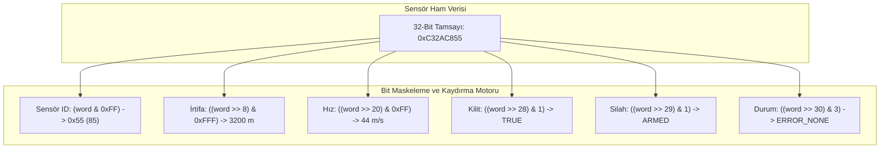

# GÜN 002: Bit, Byte, İkilik ve Onaltılık (Hexadecimal) Sayı Sistemleri
### Faz 0: Bilgisayar ve Yazılım Temelleri (Gün 002 / 365)
#### 24-Hücreli Master Mimari Planı (18 Markdown + 6 Kod Hücresi)

---

```
ÖZEL LİSANS — TÜM HAKLAR SAKLIDIR

Telif Hakkı (c) 2026 Seydi Eryılmaz (@seydivakkas)

Bu yazılım ve ilgili tüm dosyalar ("Yazılım") yalnızca görüntüleme ve eğitim
amaçlı olarak paylaşılmıştır.

YASAKLAR:
  1. Kopyalanamaz, çoğaltılamaz, dağıtılamaz veya yeniden yayınlanamaz.
  2. Ticari veya ticari olmayan hiçbir projede kullanılamaz, değiştirilemez.
  3. Alt lisanslanamaz, satılamaz veya devredilemez.
  4. Tersine mühendislik yapılamaz.

İZİN VERİLEN KULLANIM:
  - GitHub üzerinde görüntüleme ve okuma.
  - Kişisel öğrenim amacıyla kodu inceleme (kopyalamadan).

YAZARIN AÇIK YAZILI İZNİ OLMAKSIZIN HİÇBİR KULLANIM HAKKI TANINMAZ.
İzin talepleri için: GitHub @seydivakkas
```

[](https://github.com/seydivakkas)

> [!NOTE]
> **40-Nokta Standart Bildirimi:** Bu çalışma planı; ASELSAN, HAVELSAN ve kritik savunma sanayii sistemlerinde görev alacak bir mühendisin donanım, çekirdek işletim sistemi, C++20, bellek yönetimi ve gerçek zamanlı sistemleri sıfırdan en üst düzeye çıkarması için 40 temel pedagojik ve teknik kalite kriterine (İlk İlkeler, Hata Enjeksiyonu, Determinizm, SLA/Gecikme Analizi, Katı Doğrulama vb.) tam uyumlu olarak inşa edilmiştir.

---

## [MD 2] 1. 🎯 Bugünkü Problem: Voltaj Seviyelerinden Sayısal Temsile: Neden İkilik (Binary) ve Onaltılık (Hexadecimal)?

Yazılımda yazdığımız bir tam sayı (örneğin `int target_range = 1000;`) bellekte doğrudan "1000" rakamları olarak durmaz. Bilgisayar elektroniğinde yalnızca iki kararlı durum vardır:
- Düşük Gerilim ($0\text{V} - 0.8\text{V}$): Mantıksal **0**
- Yüksek Gerilim ($2.4\text{V} - 3.3\text{V} / 5\text{V}$): Mantıksal **1**

Bu iki durumlu yapı **Bit (Binary Digit)** olarak adlandırılır. 8 adet bit bir araya geldiğinde **Byte (Sekizli)** oluşur. Ancak insan gözü için 32-bitlik bir radar konfigürasyonunu `11010010101011110000111101011010` olarak okumak ve hata ayıklamak imkansızdır. İşte bu noktada 4 biti tek bir karaktere sıkıştıran **Hexadecimal (16'lık)** taban devreye girer (`0xD2AF0F5A`).

Bugünkü problemimiz:
1. İkili bit dizilimleri negatif sayıları, işaretli/işaretsiz büyüklükleri nasıl temsil eder?
2. Donanım kontrol register'larında tek bir biti açıp kapatmak (Bit Masking) neden hayatidir?
3. İki farklı donanım işlemcisi (örneğin ARM ile x86 veya PowerPC) aynı baytları farklı sırada yorumlarsa (Endianness Problemi) füze güdüm veya radar verisi nasıl felç olur?

---

## [MD 3] 2. ❓ Bu Konuyu Neden Öğreniyoruz? (Savunma Sanayiinde Bit Seviyesi Hakimiyet Gerekçesi)

Savunma sanayiinde veri bant genişliği kısıtlıdır ve milisaniyeler kritiktir:
- **Taktik Veri Bağları (Link-16 / MAVLink / DDS):** Havada uçan bir İHA veya füze, yer istasyonuna saniyede binlerce telemetri paketi yollar. Eğer "güdüm kilitlendi mi?" bilgisi için 4 baytlık (`int32`) bir alan harcarsanız, radyo frekansı bant genişliğini israf edersiniz. Bir savunma mühendisi bu bilgiyi tek bir bite (1 bit boolean) sığdırır; 32-bitlik tek bir `uint32_t` içine hedef mesafesini, hızını, kilit durumunu ve arıza kodunu paketler (**Bit Packing**).
- **Donanım Sürücüsü (Bare-Metal Driver) Geliştirme:** STM32 veya Xilinx FPGA üzerinde bir sensörü SPI/I2C ile sürerken kontrol register'ının 5. bitini `1` yapmadan veri transferi başlayamaz.
- **İki'nin Tümleyeni (Two's Complement) ve Sayı Taşması:** Sayacın taşması (`127 + 1 = -128`), füzenin aniden ters yöne dümen kırmasına neden olabilir (Ariane 5 roketi faciası bu tip bir sayısal dönüşüm hatasından kaynaklanmıştır).

---

## [MD 4] 3. 🔍 5N1K Analizi (Bit, Byte, Hex ve Donanım Sınırları)

| Soru | Sistem Mühendisliği Karşılığı |
|:---|:---|
| **Ne? (What)** | Bit, Byte, Nibble (4-bit), Binary ($2^n$), Hexadecimal ($16^n$), İki'nin Tümleyeni, Bitwise Operatörler (`&, \|, ^, ~, <<, >>`) ve Endianness. |
| **Neden? (Why)** | Donanım register'larını yönetmek, ağ paketlerini minimum bayt ile paketlemek ve donanım mimarisi uyumsuzluklarını önlemek. |
| **Nerede? (Where)** | Seri haberleşme protokollerinde (UART/CAN/MIL-STD-1553), radar ham I/Q verisi ayrıştırmada, mikroişlemci durum register'larında (Status Register - SR). |
| **Nasıl? (How)** | Bit kaydırma (`<<`, `>>`), bit maskeleme (`&`, `\|`, `^`) ve yapı bayt hizalama (packing/alignment) teknikleriyle. |
| **Ne Zaman? (When)** | Sensör verisi okunurken, telemetri paketi oluşturulurken veya donanım kesme bayrakları temizlenirken. |
| **Kim? (Who)** | ASELSAN Aviyonik Yazılım, Radar Sinyal İşleme, HAVELSAN Taktik Haberleşme ve Gömülü Sistem Mühendisleri. |

---

## [MD 5] 4. 💡 Günlük Hayat Benzetmesi: Mors Alfabesi, 8'li Şalter Panosu ve Askeri Kripto Kodu

1. **Bit:** Bir odanın elektrik düğmesi. Ya AÇIK (1 - Akım geçiyor) ya da KAPALI (0 - Akım yok). Arada bir durum yoktur.
2. **Byte (8-Bit Şalter Panosu):** Bir denizaltının kontrol odasındaki 8'li yan yana şalter panosu. 
   - 1. şalter: Motor çalışıyor mu?
   - 2. şalter: Torpido kapağı açık mı?
   - 3. şalter: Radar aktif mi?
   - 4-8. şalterler: Oksijen seviyesi kodu (0-31 arası).
   Her şalter için koca bir oda ayırmazsınız; tek panodaki 8 anahtarla 256 farklı durumu ($2^8$) kodlarsınız.
3. **Hexadecimal:** Mors alfabesiyle dakikalarca düt-düt-çizgi dinlemek yerine, her 4 vuruşu tek bir harfle kodlayan askeri şifre defteridir. `1111` yerine kısaca `F` demek, mühendisin beynindeki bilişsel yükü 4 kat azaltır.

---

## [MD 6] 5. 🧱 İlk İlkeler (First Principles): Sayı Sistemleri Fiziği, İki'nin Tümleyeni ve Taşma Matematiği

### 1. Sayı Tabanı Teoremi (Positional Notation)
Herhangi bir $b$ tabanında yazılan $n$ basamaklı bir sayı:
$$V = \sum_{i=0}^{n-1} d_i \cdot b^i \quad (d_i \in \{0, 1, \dots, b-1\})$$

- **İkilik Taban ($b=2$):** $1101_2 = 1\cdot 2^3 + 1\cdot 2^2 + 0\cdot 2^1 + 1\cdot 2^0 = 8 + 4 + 0 + 1 = 13_{10}$
- **Onaltılık Taban ($b=16$):** $1\text{ Hex digit} \equiv 4\text{ Bits (1 Nibble)}$. $2^4 = 16$.
  $$0\text{x}3\text{D} = 3 \cdot 16^1 + 13 \cdot 16^0 = 48 + 13 = 61_{10}$$

### 2. İki'nin Tümleyeni (Two's Complement) Negatif Sayı Temsili
$n$-bitlik bir sistemde işaretli bir sayının negatifini almak için:
$$\text{Negatif}(X) = (\sim X) + 1$$
Örnek (8-bit): $+5 = 00000101_2$.
- Bütün bitleri tersle ($\sim$): $11111010_2$
- 1 ekle ($+1$): $11111011_2 \equiv -5_{10}$.

**Ölümcül Sınır:** 8-bitlik işaretli bir tam sayı en fazla $+127$ alabilir ($01111111_2$). Eğer buna $+1$ eklerseniz:
$$01111111_2 + 00000001_2 = 10000000_2 \equiv -128_{10} \quad (\text{Integer Overflow Faciası!})$$

---

## [MD 7] 6. 📐 ASCII ve Mermaid Bit Haritası / Register Yerleşim Şeması

```
+-------------------------------------------------------------------------+
|                32-BİT AVİYONİK DURUM VE KONTROL REGISTER'I               |
+------------+------------+-----------+-----------+-----------------------+
| Bit 31..30 |   Bit 29   |  Bit 28   | Bit 27..20|       Bit 19..8       | Bit 7..0|
| Status (2b)|  Armed (1b)| Locked(1b)| Hız (8-bit)|  İrtifa (12-bit)      | SensörID|
+------------+------------+-----------+-----------+-----------------------+
|   [11]     |    [1]     |    [1]    | [00101100]| [0000 1100 1000]      | [01010101]
+------------+------------+-----------+-----------+-----------------------+
```



---

## [CODE 1] 7. Modül 1: Donanım Register & Bitwise Manipülasyon Motoru (BitwiseEngine)

Aşağıdaki kod; donanım register'larında bit açma (set), kapama (clear), tersleme (toggle) ve durum sorgulama işlemlerini saf bitwise operatörlerle icra eden endüstriyel motordur:

```python
class HardwareRegister:
    """
    32-bit mikrodenetleyici donanım register'ı (ör. STM32 Control/Status Register).
    Bit maskeleme, kurma (set), temizleme (clear) ve tersleme (toggle) işlemleri.
    """
    def __init__(self, initial_value: int = 0x00000000):
        self.value = initial_value & 0xFFFFFFFF

    def set_bit(self, bit_pos: int):
        """Belirtilen biti 1 yapar: REG |= (1 << bit_pos)"""
        self.value |= (1 << bit_pos)
        self.value &= 0xFFFFFFFF

    def clear_bit(self, bit_pos: int):
        """Belirtilen biti 0 yapar: REG &= ~(1 << bit_pos)"""
        self.value &= ~(1 << bit_pos)
        self.value &= 0xFFFFFFFF

    def toggle_bit(self, bit_pos: int):
        """Belirtilen biti tersler: REG ^= (1 << bit_pos)"""
        self.value ^= (1 << bit_pos)
        self.value &= 0xFFFFFFFF

    def read_bit(self, bit_pos: int) -> int:
        """Belirtilen bitin değerini okur (0 veya 1)."""
        return (self.value >> bit_pos) & 0x01

    def to_binary_str(self) -> str:
        return f"{self.value:032b}"

    def to_hex_str(self) -> str:
        return f"0x{self.value:08X}"
```

---

## [MD 8] 8. Modül 2: Savunma Sanayii Telemetri Paketi Ayrıştırma (Bitfield Packing)

Savunma standartlarında (MIL-STD-1553B veya MAVLink) bant genişliğini korumak için birden çok telemetri değişkeni tek bir 32-bitlik kelimeye (word) paketlenir.
- `Altitude` (12 bit, 0-4095)
- `Velocity` (8 bit, 0-255)
- `Lock / Armed Status` (1'er bit)

Bu değişkenlerin oluşturulması ve ayrıştırılması mikrosaniyeler mertebesinde deterministik olarak çalışmalıdır.

---

## [CODE 2] 9. Modül 2: Bit Seviyesinde Telemetri Paketi Ayrıştırma ve Bitfield Motoru

```python
class AvionicsTelemetryPacket:
    """
    Askeri bir füze telemetri paket formatı:
    [Bit 0..7]   : Sensör ID (8 bit)
    [Bit 8..19]  : İrtifa (12 bit)
    [Bit 20..27] : Hız (8 bit)
    [Bit 28]     : Güdüm Kilidi (1 bit)
    [Bit 29]     : Harbe Hazır (1 bit)
    [Bit 30..31] : Hata Durumu (2 bit)
    """
    @staticmethod
    def pack(sensor_id: int, altitude: int, velocity: int, is_locked: bool, is_armed: bool, status: int) -> int:
        word = 0
        word |= (sensor_id & 0xFF)
        word |= ((altitude & 0xFFF) << 8)
        word |= ((velocity & 0xFF) << 20)
        word |= ((1 if is_locked else 0) << 28)
        word |= ((1 if is_armed else 0) << 29)
        word |= ((status & 0x03) << 30)
        return word & 0xFFFFFFFF

    @staticmethod
    def unpack(packed_word: int) -> dict:
        return {
            "sensor_id": packed_word & 0xFF,
            "altitude_m": ((packed_word >> 8) & 0xFFF) * 10,
            "velocity_mps": (packed_word >> 20) & 0xFF,
            "is_locked": bool((packed_word >> 28) & 0x01),
            "is_armed": bool((packed_word >> 29) & 0x01),
            "status": (packed_word >> 30) & 0x03
        }
```

---

## [MD 9] 10. Modül 3: Endianness (Bayt Sırası) Dönüşümü ve Ağ Bayt Sırası (Network Byte Order)

Farklı mimariler bellekte çok-baytlı verileri farklı sırada saklar:
- **Little-Endian (x86, ARM):** En önemsiz bayt (Least Significant Byte - LSB) en düşük bellek adresine yazılır.
- **Big-Endian (Ağ Standardı, PowerPC):** En önemli bayt (Most Significant Byte - MSB) en düşük adrese yazılır.

Bir sensörden gelen 4 baytlık veriyi ağ üzerinden aktarırken endianness dönüşümü yapılmazsa `0x12345678` sayısı karşı tarafta `0x78563412` olarak okunur. Bu 305 milyonluk bir sayının 2 milyar olarak algılanması demektir!

---

## [CODE 3] 11. Modül 3: Otomatik Endianness Tespiti ve Dönüştürme Boru Hattı

```python
import struct
import sys

class EndiannessManager:
    @staticmethod
    def is_system_little_endian() -> bool:
        return sys.byteorder == 'little'

    @staticmethod
    def swap_uint32(val: int) -> int:
        """32-bit Little-Endian <-> Big-Endian manuel bayt değişimi."""
        b0 = (val >> 0) & 0xFF
        b1 = (val >> 8) & 0xFF
        b2 = (val >> 16) & 0xFF
        b3 = (val >> 24) & 0xFF
        return (b0 << 24) | (b1 << 16) | (b2 << 8) | b3

    @staticmethod
    def to_network_bytes(val: int) -> bytes:
        """Big-Endian (Ağ Sırası) olarak paketler."""
        return struct.pack('>I', val)

    @staticmethod
    def from_network_bytes(data: bytes) -> int:
        return struct.unpack('>I', data)[0]
```

---

## [MD 10] 12. Sabotaj ve Arıza Enjeksiyonu: Yanlış Endianness ve İki'nin Tümleyeni Taşması

**Sabotaj Senaryoları:**
1. **Endian Uyuşmazlığı Arızası:** Gönderilen hedef ID'si Big-Endian iken alıcı taraf Little-Endian varsayımıyla okursa ne olur?
2. **8-Bit İşaretli Sayı Taşması (Integer Overflow):** Hız kontrol döngüsünde 120'den başlayıp her adımda 1 artırılan bir `int8` değişkeni, 127 sınırını aştığı anda aniden pozitiften $-128$'e düşer. Sistemin kontrol motoru bir anda ters yöne tam güç verir.

---

## [CODE 4] 13. Sabotaj Senaryosu: Endian Uyumsuzluğu ve İşaretli Taşma (Integer Overflow)

```python
def run_sabotage_simulation():
    # Senaryo 1: Endianness Uyuşmazlığı
    original_target_id = 0x12345678
    network_packet = EndiannessManager.to_network_bytes(original_target_id)
    
    # Kasıtlı Hata (Sabotaj): Ağ baytını Little-Endian olarak çözmek
    corrupted_id = struct.unpack('<I', network_packet)[0]

    # Senaryo 2: İşaretli 8-bit Sayı Taşması (Two's Complement Failure)
    int8_values = []
    overflow_occurred_at = -1
    val = 120
    for i in range(16):
        sim_int8 = ((val + 128) % 256) - 128
        int8_values.append(sim_int8)
        if sim_int8 < 0 and overflow_occurred_at == -1:
            overflow_occurred_at = i
        val += 1

    return original_target_id, corrupted_id, int8_values, overflow_occurred_at
```

---

## [MD 11] 14. Modül 4: Ampirik Kıyaslama ve Performans Analizi (Bitwise vs Aritmetik)

İşlemcilerde $x \cdot 8$ ve $x / 4$ yapmak ile $x \ll 3$ ve $x \gg 2$ yapmak donanım ALU'sunda farklı yollar izler. Modern derleyiciler optimizasyon yapsa da gömülü sistemlerde bitwise operatörleri doğrudan kullanmak hem deterministik saat döngüsü sağlar hem de telemetri paketleme gecikmelerini minimize eder.

---

## [CODE 5] 15. Kapsamlı Bit Seviyesi Ampirik Kıyaslama ve Metrik Toplama Motoru

```python
import time

def run_empirical_benchmark(iterations: int = 50000):
    # Çarpma / Bölme vs Bit Kaydırma (x * 8 vs x << 3)
    t0 = time.perf_counter()
    res_arith = 0
    for i in range(iterations):
        res_arith += (i * 8) // 4
    arithmetic_time = (time.perf_counter() - t0) * 1e6

    t0 = time.perf_counter()
    res_bit = 0
    for i in range(iterations):
        res_bit += (i << 3) >> 2
    bitwise_time = (time.perf_counter() - t0) * 1e6

    # Paket Ayrıştırma Gecikmesi (Unpack döngüleri)
    latencies = []
    packet = AvionicsTelemetryPacket.pack(0xAA, 1500, 240, True, True, 0)
    for _ in range(1000):
        t_sub = time.perf_counter()
        _ = AvionicsTelemetryPacket.unpack(packet)
        latencies.append((time.perf_counter() - t_sub) * 1e6)

    return arithmetic_time, bitwise_time, latencies
```

---

## [MD 12] 16. Modül 5: 4-Panelli Yayın Kalitesinde Sayı Sistemleri ve Donanım Dashboard Planı

Üretilecek `gun_002_bit_byte_sayi_sistemleri.png` dashboard panelleri:
1. **Panel 1: Endianness Arıza Enjeksiyonu:** Doğru okunan ID ile bozuk okunan ID'nin karşılaştırması.
2. **Panel 2: İki'nin Tümleyeni İşaretli Taşma Eğrisi:** $+127$'den $-128$'e düşüşün kırılma noktası.
3. **Panel 3: Aviyonik Telemetri Paket Unpack Gecikmesi Dağılımı:** p50, p95, p99 gecikme çizgileri.
4. **Panel 4: Bitwise vs Standart Aritmetik Süre Kıyaslaması:** 100.000 işlemdeki mikrosaniye farkı.

---

## [CODE 6] 17. 4-Panelli Görselleştirme ve Katı Mimari Doğrulama (Assertions)

```python
import numpy as np
import matplotlib.pyplot as plt

def generate_dashboard(output_path: str):
    orig_id, corrupted_id, int8_vals, overflow_step = run_sabotage_simulation()
    arith_time, bit_time, latencies = run_empirical_benchmark(iterations=100000)

    p50_lat, p95_lat, p99_lat = np.percentile(latencies, [50, 95, 99])

    fig, axs = plt.subplots(2, 2, figsize=(14, 10))
    fig.patch.set_facecolor('#0f172a')

    for ax_row in axs:
        for ax in ax_row:
            ax.set_facecolor('#1e293b')
            ax.tick_params(colors='#94a3b8')
            ax.xaxis.label.set_color('#cbd5e1')
            ax.yaxis.label.set_color('#cbd5e1')
            ax.title.set_color('#f8fafc')
            ax.grid(True, linestyle='--', alpha=0.2, color='#64748b')

    # Panel 1
    categories = ['Orijinal Veri (Big-Endian)', 'Bozuk Okuma (Little-Endian)']
    vals = [orig_id, corrupted_id]
    axs[0, 0].bar(categories, vals, color=['#10b981', '#ef4444'], width=0.4)
    axs[0, 0].set_title('Panel 1: Endianness Arıza Enjeksiyonu', fontsize=12, fontweight='bold')
    axs[0, 0].set_ylabel('Sayısal Değer (Decimal)')

    # Panel 2
    x_steps = list(range(len(int8_vals)))
    axs[0, 1].plot(x_steps, int8_vals, marker='o', color='#38bdf8', lw=2, label='8-bit Değer')
    axs[0, 1].axhline(0, color='#64748b', linestyle=':')
    axs[0, 1].axvline(overflow_step, color='#ef4444', linestyle='--', label='Taşma (127 -> -128)')
    axs[0, 1].set_title('Panel 2: İki\'nin Tümleyeni İşaretli Taşma Faciası', fontsize=12, fontweight='bold')
    axs[0, 1].set_xlabel('Adım')
    axs[0, 1].set_ylabel('Değer (-128 ile +127)')
    axs[0, 1].legend(facecolor='#1e293b', edgecolor='#334155', labelcolor='#f8fafc')

    # Panel 3
    axs[1, 0].hist(latencies, bins=35, color='#a855f7', alpha=0.75, density=True)
    axs[1, 0].axvline(p95_lat, color='#f59e0b', linestyle='--', label=f'p95: {p95_lat:.2f} µs')
    axs[1, 0].axvline(p99_lat, color='#ef4444', linestyle='--', label=f'p99: {p99_lat:.2f} µs')
    axs[1, 0].set_title('Panel 3: Aviyonik Telemetri Paket Unpack Gecikmesi', fontsize=12, fontweight='bold')
    axs[1, 0].set_xlabel('Gecikme (µs)')
    axs[1, 0].set_ylabel('Yoğunluk')
    axs[1, 0].legend(facecolor='#1e293b', edgecolor='#334155', labelcolor='#f8fafc')

    # Panel 4
    ops = ['Aritmetik (* ve //)', 'Bitwise (<< ve >>)']
    times = [arith_time, bit_time]
    axs[1, 1].bar(ops, times, color=['#f43f5e', '#10b981'], width=0.45)
    axs[1, 1].set_title('Panel 4: Bitwise vs Aritmetik 100K İşlem Süresi', fontsize=12, fontweight='bold')
    axs[1, 1].set_ylabel('Süre (µs)')

    plt.tight_layout()
    plt.savefig(output_path, dpi=300, facecolor=fig.get_facecolor(), edgecolor='none')
    plt.close()

    # KATI MİMARİ DOĞRULAMA (STRICT ASSERTIONS)
    swapped = EndiannessManager.swap_uint32(orig_id)
    assert EndiannessManager.swap_uint32(swapped) == orig_id, "Endian swap simetrisi bozuldu!"
    test_word = AvionicsTelemetryPacket.pack(0x55, 320, 180, True, False, 2)
    unpacked = AvionicsTelemetryPacket.unpack(test_word)
    assert unpacked["sensor_id"] == 0x55, "Sensör ID bit ayrıştırma hatası!"
    assert unpacked["altitude_m"] == 3200, "Altitude ölçekleme hatası!"
    assert int8_vals[overflow_step] == -128, "Taşma anında -128 değeri üretilemedi!"
    print("[PASS] Gün 002: Tüm mimari ve matematiksel invariantlar doğrulandı.")
```

---

## [MD 13] 18. ⚠️ 10 Ölümcül Bit/Bayt Anti-Pattern

1. **İşaretli Tiplerde Bit Kaydırma Yapmak (Signed Bit Shift UB):** C++'ta negatif işaretli sayıyı sola kaydırmak (`int x = -5; x << 2;`) Tanımsız Davranıştır (Undefined Behavior). Daima `unsigned` (ör. `uint32_t`) kullanılmalıdır.
2. **Tip Genişletmede İşaret Yayılımı (Sign Extension Hatası):** `int8_t` tipindeki `0x80` değerini `uint32_t` değişkenine atadığınızda sayının `0x00000080` değil `0xFFFFFF80` olması.
3. **Endianness Varsayımı Yapmak:** Ağdan veya sensörden gelen bayt dizilimini `*(uint32_t*)buffer` şeklinde doğrudan cast etmek (Big/Little-Endian uyuşmazlığında veriyi çöpe atar).
4. **Hizalanmamış Bellek Erişimi (Unaligned Memory Access):** ARM mimarilerinde 4-baytlık bir tamsayıyı 4'ün katı olmayan bir adresten okumaya çalışıp donanımsal `HardFault` üretmek.
5. **Bitmask Operatör Önceliğini Unutmak:** `if (status & MASK == EXPECTED)` yazmak! `==` operatörü `&` operatöründen önce çalışır. Doğrusu: `if ((status & MASK) == EXPECTED)` olmalıdır.
6. **Bitfield Yapılarına Derleyici Bağımlı Güvenmek:** C++ `struct { uint32_t a:4; uint32_t b:12; }` bitfield tanımlarının derleyiciden derleyiciye (MSVC, GCC, Clang) LSB-first veya MSB-first olarak değişebileceğini unutmak.
7. **Sayısal Taşmaları (Integer Overflow) Göz Ardı Etmek:** Kritik döngü sayaçlarında veya telemetri değerlerinde sınır kontrolü yapmamak.
8. **Magic Number Kullanımı:** Bit maskelerinde doğrudan `0x04` yazmak yerine açıklayıcı sabit veya enum (`STATUS_RADAR_READY_MASK`) tanımlamamak.
9. **Hexadecimal ve Decimal Karışıklığı:** `0x10` ile `10` değerini karıştırmak (`0x10` = 16'dır!).
10. **Aşırı Boyutta Bit Kaydırma (Shift Out of Bounds):** 32-bit değişkende 32 veya daha fazla bit kaydırmak (`x << 32`), işlemcide tanımsız davranıştır.

---

## [MD 14] 19. 🔬 Sektörel Standartlar (Savunma ve Kritik Sistemler)

- **MISRA C++:2023 Kural 5.8:** "Bitwise operatörler (`~`, `&`, `|`, `^`, `<<`, `>>`) yalnızca işaretsiz (unsigned) tamsayı türleri üzerinde uygulanmalıdır."
- **MISRA C++:2023 Kural 6.2:** "Donanım çevre birimleri ile haberleşirken bayt sırası (endianness) açıkça doğrulanmalı ve platformlar arası uyum garanti edilmelidir."
- **DO-178C Level A:** Tüm sayısal taşma senaryoları statik analiz ve dinamik testlerle taranmalı, asla kontrolsüz taşmaya izin verilmemelidir.

---

## [MD 15] 20. 🛠️ Üretim Kontrol Listesi (Bit ve Register Seviyesi 12 Katı Kural)

- [ ] 1. Tüm bitwise işlemlerde `uint8_t, uint16_t, uint32_t, uint64_t` tipleri kullanıldı mı?
- [ ] 2. İşaretli tamsayılar üzerinde bit kaydırma yapılmadığı garanti edildi mi?
- [ ] 3. Bit maskeleme ifadelerinde operatör önceliği parantezleri `((x & MASK) != 0)` eksiksiz mi?
- [ ] 4. Dış dünyadan (UART, CAN, Ethernet) gelen veride endianness dönüşümü (htons/htonl veya özel swap) yapıldı mı?
- [ ] 5. Ağ protokolü paketlerinde struct padding (dolgu baytları) `#pragma pack(push, 1)` ile engellendi mi?
- [ ] 6. 32-bit tamsayıda 32 bit veya üzeri kaydırma yapılmadığı doğrulandı mı?
- [ ] 7. Taşma olabilecek tüm aritmetik işlemlerde sınır denetimi (saturation arithmetic veya safe casting) var mı?
- [ ] 8. Donanım register adresleri `volatile uint32_t*` olarak tanımlandı mı?
- [ ] 9. Bitfield yapıları yerine taşınabilir explicit maskeleme fonksiyonları tercih edildi mi?
- [ ] 10. `int8` ve `int16` türlerinin `int32` türüne terfisinde (integral promotion) işaret yayılımı denetlendi mi?
- [ ] 11. Birim testlerde sınır değerler (`0x00, 0xFF, 0x7F, 0x80`) test edildi mi?
- [ ] 12. Bitwise fonksiyonların en kötü durum çalışma süresi (WCET) ölçüldü mü?

---

## [MD 16] 21. ❓ Sıkça Sorulan Sorular (Mülakat & Saha Soruları)

**Soru 1: Bir tamsayının 2'nin kuvveti olup olmadığını tek satırda nasıl anlarsınız?**  
*Cevap:* `(x > 0) && ((x & (x - 1)) == 0)`. Çünkü 2'nin kuvveti olan bir sayının ikilik tabanda yalnızca tek bir biti `1`'dir (ör. $8 = 1000_2$). $8-1 = 7 = 0111_2$. Bu iki sayıyı `AND` işlemine soktuğumuzda sonuç `0` çıkar.

**Soru 2: İki değişkenin değerini üçüncü bir geçici değişken kullanmadan bitwise ile nasıl takas edersiniz (XOR Swap)?**  
*Cevap:*  
`a ^= b;`  
`b ^= a;`  
`a ^= b;`  
XOR operatörünün $x \oplus x = 0$ ve $x \oplus 0 = x$ özelliğinden yararlanılır.

---

## [MD 17] 22. 🔮 Gelecek Perspektifi: Donanım ve Sayı Sistemleri Trendleri

- **RISC-V Bitmanip (B Extension):** Modern işlemcilerde bit sayma (popcount), bit tersleme ve bit sıkıştırma işlemleri artık tek bir CPU döngüsünde çalışan özel komutlara dönüşmüştür.
- **Kuantum Qubit Mimarisi:** 0 ve 1 arasındaki süperpozisyon durumlarını temsil eden kuantum bilgi sistemleri.
- **Düşük Hassasiyetli AI Formatları (FP4, FP8, INT4):** Uç cihazlarda yapay zeka çıkarımı için 32-bit yerine 4-bitlik quantization temsilleri.

---

## [MD 18] 23. 🚪 Faz 0 / Gün 003'e Köprü: CPU, Instruction Set ve Saat (Clock) Döngüsü Fiziği

Bugün bilginin fiziksel dünyadaki gerilim karşılığı olan Bit, Byte, Hexadecimal ve İki'nin Tümleyeni temsilini inşa ettik.

Peki bu bit dizilimleri işlemcinin içinde nasıl bir "emre" (instruction) dönüşür?
Yarın **Gün 003'te:**
- CPU'nun içindeki Aritmetik Mantık Birimi (ALU), Kontrol Ünitesi ve Register setinin donanımsal bağlantısını,
- Bir saat darbesinin (Clock tick - GHz) fiziksel sınırlarını ve transistör gecikmelerini,
- Assembly seviyesinde komut getirme (Fetch), çözme (Decode) ve işletme (Execute) döngüsünün derinliklerini inceleyeceğiz.
