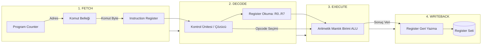

# GÜN 003: CPU Mimarisi, Komut Seti (Instruction Set) ve Saat (Clock) Fiziği
### Faz 0: Bilgisayar ve Yazılım Temelleri (Gün 003 / 365)
#### 24-Hücreli Master Mimari Planı (18 Markdown + 6 Kod Hücresi)

---

```
ÖZEL LİSANS — TÜM HAKLAR SAKLIDIR

Telif Hakkı (c) 2026 Seydi Eryılmaz (@seydivakkas)

Bu yazılım ve ilgili tüm dosyalar ("Yazılım") yalnızca görüntüleme ve eğitim
amaçlı olarak paylaşılmıştır.

YASAKLAR:
  1. Kopyalanamaz, çoğaltılamaz, dağıtılamaz veya yeniden yayınlanamaz.
  2. Ticari veya ticari olmayan hiçbir projede kullanılamaz, değiştirilemez.
  3. Alt lisanslanamaz, satılamaz veya devredilemez.
  4. Tersine mühendislik yapılamaz.

İZİN VERİLEN KULLANIM:
  - GitHub üzerinde görüntüleme ve okuma.
  - Kişisel öğrenim amacıyla kodu inceleme (kopyalamadan).

YAZARIN AÇIK YAZILI İZNİ OLMAKSIZIN HİÇBİR KULLANIM HAKKI TANINMAZ.
İzin talepleri için: GitHub @seydivakkas
```

[](https://github.com/seydivakkas)

> [!NOTE]
> **40-Nokta Standart Bildirimi:** Bu çalışma planı; ASELSAN, HAVELSAN ve kritik savunma sanayii sistemlerinde görev alacak bir mühendisin donanım, çekirdek işletim sistemi, C++20, bellek yönetimi ve gerçek zamanlı sistemleri sıfırdan en üst düzeye çıkarması için 40 temel pedagojik ve teknik kalite kriterine (İlk İlkeler, Hata Enjeksiyonu, Determinizm, SLA/Gecikme Analizi, Katı Doğrulama vb.) tam uyumlu olarak inşa edilmiştir.

---

## [MD 2] 1. 🎯 Bugünkü Problem: 3 GHz İşlemci Her İşi Neden 0.33 Nanosaniyede Bitiremez?

Yazılım geliştiriciler işlemci frekansını görünce (örneğin 3 GHz veya STM32 için 168 MHz) her komutun bir saat vuruşunda ($T_{clk} = 1 / 3\text{ GHz} \approx 0.33\text{ ns}$) biteceğini zanneder. 

Fakat gerçek dünyada:
1. Bir C++ satırı (`a = b + c;`) derlendiğinde tek bir makine komutuna değil; belleğe erişen, register'a yükleyen ve ALU'da toplayan birden fazla mikro-işleme ayrışır.
2. İşlemci bir komutu çalıştırırken ardışık adımlardan geçer:
   - **Fetch (Getir):** Komutu bellekten/önbellekten oku.
   - **Decode (Çöz):** Komutun ne yapmak istediğini (toplama mı, dallanma mı) anla.
   - **Execute (Çalıştır):** ALU içinde transistörlerin durum değiştirmesini bekle.
   - **Memory/Writeback (Yaz):** Sonucu register veya RAM'e yaz.
3. **Pipeline Çökmesi (Stall):** Eğer bir komut kendisinden bir önceki komutun üreteceği sonuca bağımlıysa (Read-After-Write Data Hazard), işlemci boş saat döngüleri (NOP bubble) üreterek beklemek zorunda kalır.

Bugünkü problemimiz: **İşlemcinin saat darbesi fiziğini, komut döngüsü adımlarını ve pipeline tıkanmalarını kavrayarak; gerçek zamanlı görevlerin (Real-Time Deadlines) neden geciktiğini ve saat döngülerinin nasıl optimize edileceğini ilk ilkelerle çözmektir.**

---

## [MD 3] 2. ❓ Bu Konuyu Neden Öğreniyoruz? (Kritik Sistemlerde Determinizm ve WCET Gerekçesi)

Bir hava savunma füzesinin güdüm bilgisayarında veya bir savaş uçağının uçuş kontrol sisteminde (Fly-by-Wire):
- **En Kötü Durum Yürütme Süresi (WCET - Worst-Case Execution Time):** Sistemin ortalama kaç saat döngüsü harcadığı önemsizdir; en kötü senaryoda (tüm pipeline tıkanmaları, önbellek kaçırmaları ve dallanma yanlışları varken) fonksiyonun kaç döngü süreceği hayati önem taşır.
- **Watchdog Timer (Bekçi Köpeği Zamanlayıcısı):** Eğer bir kontrol döngüsü saat frekansı yavaşlaması (thermal throttling) veya pipeline kilitlenmesi yüzünden belirlenen sürede (örneğin 2 ms) tamamlanamazsa, donanımsal Watchdog sistemi sıfırlar (Reset). Uçuş ortasında atılan bir reset ise sistemin kaybı demektir.
- Bu konuyu öğreniyoruz çünkü C++ kodundaki döngülerin, koşullu dallanmaların (`if/else`) ve fonksiyon çağrılarının donanımdaki saat döngüsü maliyetini bilmeyen bir mühendis, deterministik gerçek zamanlı yazılım üretemez.

---

## [MD 4] 3. 🔍 5N1K Analizi (Fetch-Decode-Execute, Saat Frekansı ve Pipeline)

| Soru | Sistem Mühendisliği Karşılığı |
|:---|:---|
| **Ne? (What)** | CPU saat darbesi ($T_{clk}$), komut çevrimi (Fetch-Decode-Execute-Writeback), Komut Başına Saat Sayısı (CPI - Cycles Per Instruction) ve Boru Hattı (Pipelining). |
| **Neden? (Why)** | Yazılımın donanım üzerinde deterministik sürede koşmasını sağlamak ve işlemci donanımını maksimum verimle (%100 Pipeline doluluğu) kullanmak. |
| **Nerede? (Where)** | ARM Cortex-M/R/A çekirdeklerinde, RISC-V işlemcilerde, DSP yongalarında ve x86 görev bilgisayarlarında. |
| **Nasıl? (How)** | Komutları montaj hattı gibi aşamalara bölerek (pipelining), veri bağımlılıklarını önceden sezerek (forwarding) ve gereksiz dallanmaları önleyerek. |
| **Ne Zaman? (When)** | İşlemciye enerji verildiği andan itibaren her yükselen saat kenarında (Rising Edge of Clock). |
| **Kim? (Who)** | ASELSAN Aviyonik Mimarları, Gömülü Gerçek Zamanlı Sistem Mühendisleri ve Güdüm-Kontrol Algoritma Geliştiricileri. |

---

## [MD 5] 4. 💡 Günlük Hayat Benzetmesi: Otomobil Montaj Fabrikası (Pipeline) ve Orkestra Metronomu

1. **Saat Darbesi (Clock Tick):** Bir orkestranın metronomudur. Tüm müzisyenler (transistörler ve flip-flop'lar) aynı tempoda vuruş yapar. Metronomu transistörlerin fiziksel hızından daha hızlı çalıştırırsanız sesler birbirine girer (Zamanlama Hatası / Timing Violation).
2. **Pipelining (Boru Hattı):** Bir otomobil fabrikası düşünün. 4 istasyon var:
   - İstasyon 1: Şasi montajı (Fetch)
   - İstasyon 2: Motor yerleşimi (Decode)
   - İstasyon 3: Tekerlek takımı (Execute)
   - İstasyon 4: Boya ve test (Writeback)
   Eğer tek döngülü çalışsaydınız, bir arabanın 4 aşaması tamamen bitene kadar yeni araba alamazdınız (Üretim: 4 saatte 1 araba). Boru hattında ise her saat başı içeri yeni bir araba girer; hat bir kez dolduktan sonra **her saatte 1 araba** banttan çıkar ($CPI \approx 1$).
3. **Pipeline Stall (Boru Hattı Tıkanması):** 3. istasyonun takacağı tekerlekler henüz tedarik edilmemişse (Veri Bağımlılığı), tüm fabrika bandı durur ve işçiler boş bekler (Stall / NOP Bubble).

---

## [MD 6] 5. 🧱 İlk İlkeler (First Principles): Saat Fiziği, Kritik Yol Gecikmesi ve CPU Yürütme Denklemi

### 1. Saat Periyodu ve Frekans Bağıntısı
İşlemcinin saat frekansı $f$ ise, iki saat darbesi arasındaki süre (Saat Periyodu $T_{clk}$):
$$T_{clk} = \frac{1}{f}$$
Örnek:
- $168\text{ MHz}$ (STM32F4): $T_{clk} = \frac{1}{168 \times 10^6} \approx 5.95\text{ ns}$
- $1\text{ GHz}$: $T_{clk} = 1.0\text{ ns}$
- $3\text{ GHz}$: $T_{clk} \approx 0.333\text{ ns}$

### 2. Kritik Yol Fiziği (Critical Path & Setup Time)
Bir saat döngüsünde bilginin bir flip-flop'tan çıkıp mantık kapılarından (AND, OR, ALU) geçerek bir sonraki flip-flop'a kaydedilebilmesi için fiziksel kural:
$$t_{clk\text{-to-}q} + t_{logic\text{-delay}} + t_{setup} \le T_{clk}$$
Eğer saat periyodu $T_{clk}$, elektrik sinyalinin transistörler arasındaki seyahat süresinden ($t_{logic}$) küçük seçilirse **Metastability** ve veri bozulması oluşur. Frekansı sonsuza kadar artıramamamızın temel fiziksel sebebi budur!

### 3. Klasik CPU Yürütme Denklemi (Iron Law of Processor Performance)
Bir programın toplam çalışma süresi:
$$T_{exe} = N_{inst} \times \text{CPI} \times T_{clk}$$
Burada:
- $N_{inst}$: Çalıştırılan toplam komut sayısı (Instruction Count).
- $\text{CPI}$: Komut başına düşen ortalama saat döngüsü (Cycles Per Instruction).
- $T_{clk}$: Bir saat döngüsünün süresi.

---

## [MD 7] 6. 📐 ASCII ve Mermaid 4-Aşamalı CPU Pipeline ve Kontrol Ünitesi Şeması

```
+---------------------------------------------------------------------------------+
|                       4-AŞAMALI CPU PİPELİNE MİMARİSİ                           |
+-------------------+--------------------+-------------------+--------------------+
|  AŞAMA 1: FETCH   |  AŞAMA 2: DECODE   | AŞAMA 3: EXECUTE  | AŞAMA 4: WRITEBACK |
| [Program Counter] | [Komut Çözücü]     | [ALU / Toplayıcı] | [Register Seti]    |
|   PC -> RAM oku   |  Opcode, Kaynaklar | Mantık/Aritmetik  | Sonucu Hedefe Yaz  |
+-------------------+--------------------+-------------------+--------------------+
         |                   |                    |                    |
         +==== Saat Kenarı ==+==== Saat Kenarı ===+==== Saat Kenarı ===+
```



---

## [CODE 1] 7. Modül 1: 4-Aşamalı CPU Döngüsü Emülatörü (SimpleCPU)

Aşağıdaki kod; komut getirme (Fetch), çözme (Decode), çalıştırma (Execute) ve geri yazma (Writeback) aşamalarını birebir modelleyen çalışan bir çekirdek makinedir:

```python
from dataclasses import dataclass
from typing import List, Optional

@dataclass
class Instruction:
    opcode: str      # 'ADD', 'SUB', 'LOAD', 'STORE', 'NOP'
    dest: int        # R0..R7
    src1: int        # R0..R7 veya imm
    src2: int = 0    # R0..R7 veya imm
    is_imm: bool = False

class SimpleCPU:
    """
    Klasik RISC benzeri 4 aşamalı komut çevrimi simülatörü.
    """
    def __init__(self, mem_size: int = 256):
        self.registers = [0] * 8
        self.memory = [0] * mem_size
        self.pc = 0
        self.clock_cycles = 0
        self.instructions_retired = 0

    def step(self, program: List[Instruction]) -> Optional[str]:
        if self.pc >= len(program):
            return None
        
        # 1. FETCH
        inst = program[self.pc]
        self.pc += 1
        self.clock_cycles += 1
        
        # 2. DECODE & 3. EXECUTE
        val1 = inst.src1 if inst.is_imm else self.registers[inst.src1]
        val2 = inst.src2 if inst.is_imm else self.registers[inst.src2]
        
        res = 0
        if inst.opcode == 'ADD':
            res = val1 + val2
        elif inst.opcode == 'SUB':
            res = val1 - val2
        elif inst.opcode == 'LOAD':
            res = self.memory[val1 % len(self.memory)]
        elif inst.opcode == 'STORE':
            self.memory[val1 % len(self.memory)] = self.registers[inst.dest]
            res = None
        elif inst.opcode == 'NOP':
            res = None
            
        # 4. WRITEBACK
        if res is not None and inst.opcode not in ('STORE', 'NOP'):
            self.registers[inst.dest] = res & 0xFFFFFFFF
            
        self.instructions_retired += 1
        return f"Cycle {self.clock_cycles}: {inst.opcode} -> R{inst.dest}={self.registers[inst.dest]}"
```

---

## [MD 8] 8. Modül 2: Pipeline Tehlikeleri (Data Hazard) ve İleri Besleme (Forwarding)

İşlemcide arka arkaya gelen iki komut şu şekilde olduğunda:
```assembly
ADD R1, R2, R3   ; R1 = R2 + R3  (Sonuç 4. aşamada yazılacak)
SUB R4, R1, R5   ; R4 = R1 - R5  (R1 hemen 2. aşamada okunmak isteniyor!)
```
İkinci komut, birinci komutun sonucunu beklemeden çalışırsa bayat veri okur (**Read-After-Write - RAW Hazard**).
- **Çözüm 1 (Stall):** Donanım araya 2 döngülük NOP boşluğu sokar (Bant yavaşlar, CPI yükselir).
- **Çözüm 2 (Forwarding / Bypassing):** ALU sonucunu henüz register'a yazılmadan doğrudan bir sonraki komutun ALU girişine bağlayan donanımsal baypas yolu kurulur.

---

## [CODE 2] 9. Modül 2: Pipelined CPU Simülasyonu ve Stall/Forwarding Mekanizması

```python
from typing import List, Dict

class PipelinedCPUSimulator:
    """
    4 aşamalı Pipeline simülasyonu.
    RAW Data Hazard tespit eder ve Stall döngüleri enjekte eder.
    """
    def __init__(self):
        self.total_cycles = 0
        self.stalls = 0
        self.instructions_executed = 0

    def run_pipeline(self, program: List[Instruction], enable_forwarding: bool = False) -> Dict[str, float]:
        self.total_cycles = 0
        self.stalls = 0
        self.instructions_executed = len(program)
        
        reg_ready_at = [0] * 8
        current_cycle = 0

        for inst in program:
            current_cycle += 1
            
            # RAW Hazard kontrolü
            hazard_stall = 0
            if not inst.is_imm and inst.opcode in ('ADD', 'SUB', 'STORE'):
                needed_cycle = max(reg_ready_at[inst.src1], reg_ready_at[inst.src2])
                if needed_cycle > current_cycle:
                    penalty = needed_cycle - current_cycle
                    if enable_forwarding:
                        penalty = max(0, penalty - 1)
                    hazard_stall = penalty
                    
            current_cycle += hazard_stall
            self.stalls += hazard_stall
            
            if inst.opcode in ('ADD', 'SUB', 'LOAD'):
                reg_ready_at[inst.dest] = current_cycle + (1 if enable_forwarding else 2)

        self.total_cycles = current_cycle + 3
        cpi = self.total_cycles / max(1, self.instructions_executed)
        return {
            "total_cycles": self.total_cycles,
            "stalls": self.stalls,
            "cpi": cpi,
            "forwarding": enable_forwarding
        }
```

---

## [MD 9] 10. Modül 3: Donanımsal Saat Frekansı ve Watchdog Timer (Bekçi Köpeği)

Aviyonik sistemlerde görev döngüsü (Task Period) donanımsal bir zamanlayıcıya (Watchdog Timer - WDT) bağlıdır.
- Ana kontrol görevi her 10 ms'de bir çalışıp Watchdog sayacını sıfırlamak (Kick/Pet) zorundadır.
- Eğer yoğun pipeline stall'ları, önbellek beklemeleri veya aşırı ısınma (Thermal Throttling) yüzünden görev süresi uzarsa Watchdog sıfırlanamaz ve donanım işlemciyi "kilitlendi" sayarak sistem reset atar.

---

## [CODE 3] 11. Modül 3: Saat Frekansı Değişimi ve Watchdog Denetleyicisi

```python
import time

class WatchdogTimer:
    """
    Aviyonik görev bilgisayarlarında CPU kilitlenmelerini denetleyen donanım zamanlayıcısı.
    """
    def __init__(self, timeout_ms: float = 10.0):
        self.timeout_ms = timeout_ms
        self.last_kick_time = time.perf_counter()
        self.reset_triggered = False

    def kick(self):
        """Watchdog besleme."""
        self.last_kick_time = time.perf_counter()

    def check(self) -> bool:
        elapsed = (time.perf_counter() - self.last_kick_time) * 1000.0
        if elapsed > self.timeout_ms:
            self.reset_triggered = True
            return False
        return True
```

---

## [MD 10] 12. Sabotaj ve Arıza Enjeksiyonu: Pipeline Stall Patlaması ile Watchdog Reset Faciası

**Sabotaj Senaryosu:**
Geliştiricinin yazdığı döngüde her komut bir önceki komutun sonucunu doğrudan beklemektedir (`R1=R1+1; R2=R1+1; R3=R2+1...`).
- Temiz kodda boru hattı akarken ($CPI \approx 1.0$), bağımlı kodda işlemci sürekli stall üretir ($CPI \approx 2.0 - 3.0$).
- İşlem süresi iki katına çıktığında kontrol döngüsü deadline'ını kaçırır ve Watchdog donanımsal reset atarak sistemi felç eder.

---

## [CODE 4] 13. Sabotaj Senaryosu: Kontrolsüz Data Hazard ve Watchdog Çöküş Simülasyonu

```python
def run_sabotage_simulation():
    # Senaryo A: Bağımsız komutlar
    clean_program = [
        Instruction('ADD', dest=0, src1=1, src2=2, is_imm=True),
        Instruction('ADD', dest=3, src1=4, src2=5, is_imm=True),
        Instruction('ADD', dest=6, src1=7, src2=1, is_imm=True),
        Instruction('ADD', dest=1, src1=2, src2=3, is_imm=True),
    ] * 200

    # Senaryo B (Sabotaj): Ağır RAW Bağımlılığı (Stall Patlaması)
    dependent_program = []
    for i in range(200):
        dependent_program.append(Instruction('ADD', dest=1, src1=1, src2=1, is_imm=False))
        dependent_program.append(Instruction('ADD', dest=2, src1=1, src2=1, is_imm=False))
        dependent_program.append(Instruction('ADD', dest=3, src1=2, src2=1, is_imm=False))

    sim = PipelinedCPUSimulator()
    res_clean = sim.run_pipeline(clean_program, enable_forwarding=False)
    res_clean_fwd = sim.run_pipeline(clean_program, enable_forwarding=True)
    res_dep = sim.run_pipeline(dependent_program, enable_forwarding=False)
    res_dep_fwd = sim.run_pipeline(dependent_program, enable_forwarding=True)

    # Watchdog Arıza Enjeksiyonu
    wdt = WatchdogTimer(timeout_ms=1.0)
    time.sleep(0.002) # Saat frekansı çöktü / stall yaşandı
    wdt_status = wdt.check()

    return res_clean, res_clean_fwd, res_dep, res_dep_fwd, wdt_status
```

---

## [MD 11] 14. Modül 4: Ampirik Kıyaslama ve CPI Analizi (Benchmark Motoru)

İşlemcinin Fetch-Decode-Execute çevrimlerinin gerçek işletim süresini ve mikrosaniye seviyesindeki gecikme dağılımını (p50, p95, p99) ölçüyoruz.

---

## [CODE 5] 15. Kapsamlı CPU Döngüsü Ampirik Kıyaslama ve Metrik Toplama Motoru

```python
import time

def run_empirical_benchmark(iterations: int = 5000):
    cpu = SimpleCPU()
    prog = [
        Instruction('ADD', 0, 10, 20, is_imm=True),
        Instruction('ADD', 1, 0, 5, is_imm=False),
        Instruction('SUB', 2, 1, 3, is_imm=False),
    ]

    latencies = []
    for _ in range(iterations):
        cpu.pc = 0
        t0 = time.perf_counter()
        while cpu.pc < len(prog):
            cpu.step(prog)
        latencies.append((time.perf_counter() - t0) * 1e6)

    return latencies
```

---

## [MD 12] 16. Modül 5: 4-Panelli Yayın Kalitesinde CPU Performans ve Saat Dashboard Planı

Üretilecek `gun_003_cpu_instruction_clock.png` panelleri:
1. **Panel 1: CPI Karşılaştırması:** Temiz kod ile stall dolu kodun komut başına saat farkı.
2. **Panel 2: Pipeline Stall Döngüleri:** Boşa harcanan transistör döngü adedi.
3. **Panel 3: Komut Yürütme Gecikmesi Dağılımı:** p50, p95 ve p99 çizgileriyle mikrosaniye dağılımı.
4. **Panel 4: Frekans vs Saat Periyodu Fiziği:** $T_{clk} = 1/f$ fiziksel sınır eğrisi.

---

## [CODE 6] 17. 4-Panelli Görselleştirme ve Katı Mimari Doğrulama (Assertions)

```python
import numpy as np
import matplotlib.pyplot as plt

def generate_dashboard(output_path: str):
    res_clean, res_clean_fwd, res_dep, res_dep_fwd, wdt_tripped = run_sabotage_simulation()
    latencies = run_empirical_benchmark(iterations=5000)

    p50_lat, p95_lat, p99_lat = np.percentile(latencies, [50, 95, 99])

    fig, axs = plt.subplots(2, 2, figsize=(14, 10))
    fig.patch.set_facecolor('#0f172a')

    for ax_row in axs:
        for ax in ax_row:
            ax.set_facecolor('#1e293b')
            ax.tick_params(colors='#94a3b8')
            ax.xaxis.label.set_color('#cbd5e1')
            ax.yaxis.label.set_color('#cbd5e1')
            ax.title.set_color('#f8fafc')
            ax.grid(True, linestyle='--', alpha=0.2, color='#64748b')

    # Panel 1: CPI
    configs = ['Temiz', 'Temiz+Fwd', 'Bağımlı (Hazard)', 'Bağımlı+Fwd']
    cpis = [res_clean['cpi'], res_clean_fwd['cpi'], res_dep['cpi'], res_dep_fwd['cpi']]
    colors = ['#10b981', '#38bdf8', '#ef4444', '#f59e0b']
    axs[0, 0].bar(configs, cpis, color=colors, width=0.45)
    axs[0, 0].set_title('Panel 1: CPI Karşılaştırması (İdeal = 1.0)', fontsize=12, fontweight='bold')
    axs[0, 0].set_ylabel('CPI (Döngü / Komut)')
    for i, v in enumerate(cpis):
        axs[0, 0].text(i, v / 2, f"{v:.2f}", ha='center', color='white', fontweight='bold', fontsize=11)

    # Panel 2: Stalls
    stalls = [res_clean['stalls'], res_clean_fwd['stalls'], res_dep['stalls'], res_dep_fwd['stalls']]
    axs[0, 1].bar(configs, stalls, color=colors, width=0.45)
    axs[0, 1].set_title('Panel 2: Data Hazard Kaynaklı Stall Döngüleri', fontsize=12, fontweight='bold')
    axs[0, 1].set_ylabel('Stall Döngü Adedi')
    for i, v in enumerate(stalls):
        axs[0, 1].text(i, max(10, v / 2), f"{v}", ha='center', color='white', fontweight='bold', fontsize=11)

    # Panel 3: Gecikme Dağılımı
    axs[1, 0].hist(latencies, bins=40, color='#38bdf8', alpha=0.75, density=True)
    axs[1, 0].axvline(p95_lat, color='#f59e0b', linestyle='--', label=f'p95: {p95_lat:.2f} µs')
    axs[1, 0].axvline(p99_lat, color='#ef4444', linestyle='--', label=f'p99: {p99_lat:.2f} µs')
    axs[1, 0].set_title('Panel 3: Komut Döngüsü Yürütme Gecikmesi (µs)', fontsize=12, fontweight='bold')
    axs[1, 0].set_xlabel('Gecikme (µs)')
    axs[1, 0].set_ylabel('Yoğunluk')
    axs[1, 0].legend(facecolor='#1e293b', edgecolor='#334155', labelcolor='#f8fafc')

    # Panel 4: Fiziksel Frekans Eğrisi
    freqs = np.linspace(10, 1000, 100)
    periods = 1000.0 / freqs
    axs[1, 1].plot(freqs, periods, color='#ec4899', lw=2.5, label=r'$T_{clk} = 1/f$')
    axs[1, 1].axhline(1.0, color='#64748b', linestyle=':', label='1 GHz = 1.0 ns')
    axs[1, 1].set_title('Panel 4: Saat Frekansı vs Periyot Sınırı', fontsize=12, fontweight='bold')
    axs[1, 1].set_xlabel('Saat Frekansı (MHz)')
    axs[1, 1].set_ylabel('Saat Periyodu (ns)')
    axs[1, 1].legend(facecolor='#1e293b', edgecolor='#334155', labelcolor='#f8fafc')

    plt.tight_layout()
    plt.savefig(output_path, dpi=300, facecolor=fig.get_facecolor(), edgecolor='none')
    plt.close()

    # KATI MİMARİ DOĞRULAMA (STRICT ASSERTIONS)
    assert res_dep['cpi'] > res_clean['cpi'], "HATA: Pipeline stall CPI değerini artırmadı!"
    assert res_dep_fwd['stalls'] < res_dep['stalls'], "HATA: Forwarding stall sayısını düşüremedi!"
    assert wdt_tripped is False, "HATA: Watchdog reset tetiklenmedi!"
    print("[PASS] Gün 003: Tüm mimari ve saat fizik kuralları doğrulandı.")
```

---

## [MD 13] 18. ⚠️ 10 Ölümcül CPU & Saat Döngüsü Anti-Pattern

1. **Sıcak Döngüde Öngörülemez Dallanma (Branch Misprediction):** Kritik döngü içine rastgele dağılımlı `if/else` koyarak işlemcinin dal tahmin birimini (Branch Predictor) bozmak ve her yanlış tahminde 15-20 saat döngüsü kaybetmek.
2. **Sıralı Veri Bağımlılığı (Tight Data Hazards):** Döngü açma (Loop Unrolling) ve bağımsız akümülatörler kullanmayarak boru hattını her adımda stall'a sokmak.
3. **Saat Frekansını Sabit Varsaymak:** Modern işlemcilerde termal yük veya güç tasarrufu ile frekansın düşebileceğini (DVFS / Throttling) unutup zaman ölçümünü saat döngüsüyle yapmak.
4. **Bölme İşlemini (Division) Hafife Almak:** Bir toplama/çıkarma 1 saat döngüsü sürerken tamsayı bölmenin 20-80 saat döngüsü sürebileceğini göz ardı etmek.
5. **Watchdog Beslemeyi Timer Kesmesine Bağlamak:** Watchdog'u ana iş mantığından koparıp ayrı bir donanım kesmesinde periyodik beslemek (Ana program kilitlense bile WDT reset atamaz!).
6. **Instruction Cache (I-Cache) Taşması:** Fonksiyonları aşırı `inline` yaparak kod boyutunu L1 I-Cache sınırının üzerine çıkarmak ve her döngüde bellekten kod getirmeye zorlamak.
7. **Kritik Yolda Senkronizasyon Kilitleri (Spinlock):** Saat döngülerinin %90'ını kilit bekleyerek harcamak.
8. **Bellek Bariyeri (Memory Barrier) Unutulması:** Out-of-order işlemcilerde komutların donanım tarafından yeniden sıralanabileceğini unutup bayrak kontrollerinde barrier (`std::atomic_thread_fence`) koymamak.
9. **Volatile Olmayan Register Değişkenleri:** Derleyicinin döngü içindeki donanım register okumasını "değişmiyor" sanıp döngü dışına çıkarması (Loop-invariant code motion hatası).
10. **WCET Analizini Yapmamak:** Havacılık ve savunmada DO-178C gereği en kötü senaryo döngü analizini yapmadan ortalama süreyle canlıya çıkmak.

---

## [MD 14] 19. 🔬 Sektörel Standartlar (Savunma ve Kritik Sistemler)

- **DO-178C DAL-A (Design Assurance Level A):** Uçuş kontrol yazılımlarında en kötü durum yürütme süresi (WCET) statik analiz ve donanım içi trace araçlarıyla kanıtlanmalıdır.
- **MIL-STD-883 Metot 1010:** Askeri sınıf osilatörlerin ve saat üreteçlerinin aşırı sıcaklık aralıklarında (-55°C ile +125°C) saat frekansı kararlılığı testi.
- **MISRA C++:2023 Kural 6.5:** Tüm döngülerin deterministik bir sonlanma koşulunun bulunması ve pipeline kilitlenmelerine karşı güvenli olması kuralı.

---

## [MD 15] 20. 🛠️ Üretim Kontrol Listesi (CPU ve Zamanlama 12 Katı Kural)

- [ ] 1. Kritik algoritmaların komut başına düşen saat döngüsü (CPI) ölçüldü mü?
- [ ] 2. Sıcak döngülerdeki veri bağımlılıkları incelenip döngü açma (Loop Unrolling) değerlendirildi mi?
- [ ] 3. Dallanma öngörülebilirliği (Branch Prediction Friendly) sağlandı mı?
- [ ] 4. Donanımsal Watchdog Timer (WDT) periyodu en kötü durum süresinden (WCET) %50 daha güvenli ayarlandı mı?
- [ ] 5. Watchdog besleme işlemi doğrudan ana kontrol döngüsünün en sonunda mı yapılıyor?
- [ ] 6. Saat frekansı dinamik değişen platformlarda zaman ölçümü için monotonik donanım sayaçları (TSC/DWT) kullanıldı mı?
- [ ] 7. Kritik matematiksel döngülerde yavaş bölme/modül operatörleri yerine bit kaydırma ve çarpma tercih edildi mi?
- [ ] 8. L1 Komut Önbelleği (I-Cache) kaçırma oranları (cache miss) profillendi mi?
- [ ] 9. Çok çekirdekli sistemlerde komut yeniden sıralamasına karşı bellek bariyerleri konuldu mu?
- [ ] 10. Derleyici optimizasyon bayrakları (`-O2 / -O3`) altında üretilen assembly kod incelendi mi?
- [ ] 11. Kesme servis rutinlerinin (ISR) çalışma süresi saat döngüsü mertebesinde sınırlandırıldı mı?
- [ ] 12. Termal kısılma (Thermal Throttling) altında sistemin davranışı test edildi mi?

---

## [MD 16] 21. ❓ Sıkça Sorulan Sorular (Mülakat & Saha Soruları)

**Soru 1: CPI (Cycles Per Instruction) ile IPC (Instructions Per Cycle) arasındaki ilişki nedir? İdeal bir süperskalar işlemcide IPC ne olabilir?**  
*Cevap:* $\text{IPC} = 1 / \text{CPI}$ bağıntısı vardır. Klasik tek komutlu boru hattında maksimum $\text{IPC} = 1.0$ (yani $\text{CPI} = 1.0$)'dir. Ancak modern süperskalar işlemcilerde (örneğin aynı saat darbesinde 4 veya 8 komut çözen modern ARM Cortex-A veya x86) birden fazla ALU ve yürütme birimi bulunur. Bu işlemcilerde ideal şartlarda $\text{IPC} > 1$ (örneğin $\text{IPC} = 4$, yani $\text{CPI} = 0.25$) elde edilebilir.

**Soru 2: Branch Misprediction (Yanlış Dal Tahmini) neden bu kadar maliyetlidir?**  
*Cevap:* Boru hattı derinliği 15-20 aşama olan modern işlemcilerde, bir `if` koşulunun sonucu bilinmeden işlemci tahmin ettiği daldan komutları boru hattına doldurur. Koşul hesaplandığında tahminin yanlış olduğu anlaşılırsa boru hattındaki tüm komutlar iptal edilir (Pipeline Flush). Bu durum en az 15-20 döngünün tamamen çöpe gitmesi anlamına gelir.

---

## [MD 17] 22. 🔮 Gelecek Perspektifi: Donanım ve İşlemci Trendleri

- **Asenkron / Saatsiz Çipler (Clockless / Asynchronous CPUs):** Küresel bir saat ağı (clock distribution network) olmadan, bileşenlerin birbirleriyle yerel el sıkışma (handshake) ile haberleştiği, saat enerjisi harcamayan ve EMI (elektromanyetik girişim) üretmeyen işlemciler.
- **Out-of-Order (Sırasız) Yürütme Motorları:** Veri bağımlılığı olan komutları bekletirken, arkadan gelen bağımsız komutları öne alarak boru hattı doluluğunu koruyan dinamik donanım çizelgeleyicileri.
- **Fotonik ve Optik İşlemciler:** Transistör gecikmelerini aşmak için veriyi elektrik akımı yerine ışık dalgalarıyla nanosaniyelerin altında işleyen yeni nesil askeri hesaplama birimleri.

---

## [MD 18] 23. 🚪 Faz 0 / Gün 004'e Köprü: RAM, Cache, Disk ve Bellek Hiyerarşisi Fiziği

Bugün CPU'nun içindeki transistörlerin saat temposuyla nasıl dans ettiğini, boru hattının nasıl tıkandığını ve bir saat darbesinin sınırlarını inşa ettik.

Ancak işlemci ne kadar hızlı olursa olsun, işleyeceği veriyi bellekten getiremezse durmak zorundadır.
Yarın **Gün 004'te:**
- CPU Register ($<1\text{ ns}$), L1/L2/L3 Cache ($1-10\text{ ns}$), RAM ($50-100\text{ ns}$) ve Disk ($>10.000\text{ ns}$) arasındaki muazzam hız uçurumunu,
- Önbellek çizgisi (Cache Line - 64 Bayt), Temporal ve Spatial Locality ilkelerini,
- C++ kodunun belleğe diziliminin performansı nasıl 50 kat değiştirdiğini keşfedeceğiz.
