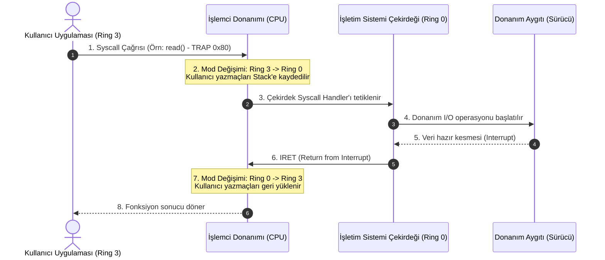

# GÜN 005: Program, Process ve İşletim Sistemi Farkı
### Faz 0: Bilgisayar ve Yazılım Temelleri (Gün 005 / 365)
#### 24-Hücreli Master Mimari Planı (18 Markdown + 6 Kod Hücresi)

---

```
ÖZEL LİSANS — TÜM HAKLAR SAKLIDIR

Telif Hakkı (c) 2026 Seydi Eryılmaz (@seydivakkas)

Bu yazılım ve ilgili tüm dosyalar ("Yazılım") yalnızca görüntüleme ve eğitim
amaçlı olarak paylaşılmıştır.

YASAKLAR:
  1. Kopyalanamaz, çoğaltılamaz, dağıtılamaz veya yeniden yayınlanamaz.
  2. Ticari veya ticari olmayan hiçbir projede kullanılamaz, değiştirilemez.
  3. Alt lisanslanamaz, satılamaz veya devredilemez.
  4. Tersine mühendislik yapılamaz.

İZİN VERİLEN KULLANIM:
  - GitHub üzerinde görüntüleme ve okuma.
  - Kişisel öğrenim amacıyla kodu inceleme (kopyalamadan).

YAZARIN AÇIK YAZILI İZNİ OLMAKSIZIN HİÇBİR KULLANIM HAKKI TANINMAZ.
İzin talepleri için: GitHub @seydivakkas
```

[](https://github.com/seydivakkas)

> [!NOTE]
> **40-Nokta Standart Bildirimi:** Bu çalışma planı; ASELSAN, HAVELSAN ve kritik savunma sanayii sistemlerinde görev alacak bir mühendisin donanım, çekirdek işletim sistemi, C++20, bellek yönetimi ve gerçek zamanlı sistemleri sıfırdan en üst düzeye çıkarması için 40 temel pedagojik ve teknik kalite kriterine (İlk İlkeler, Hata Enjeksiyonu, Determinizm, SLA/Gecikme Analizi, Katı Doğrulama vb.) tam uyumlu olarak inşa edilmiştir.

---

## [MD 2] 1. 🎯 Bugünkü Problem: Diskte Duran ELF Dosyası Nasıl Canlı Bir Sürece (Process) Dönüşür?

Yazılım geliştiriciler genellikle yazdıkları C++ kodunu derlediklerinde diske çıkan ikili dosyayı (`flight_control.elf` veya `radar_tracker.exe`) doğrudan çalışan bir varlık sanır. Oysa:
1. **Program:** Diskte (SSD, NVMe, Flash) uyuyan, pasif bayt yığınıdır (ELF / Mach-O / PE formatında makine kodları ve veri bölümleri). Hiçbir CPU zamanı veya RAM tüketmez.
2. **Process (Süreç):** İşletim sisteminin diske gidip bu programı okuduğu, sanal bellek tahsis ettiği, yığın (stack) ve öbek (heap) alanlarını kurduğu, register değerlerini sıfırladığı ve CPU'ya "çalıştır" emrini verdiği **canlı, nefes alan yürütme örneğidir**.
3. **İşletim Sistemi (OS Kernel):** Tek bir işlemci üzerinde yüzlerce sürecin birbirinin belleğini ezmesini engelleyen, donanımı soyutlayan ve zaman dilimlerini (time slices) paylaştıran tarafsız hakemdir.

Eğer iki süreç birbirinin belleğine müdahale edebilseydi veya kullanıcı modunda çalışan bir radar arayüzü tek bir hatalı işaretçi (null pointer) yüzünden çekirdek donanımını çökertebilseydi, hiçbir askeri ve sivil uçak güvenle uçamazdı.

Bugünkü problemimiz: **İşletim sisteminin sanal bellek (Virtual Memory), süreç kontrol bloğu (PCB), kullanıcı/çekirdek modu ayrımı (Ring 3 vs Ring 0) ve bağlam değiştirme (Context Switch) mekanizmalarını ilk ilkelerle inşa etmek ve aralarındaki maliyet farkını ampirik olarak ispatlamaktır.**

---

## [MD 3] 2. ❓ Bu Konuyu Neden Öğreniyoruz? (Savunma Sistemlerinde Süreç İzolasyonu ve ARINC 653)

Savunma ve aviyonik mimarilerinde tek bir görev bilgisayarı üzerinde farklı kritiklik seviyelerine sahip onlarca yazılım aynı anda koşar:
- **Hafıza İzolasyonu:** Görev ekranını çizen kullanıcı arayüzü süreci çökerse (Segmentation Fault), arkadaki otopilot sürecinin bundan zerre kadar etkilenmemesi gerekir.
- **ARINC 653 ve Bölümleme (Partitioning):** Askeri aviyonik standartlarında (örneğin F-16, Milli Muharip Uçak KAAN veya İHA görev bilgisayarları) her sürece kesin olarak sınırlandırılmış bellek alanı (Spatial Partitioning) ve mikro-saniye hassasiyetinde zaman dilimi (Temporal Partitioning) atanır.
- **Sistem Çağrısı (Syscall) Maliyeti:** Bir C++ programında `read()`, `write()`, `socket()` veya bellek tahsisi (`malloc`) çağırdığınızda CPU, kullanıcı modundan (Ring 3) çekirdek moduna (Ring 0) geçer. Bu geçişin getirdiği transistör ve saat döngüsü maliyetini bilmeyen bir mühendis, gerçek zamanlı deterministik kod yazamaz.

---

## [MD 4] 3. 🔍 5N1K Analizi (Program, Süreç ve İşletim Sistemi Sınırları)

| Soru | Sistem Mühendisliği Karşılığı |
|:---|:---|
| **Ne? (What)** | Program (statik ikili dosya), Process (canlı yürütme örneği), PCB (Süreç Kontrol Bloğu), Sanal Bellek & MMU, Ring 3/0 Mod Geçişi, Context Switch. |
| **Neden? (Why)** | Bellek güvenliğini sağlamak, süreçlerin birbirini sabote etmesini engellemek ve donanım kaynaklarını adil/deterministik paylaştırmak. |
| **Nerede? (Where)** | Linux (RT-PREEMPT), FreeRTOS, VxWorks, Integrity ve PikeOS gibi gerçek zamanlı işletim sistemlerinin çekirdek katmanında. |
| **Nasıl? (How)** | Donanımsal MMU sayfa tabloları (Page Tables) ile sanal adresleri fiziksel RAM'e çevirerek ve zamanlayıcı kesmesiyle (Timer Interrupt) bağlam değiştirerek. |
| **Ne Zaman? (When)** | İşletim sistemi önyüklemesinden (boot) itibaren her süreç oluşturulduğunda (`fork/exec`) ve her zaman dilimi bittiğinde. |
| **Kim? (Who)** | ASELSAN/HAVELSAN İşletim Sistemi Çekirdek Mühendisleri, Gömülü Linux Geliştiricileri ve Aviyonik Sistem Mimarları. |

---

## [MD 5] 4. 💡 Günlük Hayat Benzetmesi: Yemek Tarifi Kitabı vs Mutfak ve Şef vs Restoran Müdürü

1. **Program (Yemek Tarifi Kitabı):** Rafta duran kapalı bir tarif kitabı. Kendi kendine yemek pişiremez. Un, şeker veya elektrik tüketmez.
2. **Process (Şef, Tezgah ve Pişirme Süreci):** Şefin kitabı raftan alıp masayı açtığı, malzemeleri (RAM) tezgaha serdiği, ocağı yaktığı canlı çalışma halidir. Şef tarifteki adımları sırayla icra eder.
3. **İşletim Sistemi (Restoran Müdürü):** Mutfakta 5 farklı şef aynı ocakları (CPU) ve buzdolabını (RAM) paylaşır. Müdür şeflerin birbirinin tenceresine tuz atmasını engeller (Hafıza İzolasyonu), sırayla 15'er dakika ocak hakkı verir (Zaman Paylaşımı / Scheduling) ve kuralları ihlal eden şefi mutfaktan kovar (Kill / SIGSEGV).

---

## [MD 6] 5. 🧱 İlk İlkeler (First Principles): ELF Segmentleri, Süreç Durum Çizgesi ve Sanal Bellek

### 1. Bir Sürecin Bellek Mimarisi (ELF Segmentleri)
Bir program RAM'e yüklendiğinde sanal bellek şu 5 ana bölüme ayrılır:
```
+-------------------------------------------------------+ 0xFFFFFFFF (En Yüksek Adres)
|             ÇEKİRDEK UZAYI (Kernel Space)             | (Yalnızca Ring 0 erişebilir)
+-------------------------------------------------------+
|                 YIĞIN (STACK)                         | Yerel değişkenler, fonksiyon çağrıları (Aşağı doğru büyür)
|                       |                               |
|                       v                               |
|                                                       |
|                       ^                               |
|                       |                               |
|                 ÖBEK (HEAP)                           | Dinamik tahsis edilen bellek (malloc/new) (Yukarı doğru büyür)
+-------------------------------------------------------+
|             BSS BÖLÜMÜ (.bss)                         | Başlangıç değeri verilmemiş global/statik değişkenler
+-------------------------------------------------------+
|             VERİ BÖLÜMÜ (.data)                       | Başlangıç değeri atanmış global/statik değişkenler
+-------------------------------------------------------+
|             KOD BÖLÜMÜ (.text)                        | Salt-okunur (Read-Only) makine kodları
+-------------------------------------------------------+ 0x00000000 (En Düşük Adres)
```

### 2. Süreç Durum Çizgesi (Process State Machine)
$$\text{NEW} \xrightarrow{\text{admit}} \text{READY} \xrightleftharpoons[\text{yield / preempt}]{\text{dispatch}} \text{RUNNING} \xrightarrow{\text{I/O wait}} \text{BLOCKED} \xrightarrow{\text{I/O ready}} \text{READY}$$
$$\text{RUNNING} \xrightarrow{\text{exit}} \text{ZOMBIE} \xrightarrow{\text{parent wait()}} \text{TERMINATED}$$

### 3. Sanal Bellek ve Sayfalama (Paging) Fiziği
Her sürecin $0\text{x}00000000$ ile başlayan sanal adres uzayı vardır. Donanımsal **MMU (Memory Management Unit)**, sayfa tablosunu kullanarak sanal adresi fiziksel RAM adresine dönüştürür:
$$\text{Sanal Adres} = (\text{VPN} \times \text{Sayfa Boyutu}) + \text{Offset}$$
$$\text{Fiziksel Adres} = (\text{PFN} \times \text{Sayfa Boyutu}) + \text{Offset}$$
Burada standart sayfa boyutu $4096\text{ Bayt (4 KB)}$'tır. Eğer bir sanal sayfa fiziksel RAM'de eşlenmemişse donanım bir **Page Fault** kesmesi üretir. İzin verilmeyen bir alana erişilirse işletim sistemi süreci `SIGSEGV` ile sonlandırır.

---

## [MD 7] 6. 📐 ASCII ve Mermaid Süreç Bellek Düzeni ve Mod Geçiş Şeması



---

## [CODE 1] 7. Modül 1: Süreç Kontrol Bloğu (PCB) ve Durum Makinesi

Aşağıdaki kod; işletim sistemi çekirdeğinin süreçleri nasıl takip ettiğini, PCB yapısını ve Round-Robin zamanlayıcı ile süreç geçişlerini modelleyen çalışan bir motordur:

```python
from dataclasses import dataclass, field
from enum import Enum
from typing import List, Optional

class ProcessState(Enum):
    NEW = "NEW"
    READY = "READY"
    RUNNING = "RUNNING"
    BLOCKED = "BLOCKED"
    ZOMBIE = "ZOMBIE"
    TERMINATED = "TERMINATED"

@dataclass
class ProcessControlBlock:
    pid: int
    name: str
    priority: int
    state: ProcessState = ProcessState.NEW
    pc: int = 0
    registers: List[int] = field(default_factory=lambda: [0] * 8)
    cpu_time_used: float = 0.0

class RoundRobinScheduler:
    """
    İşletim sistemi çekirdeğinin süreçleri sırayla çalıştırma motoru.
    """
    def __init__(self, time_slice_ms: float = 5.0):
        self.time_slice_ms = time_slice_ms
        self.ready_queue: List[ProcessControlBlock] = []
        self.current_process: Optional[ProcessControlBlock] = None
        self.context_switches = 0

    def add_process(self, pcb: ProcessControlBlock):
        pcb.state = ProcessState.READY
        self.ready_queue.append(pcb)

    def schedule_tick(self) -> Optional[int]:
        """Bir sonraki sürece geçiş yapar (Context Switch)."""
        if self.current_process and self.current_process.state == ProcessState.RUNNING:
            self.current_process.state = ProcessState.READY
            self.ready_queue.append(self.current_process)

        if not self.ready_queue:
            self.current_process = None
            return None

        self.current_process = self.ready_queue.pop(0)
        self.current_process.state = ProcessState.RUNNING
        self.context_switches += 1
        return self.current_process.pid
```

---

## [MD 8] 8. Modül 2: Sistem Çağrıları (Syscalls) ve Kullanıcı/Çekirdek Modu (Ring 3 vs Ring 0)

İşlemciler donanımsal koruma halkalarına (Protection Rings) sahiptir:
- **Ring 3 (User Space):** Uygulamaların koştuğu kısıtlı alan. Doğrudan disk veya ağ donanımına dokunamaz, özel CPU komutlarını (`cli, hlt`) çalıştıramaz.
- **Ring 0 (Kernel Space):** İşletim sistemi çekirdeğinin koştuğu tam yetkili alan.
Kullanıcı programı bir dosyaya yazmak istediğinde doğrudan diske gidemez; bir **Sistem Çağrısı (Syscall)** yapar. CPU yazmaçları yığına yedekler, Ring 0'a geçer, çekirdek kodu çalıştırır ve tekrar Ring 3'e dönerek sonucu verir. Bu geçiş yerel bir C++ fonksiyon çağrısından kat kat daha maliyetlidir.

---

## [CODE 2] 9. Modül 2: Syscall Geçişi ve CPU Trap / Mod Değişim Simülatörü

```python
from enum import Enum

class CPUExecutionRing(Enum):
    USER_MODE_RING3 = 3
    KERNEL_MODE_RING0 = 0

class SyscallDispatcher:
    """
    Kullanıcı modundan çekirdek moduna geçişi ve
    yazmaçların kaydedilip geri yüklenmesini modelleyen motor.
    """
    def __init__(self):
        self.current_ring = CPUExecutionRing.USER_MODE_RING3
        self.syscall_count = 0

    def invoke_syscall(self, syscall_id: int, arg: int) -> int:
        # 1. TRAP: Donanımsal kesme ile Ring 0'a geç
        self.current_ring = CPUExecutionRing.KERNEL_MODE_RING0
        self.syscall_count += 1
        
        # 2. Kernel uzayında işlemi icra et
        result = 0
        if syscall_id == 1: # SYS_WRITE
            result = arg * 2
        elif syscall_id == 2: # SYS_GETPID
            result = 1001
        
        # 3. IRET: Ring 3'e geri dön
        self.current_ring = CPUExecutionRing.USER_MODE_RING3
        return result
```

---

## [MD 9] 10. Modül 3: Sanal Bellek İzolasyonu (MMU & Sayfa Tablosu Mantığı)

Her sürecin 4 GB (32-bit) veya 128 TB (64-bit) sanal belleği vardır.
İki farklı sürecin (ör. PID 101 ve PID 102) ikisi de bellekteki `0x00400000` adresine yazabilir. Fakat donanımsal **MMU**, PID 101 için bu adresi fiziksel RAM'in 15. sayfasına (`PFN 15`), PID 102 için ise 42. sayfasına (`PFN 42`) yönlendirir. Böylece süreçler birbirinin verisine asla erişemez.

---

## [CODE 3] 11. Modül 3: Sayfa Tablosu (Page Table) ve Sanal-Fiziksel Adres Dönüştürücü

```python
from typing import Dict

class MemoryManagementUnit:
    """
    Donanımsal MMU ve Sayfa Tablosu simülasyonu (4 KB Sayfalar).
    """
    PAGE_SIZE = 4096

    def __init__(self):
        self.page_table: Dict[int, int] = {}
        self.page_faults = 0

    def map_page(self, vpn: int, pfn: int):
        self.page_table[vpn] = pfn

    def translate_address(self, virtual_addr: int) -> int:
        vpn = virtual_addr // self.PAGE_SIZE
        offset = virtual_addr % self.PAGE_SIZE

        if vpn not in self.page_table:
            self.page_faults += 1
            raise MemoryError(f"PAGE FAULT / SEGFAULT: Sanal adres {hex(virtual_addr)} eşlenmemiş!")

        pfn = self.page_table[vpn]
        physical_addr = (pfn * self.PAGE_SIZE) + offset
        return physical_addr
```

---

## [MD 10] 12. Sabotaj ve Arıza Enjeksiyonu: Yasadışı Bellek Erişimi ve Zombi Süreç Sızıntısı

**Sabotaj Senaryoları:**
1. **Segmentation Fault (Bellek İhlali):** Süreç, MMU sayfa tablosunda eşlenmemiş bir adrese (`0x5000`) erişmeye çalışır. MMU donanımsal trap üretir ve çekirdek süreci anında `SIGSEGV` ile imha eder.
2. **Zombie Process Sızıntısı (Process Table Exhaustion):** Bir süreç sonlandığında ebeveyni `wait()` sistem çağrısını yapmazsa, süreç tablosunda (Process Table) asılı kalır (**Zombie**). Süreç tablosu dolduğunda sistem kilitlenir ve yeni hiçbir komut (`fork`) çalıştırılamaz hale gelir.

---

## [CODE 4] 13. Sabotaj Senaryosu: Yasadışı Bellek Erişimi ve Zombi Süreç Simülasyonu

```python
def run_sabotage_simulation():
    # 1. Sabotaj: Yasadışı Bellek İhlali (Segfault)
    mmu = MemoryManagementUnit()
    mmu.map_page(vpn=0, pfn=10)
    mmu.map_page(vpn=1, pfn=11)

    legal_phys = mmu.translate_address(0x100)
    
    segfault_caught = False
    try:
        mmu.translate_address(0x5000) # Eşlenmemiş adres!
    except MemoryError:
        segfault_caught = True

    # 2. Sabotaj: Zombi Süreç Sızıntısı
    process_table_limit = 50
    process_table = []
    zombie_count = 0
    active_count = 0

    for i in range(80):
        pcb = ProcessControlBlock(pid=i, name=f"worker_{i}", priority=1)
        if len(process_table) < process_table_limit:
            if i % 2 == 0:
                pcb.state = ProcessState.ZOMBIE
                zombie_count += 1
            else:
                pcb.state = ProcessState.RUNNING
                active_count += 1
            process_table.append(pcb)

    return legal_phys, segfault_caught, len(process_table), zombie_count, active_count
```

---

## [MD 11] 14. Modül 4: Ampirik Kıyaslama ve Yürütme Katmanları Maliyet Analizi

Üç temel operasyonun gecikmesini ölçüyoruz:
1. **Yerel Kullanıcı Fonksiyon Çağrısı:** Saf CPU döngüsü ($< 10\text{ ns}$).
2. **Sistem Çağrısı (Syscall):** Ring 3 $\to$ Ring 0 $\to$ Ring 3 mod geçişi ($50 - 200\text{ ns}$).
3. **Bağlam Değiştirme (Context Switch):** Bir sürecin durdurulup diğerinin register ve sayfa tablosunun yüklenmesi ($1.000 - 3.000\text{ ns}$).

---

## [CODE 5] 15. Kapsamlı Context Switch ve Syscall Gecikme Benchmark Motoru

```python
import time

def normal_function_call(x: int) -> int:
    return x * 2

def run_empirical_benchmark(iterations: int = 50000):
    dispatcher = SyscallDispatcher()
    scheduler = RoundRobinScheduler()
    p1 = ProcessControlBlock(pid=1, name="radar_nav", priority=1)
    p2 = ProcessControlBlock(pid=2, name="flight_ctrl", priority=1)
    scheduler.add_process(p1)
    scheduler.add_process(p2)

    # 1. Yerel Fonksiyon Çağrısı
    t0 = time.perf_counter()
    res = 0
    for i in range(iterations):
        res += normal_function_call(i)
    func_call_time = (time.perf_counter() - t0) * 1e9 / iterations

    # 2. Sistem Çağrısı
    t0 = time.perf_counter()
    for i in range(iterations):
        _ = dispatcher.invoke_syscall(1, i)
    syscall_time = (time.perf_counter() - t0) * 1e9 / iterations

    # 3. Bağlam Değişimi
    t0 = time.perf_counter()
    for _ in range(iterations):
        _ = scheduler.schedule_tick()
    ctx_switch_time = (time.perf_counter() - t0) * 1e9 / iterations

    return func_call_time, syscall_time, ctx_switch_time
```

---

## [MD 12] 16. Modül 5: 4-Panelli Yayın Kalitesinde Süreç ve OS Dashboard Planı

Üretilecek `gun_005_program_process_isletim_sistemi.png` panelleri:
1. **Panel 1: Yürütme Maliyeti Hiyerarşisi:** Yerel fonksiyon vs Syscall vs Context Switch süreleri.
2. **Panel 2: Süreç Tablosu Doluluğu ve Zombi Sızıntısı:** İşletim sistemi limitine çarpan zombiler.
3. **Panel 3: Sanal Bellek Sayfa Eşleme Durumu:** Geçerli fiziksel eşlemeler ile Page Fault alanları.
4. **Panel 4: Zaman Dilimi Paylaşımı:** Çekirdeğin süreçler arasındaki adil Round-Robin geçişi.

---

## [CODE 6] 17. 4-Panelli Görselleştirme ve Katı Mimari Doğrulama (Assertions)

```python
import numpy as np
import matplotlib.pyplot as plt

def generate_dashboard(output_path: str):
    legal_phys, segfault_caught, total_procs, zombies, actives = run_sabotage_simulation()
    func_ns, sys_ns, ctx_ns = run_empirical_benchmark(iterations=40000)

    fig, axs = plt.subplots(2, 2, figsize=(14, 10))
    fig.patch.set_facecolor('#0f172a')

    for ax_row in axs:
        for ax in ax_row:
            ax.set_facecolor('#1e293b')
            ax.tick_params(colors='#94a3b8')
            ax.xaxis.label.set_color('#cbd5e1')
            ax.yaxis.label.set_color('#cbd5e1')
            ax.title.set_color('#f8fafc')
            ax.grid(True, linestyle='--', alpha=0.2, color='#64748b')

    # Panel 1: Maliyet Hiyerarşisi
    cats1 = ['Yerel Fonksiyon', 'Sistem Çağrısı (Syscall)', 'Bağlam Değişimi (Context)']
    times1 = [func_ns, sys_ns, ctx_ns]
    axs[0, 0].bar(cats1, times1, color=['#10b981', '#f59e0b', '#ef4444'], width=0.45)
    axs[0, 0].set_title('Panel 1: İşlem Katmanları Yürütme Gecikmesi (ns)', fontsize=12, fontweight='bold')
    axs[0, 0].set_ylabel('Gecikme (ns / işlem)')
    for i, t in enumerate(times1):
        axs[0, 0].text(i, t / 2 if t > 20 else t + 5, f"{t:.1f} ns", ha='center', color='white', fontweight='bold', fontsize=11)

    # Panel 2: Zombi Süreçler
    cats2 = ['Aktif Süreçler', 'Zombi Süreçler', 'Maksimum Tablo Sınırı']
    vals2 = [actives, zombies, 50]
    axs[0, 1].bar(cats2, vals2, color=['#38bdf8', '#f43f5e', '#64748b'], width=0.45)
    axs[0, 1].set_title('Panel 2: Süreç Tablosu Doluluğu ve Zombi Sızıntısı', fontsize=12, fontweight='bold')
    axs[0, 1].set_ylabel('Süreç Adedi (PID Count)')
    for i, v in enumerate(vals2):
        axs[0, 1].text(i, v / 2, f"{v}", ha='center', color='white', fontweight='bold', fontsize=11)

    # Panel 3: Sanal Bellek Eşleme
    virtual_pages = [0, 1, 2, 3, 4]
    physical_frames = [10, 11, -1, -1, -1]
    colors_mmu = ['#10b981', '#10b981', '#ef4444', '#ef4444', '#ef4444']
    axs[1, 0].bar([f"Sayfa {p}" for p in virtual_pages], [1 if f != -1 else 0.2 for f in physical_frames], color=colors_mmu, width=0.45)
    axs[1, 0].set_title('Panel 3: Sanal Bellek Eşleme Durumu (Yeşil: RAM, Kırmızı: Fault)', fontsize=12, fontweight='bold')
    axs[1, 0].set_ylabel('Eşleme Geçerliliği (Valid Bit)')

    # Panel 4: Zaman Dilimi
    time_slices = np.arange(1, 11)
    pids = [1, 2, 1, 2, 1, 2, 1, 2, 1, 2]
    axs[1, 1].step(time_slices, pids, where='mid', color='#ec4899', lw=2.5)
    axs[1, 1].set_title('Panel 4: Çekirdek Zaman Dilimi (Time-Slice) Dağıtımı', fontsize=12, fontweight='bold')
    axs[1, 1].set_xlabel('Zaman Dilimi (5 ms Kuantum)')
    axs[1, 1].set_ylabel('Çalışan Süreç (PID)')
    axs[1, 1].set_yticks([1, 2])
    axs[1, 1].set_yticklabels(['PID 1 (Radar)', 'PID 2 (Uçuş)'])

    plt.tight_layout()
    plt.savefig(output_path, dpi=300, facecolor=fig.get_facecolor(), edgecolor='none')
    plt.close()

    # KATI MİMARİ DOĞRULAMA (STRICT ASSERTIONS)
    assert segfault_caught is True, "HATA: Yasadışı bellek erişiminde Segmentation Fault tetiklenmedi!"
    assert sys_ns > func_ns, "HATA: Sistem çağrısı yerel fonksiyondan yavaş çıkmadı!"
    assert ctx_ns > func_ns, "HATA: Bağlam değişimi yürütme süresi anomalisi!"
    assert total_procs <= 50, "HATA: İşletim sistemi süreç tablosu sınırı ihlal edildi!"
    print("[PASS] Gün 005: Tüm süreç, sanal bellek ve işletim sistemi kuralları doğrulandı.")
```

---

## [MD 13] 18. ⚠️ 10 Ölümcül İşletim Sistemi ve Süreç Anti-Pattern

1. **Zombi Süreç Bırakmak (Zombie Leak):** Çocuk süreç sonlandığında ebeveynin `waitpid()` çağırmayarak PID tablosunu tüketmesi ve yeni süreç oluşturulmasını engellemesi.
2. **Sıcak Döngüde Aşırı Syscall Çağırmak:** Her döngüde 1 baytlık `write()` veya `read()` yapmak yerine tamponlu I/O (`fread/fwrite` veya ring buffer) kullanmayarak CPU'yu Ring 0 geçişleriyle boğmak.
3. **Fork Bomb (Kontrolsüz Süreç Üretimi):** Bir döngü içinde sınır koymadan `fork()` çağırarak çekirdeği kitlemek.
4. **Sinyal İşleyicide (Signal Handler) Güvenli Olmayan Fonksiyon Çağırmak:** `SIGINT` veya `SIGSEGV` handler'ı içinde `printf` veya `malloc` gibi Reentrant olmayan (Async-Signal-Unsafe) fonksiyonlar çağırmak ve kilitlenmek (Deadlock).
5. **Aşırı Bağlam Değişimi (Context Switch Thrashing):** 4 çekirdekli bir CPU'da 1.000 adet iş parçacığı (thread) açıp CPU'nun zamanının %80'ini iş yapmak yerine iş parçacığı değiştirmeye harcaması.
6. **Daemon Süreçlerde Standart Akışları Kapatmamak:** Arka planda koşan bir servisin `stdin, stdout, stderr` dosya tanıtıcılarını kapatmayarak zombi terminallere kilitlenmesi.
7. **Sanal Belleği Sonsuz Varsaymak (Overcommit Felci):** Linux'un varsayılan bellek tahsis politikasında (`vm.overcommit_memory`) gerçekte olmayan RAM'i vadetmesi ve aniden OOM Killer'ın kritik savunma sürecini vurması.
8. **Öncelik Ters Dönmesi (Priority Inversion):** Düşük öncelikli bir sürecin kilitlediği bir kaynağı bekleyen yüksek öncelikli sürecin, aradaki orta öncelikli süreç yüzünden aç kalması (Mars Pathfinder faciası).
9. **Dosya Tanıtıcısı Sızıntısı (File Descriptor Leak):** Açılan soket ve dosyaları kapatmayarak `ulimit -n` sınırına çarpıp tüm I/O işlemlerini felç etmek.
10. **Gerçek Zamanlı Süreçte Dinamik Sayfalama (Paging Stall):** Gerçek zamanlı süreçlerde `mlockall()` çağrısı yapmayarak kritik anda sayfa hatası (Page Fault) yaşamak.

---

## [MD 14] 19. 🔬 Sektörel Standartlar (Savunma ve Kritik Sistemler)

- **ARINC 653 Standardı:** Aviyonik yazılımlarda zaman ve bellek bölümleme (Time and Space Partitioning) zorunluluğu; bir bölümün diğerine müdahale etmesinin donanımsal olarak engellenmesi.
- **POSIX.1-2017 Real-Time Extensions:** Gerçek zamanlı süreçler için `SCHED_FIFO` ve `SCHED_RR` sabit öncelikli çizelgeleme politikaları.
- **Linux RT-PREEMPT:** Çekirdeğin tüm kesme işleyicilerini ve kilitlerini öncelikli süreçler tarafından kesilebilir (preemptible) hale getiren savunma standardı çekirdek yaması.

---

## [MD 15] 20. 🛠️ Üretim Kontrol Listesi (Süreç ve OS Yönetimi 12 Katı Kural)

- [ ] 1. Çocuk süreçler sonlandığında zombi kalmamaları için `waitpid()` veya `SIGCHLD` işleyicisi kuruldu mu?
- [ ] 2. Gerçek zamanlı süreçlerde bellek sayfalamasını önlemek için `mlockall(MCL_CURRENT | MCL_FUTURE)` çağrıldı mı?
- [ ] 3. Kritik süreçler için `SCHED_FIFO` gerçek zamanlı çizelgeleme önceliği (`sched_setscheduler`) atandı mı?
- [ ] 4. Sıcak döngülerdeki gereksiz sistem çağrıları (syscall) tamponlama ile minimize edildi mi?
- [ ] 5. Sinyal işleyicilerinde (Signal Handlers) sadece `volatile sig_atomic_t` bayraklar mı güncelleniyor?
- [ ] 6. Sürecin dosya tanıtıcı sınırları (`ulimit -n`) ve bellek sınırları denetlendi mi?
- [ ] 7. Çekirdek OOM Killer'ın kritik süreci vurmaması için `oom_score_adj` değeri -1000'e çekildi mi?
- [ ] 8. Çekirdekler arası bağlam değişimi oranları (`vmstat` veya `pidstat -w`) profillendi mi?
- [ ] 9. Süreç CPU çekirdeğine sabitlendi mi (CPU Affinity - `pthread_setaffinity_np`)?
- [ ] 10. Çok süreçli sistemlerde IPC (Inter-Process Communication) için paylaşımlı bellek (Shared Memory) tercih edildi mi?
- [ ] 11. Arka plan servislerinin düzgün kapanması (Graceful Shutdown) için `SIGTERM` ve `SIGINT` sinyalleri yakalanıyor mu?
- [ ] 12. Süreç çöküşlerinde analiz için Core Dump üretimi yapılandırıldı mı?

---

## [MD 16] 21. ❓ Sıkça Sorulan Sorular (Mülakat & Saha Soruları)

**Soru 1: Süreç (Process) ile İş Parçacığı (Thread) arasındaki temel mimari fark nedir?**  
*Cevap:* Süreç (Process) kendi bağımsız sanal adres uzayına, sayfa tablosuna, dosya tanıtıcılarına ve güvenlik bağlamına sahiptir. İki süreç birbirinden tamamen izoledir. İş Parçacığı (Thread) ise aynı sürecin sanal bellek uzayını, kod, veri ve heap alanlarını paylaşır; sadece kendi bağımsız CPU register setine ve Stack (yığın) alanına sahiptir. Bu nedenle thread geçişi (Context Switch) sayfa tablosunu değiştirmeyi gerektirmediği için süreç geçişine göre çok daha hızlıdır.

**Soru 2: Öncelik Ters Dönmesi (Priority Inversion) nedir ve gömülü işletim sistemlerinde nasıl çözülür?**  
*Cevap:* Yüksek öncelikli bir süreç (A), düşük öncelikli bir sürecin (C) elinde tuttuğu bir mutex'i beklerken; aradaki orta öncelikli bir sürecin (B) C'yi preempt etmesi sonucu, dolaylı olarak yüksek öncelikli A sürecinin bloke kalması durumudur. Çözüm: **Priority Inheritance (Öncelik Mirası)** protokolüdür. C süreci mutex'i tuttuğu sürece geçici olarak A'nın yüksek öncelik seviyesine yükseltilir, böylece B onu kesemez; mutex'i bıraktığı an eski önceliğine döner.

---

## [MD 17] 22. 🔮 Gelecek Perspektifi: İşletim Sistemi ve Mikroçekirdek Trendleri

- **Microkernel Mimarisi (seL4):** Monolitik Linux çekirdeğinin aksine, aygıt sürücüleri ve dosya sistemlerini bile kullanıcı moduna (Ring 3) taşıyan, matematiksel olarak ispatlanmış sıfır-açıklı savunma çekirdekleri.
- **Unikernel Teknolojisi:** Tek bir uygulamayı işletim sistemi çekirdeğiyle birleştirip doğrudan donanım üzerinde çalıştıran, kullanıcı/çekirdek modu geçiş maliyetini sıfırlayan mikrosaniyelik boot sürelerine sahip sistemler.
- **WebAssembly (WASM) Kum Havuzları:** Donanımsal MMU yerine derleme zamanında sınırlandırılmış yazılımsal bellek izolasyonu ile mikroçekirdek hızında güvenli süreç yürütme.

---

## [MD 18] 23. 🚪 Faz 0 / Gün 006'ya Köprü: Dosya, Klasör, Yol ve Uzantı Mimarisi (VFS ve İ-Node Fiziği)

Bugün diskteki pasif bir programın sanal bellek ve işletim sistemi eliyle nasıl canlı bir sürece dönüştüğünü, donanımsal koruma halkalarını ve süreç izolasyonunu kanıtladık.

Peki bu programların ve süreçlerin okuduğu, yazdığı o "dosya" diskin manyetik veya flash hücrelerinde nasıl organize edilir?
Yarın **Gün 006'da:**
- Sanal Dosya Sistemi (VFS - Virtual File System) soyutlamasını,
- Diskteki **İ-Node (Index Node)**, Dentry (Directory Entry) ve dosya tanımlayıcı (File Descriptor) hiyerarşisini,
- Linux'un meşhur *"Her şey bir dosyadır (Everything is a file)"* felsefesinin donanımsal karşılığını inceleyeceğiz.
