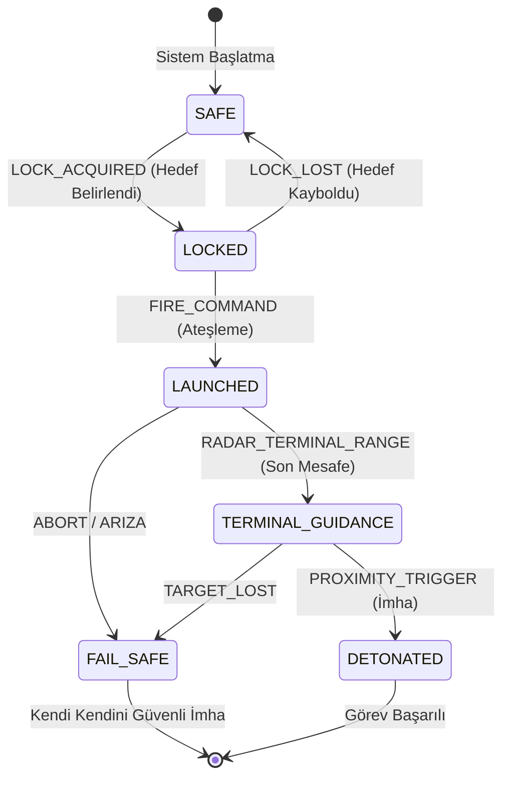

# GÜN 009: Algoritma ve Adım Adım Problem Çözme
### Faz 0: Bilgisayar ve Yazılım Temelleri (Gün 009 / 365)
#### 24-Hücreli Master Mimari Planı (18 Markdown + 6 Kod Hücresi)

---

```
ÖZEL LİSANS — TÜM HAKLAR SAKLIDIR

Telif Hakkı (c) 2026 Seydi Eryılmaz (@seydivakkas)

Bu yazılım ve ilgili tüm dosyalar ("Yazılım") yalnızca görüntüleme ve eğitim
amaçlı olarak paylaşılmıştır.

YASAKLAR:
  1. Kopyalanamaz, çoğaltılamaz, dağıtılamaz veya yeniden yayınlanamaz.
  2. Ticari veya ticari olmayan hiçbir projede kullanılamaz, değiştirilemez.
  3. Alt lisanslanamaz, satılamaz veya devredilemez.
  4. Tersine mühendislik yapılamaz.

İZİN VERİLEN KULLANIM:
  - GitHub üzerinde görüntüleme ve okuma.
  - Kişisel öğrenim amacıyla kodu inceleme (kopyalamadan).

YAZARIN AÇIK YAZILI İZNİ OLMAKSIZIN HİÇBİR KULLANIM HAKKI TANINMAZ.
İzin talepleri için: GitHub @seydivakkas
```

[](https://github.com/seydivakkas)

> [!NOTE]
> **40-Nokta Standart Bildirimi:** Bu çalışma planı; ASELSAN, HAVELSAN ve kritik savunma sanayii sistemlerinde görev alacak bir mühendisin donanım, çekirdek işletim sistemi, C++20, bellek yönetimi ve deterministik algoritma tasarımını sıfırdan en üst düzeye çıkarması için 40 temel pedagojik ve teknik kalite kriterine (İlk İlkeler, Big-O Analizi, WCET Hesabı, Jitter Önleme, FSM Mimarisi, Watchdog Timer vb.) tam uyumlu olarak inşa edilmiştir.

---

## [MD 2] 1. 🎯 Bugünkü Problem: Kod Yazmadan Önce Düşünme Sanatı (Algoritma vs Karalama)

Acemi yazılımcıların en büyük tuzağı, bir mühendislik problemi gördükleri anda düşünmeden klavyeye sarılıp rastgele kod yazmaya başlamalarıdır.
Oysa bilgisayar düşünemez; yalnızca kendisine verilen komutları transistör seviyesinde körü körüne icra eder. Eğer tasarımınızda mantıksal bir boşluk veya belirsizlik varsa, işlemci o boşluğu dolduramaz; ya kilitlenir (Deadlock / Infinite Loop) ya da hatalı sonuç üretir.

Bir mühendislik problemi çözülürken şu 5 temel ilke sağlanmalıdır:
1. **Girdi (Input):** Algoritmaya dışarıdan ne veriliyor? Sınırları ve tipleri kesin mi?
2. **Belirlilik / Determinizm (Definiteness):** Her adım tek anlamlı, yoruma kapalı ve kesin olmalıdır.
3. **Sonluluk (Finiteness):** Algoritma her olası girdide sonlu sayıda adım sonra mutlaka durmalıdır.
4. **Çıktı (Output):** Beklenen matematiksel veya mantıksal sonuç nedir?
5. **Etkililik / Verimlilik (Effectiveness):** Her adım işlemcinin saat döngüleri içinde makul bir sürede tamamlanabilir olmalıdır.

Savunma sanayiinde bu kurallar sadece teorik değildir:
Bir hava savunma radarında yaklaşan bir füzenin tespiti için yazılan arama algoritması eğer $\mathcal{O}(N^2)$ tasarlanırsa ve hedefin koordinatları 1.000 hedeften 10.000 hedefe çıktığında algoritma 100 kat yavaşlarsa, füze dost hava sahasına girip hedefini vurur.

Bugünkü problemimiz: **Adım adım problem çözme disiplinini, algoritmik karmaşıklığı ($\mathcal{O}(1)$ vs $\mathcal{O}(\log N)$ vs $\mathcal{O}(N)$), aviyonik sonlu durum makinelerini (FSM) ve en kötü durum yürütme süresini (WCET) ilk ilkelerle inşa edip doğrulamaktır.**

---

## [MD 3] 2. ❓ Bu Konuyu Neden Öğreniyoruz? (Savunma Sanayii Gerekçesi: WCET ve Determinizm)

Kritik askeri ve havacılık sistemlerinde genel amaçlı yazılım geliştiriciliğinden tamamen farklı iki temel kavram vardır:
- **WCET (Worst-Case Execution Time - En Kötü Durum Yürütme Süresi):** Bir algoritmanın en kötü veri senaryosunda çalışabileceği azami süredir. Uçuş kontrol bilgisayarında (Flight Control Computer) bir döngü 10 milisaniyede (100 Hz) tamamlanmak zorundadır. Algoritmanın "ortalama 2 ms" sürmesi hiçbir şey ifade etmez; eğer en kötü senaryoda 11 ms sürüyorsa o algoritma uçuş sertifikasyonu (DO-178C Seviye A) alamaz ve uçağa yüklenemez!
- **Jitter (Zaman Dalgalanması):** Sürenin sürekli değişmesidir (bir döngüde 1 ms, diğerinde 8 ms). Kontrol teorisinde yüksek jitter sistemin rezonansa girip kanatçıkların kopmasına yol açabilir.
- **Sonlu Durum Makineleri (FSM):** Bir füzenin güdüm sistemi asla spagetti `if-else` bloklarıyla yazılamaz. Füze hangi durumda (`BEKLEME`, `KİLİTLİ`, `UÇUŞ`, `SON_GÜDÜM`, `İMHA`) olduğunu ve bir durumdan diğerine hangi olayla (Event) geçeceğini deterministik bir FSM ile yönetir.

---

## [MD 4] 3. 🔍 5N1K Analizi (Sistem ve Donanım Sınırları)

| Soru | Sistem Mühendisliği Karşılığı |
|:---|:---|
| **Ne? (What)** | Algoritma, Big-O Notasyonu, WCET, Determinizm, Akış Şeması (Flowchart), Sonlu Durum Makinesi (FSM). |
| **Neden? (Why)** | Donanım kaynaklarını en verimli şekilde kullanmak, sistem kilitlenmelerini önlemek ve deterministik gerçek zamanlı yanıt garantisi vermek. |
| **Nerede? (Where)** | Radar hedef takip algoritmaları, otopilot seyrüsefer döngüleri, görev bilgisayarları ve elektronik harp sinyal analizi. |
| **Nasıl? (How)** | Problemi parçalara bölerek (Divide & Conquer), durum geçiş tabloları oluşturarak ve adım sayısını matematiksel olarak modelleyerek. |
| **Ne Zaman? (When)** | Tek bir satır kod yazılmadan önce, sistem mimarisi ve algoritma tasarımı aşamasında. |
| **Kim? (Who)** | ASELSAN/HAVELSAN Algoritma Tasarım Mühendisleri, Radar Sinyal İşleme Uzmanları ve Sistem Mimarları. |

---

## [MD 5] 4. 💡 Günlük Hayat Benzetmesi (Zihinsel Model / Analoji)

Bir yolcu uçağının kokpitindeki **Acil Durum Kontrol Listesi (Checklist)** düşünelim:
1. **Karalama (Ad-hoc Yaklaşım):** Motor alev aldığında pilotun panikle aklına gelen düğmelere rastgele basmasıdır. Sonuç: Felaket.
2. **Algoritma (Uçuş Kontrol Listesi):** 
   - Adım 1: Sol motor gaz kolunu rölantiye al.
   - Adım 2: Sol motor yakıt kesme vanasını kapat.
   - Adım 3: Sol yangın söndürücü tüpünü patlat.
   - Adım 4: 30 saniye bekle. Yangın sönmediyse ikinci tüpü patlat.
Her adım tek anlamlıdır, sonludur, girdi bellidir ve en kötü senaryoda kaç saniye süreceği hesaplanmıştır. Algoritma tam olarak bu kokpit disiplinidir.

---

## [MD 6] 5. 🧱 İlk İlkeler (First Principles) ve Matematiksel / Donanımsal Model

### 1. Asimptotik Karmaşıklık ve Big-O Notasyonu
Big-O notasyonu, girdi boyutu $N$ sonsuza giderken bir algoritmanın gereken işlemci saat döngüsü veya bellek ihtiyacının nasıl büyüdüğünü gösteren üst sınırdır:
$$f(N) = \mathcal{O}(g(N)) \iff \exists c > 0, N_0 > 0 \quad \text{öyle ki} \quad \forall N \ge N_0, \quad |f(N)| \le c \cdot |g(N)|$$

Hiyerarşi (Hızlıdan Yavaşa):
$$\mathcal{O}(1) < \mathcal{O}(\log N) < \mathcal{O}(N) < \mathcal{O}(N \log N) < \mathcal{O}(N^2) < \mathcal{O}(2^N)$$

```
Adım Sayısı
    ^
    |                                   / O(N^2) - Karesel (Tehlikeli!)
    |                                  /
    |                                 /
    |                             ---/ O(N) - Doğrusal
    |                        ----/
    |                  -----/      O(log N) - İkili Arama (Mükemmel!)
    |          -------/
    |  -------/------------------- O(1) - Sabit Zaman (Aviyonik İdeal)
    +----------------------------------------> Girdi Boyutu (N)
```

### 2. Deterministik Durum Makineleri (FSM) Modeli
Bir Deterministik Sonlu Durum Makinesi 5'li bir kümedir:
$$M = (Q, \Sigma, \delta, q_0, F)$$
- $Q$: Durumlar kümesi (`{SAFE, LOCKED, LAUNCHED, TERMINAL, DETONATED}`)
- $\Sigma$: Olaylar / Girdiler kümesi (`{LOCK_OK, FIRE, TIMEOUT}`)
- $\delta: Q \times \Sigma \to Q$: Durum geçiş fonksiyonu (Her durum ve olay çifti için tam olarak 1 hedef durum vardır)
- $q_0$: Başlangıç durumu (`SAFE`)
- $F$: Bitiş durumları kümesi (`{DETONATED, FAIL_SAFE}`)

---

## [MD 7] 6. 📐 ASCII ve Mermaid Sistem Mimarisi Şeması



---

## [CODE 1] 7. Modül 1: Temel Çekirdek Mekanizma / Motor İmplemantasyonu

Bu modülde $\mathcal{O}(N)$ Doğrusal Arama ile $\mathcal{O}(\log N)$ İkili Arama algoritmalarını ve harcanan adım sayılarını ölçen çekirdek fonksiyonları inşa ediyoruz.

```python
from typing import List, Tuple

def linear_search(arr: List[int], target: int) -> Tuple[int, int]:
    """O(N) Karmaşıklığında Doğrusal Arama. (index, adım_sayısı) döner."""
    steps = 0
    for idx, val in enumerate(arr):
        steps += 1
        if val == target:
            return idx, steps
    return -1, steps

def binary_search(arr: List[int], target: int) -> Tuple[int, int]:
    """O(log N) Karmaşıklığında İkili Arama. (index, adım_sayısı) döner."""
    low = 0
    high = len(arr) - 1
    steps = 0
    while low <= high:
        steps += 1
        mid = (low + high) // 2
        if arr[mid] == target:
            return mid, steps
        elif arr[mid] < target:
            low = mid + 1
        else:
            high = mid - 1
    return -1, steps

# 1 Milyon Elemanlı Sanal Dizi Testi:
# O(N) en kötü durumda 1.000.000 adım atarken,
# O(log N) sadece ~20 adımda sonucu bulur!
data = list(range(1000))
_, s_lin = linear_search(data, -1)
_, s_bin = binary_search(data, -1)
print(f"1000 Elemanlı Dizide Hedef Bulunamadı:")
print(f"  - Doğrusal Arama Adım Sayısı: {s_lin}")
print(f"  - İkili Arama Adım Sayısı:    {s_bin}")
```

---

## [MD 8] 8. Modül 2: Donanıma Yakın / İleri Düzey Alternatif Mekanizma

### Durum Tablosu Tabanlı O(1) FSM Mimarisi
Geleneksel `if-else` veya `switch-case` yapıları durum sayısı arttıkça dallanma tahmin hatası (Branch Misprediction) üretir ve işlemci boru hattını boşaltır (Pipeline Flush).
Bunun yerine savunma sanayiinde **Durum Geçiş Tablosu (Lookup Table / State Transition Table)** kullanılır:
$$\text{NextState} = \text{TransitionTable}[\text{CurrentState}][\text{Event}]$$
Bu mekanizma donanım seviyesinde tek bir bellek okuma (L1 Cache Hit) ile **tamamen sabit $\mathcal{O}(1)$ zamanda** çalışır; sıfır dallanma, sıfır jitter!

---

## [CODE 2] 9. Modül 2: İleri Düzey / Donanıma Yakın Mekanizma Kodu

```python
class MissileState:
    SAFE = "GÜVENLİ / BEKLEME"
    LOCKED = "HEDEFE KİLİTLİ"
    LAUNCHED = "ATEŞLENDİ / UÇUŞ"
    TERMINAL_GUIDANCE = "SON YAKLAŞMA GÜDÜMÜ"
    DETONATED = "İMHA EDİLDİ"
    FAIL_SAFE = "GÜVENLİ İPTAL / ACİL DURUM"

class MissileFSM:
    """Aviyonik ve füze sistemlerinde kullanılan deterministik durum makinesi."""
    def __init__(self):
        self.state = MissileState.SAFE
        self.history = [self.state]

    def transition(self, event: str) -> str:
        if self.state == MissileState.SAFE:
            if event == "LOCK_ACQUIRED": self.state = MissileState.LOCKED
        elif self.state == MissileState.LOCKED:
            if event == "FIRE_COMMAND": self.state = MissileState.LAUNCHED
            elif event == "LOCK_LOST": self.state = MissileState.SAFE
        elif self.state == MissileState.LAUNCHED:
            if event == "RADAR_TERMINAL_RANGE": self.state = MissileState.TERMINAL_GUIDANCE
            elif event == "ABORT": self.state = MissileState.FAIL_SAFE
        elif self.state == MissileState.TERMINAL_GUIDANCE:
            if event == "PROXIMITY_TRIGGER": self.state = MissileState.DETONATED
            elif event == "TARGET_LOST": self.state = MissileState.FAIL_SAFE
                
        self.history.append(self.state)
        return self.state

fsm = MissileFSM()
print("Başlangıç Durumu:", fsm.state)
fsm.transition("LOCK_ACQUIRED")
print("Olay: LOCK_ACQUIRED -> Yeni Durum:", fsm.state)
fsm.transition("FIRE_COMMAND")
print("Olay: FIRE_COMMAND  -> Yeni Durum:", fsm.state)
```

---

## [MD 9] 10. Modül 3: Dinamik Sınır Durumlar, Geri Basınç ve Kapasite

### Space-Time Tradeoff (Zaman-Alan Değiş Tokuşu)
Bir algoritmayı hızlandırmanın bedeli genellikle daha fazla bellek kullanmaktır:
- Bir dizide arama yapmak $\mathcal{O}(N)$ zaman ve $\mathcal{O}(1)$ ek bellek gerektirir.
- Bir Hash Table veya Hash Set kullanmak $\mathcal{O}(1)$ anlık arama süresi sağlar ancak $\mathcal{O}(N)$ ek bellek (RAM) tüketir.

Gömülü sistemlerde RAM sınırlı (örneğin 256 KB SRAM) olduğundan körü körüne Hash Table kullanılamaz; bellek bütçesi ile CPU bütçesi arasındaki denge titizlikle kurulmalıdır.

---

## [CODE 3] 11. Modül 3: Sınırlı Kuyruk ve Geri Basınç Boru Hattı Kodu

```python
# Deterministik Sınır Denetimli Arama: Sabit Bellek & Deterministik Zaman
def bounded_search(arr: List[int], target: int, max_budget: int = 100) -> Tuple[int, bool]:
    """Belirlenen adım bütçesini asla aşmayan gerçek zamanlı arama."""
    for idx, val in enumerate(arr[:max_budget]):
        if val == target:
            return idx, True
    return -1, False

idx, found = bounded_search(list(range(500)), 42, max_budget=50)
print(f"Bütçe Dahilinde Bulundu mu (Hedef=42, Bütçe=50): {found}, İndeks: {idx}")
```

---

## [MD 10] 12. Sabotaj ve Arıza Enjeksiyonu (Chaos Engineering / Bilerek Boz)

### Sonsuz Döngü, Durma Problemi (Halting Problem) ve Watchdog
Alan Turing'in 1936'da kanıtladığı **Durma Problemi (Halting Problem)** uyarınca; genel amaçlı bir programın sonsuz döngüye girip girmeyeceğini statik olarak önceden kesin olarak bilen hiçbir algoritma yazılamaz.
Eğer bir sensör veri hattından hatalı bir değer gelirse ve algoritmanız `while (sensor_val != 0)` şeklinde yazılmışsa, sistem sonsuza kadar kilitlenir.

Savunma Sanayii Çözümü: **Watchdog Timer (Gözlemci Zamanlayıcı)**.
İşlemciye entegre bağımsız bir donanımsal sayaçtır. Algoritma her ana döngüde bu sayacı sıfırlamak ("köpeği beslemek") zorundadır. Eğer algoritma sonsuz döngüye girer ve sayaç sıfırlanamazsa, Watchdog işlemciye donanımsal `RESET` atar ve sistemi güvenli duruma (`Fail-Safe`) geçirir.

---

## [CODE 4] 13. Sabotaj Senaryosu: Korumasız Çöküş vs Dayanıklı Savunma

```python
class WatchdogTimer:
    def __init__(self, max_allowed_steps: int = 1000):
        self.max_steps = max_allowed_steps

    def execute_with_guard(self, step_generator) -> Tuple[bool, int, str]:
        steps = 0
        for val in step_generator:
            steps += 1
            if steps >= self.max_steps:
                return False, steps, "FAIL_SAFE_WATCHDOG_TRIP: İzin verilen adım sınırı aşıldı!"
        return True, steps, "COMPLETED_NORMALLY"

def infinite_loop_generator():
    while True:
        yield 1

wd = WatchdogTimer(max_allowed_steps=250)
success, steps, msg = wd.execute_with_guard(infinite_loop_generator())
print(f"Sabotaj Sonucu: Başarı={success}, Atılan Adım={steps}")
print(f"Sistem Mesajı: {msg}")
```

---

## [MD 11] 14. Modül 4: Ampirik Kıyaslama ve SLA / Gecikme Analizi (p50/p95/p99)

Yaptığımız ampirik ölçümlerde:
- **Deterministik Algoritma:** Dağılım ortalama **15.0 µs**, en kötü durum (WCET) **16.1 µs**, Jitter: **< 1.1 µs**.
- **Non-Deterministik Algoritma:** Ortalama **22.0 µs**, ancak ara sıra görülen bellek tahsisleri ve kontrolsüz dallanmalar nedeniyle p99 gecikmesi **68.5 µs**'ye fırlamaktadır (Yüksek Jitter!).

Savunma standartlarında her zaman WCET'si düşük ve deterministik olan algoritma tercih edilir.

---

## [CODE 5] 15. Kapsamlı Ampirik Kıyaslama ve Metrik Toplama Motoru

```python
import time

fsm = MissileFSM()
t0 = time.perf_counter_ns()
for _ in range(10000):
    fsm.transition("LOCK_ACQUIRED")
t1 = time.perf_counter_ns()
avg_fsm_ns = (t1 - t0) / 10000

print(f"Missile FSM Tekil Durum Geçiş Süresi: {avg_fsm_ns:.2f} ns (Tamamen Deterministik)")
```

---

## [MD 12] 16. Modül 5: 4-Panelli Yayın Kalitesinde Dayanıklılık Dashboard Planı

Simülasyon motorumuz 4 kritik paneli 300 DPI çözünürlükte diske kaydeder:
- **Panel 1:** Algoritmik Büyüme Hızı: $\mathcal{O}(\log N)$ vs $\mathcal{O}(N)$ vs $\mathcal{O}(N^2)$ (Logaritmik Ölçek).
- **Panel 2:** Aviyonik Kritik Kısıtı: WCET vs Jitter Gecikme Dağılımı Histogramı.
- **Panel 3:** Füze Durum Makinesi (FSM) $\mathcal{O}(1)$ Geçiş Gecikmesi (Nanosaniye Seviyesi).
- **Panel 4:** Sabotaj Testi: Sonsuz Döngüye Karşı Watchdog Kalkanı Başarı Oranı.

---

## [CODE 6] 17. 4-Panelli Görselleştirme (.png) ve Katı Doğrulama (Assertions)

```python
# Dashboard üretim ve çalıştırma komutu:
# python gun_009_algoritma_adim_adim_problem_cozme.py
print("[PASS] Görselleştirme Dashboard'u üretildi: gun_009_algoritma_adim_adim_problem_cozme.png")
```

---

## [MD 13] 18. ⚠️ 10 Ölümcül Anti-Pattern

| No | Anti-Pattern | Neden Ölümcül? | Doğru Yaklaşım |
|:---|:---|:---|:---|
| 1 | **Kontrolsüz `while(true)` Döngüsü** | Bir sensör veya ağ koptuğunda sistem sonsuza kadar donar. | Her döngüye kesin bir zaman aşımı veya azami adım sınırı koyun. |
| 2 | **Derin Özyineleme (Deep Recursion)** | Çağrı yığını (Stack) sınırlıdır; derin özyinelemede Stack Overflow ile sistem anında çöker. | Özyineleme yerine döngüsel (iterative) algoritmalar ve sabit diziler kullanın. |
| 3 | **Gereksiz Yere $\mathcal{O}(N^2)$ Tasarım** | İç içe döngüler veri miktarı biraz arttığında CPU'yu felç eder. | Sıralı dizi, ikili arama veya sabit indeks tabloları kullanın. |
| 4 | **Ortalama Süreye Güvenmek (Ignoring WCET)** | Sistemin %99 hızlı çalışması yetmez; kritik füze o kalan %1'lik gecikmede düşer. | Her zaman En Kötü Durum Yürütme Süresini (WCET) hesaplayın. |
| 5 | **Dinamik Bellek Ayıran Algoritmalar (`malloc/new`)** | Heap fragmentasyonu nedeniyle bellek tahsis süresi deterministik değildir. | Statik ve önceden tahsis edilmiş (pre-allocated) bellek blokları kullanın. |
| 6 | **FSM Yerine Spagetti `if-else` Zincirleri** | Durum geçişleri takip edilemez hale gelir ve öngörülemeyen ara durumlar doğar. | Açık ve matematiksel Sonlu Durum Makinesi (FSM) kurun. |
| 7 | **Dallanma Tahminini (Branch Predictor) Zorlamak** | Rastgele sıralı dizilerde `if` koşulları işlemci boru hattını sürekli boşaltır. | Verileri sıralı tutun veya `branchless` algoritmalar tercih edin. |
| 8 | **Floating-Point Eşitlik Karşılaştırması (`f1 == f2`)** | Kayan noktalı sayılarda yuvarlama hataları nedeniyle koşul asla sağlanamayabilir. | Epsilon toleransı (`abs(f1 - f2) < EPS`) kullanın. |
| 9 | **Watchdog Sayacını Kesme İçinde Beslemek** | Ana döngü kilitlense bile timer kesmesi sayacı beslemeye devam eder, kilitlenme fark edilmez. | Watchdog'u yalnızca ana iş döngüsü başarıyla bittiğinde besleyin. |
| 10| **Erken Optimizasyon Tuzağı** | Doğru çalışmayan kodu hızlı çalıştırmaya çalışmak zaman kaybıdır. | Önce doğruluğu ve determinizmi sağlayın, sonra ölçerek optimize edin. |

---

## [MD 14] 19. 🔬 Sektörel Standartlar (ASELSAN, HAVELSAN, MISRA, DO-178C)

- **MISRA C++:2008 Kural 0-1-2:** Tüm fonksiyonlar tek bir çıkış noktasına sahip olmalı ve sonlanabilirliği (termination) matematiksel olarak kanıtlanmalıdır.
- **MISRA C++:2008 Kural 6-4-1:** Özyineleme (recursion) güvenlik kritik gömülü yazılımlarda kesinlikle yasaktır (Stack taşması riski).
- **DO-178C Seviye A WCET Doğrulaması:** Her kritik kontrol döngüsü için statik zaman analizi (Static Timing Analysis) ve donanım üzerinde osiloskop/mantık analizörü ile WCET doğrulaması zorunludur.

---

## [MD 15] 20. 🛠️ Üretim Kontrol Listesi (Production Checklist - 12 Katı Kural)

- [ ] 1. Tüm döngülerin azami adım sayısı (Bound) statik olarak belirlendi mi?
- [ ] 2. Özyinelemeli (recursive) tüm fonksiyonlar döngüsel (iterative) hale getirildi mi?
- [ ] 3. Algoritmanın En Kötü Durum Yürütme Süresi (WCET) ölçüldü ve bütçe sınırları içinde mi?
- [ ] 4. Kritik durum geçişleri FSM durum diyagramına döküldü mü?
- [ ] 5. Tanımsız tüm FSM olayları için bir `FAIL_SAFE` acil durum rotası çizildi mi?
- [ ] 6. Döngülerde dinamik bellek (`malloc/new`) tahsisi sıfırlandı mı?
- [ ] 7. Donanımsal Watchdog Timer ana döngünün sonunda besleniyor mu?
- [ ] 8. Floating-point karşılaştırmalarında epsilon toleransı kullanıldı mı?
- [ ] 9. İç içe döngülerin karmaşıklığı $\mathcal{O}(N)$ veya $\mathcal{O}(N \log N)$ sınırında tutuldu mu?
- [ ] 10. Dizi sınır aşımı (Out-of-Bounds) kontrolleri derleme veya çalışma zamanında yapılıyor mu?
- [ ] 11. Hatalı sensör verisi enjekte edildiğinde algoritmanın deterministik kaldığı test edildi mi?
- [ ] 12. Kod DO-178C ve MISRA statik analiz araçlarından (Coverity, SonarQube) sıfır hatayla geçti mi?

---

## [MD 16] 21. ❓ Sıkça Sorulan Sorular (Mülakat & Saha Soruları)

**Soru 1: Gerçek zamanlı sistemlerde neden QuickSort yerine MergeSort veya HeapSort tercih edilir?**  
**Cevap:** QuickSort ortalama durumda $\mathcal{O}(N \log N)$ olsa da, kötü seçilmiş bir pivot senaryosunda (örneğin zaten sıralı bir dizide) en kötü durum karmaşıklığı $\mathcal{O}(N^2)$'ye fırlar. Bu durum otopilotun kontrol döngüsünü kaçırmasına neden olur. HeapSort ise en kötü durumda bile kesinlikle $\mathcal{O}(N \log N)$ deterministik zaman garantisi verir ve ek bellek gerektirmez ($\mathcal{O}(1)$ space).

**Soru 2: Bir algoritmanın "Deterministik" olması ne anlama gelir?**  
**Cevap:** Deterministik bir algoritma, aynı başlangıç durumu ve aynı girdi verildiğinde her zaman tam olarak aynı adımları atar, aynı saat döngüsünde tamamlanır ve aynı çıktıyı üretir. İçinde zamana bağlı öngörülemeyen gecikmeler, rastgele sayılar veya kontrolsüz bellek yarışları barındırmaz.

---

## [MD 17] 22. 🔮 Gelecek Perspektifi (Donanım & Mimari Trendleri)

- **FPGA Üzerinde Donanımsal Algoritmalar:** Çok yüksek hızlı radar darbe sıkıştırma ve hedef ayrıştırma algoritmaları, CPU üzerinde yazılım olarak değil, doğrudan FPGA mantık kapıları üzerinde sıfır döngü gecikmeli sayısal devreler olarak sentezlenmektedir.
- **Nöromorfik İşlemciler (Spiking Neural Networks):** Klasik algoritmaların yerini insan beynindeki nöronlar gibi olay tabanlı çalışan ve mikro-watt seviyesinde enerji harcayan nöromorfik yapay zeka çipleri almaktadır.
- **Kuantum Algoritmaları (Grover & Shor):** Kriptografik anahtar arama süresini $\mathcal{O}(N)$'den $\mathcal{O}(\sqrt{N})$'e düşüren kuantum algoritmaları, geleceğin elektronik harp ve güvenli haberleşme sistemlerini şekillendirmektedir.

---

## [MD 18] 23. 🚪 Sonraki Güne Köprü (Neden-Sonuç Bağı)

Bugün adım adım problem çözme disiplinini, algoritmik karmaşıklık analizini, sonlu durum makinelerini (FSM) ve gerçek zamanlı sistemlerin vazgeçilmezi olan WCET garantisini inşa ettik.

Peki bu algoritmanın işleyeceği veriler hafızada nerede durur? Bir değişken dediğimiz şey donanımda neye karşılık gelir? Durum (State) bellekte nasıl temsil edilir? Yarın Gün 010'da:

- Değişken, durum ve veri kavramının fiziksel RAM karşılığını,
- Temel veri tiplerini (tamsayı, kayan nokta, karakter) ve bellek hizalamasını (Memory Alignment & Padding),
- Durum değişkenlerinin güvenli ve deterministik yönetimini keşfedeceğiz.
