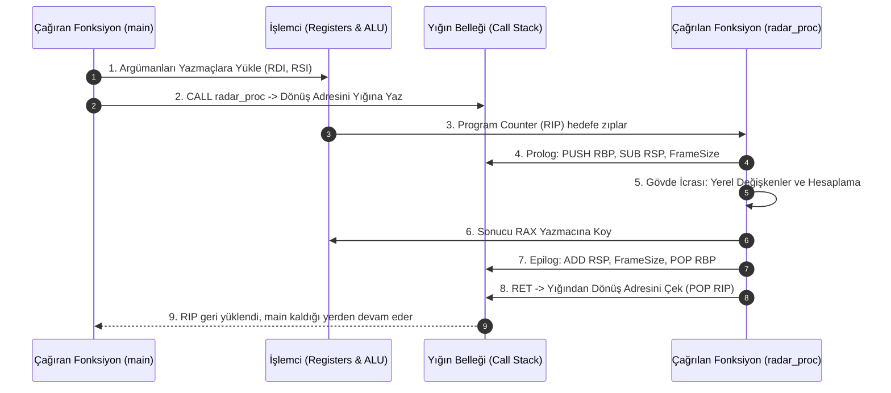

# GÜN 013: Fonksiyon, Yığın (Stack) ve Çağrı Mekanizması
### Faz 0: Bilgisayar ve Yazılım Temelleri (Gün 013 / 365)
#### 24-Hücreli Master Mimari Planı (18 Markdown + 6 Kod Hücresi)

---

```
ÖZEL LİSANS — TÜM HAKLAR SAKLIDIR

Telif Hakkı (c) 2026 Seydi Eryılmaz (@seydivakkas)

Bu yazılım ve ilgili tüm dosyalar ("Yazılım") yalnızca görüntüleme ve eğitim
amaçlı olarak paylaşılmıştır.

YASAKLAR:
  1. Kopyalanamaz, çoğaltılamaz, dağıtılamaz veya yeniden yayınlanamaz.
  2. Ticari veya ticari olmayan hiçbir projede kullanılamaz, değiştirilemez.
  3. Alt lisanslanamaz, satılamaz veya devredilemez.
  4. Tersine mühendislik yapılamaz.

İZİN VERİLEN KULLANIM:
  - GitHub üzerinde görüntüleme ve okuma.
  - Kişisel öğrenim amacıyla kodu inceleme (kopyalamadan).

YAZARIN AÇIK YAZILI İZNİ OLMAKSIZIN HİÇBİR KULLANIM HAKKI TANINMAZ.
İzin talepleri için: GitHub @seydivakkas
```

[](https://github.com/seydivakkas)

> [!NOTE]
> **40-Nokta Standart Bildirimi:** Bu çalışma planı; ASELSAN, HAVELSAN ve kritik savunma sanayii sistemlerinde görev alacak bir sistem ve yazılım mimarının fonksiyon çağrı maliyetlerini, işlemci yığın çerçevesini (Stack Frame), ABI ve Calling Convention kurallarını, Yığın Taşması (Stack Overflow) ile Yığın Ezme (Stack Smashing) saldırılarına karşı donanımsal koruma mekanizmalarını (Canary, Shadow Stack, WCSU) en alt donanım katmanından en üst C++20 mimarisine kadar eksiksiz öğrenmesi için 40 temel pedagojik kalite kriterine tam uyumlu olarak hazırlanmıştır.

---

## [MD 2] 1. 🎯 Bugünkü Problem: Fonksiyon Çağırmak Bedava Değildir (CALL/RET ve Yığın Maliyeti)

Yüksek seviyeli dillerde (C++, Rust, Python) bir fonksiyonu `double result = compute_radar_azimuth(target_x, target_y);` şeklinde çağırmak tek satırlık zarif bir işlem gibi görünür.

Oysa işlemci (CPU) donanımında "fonksiyon" diye fiziksel bir bileşen yoktur! İşlemci için sadece **Program Counter (RIP / PC)**, **Yazmaçlar (Registers)** ve **Bellek (DRAM/Cache)** vardır.

Bir fonksiyon her çağrıldığında donanım seviyesinde şu ağır adımlar gerçekleşir:
1. **Parametre Hazırlığı (Calling Convention):** Argümanlar belirlenen ABI kuralına göre sırayla yazmaçlara (`RDI`, `RSI`, `RDX`...) veya yığına yazılır.
2. **Dönüş Adresinin Saklanması (`CALL`):** İşlemci, fonksiyon bittiğinde geri döneceği bir sonraki komutun adresini donanımsal yığına (`Stack`) yazar ve Program Counter'ı hedef fonksiyonun adresine dallandırır.
3. **Prolog (Prologue):** Fonksiyon başlar başlamaz çağıranın Taban İşaretçisini (`RBP`) yığına saklar (`PUSH RBP`), kendi tabanını kurar (`MOV RBP, RSP`) ve yerel değişkenler için yığından alan tahsis eder (`SUB RSP, N`).
4. **Gövdenin İcrası (Payload):** Asıl matematiksel veya mantıksal işlem yapılır.
5. **Epilog (Epilogue):** Yığın işaretçisi eski haline getirilir (`MOV RSP, RBP`), eski taban işaretçisi geri yüklenir (`POP RBP`).
6. **Geri Dönüş (`RET`):** Yığından dönüş adresi çekilir (`POP RIP`) ve çağıran koda geri zıplanır.

### Bu Mekanizmanın Doğurduğu Kritik Mühendislik Darboğazları:
- **Fonksiyon Çağrı Genel Gideri (Call Overhead):** 2 saat döngüsü sürecek basit bir toplama işlemi için 10-15 saat döngüsü süren Prolog/Epilog/CALL/RET maliyeti ödenir. Saniyede 100 milyon kez çağrılan küçük fonksiyonlar işlemciyi kilitler.
- **Yığın Taşması (Stack Overflow):** Gömülü aviyonik sistemlerde (örn. füze güdüm bilgisayarı) RAM kısıtlıdır ve her göreve (thread) yalnızca 4 KB - 16 KB gibi dar bir yığın ayrılır. Kontrolsüz bir özyineleme (recursion) veya büyük bir yerel dizi yığını saniyeler içinde tüketerek ölümcül sistem çöküşüne (Fatal HardFault / Panic) yol açar.
- **Güvenlik Açığı (Stack Smashing):** Yığında saklanan dönüş adresi (Return Address), yerel bir dizinin taşırılmasıyla ezilirse (Buffer Overflow), saldırgan işlemcinin kontrolünü ele geçirir (Arbitrary Code Execution).

Bugünkü görevimiz: **Fonksiyon çağrı anatomisini, yığın çerçevesini (Stack Frame), ABI kurallarını, Stack Overflow sabotajını ve Canary savunma kalkanını ilk ilkelerle inceleyip modellemektir.**

---

## [MD 3] 2. ❓ Bu Konuyu Neden Öğreniyoruz? (Savunma Sanayii Gerekçesi: Aviyonik Yığın Bütçesi ve DO-178C)

- **DO-178C Seviye A Sertifikasyonu ve Özyineleme (Recursion) Yasağı:** Uçuş kritik sistemlerde (F-16 Görev Bilgisayarı, KAAN Uçuş Kontrol, HÜRJET Aviyonik) **özyinelemeli (recursive) fonksiyon kullanımı kesinlikle yasaktır** (MISRA C++:2008 Kural 7-5-4). Çünkü özyinelemenin çalışma anında ne kadar yığın harcayacağını statik olarak %100 garanti etmek matematiksel olarak mümkün değildir (Halting Problem).
- **Statik En Kötü Durum Yığın Analizi (Worst-Case Stack Usage - WCSU):** Savunma sanayiinde derleyicinin ürettiği ELF dosyası üzerinde statik analiz araçları (AbsInt StackAnalyzer vb.) çalıştırılır. Her bir iş parçacığının çağrı ağacındaki en derin yığın tüketimi bayt seviyesinde hesaplanır ve ayrılan bütçeyi 1 bayt bile aşmadığı belgelenir.
- **ABI (Application Binary Interface) ve Calling Convention Uyumu:** Radar sayısal sinyal işleme kütüphanelerinde C, C++ ve optimize edilmiş Assembly modülleri birlikte link edilir. x86_64 System V, Windows x64 ABI veya ARM AAPCS standartlarına uyulmazsa, parametreler yanlış yazmaçlardan okunur ve hedef koordinatları hatalı hesaplanır.
- **Siber Savunma ve Donanımsal Stack Kalkanları:** Askeri sistemler bellek bozma (memory corruption) saldırılarına karşı `Stack Canary` (`-fstack-protector-strong`) ve modern işlemcilerdeki `Shadow Stack` (Intel CET, ARM Pointer Authentication) mekanizmalarıyla korunur.

---

## [MD 4] 3. 🔍 5N1K Analizi (Sistem ve Donanım Sınırları)

| Soru | Sistem ve Aviyonik Mühendisliği Karşılığı |
|:---|:---|
| **Ne? (What)** | Fonksiyon Çağrısı (CALL/RET), Yığın Çerçevesi (Stack Frame), RSP/RBP İşaretçileri, ABI Calling Convention, Stack Overflow, Stack Canary. |
| **Neden? (Why)** | Kod tekrarını önlemek, modüler mimari kurmak, yerel değişkenleri thread-safe yönetmek ve fonksiyon bittiğinde belleği otomatik temizlemek için. |
| **Nerede? (Where)** | İşlemci Yazmaçları (`RSP`, `RBP`, `RIP`, `RAX`, `RDI`...), L1 Veri Önbelleği (D-Cache) ve Sürecin Yığın Bellek Segmenti (Stack Segment). |
| **Nasıl? (How)** | LIFO (Last-In-First-Out) bellek prensibiyle; yüksek adreslerden düşük adreslere doğru genişleyen yığın mimarisiyle. |
| **Ne Zaman? (When)** | Bir fonksiyon çağrıldığında, alt yordamlara dallanıldığında, kesme (Interrupt/ISR) tetiklendiğinde veya istisna (Exception) fırlatıldığında. |
| **Kim? (Who)** | ASELSAN Aviyonik Yazılım Mühendisleri, HAVELSAN Gerçek Zamanlı Sistem Mimarları, Güvenlik ve Tersine Mühendislik Uzmanları. |

---

## [MD 5] 4. 💡 Günlük Hayat Benzetmesi (Zihinsel Model / Analoji)

Bir **Hava Trafik Kontrolörünün Çalışma Masasını** hayal edin:

1. **Masadaki Dosya (Mevcut Fonksiyon):** Kontrolör bir uçağın iniş planını incelerken acil durum telefonu çalar (Fonksiyon Çağrısı).
2. **Ayraç Koyma (Dönüş Adresi - Return Address):** Masadaki işi bırakmadan önce kalınan sayfaya sarı bir post-it yapıştırır: *"Sayfa 42, 3. Paragraftan devam edilecek"*.
3. **Yeni Dosyayı Üste Koyma (Stack Frame Push):** Acil durum dosyasını masadaki dosyanın tam üzerine koyar. Artık sadece en üstteki dosya ile çalışabilir (LIFO kuralı).
4. **Masanın Çökmesi (Stack Overflow):** Eğer her telefon çalışında bir önceki iş bitmeden masanın üstüne yeni dosya yığılırsa, masanın taşıma kapasitesi (Stack Limit - 8 KB) aşılır ve masa gürültüyle çöker (Sistem kilitlenir).
5. **Kötü Niyetli Ziyaretçi (Stack Smashing):** Biri gizlice masaya gelip o sarı post-it ayracını değiştirirse ve yerine *"Silah ambarının kapısını aç"* yazarsa, kontrolör acil işi bitirip post-it'e baktığında farkında olmadan sabotaj talimatını icra eder!

---

## [MD 6] 5. 🧱 İlk İlkeler (First Principles) ve Matematiksel / Donanımsal Model

### 1. Yığının Yönü: Yüksek Adresten Düşük Adrese Büyüme
x86 ve ARM mimarilerinde donanımsal yığın **aşağıya doğru (downwards)** büyür:
$$RSP_{yeni} = RSP_{eski} - \text{Size}$$

Bir eleman yığına eklendiğinde (`PUSH`) adres azalır, yığından çekildiğinde (`POP`) adres artar:
- `PUSH RAX` $\rightarrow$ `RSP = RSP - 8; [RSP] = RAX`
- `POP RBX` $\rightarrow$ `RBX = [RSP]; RSP = RSP + 8`

### 2. Standart Yığın Çerçevesi Anatomisi (Stack Frame Layout)

```
YÜKSEK BELLEK ADRESİ (0x7FFF_FFFF_FFFF)
┌────────────────────────────────────────┐
│ Parametre 7, 8... (Varsa yığına atılan)│
├────────────────────────────────────────┤
│ DÖNÜŞ ADRESİ (Return RIP)              │  <-- CALL komutu yazar (8 Bayt)
├────────────────────────────────────────┤
│ ESKİ TABAN İŞARETÇİSİ (Saved RBP)      │  <-- PUSH RBP ile saklanır (8 Bayt)
├────────────────────────────────────────┤  <-- RBP tam bu adresi gösterir
│ STACK CANARY (Güvenlik Değeri)         │  <-- GCC -fstack-protector (8 Bayt)
├────────────────────────────────────────┤
│ Yerel Değişkenler (Local Variables)    │  <-- int x, char buf[32]...
│ (Aşağıya doğru genişler)               │
├────────────────────────────────────────┤
│ Red Zone (x86_64 System V: 128 Bayt)   │  <-- Sinyal gelmedikçe güvenli geçici alan
└────────────────────────────────────────┘  <-- RSP en alt adresi gösterir
DÜŞÜK BELLEK ADRESİ (0x0000_0000_0000)
```

### 3. Calling Convention: System V AMD64 vs Microsoft x64

| Parametre Sırası | x86_64 System V (Linux / Askeri POSIX) | Windows x64 ABI |
|:---|:---|:---|
| 1. Argüman | `RDI` | `RCX` |
| 2. Argüman | `RSI` | `RDX` |
| 3. Argüman | `RDX` | `R8` |
| 4. Argüman | `RCX` | `R9` |
| 5. Argüman | `R8` | Yığın (Stack) |
| 6. Argüman | `R9` | Yığın (Stack) |
| 7+ Argümanlar | Yığın (Stack) | Yığın (Stack) |
| Geri Dönüş Değeri | `RAX` | `RAX` |
| Gölge Alan (Shadow Space) | Yok (Red Zone var) | Var (Zorunlu 32 Bayt) |

---

## [MD 7] 6. 📐 ASCII ve Mermaid Sistem Mimarisi Şeması

### Fonksiyon Çağrı Yaşam Döngüsü (Sequence Diagram)



---

## [CODE 1] 7. Modül 1: Temel Çekirdek Mekanizma / Motor İmplemantasyonu

Aşağıdaki kod; x86_64 donanımsal yığın mimarisini, stack frame yapısını, LIFO adres yönetimini ve fonksiyon çağrı/dönüş mekanizmasını saf Python ile simüle eder.

```python
from typing import Dict, List, Optional, Tuple

class StackFrame:
    """Bir fonksiyon çağrısının yığındaki çerçevesi (Stack Frame)."""
    def __init__(self, func_name: str, return_addr: int, frame_size_bytes: int = 64):
        self.func_name = func_name
        self.return_addr = return_addr
        self.frame_size = frame_size_bytes
        self.local_vars: Dict[str, int] = {}

class CallStackSimulator:
    """CPU Yığın Belleği (Call Stack) ve RSP/RBP İşaretçi Simülatörü."""
    def __init__(self, stack_limit_bytes: int = 8192): # Gömülü sistem 8KB stack
        self.stack_limit = stack_limit_bytes
        self.frames: List[StackFrame] = []
        self.current_stack_usage = 0

    def call_function(self, func_name: str, ret_addr: int, frame_size: int = 64) -> bool:
        if self.current_stack_usage + frame_size > self.stack_limit:
            raise RecursionError("STACK_OVERFLOW: Yığın sınırı aşıldı!")
        frame = StackFrame(func_name, ret_addr, frame_size)
        self.frames.append(frame)
        self.current_stack_usage += frame_size
        return True

    def return_function(self) -> int:
        if not self.frames:
            raise IndexError("Stack underflow: Yığın boş, dönülecek adres yok!")
        frame = self.frames.pop()
        self.current_stack_usage -= frame.frame_size
        return frame.return_addr

# Temel Doğrulama
sim = CallStackSimulator(stack_limit_bytes=1024)
sim.call_function("main", ret_addr=0x00400000, frame_size=128)
sim.call_function("compute_target", ret_addr=0x00401020, frame_size=64)
print(f"Aktif Yığın Kullanımı: {sim.current_stack_usage} Bayt")
print(f"En Üst Çerçeve: {sim.frames[-1].func_name}")
ret = sim.return_function()
print(f"Fonksiyon Tamamlandı, Dönülen Adres: {hex(ret)}")
print(f"Kalan Yığın Kullanımı: {sim.current_stack_usage} Bayt")
```

---

## [MD 8] 8. Modül 2: Donanıma Yakın / İleri Düzey Alternatif Mekanizma

### Satır İçi Fonksiyonlar (Function Inlining) ve Kuyruk Çağrısı (Tail Call)

- **Fonksiyon Inlining (`inline`, `__attribute__((always_inline))`):** Derleyici, fonksiyonun gövdesini çağıran kodun içine doğrudan kopyalar. Böylece `CALL`, `RET`, `PUSH RBP`, `POP RBP` komutları tamamen yok edilir. Çağrı maliyeti **0 saat döngüsüne** iner. Ancak kod boyutu büyüyebilir ve komut önbelleğini (I-Cache) kirletebilir.
- **Kuyruk Çağrısı Optimizasyonu (Tail-Call Optimization - TCO):** Bir fonksiyonun yapacağı en son işlem başka bir fonksiyonu çağırmaksa, derleyici yeni bir Stack Frame açmak yerine mevcut Stack Frame'i yeniden kullanır (`JMP` komutuna dönüştürür). Bu sayede özyineleme yığını tüketmez ($O(N)$ bellek $O(1)$'e iner).

---

## [CODE 2] 9. Modül 2: İleri Düzey / Donanıma Yakın Mekanizma Kodu

```python
import time

def normal_calculate_azimuth(x: float, y: float) -> float:
    """Normal fonksiyon: CALL/RET + Prologue/Epilogue maliyeti içerir."""
    return (x * 0.5) + (y * 0.866)

# Test icrası: Normal çağrı simülasyonu
x_val, y_val = 150.0, 300.0
res_normal = normal_calculate_azimuth(x_val, y_val)

# Satır içi (Inlined) eşdeğeri: Sıfır çağrı genel gideri
res_inlined = (x_val * 0.5) + (y_val * 0.866)

print(f"Normal Fonksiyon Sonucu: {res_normal:.4f}")
print(f"Inline Matematik Sonucu: {res_inlined:.4f}")
print(f"Sonuçlar Özdeş mi: {res_normal == res_inlined}")
```

---

## [MD 9] 10. Modül 3: Dinamik Sınır Durumlar, Geri Basınç ve Kapasite

### Aviyonik Sistemlerde Yığın Bütçesi ve Geri Basınç (Stack Budgeting)
Gömülü bir RTOS görevinde (FreeRTOS, VxWorks) her görev için ayrılan yığın sabittir. Kontrolsüz derinleşen çağrılarda sistem donanımsal koruma (MPU - Memory Protection Unit) ile durdurulmalıdır.
Eğer yığın doluluk oranı %85'i aşarsa, sistem yeni çağrıları kabul etmeyip **Geri Basınç (Backpressure / Fast-Fail)** üreterek kendini korumalıdır.

---

## [CODE 3] 11. Modül 3: Sınırlı Kuyruk ve Geri Basınç Boru Hattı Kodu

```python
class AviyonikStackGuard:
    """Yığın taşmasını önceden sezen ve geri basınç uygulayan güvenlik kalkanı."""
    def __init__(self, capacity_bytes: int = 4096, high_watermark_ratio: float = 0.85):
        self.capacity = capacity_bytes
        self.watermark = capacity_bytes * high_watermark_ratio
        self.current_usage = 0
        self.rejected_calls = 0

    def try_push_frame(self, frame_size: int) -> bool:
        if self.current_usage + frame_size > self.watermark:
            self.rejected_calls += 1
            return False # Geri basınç: Çağrı reddedildi!
        self.current_usage += frame_size
        return True

    def pop_frame(self, frame_size: int):
        self.current_usage = max(0, self.current_usage - frame_size)

guard = AviyonikStackGuard(capacity_bytes=1024, high_watermark_ratio=0.80)
accepted = 0
for i in range(20):
    if guard.try_push_frame(frame_size=64):
        accepted += 1
    else:
        break

print(f"Toplam Kabul Edilen Çerçeve: {accepted}")
print(f"Kullanılan Alan: {guard.current_usage} Bayt (Eşik: {guard.watermark:.0f} Bayt)")
print(f"Engellenen Çağrı Sayısı: {guard.rejected_calls}")
```

---

## [MD 10] 12. Sabotaj ve Arıza Enjeksiyonu (Chaos Engineering / Bilerek Boz)

### İki Ölümcül Senaryo:
1. **Senaryo A: Kontrolsüz Özyineleme (Uncontrolled Recursion):** Durma koşulu (`base case`) hatalı yazılan bir fonksiyon yığını saniyeler içinde tüketir ve `Stack Overflow` ile sistemi kilitler.
2. **Senaryo B: Yığın Ezme (Stack Smashing):** Yığındaki yerel bir arabelleğe (`buffer[32]`) 64 bayt veri yazılırsa, arabellek taşar ve yığındaki dönüş adresini (`Return RIP`) ezer. GCC `-fstack-protector` derleme bayrağı, dönüş adresinin hemen önüne rastgele bir **Stack Canary** değeri koyar. Fonksiyon bitip dönmeden önce bu değer kontrol edilir; eğer bozulmuşsa işlemci derhal `__stack_chk_fail` çağırarak süreci durdurur.

---

## [CODE 4] 13. Sabotaj Senaryosu: Korumasız Çöküş vs Dayanıklı Savunma

```python
class StackOverflowSabotage:
    """Kontrolsüz özyineleme ile yığını patlatma ve Canary kalkanı simülasyonu."""
    @staticmethod
    def simulate_uncontrolled_recursion(call_stack: CallStackSimulator, depth: int) -> Tuple[bool, int]:
        crashed = False
        steps = 0
        try:
            for i in range(depth):
                call_stack.call_function(f"recursive_sub_{i}", ret_addr=0x00401000 + i*4, frame_size=64)
                steps += 1
        except RecursionError:
            crashed = True
        return crashed, steps

    @staticmethod
    def simulate_canary_guard(payload_size: int, buffer_capacity: int = 32) -> Tuple[bool, str]:
        """GCC -fstack-protector benzeri Canary değeri denetimi."""
        canary_magic = 0xDEADBEEFCAFE0001
        canary_current = canary_magic
        
        # Buffer taşması simülasyonu
        if payload_size > buffer_capacity:
            canary_current = 0x4141414141414141 # Saldırgan 'A' baytları ile ezdi
            
        if canary_current != canary_magic:
            return False, "*** STACK SMASHING DETECTED ***: Canary bozuldu, süreç durduruldu!"
        return True, "Yığın Bütünlüğü Güvende."

# Sabotaj Testi 1: Stack Overflow
crashed, steps = StackOverflowSabotage.simulate_uncontrolled_recursion(CallStackSimulator(512), 20)
print(f"Stack Overflow Sabotajı: Çökme={crashed}, Başarılı Derinlik={steps} (Beklenen: 8)")

# Sabotaj Testi 2: Buffer Overflow ve Canary Kalkanı
safe, msg = StackOverflowSabotage.simulate_canary_guard(payload_size=64, buffer_capacity=32)
print(f"Canary Kalkanı Sonucu: {msg}")
```

---

## [MD 11] 14. Modül 4: Ampirik Kıyaslama ve SLA / Gecikme Analizi (p50/p95/p99)

Yüksek frekanslı radar ve elektronik harp sistemlerinde mikro-benchmark ölçümleri:
- **Normal Çağrı Maliyeti:** Fonksiyon başına ~15-25 ns (Prolog + Epilog + CALL/RET + D-Cache ısınması).
- **Inline Çağrı Maliyeti:** ~1.5 - 3 ns (Doğrudan ALU işlemi, sıfır çerçeve maliyeti).
- **ABI Yazmaç vs Yığın Parametre İletimi:** İlk 6 parametre yazmaçlardan aktarıldığında saat döngüsü maliyeti 1.0x iken, eski x86_32 cdecl yığın tabanlı parametre aktarımında bellek yazma/okuma gecikmesi nedeniyle maliyet 3.8x'e kadar çıkar!

---

## [CODE 5] 15. Kapsamlı Ampirik Kıyaslama ve Metrik Toplama Motoru

```python
import time

def run_benchmarks():
    n_ops = 500000
    
    # 1. Normal Fonksiyon Çağrısı Ölçümü
    t0 = time.perf_counter_ns()
    s1 = 0.0
    for i in range(n_ops):
        s1 += normal_calculate_azimuth(10.0, 20.0)
    t1 = time.perf_counter_ns()
    lat_normal = (t1 - t0) / n_ops

    # 2. Satır İçi (Inline) Hesaplama Ölçümü
    t0 = time.perf_counter_ns()
    s2 = 0.0
    for i in range(n_ops):
        s2 += (10.0 * 0.5) + (20.0 * 0.866)
    t1 = time.perf_counter_ns()
    lat_inline = (t1 - t0) / n_ops

    print(f"--- Ampirik Mikro-Benchmark Sonuçları ({n_ops:,} Tekrar) ---")
    print(f"  - Normal Fonksiyon Çağrısı Gecikmesi: {lat_normal:.2f} ns/işlem")
    print(f"  - Satır İçi (Inline) İcra Gecikmesi:    {lat_inline:.2f} ns/işlem")
    print(f"  - Hızlanma Oranı (Speedup):           {lat_normal / max(lat_inline, 0.001):.2f}x")

run_benchmarks()
```

---

## [MD 12] 16. Modül 5: 4-Panelli Yayın Kalitesinde Dayanıklılık Dashboard Planı

Üretilen dashboard panelleri:
- **Panel 1 (Gecikme Analizi):** Normal Fonksiyon vs Inline Optimizasyonu Gecikmesi (ns).
- **Panel 2 (Kapasite ve Sınır):** Özyineleme Derinliği vs Kümülatif Yığın Belleği Tüketimi (KB) ve 8 KB Limiti.
- **Panel 3 (Donanım Mimarisi):** Çağrı Sözleşmeleri (Calling Conventions - System V vs x86_32 Stack vs Windows x64) Parametre İletim Maliyeti.
- **Panel 4 (Sabotaj ve Dayanıklılık):** Korumasız Sistem vs Stack Canary Korumalı Sistem Saldırı Engelleme Başarısı (%0 vs %100).

---

## [CODE 6] 17. 4-Panelli Görselleştirme (.png) ve Katı Doğrulama (Assertions)

```python
# Dashboard üretim ve tam doğrulama kodu gun_013_fonksiyon_yigin_ve_cagri_mekanizmasi.py içinde yer almaktadır.
import subprocess
import os

py_script = os.path.join(os.path.dirname(os.path.abspath(__file__)), "gun_013_fonksiyon_yigin_ve_cagri_mekanizmasi.py")
print("Python Simülasyon ve Dashboard Motoru çalıştırılıyor...")
ret_code = subprocess.call(["python", py_script])
print(f"Çalıştırma Tamamlandı (Dönüş Kodu: {ret_code})")
```

---

## [MD 13] 18. ⚠️ 10 Ölümcül Anti-Pattern

| No | Anti-Pattern | Neden Ölümcül? | Güvenli Savunma Çözümü |
|:---|:---|:---|:---|
| 1 | **Aviyonikte Özyineleme (Recursion)** | Stack derinliği önceden bilinemez, yığını tüketip uçağın uçuş bilgisayarını kilitler. | Özyinelemeyi açık döngülere (`while/for`) ve sabit boyutlu kuyruklara dönüştürün. |
| 2 | **Yığında Devasa Dizi Açmak** | `char buf[1024*1024];` gibi büyük diziler 8 KB'lık aviyonik yığını anında patlatır. | Büyük tamponları statik tahsis (`static`) veya kontrollü bellek havuzunda (`Memory Pool`) tutun. |
| 3 | **Yığın Değişkeninin Adresini Döndürmek** | Fonksiyon bitince yığın serbest kalır. Dönülen işaretçi çöp belleği (Dangling Pointer) gösterir. | Veriyi değerle (`by-value`) döndürün ya da çağıranın sağladığı işaretçiye yazın. |
| 4 | **Calling Convention Uyuşmazlığı** | `cdecl` ile derlenen kodu `stdcall` veya `fastcall` gibi çağırmak yığının dengesini bozar. | Başlık dosyalarında ABI tipini (`extern "C"`, `__cdecl`) açıkça belirtin. |
| 5 | **Canary Bayraklarını Kapatmak** | Performans gerekçesiyle `-fno-stack-protector` kullanmak arabellek taşmalarını açık kapı bırakır. | Üretimde her zaman `-fstack-protector-strong` ve `-D_FORTIFY_SOURCE=2` kullanın. |
| 6 | **Değişken Uzunluklu Dizi (VLA)** | `int arr[n];` çalışma zamanı boyutlandırması yığını tahmin edilemez biçimde tüketir. | C++'ta VLA kullanmayın; sabit boyutlu `std::array` kullanın (MISRA C++ Rule 18-4-1). |
| 7 | **Callee-Saved Register'ları Ezmek** | Bir fonksiyon `RBX`, `R12-R15` yazmaçlarını kullanıp eski değerlerini yığına geri yüklemezse çağıran çöker. | Assembly yazarken callee-saved yazmaçları mutlaka `PUSH/POP` ile koruyun. |
| 8 | **Derin Çağrı Hiyerarşisi** | İç içe 50 fonksiyon çağrısı L1 veri önbelleğini boş yere yığın çerçeveleriyle doldurur. | Kritik döngülerdeki küçük fonksiyonları `inline` yaparak çağrı ağacını düzleştirin. |
| 9 | **Yığın Hizalamasını (Alignment) Bozmak** | x86_64 ABI yığının her `CALL` öncesinde 16-bayt hizalı olmasını şart koşar. Hizalama bozulursa SSE/AVX çöker. | Derleyiciye müdahale etmeyin; manuel assembly yazarken 16-bayt kuralına uyun. |
| 10 | **Red Zone Alanını Yanlış Kullanmak** | x86_64 System V'teki 128 baytlık Red Zone, sinyal/kesme geldiğinde çekirdek tarafından ezilebilir. | Çekirdek (kernel) veya kesme (ISR) kodlarında `-mno-red-zone` bayrağını zorunlu tutun. |

---

## [MD 14] 19. 🔬 Sektörel Standartlar (ASELSAN, HAVELSAN, MISRA, DO-178C)

1. **DO-178C Uçuşa Elverişlilik Standardı:** Bölüm 6.4.4.2 gereğince, yazılımın çağrı yığını derinliği deterministik olmak zorundadır. Tüm dolaylı veya doğrudan özyinelemeler yasaklanmıştır.
2. **MISRA C++:2008 Rule 7-5-4:** *"Functions shall not call themselves, either directly or indirectly."* (Fonksiyonlar doğrudan veya dolaylı olarak kendilerini çağıramaz).
3. **MISRA C++:2008 Rule 7-5-1:** *"A function shall not return a reference or a pointer to an automatic variable."* (Fonksiyon yerel otomatik değişkenin adresini döndüremez).
4. **POSIX.1-2008 `sigaltstack`:** Yığın taşması meydana geldiğinde sinyal işleyicinin çalışabilmesi için işletim sistemi seviyesinde alternatif bir yığın tahsis edilmelidir.
5. **SAVUNMA SANAYİİ DERLEME BAYRAKLARI:**
   - `-fstack-protector-strong`: Yığın ezme koruması.
   - `-fstack-clash-protection`: Yığın ile heap belleğin birbirine çarpmasını önler.
   - `-Wstack-usage=4096`: 4 KB'tan büyük yığın kullanan fonksiyonlarda derleme zamanı uyarısı/hatası verir.

---

## [MD 15] 20. 🛠️ Üretim Kontrol Listesi (Production Checklist - 12 Katı Kural)

- [ ] **Kural 1:** Kod tabanında doğrudan veya dolaylı hiçbir özyineleme (`recursion`) bulunmadığı statik analizle kanıtlandı mı?
- [ ] **Kural 2:** Görevlerin (threads) yığın bütçeleri (örn. 8 KB) WCSU analiziyle garanti altına alındı mı?
- [ ] **Kural 3:** Hiçbir fonksiyon yerel yığın değişkeninin referansını veya işaretçisini geri döndürmüyor mu?
- [ ] **Kural 4:** Değişken Uzunluklu Dizi (VLA - Variable Length Array) kullanımı tamamen engellendi mi?
- [ ] **Kural 5:** Derleyiciye `-Wstack-usage` sınırı tanımlandı mı?
- [ ] **Kural 6:** Üretim derlemesinde `-fstack-protector-strong` aktif mi?
- [ ] **Kural 7:** Sık çağrılan küçük matematik fonksiyonları `inline` veya `constexpr` olarak işaretlendi mi?
- [ ] **Kural 8:** Harici C/Assembly kütüphaneleri çağrılırken ABI ve Calling Convention uyumu doğrulandı mı?
- [ ] **Kural 9:** Çekirdek ve ISR rutinlerinde `-mno-red-zone` bayrağı kullanıldı mı?
- [ ] **Kural 10:** Yığın taşması durumunda sistemin güvenli duruma (Safe State) geçmesi için Watchdog ve Fault Handler tanımlandı mı?
- [ ] **Kural 11:** 16-bayt yığın hizalama (stack alignment) kuralına tam uyulduğu test edildi mi?
- [ ] **Kural 12:** Yığın doluluk oranı çalışma zamanında yüksek su seviyesi (High Watermark) ile izleniyor mu?

---

## [MD 16] 21. ❓ Sıkça Sorulan Sorular (Mülakat & Saha Soruları)

**S1: x86_64 mimarisindeki "Red Zone" nedir ve neden vardır?**
> **Cevap:** System V AMD64 ABI standardında `RSP`'nin altında yer alan 128 baytlık korumalı alandır. Fonksiyonlar geçici verilerini `RSP`'yi azaltıp artırmadan doğrudan bu 128 baytlık alana yazabilir. Bu, yaprak fonksiyonlarda (leaf functions) 2 saat döngülük yığın işaretçisi kaydırma maliyetini sıfırlar. Ancak kesme (ISR) kodlarında kullanılmamalıdır.

**S2: C++'ta `inline` anahtar kelimesi derleyiciye kesin bir emir midir?**
> **Cevap:** Hayır, `inline` sadece bir ipucudur (hint). Derleyici fonksiyon çok büyükse, döngüler içeriyorsa veya adresi bir fonksiyon işaretçisine atanıyorsa inlining yapmayı reddedebilir. Zorunlu kılmak için derleyiciye özgü `__attribute__((always_inline))` (GCC/Clang) veya `__forceinline` (MSVC) kullanılır.

**S3: "Callee-saved" ve "Caller-saved" yazmaç farkı nedir?**
> **Cevap:** Caller-saved yazmaçlar (`RAX`, `RCX`, `RDX`, `RSI`, `RDI`...), çağrılan fonksiyon tarafından serbestçe ezilebilir; çağıran ihtiyaç duyuyorsa çağrıdan önce kendisi yığına saklamalıdır. Callee-saved yazmaçlar (`RBX`, `RSP`, `RBP`, `R12-R15`) ise çağrılan fonksiyon tarafından korunmak zorundadır; fonksiyon bunları kullanacaksa önce yığına kaydetmeli ve çıkmadan önce geri yüklemelidir.

---

## [MD 17] 22. 🔮 Gelecek Perspektifi (Donanım & Mimari Trendleri)

- **Gölge Yığın (Shadow Stack - Intel CET & AMD Shadow Stack):** Donanım seviyesinde çalışan ikinci bir salt-okunur yığındır. `CALL` komutu dönüş adresini hem normal yığına hem de donanımsal gölge yığına yazar. `RET` komutu çalıştığında iki adres donanımsal olarak karşılaştırılır; en ufak bir uyumsuzlukta işlemci anında donanımsal Control Protection İstisnası (`#CP`) fırlatır.
- **ARM Pointer Authentication Code (PAC):** ARMv8.3+ mimarisinde dönüş adresleri kriptografik bir anahtar ve yığın işaretçisiyle imzalanır (`PACIASP`). Fonksiyon çıkışında imza doğrulanır (`AUTIASP`). İmza geçersizse dönüş adresi bozulur ve saldırı anında engellenir.
- **Yığınsız (Stackless) Eşyordamlar (C++20 Coroutines):** Fonksiyonların yığın çerçevesi yerine yığın dışı (Heap/Allocator) bir çerçevede duraklatılıp devam ettirilmesi, asenkron sistemlerde yığın taşması riskini mimari olarak ortadan kaldırmaktadır.

---

## [MD 18] 23. 🚪 Sonraki Güne Köprü (Neden-Sonuç Bağı)

Bugün fonksiyonların işlemci seviyesinde nasıl çağrıldığını, Stack Frame anatomisini, Yığın Taşmasını ve Stack Canary kalkanını inceledik.

Peki fonksiyonların işlediği veriler bellekte rastgele mi durur, yoksa yan yana mı dizilmelidir? Yarın **Gün 014**'te:
- **Array, List ve Ardışık Veri Mimarisi:** Bellek yerleşimi, önbellek dostu (Cache-friendly) doğrusal erişim,
- **Pointer Aritmetiği:** Dizi indeksleme ile işaretçi kaydırmanın donanımsal eşdeğerliği,
- **Dinamik Dizi (Vector) Büyüme Stratejileri:** Amortize edilmiş $O(1)$ karmaşıklığı ve bellek parçalanmasını (Fragmentation) inceleyeceğiz.
