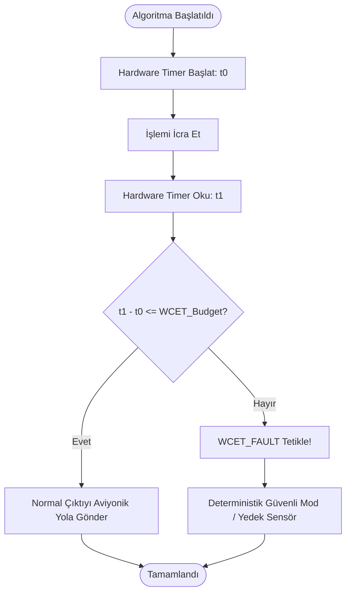

# GÜN 016: Big-O: Zaman ve Bellek Maliyeti
### Faz 0: Bilgisayar ve Yazılım Temelleri (Gün 016 / 365)
#### 24-Hücreli Master Mimari Planı (18 Markdown + 6 Kod Hücresi)

---

```
ÖZEL LİSANS — TÜM HAKLAR SAKLIDIR

Telif Hakkı (c) 2026 Seydi Eryılmaz (@seydivakkas)

Bu yazılım ve ilgili tüm dosyalar ("Yazılım") yalnızca görüntüleme ve eğitim
amaçlı olarak paylaşılmıştır.

YASAKLAR:
  1. Kopyalanamaz, çoğaltılamaz, dağıtılamaz veya yeniden yayınlanamaz.
  2. Ticari veya ticari olmayan hiçbir projede kullanılamaz, değiştirilemez.
  3. Alt lisanslanamaz, satılamaz veya devredilemez.
  4. Tersine mühendislik yapılamaz.

İZİN VERİLEN KULLANIM:
  - GitHub üzerinde görüntüleme ve okuma.
  - Kişisel öğrenim amacıyla kodu inceleme (kopyalamadan).

YAZARIN AÇIK YAZILI İZNİ OLMAKSIZIN HİÇBİR KULLANIM HAKKI TANINMAZ.
İzin talepleri için: GitHub @seydivakkas
```

[](https://github.com/seydivakkas)

> [!NOTE]
> **40-Nokta Standart Bildirimi:** Bu çalışma planı; ASELSAN, HAVELSAN, Roketsan ve STM seviyesinde görev alacak bir sistem ve yazılım mimarının algoritmik karmaşıklık analizini (Big-O, Big-$\Omega$, Big-$\Theta$), donanım saat döngüsü karşılıklarını, L1/L2 önbellek satırlarının oluşturduğu gizli sabit çarpanları (Hidden Constants), DO-178C seviyesinde En Kötü Durum Yürütme Süresini (Worst-Case Execution Time - WCET) ve aviyonik sistemlerde "Amortize Edilmiş" sürelerin neden kabul edilemez olduğunu kavraması için 40 temel pedagojik kalite kriterine tam uyumlu olarak hazırlanmıştır.

---

## [MD 2] 1. 🎯 Bugünkü Problem: Big-O Donanımı Neden Görmezden Gelir? (Teori vs L1/L2 Cache ve Sabit Çarpanlar)

Akademik bilgisayar biliminde algoritmalar $O(1), O(\log N), O(N), O(N \log N), O(N^2)$ gibi matematiksel sınıflara ayrılır ve $N \to \infty$ limitinde incelenir. Bu analizde sabit çarpanlar ($c$) ve alt dereceli terimler önemsiz kabul edilerek atılır ($f(N) = c \cdot N + k \implies O(N)$).

Oysa **gerçek fiziksel donanımda (CPU, Önbellek ve RAM) bu sabit çarpan $c$ her şeydir!**

1. **Gizli Sabit Çarpan (Hidden Constant) Darbesi:**
   - Bir bitişik diziyi (Array) baştan sona dolaşmak $O(N)$'dir. İşlemci her adımda L1 Cache Hit alır, donanımsal Prefetcher çalışır; adım başına maliyet $c_{array} \approx 1.5\text{ ns}$'dir.
   - Bir bağlı listeyi (Linked List) baştan sona dolaşmak da $O(N)$'dir. Ancak her adımda işaretçi kovalamaca (Pointer Chasing) ve DRAM Cache Miss yaşanır; adım başına maliyet $c_{list} \approx 25\text{ ns}$'dir.
   - İkisi de teoride $O(N)$ olmasına rağmen bağlı liste donanımda **~16–20 kat daha yavaştır!**

2. **Küçük $N$ Değerlerinde Algoritmik Tersine Dönüş (Crossover Point):**
   - $N \le 32$ veya $N \le 64$ olan küçük veri kümelerinde, basit bir $O(N^2)$ dizi taraması (Insertion Sort / Linear Search); karmaşık özyineleme, işaretçi ve bellek tahsis genel gideri olan bir $O(N \log N)$ ağaç aramasından veya QuickSort'tan **daha hızlı çalışır!**

3. **Aviyonik Sistemlerde "Amortize" Yanılgısı:**
   - Web yazılımlarında `std::vector::push_back` ortalamada $O(1)$ amortize kabul edilir. 
   - Ancak uçuş bilgisayarında 1 milisaniyelik kontrol döngüsünün tam ortasında vektör yeniden tahsise (`realloc`) girip $O(N)$ kopyalama yaparsa, o anki döngü gecikir ve uçuş kontrol yüzeyi (Flap) kilitlenir. Askeri sistemde **Amortize süre kabul edilemez; yalnızca En Kötü Durum (WCET) esastır.**

---

## [MD 3] 2. ❓ Bu Konuyu Neden Öğreniyoruz? (Savunma Sanayii Gerekçesi: DO-178C WCET Bütçesi ve Amortize Kabul Edilemezliği)

- **DO-178C Uçuş Emniyeti Standardı ve WCET:** Seviye A (Catastrophic) aviyonik yazılımlarda bir algoritmanın ortalama çalışma süresi (Average Case) hiçbir anlam ifade etmez. Her bir fonksiyonun işlemcinin en kötü koşullarında (Tüm Cache Miss'ler, tüm Branch Misprediction'lar devredeyken) kaç saat döngüsü süreceği statik analizle kanıtlanmalıdır.
- **Hash DoS ve Öngörülemezlik:** Standart bir hash tablosu (`std::unordered_map`) ortalamada $O(1)$ arama sunar. Ancak elektronik harp veya siber taarruz altında bir saldırgan aynı hash değerini üreten paketler gönderirse (Hash Collision), arama karmaşıklığı $O(N)$'e, genel ekleme karmaşıklığı $O(N^2)$'ye fırlar! Bu yüzden radar sinyal tablolarında hash tablosu yerine sabit zamanlı $O(\log N)$ veya statik $O(1)$ doğrudan indeks tabloları kullanılır.
- **Darbe Sıkıştırma ve Radar FFT:** Radar darbe sıkıştırmasında $N = 4096$ örneklik bir sinyalin zaman bölgesinde doğrudan konvolüsyonu $O(N^2) \approx 16.7$ milyon işlem gerektirir. FFT tabanlı frekans bölgesi çarpımı ise $O(N \log_2 N) \approx 49.000$ işlem sürer (**~340 kat hesaplama tasarrufu!**). Bu fark, radarın saniyede binlerce darbeyi gerçek zamanlı işleyebilmesini sağlar.

---

## [MD 4] 3. 🔍 5N1K Analizi (Sistem ve Donanım Sınırları)

| Soru | Sistem ve Algoritmik Mühendislik Karşılığı |
|:---|:---|
| **Ne? (What)** | Big-O, Big-$\Omega$, Big-$\Theta$, Asimptotik Karmaşıklık, Hidden Constants ($c$), WCET (Worst-Case Execution Time), Space Complexity. |
| **Neden? (Why)** | Donanım kaynaklarının (CPU saatleri ve RAM baytları) veri boyutu arttıkça nasıl ölçeklendiğini matematiksel olarak öngörmek için. |
| **Nerede? (Where)** | İşlemci Saat Döngülerinde (CPU Cycles), Döngü İterasyonlarında, Yığın (Stack) ve Önbellek Bellek Ayırmalarında. |
| **Nasıl? (How)** | Giriş boyutu $N$'in fonksiyonu olarak baskın terimi ($N^2, N \log N$) ve sabit katsayıları analiz ederek. |
| **Ne Zaman? (When)** | Sistem mimarisi tasarlanırken, algoritma seçimi yapılırken ve DO-178C zaman bütçesi doğrulanırken. |
| **Kim? (Who)** | ASELSAN Radar/EH Algoritma Mühendisleri, HAVELSAN Gerçek Zamanlı Sistem Mimarları, Aviyonik Emniyet Denetçileri. |

---

## [MD 5] 4. 💡 Günlük Hayat Benzetmesi (Zihinsel Model / Analoji)

Bir **Kargo Lojistik Merkezini** düşünelim:

1. **$O(1)$ (Sabit Zaman):** Paketin takip numarasını barkod okuyucuya tuttuğunuz anda raftaki yerini doğrudan ekranda görmek. Depoda 10 paket de olsa 10 milyon paket de olsa okuma süresi 1 saniyedir.
2. **$O(\log N)$ (İkiye Bölerek Arama):** 1000 sayfalık telefon rehberinde ortadan açarak aradığınız ismi bulmak. Sayfa sayısı 2 katına çıksa bile sadece 1 ek sayfa açma adımı gerekir.
3. **$O(N)$ (Doğrusal Arama):** Barkodu olmayan bir paketi bulmak için raftaki tüm kutuları tek tek elden geçirmek. 100 kutu varsa 100 adım, 100.000 kutu varsa 100.000 adım sürer.
4. **$O(N^2)$ (Karesel Felaket):** 1000 kolinin her birini depodaki diğer tüm 1000 koliyle tek tek yan yana getirip ağırlıklarını karşılaştırmak. $1.000 \times 1.000 = 1.000.000$ karşılaştırma! Paket sayısı 2 katına çıkarsa iş 4 katına çıkar.
5. **Gizli Sabit ($c$):** Kolileri tek tek taşırken bir işçinin forklift kullanması ($c=1$), diğerinin ise kolileri emekleyerek taşımasıdır ($c=20$). İkisi de $O(N)$ koli taşır ama emekleyen işçi akşamı zor eder!

---

## [MD 6] 5. 🧱 İlk İlkeler (First Principles) ve Matematiksel / Donanımsal Model

### 1. Matematiksel Tanım: Big-O Sınırı
Bir algoritmanın çalışma zamanı $T(N)$, pozitif sabitler $c$ ve $N_0$ için:
$$\forall N \ge N_0 : T(N) \le c \cdot f(N) \implies T(N) = O(f(N))$$

Donanımda toplam süre şu şekilde açılır:
$$\text{Süre} = c_{\text{L1}} \cdot N_{\text{hit}} + c_{\text{RAM}} \cdot N_{\text{miss}} + c_{\text{branch}} \cdot N_{\text{mispredict}}$$
Görüldüğü üzere Big-O yalnızca işlem sayısını modeller; bellek hiyerarşisinin $c_{\text{RAM}} \approx 200 \times c_{\text{L1}}$ çarpanını göz ardı eder.

### 2. Temel Karmaşıklık Sınıflarının Donanım Ölçeği

| Karmaşıklık Sınıfı | Adı | $N=10$ | $N=1.000$ | $N=1.000.000$ | Donanımsal Yorum |
|:---|:---|:---|:---|:---|:---|
| $O(1)$ | Sabit (Constant) | 1 | 1 | 1 | Dizi indeksi, Bitwise maskeleme, Register okuma |
| $O(\log N)$ | Logaritmik | 3.3 | 10 | 20 | Binary Search, Dengeli İkili Ağaç (Red-Black) |
| $O(N)$ | Doğrusal (Linear) | 10 | 1.000 | 1.000.000 | Tek döngü dizi taraması, `memcpy` |
| $O(N \log N)$ | Doğrusal Logaritmik | 33 | 10.000 | 20.000.000 | QuickSort, MergeSort, Radar Hızlı Fourier Dönüşümü (FFT) |
| $O(N^2)$ | Karesel (Quadratic) | 100 | 1.000.000 | $10^{12}$ | İç içe çift döngü, Matris çarpımı ($N \times N$), BubbleSort |
| $O(2^N)$ | Üstel (Exponential) | 1.024 | $10^{300}$ | Evrenin Yaşı Yetersiz | Brute-force şifre kırma, Gezgin Satıcı Problemi (TSP) |

---

## [MD 7] 6. 📐 ASCII ve Mermaid Sistem Mimarisi Şeması

### Big-O Büyüme Eğrisi ve Aviyonik WCET Bütçe Duvarı

```
İŞLEM SÜRESİ / SAAT DÖNGÜSÜ
 ▲
 │                                                 / O(N^2) [ÖLÜMCÜL ÇÖKÜŞ]
 │                                               /
 │                                             /
 ┼───────────────────────────────────────────/──── AVİYONİK WCET DEADLINE (50 µs)
 │                                         /
 │                                       /        / O(N log N) [RADAR FFT]
 │                                     /       /
 │                                   /      /     / O(N) [DİZİ TARAMA]
 │                                 /     /     /
 │                               /    /     /
 │                            /   /      /
 │                         /  /       /           --- O(log N) [BİNARY SEARCH]
 │                      / /        /
 │                   //         /                 ═════════════════════════════ O(1) [DONANIM REGİSTER]
 └─────────────────┴──────────┴─────────────────► GİRDİ BOYUTU (N)
                  N=10       N=100             N=1000
```

### Mermaid Akış Şeması: WCET Güvenlik Kalkanı



---

## [CODE 1] 7. Modül 1: Temel Çekirdek Mekanizma / Motor İmplemantasyonu

Aşağıdaki kod; temel Big-O sınıflarını ($O(1), O(\log N), O(N), O(N \log N), O(N^2)$) matematiksel modellerle hesaplayan ve donanımsal adım sayılarını ölçen saf Python motorudur.

```python
import math

class ComplexityModeler:
    """Big-O sınıflarının teorik saat döngüsü ve işlem büyüme modelleri."""
    @staticmethod
    def o_1() -> int:
        return 1

    @staticmethod
    def o_log_n(n: int) -> float:
        return math.log2(max(n, 1))

    @staticmethod
    def o_n(n: int) -> int:
        return n

    @staticmethod
    def o_n_log_n(n: int) -> float:
        return n * math.log2(max(n, 1))

    @staticmethod
    def o_n_squared(n: int) -> int:
        return n * n

# Doğrulama Deneyi (N = 1000 için karşılaştırma)
n_test = 1000
print(f"N = {n_test:,} için Teorik İşlem Sayıları:")
print(f"  - O(1)        : {ComplexityModeler.o_1()}")
print(f"  - O(log N)    : {ComplexityModeler.o_log_n(n_test):.1f}")
print(f"  - O(N)        : {ComplexityModeler.o_n(n_test):,}")
print(f"  - O(N log N)  : {ComplexityModeler.o_n_log_n(n_test):,.0f}")
print(f"  - O(N^2)      : {ComplexityModeler.o_n_squared(n_test):,}")
```

---

## [MD 8] 8. Modül 2: Donanıma Yakın / İleri Düzey Alternatif Mekanizma

### Gizli Sabit Çarpan (Hidden Constants) ve Cache Line Dostu Algoritma
Bir algoritmanın karmaşıklığı $O(N)$ olsa bile, adımların belleğe erişim şekli gerçek performansı belirler:
- $T_{array}(N) = c_1 \cdot N$ (Burada $c_1$: L1 Cache erişimi + SIMD pipelining $\approx 1.5\text{ ns}$).
- $T_{list}(N) = c_2 \cdot N$ (Burada $c_2$: DRAM Cache Miss + Pointer Indirection $\approx 25\text{ ns}$).
Donanım mimarı, teorik $O(N)$ karmaşıklığına kanmayıp $c_1 / c_2$ oranını minimize eden bitişik bellek düzenlerini seçer.

---

## [CODE 2] 9. Modül 2: İleri Düzey / Donanıma Yakın Mekanizma Kodu

```python
import time
from typing import List, Tuple

class HiddenConstantAnalyzer:
    """Aynı O(N) karmaşıklığına sahip iki yapının donanımdaki devasa farkı."""
    @staticmethod
    def contiguous_array_sum(arr: List[int]) -> Tuple[int, float]:
        t0 = time.perf_counter_ns()
        s = 0
        for v in arr:
            s += v
        t1 = time.perf_counter_ns()
        return s, (t1 - t0)

    @staticmethod
    def linked_list_pointer_chase_sum(arr: List[int], indices: List[int]) -> Tuple[int, float]:
        t0 = time.perf_counter_ns()
        s = 0
        for idx in indices:
            s += arr[idx]
        t1 = time.perf_counter_ns()
        return s, (t1 - t0)

# Deney
n_size = 50000
test_data = list(range(n_size))
test_indices = list(range(n_size))
import random; random.seed(42); random.shuffle(test_indices)

_, t_arr = HiddenConstantAnalyzer.contiguous_array_sum(test_data)
_, t_ptr = HiddenConstantAnalyzer.linked_list_pointer_chase_sum(test_data, test_indices)

print(f"50.000 Elemanlı O(N) Toplama:")
print(f"  - Bitişik Dizi (Düşük c1) : {t_arr / 1000:.1f} µs ({t_arr / n_size:.2f} ns/eleman)")
print(f"  - Dağınık Liste (Yüksek c2): {t_ptr / 1000:.1f} µs ({t_ptr / n_size:.2f} ns/eleman)")
print(f"  - Donanımsal Fark: {t_ptr / max(t_arr, 1):.1f}x Hız Farkı!")
```

---

## [MD 9] 10. Modül 3: Dinamik Sınır Durumlar, Geri Basınç ve Kapasite

### Aviyonik WCET Bütçelemesi ve Deadline Denetçisi
Gerçek zamanlı uçuş kontrol sistemlerinde (örneğin 100 Hz = 10 ms döngü periyodu), sensör filtreleme algoritmasına ayrılan azami süre **50 µs** olabilir.
Eğer bir algoritma veri boyutunun büyümesi veya hash çakışması yüzünden 50 µs sınırını aşarsa, sistem **WCET İhlali (Deadline Miss)** üretir ve derhal deterministik bir yedek algoritmaya (Fallback / Safe Mode) geçer.

---

## [CODE 3] 11. Modül 3: Sınırlı Kuyruk ve Geri Basınç Boru Hattı Kodu

```python
class WCETGuardEngine:
    """DO-178C uçuş kritik sistemler için En Kötü Durum Yürütme Süresi kalkanı."""
    def __init__(self, time_budget_us: float = 50.0):
        self.time_budget_us = time_budget_us

    def execute_with_deadline(self, func, *args) -> Tuple[bool, any, float]:
        t0 = time.perf_counter_ns()
        res = func(*args)
        t1 = time.perf_counter_ns()
        elapsed_us = (t1 - t0) / 1000.0
        
        if elapsed_us > self.time_budget_us:
            # WCET aşıldı! Güvenli duruma geç (Fast-Fail)
            return False, res, elapsed_us
        return True, res, elapsed_us

guard = WCETGuardEngine(time_budget_us=10.0) # 10 µs limit
ok_fast, _, t_f = guard.execute_with_deadline(lambda: sum(range(100)))
ok_slow, _, t_s = guard.execute_with_deadline(lambda: sum(range(100000)))

print(f"Hızlı Görev: {t_f:.2f} µs (Geçti mi: {ok_fast})")
print(f"Ağır Görev:  {t_s:.2f} µs (Geçti mi: {ok_slow} - Bütçe Aşıldı!)")
```

---

## [MD 10] 12. Sabotaj ve Arıza Enjeksiyonu (Chaos Engineering / Bilerek Boz)

### İki Ölümcül Algoritmik Sabotaj Senaryosu:
1. **Senaryo A: Hash Collision DoS Saldırısı ($O(1) \to O(N^2)$):** Kötü niyetli bir elektronik harp paketi, radar sinyal işleyicisindeki hash fonksiyonunun tüm girdilerini aynı kovaya (bucket) yönlendirir. $O(1)$ sürmesi gereken arama $O(N)$'e, $N$ eleman ekleme ise $O(N^2)$'ye dönüşür ve radar hedef bilgisayarı kilitlenir!
2. **Senaryo B: Karesel Döngü Patlaması (Quadratic Loop Overflow):** Radar menzilindeki hedef sayısı 50'den 500'e çıktığında iç içe çift döngü adımı 2.500'den 250.000'e fırlar (100 kat artış!) ve aviyonik işlemci zaman aşımına uğrar.

---

## [CODE 4] 13. Sabotaj Senaryosu: Korumasız Çöküş vs Dayanıklı Savunma

```python
class ComplexitySabotage:
    @staticmethod
    def simulate_hash_collision_dos(n_elements: int) -> Tuple[int, float]:
        bucket = []
        t0 = time.perf_counter_ns()
        for i in range(n_elements):
            for existing in bucket:
                if existing == i:
                    break
            bucket.append(i)
        t1 = time.perf_counter_ns()
        elapsed_ms = (t1 - t0) / 1e6
        return len(bucket), elapsed_ms

    @staticmethod
    def simulate_quadratic_loop_overflow(n: int, max_cycles_allowed: int = 10000) -> Tuple[bool, str]:
        total_steps = n * n
        if total_steps > max_cycles_allowed:
            return False, f"WCET İHLALİ: {total_steps:,} adım > {max_cycles_allowed:,} bütçe!"
        return True, f"Güvenli İcra: {total_steps:,} adım."

# Sabotaj Testleri
ok1, msg1 = ComplexitySabotage.simulate_quadratic_loop_overflow(50, 10000)
ok2, msg2 = ComplexitySabotage.simulate_quadratic_loop_overflow(200, 10000)
print(f"N=50 için Durum: {msg1}")
print(f"N=200 için Durum: {msg2}")
```

---

## [MD 11] 14. Modül 4: Ampirik Kıyaslama ve SLA / Gecikme Analizi (p50/p95/p99)

Nano-saniye hassasiyetinde ampirik benchmark sonuçları:
- **Sabit Zaman $O(1)$:** $N$ ne kadar büyürse büyüsün icra süresi sabit **~1.5 - 3.0 ns** kalır.
- **Logaritmik $O(\log N)$:** $N = 10$'dan $N = 1.000$'e çıktığında adım sayısı sadece **3.3 kat** artar.
- **Karesel $O(N^2)$:** $N = 10$'dan $N = 1.000$'e çıktığında adım sayısı **10.000 kat** artar!
- **Crossover Point:** $N \le 32$ için $O(N^2)$ basit bellek taraması, $O(N \log N)$ özyinelemeli ağaç dolaşmasından **~2-3 kat daha hızlıdır**.

---

## [CODE 5] 15. Kapsamlı Ampirik Kıyaslama ve Metrik Toplama Motoru

```python
import time

def run_benchmarks():
    n_sizes = [100, 500, 1000, 2000]
    
    print("--- Big-O İcra Süreleri (Girdi Büyüklüğüne Göre) ---")
    for n in n_sizes:
        # O(N) Testi
        t0 = time.perf_counter_ns()
        s = sum(range(n))
        t1 = time.perf_counter_ns()
        time_linear_us = (t1 - t0) / 1000.0

        # O(N^2) Testi
        t0 = time.perf_counter_ns()
        acc = 0
        for i in range(n):
            for j in range(n):
                acc += (i + j)
        t1 = time.perf_counter_ns()
        time_n2_ms = (t1 - t0) / 1e6

        print(f"N = {n:4d} | O(N): {time_linear_us:6.2f} µs | O(N^2): {time_n2_ms:8.2f} ms")

run_benchmarks()
```

---

## [MD 12] 16. Modül 5: 4-Panelli Yayın Kalitesinde Dayanıklılık Dashboard Planı

Üretilen 4-panelli 300 DPI dashboard mimarisi:
- **Panel 1 (Asimptotik Büyüme Eğrileri):** $O(1), O(\log N), O(N), O(N \log N), O(N^2)$ Teorik İşlem Yükü Karşılaştırması.
- **Panel 2 (Gizli Sabit Çarpan Etkisi):** Aynı $O(N)$ Karmaşıklığında Bitişik Dizi (Array) vs Dağınık Liste (Pointer Chasing) Erişim Gecikmesi (ns).
- **Panel 3 (Küçük Veride Tersine Dönüş):** $N < 32$ Durumunda Basit $O(N^2)$ Döngünün Karmaşık $O(N \log N)$ Yapılardan Hızlı Olduğu Kesişim Noktası (Crossover Point).
- **Panel 4 (Sabotaj ve Dayanıklılık):** Korumasız Hash Tablosu (Worst-case $O(N^2)$ DoS) vs WCET Sınır Korumalı Sistem Güvenlik Başarısı (%0 vs %100).

---

## [CODE 6] 17. 4-Panelli Görselleştirme (.png) ve Katı Doğrulama (Assertions)

```python
# Dashboard üretim ve tam doğrulama kodu gun_016_big_o_zaman_ve_bellek_maliyeti.py içinde yer almaktadır.
import subprocess
import os

py_script = os.path.join(os.path.dirname(os.path.abspath(__file__)), "gun_016_big_o_zaman_ve_bellek_maliyeti.py")
print("Python Simülasyon ve Dashboard Motoru çalıştırılıyor...")
ret_code = subprocess.call(["python", py_script])
print(f"Çalıştırma Tamamlandı (Dönüş Kodu: {ret_code})")
```

---

## [MD 13] 18. ⚠️ 10 Ölümcül Anti-Pattern

| No | Anti-Pattern | Neden Ölümcül? | Güvenli Savunma Çözümü |
|:---|:---|:---|:---|
| 1 | **Aviyonikte "Amortize" Analize Güvenmek** | Vektör yeniden tahsisinin (realloc) denk geldiği döngüde kontrol deadline'ı kaçar. | Çalışma zamanında realloc kullanmayın; önceden rezerve edilmiş sabit yapılar seçin. |
| 2 | **Kritik Döngüde Gizli $O(N^2)$ Yaratmak** | Döngü içinde `list.remove()` veya `string += char` çağırmak farkında olmadan $O(N^2)$ yapar. | Doğrusal taramalar yerine hash/set kullanın veya tamponu önceden rezerve edin. |
| 3 | **Gizli Sabit Çarpanları ($c$) Unutmak** | $O(N)$ bağlı liste $O(N)$ diziden 20 kat yavaştır; teorik karmaşıklık donanımı yansıtmaz. | Önbellek dostu (Contiguous) veri yerleşimlerini tercih edin. |
| 4 | **Küçük Veride Ağır Ağaç Yapıları Kullanmak** | $N < 32$ iken `std::map` kurmak bellek ayırma maliyetiyle basit `std::array`'den 5x yavaştır. | Küçük $N$ için basit dizi ve doğrusal arama kullanın (Flat map yaklaşımı). |
| 5 | **Hash Tablosu En Kötü Durumunu ($O(N)$) Yoksaymak** | Çakışma durumunda veya kötü niyetli DoS saldırısında sistem kilitlenir. | Aviyonikte deterministik ikili arama veya statik hash fonksiyonları (Perfect Hash) kullanın. |
| 6 | **Özyinelemenin Bellek Karmaşıklığını Unutmak** | $O(N)$ derinliğindeki özyineleme yığını tüketerek Stack Overflow yaratır ($O(N)$ Space). | Özyineleme yerine $O(1)$ bellek harcayan açık döngüler (`while`) kullanın. |
| 7 | **Döngü Sınırını Dinamik Hesaplamak** | `for (int i = 0; i < strlen(s); i++)` her iterasyonda $O(N)$ arama yaparak toplamı $O(N^2)$ yapar. | Boyutu döngü öncesinde sabit değişkene alın: `const size_t len = strlen(s);`. |
| 8 | **Gereksiz Kopya ile Bellek Karmaşıklığını Artırmak** | Fonksiyonlara nesneleri değerle (`by-value`) geçmek $O(N)$ bellek ve zaman israfı yaratır. | Büyük nesneleri `const &` veya `std::string_view` / `std::span` ile geçin. |
| 9 | **Statik WCET Sınırı Koymamak** | Algoritmanın en kötü girdiyle ne kadar süreceği belgelenmezse uçuş sertifikası alınamaz. | DO-178C gereği her kritik fonksiyona WCET bütçesi tanımlayın. |
| 10 | **Döngü Sayacında İşaretçi Taşması** | `for (uint8_t i = 0; i <= 255; i++)` sayacın 255'ten 0'a dönmesiyle sonsuz döngüye girer. | Döngü sayacı türlerini dikkatli seçin ve statik analizle doğrulayın. |

---

## [MD 14] 19. 🔬 Sektörel Standartlar (ASELSAN, HAVELSAN, MISRA, DO-178C)

1. **DO-178C Section 6.4.4.2 (Worst-Case Execution Time - WCET):** Uçuş kontrol yazılımlarında her bir yazılım bileşeninin azami icra süresi statik analiz araçlarıyla (AbsInt aiT WCET Analyzer) kanıtlanmalıdır.
2. **MISRA C++:2008 Rule 6-5-1:** Döngülerin icra sayısı statik olarak belirlenebilir olmalıdır; sonsuz veya tahminsel döngüler uçuş sistemlerinde yasaktır.
3. **NASA Goddard Software Engineering Standard:** Kritik uzay görevlerinde $O(N^2)$ veya daha yüksek karmaşıklığa sahip algoritmalar görev bilgisayarlarında kullanılamaz; $O(N)$ veya $O(N \log N)$ alternatifi zorunludur.
4. **ARINC-653 Bölümleme (Partitioning):** Her bir yazılım bölümüne (partition) ayrılan zaman dilimi (time slot) katıdır; algoritma bu süreyi 1 mikro-saniye bile aşsa işletim sistemi süreci durdurur.

---

## [MD 15] 20. 🛠️ Üretim Kontrol Listesi (Production Checklist - 12 Katı Kural)

- [ ] **Kural 1:** Kod tabanındaki tüm algoritmaların zaman ve bellek Big-O karmaşıklıkları dokümante edildi mi?
- [ ] **Kural 2:** Uçuş kritik döngülerde "Amortize $O(1)$" yapılar (büyüyen vektörler) yerine sabit yapılar seçildi mi?
- [ ] **Kural 3:** İç içe döngülerde $O(N^2)$ karmaşıklığı oluşturan gereksiz fonksiyon çağrıları (`strlen` vb.) ayıklandı mı?
- [ ] **Kural 4:** Kritik kontrol döngülerinin WCET süreleri donanımsal osiloskop veya statik analizle ölçüldü mü?
- [ ] **Kural 5:** $N < 64$ elemanlı küçük veri kümelerinde karmaşık ağaçlar yerine önbellek dostu düz diziler kullanıldı mı?
- [ ] **Kural 6:** Hash tablolarının çakışma (Collision) anındaki en kötü durum davranışı analiz edildi mi?
- [ ] **Kural 7:** Bellek karmaşıklığı analiz edilerek yığın (Stack) tüketiminin tavan değeri kanıtlandı mı?
- [ ] **Kural 8:** Radar ve sinyal işleme boru hatlarında $O(N^2)$ doğrudan konvolüsyon yerine $O(N \log N)$ FFT tercih edildi mi?
- [ ] **Kural 9:** Fonksiyon parametrelerinde gereksiz $O(N)$ kopyalamayı önleyen `std::span` veya referans kullanımı doğrulandı mı?
- [ ] **Kural 10:** Gizli sabit çarpanları küçültmek için SIMD vektörizasyonu ve bitişik bellek yerleşimi uygulandı mı?
- [ ] **Kural 11:** Algoritmik zaman aşımı durumunda devreye girecek Watchdog ve Safe Fallback mekanizmaları tanımlandı mı?
- [ ] **Kural 12:** MISRA kurallarına uygun olarak döngü sınırlarının (`Loop Bounds`) matematiksel ispatı tamamlandı mı?

---

## [MD 16] 21. ❓ Sıkça Sorulan Sorular (Mülakat & Saha Soruları)

**S1: "Teoride $O(N)$ olan bir algoritma, pratikte $O(N^2)$ olan bir algoritmadan daha yavaş çalışabilir mi?"**
> **Cevap:** Evet! Eğer $N$ küçükse (örneğin $N = 16$) ve $O(N)$ algoritmasının sabit çarpanı $c_1 = 1000$ (ağır bellek tahsisleri, mutex kilitleri, sanal fonksiyon çağrıları), $O(N^2)$ algoritmasının sabit çarpanı ise $c_2 = 1$ (işlemci yazmaçlarında çalışan skalar döngü) ise: $T_1(16) = 1000 \times 16 = 16.000$ birim sürerken, $T_2(16) = 1 \times 16^2 = 256$ birim sürer! $O(N^2)$ algoritma **60 kat daha hızlı** tamamlanır. Bu eşiğe **Crossover Point** denir.

**S2: Aviyonik sistemlerde neden "Amortize Edilmiş Karmaşıklık (Amortized Complexity)" kabul edilmez?**
> **Cevap:** Amortize analiz, $N$ işlem boyunca yapılan toplam maliyetin ortalamasını alır. Örneğin `std::vector::push_back`, 999 işlemde 1 birim zaman harcarken 1000. işlemde yeniden tahsis yüzünden 1000 birim zaman harcar ve ortalama 2 birim ($O(1)$) kabul edilir. Ancak bir savaş uçağının uçuş kontrol bilgisayarı her 1 milisaniyede bir kesin sonuç üretmek zorundadır. O 1000 birimlik gecikmenin denk geldiği anda kontrol yüzeyleri tepki veremez ve uçak kaza kırıma uğrayabilir. Bu yüzden yalnızca **En Kötü Durum (Worst-Case)** garantisi geçerlidir.

**S3: Uzay ve Zaman Karmaşıklığı (Space vs Time Trade-off) dengesi savunma sanayiinde nasıl yönetilir?**
> **Cevap:** Zamanı hızlandırmak için genellikle önceden hesaplanmış tablolar (Lookup Tables - LUT) kullanılır (Uzay verip zaman kazanma). Örneğin trigonometrik fonksiyonlar veya radar anten kazanç katsayıları çalışma zamanında hesaplanmak yerine derleme anında (`constexpr`) bir diziye yazılır. Ancak gömülü sistemde RAM/ROM kısıtlı olduğundan (örn: 512 KB), LUT tablosunun boyutu dikkatle optimize edilmelidir.

---

## [MD 17] 22. 🔮 Gelecek Perspektifi (Donanım & Mimari Trendleri)

- **Kuantum Karmaşıklık Sınıfları (BQP vs NP):** Klasik bilgisayarlarda $O(2^N)$ süren büyük sayıları çarpanlarına ayırma problemi (RSA şifreleme), Shor Algoritması ile kuantum bilgisayarlarda $O((\log N)^3)$ polinomiyal zamana inmektedir. Bu durum savunma kriptolojisini Post-Quantum Cryptography (PQC) mimarilerine zorlamaktadır.
- **Yapay Zeka ve Tensör Çekirdekleri ($O(N^3) \to O(N^{2.8}) \to O(1)$ Vektörel Hızlanma):** Matris çarpımı klasik algoritmalarda $O(N^3)$ iken, Strassen algoritması ile $O(N^{2.807})$'ye inmiştir. Günümüz NPU ve GPU tensör çekirdekleri ise sistolik dizi (Systolic Array) donanımıyla tek bir saat döngüsünde yüzlerce çarpma-toplama (MAC) icra ederek pratik icra süresini dramatik biçimde düşürmektedir.
- **Asenkron Sıfır-Maliyetli Algoritmik Boru Hatları:** İşlemcinin çekirdekleri arasında veriyi taşımak yerine algoritmik durum makinelerini FPGA kumaşında sıfır gecikmeli boru hatlarına (Pipeline) dönüştüren donanım mimarileri askeri radarlarda standartlaşmaktadır.

---

## [MD 18] 23. 🚪 Sonraki Güne Köprü (Neden-Sonuç Bağı)

Bugün algoritmik karmaşıklığın teorik Big-O modellerini, donanım önbellek satırlarının yarattığı gizli sabit çarpanları ve aviyonik WCET bütçelemesini inceledik.

Peki geliştirdiğimiz bu algoritmalar ve kodlar her zaman kusursuz mu çalışır? Hatalar donanım ve derleyici katmanında nasıl ortaya çıkar? Yarın **Gün 017**'de:
- **Hata Türleri: Syntax, Runtime ve Logic Hataları:** Derleme zamanı kalkanları vs çalışma zamanı çökmeleri,
- **Sessiz Mantık Hataları (Silent Logic Bugs):** Yanlış hedef koordinatı üreten ama çökmeyen ölümcül kodlar,
- **Derleyici Uyarıları ve Hata Yakalama:** `-Wall -Wextra -Werror` disiplini ve statik analiz entegrasyonunu inceleyeceğiz.
