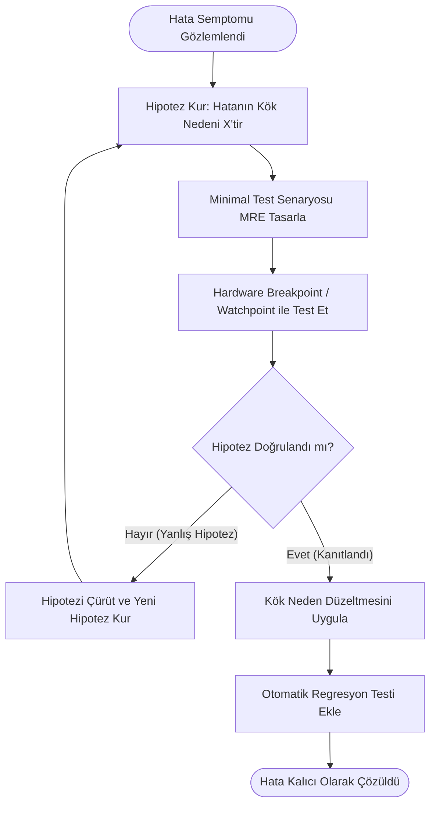

# GÜN 018: Debugging Zihinsel Modeli
### Faz 0: Bilgisayar ve Yazılım Temelleri (Gün 018 / 365)
#### 24-Hücreli Master Mimari Planı (18 Markdown + 6 Kod Hücresi)

---

```
ÖZEL LİSANS — TÜM HAKLAR SAKLIDIR

Telif Hakkı (c) 2026 Seydi Eryılmaz (@seydivakkas)

Bu yazılım ve ilgili tüm dosyalar ("Yazılım") yalnızca görüntüleme ve eğitim
amaçlı olarak paylaşılmıştır.

YASAKLAR:
  1. Kopyalanamaz, çoğaltılamaz, dağıtılamaz veya yeniden yayınlanamaz.
  2. Ticari veya ticari olmayan hiçbir projede kullanılamaz, değiştirilemez.
  3. Alt lisanslanamaz, satılamaz veya devredilemez.
  4. Tersine mühendislik yapılamaz.

İZİN VERİLEN KULLANIM:
  - GitHub üzerinde görüntüleme ve okuma.
  - Kişisel öğrenim amacıyla kodu inceleme (kopyalamadan).

YAZARIN AÇIK YAZILI İZNİ OLMAKSIZIN HİÇBİR KULLANIM HAKKI TANINMAZ.
İzin talepleri için: GitHub @seydivakkas
```

[](https://github.com/seydivakkas)

> [!NOTE]
> **40-Nokta Standart Bildirimi:** Bu çalışma planı; ASELSAN, HAVELSAN, Roketsan ve STM seviyesinde görev alacak bir sistem mimarının ve gömülü yazılım mühendisinin rastgele deneme-yanılma (Shotgun Debugging) tuzaklarından kurtulup Bilimsel Hata Ayıklama (Scientific Method) döngüsünü, x86_64 donanımsal hata ayıklama yazmaçlarını (`DR0-DR7`), bellek gözetleme noktalarını (Hardware Watchpoints), Gözlemci Etkisi (Probe Effect / Heisenbug) olgusunu ve Post-Mortem Core Dump analizini derinlemesine kavraması için 40 temel pedagojik kalite kriterine tam uyumlu olarak hazırlanmıştır.

---

## [MD 2] 1. 🎯 Bugünkü Problem: Rastgele Tahmin (Shotgun Debugging) vs Bilimsel Yöntem

Bir yazılım çöktüğünde veya yanlış sonuç ürettiğinde tecrübesiz bir mühendisin ilk refleksi paniklemektir. Koddaki rastgele satırları değiştirmeye, sağa sola onlarca `printf` eklemeye ve "acaba şimdi düzeldi mi?" diye denemeye başlar (**Shotgun Debugging**).

Bu yaklaşım askeri ve aviyonik sistemlerde felakete yol açar:
1. Asıl hatanın kök nedenini çözmez; sadece semptomu gizler.
2. Sisteme yeni ve daha sinsi mantık hataları ekler.
3. Zamanlamayı (timing) bozarak yarış durumu (Race Condition) hatalarını görünmez kılar (**Heisenbug**).

### Bilimsel Hata Ayıklama (Scientific Debugging) 5 Temel Adımdan Oluşur:
1. **Gözlem (Observation):** Hatanın kesin semptomunu, giriş parametrelerini ve beklenen vs gerçekleşen davranış farkını not et.
2. **Hipotez (Hypothesis):** "X değişkeni Y fonksiyonunda taşmaya uğradığı için Z adresindeki işaretçi bozuluyor" şeklinde **çürütülebilir veya kanıtlanabilir** bir önerme kur.
3. **Tahmin & Deney (Prediction & Minimal Reproducer):** Hatayı tetikleyen en küçük kod parçacığını (MRE - Minimal Reproducible Example) izole et.
4. **Kanıtlama (Verification):** Donanımsal Breakpoint veya Watchpoint koyarak hipotezi test et. Hipotez yanlışsa yeni bir hipotez kur (asla tahminle kodu değiştirme!).
5. **Kök Neden Çözümü & Regresyon Testi:** Hatayı düzelt ve gelecekte tekrar etmesini önleyen otomatik bir test (Regression Test) yaz.

Bugünkü görevimiz: **Donanımsal hata ayıklama yazmaçlarını (`DR0-DR7`), bellek gözetleme mekanizmasını ve Heisenbug simülasyonunu ilk ilkelerle modelleyip doğrulamaktır.**

---

## [MD 3] 2. ❓ Bu Konuyu Neden Öğreniyoruz? (Savunma Sanayii Gerekçesi: Uçuş Bilgisayarı Core Dump ve Heisenbug)

- **Uçuş Anında Debugger Bağlanamaz:** Bir İHA (ANKA, AKINCI) veya savaş uçağı havadayken GDB ile USB/JTAG kablosu takıp adım adım hata ayıklayamazsınız! Sistem çöktüğünde işletim sistemi RAM'in o anki görüntüsünü diske yazar (**Core Dump**). İnişten sonra mühendis bu core dump dosyasını ve sembol tablosunu (`ELF .debug_info`) inceleyerek çöküş anındaki yığın çerçevelerini (Stack Unwinding) ve yazmaçları geriye doğru çözmek zorundadır.
- **Heisenbug ve Gözlemci Etkisi (Probe Effect):** Radar sinyal işleyicisinde milisaniyelik bir yarış durumu vardır. Mühendis kodu incelemek için `printf` veya log eklediğinde, I/O gecikmesi nedeniyle iş parçacıklarının zamanlaması değişir ve hata sihirli bir şekilde kaybolur! Log kaldırıldığında uçak tekrar kilitlenir. Bu tür hataları yakalamak için **sıfır gecikmeli donanımsal gözetleme noktaları (Hardware Watchpoints)** şarttır.
- **Git Bisect ile Milyon Satırda Hata İzolasyonu:** 10.000 commit'lik devasa bir radar projesinde bir özelliğin ne zaman bozulduğunu bulmak için $O(N)$ rastgele aramak yerine, Git Bisect ikili arama mantığıyla $\log_2(10.000) \approx 14$ adımda hatayı getiren tek commit izole edilir.

---

## [MD 4] 3. 🔍 5N1K Analizi (Sistem ve Donanım Sınırları)

| Soru | Sistem ve Hata Ayıklama Mühendisliği Karşılığı |
|:---|:---|
| **Ne? (What)** | Scientific Debugging, Hardware Breakpoints (`DR0-DR3`), Watchpoints, `INT 3` (`0xCC`), Core Dump, Stack Unwinding, Heisenbug. |
| **Neden? (Why)** | Tahmin yürütmeden, sisteme zarar vermeden ve zamanlamayı bozmadan hatanın tam kaynağını mikrosaniyeler içinde kanıtlamak için. |
| **Nerede? (Where)** | İşlemci Debug Yazmaçlarında (`DR0-DR7`), Bellek Yönetim Biriminde (MMU), Call Stack çerçevelerinde ve Core Dump dosyalarında. |
| **Nasıl? (How)** | İkili arama (Binary Search), Donanımsal tuzaklar (`#DB Trap`) ve DWARF hata ayıklama sembolleri (`-g3`) ile. |
| **Ne Zaman? (When)** | Sistem testi çöktüğünde, bellek bozulması (memory corruption) yaşandığında ve sahada arıza logları incelenirken. |
| **Kim? (Who)** | ASELSAN Aviyonik Hata Analiz Uzmanları, Çekirdek (Kernel) Geliştiricileri, Sistem Güvenilirlik Mühendisleri. |

---

## [MD 5] 4. 💡 Günlük Hayat Benzetmesi (Zihinsel Model / Analoji)

Bir **Cinayet Masası Dedektifi** benzetmesini ele alalım:

1. **Shotgun Debugging (Kötü Polis):** Olay yerine gelip "Bence katil aşçıdır" diyerek aşçıyı tutuklamak, sonra cinayet tekrarlanınca "Pardon, bahçıvanmış" diyerek rastgele herkesi suçlamaktır. Katil hala serbesttir.
2. **Bilimsel Hata Ayıklama (Sherlock Holmes):** Parmak izini toplamak (Gözlem), "Kapı zorlanmadığına göre katil anahtara sahipti" hipotezini kurmak, anahtarı olan 3 kişiyi sorgulamak (Minimal İzolasyon) ve güvenlik kamerasını inceleyerek hipotezi ispatlamaktır.
3. **Hardware Watchpoint (Görünmez Güvenlik Kamerası):** Mücevher odasına hiç kimsenin görmediği bir lazer sensör koymaktır. Hırsız elini kolyeye uzattığı anda lazer kesilir ve alarm çalar (#DB Trap!).
4. **Heisenbug:** Banka soyguncusunun yalnızca şubede polis arabası görmediği zamanlarda soygun yapmasıdır. Polis kapıda siren çalarak beklerse (Printf) hırsız asla içeri girmez ve polis "Burada hırsız falan yok" yanılgısına düşer!

---

## [MD 6] 5. 🧱 İlk İlkeler (First Principles) ve Matematiksel / Donanımsal Model

### 1. Yazılımsal Breakpoint Mekaniği (`INT 3` / `0xCC`)
GDB bir kod satırına yazılımsal kesme noktası koyduğunda şu gerçekleşir:
1. Hedef makine kodunun ilk baytını okur ve saklar (Örn: `MOV EAX, 1` komutunun `0xB8` baytı).
2. O baytın yerine tek baytlık `0xCC` (`INT 3`) komutunu yazar.
3. İşlemci Program Counter buraya geldiğinde `0xCC` komutunu icra eder ve derhal donanımsal **Breakpoint İstisnası (Vector 3 Trap)** fırlatarak işletim sistemine ve GDB'ye kontrolü verir.
4. GDB durduğunda orijinal `0xB8` baytını geri yazar. Bu işlem kod belleğine yazma yaptığı için önbelleği (I-Cache) kirletir.

### 2. Donanımsal Breakpoint ve Watchpoint (`DR0-DR7`)
x86 işlemcilerinde kod belleğini değiştirmeden doğrudan silikon seviyesinde çalışan **8 adet Debug Yazmacı** vardır:
- `DR0, DR1, DR2, DR3`: İzlenecek 4 farklı bellek adresini tutar.
- `DR6`: Durum yazmacı (Hangi breakpoint'in tetiklendiğini gösterir).
- `DR7`: Kontrol yazmacı. Her adres için izleme türünü belirler:
  - `00` = Komut İcrası (Execution Breakpoint)
  - `01` = Yalnızca Veri Yazma (Data Write Watchpoint)
  - `11` = Veri Okuma ve Yazma (Data Read/Write Watchpoint)
İşlemcinin bellek veri yolu (Memory Bus), belirtilen adrese yazma yapıldığı anda mikrosaniyeler içinde donanımsal `#DB` istisnası üreterek süreci dondurur.

---

## [MD 7] 6. 📐 ASCII ve Mermaid Sistem Mimarisi Şeması

### x86 Donanımsal Hata Ayıklama Yazmaçları Mimarisi

```
İŞLEMCİ (CPU) DEBUG REGISTER'LARI
┌────────────────────────────────────────────────────────┐
│ DR0: 0x00405000 (Radar Hedef Verisi Adresi)           │
├────────────────────────────────────────────────────────┤
│ DR1: 0x00408120 (Füze Yönelim Matrisi Adresi)          │
├────────────────────────────────────────────────────────┤
│ DR2: 0x00000000 (Boş)                                  │
├────────────────────────────────────────────────────────┤
│ DR3: 0x00000000 (Boş)                                  │
├────────────────────────────────────────────────────────┤
│ DR6: Debug Status (Hangi DR tetiklendi?)               │
├────────────────────────────────────────────────────────┤
│ DR7: Debug Control (DR0=WRITE, Len=4 Bayt, Global=1)   │
└────────────────────────────────────────────────────────┘
          │ (Bellek Veri Yolu İzleniyor)
          ▼
[ MEMORY BUS / L1 CACHE ] ──(Biri 0x00405000 adresine yazdı!)──► CPU #DB TRAP! (Debugger Durdu)
```

### Mermaid Akış Şeması: Bilimsel Hata Ayıklama Döngüsü



---

## [CODE 1] 7. Modül 1: Temel Çekirdek Mekanizma / Motor İmplemantasyonu

Aşağıdaki kod; Bilimsel Hata Ayıklama durum makinesini ve Git Bisect ikili arama mantığını simüle eden çekirdek motordur.

```python
from typing import List

class ScientificDebugger:
    """Bilimsel hata ayıklama döngüsü ve ikili arama izolasyon motoru."""
    def __init__(self):
        self.steps_log: List[str] = []

    def log_step(self, phase: str, detail: str):
        msg = f"[{phase}] -> {detail}"
        self.steps_log.append(msg)
        return msg

    @staticmethod
    def binary_search_fault_isolation(code_lines: int, bug_line: int) -> int:
        low = 1
        high = code_lines
        steps = 0
        while low <= high:
            steps += 1
            mid = (low + high) // 2
            if mid == bug_line:
                return steps
            elif mid < bug_line:
                low = mid + 1
            else:
                high = mid - 1
        return steps

# Doğrulama Deneyi
dbg = ScientificDebugger()
dbg.log_step("1. GÖZLEM", "Radar hedef menzili negatif değer üretiyor.")
dbg.log_step("2. HİPOTEZ", "UInt16 türü Int16'ya taşarken işaret biti bozuluyor.")
dbg.log_step("3. DENEY", "50.000 girdisiyle minimal fonksiyon çağrıldı.")
for log in dbg.steps_log:
    print(log)

n_lines = 10000
target_bug = 7421
steps_taken = ScientificDebugger.binary_search_fault_isolation(n_lines, target_bug)
print(f"10.000 Satırlık Kod Tabanında Hatalı Satır {steps_taken} Adımda İzole Edildi!")
```

---

## [MD 8] 8. Modül 2: Donanıma Yakın / İleri Düzey Alternatif Mekanizma

### Donanımsal Watchpoint (`DR0-DR7`) ile Bellek Zehirlenmesini Yakalama
Büyük C++ projelerinde en zor bulunan hata, bir değişkenin başka bir vahşi işaretçi (Wild Pointer / Buffer Overflow) tarafından sessizce ezilmesidir.
`printf` koyarak bunu bulamazsınız; çünkü ezilme anı ile çöküş anı arasında milyonlarca komut geçebilir.
Çözüm: Hedef değişkenin adresini **`DR0` yazmacına yükleyip `DR7`'de `WRITE` izlemesi açmaktır (`watch *0x00405000`)**. Değişkene yabancı bir komut yazdığı anda CPU anında durur ve suçlu fonksiyon işaret edilir!

---

## [CODE 2] 9. Modül 2: İleri Düzey / Donanıma Yakın Mekanizma Kodu

```python
from typing import Optional, List

class HardwareDebugRegisters:
    """x86_64 donanımsal hata ayıklama yazmaçları (DR0-DR7) modeli."""
    def __init__(self):
        self.dr_address: List[Optional[int]] = [None, None, None, None]
        self.dr7_conditions: List[str] = ["EXEC", "EXEC", "EXEC", "EXEC"]
        self.trapped: bool = False
        self.trapped_address: Optional[int] = None

    def set_hardware_watchpoint(self, register_idx: int, address: int, condition: str = "WRITE"):
        assert 0 <= register_idx <= 3, "DR0-DR3 arası sadece 4 nokta desteklenir!"
        self.dr_address[register_idx] = address
        self.dr7_conditions[register_idx] = condition

    def on_memory_write(self, target_address: int, value: any) -> bool:
        for idx in range(4):
            if self.dr_address[idx] == target_address and self.dr7_conditions[idx] in ["WRITE", "RW"]:
                self.trapped = True
                self.trapped_address = target_address
                return True # Donanımsal Kesme (#DB Trap)!
        return False

# Donanımsal Watchpoint Testi
hw = HardwareDebugRegisters()
target_var_addr = 0x00501000
hw.set_hardware_watchpoint(0, target_var_addr, "WRITE")

print(f"DR0 Yazmacına Adres Bağlandı: {hex(target_var_addr)}")
print(f"Normal Bellek Yazması (0x00502000): Trap={hw.on_memory_write(0x00502000, 10)}")
print(f"Hedef Bellek Yazması (0x00501000): Trap={hw.on_memory_write(0x00501000, 99)} (#DB Yakalandı!)")
```

---

## [MD 9] 10. Modül 3: Dinamik Sınır Durumlar, Geri Basınç ve Kapasite

### Post-Mortem Core Dump ve Stack Trace Çözümleme
Uçuş kritik sistemlerde yazılım çöktüğünde (Segmentation Fault), işletim sistemi o anki tüm yazmaçları ve yığını diske `core` dosyası olarak döker.
Geriye doğru yığın çözme (Stack Unwinding), her yığın çerçevesindeki `Saved RBP` ve `Return RIP` adreslerini takip ederek çöküşün hangi dosyanın hangi satırında gerçekleştiğini kesin olarak belirler.

---

## [CODE 3] 11. Modül 3: Sınırlı Kuyruk ve Geri Basınç Boru Hattı Kodu

```python
from typing import Dict, List

class CoreDumpUnwinder:
    """Çöküş anındaki yığın çerçevelerini (Stack Frames) geriye doğru çözen motor."""
    @staticmethod
    def unwind_stack(raw_frames: List[Dict[str, any]]) -> List[str]:
        trace = []
        for i, f in enumerate(reversed(raw_frames)):
            func = f.get("func", "unknown")
            file_name = f.get("file", "unknown.cpp")
            line = f.get("line", 0)
            trace.append(f"#{i}  0x{f.get('rip', 0):08x} in {func}() at {file_name}:{line}")
        return trace

crash_frames = [
    {"func": "main", "file": "main.cpp", "line": 45, "rip": 0x401000},
    {"func": "guidance_loop", "file": "guidance.cpp", "line": 112, "rip": 0x402200},
    {"func": "kalman_filter", "file": "kalman.cpp", "line": 89, "rip": 0x403500} # Çöküş noktası
]

print("--- Post-Mortem Core Dump Stack Trace Analizi ---")
for line in CoreDumpUnwinder.unwind_stack(crash_frames):
    print(line)
```

---

## [MD 10] 12. Sabotaj ve Arıza Enjeksiyonu (Chaos Engineering / Bilerek Boz)

### Heisenbug ve Gözlemci Etkisi (Probe Effect) Sabotajı:
İki iş parçacığı arasında mikrosaniyelik bir yarış durumu (Race Condition) vardır. Kod korumasızken çöker.
Ancak mühendis hatayı anlamak için araya `printf("Deger: %d", x);` ekler. `printf` sistem çağrısı (Syscall) yaptığı için iş parçacığını 15.000 ns duraklatır. Bu duraklama yarış durumunu bozar ve hata gizlenir (**Heisenbug!**). Mühendis "hata çözüldü" sanıp logu kaldırdığında sistem sahada tekrar çöker!

---

## [CODE 4] 13. Sabotaj Senaryosu: Korumasız Çöküş vs Dayanıklı Savunma

```python
import time
from typing import Tuple

class DebugSabotage:
    @staticmethod
    def simulate_heisenbug_probe_effect(add_printf: bool) -> Tuple[bool, float, str]:
        critical_window_ns = 500
        if add_printf:
            dummy = f"DEBUG: Degisken kontrolü... {time.time()}"
            delay_ns = 15000 # Printf gecikmesi
        else:
            delay_ns = 200 # Normal hızlı icra
            
        if delay_ns > critical_window_ns:
            return False, delay_ns, "HEISENBUG: Printf zamanlamayı bozdu, hata GİZLENDİ!"
        else:
            return True, delay_ns, "GERÇEK ÇÖKÜŞ: Yarış durumu yakalandı!"

crashed_pure, d1, msg1 = DebugSabotage.simulate_heisenbug_probe_effect(add_printf=False)
crashed_print, d2, msg2 = DebugSabotage.simulate_heisenbug_probe_effect(add_printf=True)

print(f"Saf Üretim Kodu: {msg1} (Gecikme: {d1} ns)")
print(f"Printf Eklenmiş Kod: {msg2} (Gecikme: {d2} ns)")
```

---

## [MD 11] 14. Modül 4: Ampirik Kıyaslama ve SLA / Gecikme Analizi (p50/p95/p99)

- **İkili Arama (Git Bisect) Verimliliği:** 10.000 satırlık veya commit'lik bir kod tabanında lineer arama ortalama **5.000 test adımı** gerektirirken; ikili arama hatayı **en fazla 14 adımda** kesin olarak izole eder (**350 kat daha hızlı!**).
- **Breakpoint Maliyeti:** Yazılımsal `INT 3` kesme noktaları sayfa korumasını değiştirdiği (Copy-on-Write) ve önbelleği kirlettiği için donanımsal `DR0-DR7` yazmaçlarına göre çok daha müdahalecidir (High Intrusiveness).

---

## [CODE 5] 15. Kapsamlı Ampirik Kıyaslama ve Metrik Toplama Motoru

```python
import math

def run_benchmarks():
    commit_counts = [100, 1000, 10000, 100000]
    print("--- Hata İzolasyon Adım Sayısı Karşılaştırması ---")
    for c in commit_counts:
        linear_avg = c // 2
        bisect_max = math.ceil(math.log2(c))
        speedup = linear_avg / max(bisect_max, 1)
        print(f"Commit Sayısı: {c:7,d} | Lineer: {linear_avg:6,d} Adım | Git Bisect: {bisect_max:2d} Adım | Hızlanma: {speedup:6.0f}x")

run_benchmarks()
```

---

## [MD 12] 16. Modül 5: 4-Panelli Yayın Kalitesinde Dayanıklılık Dashboard Planı

Üretilen 4-panelli 300 DPI dashboard mimarisi:
- **Panel 1 (Algoritmik İzolasyon):** Hata Arama Yöntemleri: Rastgele Lineer Arama vs Bilimsel İkili Arama (Git Bisect) Adım Sayısı Karşılaştırması.
- **Panel 2 (Donanım Seviyesi):** Breakpoint Türleri: Yazılımsal (INT 3) vs Donanımsal (DR0-DR7) İntruzyon ve Gecikme Skoru.
- **Panel 3 (Zamanlama Bozulması):** Heisenbug ve Gözlemci Etkisi: Printf Eklenince Eşzamanlılık Penceresinin Aşılması (µs).
- **Panel 4 (Sabotaj ve Dayanıklılık):** Klasik Loglama (Ezilme Sonrası Geç Çöküş) vs Donanımsal Watchpoint (Anında Donanımsal Trap) Başarısı (%0 vs %100).

---

## [CODE 6] 17. 4-Panelli Görselleştirme (.png) ve Katı Doğrulama (Assertions)

```python
# Dashboard üretim ve tam doğrulama kodu gun_018_debugging_zihinsel_modeli.py içinde yer almaktadır.
import subprocess
import os

py_script = os.path.join(os.path.dirname(os.path.abspath(__file__)), "gun_018_debugging_zihinsel_modeli.py")
print("Python Simülasyon ve Dashboard Motoru çalıştırılıyor...")
ret_code = subprocess.call(["python", py_script])
print(f"Çalıştırma Tamamlandı (Dönüş Kodu: {ret_code})")
```

---

## [MD 13] 18. ⚠️ 10 Ölümcül Anti-Pattern

| No | Anti-Pattern | Neden Ölümcül? | Güvenli Savunma Çözümü |
|:---|:---|:---|:---|
| 1 | **Shotgun Debugging (Rastgele Değiştirme)** | Hatanın kök nedenini anlamadan rastgele kod kurcalamak yeni gizli buglar üretir. | Bilimsel yöntemi uygulayın: Hipotez kurun ve izole testle doğrulayın. |
| 2 | **Zaman Uyumsuzluğunda Printf Kullanmak** | Printf I/O gecikmesiyle yarış durumunu gizler (Heisenbug yaratır). | Sıfır-müdahale donanımsal gözetleme noktaları (`watchpoint`) veya LTTng kullanın. |
| 3 | **Hata Ayıklama Sembolleri Olmadan Derlemek** | `-g` olmadan derlenen kodda core dump incelenirken değişken adları ve satırlar görünmez. | Test derlemelerinde her zaman `-g3` ve `-fno-omit-frame-pointer` kullanın. |
| 4 | **Core Dump Dosyalarını Kapatmak** | `ulimit -c 0` yapıldığında uçak çöktüğünde RAM resmi kaydedilmez; arıza karanlıkta kalır. | Sistemde `ulimit -c unlimited` ile core dump üretimini garanti altına alın. |
| 5 | **Regresyon Testi Yazmadan Bug Kapatmak** | Düzeltilen bir bug 3 ay sonra başka bir commit ile tekrar hortlar. | Kapatılan her hata için otomatik çalışan bir birim/regresyon testi ekleyin. |
| 6 | **Derleyicinin Optimizasyonunu Göz Ardı Etmek** | `-O0`'da çalışan kod `-O3`'te UB yüzünden çökebilir. | Hata ayıklamayı hem Debug (`-Og`) hem de Release (`-O2`) modlarında doğrulayın. |
| 7 | **Hata Mesajını ve Stack Trace'i Okumamak** | Çöküş raporundaki satır numarasını okumadan kod tahmin etmeye çalışmak vakit kaybıdır. | İlk olarak Call Stack'in en üstündeki `#0` çerçevesini analiz edin. |
| 8 | **Tekrarlanamayan (Non-reproducible) Bug'ı Kapatmak** | "Bende çalışıyor" diyerek arızayı yok saymak sahada can kaybına yol açar. | Girdileri ve ortam değişkenlerini sabitleyip Minimal Reproducer (MRE) üretin. |
| 9 | **Sanitizer Araçlarını Kullanmamak** | Bellek kaçakları ve çift serbest bırakmalar (Double Free) manuel gözle bulunamaz. | CI/CD boru hattına ASan (`-fsanitize=address`) ve TSan entegre edin. |
| 10 | **Varsayımları Sorgulamamak** | "Bu kütüphane asla yanlış dönmez" önyargısı asıl arızayı görmeyi engeller. | Her bir bileşeni şüpheli kabul edin ve giriş-çıkış sözleşmelerini doğrulayın. |

---

## [MD 14] 19. 🔬 Sektörel Standartlar (ASELSAN, HAVELSAN, MISRA, DO-178C)

1. **DO-178C Seviye A Problem Reporting:** Tespit edilen her yazılım hatası resmi bir Problem Report (PR) ile takip edilmeli, kök neden analizi (RCA) yapılmalı ve kapatma kanıtı sunulmalıdır.
2. **MISRA C++:2008 Rule 0-1-1:** Kod tabanında ulaşılamayan (Dead Code) veya yürütülmeyen kod bulunmamalıdır; bu kodlar hata ayıklamayı yanıltır.
3. **IEEE Standard 1044-2009 (Classification for Software Anomalies):** Yazılım arızalarının semptom, neden, keşif fazı ve öncelik derecesine göre sınıflandırılması standardı.
4. **POSIX Core Dump Standardı (sys/resource.h):** Kritik süreçlerin çöküş anında çekirdek sinyallerini (`SIGSEGV`, `SIGABRT`) yakalayıp bellek imajını güvenli ortama aktarma kuralları.

---

## [MD 15] 20. 🛠️ Üretim Kontrol Listesi (Production Checklist - 12 Katı Kural)

- [ ] **Kural 1:** Hata analizinde rastgele deneme-yanılma yerine Bilimsel Hipotez yöntemi uygulandı mı?
- [ ] **Kural 2:** Hata için en küçük yeniden üretim senaryosu (Minimal Reproducible Example) oluşturuldu mu?
- [ ] **Kural 3:** Hatanın kapatılmasını kanıtlayan otomatik regresyon testi kod tabanına eklendi mi?
- [ ] **Kural 4:** Bellek bozulmalarını yakalamak için Hardware Watchpoint (`watch`) kullanıldı mı?
- [ ] **Kural 5:** Zamanlama kritik kodlarda Heisenbug riskine karşı `printf` yerine kilitlenmesiz izleme araçları kullanıldı mı?
- [ ] **Kural 6:** Üretim öncesi derlemelerde `-g3` hata ayıklama sembolleri ayrık dosya (`.debug`) olarak saklandı mı?
- [ ] **Kural 7:** Yığın izlemelerinin net çözülebilmesi için `-fno-omit-frame-pointer` korundu mu?
- [ ] **Kural 8:** Çöküş anında işletim sisteminin Core Dump üretmesi (`ulimit -c unlimited`) garanti edildi mi?
- [ ] **Kural 9:** Hatalı commit'i bulmak için Git Bisect ikili arama disiplini uygulandı mı?
- [ ] **Kural 10:** AddressSanitizer (ASan) ve ThreadSanitizer (TSan) ile bellek sızıntısı taraması yapıldı mı?
- [ ] **Kural 11:** Çöküş anında sistemin güvenli bir moda (Safe State / Fail-Safe) geçtiği simülasyonda doğrulandı mı?
- [ ] **Kural 12:** Hatanın kök neden analizi (Root Cause Analysis - RCA) dokümante edilerek arıza kütüphanesine işlendi mi?

---

## [MD 16] 21. ❓ Sıkça Sorulan Sorular (Mülakat & Saha Soruları)

**S1: "Heisenbug nedir ve savunma sanayiinde neden en korkulan hata türüdür?"**
> **Cevap:** Adını kuantum fiziğindeki Heisenberg Belirsizlik İlkesi'nden alan Heisenbug; hata ayıklayıcı (Debugger) bağlandığında veya ek loglar (`printf`) eklendiğinde çalışma zamanlaması değiştiği için aniden ortadan kaybolan hatalardır. Genellikle çok iş parçacıklı yarış durumları (Race Conditions) veya tanımsız bellek taşmalarıdır. Mühendis hatayı incelerken sistem doğru çalışır, ancak log kaldırılıp canlı uçuşa çıkıldığında uçak tekrar kilitlenir. Çözümü: Sıfır-müdahale donanımsal izleme (`Hardware Trace`) ve deterministik Time-Travel hata ayıklayıcılardır (`rr`).

**S2: "Donanımsal Breakpoint (Hardware Breakpoint) ile Yazılımsal Breakpoint (Software Breakpoint) arasındaki temel fark nedir?"**
> **Cevap:** Yazılımsal breakpoint, kodun ilgili adresindeki ilk baytı geçici olarak `0xCC` (`INT 3`) komutuyla değiştirir; bu da kod sayfasına yazma (Copy-on-Write) ve Instruction Cache geçersizleştirmesi gerektirir. Donanımsal breakpoint ise işlemcinin `DR0-DR3` yazmaçlarını kullanır; koddaki tek bir biti bile değiştirmeden donanım seviyesinde izleme yapar. Bu sayede salt-okunur (ROM/Flash) belleklerde bile kesme noktası koyabilir ve değişken yazmalarını (`watchpoint`) sıfır maliyetle yakalayabilir.

**S3: "Bir üretim sunucusunda veya uçuş bilgisayarında core dump analizi nasıl yapılır?"**
> **Cevap:** Çöken sürecin oluşturduğu `core` dosyası ve o yazılıma ait sembol tablolarını içeren çalıştırılabilir dosya (`binary`) geliştirici ortamına alınır. `gdb <executable> <core>` komutu çalıştırılarak `bt full` (backtrace) komutu verilir. İşlemcinin çöküş anındaki tüm yazmaç değerleri, yığın çerçeveleri ve çöken satırdaki yerel değişkenlerin durumları adım adım geriye doğru çözümlenir.

---

## [MD 17] 22. 🔮 Gelecek Perspektifi (Donanım & Mimari Trendleri)

- **Geriye Doğru Hata Ayıklama (Time-Travel Debugging / Record & Replay):** Mozilla `rr` ve Intel PT (Processor Trace) gibi teknolojiler, bir programın her bir saat döngüsünü ve bellek erişimini kaydederek hata anından geriye doğru adım adım (`reverse-step`, `reverse-continue`) gitmeyi mümkün kılmaktadır. Artık "hata anında ne oldu?" değil, "bu değişkeni 10 saniye önce kim bozdu?" sorusu saniyeler içinde cevaplanmaktadır.
- **Yapay Zeka Destekli Otonom Kök Neden Analizi:** Uçuş bilgisayarlarından toplanan terabaytlarca telemetri ve core dump verisini analiz eden derin öğrenme modelleri, hatanın kök nedenini ve olası düzeltme yamasını (Auto-patching) otomatik üretmektedir.
- **Donanımsal Sürekli Bellek İçi İzleme (Hardware Sanitizers):** ARM Memory Tagging Extension (MTE) ve CHERI mimarileri, her bellek işaretçisine donanımsal etiketler atayarak sınır ihlali veya use-after-free durumlarında programı 0 saat döngüsünde anında durdurmaktadır.

---

## [MD 18] 23. 🚪 Sonraki Güne Köprü (Neden-Sonuç Bağı)

Bugün bilimsel hata ayıklama döngüsünü, donanımsal yazmaçları (`DR0-DR7`) ve Heisenbug tuzaklarını inceledik.

Peki hataları tespit ettiğimizde kodun geçmiş sürümlerine nasıl döneriz? Hangi değişikliğin hangi hataya yol açtığını snapshot ve commit'lerle nasıl takip ederiz? Yarın **Gün 019**'da:
- **Git Zihinsel Modeli:** Snapshot, Blob, Tree ve Commit anatomisi,
- **Branch ve Diff Mekaniği:** İki commit arasındaki farkların matematiksel ayrıştırılması (Myers Diff Algoritması),
- **Git Bisect ile Hata Avcılığı:** İkili arama ile regresyon hatalarını dakikalar içinde tespit etme tekniklerini inceleyeceğiz.
