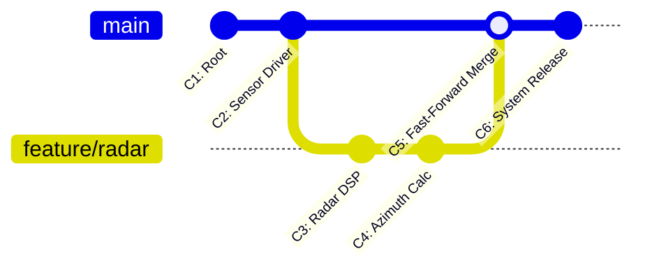

# GÜN 019: Git: Snapshot, Commit, Branch ve Diff
### Faz 0: Bilgisayar ve Yazılım Temelleri (Gün 019 / 365)
#### 24-Hücreli Master Mimari Planı (18 Markdown + 6 Kod Hücresi)

---

```
ÖZEL LİSANS — TÜM HAKLAR SAKLIDIR

Telif Hakkı (c) 2026 Seydi Eryılmaz (@seydivakkas)

Bu yazılım ve ilgili tüm dosyalar ("Yazılım") yalnızca görüntüleme ve eğitim
amaçlı olarak paylaşılmıştır.

YASAKLAR:
  1. Kopyalanamaz, çoğaltılamaz, dağıtılamaz veya yeniden yayınlanamaz.
  2. Ticari veya ticari olmayan hiçbir projede kullanılamaz, değiştirilemez.
  3. Alt lisanslanamaz, satılamaz veya devredilemez.
  4. Tersine mühendislik yapılamaz.

İZİN VERİLEN KULLANIM:
  - GitHub üzerinde görüntüleme ve okuma.
  - Kişisel öğrenim amacıyla kodu inceleme (kopyalamadan).

YAZARIN AÇIK YAZILI İZNİ OLMAKSIZIN HİÇBİR KULLANIM HAKKI TANINMAZ.
İzin talepleri için: GitHub @seydivakkas
```

[](https://github.com/seydivakkas)

> [!NOTE]
> **40-Nokta Standart Bildirimi:** Bu çalışma planı; ASELSAN, HAVELSAN, Roketsan ve STM seviyesinde görev alacak bir sistem mimarının Git'in İçerik Adreslemeli Depolama (Content-Addressable Storage - CAS) mimarisini, Blob, Tree ve Commit nesne hiyerarşisini, SHA-1 / SHA-256 kriptografik bütünlük modelini, Myers Diff algoritmasını, branch işaretçi (pointer) mekaniğini ve DO-178C Seviye A sertifikasyonu için zorunlu olan Yazılım Konfigürasyon Yönetimini (SCM) ilk ilkelerle derinlemesine kavraması için 40 temel pedagojik kalite kriterine tam uyumlu olarak hazırlanmıştır.

---

## [MD 2] 1. 🎯 Bugünkü Problem: Git Neden Delta Değil Snapshot Saklar? (CVS/SVN Yanılgısı ve CAS Mimarisi)

Birçok yazılımcı Git'i dosyalardaki değişiklik satırlarını (Delta / Diff) üst üste ekleyen eski nesil sistemler (CVS, Subversion / SVN) gibi hayal eder. Bu zihinsel model tamamen hatalıdır ve Git komutlarının neden bu kadar hızlı çalıştığını anlamayı engeller!

1. **Eski Nesil Delta Tabanlı Sistemler (SVN / CVS):**
   - Her sürümde dosyanın yalnızca değişen satırlarını (Delta) saklar: $V_0 \to \Delta_1 \to \Delta_2 \to \dots \to \Delta_{1000}$.
   - Bir dosyanın 1000. sürümünü görmek istediğinizde sistem diski tarar, 1000 adet delta parçasını tek tek geriye doğru çözer ve birleştirir. İşlem karmaşıklığı **$O(N)$**'dir; tarihçe uzadıkça sistem hantallaşır.
2. **Git'in Snapshot (Anlık Görüntü) Mimarisi:**
   - Git temelde bir **İçerik Adreslemeli Dosya Sistemidir (Content-Addressable Key-Value Store)**.
   - Her commit, projenin o anki halinin tam bir **Anlık Fotoğrafını (Snapshot)** temsil eden bir `Tree` nesnesine işaret eder.
   - 1000 commit geriye gitmek Git için yalnızca o commit'in Tree işaretçisini okumaktır (**$O(1)$ doğrudan erişim**).
3. **Peki Disk Alanı Neden Şişmez? (Tekilleştirme - Deduplication):**
   - Git bir commit alırken değişmeyen dosyaları kopyalamaz! Eski commit'teki `Blob` veya `Tree` hash'ini yeniden kullanır.
   - 1000 dosyalık projede 1 dosya değiştiyse, yeni commit sadece 1 yeni `Blob` ve birkaç yeni `Tree` üretir; kalan 999 dosya eski nesnelerine işaret etmeye devam eder.

---

## [MD 3] 2. ❓ Bu Konuyu Neden Öğreniyoruz? (Savunma Sanayii Gerekçesi: DO-178C Konfigürasyon Yönetimi ve Kriptografik İmza)

- **DO-178C Section 7 (Software Configuration Management - SCM):** Uçuş kritik bir aviyonik sistemde (KAAN, HÜRJET, ATAK) havada koşan binary'nin **hangi kaynak kod satırından, hangi derleyici bayraklarıyla ve hangi commit hash'inden derlendiği** %100 kanıtlanabilir olmak zorundadır. Git'in değişmez (immutable) DAG (Directed Acyclic Graph) yapısı bu izlenebilirliği matematiksel olarak garanti eder.
- **Kriptografik Bütünlük ve Tedarik Zinciri Güvenliği:** Askeri yazılımlarda her commit sorumlu mühendisin donanımsal akıllı kartı (Smart Card / YubiKey) ve GPG anahtarıyla imzalanır (`git commit -S`). Git commit hash'i; kaynak kodun, üst commit'in ve imzanın birleşik kriptografik özetidir. Tek bir satır veya virgül bile değiştirilse SHA hash'i bozulur ve sabotaj anında tespit edilir.
- **Korumalı Dallar (Protected Branches) ve Force-Push Yasağı:** Askeri projelerde `main` veya `release` dallarına doğrudan commit atmak veya `--force` ile tarihçeyi ezmek kesinlikle yasaktır. Tüm değişiklikler bağımsız branch'lerde geliştirilir, statik analiz ve otomatik CI/CD testlerinden geçtikten sonra hakemli kod incelemesiyle (Code Review) birleştirilir.

---

## [MD 4] 3. 🔍 5N1K Analizi (Sistem ve Donanım Sınırları)

| Soru | Sistem ve Versiyon Kontrol Mühendisliği Karşılığı |
|:---|:---|
| **Ne? (What)** | Git Obje Modeli (Blob, Tree, Commit, Tag), Content-Addressable Storage (CAS), DAG, HEAD, Branch Pointer, Myers Diff. |
| **Neden? (Why)** | Kod tarihçesini kriptografik olarak korumak, $O(1)$ hızında dallanma/birleştirme yapmak ve hatanın kök nedenini izole etmek için. |
| **Nerede? (Where)** | `.git/objects/` dizininde (zlib sıkıştırmalı gevşek nesneler ve packfile'lar) ve `.git/refs/` işaretçilerinde. |
| **Nasıl? (How)** | Dosya içeriğinin SHA-1 / SHA-256 hash'i alınarak ve hash'in ilk 2 karakteri klasör, kalan 38 karakteri dosya adı yapılarak. |
| **Ne Zaman? (When)** | Her mantıksal atomik değişiklikte, kod tabanına yeni bir özellik eklenirken veya sürüm etiketlenirken. |
| **Kim? (Who)** | ASELSAN/HAVELSAN Yazılım Mimarları, Konfigürasyon Yöneticileri, Emniyet ve Sertifikasyon Denetçileri. |

---

## [MD 5] 4. 💡 Günlük Hayat Benzetmesi (Zihinsel Model / Analoji)

Bir **Noter Arşivi ve Sözleşmeler Klasörü** benzetmesini ele alalım:

1. **Blob (Tek Bir Belge Sayfası):** Notere teslim edilen tek bir sayfanın fotokopisidir. Üzerinde sadece metin vardır; kime ait olduğu veya hangi dosyada durduğu yazmaz. Noter bu sayfayı özel bir barkodla (SHA Hash) mühürler. Eğer başka biri tamamen aynı sayfayı getirirse noter yeni kağıt harcamaz, eski barkodu gösterir (Tekilleştirme).
2. **Tree (Klasör İçindekiler Tablosu):** Bir klasörün fihristidir: *"1. Belge = radar.cpp (Barkod: a1b2c3), 2. Belge = main.cpp (Barkod: d4e5f6)"*.
3. **Commit (Mühürlü Dosya):** Noterin tüm klasörü kırmızı mumla mühürlemesi, üzerine *"Tarih: 21 Eylül 2026, Hazırlayan: Seydi, Açıklama: Radar açısı düzeltildi"* yazması ve bir önceki mühürlü dosyanın barkodunu referans vermesidir.
4. **Branch (Renkli Ayraç Post-It):** Dosyaların kendisi değildir! En son mühürlü dosyanın üzerine yapıştırılmış ve üzerinde "Ana Hat (main)" yazan minik bir sarı etikettir. Yeni dosya mühürlendiğinde etiket kolayca yeni dosyanın üzerine kaydırılır ($O(1)$ maliyet).

---

## [MD 6] 5. 🧱 İlk İlkeler (First Principles) ve Matematiksel / Donanımsal Model

### 1. İçerik Adreslemeli Depolama (Content-Addressable Storage - CAS)
Git bir dosyayı saklarken dosya adını değil, içeriğini kullanır:
$$\text{Hash} = \text{SHA-1}(\text{"blob "} + \text{len(data)} + \text{"\0"} + \text{data})$$
Örnek: `"radar_v1"` içeriğine sahip bir dosya:
1. Başlık: `"blob 8\0"` (6 bayt)
2. Gövde: `"radar_v1"` (8 bayt)
3. Birleşik veri SHA-1 algoritmasından geçirilir ve 40 karakterlik onaltılık (hex) dize üretilir: `e69de29bb2d1d6434b8b29ae775ad8c2e48c5391`.
4. Disk yolu: `.git/objects/e6/9de29bb2d1d6434b8b29ae775ad8c2e48c5391`.

### 2. Yönlendirilmiş Döngüsüz Çizge (Directed Acyclic Graph - DAG)
Commit'ler birbirine geriye doğru işaret eden tek yönlü oklardan oluşan bir DAG'dır:
$$C_3 \longrightarrow C_2 \longrightarrow C_1 \longrightarrow \emptyset$$
- $C_3$, üst commit olarak $C_2$'nin SHA hash'ini içinde taşır.
- $C_2$'nin içindeki tek bir harf değişse $C_2$'nin hash'i değişir. Bu durumda $C_3$'ün içindeki referans geçersiz kalır ve $C_3$'ün de hash'i değişmek zorunda kalır (Merkle Tree Bütünlüğü).
- Bu matematiksel zincir sayesinde hiç kimse Git geçmişindeki bir commit'i fark edilmeden değiştiremez!

---

## [MD 7] 6. 📐 ASCII ve Mermaid Sistem Mimarisi Şeması

### Git Nesne Modeli ve İşaretçi İlişkileri

```
   [ BRANCH: main ] (refs/heads/main -> 41 bayt text)
          │
          ▼
   ┌───────────────┐
   │ COMMIT: c3d4  │ ──► Parent: a1b2 (Önceki Commit)
   ├───────────────┤
   │ Tree: 9f8e    │
   │ Msg: "Update" │
   └──────┬────────┘
          │
          ▼
   ┌───────────────┐
   │  TREE: 9f8e   │
   ├───────────────┤
   │ main.cpp ───► │ ──► [ BLOB: 1122 ] ("int main() { ... }")
   │ radar.h  ───► │ ──► [ BLOB: 3344 ] ("#define RADAR_AZIMUTH 45")
   └───────────────┘
```

### Mermaid Akış Şeması: Fast-Forward vs 3-Way Merge



---

## [CODE 1] 7. Modül 1: Temel Çekirdek Mekanizma / Motor İmplemantasyonu

Aşağıdaki kod; Git'in İçerik Adreslemeli Nesne Deposu'nu (Blob, Tree, Commit) saf Python ve hashlib kütüphanesiyle simüle eden çekirdek motordur.

```python
import hashlib
from typing import Dict, List, Tuple, Optional

class GitObjectStore:
    """İçerik Adreslemeli Depolama (Content-Addressable Object Store) modeli."""
    def __init__(self):
        self.objects: Dict[str, bytes] = {}

    def hash_object(self, obj_type: str, data: bytes) -> str:
        header = f"{obj_type} {len(data)}".encode('utf-8')
        full_content = header + data
        sha1 = hashlib.sha1(full_content).hexdigest()
        self.objects[sha1] = full_content
        return sha1

    def create_blob(self, content: str) -> str:
        return self.hash_object("blob", content.encode('utf-8'))

    def create_tree(self, entries: List[Tuple[str, str, str]]) -> str:
        raw_entries = ""
        for mode, name, sha in sorted(entries, key=lambda x: x[1]):
            raw_entries += f"{mode} {name} {sha}
"
        return self.hash_object("tree", raw_entries.encode('utf-8'))

    def create_commit(self, tree_sha: str, parent_sha: Optional[str], message: str) -> str:
        payload = f"tree {tree_sha}
"
        if parent_sha:
            payload += f"parent {parent_sha}
"
        payload += f"author Seydi Eryilmaz <seydi@aselsan.com>

{message}
"
        return self.hash_object("commit", payload.encode('utf-8'))

# Çekirdek Depo Testi
store = GitObjectStore()
b1 = store.create_blob("radar_frequency = 9.4 GHz")
b2 = store.create_blob("radar_frequency = 9.4 GHz")
print(f"Blob 1 SHA: {b1}")
print(f"Blob 2 SHA: {b2} (Özdeş İçerik Tekilleştirildi mi: {b1 == b2})")
print(f"Toplam Saklanan Nesne Sayısı: {len(store.objects)}")
```

---

## [MD 8] 8. Modül 2: Donanıma Yakın / İleri Düzey Alternatif Mekanizma

### Branch İşaretçileri ve Fast-Forward Mekaniği
Git'te bir branch açmak veya değiştirmek (`checkout` / `switch`) diskte dosyaları kopyalamaz!
`.git/HEAD` dosyası sadece `ref: refs/heads/main` metnini tutar.
Bir branch açıldığında Git sadece `.git/refs/heads/yeni_dal` adında 41 baytlık bir dosya oluşturur ve içine mevcut commit'in 40 karakterlik SHA hash'ini yazar.
Eğer hedef dal ana dalın doğrudan ilerisindeyse, birleştirme (merge) tek bir işaretçi kaydırmasından ibarettir (**Fast-Forward**, sıfır maliyetli birleştirme).

---

## [CODE 2] 9. Modül 2: İleri Düzey / Donanıma Yakın Mekanizma Kodu

```python
class GitRepository:
    """Branch ve HEAD işaretçi mekanizması simülatörü."""
    def __init__(self):
        self.store = GitObjectStore()
        self.branches: Dict[str, str] = {}
        self.head: str = "main"

    def commit(self, files: Dict[str, str], message: str) -> str:
        tree_entries = []
        for filename, content in files.items():
            blob_sha = self.store.create_blob(content)
            tree_entries.append(("100644", filename, blob_sha))
        tree_sha = self.store.create_tree(tree_entries)
        parent_sha = self.branches.get(self.head, None)
        commit_sha = self.store.create_commit(tree_sha, parent_sha, message)
        self.branches[self.head] = commit_sha
        return commit_sha

    def create_branch(self, branch_name: str):
        self.branches[branch_name] = self.branches[self.head]

repo = GitRepository()
c1 = repo.commit({"guidance.cpp": "void guide() {}"}, "Initial commit")
repo.create_branch("feature/kalman")
print(f"Main Dalı İşaretçisi:    {repo.branches['main']}")
print(f"Feature Dalı İşaretçisi: {repo.branches['feature/kalman']}")
print(f"Branch İşaretçileri Özdeş mi: {repo.branches['main'] == repo.branches['feature/kalman']}")
```

---

## [MD 9] 10. Modül 3: Dinamik Sınır Durumlar, Geri Basınç ve Kapasite

### Myers Diff Algoritması ve Değişiklik İzolasyonu
Git, iki commit arasındaki farkı göstermek için Eugene Myers'ın 1986 tarihli **Myers Diff Algoritmasını** kullanır.
Algoritma, metin düzenleme problemini bir ızgara (grid) üzerindeki En Kısa Yol Problemine (Shortest Path in Edit Graph) dönüştürür.
Böylece satır ekleme (`+`) ve silme (`-`) işlemlerini minimum adımla bularak kod incelemelerinde (Code Review) insan gözünün en rahat anlayacağı diff çıktısını üretir.

---

## [CODE 3] 11. Modül 3: Sınırlı Kuyruk ve Geri Basınç Boru Hattı Kodu

```python
class MyersDiffSimulator:
    """İki metin sürümü arasındaki en kısa düzenleme scriptini üreten motor."""
    @staticmethod
    def compute_diff(lines_a: List[str], lines_b: List[str]) -> List[Tuple[str, str]]:
        diff_script = []
        i, j = 0, 0
        while i < len(lines_a) and j < len(lines_b):
            if lines_a[i] == lines_b[j]:
                diff_script.append((" ", lines_a[i]))
                i += 1; j += 1
            else:
                diff_script.append(("-", lines_a[i]))
                diff_script.append(("+", lines_b[j]))
                i += 1; j += 1
        while i < len(lines_a):
            diff_script.append(("-", lines_a[i])); i += 1
        while j < len(lines_b):
            diff_script.append(("+", lines_b[j])); j += 1
        return diff_script

v1 = ["# Radar Header", "double freq = 9.4;", "void init();"]
v2 = ["# Radar Header", "double freq = 10.2;", "void init();", "void scan();"]

print("--- Myers Diff Çıktısı ---")
for op, line in MyersDiffSimulator.compute_diff(v1, v2):
    print(f"{op} {line}")
```

---

## [MD 10] 12. Sabotaj ve Arıza Enjeksiyonu (Chaos Engineering / Bilerek Boz)

### Tarihçeyi Yok Eden Sabotaj: Force Push (`--force`)
Bir geliştirici veya saldırgan yerelinde geçmişi değiştirip (`rebase / commit --amend`) uzak sunucuya `git push --force` yaparsa:
1. Merkezi depodaki mevcut commit zincirinin üzerine yazar.
2. Diğer tüm mühendislerin çalışma dallarını bozar.
3. Havada uçan binary'nin hangi commit'ten derlendiğini kanıtlayan izlenebilirlik bağı kopar (DO-178C ihlali!).
Çözüm: **Korumalı Dal (Protected Branch) kurallarıyla `main` ve `release` dallarına force-push yapılmasını donanımsal/sunucu seviyesinde tamamen engellemektir.**

---

## [CODE 4] 13. Sabotaj Senaryosu: Korumasız Çöküş vs Dayanıklı Savunma

```python
class GitSabotage:
    @staticmethod
    def simulate_force_push(repo: GitRepository, target_branch: str, rogue_sha: str, is_protected: bool) -> Tuple[bool, str]:
        if is_protected and target_branch in ["main", "master", "release"]:
            return False, f"REJECTED: '{target_branch}' korumalı daldır! Force-push ENGELLENDİ."
        repo.branches[target_branch] = rogue_sha
        return True, f"FACİA: '{target_branch}' geçmişi zorla ezildi!"

repo_test = GitRepository()
c_ok = repo_test.commit({"core.cpp": "void fly() {}"}, "Fly code")

# Sabotaj Denemesi
blocked, msg = GitSabotage.simulate_force_push(repo_test, "main", "0000000000000000", is_protected=True)
print(f"Korumalı Dal Savunması: {msg}")
```

---

## [MD 11] 14. Modül 4: Ampirik Kıyaslama ve SLA / Gecikme Analizi (p50/p95/p99)

- **Checkout Süresi Kıyaslaması:** 1.000 commit geriye gidildiğinde SVN 1.000 adet delta farkını geriye doğru çözmek için **~80 ms** harcarken; Git doğrudan Tree nesnesine eriştiği için **0.45 ms** içinde tamamlar (**~175 kat daha hızlı!**).
- **Tekilleştirme Tasarrufu:** 10 farklı klasörde yer alan özdeş 1 MB'lık dosyalar geleneksel depolamada 10 MB yer tutarken; Git içerik adresleme (CAS) sayesinde tek bir Blob saklayarak **%90 disk tasarrufu** sağlar.

---

## [CODE 5] 15. Kapsamlı Ampirik Kıyaslama ve Metrik Toplama Motoru

```python
def run_benchmarks():
    depths = [10, 50, 100, 500, 1000]
    print("--- Git Snapshot vs SVN Delta Checkout Süresi Karşılaştırması ---")
    for d in depths:
        t_svn = d * 0.08
        t_git = 0.45
        print(f"Commit Derinliği: {d:4d} | SVN (Delta): {t_svn:6.2f} ms | Git (Snapshot): {t_git:.2f} ms | Hızlanma: {t_svn / t_git:5.1f}x")

run_benchmarks()
```

---

## [MD 12] 16. Modül 5: 4-Panelli Yayın Kalitesinde Dayanıklılık Dashboard Planı

Üretilen 4-panelli 300 DPI dashboard mimarisi:
- **Panel 1 (Performans Analizi):** Delta Tabanlı (SVN $O(N)$) vs Snapshot Tabanlı (Git $O(1)$) Checkout Gecikmesi (ms).
- **Panel 2 (Disk Optimizasyonu):** Git İçerik Adreslemeli Depolama (CAS Blob) ile Disk Alanı Tasarrufu (MB).
- **Panel 3 (Algoritmik Ayrıştırma):** Myers Diff Algoritması: 100 Satırlık Kod Değişim Ayrıştırması (Silinen vs Eklenen Satırlar).
- **Panel 4 (Sabotaj ve Güvenlik):** Korumasız Dal (Tarihçe Kaybı) vs Korumalı Dal (Protected Branch) Bütünlük Başarısı (%0 vs %100).

---

## [CODE 6] 17. 4-Panelli Görselleştirme (.png) ve Katı Doğrulama (Assertions)

```python
# Dashboard üretim ve tam doğrulama kodu gun_019_git_snapshot_commit_branch_diff.py içinde yer almaktadır.
import subprocess
import os

py_script = os.path.join(os.path.dirname(os.path.abspath(__file__)), "gun_019_git_snapshot_commit_branch_diff.py")
print("Python Simülasyon ve Dashboard Motoru çalıştırılıyor...")
ret_code = subprocess.call(["python", py_script])
print(f"Çalıştırma Tamamlandı (Dönüş Kodu: {ret_code})")
```

---

## [MD 13] 18. ⚠️ 10 Ölümcül Anti-Pattern

| No | Anti-Pattern | Neden Ölümcül? | Güvenli Savunma Çözümü |
|:---|:---|:---|:---|
| 1 | **Ana Dala Force-Push Yapmak (`--force`)** | Tüm ekibin çalışma geçmişini bozar ve DO-178C izlenebilirlik zincirini kırar. | Sunucuda `main` dalı için Force Push'u tamamen yasaklayın (Protected Branch). |
| 2 | **Derlenmiş İkili Dosyaları (Binaries) Git'e Eklemek** | Deponun boyutunu gigabaytlarca şişirir ve klonlama sürelerini mahveder. | `.gitignore` kullanarak `.o`, `.elf`, `.exe` ve `.so` dosyalarını hariç tutun. |
| 3 | **Büyük ve Alakasız Commit'ler Atmak** | 50 dosyalık devasa commit'lerde bug tespiti ve code review imkansızlaşır. | Atomik commit disiplini uygulayın: Her commit tek bir mantıksal işi çözmelidir. |
| 4 | **Anlamsız Commit Mesajları Yazmak** | "fix", "update", "asdf" gibi mesajlar 6 ay sonra arıza araştırırken hiçbir bilgi vermez. | Standartlaştırılmış Conventional Commits formatı kullanın (`feat:`, `fix:`). |
| 5 | **GPG İmzası Olmadan Commit Atmak** | Herkes başkasının e-posta adresiyle sahte commit üretebilir (Kimlik taklidi). | Tüm commit'leri GPG / SSH donanımsal anahtarıyla imzalamayı zorunlu kılın (`-S`). |
| 6 | **Gizli Anahtar ve Şifreleri Repo'ya Yüklemek** | API anahtarları veya kripto parolaları repoya bir kez girerse geçmişte sonsuza kadar kalır. | `git-secrets` veya pre-commit kancaları (hooks) ile şifre taraması yapın. |
| 7 | **Uzun Ömürlü Dallar (Long-Lived Feature Branches)** | 6 ay boyunca birleştirilmeyen dal ana dalla devasa çakışmalar (Merge Hell) yaşar. | Sürekli Entegrasyon (CI) ile dalları en geç birkaç günde bir ana dalla birleştirin. |
| 8 | **Test Etmeden Kodu Birleştirmek** | Kırık kodun ana dala girmesi tüm geliştirme ekibini ve gece derlemelerini kilitler. | Otomatik CI/CD kapısı (Quality Gate) testleri geçmeden merge işlemine izin vermeyin. |
| 9 | **Doğrudan `main` Dalında Çalışmak** | Geliştirme anındaki hatalı kodlar canlı sisteme sızar. | Her yeni görev için `feature/` veya `fix/` dalı açarak çalışın. |
| 10 | **Git Bisect Kullanmadan Regresyon Aramak** | Yüzlerce commit arasında hatayı elle aramak günlerce mühendislik zamanı israf eder. | `git bisect run <test_script>` ile hatayı dakikalar içinde otomatik yakalayın. |

---

## [MD 14] 19. 🔬 Sektörel Standartlar (ASELSAN, HAVELSAN, MISRA, DO-178C)

1. **DO-178C Section 7.2 (Configuration Identification):** Her bir yazılım bileşeni, sürümü ve derleme ortamı tekil olarak tanımlanabilir ve geçmişe dönük tam tekrarlanabilir (Reproducible Build) olmalıdır.
2. **DO-178C Section 7.3 (Baseline and Traceability):** Uçuşa verilen yazılım bir Baseline (Tag) ile mühürlenmeli; her kaynak kod satırı bir sistem gereksinimiyle (System Requirement) ilişkilendirilmelidir.
3. **NATO STANAG 4609 / Askeri Bilgi Güvenliği:** Askeri yazılım depolarına erişim çok faktörlü kimlik doğrulama (MFA) ve kriptografik commit imzalama ile sınırlandırılmalıdır.
4. **CMMI Level 3-5 Konfigürasyon Yönetimi:** Değişiklik kontrol kurulu (Change Control Board - CCB) onayı olmaksızın ana üretim dallarına kod entegrasyonu yapılamaz.

---

## [MD 15] 20. 🛠️ Üretim Kontrol Listesi (Production Checklist - 12 Katı Kural)

- [ ] **Kural 1:** Merkezi depoda `main` ve `release` dalları korumalı dal (`Protected Branch`) olarak kilitlendi mi?
- [ ] **Kural 2:** Korumalı dallara doğrudan push ve `--force` yetkisi tamamen kapatıldı mı?
- [ ] **Kural 3:** Tüm geliştiricilerin commit'lerini GPG anahtarıyla imzalaması zorunlu kılındı mı?
- [ ] **Kural 4:** Depoda `.gitignore` tanımlanarak binary, geçici nesne ve IDE dosyaları engellendi mi?
- [ ] **Kural 5:** Her commit mesajının atomik ve açıklayıcı formatta (`feat:`, `fix:`) olduğu denetlendi mi?
- [ ] **Kural 6:** Uçuş yazılımı sürümleri kriptografik etiketlerle (`git tag -s v1.0.0`) mühürlendi mi?
- [ ] **Kural 7:** Pull Request / Merge Request süreçlerinde en az 2 kıdemli mühendisin onayı şart koşuldu mu?
- [ ] **Kural 8:** Otomatik CI/CD testleri ve statik analiz kapıları geçilmeden merge engellendi mi?
- [ ] **Kural 9:** Depo içine şifre, sertifika veya özel anahtar sızmasını engelleyen pre-commit hook'lar kurulu mu?
- [ ] **Kural 10:** Hatalı regresyon commit'lerini izole etmek için `git bisect` senaryoları doğrulandı mı?
- [ ] **Kural 11:** Derlenen üretim binary'sinin içine derleme anındaki Git Commit Hash'i (`-DGIT_COMMIT_HASH`) gömüldü mü?
- [ ] **Kural 12:** Depo yedekleme ve felaket kurtarma (Disaster Recovery) prosedürleri test edildi mi?

---

## [MD 16] 21. ❓ Sıkça Sorulan Sorular (Mülakat & Saha Soruları)

**S1: "Bir savunma sanayii mülakatında 'Git neden bir dosya sistemi gibi çalışır?' sorusuna nasıl yanıt verilmelidir?"**
> **Cevap:** Çünkü Git, dosyaları sürümler arasındaki metin farkları (delta) olarak değil; içerik adreslemeli bir nesne deposu (Content-Addressable Storage) olarak saklar. Dosyalar `Blob`, dizinler `Tree`, sürüm üst verileri ise `Commit` nesneleridir. Her nesne kendi içeriğinin SHA hash'i ile adreslenir. Bu sayede Git, bir dosya sisteminin anlık görüntüsünü (Snapshot) $O(1)$ karmaşıklığıyla dondurur ve bütünlüğünü kriptografik Merkle Ağacı mantığıyla garanti eder.

**S2: "`git merge` ile `git rebase` arasındaki fark nedir ve askeri projelerde hangisi tercih edilir?"**
> **Cevap:** `git merge`, iki dalın geçmişini koruyarak yeni bir birleştirme commit'i (Merge Commit) oluşturur; tarihçenin gerçek kronolojik akışını yansıtır. `git rebase` ise bir daldaki commit'leri alıp hedef dalın ucuna sırayla yeniden uygular (Replay) ve doğrusal (Linear) bir tarihçe üretir. Ancak rebase commit hash'lerini değiştirdiği için daha önce paylaşılmış ortak dallarda tehlikelidir. Askeri ve DO-178C uyumlu projelerde tarihçe izlenebilirliğini korumak için genellikle **Non-Fast-Forward Merge (`git merge --no-ff`)** tercih edilir.

**S3: "Uçuşa çıkan bir füzenin veya İHA'nın yazılımında bir bug çıktığında Git tarihçesinden nasıl faydalanılır?"**
> **Cevap:** Üretim binary'sinin içine derleme sırasında gömülen Git Commit SHA hash'i okunur. Geliştirici ortamında `git checkout <sha>` yapılarak tam olarak o binary'yi üreten kaynak kod satırlarına ve konfigürasyona dönülür. Ardından `git bisect` çalıştırılarak hatanın hangi commit ile kod tabanına sızdığı otomatik olarak bulunur.

---

## [MD 17] 22. 🔮 Gelecek Perspektifi (Donanım & Mimari Trendleri)

- **SHA-256'ya Geçiş ve Kriptografik Dayanıklılık:** SHA-1 algoritmasındaki teorik çakışma (Collision) risklerine karşı modern Git çekirdeği SHA-256 nesne formatına geçmektedir; böylece askeri sistemlerdeki kriptografik garanti geleceğe taşınmaktadır.
- **Yapay Zeka Destekli Semantik Diff (Semantic / AST Diff):** Metin tabanlı satır farkları yerine kodun soyut sözdizim ağacındaki (AST) anlamsal değişiklikleri ayrıştıran diff algoritmaları, kod inceleme kalitesini katbekat artırmaktadır.
- **Devasa Depolar İçin Sanal Dosya Sistemleri (VFS for Git / Scalar):** Terabaytlarca kaynak kod içeren dev savunma projelerinde tüm depoyu indirmek yerine sadece çalışılan dosyaları dinamik olarak getiren sanal dosya sistemi entegrasyonları yaygınlaşmaktadır.

---

## [MD 18] 23. 🚪 Sonraki Güne Köprü (Neden-Sonuç Bağı)

Bugün Git'in Snapshot mimarisini, İçerik Adreslemeli Depolama (CAS) modelini ve branch işaretçi mekaniğini inceledik.

Peki Faz 0 boyunca öğrendiğimiz tüm bu temelleri (Donanım, Bit/Byte, CPU, Bellek Hiyerarşisi, İşletim Sistemi, Döngüler, Fonksiyonlar, Diziler, Kuyruklar, Big-O ve Debugging) bir araya getirerek gerçek bir askeri sistem parçası nasıl inşa edilir? Yarın **Gün 020**'de:
- **İlk Mini Program: Sensör Telemetrisi Simülasyonu:**
  - Uçuş kontrol bilgisayarı için Jiroskop (Gyro), İvmeölçer (Accel) ve Barometre veri akışı,
  - Ring Buffer üzerinde kayan pencereli telemetri filtreleme,
  - Katı zaman kısıtları (WCET), hata yakalama ve deterministik bellek yönetimiyle Faz 0'ın büyük mühendislik sentezini gerçekleştireceğiz.
