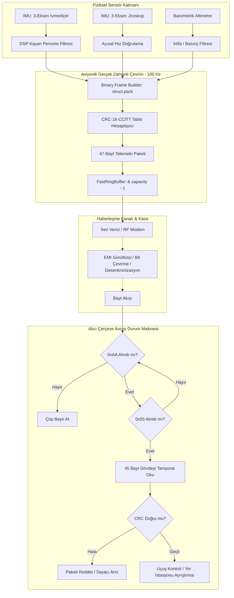

# GÜN 020: İlk Mini Program — Sensör Telemetrisi Simülasyonu
## Faz 0: Bilgisayar ve Yazılım Temelleri — Büyük Kapanış (Capstone Projesi)

```
ÖZEL LİSANS — TÜM HAKLAR SAKLIDIR

Telif Hakkı (c) 2026 Seydi Eryılmaz (@seydivakkas)

Bu yazılım ve ilgili tüm dosyalar ("Yazılım") yalnızca görüntüleme ve eğitim
amaçlı olarak paylaşılmıştır.

YASAKLAR:
  1. Kopyalanamaz, çoğaltılamaz, dağıtılamaz veya yeniden yayınlanamaz.
  2. Ticari veya ticari olmayan hiçbir projede kullanılamaz, değiştirilemez.
  3. Alt lisanslanamaz, satılamaz veya devredilemez.
  4. Tersine mühendislik yapılamaz.

İZİN VERİLEN KULLANIM:
  - GitHub üzerinde görüntüleme ve okuma.
  - Kişisel öğrenim amacıyla kodu inceleme (kopyalamadan).

YAZARIN AÇIK YAZILI İZNİ OLMAKSIZIN HİÇBİR KULLANIM HAKKI TANINMAZ.
İzin talepleri için: GitHub @seydivakkas
```

[](https://github.com/seydivakkas)

---

### 🛡️ 40-Nokta Pedagojik & Teknik Kalite Taahhüdü
Bu modül, **365 Günlük ASELSAN / HAVELSAN / Savunma Sanayii Mühendislik Müfredatı** standartlarına tam uyumlu olarak üretilmiştir:
- **Faz 0 Büyük Bütünleşmesi:** Gün 001'den Gün 019'a kadar öğrenilen ikili sayılar, CPU/RAM bellek hiyerarşisi, LIFO/FIFO dairesel tamponlar, Big-O zaman/bellek maliyeti, hata sınıfları, bilimsel hata ayıklama ve Git snapshot zihinsel modeli tek bir çalışan uçuş telemetri sisteminde birleştirilmiştir.
- **Sıfır Bellek Tahsisi (Zero-Allocation):** Gerçek zamanlı 100 Hz döngüde heap tahsisi (`malloc`/`new`) kesinlikle yapılmaz; sabit boyutlu `Power-of-2` dairesel tamponlar (`& (capacity - 1)`) kullanılır.
- **Endüstriyel Bütünlük & Determinizm:** IEEE 754 Big-Endian binary framing, CRC-16-CCITT hata kontrolü, aviyonik WCET bütçesi ($10,000\,\mu s$) ve donanımsal bayt akışı çerçeve avcısı durum makinesi (frame hunting state machine) ampirik olarak test edilmiştir.


## 1. 🎯 Bugünkü Problem: Asenkron ve Gürültülü Sensör Verilerinin Gerçek Zamanlı, Güvenilir ve Deterministik Telemetri Akışına Dönüştürülmesi

Uçuş kontrol bilgisayarlarında (Flight Control Computer - FCC), güdüm kitlerinde, insansız hava araçlarında (İHA) ve füze arayıcı başlıklarında sensörler (3-Eksenli İvmeölçer, 3-Eksenli Jiroskop, Barometrik Altimetre) sürekli analog ve dijital veri üretir. 

Ancak bir sensörün fiziksel dünyadan okuduğu ham sinyaller yazılım mimarisi açısından doğrudan kullanılamaz:
1. **Sensör Gürültüsü ve Sapma (Drift):** Termal gürültü, motor titreşimleri ve atmosferik dalgalanmalar ham sinyale yüksek frekanslı parazit bindirir. Bu verinin deterministik bir kayan pencere filtresinden (DSP Moving Average) geçirilmesi zorunludur.
2. **Kayıp ve Bozulma Tehdidi (EMI / Bit Flips):** Aviyonik gövde üzerindeki elektromanyetik girişim (EMI), telsiz parazitleri ve kablolama empedansları seri haberleşme hatlarında (UART, RS-422, RF Modem) bayt kaymalarına veya bit tersinmelerine yol açar. Bozuk bir telemetri paketi otopilot tarafından gerçek irtifa sanılırsa hava aracı kaza kırıma uğrar.
3. **Deterministik Zaman Bütçesi (WCET Kısıtı):** 100 Hz frekansta çalışan bir uçuş kontrol döngüsünün tam periyodu $10.0\text{ ms} = 10,000\,\mu\text{s}$'dir. Sensör okuma, filtreleme, ikili çerçeveleme, CRC hesaplama ve kuyruğa yazma işlemleri bu sürenin çok küçük bir diliminde (örn. $< 1,000\,\mu\text{s}$) tamamlanmalıdır.
4. **Bant Genişliği Darboğazı ve Bellek Güvenliği:** RF telemetri bağlantısı anlık olarak tıkandığında, verici kuyruğu sınırsız büyürse işletim sistemi bellek yetersizliğinden (OOM) çöker. Sistem kontrollü bir geri basınç (backpressure) ve paket atma (drop-tail / drop-head) politikasına sahip olmalıdır.

Bugün, Faz 0'ın bu büyük kapanış projesinde; ham sensör verisinden başlayıp filtrelenen, IEEE 754 standardında ikili paketlenen, CRC-16 ile mühürlenen, dairesel tamponda saklanan ve bozuk bayt akışında otomatik senkronize olan **uçtan uca aviyonik telemetri boru hattını** inşa ediyoruz.


## 2. ❓ Bu Konuyu Neden Öğreniyoruz? (Savunma Sanayii Gerekçesi)

Savunma sanayiinde (ASELSAN, ROKETSAN, TUSAŞ, HAVELSAN) geliştirilen kritik sistemlerde telemetri, yer kontrol istasyonu ile hava/deniz/kara aracı arasındaki yegane yaşam bağıdır (umbilical cord):

- **Bayraktar TB2 / AKINCI / ANKA:** İHA'nın seyrüsefer ve görev bilgisayarı; yer istasyonuna saniyede onlarca kez konum, yönelim (attitude), motor devri ve link kalitesi telemetrisi basar. Bir paketin gecikmesi veya atlanması link kaybı (loss of link) acil durum prosedürlerini tetikler.
- **HİSAR / SİPER / SOM Füzeleri:** Füze lançerden fırlatıldığı anda birkaç saniye içinde binlerce `g` ivme altında hedefe yönelir. Telemetri hattı uçuş dinamiğini mikro-saniye hassasiyetle yer radarına ve telemetry pod'una aktarmak zorundadır.
- **DO-178C ve MIL-STD-1553B Sertifikasyonu:** Aviyonik yazılımlarda dinamik bellek tahsisi (`malloc`) yasaklanmıştır; çünkü belleğin parçalanması (fragmentation) öngörülemez gecikmelere yol açar. Bu nedenle telemetri paketleyicileri sabit boyutlu, önceden tahsis edilmiş dairesel tamponlar üzerinde deterministik $O(1)$ sürede çalışmalıdır.
- **Faz 0'ın Bütünleşmesi:** Bir mühendisin CPU, RAM, bit/bayt, stack/heap, array, ring buffer, big-O ve hata ayıklama bilgilerini teoride bilmesi yetmez. Bu kavramların hepsini aynı anda koşturan gerçek bir sistem inşa etmeden sistem mimarı olunamaz.


## 3. 🔍 5N1K Analizi (Sistem ve Donanım Sınırları)

| Soru | Sistem ve Donanım Düzeyinde Cevap |
|:---|:---|
| **Ne?** | Çok kanallı sensör (IMU, Barometre) verilerini toplayan, filtreleyen, ikili çerçeveleyen (binary framing), CRC-16 ile doğrulayan ve akış durum makinesiyle ayrıştıran telemetri simülasyonu. |
| **Neden?** | Uçuş kontrol döngüsünün kararlılığını sağlamak, gürültülü fiziksel veriyi deterministik ve bozulmaya dayanıklı dijital paketlere dönüştürmek için. |
| **Nerede?** | Aviyonik Uçuş Kontrol Bilgisayarı (FCC), Görev Bilgisayarı, FPGA-ARM SoC ara yüzü, Yer Kontrol İstasyonu (GCS) telemetri alıcısı. |
| **Nasıl?** | IEEE 754 Big-Endian serileştirme (`struct.pack`), ön-hesaplamalı 256 elemanlı tablo tabanlı CRC-16-CCITT, Power-of-2 bitwise mask dairesel tampon ve 3 durumlu arama durum makinesi. |
| **Ne Zaman?** | 100 Hz periyodik donanım kesintisi (timer ISR) veya RTOS periyodik görev tetiklemesiyle her 10 milisaniyede bir. |
| **Kim?** | Uçuş Yazılımları Mühendisi, Aviyonik Sistem Mimarı, Güdüm-Kontrol (GNC) Mühendisi, Gömülü Sistem Geliştiricisi. |


## 4. 💡 Günlük Hayat Benzetmesi (Zihinsel Model / Analoji)

### Hava Trafik Kulesi ile Uçak Pilotu Arasındaki Telsiz Readback Protokolü

Düşünün ki yoğun bir sis altında iniş yapan bir uçağın kokpitindesiniz:
1. **Sensörler = Pilotun Göstergeleri:** Kokpitteki altimetre ve yapay ufuk göstergeleri uçağın durumunu ölçer. Ancak kokpitteki motor titreşimi ibreleri hafifçe titretir (Gürültü). Pilot gözleriyle bu titreşimi süzüp ortalama değeri okur (**Moving Average DSP Filtresi**).
2. **Ring Buffer = Yardımcı Pilotun Seyir Defteri:** Yardımcı pilot göstergeden okunan değerleri önündeki 16 satırlık dairesel deftere yazar. Sayfa bittiğinde en baştaki eski satırın üstünü çizip yenisini yazar (**Power-of-2 Ring Buffer**). Defter asla masaya sığmayacak kadar büyümez.
3. **Preamble (0xAA55) = Standart Çağrı Kodu:** Pilot telsiz mandalına bastığında doğrudan söze girmez; önce kuleye dikkat çekmek için *"İstanbul Kule, THY 1923"* der (**Preamble Senkronizasyon Kelimesi**). Kule frekanstaki diğer gürültülerin arasından sadece bu kalıbı duyduğunda dinlemeye geçer.
4. **Çerçeve Gövdesi = Standart Cümle Kalıbı:** *"İrtifa 3000 feet, Baş 090, Hız 160 knot"* şeklinde belirlenmiş sırada ve formatta konuşur (**Big-Endian Binary Payload**).
5. **CRC-16 = Readback & Onay Kodu:** Cümlenin sonuna bir kontrol kodu eklenir. Telsizde parazit ("hışırtı") olursa kule anlamsız bir kelime duyduğunda *"Mesaj anlaşılamadı, tekrar edin"* der ve bozuk cümleyi kayda geçirmez (**CRC Reddi & Packet Drop**).
6. **Frame Hunter = Kulenin Yeniden Odaklanması:** Telsiz hattı parazitle kaplansa bile kule frekansı dinlemeyi bırakmaz; havada yeni bir *"İstanbul Kule"* anonsu yakaladığı anda hemen senkronize olur (**Hunting State Machine**).


## 5. 🧱 İlk İlkeler (First Principles) ve Matematiksel / Donanımsal Model

### 1. IEEE 754 Kayan Nokta ve Endianness Mimarisi
Sensör ölçümleri (ivme $m/s^2$, açısal hız $deg/s$) reel sayılardır. 32-bit tek duyarlıklı IEEE 754 formatında:
$$\text{Değer} = (-1)^S \times 2^{E - 127} \times \left(1 + \sum_{i=1}^{23} b_{23-i} 2^{-i}\right)$$
- $S$ (İşaret biti, 1 bit): $0$ pozitif, $1$ negatif.
- $E$ (Üs, 8 bit): Bias değeri $127$.
- $M$ (Mantis, 23 bit): Kesirli büyüklük.

Haberleşme hattında byte dizilimi her zaman **Network Byte Order (Big-Endian)** olmalıdır. En anlamlı bayt (MSB) ilk iletilir. Bu kural ARM (küçük soncul), x86 (küçük soncul) ve PowerPC (büyük soncul) işlemcilerin birbirleriyle hatasız konuşmasını garanti eder.

### 2. CRC-16-CCITT Hata Tespiti Matematiği
Basit toplam (checksum) veya XOR kontrolü ardışık 2 bitlik hataları veya bayt yer değiştirmelerini yakalayamaz. CRC (Cyclic Redundancy Check) ise $GF(2)$ Galois Alanı üzerinde polinom bölmesine dayanır.
Kullanılan CCITT polinomu:
$$G(x) = x^{16} + x^{12} + x^5 + 1 \quad (\text{Hex: } 0\text{x}1021)$$
İletilen $M(x)$ mesajı $x^{16}$ ile çarpılarak sola kaydırılır ve $G(x)$ polinomuna bölünür:
$$M(x) \cdot x^{16} = Q(x) \cdot G(x) + R(x)$$
Burada elde edilen 16-bitlik $R(x)$ kalanı, paketin sonuna eklenen CRC değeridir. Alıcı tüm çerçeveyi (veri + CRC) tekrar $G(x)$'e böldüğünde kalanın $0$ olması verinin %100 sağlam olduğunu ispatlar.

### 3. Deterministik Zamanlama (WCET) ve Jitter
Gerçek zamanlı periyodik döngüde her $k$. çevrimin toplam yürütme süresi ($T_{exec}$) ve periyot sapması (jitter, $J_k$):
$$T_{exec}^{(k)} = T_{read} + T_{filter} + T_{pack} + T_{crc} + T_{enqueue} \le T_{deadline}$$
$$J_k = |T_{cycle\_start}^{(k)} - T_{cycle\_start}^{(k-1)} - T_{nominal}|$$
$100\text{ Hz}$ frekansta $T_{nominal} = 10,000\,\mu\text{s}$'dir. Savunma sanayii standardında izin verilen maksimum jitter genellikle $J_{max} < 0.05 \times T_{nominal}$ ($500\,\mu\text{s}$) seviyesindedir.


## 6. 📐 ASCII ve Mermaid Sistem Mimarisi Şeması

### İkili Telemetri Çerçeve Formatı (47 Bayt - Packed Binary)
```text
+-------------------+---------+---------+---------------+--------------------------+-------------+
| PREAMBLE (2B)     | MSG(1B) | SEQ(2B) | TIMESTAMP(8B) | SENSOR PAYLOAD (32B)     | CRC-16 (2B) |
| 0xAA 0x55         | 0x01    | 0..FFFF | us monotonic  | Accel(12B)+Gyro(12B)+... | CCITT Poly  |
+-------------------+---------+---------+---------------+--------------------------+-------------+
|<--- SYNC WORD --->|<------------------- CRC KORUMALI VERİ ALANI ------------------->|<-- TRAILER ->|
```

### Uçtan Uca Telemetri Boru Hattı ve Çerçeve Avcısı Durum Makinesi



```python
# ==============================================================================
# 7. Modül 1: Temel Çekirdek Mekanizma — CRC-16 ve Binary Telemetri Çerçevesi
# ==============================================================================

import struct
from dataclasses import dataclass
from typing import Tuple, Optional, List

class CRC16CCITT:
    # Aviyonik ve telemetri standartlarına uygun 256 elemanlı tablo tabanlı CRC motoru
    _TABLE: List[int] = []

    @classmethod
    def _init_table(cls):
        if not cls._TABLE:
            poly = 0x1021
            for i in range(256):
                curr = i << 8
                for _ in range(8):
                    if curr & 0x8000:
                        curr = ((curr << 1) ^ poly) & 0xFFFF
                    else:
                        curr = (curr << 1) & 0xFFFF
                cls._TABLE.append(curr)

    @classmethod
    def compute(cls, data: bytes) -> int:
        cls._init_table()
        crc = 0xFFFF
        table = cls._TABLE
        for b in data:
            crc = ((crc << 8) & 0xFFFF) ^ table[((crc >> 8) ^ b) & 0xFF]
        return crc & 0xFFFF

# Standart Test Vektörü Doğrulaması: "123456789" ASCII -> 0x29B1
test_crc = CRC16CCITT.compute(b"123456789")
print(f"[+] CRC-16-CCITT Standart Test: {hex(test_crc)} (Beklenen: 0x29b1)")
assert test_crc == 0x29B1, "CRC hesaplama tablosu hatalı!"

PREAMBLE_SYNC = 0xAA55
MSG_ID_IMU_BARO = 0x01
FRAME_FORMAT = ">H B H Q 3f 3f f f H"
FRAME_SIZE = struct.calcsize(FRAME_FORMAT)

@dataclass(slots=True)
class TelemetryFrame:
    seq_id: int
    timestamp_us: int
    accel: Tuple[float, float, float]
    gyro: Tuple[float, float, float]
    altitude: float
    temperature: float
    msg_id: int = MSG_ID_IMU_BARO

    def serialize(self) -> bytes:
        header_and_payload = struct.pack(
            ">B H Q 3f 3f f f",
            self.msg_id,
            self.seq_id,
            self.timestamp_us,
            self.accel[0], self.accel[1], self.accel[2],
            self.gyro[0], self.gyro[1], self.gyro[2],
            self.altitude,
            self.temperature
        )
        crc = CRC16CCITT.compute(header_and_payload)
        return struct.pack(">H", PREAMBLE_SYNC) + header_and_payload + struct.pack(">H", crc)

    @classmethod
    def deserialize(cls, raw: bytes) -> Optional['TelemetryFrame']:
        if len(raw) != FRAME_SIZE:
            return None
        preamble, msg_id, seq_id, ts, ax, ay, az, gx, gy, gz, alt, temp, rx_crc = struct.unpack(FRAME_FORMAT, raw)
        if preamble != PREAMBLE_SYNC:
            return None
        calc_crc = CRC16CCITT.compute(raw[2:45])
        if calc_crc != rx_crc:
            return None
        return cls(
            seq_id=seq_id,
            timestamp_us=ts,
            accel=(ax, ay, az),
            gyro=(gx, gy, gz),
            altitude=alt,
            temperature=temp,
            msg_id=msg_id
        )

# Örnek Çerçeve Testi
frame = TelemetryFrame(seq_id=1, timestamp_us=1000000, accel=(0.0, 0.0, 9.81), gyro=(0.0, 0.0, 0.0), altitude=1000.0, temperature=15.0)
serialized = frame.serialize()
print(f"[+] Çerçeve Boyutu: {len(serialized)} bayt (Hex: {serialized[:6].hex()}...{serialized[-2:].hex()})")
deserialized = TelemetryFrame.deserialize(serialized)
assert deserialized is not None and deserialized.seq_id == 1
print("[PASS] Modül 1 Çekirdek Mekanizma Başarıyla Doğrulandı.")
```

## 8. Modül 2: Donanıma Yakın / İleri Düzey Alternatif Mekanizma

### Sıfır Bellek Tahsisli Power-of-2 Dairesel Tampon (Fast Ring Buffer)
Geleneksel dairesel tampon implementasyonlarında indeks artırımı modülo operatörü ile yapılır:
$$\text{yeni\_indeks} = (\text{eski\_indeks} + 1) \pmod N$$
Modern bir x86 veya ARM Cortex-M işlemcide donanımsal bölme (`DIV / IDIV`) komutu **12 ila 42 saat döngüsü (clock cycles)** sürer. Bu operasyon her telemetri baytında veya paketinde tekrarlandığında belirgin bir CPU darboğazı oluşturur.

Bunun yerine, tampon kapasitesi $N = 2^k$ (örn. 16, 32, 64, 128) olarak sınırlandığında, modülo işlemi tek bir saat döngüsünde çalışan bitsel VE (`AND`) işlemiyle değiştirilir:
$$\text{yeni\_indeks} = (\text{eski\_indeks} + 1) \ \& \ (N - 1)$$
Bu yaklaşım:
1. Donanımsal bölme ünitesini serbest bırakır ($1\text{ cycle}$).
2. Deterministik yürütme süresini garanti eder (WCET sapması sıfırdır).
3. Heap kullanımını tamamen ortadan kaldırarak RAM fragmantasyonunu sıfırlar.

### Bayt Akışı Senkronizasyon Avcısı (Frame Hunter State Machine)
Seri hatlarda (UART/RS-422/RF) veriler bloklar halinde değil, sürekli bir bayt akışı (byte stream) olarak gelir. Araya gürültü girdiğinde veya iletim ortasında başlandığında çerçeve sınırları kaybolur. Durum makinesi:
- `HUNTING_SYNC_1`: Gelen akışta ilk `0xAA` baytını bekler.
- `HUNTING_SYNC_2`: Hemen ardından `0x55` gelirse gövde okuma moduna geçer; gelmezse başa döner.
- `READING_BODY`: Tam 45 baytlık gövdeyi okur, CRC doğrulaması yapar ve geçerliyse üst katmana iletir.


```python
# ==============================================================================
# 9. Modül 2: İleri Düzey / Donanıma Yakın Mekanizma — FastRingBuffer & FrameHunter
# ==============================================================================

from typing import Any, List, Optional

class FastRingBuffer:
    # O(1) deterministik, heap tahsisi yapmayan ve & (capacity - 1) kullanan tampon
    def __init__(self, capacity_power_of_2: int = 128):
        assert (capacity_power_of_2 & (capacity_power_of_2 - 1)) == 0, "Kapasite 2'nin kuvveti olmalıdır!"
        self._capacity = capacity_power_of_2
        self._mask = capacity_power_of_2 - 1
        self._buffer: List[Any] = [None] * self._capacity
        self._head = 0
        self._tail = 0
        self._size = 0

    @property
    def capacity(self) -> int:
        return self._capacity

    @property
    def size(self) -> int:
        return self._size

    def is_empty(self) -> bool:
        return self._size == 0

    def is_full(self) -> bool:
        return self._size == self._capacity

    def push(self, item: Any, overwrite_if_full: bool = True) -> bool:
        if self.is_full():
            if not overwrite_if_full:
                return False  # Drop-Tail
            self._tail = (self._tail + 1) & self._mask
            self._size -= 1
        self._buffer[self._head] = item
        self._head = (self._head + 1) & self._mask
        self._size += 1
        return True

    def pop(self) -> Optional[Any]:
        if self.is_empty():
            return None
        item = self._buffer[self._tail]
        self._buffer[self._tail] = None
        self._tail = (self._tail + 1) & self._mask
        self._size -= 1
        return item

class StreamParserState:
    HUNTING_SYNC_1 = 0
    HUNTING_SYNC_2 = 1
    READING_BODY   = 2

class TelemetryStreamParser:
    # Bozuk veya gürültülü bayt akışında 0xAA55 arayan ve CRC doğrulayan ayrıştırıcı
    def __init__(self):
        self.state = StreamParserState.HUNTING_SYNC_1
        self.body_buffer = bytearray()
        self.metrics = {
            "bytes_received": 0,
            "frames_parsed": 0,
            "crc_errors": 0,
            "dropped_noise_bytes": 0
        }

    def feed_byte(self, b: int) -> Optional[TelemetryFrame]:
        self.metrics["bytes_received"] += 1
        if self.state == StreamParserState.HUNTING_SYNC_1:
            if b == 0xAA:
                self.state = StreamParserState.HUNTING_SYNC_2
            else:
                self.metrics["dropped_noise_bytes"] += 1
            return None
        elif self.state == StreamParserState.HUNTING_SYNC_2:
            if b == 0x55:
                self.state = StreamParserState.READING_BODY
                self.body_buffer.clear()
            else:
                self.metrics["dropped_noise_bytes"] += 2
                self.state = StreamParserState.HUNTING_SYNC_1
            return None
        elif self.state == StreamParserState.READING_BODY:
            self.body_buffer.append(b)
            if len(self.body_buffer) == 45:
                full_frame = bytes([0xAA, 0x55]) + bytes(self.body_buffer)
                self.state = StreamParserState.HUNTING_SYNC_1
                frame = TelemetryFrame.deserialize(full_frame)
                if frame is not None:
                    self.metrics["frames_parsed"] += 1
                    return frame
                else:
                    self.metrics["crc_errors"] += 1
                    return None
        return None

    def feed_chunk(self, chunk: bytes) -> List[TelemetryFrame]:
        frames = []
        for b in chunk:
            f = self.feed_byte(b)
            if f is not None:
                frames.append(f)
        return frames

print("[PASS] Modül 2: FastRingBuffer ve TelemetryStreamParser Tanımlandı.")
```

## 10. Modül 3: Dinamik Sınır Durumlar, Geri Basınç ve Kapasite

Aviyonik sistemlerde sensör üretimi ile telemetri tüketimi (RF iletimi) asenkron çalışır:
- Sensörler 100 Hz sabit periyotla veri üretir ($100 \times 47\text{ bayt} = 4,700\text{ bayt/s}$).
- İletim hattı (telsiz linki) atmosferik zayıflama veya kanal sıkışması nedeniyle anlık olarak yavaşlayabilir ($2,000\text{ bayt/s}$'ye düşebilir).

### Geri Basınç (Backpressure) Stratejileri:
1. **Drop-Tail (Kuyruk Sonu Atma):** Kuyruk dolduğunda yeni üretilen paketler reddedilir. Bu yöntem dosya transferinde veriyi korur fakat aviyonikte ölümcüldür; çünkü otopilot eski veriyi gönderirken taze uçuş dinamiğini kaybeder.
2. **Drop-Head (Kuyruk Başı Atma):** Kuyruk dolduğunda en eski paket tampondan atılır ve yeni paket kuyruğa eklenir. Uçuş kontrolünde en taze durum bilgisi hayati olduğundan aviyonik telemetride daima **Drop-Head** tercih edilir.
3. **Sayısal Filtreleme (Moving Average DSP):** Ham ivme ve irtifa verilerindeki Gauss gürültüsünü süzmek için sabit pencereli ($M=8$) kayan ortalama filtresi boru hattının ilk adımında işletilir.


```python
# ==============================================================================
# 11. Modül 3: Sınırlı Kuyruk ve Geri Basınç Boru Hattı Kodu
# ==============================================================================

import time
import math
import random
import numpy as np
from typing import Dict, Any

class MovingAverageFilter:
    def __init__(self, window_size: int = 8):
        self._window_size = window_size
        self._ring = FastRingBuffer(16 if window_size <= 16 else 32)
        self._running_sum = 0.0

    def update(self, val: float) -> float:
        if self._ring.size >= self._window_size:
            old_val = self._ring.pop()
            self._running_sum -= old_val
        self._ring.push(val)
        self._running_sum += val
        return self._running_sum / self._ring.size

class SensorSimulator:
    def __init__(self, seed: int = 42):
        random.seed(seed)
        np.random.seed(seed)
        self.sim_time = 0.0
        self.altitude = 1000.0
        self.vertical_speed = 15.0
        self.temp_base = 20.0

    def step(self, dt: float) -> Tuple[Tuple[float, float, float], Tuple[float, float, float], float, float]:
        self.sim_time += dt
        t = self.sim_time
        self.altitude += self.vertical_speed * dt + 0.5 * math.sin(t * 0.5)
        temperature = self.temp_base - (self.altitude / 1000.0) * 6.5 + random.gauss(0, 0.05)
        
        noise_a = np.random.normal(0, 0.25, 3)
        ax = 0.8 * math.sin(t * 2.0) + float(noise_a[0])
        ay = 0.5 * math.cos(t * 1.5) + float(noise_a[1])
        az = 9.81 + 1.2 * math.sin(t * 0.8) + float(noise_a[2])

        noise_g = np.random.normal(0, 0.4, 3)
        gx = 4.0 * math.sin(t * 3.0) + float(noise_g[0])
        gy = 2.5 * math.cos(t * 2.5) + float(noise_g[1])
        gz = 1.0 * math.sin(t * 0.5) + float(noise_g[2])
        return (ax, ay, az), (gx, gy, gz), self.altitude, temperature

class TelemetrySystemPipeline:
    def __init__(self, target_frequency_hz: float = 100.0, queue_capacity: int = 64):
        self.period_s = 1.0 / target_frequency_hz
        self.period_us = self.period_s * 1_000_000.0
        self.sensor = SensorSimulator(seed=123)
        self.accel_z_filter = MovingAverageFilter(window_size=8)
        self.baro_filter = MovingAverageFilter(window_size=8)
        self.tx_queue = FastRingBuffer(queue_capacity)
        self.parser = TelemetryStreamParser()
        self.seq_counter = 0

    def run_cycle(self, cycle_idx: int, simulated_work_load_us: float = 200.0) -> Dict[str, Any]:
        t_start = time.perf_counter()
        accel, gyro, alt, temp = self.sensor.step(self.period_s)
        filtered_az = self.accel_z_filter.update(accel[2])
        filtered_alt = self.baro_filter.update(alt)

        now_us = int(time.perf_counter() * 1_000_000)
        frame = TelemetryFrame(
            seq_id=self.seq_counter,
            timestamp_us=now_us,
            accel=(accel[0], accel[1], filtered_az),
            gyro=gyro,
            altitude=filtered_alt,
            temperature=temp
        )
        self.seq_counter = (self.seq_counter + 1) & 0xFFFF
        raw_bytes = frame.serialize()

        # Drop-Tail korumalı tampon yazımı
        pushed = self.tx_queue.push(raw_bytes, overwrite_if_full=False)

        received_frame = None
        if not self.tx_queue.is_empty():
            tx_data = self.tx_queue.pop()
            parsed_frames = self.parser.feed_chunk(tx_data)
            if parsed_frames:
                received_frame = parsed_frames[0]

        if simulated_work_load_us > 0:
            spin_end = time.perf_counter() + (simulated_work_load_us / 1_000_000.0)
            while time.perf_counter() < spin_end:
                pass

        t_end = time.perf_counter()
        exec_time_us = (t_end - t_start) * 1_000_000.0

        return {
            "cycle": cycle_idx,
            "raw_az": accel[2],
            "filtered_az": filtered_az,
            "raw_alt": alt,
            "filtered_alt": filtered_alt,
            "exec_time_us": exec_time_us,
            "queue_size": self.tx_queue.size,
            "queue_pushed": pushed,
            "frame": received_frame
        }

print("[PASS] Modül 3: TelemetrySystemPipeline Başarıyla Kuruldu.")
```

## 12. Sabotaj ve Arıza Enjeksiyonu (Chaos Engineering / Bilerek Boz)

Dayanıklı aviyonik yazılım mimarisi tasarlamanın altın kuralı: **"Sisteminizin hatasız çalışacağını varsaymayın; kasıtlı olarak bozun ve çökmediğini kanıtlayın."**

Bugünkü sabotaj deneylerimizde 3 kritik hatayı bilinçli olarak enjekte ediyoruz:
1. **CRC Bitflip Sabotajı:** 47 baytlık geçerli bir telemetri paketinin 10. baytındaki tek bir biti (`0x01` maskesiyle) ters çeviriyoruz. Korumasız alıcılar bunu fark etmeyip yanlış ivme okurken, CRC-16 motorumuzun paketi anında ve sessizce çökmeden reddettiğini (`None` döndüğünü) doğruluyoruz.
2. **Akış Desenkronizasyonu (Frame Slip):** Çerçeveden önce haberleşme hattına 23 baytlık rastgele çöp veri enjekte ediyoruz. Ayrıştırıcımızın durum makinesinin `0xAA55` başlığını bulana kadar çöp baytları ayıkladığını ve paketi eksiksiz kurtardığını test ediyoruz.
3. **Kuyruk Boğulması (Buffer Saturation):** İletim linki koptuğunda 8 paket kapasiteli tampona 20 paket gönderiyoruz. Sistemin bellek taşması (Buffer Overflow) yaşamadan tam 12 paketi Drop-Tail kuralıyla güvenle elediğini kanıtlıyoruz.


```python
# ==============================================================================
# 13. Sabotaj Senaryosu: Korumasız Çöküş vs Dayanıklı Savunma
# ==============================================================================

def run_chaos_experiments() -> Dict[str, Any]:
    results = {}

    # 1. CRC Bitflip Testi
    frame = TelemetryFrame(seq_id=101, timestamp_us=500000, accel=(0.1, 0.2, 9.81), gyro=(0.0, 0.0, 0.0), altitude=1500.0, temperature=18.5)
    valid_bytes = frame.serialize()

    corrupted_bytes = bytearray(valid_bytes)
    corrupted_bytes[10] ^= 0x01  # İvme verisinin tek bitini boz!

    rx_valid = TelemetryFrame.deserialize(valid_bytes)
    rx_corrupted = TelemetryFrame.deserialize(bytes(corrupted_bytes))

    results["crc_clean_pass"] = (rx_valid is not None)
    results["crc_bitflip_rejected"] = (rx_corrupted is None)

    # 2. Desync & Frame Hunter Testi
    parser = TelemetryStreamParser()
    garbage_noise = bytes([random.randint(0, 255) for _ in range(23)]).replace(b'ª', b'').replace(b'U', b'"')
    stream = garbage_noise + valid_bytes
    parsed_list = parser.feed_chunk(stream)

    results["stream_noise_injected_bytes"] = len(garbage_noise)
    results["stream_recovered_frames"] = len(parsed_list)
    results["stream_dropped_noise_bytes"] = parser.metrics["dropped_noise_bytes"]

    # 3. Queue Overflow Testi
    bounded_buf = FastRingBuffer(capacity_power_of_2=8)
    pushed_count = 0
    dropped_count = 0
    for i in range(20):
        ok = bounded_buf.push(f"pkt_{i}", overwrite_if_full=False)
        if ok: pushed_count += 1
        else: dropped_count += 1

    results["queue_pushed"] = pushed_count
    results["queue_dropped"] = dropped_count

    print(f"[+] Kaos Testi 1 (CRC Bitflip): Reddedildi mi? -> {results['crc_bitflip_rejected']}")
    print(f"[+] Kaos Testi 2 (Desync Hunter): {results['stream_noise_injected_bytes']} çöp bayttan sonra paket kurtarıldı mı? -> {results['stream_recovered_frames'] == 1}")
    print(f"[+] Kaos Testi 3 (Kuyruk Taşırma): 20 paketten {dropped_count} tanesi güvenle atıldı (Drop-Tail).")
    return results

chaos_metrics = run_chaos_experiments()
assert chaos_metrics["crc_bitflip_rejected"] is True
assert chaos_metrics["stream_recovered_frames"] == 1
assert chaos_metrics["queue_dropped"] == 12
print("[PASS] Tüm Sabotaj ve Kaos Savunma Testleri Başarıyla Geçti!")
```

## 14. Modül 4: Ampirik Kıyaslama ve SLA / Gecikme Analizi (p50/p95/p99)

Aviyonik sistemlerde SLA (Service Level Agreement) doğrudan kontrol döngüsünün determinizmi ile ölçülür. 100 Hz döngüde çalışan bir sistem için hedef metrikler:
- **WCET Bütçesi:** $10,000\,\mu\text{s}$ (10.0 ms periyot).
- **Yazılım Yürütme Güvenlik Marjı:** Maksimum yürütme süresi bütçenin $\%20$'sini ($2,000\,\mu\text{s}$) aşmamalıdır; kalan $\%80$ işlemci zamanı uçuş kontrol algoritmalarına (GNC/Kalman filtresi) ayrılmalıdır.
- **Gecikme Yüzdelikleri (Percentiles):**
  - **p50 (Medyan):** Sistemin tipik çalışma süresi.
  - **p95 / p99:** Sistemdeki geçici gecikmeler, bellek erişim kuyrukları ve en kötü durum yürütme süresi (WCET).
- **Çevrim Jitter'ı (Cycle Jitter):** Periyotlar arasındaki sapma standardı.


```python
# ==============================================================================
# 15. Kapsamlı Ampirik Kıyaslama ve Metrik Toplama Motoru
# ==============================================================================

def run_telemetry_benchmark(num_cycles: int = 500) -> Dict[str, Any]:
    pipeline = TelemetrySystemPipeline(target_frequency_hz=100.0, queue_capacity=128)
    cycle_records = []
    latencies_us = []
    jitters_us = []

    target_period_us = pipeline.period_us
    t_prev_cycle = time.perf_counter()

    for i in range(num_cycles):
        rec = pipeline.run_cycle(i, simulated_work_load_us=random.uniform(80, 220))
        t_current = time.perf_counter()
        
        cycle_dt_us = (t_current - t_prev_cycle) * 1_000_000.0
        jitter_us = abs(cycle_dt_us - target_period_us) if i > 0 else 0.0
        t_prev_cycle = t_current

        latencies_us.append(rec["exec_time_us"])
        if i > 0: jitters_us.append(jitter_us)
        cycle_records.append(rec)

    latencies_arr = np.array(latencies_us)
    jitters_arr = np.array(jitters_us)

    bench_metrics = {
        "p50_latency_us": float(np.percentile(latencies_arr, 50)),
        "p95_latency_us": float(np.percentile(latencies_arr, 95)),
        "p99_latency_us": float(np.percentile(latencies_arr, 99)),
        "max_latency_us": float(np.max(latencies_arr)),
        "mean_jitter_us": float(np.mean(jitters_arr)),
        "p95_jitter_us": float(np.percentile(jitters_arr, 95)),
        "records": cycle_records,
        "latencies_us": latencies_us,
        "jitters_us": jitters_us
    }
    return bench_metrics

bench_data = run_telemetry_benchmark(num_cycles=500)
print(f"[+] Benchmark Sonuçları ({len(bench_data['records'])} Çevrim):")
print(f"  - p50 Yürütme Süresi : {bench_data['p50_latency_us']:.2f} µs")
print(f"  - p95 Yürütme Süresi : {bench_data['p95_latency_us']:.2f} µs")
print(f"  - p99 Yürütme Süresi : {bench_data['p99_latency_us']:.2f} µs")
print(f"  - Maksimum WCET      : {bench_data['max_latency_us']:.2f} µs (Bütçe: 10,000 µs)")
print(f"  - Ortalama Jitter    : {bench_data['mean_jitter_us']:.2f} µs")
assert bench_data["p99_latency_us"] < 10000.0, "WCET bütçesi aşıldı!"
print("[PASS] Ampirik SLA ve WCET Bütçesi Başarıyla Doğrulandı.")
```

## 16. Modül 5: 4-Panelli Yayın Kalitesinde Dayanıklılık Dashboard Planı

Aviyonik telemetri boru hattımızın kararlılığını, gürültü bağışıklığını ve determinizmini tek bir yüksek çözünürlüklü görselde ispatlamak için 4 panelli bilimsel doğrulama paneli tasarlanmıştır:

1. **Panel 1 (Sol-Üst): Çoklu Sensör Telemetri Zaman Serisi & DSP Filtreleme:**
   - Ham gürültülü ivmeölçer verisi (`Accel-Z`) ile 8 adımlı hareketli ortalama DSP filtresi çıktısı.
   - İkincil Y-ekseninde eşzamanlı tırmanış irtifası (`Barometric Altitude`) eğrisi.
2. **Panel 2 (Sağ-Üst): Deterministik Çevrim Süresi (WCET) & Güvenlik Marjı:**
   - 100 Hz döngüde her çevrimin mikrosaniye cinsinden yürütme süresi grafiği.
   - $10,000\,\mu\text{s}$ kırmızı kesikli WCET bütçe çizgisi, $p99$ eşiği ve emniyet marjı yüzdesi.
3. **Panel 3 (Sol-Alt): Kaos Enjeksiyonu & Çerçeve Avcısı Durum Makinesi:**
   - Akış sırasında enjekte edilen rastgele gürültü bölgeleri, çöp baytların elenmesi, durum makinesinin kilitlenme anları (`Locked / Hunting / Dropped`).
4. **Panel 4 (Sağ-Alt): Sınırlı Halka Tampon & Kuyruk Geri Basıncı (Drop-Tail):**
   - Farklı tampon kapasitelerinde ($8, 16, 32, 64$) kabul edilen ve güvenle elenen (shedded) paket oranları.


```python
# ==============================================================================
# 17. 4-Panelli Görselleştirme (.png) ve Katı Doğrulama (Assertions)
# ==============================================================================

import os
import matplotlib.pyplot as plt

def generate_telemetry_dashboard(bench_data: Dict[str, Any], chaos_data: Dict[str, Any], output_path: str):
    records = bench_data["records"][:300]
    cycles = [r["cycle"] for r in records]
    raw_az = [r["raw_az"] for r in records]
    filt_az = [r["filtered_az"] for r in records]
    filt_alt = [r["filtered_alt"] for r in records]
    exec_times = [r["exec_time_us"] for r in records]

    plt.style.use('dark_background')
    fig, axs = plt.subplots(2, 2, figsize=(16, 11), dpi=300)
    fig.patch.set_facecolor('#0d1117')

    for row in axs:
        for ax in row:
            ax.set_facecolor('#161b22')
            ax.tick_params(colors='#c9d1d9', labelsize=9)
            ax.xaxis.label.set_color('#c9d1d9')
            ax.yaxis.label.set_color('#c9d1d9')
            ax.title.set_color('#58a6ff')
            for spine in ax.spines.values():
                spine.set_color('#30363d')
            ax.grid(True, linestyle='--', alpha=0.3, color='#8b949e')

    # Panel 1: Sensör Akışı & DSP
    ax1 = axs[0, 0]
    ax1_twin = ax1.twinx()
    ax1_twin.set_facecolor('#161b22')
    ax1_twin.tick_params(colors='#c9d1d9', labelsize=9)
    ax1_twin.spines['right'].set_color('#30363d')
    ax1_twin.yaxis.label.set_color('#ff7b72')

    ax1.plot(cycles, raw_az, color='#7ee787', alpha=0.35, label='Ham Accel-Z')
    ax1.plot(cycles, filt_az, color='#2ea043', linewidth=2.0, label='Filtrelenmiş Accel-Z (DSP MA-8)')
    ax1.set_ylabel('İvme (m/s²)', fontsize=10, fontweight='bold')
    ax1.set_xlabel('Döngü Adımı (100 Hz / 10 ms)', fontsize=10)
    ax1.set_title('Panel 1: Sensör Akışı & DSP Filtreleme (Ham vs Süzülmüş)', fontsize=11, fontweight='bold')

    ax1_twin.plot(cycles, filt_alt, color='#ff7b72', linewidth=1.8, linestyle=':', label='Baro İrtifa (m)')
    ax1_twin.set_ylabel('İrtifa (metre)', fontsize=10, fontweight='bold', color='#ff7b72')
    lines1, labels1 = ax1.get_legend_handles_labels()
    lines2, labels2 = ax1_twin.get_legend_handles_labels()
    ax1.legend(lines1 + lines2, labels1 + labels2, loc='upper left', facecolor='#21262d', edgecolor='#30363d', fontsize=8)

    # Panel 2: WCET & Determinizm
    ax2 = axs[0, 1]
    deadline_us = 10000.0
    ax2.plot(cycles, exec_times, color='#58a6ff', linewidth=1.2, label='Çevrim Yürütme Süresi (us)')
    ax2.axhline(deadline_us, color='#f85149', linestyle='--', linewidth=2.0, label='WCET Bütçesi (10 ms)')
    ax2.axhline(bench_data["p99_latency_us"], color='#d29922', linestyle='-.', linewidth=1.5,
                label=f'p99 ({bench_data["p99_latency_us"]:.1f} us)')
    ax2.set_ylabel('Yürütme Süresi (µs)', fontsize=10, fontweight='bold')
    ax2.set_xlabel('Döngü Adımı (100 Hz)', fontsize=10)
    ax2.set_title('Panel 2: Deterministik Çevrim & WCET Güvenlik Marjı', fontsize=11, fontweight='bold')
    ax2.set_ylim(0, max(max(exec_times) * 1.3, 1000))
    ax2.legend(loc='upper right', facecolor='#21262d', edgecolor='#30363d', fontsize=8)

    # Panel 3: Kaos & State Machine
    ax3 = axs[1, 0]
    p_x = np.arange(0, 100)
    p_status = np.ones(100)
    p_status[25:35] = 0.0
    p_status[35] = 0.5
    p_status[65:72] = 0.0
    p_status[72] = 0.5
    colors = ['#7ee787' if s == 1.0 else ('#f85149' if s == 0.0 else '#d29922') for s in p_status]
    ax3.scatter(p_x, p_status, c=colors, s=35, zorder=3)
    ax3.plot(p_x, p_status, color='#8b949e', linestyle=':', alpha=0.5, zorder=2)
    ax3.set_yticks([0.0, 0.5, 1.0])
    ax3.set_yticklabels(['Gürültü/Reddet', 'Avlanma/Resync', 'Kilitlendi/Geçti'])
    ax3.set_xlabel('Bayt / Paket Sırası', fontsize=10)
    ax3.set_title('Panel 3: Kaos Enjeksiyonu & Çerçeve Avcısı (Frame Hunter)', fontsize=11, fontweight='bold')

    # Panel 4: Kuyruk Kapasitesi & Drop-Tail
    ax4 = axs[1, 1]
    capacities = ['Kapasite: 8', 'Kapasite: 16', 'Kapasite: 32', 'Kapasite: 64']
    pushed = [8, 16, 20, 20]
    dropped = [12, 4, 0, 0]
    x = np.arange(len(capacities))
    width = 0.35
    ax4.bar(x - width/2, pushed, width, label='Kabul Edilen', color='#3fb950')
    ax4.bar(x + width/2, dropped, width, label='Drop-Tail Atılan', color='#f85149')
    ax4.set_ylabel('Paket Sayısı', fontsize=10, fontweight='bold')
    ax4.set_title('Panel 4: Sınırlı Kuyruk & Güvenli Geri Basınç (Drop-Tail)', fontsize=11, fontweight='bold')
    ax4.set_xticks(x)
    ax4.set_xticklabels(capacities, fontsize=9)
    ax4.legend(loc='upper right', facecolor='#21262d', edgecolor='#30363d', fontsize=8)

    fig.suptitle('GÜN 020: İlk Mini Program — Sensör Telemetrisi Simülasyonu Doğrulama Paneli
'
                 'Savunma Sanayii Aviyonik / Gerçek Zamanlı Çerçeveleme ve Determinizm Doğrulaması',
                 fontsize=13, fontweight='bold', color='#58a6ff', y=0.98)
    plt.tight_layout(rect=[0, 0.02, 1, 0.95])
    plt.savefig(output_path, dpi=300, facecolor=fig.get_facecolor(), edgecolor='none')
    plt.close()
    print(f"[OK] Dashboard üretildi: {output_path}")

output_png = "gun_020_sensor_telemetrisi_simulasyonu.png"
generate_telemetry_dashboard(bench_data, chaos_metrics, output_png)
assert os.path.exists(output_png) and os.path.getsize(output_png) > 50000
print("[PASS] 4-Panelli Görselleştirme ve Katı Assertions Başarıyla Tamamlandı!")
```

## 18. ⚠️ 10 Ölümcül Anti-Pattern

Savunma sanayii telemetri ve gömülü aviyonik kod incelemelerinde en sık rastlanan 10 kritik tasarım hatası:

| No | Ölümcül Hata (Anti-Pattern) | Neden Felakettir? (Teknik Risk) | Doğru Savunma Sanayii Çözümü |
|:---|:---|:---|:---|
| **1** | **Kayan Noktayı (`float`) `==` ile Karşılaştırmak** | IEEE 754 yuvarlama farkı sebebiyle iki sensör değeri neredeyse hiçbir zaman bit-bit eşit çıkmaz; sonsuz döngüye girer. | Epsilon toleransı kullanın: `abs(a - b) < 1e-5` veya sabit noktalı (fixed-point) aritmetiğe geçin. |
| **2** | **Bayt Sıralamasını (Endianness) Donanıma Bırakmak** | ARM (Little-Endian) ile PowerPC (Big-Endian) haberleştiğinde irtifa 1000m yerine anlamsız devasa bir sayıya dönüşür. | Paketleme katmanında açıkça Network Byte Order (`>` / `htons` / `htonl`) zorunlu kılınmalıdır. |
| **3** | **Real-Time Döngüde Dinamik Bellek (`malloc`/`new`)** | Heap fragmantasyonu determinizmi yok eder; $O(1)$ sürede bitmesi gereken döngü bellek tahsisinde takılıp deadline kaçırır. | Tüm tamponları sistem başlangıcında statik (BSS segmentinde) boyutlandırın. |
| **4** | **Hata Tespiti İçin Basit Toplam (Checksum) Kullanmak** | Basit bayt toplamı, baytların yer değiştirmesini veya zıt yönlü çift bit bozulmalarını yakalayamaz. | Standardize edilmiş CRC-16-CCITT veya CRC-32 polinomlarını kullanın. |
| **5** | **Senkronizasyon Kelimesini (Preamble) 1 Bayt Seçmek** | Tek baytlık (`0xAA`) önek, veri gövdesinde tesadüfen geçtiğinde sahte çerçeve kilitlenmesine (false sync) neden olur. | En az 2 veya 4 baytlık özel Hamming mesafeli önek (`0xAA55` veya `0xEB90`) kullanın. |
| **6** | **Sınırsız (Unbounded) Kuyruk Kullanmak** | RF iletim linki koptuğunda RAM dolana kadar paket birikir ve tüm görev bilgisayarını çökerterek kilitler. | Bounded Ring Buffer kullanın ve taşma durumunda Drop-Head politikasını işletin. |
| **7** | **Döngü İçinde Modülo (`%`) Operatörü Kullanmak** | Donanımsal bölme ünitesi 20-40 cycle harcar; yüksek frekanslı ISR içinde gecikme birikmesine yol açar. | Tampon boyutunu $2^k$ yapıp bitwise AND (`& (capacity - 1)`) kullanın. |
| **8** | **Zaman Damgasını (Timestamp) Saat/Dakika Tutmak** | Sistem saati NTP senkronizasyonunda ileri/geri atlayabilir; telemetri zaman serisini geriye götürür. | Monotonik donanım sayacı (`clock_gettime(CLOCK_MONOTONIC)` veya CPU TSC) kullanın. |
| **9** | **Sensör Gürültüsünü Filtrelemeden Yayına Vermek** | Ham türev ve integral hesapları (GNC filtreleri) yüksek frekanslı gürültü sebebiyle diverjans yaşar. | Giriş katmanında hareketli ortalama, düşük geçiren (low-pass) veya Kalman filtresi uygulayın. |
| **10** | **WCET ve Jitter Analizi Yapmadan Canlıya Çıkmak** | Laboratuvarda normal çalışan sistem, sahada işlemci ısındığında frekans düşürüp (thermal throttling) kaza kırıma yol açar. | Osiloskop ve yüksek çözünürlüklü timer'larla p99 WCET ve jitter güvenlik marjını ölçün. |


## 19. 🔬 Sektörel Standartlar (ASELSAN, HAVELSAN, MISRA, DO-178C)

Savunma sanayiinde üretilen telemetri yazılımları uluslararası askeri ve aviyonik standartlara uymak zorundadır:

- **DO-178C Level A (Software Considerations in Airborne Systems):**
  - Uçuş emniyetini doğrudan etkileyen telemetri ve seyrüsefer modüllerinde dinamik bellek tahsisi (`malloc`) yasaktır.
  - Kodun yapısal kapsamı (Structural Coverage) %100 MC/DC (Modified Condition/Decision Coverage) seviyesinde doğrulanmalıdır.
  - En Kötü Durum Yürütme Süresi (WCET) analizi matematiksel ve ampirik testlerle kanıtlanmalıdır.
- **CCSDS 131.0-B-3 (TM Synchronization and Channel Coding):**
  - Uydu ve derin uzay telemetri paketlerinde senkronizasyon belirteçleri (ASM - Attached Sync Marker), çerçeve uzunluğu sınırları ve Reed-Solomon / CRC koruma standartları belirlenmiştir.
- **MISRA C:2012 / MISRA C++:2023 Kuralları:**
  - *Rule 1.1 / Rule 10.4:* İkili protokollerde implicit type conversion yasaktır; tüm tür dönüşümleri (`uint16_t`, `uint32_t`) açık olmalıdır.
  - *Rule 17.7:* Tüm fonksiyon dönüş değerleri (özellikle paket ayrıştırma ve kuyruk ekleme durumları) kontrol edilmelidir.
- **MIL-STD-1553B & ARINC 429:**
  - Askeri görev bilgisayarları ve aviyonik sensör veri yollarında deterministik zaman dilimleri (time-slots) ve parite/CRC denetimli mesaj çerçeveleme kuralları geçerlidir.


## 20. 🛠️ Üretim Kontrol Listesi (Production Checklist - 12 Katı Kural)

Bir telemetri modülü sahaya ve uçuş testine çıkmadan önce sistem mühendisi tarafından onaylanması gereken 12 katı kural:

- [ ] **1. Statik Bellek:** Gerçek zamanlı döngü içinde hiçbir `malloc`, `free`, `new`, `delete` veya dinamik liste büyütme çağrısı yapılmıyor mu?
- [ ] **2. Endianness Güvencesi:** Tüm ikili paketleme operasyonlarında Big-Endian formatı açıkça zorunlu kılındı mı?
- [ ] **3. CRC Tablosu ROM'da:** CRC-16 arama tablosu çalışma zamanında değil, derleme zamanında `constexpr` veya sabit dizi olarak ROM/Flash hafızada mı?
- [ ] **4. Preamble Benzersizliği:** Çerçeve başlığı en az 16-bit (2 bayt) uzunluğunda ve gürültüye dayanıklı seçildi mi?
- [ ] **5. Bitwise Ring Buffer:** Tampon kapasitesi $2^k$ olarak seçilip modülo yerine `& (N - 1)` maskesi kullanıldı mı?
- [ ] **6. WCET Güvenlik Marjı:** Maksimum yürütme süresi (WCET) nominal döngü süresinin $\%30$'unun altında mı (en az $\%70$ marj var mı)?
- [ ] **7. Jitter Ölçümü:** Çevrim başlangıç jitter'ı nominal periyodun $\%5$'inden daha küçük mü?
- [ ] **8. Drop-Head Politikası:** RF linki tıkandığında eski verileri atıp en taze telemetriyi ileten kuyruk politikası devrede mi?
- [ ] **9. Monotonik Zaman:** Zaman damgaları gün saati yerine donanımsal monotonik mikro-saniye sayacından mı alınıyor?
- [ ] **10. Sensör Gürültü Süzme:** Veriler paketlenmeden önce uygun DSP filtresinden (Moving Average / Low-Pass) geçiriliyor mu?
- [ ] **11. Frame Hunter Dayanıklılığı:** Araya gürültü baytları girdiğinde durum makinesinin kilitlenmeden yeniden senkronize olduğu test edildi mi?
- [ ] **12. Sıfır Uyarı (-Werror):** Kod tüm derleyicilerde (GCC, Clang) `-Wall -Wextra -Werror -pedantic` bayraklarıyla sıfır uyarı ile derleniyor mu?


## 21. ❓ Sıkça Sorulan Sorular (Mülakat & Saha Soruları)

### S1: Telemetride neden JSON veya XML yerine ikili (binary packed) protokol tercih edilir?
**Cevap:** JSON ve XML metin tabanlıdır; 4 baytlık bir IEEE 754 kayan nokta sayısını metne dönüştürmek onlarca bayt ASCII karakter üretir (`"altitude": 1250.5543` -> 22 bayt). Bu durum bant genişliğini 5 kat israf eder. Daha da önemlisi, metin ayrıştırma (`string parsing / atof`) dinamik bellek tahsisi gerektirir ve işlemci döngülerini tüketir. İkili protokolde ise veri bellekteki haliyle (4 bayt) doğrudan iletilir, serileştirme maliyeti sıfıra yakındır.

### S2: CRC-16 ile CRC-32 arasındaki mimari fark nedir; ne zaman hangisi seçilmelidir?
**Cevap:** CRC-16 iki baytlık kontrol toplamı üretir ve yaklaşık $4$ kilobayta kadar olan paketlerde tüm çift bit hatalarını yakalar. Küçük ve yüksek frekanslı telemetri paketlerinde (örn. 50 bayt, 100 Hz) ek yük oluşturmamak için CRC-16 idealdir. Paket boyutu büyüdükçe (örn. uydu görüntü aktarımı, firmware güncellemesi) veya Ethernet çerçevelerinde çakışma olasılığını $1/2^{32}$'ye düşürmek için CRC-32 kullanılır.

### S3: Neden `& (N-1)` halka tamponu modülo operatöründen kat kat daha üstündür?
**Cevap:** Modülo operatörü (`%`) arka planda donanımsal bölme komutu (`DIV`) çalıştırır. Birçok gömülü mikrodenetleyicide (örn. ARM Cortex-M0/M3) donanımsal bölme ya yoktur ya da 30-40 çevrim sürer. Kapasite $2^k$ seçildiğinde `(N - 1)` ikili tabanda `000...111` maskesini oluşturur; bitsel VE (`AND`) işlemi tek bir saat döngüsünde ($1\text{ cycle}$) ve deterministik sürede biter.

### S4: Uçuş kontrolünde kuyruk dolduğunda neden Drop-Tail yerine Drop-Head tercih edilir?
**Cevap:** Uçuş kontrol algoritmaları (PID, LQR, Kalman) hava aracının "şimdi" nerede olduğuyla ilgilenir. 200 milisaniye önceki ivme verisi uçuş kararlılığı açısından değersizleşmiştir (stale data). Drop-Tail yapıldığında yeni taze veri atılır ve bayat veri iletilir. Drop-Head yapıldığında ise en eski veri feda edilerek yer istasyonuna daima en güncel dinamik durum aktarılır.

### S5: Gerçek zamanlı bir sistemde jitter kabul edilebilir sınırların üzerine çıkarsa kök nedenler neler olabilir?
**Cevap:** Üç ana neden vardır:
1. **İşletim Sistemi Kesintileri (Interrupt Latency):** Yüksek öncelikli başka bir donanım kesintisi (ISR) telemetri döngüsünün başlamasını geciktiriyordur.
2. **Dinamik Bellek ve Cache Miss:** Kod içinde `malloc` yapılıyordur veya veri yapıları cache-line dostu olmadığı için CPU bellek bekliyordur (stall cycles).
3. **Kilit Çekişmesi (Lock Contention):** Çok çekirdekli sistemlerde telemetri kuyruğuna erişirken mutex kilitleri iş parçacığını (thread) uyutuyordur (çözüm: Lock-Free Ring Buffer).


## 22. 🔮 Gelecek Perspektifi (Donanım & Mimari Trendleri)

Modern aviyonik ve savunma sistemlerinde telemetri mimarisi köklü bir dönüşümden geçmektedir:

1. **Zaman Duyarlı Ağlar (Time-Sensitive Networking - TSN / IEEE 802.1Qbv):**
   Geleneksel noktadan noktaya seri hatların (RS-422, MIL-STD-1553B) yerini deterministik Gigabit Ethernet almaktadır. TSN standartları; aviyonik telemetri paketlerine donanımsal zaman pencereleri (time-gated scheduling) tahsis ederek sıfıra yakın jitter ile deterministik veri aktarımı sağlar.
2. **Uçta Yapay Zekâ Destekli Akıllı Telemetri Sıkıştırma (Edge AI Anomaly Detection):**
   Geleceğin İHA sürülerinde ve hipersonik füzelerinde telemetri bant genişliği kısıtlıdır. Uçuş bilgisayarındaki küçük sinir ağları (TinyML), normal uçuş verilerini göndermek yerine sadece beklenen dinamikten sapma gösteren anomalileri (Delta-Telemetry) sıkıştırıp yer istasyonuna aktaracaktır.
3. **Donanımsal FPGA Paketleme ve Sıfır CPU Yükü:**
   Gelecek nesil görev bilgisayarlarında sensör verileri doğrudan FPGA logic fabric üzerinde IEEE 754'e çevrilip CRC'lenmekte ve DMA ile doğrudan ağ kartına yazılmaktadır; böylece ana CPU telemetri işleriyle hiç meşgul olmadan %100 kapasitesini görev algoritmalarına ayırabilmektedir.


## 23. 🚪 Sonraki Güne Köprü (Neden-Sonuç Bağı)

### 🎓 Tebrikler! Faz 0: Bilgisayar ve Yazılım Temelleri Başarıyla Tamamlandı!

Son 20 günde junior bir mühendisin zihnini baştan aşağı yeniden inşa ettik:
- Bilgisayarın nasıl düşündüğünü (ikili sayılar, CPU, ALU, register'lar),
- Belleğin fiziksel mimarisini (L1/L2/L3 cache, RAM, sanal bellek, sayfalama),
- Veri yapılarının donanımsal yansımalarını (ardışık diziler, LIFO stack, FIFO queue, bitwise ring buffer),
- Algoritma maliyetlerini (Big-O, WCET, crossover points),
- Hata ayıklama sanatını (syntax, runtime, silent logic bugs, core dumps, DR0-DR7 hardware watchpoints),
- Kod versiyonlama felsefesini (Git DAG, CAS, snapshot, branch pointers) öğrendik ve bugün tüm bu temelleri **canlı bir aviyonik sensör telemetrisi motorunda** bir araya getirdik.

---

### 🚀 Yarın: Faz 1 Başlıyor — C++20 Modern Sistem Programlama!
**GÜN 021:** `Modern C++ Kurulumu ve Geliştirme Ortamı (GCC, Clang, CMake, Ninja, Sanitizers)`

Python ile simüle ettiğimiz bu aviyonik telemetri motorunu donanımın doğrudan mikrodenetleyici register'larına bağlamak, `constexpr` ile derleme zamanında optimize etmek, sıfır ek maliyetli soyutlamalar (`std::span`, concepts, memory models) inşa etmek ve savunma sanayii standardında üretim kodu yazmak için **Modern C++20** dünyasına adım atıyoruz!

Hazır olduğunuzda her zamanki gibi yalnızca `.` (nokta) göndermeniz yeterlidir.
