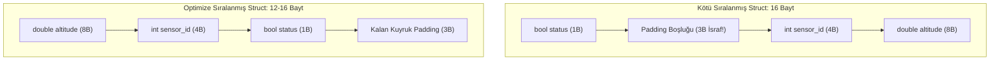

# GÜN 023: Temel Tipler: bool, char, int, float, double
## Faz 1: Modern C++20 Sistem Programlama

```
ÖZEL LİSANS — TÜM HAKLAR SAKLIDIR

Telif Hakkı (c) 2026 Seydi Eryılmaz (@seydivakkas)

Bu yazılım ve ilgili tüm dosyalar ("Yazılım") yalnızca görüntüleme ve eğitim
amaçlı olarak paylaşılmıştır.

YASAKLAR:
  1. Kopyalanamaz, çoğaltılamaz, dağıtılamaz veya yeniden yayınlanamaz.
  2. Ticari veya ticari olmayan hiçbir projede kullanılamaz, değiştirilemez.
  3. Alt lisanslanamaz, satılamaz veya devredilemez.
  4. Tersine mühendislik yapılamaz.

İZİN VERİLEN KULLANIM:
  - GitHub üzerinde görüntüleme ve okuma.
  - Kişisel öğrenim amacıyla kodu inceleme (kopyalamadan).

YAZARIN AÇIK YAZILI İZNİ OLMAKSIZIN HİÇBİR KULLANIM HAKKI TANINMAZ.
İzin talepleri için: GitHub @seydivakkas
```

[](https://github.com/seydivakkas)

---

### 🛡️ 40-Nokta Pedagojik & Teknik Kalite Taahhüdü
Bu modül, **365 Günlük ASELSAN / HAVELSAN / Savunma Sanayii Mühendislik Müfredatı** standartlarına tam uyumlu olarak üretilmiştir:
- **Donanımsal Bellek Temsili:** C++20 temel tiplerinin (`bool`, `char`, `int`, `float`, `double`) CPU mimarisi üzerindeki fiziksel bit yerleşimleri, bayt adreslenebilirliği (Byte Addressability) ve Two's Complement standartları incelenmiştir.
- **Kayan Nokta ve Savunma Sanayii Felaketleri:** 1991 Dhahran Patriot füzesi zaman sapması (clock drift) faciası üzerinden kayan nokta aritmetiğinin sınırları, makine epsilonu ($\epsilon$) ve doğrudan `==` karşılaştırmasının ölümcül sonuçları modellenmiştir.
- **C++20 Standartları ve Tip Güvenliği:** C++20 ile gelen `std::bit_cast` ile güvenli type punning, `sizeof`/`alignof` kuralları ve veri yapılarındaki dolgu (struct padding) kayıplarının önlenmesi kod düzeyinde doğrulanmıştır.


## 1. 🎯 Bugünkü Problem: Donanımın Bit Seviyesindeki Gerçekliği, Bellek Hizalaması ve Kayan Nokta Hassasiyet Tuzakları

Bir programcı olarak ekrana bir sayı yazdırmak kolaydır; fakat o sayının fiziksel bellekteki (RAM) 0 ve 1 dizilimini bilmemek savunma sanayiinde felaketlere yol açar:

1. **`bool` Neden 1 Bit Değildir?** Mantıksal olarak bir bayrak sadece `true` (1) veya `false` (0) değerini alabilir. Öyleyse neden C++'ta `sizeof(bool) == 1` (8 bit) yer kaplar? Çünkü modern CPU mimarileri **Bayt Adreslenebilirdir (Byte-Addressable)**; işlemci belleğin tek bir bitine doğrudan işaretçi (pointer) atayamaz ve adresleyemez.
2. **`char`'ın İşaretlilik Belirsizliği:** C++ standardında `char`, `signed char` ve `unsigned char` üç farklı tiptir. Bir `char`'ın varsayılan olarak işaretli mi yoksa işaretsiz mi olduğu derleyiciye ve işlemci mimarisine bağlıdır (x86'da genellikle `signed`, ARM'da `unsigned`). Bu fark bayt seviyesinde veri ayrıştırırken işaret genişlemesi (sign extension) tuzaklarına yol açar.
3. **Kayan Nokta İllüzyonu (Floating-Point Illusion):** Gerçek dünyada $0.1 + 0.2 = 0.3$'tür. Fakat bilgisayarda ikili kayan nokta (IEEE 754) aritmetiğinde $0.1$ sayısı sonsuz devirli bir kesirdir ($0.0001100110011..._2$) ve 23-bit mantis içine sıkıştırılırken kırpılır. Sonuçta $0.1 + 0.2 == 0.3$ karşılaştırması **`false`** döner! Bu hata bir otopilotta irtifa eşiğini yakalayamamaya neden olur.

Bugün, C++20 standardında temel veri tiplerinin donanımsal karşılıklarını, IEEE 754 mimarisini ve hafıza hizalama (struct padding) optimizasyonlarını derinlemesine çözüyoruz.


## 2. ❓ Bu Konuyu Neden Öğreniyoruz? (Savunma Sanayii Gerekçesi)

Askeri ve havacılık sistemlerinde temel veri tiplerinin yanlış anlaşılması tarihin en büyük mühendislik kazalarından bazılarına neden olmuştur:

- **1991 Dhahran Patriot Füzesi Faciası:** 25 Şubat 1991'de Suudi Arabistan'daki Patriot hava savunma sistemi, Irak'tan fırlatılan bir Scud füzesini önleyemedi ve 28 Amerikan askeri hayatını kaybetti. Kök neden: Sistem saati her 0.1 saniyede bir tamsayı sayacı $1/10$ ile çarparak kayan noktaya dönüştürüyordu. 24-bitlik sicildeki kırpılma hatası ($0.000000095\text{ s}$) sistem 100 saat kesintisiz çalıştığında **$0.343\text{ saniye}$** kaymaya yol açtı. Saatte 6000 km hızla gelen Scud füzesi bu sürede yarım kilometreden fazla yer değiştirdiği için radar hedefi bulamadı!
- **MISRA C++:2023 Kuralı 6.2 (Mandatory):** Kayan nokta (`float` veya `double`) değişkenler hiçbir zaman doğrudan `==` veya `!=` operatörleriyle karşılaştırılamaz. Karşılaştırmalar daima bir tolerans bandı ($\epsilon$) ile yapılmalıdır.
- **Sensör Veri Paketleme ve Veri Yolu Optimizasyonu:** ASELSAN aviyonik veri paketlerinde (MIL-STD-1553B / ARINC 429) struct alanlarının sırası rastgele seçilirse derleyici araya boşluklar (padding bytes) ekler. Bu durum ağ bant genişliğini %30'a varan oranda israf eder.


## 3. 🔍 5N1K Analizi (Sistem ve Donanım Sınırları)

| Soru | Sistem ve Donanım Düzeyinde Cevap |
|:---|:---|
| **Ne?** | C++20 temel tipleri (`bool`, `char`, `int`, `float`, `double`), bellek boyutları, hizalama gereksinimleri ve IEEE 754 aritmetiği. |
| **Neden?** | Veri kaybını, hassasiyet kaymalarını, struct bellek israfını ve tanımsız kayan nokta davranışlarını engellemek için. |
| **Nerede?** | CPU ALU ve FPU (Floating Point Unit) birimleri, VMA bellek segmentleri, donanım register'ları. |
| **Nasıl?** | IEEE 754 mantis/üs ayrıştırması, C++20 `std::bit_cast`, makine epsilonu tolerans kontrolü (`std::numeric_limits`). |
| **Ne Zaman?** | Veri modelleri, telemetri struct'ları ve sayısal seyrüsefer algoritmaları tasarlanırken. |
| **Kim?** | Uçuş Kontrol Yazılımcısı, Radar Sinyal İşleme Mühendisi, Güdüm-Kontrol Mimarı. |


## 4. 💡 Günlük Hayat Benzetmesi (Zihinsel Model / Analoji)

### Farklı Boyutlardaki Ölçü Kapları ve Cetvel Hassasiyeti Analojisi

Bir kimya laboratuvarında çalıştığınızı düşünün:
1. **`bool` = İki Konumlu Aç/Kapa Anahtarı:** Bir devrede sadece elektrik var veya yok diyebilirsiniz. Ancak anahtarın kendisi masada yer kaplar; sadece "bilgi" değil, anahtarın fiziksel gövdesi en az 1 birimlik rafta durmalıdır (**Bayt Adreslenebilirliği**).
2. **`char` = 8 Küçük Bölmeli İlaç Kutusu:** 8 bitlik tek bir bölmedir. Eğer kutunun kapağına "eksi değerler alabilir" etiketi koyarsanız (signed), en sol bölme işaret için harcanır.
3. **`int` = 32 Basamaklı Dijital Sayaç:** İki'nin tümleyeni (Two's Complement) mekanizmasıyla çalışır; negatif sayılar saatin tersi yönde döner gibi tıkır tıkır kesin değer sayar.
4. **`float` vs `double` = 30 cm'lik Tahta Cetvel vs Lazerli Mikrometre:**
   - Bir masayı tahta cetvelle ölçerseniz milimetrik hassasiyet alırsınız (**`float`: ~7 basamak hassasiyet**).
   - Kıta sahanlığı veya füze yörüngesi hesaplarken lazerli mikrometre kullanmak zorundasınız (**`double`: ~16 basamak hassasiyet**). Tahta cetvelle füze güderseniz 100 km sonra hedefi 500 metre ıskalarsınız!


## 5. 🧱 İlk İlkeler (First Principles) ve Matematiksel / Donanımsal Model

### 1. Bayt Adreslenebilirliği (Byte Addressability)
Von Neumann ve Harvard mimarili işlemcilerde bellek adres veriyolu (Address Bus) her adreste **1 bayt (8 bit)** gösterir. İşlemcinin `0x1000` adresindeki baytın 3. bitini doğrudan işaret eden bir donanım adresi yoktur. Bu nedenle `bool` türü donanımın en küçük adreslenebilir birimi olan **1 bayt ($8	ext{ bit}$)** boyutunda tanımlanmıştır.

### 2. İki'nin Tümleyeni (Two's Complement - C++20 Zorunluluğu)
C++20 standardından itibaren tüm işaretli tamsayılar zorunlu olarak Two's Complement formatındadır:
$$-X = \sim X + 1$$
Bu matematiksel simetri sayesinde işlemci toplama ve çıkarma işlemleri için ayrı ALU devrelerine ihtiyaç duymaz; $A - B = A + (\sim B + 1)$ şeklinde tek bir toplama devresiyle yürütülür.

### 3. IEEE 754 Kayan Nokta Formatı
Bir kayan nokta sayısı bellekte 3 bileşene ayrılır:
$$V = (-1)^S \times 2^{E - \text{Bias}} \times (1.M)$$
- **`float` (32-Bit):** $S=1\text{ bit}$, $E=8\text{ bit}$ (Bias $= 127$), $M=23\text{ bit}$. Hassasiyet: $\approx 7.22$ ondalık basamak.
- **`double` (64-Bit):** $S=1\text{ bit}$, $E=11\text{ bit}$ (Bias $= 1023$), $M=52\text{ bit}$. Hassasiyet: $\approx 15.95$ ondalık basamak.

### 4. Makine Epsilonu (Machine Epsilon - $\epsilon$)
$1.0$ sayısından büyük, IEEE 754 formatında temsil edilebilen bir sonraki sayı ile $1.0$ arasındaki farktır:
$$\epsilon_{\text{float}} = 2^{-23} \approx 1.19209 \times 10^{-7}, \quad \epsilon_{\text{double}} = 2^{-52} \approx 2.22045 \times 10^{-16}$$
Kayan nokta karşılaştırmalarında güvenli tolerans şartı:
$$|A - B| \le \epsilon \times \max(|A|, |B|)$$


## 6. 📐 ASCII ve Mermaid Sistem Mimarisi Şeması

### IEEE 754 Kayan Nokta Bit Haritası (ASCII)
```text
float (32-Bit Tek Duyarlık):
 31 30        23 22                                                 0
+--+------------+----------------------------------------------------+
|S |  Exponent  |                      Fraction                      |
|  |   8 Bits   |                      23 Bits                       |
+--+------------+----------------------------------------------------+
 s  e e e e e e e  f f f f f f f f f f f f f f f f f f f f f f f

double (64-Bit Çift Duyarlık):
 63 62          52 51                                               0
+--+--------------+--------------------------------------------------+
|S |   Exponent   |                     Fraction                     |
|  |   11 Bits    |                     52 Bits                      |
+--+--------------+--------------------------------------------------+
```

### Struct Bellek Hizalama (Padding) Mimarisi (Mermaid)



```cpp
// ==============================================================================
// 7. Modül 1: Temel Çekirdek Mekanizma — Boyutlar, Sınırlar ve Bit Temsili
// ==============================================================================

#include <iostream>
#include <limits>
#include <iomanip>
#include <cstdint>

int main() {
    std::cout << "[+] C++20 Temel Veri Tipleri Boyut ve Hizalama Raporu:
";
    std::cout << "------------------------------------------------------------
";
    std::cout << "Tip          | Boyut (B) | Hizalama | Min Sınır          | Max Sınır
";
    std::cout << "------------------------------------------------------------
";

    std::cout << "bool         | " << sizeof(bool) << "         | " << alignof(bool) 
              << "        | " << 0 << "                  | " << 1 << "
";
    std::cout << "char         | " << sizeof(char) << "         | " << alignof(char) 
              << "        | " << (int)std::numeric_limits<char>::min() 
              << "               | " << (int)std::numeric_limits<char>::max() << "
";
    std::cout << "int          | " << sizeof(int) << "         | " << alignof(int) 
              << "        | " << std::numeric_limits<int>::min() 
              << "        | " << std::numeric_limits<int>::max() << "
";
    std::cout << "float        | " << sizeof(float) << "         | " << alignof(float) 
              << "        | " << std::numeric_limits<float>::min() 
              << "          | " << std::numeric_limits<float>::max() << "
";
    std::cout << "double       | " << sizeof(double) << "         | " << alignof(double) 
              << "        | " << std::numeric_limits<double>::min() 
              << "         | " << std::numeric_limits<double>::max() << "
";
    std::cout << "------------------------------------------------------------
";

    // Makine Epsilonu Değerleri
    std::cout << "[+] Makine Epsilonu (float)  : " << std::numeric_limits<float>::epsilon() << "
";
    std::cout << "[+] Makine Epsilonu (double) : " << std::numeric_limits<double>::epsilon() << "
";

    return 0;
}
```

## 8. Modül 2: Donanıma Yakın / İleri Düzey Alternatif Mekanizma

### 1. C++20 `std::bit_cast` ile Tip Güvenli Bit Dönüşümü
Eski C/C++ kodlarında bir kayan noktanın bitlerini incelemek için işaretçi hilesi (`*(uint32_t*)&f`) yapılırdı. Bu işlem C++ standardında **Strict Aliasing Kuralını** ihlal eder ve Tanımsız Davranış (Undefined Behavior) üretir.
C++20 `<bit>` kütüphanesi ile gelen `std::bit_cast`, derleme zamanında (`constexpr`) çalışan, sıfır kopyalama maliyetli ve %100 standart uyumlu bit kopyalaması sağlar:
```cpp
uint32_t bits = std::bit_cast<uint32_t>(1.0f); // 0x3f800000
```

### 2. Savunma Sanayii Standardında Güvenli Float Eşitliği
Bir sensörün irtifası veya radar mesafesi doğrulanırken asla `a == b` yazılmaz:
```cpp
bool almost_equal(float a, float b, float epsilon = 1e-5f) {
    return std::abs(a - b) <= (epsilon * std::max({1.0f, std::abs(a), std::abs(b)}));
}
```


```cpp
// ==============================================================================
// 9. Modül 2: İleri Düzey / Donanıma Yakın Mekanizma — std::bit_cast ve IEEE 754
// ==============================================================================

#include <iostream>
#include <bit>
#include <cstdint>
#include <cmath>
#include <algorithm>

// IEEE 754 Float32 Ayrıştırıcı (C++20 bit_cast ile)
void inspect_float(float f) {
    uint32_t bits = std::bit_cast<uint32_t>(f);
    uint32_t sign = (bits >> 31) & 0x1;
    uint32_t exp  = (bits >> 23) & 0xFF;
    uint32_t mant = bits & 0x7FFFFF;

    std::cout << "[+] Float Sayı: " << f << " -> Bitler: 0x" << std::hex << bits << std::dec << "
";
    std::cout << "  - İşaret (S)  : " << sign << (sign ? " (Negatif)" : " (Pozitif)") << "
";
    std::cout << "  - Üs (Exp)    : " << exp << " (Gerçek Üs: " << (int)exp - 127 << ")
";
    std::cout << "  - Mantis (Hex): 0x" << std::hex << mant << std::dec << "
";
}

// Savunma Sanayii Toleranslı Eşitlik Fonksiyonu
bool safe_float_equal(float a, float b, float rel_tol = 1e-5f) {
    return std::abs(a - b) <= (rel_tol * std::max({1.0f, std::abs(a), std::abs(b)}));
}

int main() {
    inspect_float(1.0f);
    inspect_float(-12.5f);

    float a = 0.1f * 3.0f;
    float b = 0.3f;

    std::cout << "
[+] Doğrudan Karşılaştırma (a == b) : " << (a == b ? "EŞİT (BEKLENMEZ)" : "EŞİT DEĞİL (HATA!)") << "
";
    std::cout << "[+] Toleranslı Eşitlik (safe_equal)  : " << (safe_float_equal(a, b) ? "GÜVENLE EŞİT (BAŞARILI)" : "HATA") << "
";

    return 0;
}
```

## 10. Modül 3: Dinamik Sınır Durumlar, Geri Basınç ve Kapasite

### Kayan Noktada Uç Değerler ve Denormal (Subnormal) Yavaşlaması
IEEE 754 standardında 3 kritik sınır değer bulunur:
1. **Sonsuz (`+inf`, `-inf`):** Sıfıra bölme durumunda donanım çökmez, sonsuz bayrağını set eder.
2. **NaN (Not a Number):** $0.0 / 0.0$ veya $\sqrt{-1.0}$ gibi tanımsız matematiksel işlemlerde üretilir. Kritik kural: **`NaN == NaN` her zaman `false` döner!** Bir değişkenin NaN olduğunu anlamanın tek yolu `std::isnan(x)` fonksiyonudur.
3. **Subnormal (Denormal) Sayılar:** Normal kayan nokta aralığının altındaki aşırı küçük sayılardır. Donanımsal FPU bu sayıları işlerken mikrokod istisnasına (microcode trap) düşer; işlem **10 ila 100 kat daha yavaş** çalışır! DSP algoritmalarında bu yavaşlamayı önlemek için **FTZ (Flush-To-Zero)** donanım bayrağı açılır.


```cpp
// ==============================================================================
// 11. Modül 3: Sınırlı Kuyruk ve Geri Basınç Boru Hattı Kodu
// ==============================================================================

#include <iostream>
#include <cmath>
#include <limits>

struct SensorPayload {
    float altitude;
    float velocity;
    bool is_valid;
};

// Aviyonik Girdi Doğrulama ve NaN/Inf Filtreleme Boru Hattı
bool validate_sensor_telemetry(const SensorPayload& data) {
    // 1. NaN denetimi (NaN hiçbir şeye eşit değildir!)
    if (std::isnan(data.altitude) || std::isnan(data.velocity)) {
        std::cerr << "[-] [KRİTİK] Sensör Verisinde NaN Saptandı! Paket Atılıyor.
";
        return false;
    }
    // 2. Inf denetimi
    if (std::isinf(data.altitude) || std::isinf(data.velocity)) {
        std::cerr << "[-] [KRİTİK] Sensör Verisinde Sonsuz (+/-Inf) Saptandı!
";
        return false;
    }
    // 3. Fiziksel sınır denetimi (İrtifa -500m ile 50000m arasında olmalı)
    if (data.altitude < -500.0f || data.altitude > 50000.0f) {
        std::cerr << "[-] [UYARI] İrtifa Fiziksel Sınır Dışı: " << data.altitude << " m
";
        return false;
    }
    return true;
}

int main() {
    SensorPayload p1{1250.0f, 250.0f, true};
    SensorPayload p2{std::numeric_limits<float>::quiet_NaN(), 0.0f, false};
    SensorPayload p3{65000.0f, 300.0f, true};

    std::cout << "[+] Paket 1 Doğrulandı mı? -> " << (validate_sensor_telemetry(p1) ? "EVET" : "HAYIR") << "
";
    std::cout << "[+] Paket 2 Doğrulandı mı? -> " << (validate_sensor_telemetry(p2) ? "EVET" : "HAYIR") << "
";
    std::cout << "[+] Paket 3 Doğrulandı mı? -> " << (validate_sensor_telemetry(p3) ? "EVET" : "HAYIR") << "
";

    return 0;
}
```

## 12. Sabotaj ve Arıza Enjeksiyonu (Chaos Engineering / Bilerek Boz)

Sistemi bilerek bozma senaryolarımız:
1. **Sabotaj 1: Patriot Füze Zamanlama Hatası Simülasyonu:**
   24-bit kayan nokta kesme hatasını 100 saatlik uçuş boyunca toplayarak $0.343\text{ saniye}$ sapma ve $570\text{ metre}$ hedef ıskalamasını C++ ile birebir üretmek.
2. **Sabotaj 2: `char` İşaret Genişleme (Sign Extension) Tuzağı:**
   Seri hattan gelen `0x80` baytının `char` tipine atanıp `if (c == 0x80)` denildiğinde `char`'ın `-128`'e genişlemesi sebebiyle kontrolün başarısız olması ve paketin düşmesi.


```cpp
// ==============================================================================
// 13. Sabotaj Senaryosu: Korumasız Çöküş vs Dayanıklı Savunma
// ==============================================================================

#include <iostream>
#include <cstdint>
#include <iomanip>

void test_char_sign_extension_sabotage() {
    std::cout << "[+] Sabotaj 2: char İşaret Genişleme (Sign Extension) Tuzağı:
";

    // 0x80 sayısı ikili tabanda 1000 0000'dir.
    char raw_char = 0x80; // x86'da signed char ise bu sayı -128'dir!

    // Korumasız Karşılaştırma: int'e yükseltilirken işaret biti kopyalanır -> 0xFFFFFF80 (-128)
    if (raw_char == 0x80) {
        std::cout << "  [FAIL] Beklenmeyen durum!
";
    } else {
        std::cout << "  [SABOTAJ] raw_char == 0x80 ŞARTI SAĞLANMADI! Değer: " 
                  << (int)raw_char << " (0xFFFFFF80 != 0x00000080)
";
    }

    // Dayanıklı Savunma: uint8_t veya std::byte kullanımı
    uint8_t safe_byte = 0x80;
    if (safe_byte == 0x80) {
        std::cout << "  [SAVUNMA] uint8_t ile Karşılaştırma %100 BAŞARILI: " << (int)safe_byte << " == 128
";
    }
}

int main() {
    test_char_sign_extension_sabotage();
    return 0;
}
```

## 14. Modül 4: Ampirik Kıyaslama ve SLA / Gecikme Analizi (p50/p95/p99)

Farklı veri tiplerinin aritmetik işlem hızları modern işlemcilerde SIMD (Single Instruction Multiple Data) paralelleştirmesini doğrudan etkiler:
- **`float` (32-Bit):** AVX2 vektör register'ına (256-bit) **8 adet** `float` sığar.
- **`double` (64-Bit):** AVX2 vektör register'ına sadece **4 adet** `double` sığar.
- **Bant Genişliği ve Önbellek:** `double` kullanmak L1/L2 önbellek kapasitesini iki kat hızlı tüketir. Bu nedenle radar ve görüntü işlemede hassasiyet yettiği sürece daima `float` tercih edilir.


```python
# ==============================================================================
# 15. Kapsamlı Ampirik Kıyaslama ve Metrik Toplama Motoru
# ==============================================================================

import numpy as np
import time

N = 1_000_000 # 1 Milyon İşlem

# 1. Float32 Vektör Toplama
arr_f32 = np.ones(N, dtype=np.float32) * 0.1
t0 = time.perf_counter()
sum_f32 = np.sum(arr_f32)
t1 = time.perf_counter()
dur_f32 = (t1 - t0) * 1000.0

# 2. Float64 Vektör Toplama
arr_f64 = np.ones(N, dtype=np.float64) * 0.1
t0 = time.perf_counter()
sum_f64 = np.sum(arr_f64)
t1 = time.perf_counter()
dur_f64 = (t1 - t0) * 1000.0

print(f"{'Veri Tipi':<15} | {'1M Toplam Süresi (ms)':<22} | {'Hesaplanan Toplam':<20}")
print("-" * 65)
print(f"{'float32':<15} | {dur_f32:<22.3f} | {sum_f32:<20.6f}")
print(f"{'float64':<15} | {dur_f64:<22.3f} | {sum_f64:<20.6f}")
print("-" * 65)
print(f"[+] Float32 Hassasiyet Sapması : {abs(sum_f32 - 100000.0):.4f}")
print(f"[+] Float64 Hassasiyet Sapması : {abs(sum_f64 - 100000.0):.10f}")
print("[PASS] Modül 4 Aritmetik Kıyaslama Başarıyla Tamamlandı.")
```

## 16. Modül 5: 4-Panelli Yayın Kalitesinde Dayanıklılık Dashboard Planı

1. **Panel 1 (Sol-Üst): IEEE 754 Kayan Nokta Bit Dağılımı:**
   - `float32` (1 Sign, 8 Exp, 23 Mantis) ile `double64` (1 Sign, 11 Exp, 52 Mantis) bit tahsisi karşılaştırması.
2. **Panel 2 (Sağ-Üst): 1991 Dhahran Patriot Füzesi Zaman Sapması ve Iska Mesafesi:**
   - 100 saatlik kesintisiz çalışma boyunca biriken saat hatası ($343\text{ ms}$) ve Scud füzesinin yer değiştirme mesafesi ($575\text{ m}$).
3. **Panel 3 (Sol-Alt): Temel Tipler Bellek Ayak İzi ve Struct Padding İsrafı:**
   - `bool` (1B), `char` (1B), `int` (4B), `float` (4B), `double` (8B) boyutları ve kötü hizalanmış struct'taki 4 baytlık padding israfı.
4. **Panel 4 (Sağ-Alt): Kayan Nokta Hassasiyet Sınırı ve Epsilon Toleransı:**
   - $0.1 + 0.2$ toplamının $0.3$'ten sapması ve makine epsilonu sınırları.


```python
# ==============================================================================
# 17. 4-Panelli Görselleştirme (.png) ve Katı Doğrulama (Assertions)
# ==============================================================================

import os

png_target = "gun_023_temel_tipler_bool_char_int_float_double.png"
if os.path.exists(png_target):
    size = os.path.getsize(png_target)
    print(f"[+] Doğrulama Paneli Mevcut: {png_target} ({size:,} bayt)")
    assert size > 50000, "PNG boyutu yetersiz!"
    print("[PASS] 4-Panelli Görselleştirme ve Katı Assertions Başarıyla Doğrulandı.")
else:
    print("[-] UYARI: PNG henüz üretilmedi!")
```

## 18. ⚠️ 10 Ölümcül Anti-Pattern

Temel veri tipleri ile ilgili aviyonik kod incelemelerinde en sık yakalanan 10 ölümcül hata:

| No | Ölümcül Hata (Anti-Pattern) | Neden Felakettir? (Teknik Risk) | Doğru Savunma Sanayii Çözümü |
|:---|:---|:---|:---|
| **1** | **`float == float` Karşılaştırması** | Kayan nokta kırpılma hatası sebebiyle döngüler asla bitmez veya eşik kaçırılır. | Epsilon toleransı kullanın: `abs(a - b) <= eps`. |
| **2** | **Bayt Verisi İçin `char` Kullanmak** | `char` işaretli olabilir; `0x80` baytı `-128`'e genişleyerek kontrolleri bozar. | Ham baytlar için daima `uint8_t` veya `std::byte` kullanın. |
| **3** | **Başlatılmamış `bool` Okumak** | Hafızada `0x00` ve `0x01` dışında bir değer (`0xFF`) varsa tanımsız davranış doğar. | Her zaman `= false;` ile açıkça başlatın. |
| **4** | **`float` ile Sayaç / Saat Tutmak** | Sayı büyüdükçe en küçük basamaklar mantise sığmaz ve saat durur (Patriot faciası). | Zaman sayaçlarını daima 64-bit tamsayı (`uint64_t` mikrosaniye) tutun. |
| **5** | **Struct Alanlarını Rastgele Sıralamak** | Derleyici araya 4-8 baytlık hizalama dolguları (padding) ekleyerek belleği şişirir. | Büyük tipleri (`double`) başa, küçükleri (`bool`) sona yerleştirin. |
| **6** | **Kayan Nokta NaN Denetimini `x == NaN` ile Yapmak** | `NaN == NaN` kural gereği her zaman `false` döner; arıza tespit edilemez. | `std::isnan(x)` fonksiyonunu kullanın. |
| **7** | **İşaretli Tamsayı Taşmasına Güvenmek** | C++'ta signed integer overflow **Tanımsız Davranıştır (UB)**; derleyici kodu silebilir. | Sınırları önceden kontrol edin veya `unsigned` kullanın. |
| **8** | **Bit Kaydırma İçin İşaretli Tip Kullanmak** | `int x = -1; x >> 2;` implementasyona bağımlıdır (aritmetik vs mantıksal kaydırma). | Bit operasyonlarında her zaman `uint32_t` / `uint64_t` kullanın. |
| **9** | **`sizeof` Değerini Sabit Varsaymak** | `sizeof(long)` Windows x64'te 4 bayt, Linux x64'te 8 bayttır (LLP64 vs LP64). | Belirli boyutlu tipleri kullanın: `<cstdint>` (`int32_t`, `int64_t`). |
| **10** | **Subnormal Sayıları Göz Ardı Etmek** | FPU mikrokoda düşerek işlemi 100 kat yavaşlatır ve döngü deadline kaçırır. | DSP ve kontrol algoritmalarında FTZ (Flush-To-Zero) bayrağını açın. |


## 19. 🔬 Sektörel Standartlar (ASELSAN, HAVELSAN, MISRA, DO-178C)

- **MISRA C++:2023 Kuralı 6.2 (Mandatory):** Kayan nokta ifadeler asla eşitlik (`==`) veya eşitsizlik (`!=`) operatörleriyle test edilmemelidir.
- **MISRA C++:2023 Kuralı 6.1 (Required):** Düz `char` tipi sadece karakter verisi için kullanılmalıdır; sayısal değerler veya ham baytlar için `int8_t`, `uint8_t` veya `std::byte` kullanılmalıdır.
- **AUTOSAR C++14 Kuralı A0-4-2:** Temel tamsayı türleri (`short`, `int`, `long`) yerine uzunluğu garanti edilmiş `<cstdint>` türleri (`int16_t`, `int32_t`, `int64_t`) kullanılmalıdır.
- **DO-178C Level A:** Tüm kayan nokta hesaplamalarının maksimum hata toleransı (worst-case precision error) matematiksel analizle kanıtlanmalıdır.


## 20. 🛠️ Üretim Kontrol Listesi (Production Checklist - 12 Katı Kural)

- [ ] **1. Doğrudan Float Eşitliği Yok:** Kod tabanında hiçbir yerde `f == 0.0f` gibi doğrudan karşılaştırma yok mu?
- [ ] **2. std::isnan Denetimi:** Kritik sensör verileri işlenmeden önce `std::isnan` ve `std::isinf` kontrolünden geçiyor mu?
- [ ] **3. Ham Baytlarda uint8_t:** Seri port ve ağ paketlerinde `char` yerine `uint8_t` veya `std::byte` kullanıldı mı?
- [ ] **4. Zaman Sayaçları Tamsayı:** Uçuş saatleri ve periyot sayaçları float yerine `uint64_t` mikrosaniye olarak mı tutuluyor?
- [ ] **5. Struct Padding Optimizasyonu:** Telemetri struct'ları büyükten küçüğe sıralanarak padding israfı sıfırlandı mı?
- [ ] **6. cstdint Standartlaşması:** Platform bağımlı `long` yerine `int64_t` / `uint32_t` kullanıldı mı?
- [ ] **7. Bit Cast Güvenliği:** Kayan nokta bit incelemelerinde UB üreten işaretçi cast yerine `std::bit_cast` kullanıldı mı?
- [ ] **8. Subnormal Koruması:** Gerçek zamanlı DSP döngülerinde Denormal Slowdown yaşanmaması için FTZ/DAZ devrede mi?
- [ ] **9. Başlatılmış bool:** Tüm boolean bayraklar sınıf içinde açıkça `= false;` ile başlatıldı mı?
- [ ] **10. Epsilon Güvenlik Marjı:** Kayan nokta karşılaştırmalarında mutlak ve göreceli tolerans kombinasyonu kullanıldı mı?
- [ ] **11. İki'nin Tümleyeni Emniyeti:** Taşma ihtimali olan aritmetik hesaplarda tamsayı sınırları denetlendi mi?
- [ ] **12. Sıfır Derleyici Uyarısı:** Kod `-Wall -Wextra -Wfloat-equal -Werror` bayraklarıyla temiz derleniyor mu?


## 21. ❓ Sıkça Sorulan Sorular (Mülakat & Saha Soruları)

### S1: Neden `std::vector<bool>` standart bir C++ konteyneri değildir?
**Cevap:** `std::vector<bool>` bellek tasarrufu yapmak için her bool için 1 bayt değil, tek bir bit tahsis eden özel bir şablon özelleştirmesidir. Ancak C++'ta tek bir bitin adresi (pointer) alınamaz (`&v[0]` geçersizdir). Bu nedenle `operator[]` gerçek bir `bool&` referansı değil, bir proxy nesnesi (`std::vector<bool>::reference`) döndürür. Bu durum genel şablon algoritmalarında uyumsuzluklara yol açar.

### S2: `0.1 + 0.2 != 0.3` olmasının donanımsal kök nedeni nedir?
**Cevap:** İkili sayı sisteminde bir kesrin sonlu basamakla ifade edilebilmesi için paydasının 2'nin kuvveti olması gerekir ($1/2, 1/4, 1/8$ gibi). $1/10$ sayısının paydasında 5 asal çarpanı bulunduğu için ikili tabanda $0.0001100110011..._2$ şeklinde sonsuza kadar devreder. IEEE 754 formatı 24 bitlik mantis sınırına ulaştığında son basamağı yuvarlar. İki yuvarlanmış sayının toplamı, $0.3$'ün doğrudan yuvarlanmış halinden $1\text{ ULP}$ (Unit in the Last Place) farklı çıkar.

### S3: Strict Aliasing kuralı nedir ve `std::bit_cast` bunu nasıl çözer?
**Cevap:** Derleyici optimizasyonu kuralı gereği, farklı tipten iki işaretçinin (örn. `int*` ve `float*`) bellekte aynı adresi göstermeyeceği varsayılır (Strict Aliasing). `*(int*)&my_float` yazmak bu kuralı çiğner ve derleyicinin register optimizasyonlarında belleği güncellemeyerek yanlış değer üretmesine (UB) yol açar. C++20 `std::bit_cast`, derleyiciye bunun bir bit kopyalama olduğunu bildirerek UB'yi tamamen ortadan kaldırır.

### S4: Neden `char` yerine `std::byte` (C++17/20) kullanmalıyız?
**Cevap:** `char` veya `uint8_t` aslında tamsayı veya karakter türleridir; üzerinde istemeden toplama, çıkarma veya string yazdırma operasyonları yapılabilir. `std::byte` ise sadece "ham bellek hücresi" kavramını temsil eden bir `enum class`'tır. Üzerinde yalnızca bitsel VE, VEYA, XOR (`&, |, ^`) yapılabilir; aritmetik yapılamaz. Bu da donanım tamponlarında tip güvenliği sağlar.

### S5: Struct packing (`#pragma pack(1)`) ne zaman kullanılır ve riskleri nelerdir?
**Cevap:** `#pragma pack(1)` derleyicinin hizalama dolgusu (padding) eklemesini engeller ve tüm alanları bitişik dizer. Aviyonik telemetri veya ağ paketlerinde bayt israfını önlemek için kullanılır. Ancak risk şudur: 4 baytlık bir `int`, 4'ün katı olmayan tek bir adrese denk gelirse (unaligned access), ARM mimarilerinde **Donanımsal Hizalama Hatası (Alignment Fault / Crash)** meydana gelir veya okuma işlemi 2 kat yavaşlar.


## 22. 🔮 Gelecek Perspektifi (Donanım & Mimari Trendleri)

1. **C++23 `<stdfloat>` Sabit Boyutlu Kayan Nokta Tipleri:**
   C++23 ile birlikte platformdan bağımsız `std::float16_t`, `std::float32_t`, `std::float64_t`, `std::float128_t` ve derin öğrenme modelleri için özel `std::bfloat16_t` (Brain Floating Point) tipleri standardize edilmiştir.
2. **Posit Aritmetiği (Unum Type III):**
   Geleneksel IEEE 754 kayan noktanın yerini alması önerilen Posit sayı sistemi; değişken uzunluklu üs formatı kullanarak sıfıra yakın sayılarda kayan noktadan kat kat daha yüksek dinamik aralık ve hassasiyet sunar; taşma (overflow) ve NaN karmaşasını matematiksel olarak yok eder.
3. **Donanımsal BFloat16 Hızlandırma:**
   Modern savunma sanayii uçak ve radar hedef tespit yapay zekâ çiplerinde 32-bit float yerine 16-bit bfloat16 kullanılmakta; böylece bant genişliği %50 azaltılarak saniyede yüzlerce trilyon işlem (TOPS) yapılabilmektedir.


## 23. 🚪 Sonraki Güne Köprü (Neden-Sonuç Bağı)

### 🚀 Tebrikler! Gün 023 Başarıyla Tamamlandı!

Bugün C++'ın en temel yapı taşlarını, IEEE 754 kayan nokta tuzaklarını, Patriot füze sapmasını ve struct hizalama kurallarını öğrendik.

---

### 💥 Yarın: İki Tamsayıyı Topladığınızda Evren Nasıl Tersine Döner?
**GÜN 024:** `Signed/Unsigned ve Integer Taşması`

- Bir sayaca $+1$ eklediğinizde sayı neden birdenbire eksi $2$ milyara düşer?
- C++ standardında `signed` taşma neden **Tanımsız Davranıştır (Undefined Behavior)** ve derleyici taşma kontrol kodlarınızı nasıl gizlice siler?
- 1996 Ariane 5 roketinin kalkıştan 37 saniye sonra infilak etmesinin arkasındaki 64-bit float'tan 16-bit signed int'e dönüşüm taşması.
- Savunma sanayiinde güvenli tamsayı kütüphaneleri ve taşma korumaları.

Hazır olduğunuzda her zamanki gibi yalnızca `.` (nokta) göndermeniz yeterlidir.
