# 🏛️ ASELSAN & HAVELSAN Akademi — Sistem ve Yazılım Mimarisi
## Faz 1: Modern C++20 ile Donanıma Yakın Sistem Programlama
### Gün 029: Fonksiyon Bildirimi, Tanımı, ABI Çağrı Konvansiyonları ve Inlining Mimarisi

```
ÖZEL LİSANS — TÜM HAKLAR SAKLIDIR

Telif Hakkı (c) 2026 Seydi Eryılmaz (@seydivakkas)

Bu yazılım ve ilgili tüm dosyalar ("Yazılım") yalnızca görüntüleme ve eğitim
amaçlı olarak paylaşılmıştır.

YASAKLAR:
  1. Kopyalanamaz, çoğaltılamaz, dağıtılamaz veya yeniden yayınlanamaz.
  2. Ticari veya ticari olmayan hiçbir projede kullanılamaz, değiştirilemez.
  3. Alt lisanslanamaz, satılamaz veya devredilemez.
  4. Tersine mühendislik yapılamaz.

İZİN VERİLEN KULLANIM:
  - GitHub üzerinde görüntüleme ve okuma.
  - Kişisel öğrenim amacıyla kodu inceleme (kopyalamadan).

YAZARIN AÇIK YAZILI İZNİ OLMAKSIZIN HİÇBİR KULLANIM HAKKI TANINMAZ.
İzin talepleri için: GitHub @seydivakkas
```

[](https://github.com/seydivakkas)
[](standart.md)
[](verify_standart.py)

---

### 📋 Mühendislik Bildirimi ve 40-Nokta Kalite Kriterleri

Bu doküman ve eşlik eden yazılım motoru, **savunma sanayii kritik sistemlerinde (RTOS Kesme Servis Rutinleri - ISR, Radar Sinyal Dönüşüm Hatları ve Aviyonik Görev Bilgisayarları)** çalışan C++ yazılımlarının fonksiyon çağrı determinizmini, donanımsal ABI uyumunu ve sıfır maliyetli inlining mimarisini garanti altına almak için tasarlanmıştır.

1. **Katı Standart Uyumu:** ISO/IEC 14882:2020 (C++20), MISRA C++:2023 Kural 8.2.1/8.2.2, DO-178C DAL-A (Call Tree & Stack Analysis) ve Itanium C++ ABI standartları referans alınmıştır.
2. **Kapsanan İleri C++20 Mekanizmaları:** Fonksiyon Bildirimi (Declaration) vs Tanımı (Definition), One Definition Rule (ODR), System V AMD64 ABI vs Microsoft x64 ABI register aktarım kuralları, Call Overhead anatomisi (`CALL`, `RET`, prologue/epilogue), `inline` ve `__attribute__((always_inline))` optimizasyonları, C++ Name Mangling ve `extern "C"` RTOS sürücü köprüsü, C++20 Trailing Return Types ve `[[nodiscard]]` zorunluluğu.
3. **Deterministik Doğrulama:** Sayısal simülasyonlar, mikro-benchmark testleri ve 300 DPI 4-panelli yayın kalitesinde dayanıklılık dashboard'u ile her iddia ampirik olarak ispatlanmıştır.

## 1. 🎯 Bugünkü Problem: Fonksiyon Çağrı Ek Yükü, ABI Uyumsuzlukları ve Name Mangling Kaosu

Yüksek frekanslı radar ve gömülü aviyonik sistemlerde fonksiyonlar, kodun modülerliğini sağlayan temel yapı taşlarıdır. Ancak bu yapı taşları donanım seviyesinde doğru yönetilmezse üç büyük felakete yol açar:

1. **Fonksiyon Çağrı Ek Yükü (Function Call Overhead):**
   Bir fonksiyon çağrıldığında işlemci seviyesinde:
   - Geri dönüş adresi (Return Address) stack'e itilir (`CALL`).
   - Frame Pointer (`RBP`) stack'e kaydedilir ve `RSP` yeni stack çerçevesi için kaydırılır (Prologue).
   - Fonksiyon gövdesi çalışır.
   - Stack çerçevesi temizlenir (Epilogue) ve geri dönülür (`RET`).
   Eğer fonksiyon tek bir matematiksel işlem yapıyorsa (`float mag = i*i + q*q;`), harcanan 10-15 saat döngüsünün **%90'ı sadece fonksiyon kapısını açıp kapatmak için harcanır!** Radar döngüsünde saniyede 10 milyon kez çağrılan bir fonksiyonda bu durum feci bir gecikmeye yol açar.
2. **C++ Name Mangling ve RTOS Entegrasyon Çöküşü:**
   C++ derleyicileri fonksiyon aşırı yüklemeyi (overloading) desteklemek için sembol adlarını bozar (mangle eder). Örneğin `void reset_timer(int)` fonksiyonu ikili kodda `_Z11reset_timeri` haline gelir. Eğer bir FreeRTOS veya VxWorks C çekirdeği bu fonksiyona `reset_timer` adıyla ulaşmaya çalışırsa, bağlayıcı (linker) `Undefined reference` hatası verir veya arayüz uyumsuzluğundan sistem çöker.
3. **Sessiz Hata Yutma (Ignored Return Values):**
   Güdüm bilgisayarında `StatusCode fire_thruster()` gibi kritik bir fonksiyonun hata kodu çağıran tarafça kontrol edilmezse, itki motoru ateşlenmediği halde sistem füzenin hedefe gittiğini varsayar ve felaket kaçınılmaz olur.

Bugünkü mühendislik görevimiz: Donanımsal ABI ve register kurallarını kavramak, `always_inline` ile çağrı maliyetini $0 \text{ ns}$'ye indirmek, `extern "C"` ile RTOS köprüsünü kurmak ve `[[nodiscard]]` ile hata kodlarını zorunlu kılmaktır.

## 2. ❓ Bu Konuyu Neden Öğreniyoruz? (Savunma Sanayii Gerekçesi)

Savunma sanayiinde yazılım mimarisinde fonksiyonlar yalnızca bir "kod düzenleme aracı" değil, derleyicinin donanım register'larını nasıl tahsis edeceğini belirleyen bir kontrattır.

### 📡 1. ASELSAN Radar Alıcılarında Sıfır Gecikmeli Dönüşüm (`always_inline`)
Radar I/Q darbe ayrıştırıcısında her mikrosaniyede binlerce kez çağrılan `iq_to_magnitude()` fonksiyonu normal bir fonksiyon olarak bırakılırsa, `CALL` ve `RET` komutları L1 Komut Önbelleğini (L1I) kirletir ve işlemci boru hattını (pipeline) kesintiye uğratır. Bu fonksiyon `always_inline` ile mühürlendiğinde, derleyici fonksiyon çağrısını tamamen yok eder; kodu doğrudan çağıran döngünün içine eritir. Çağrı maliyeti tam anlamıyla **0 saat döngüsüdür**.

### 🚁 2. HAVELSAN Uçuş Simülatörleri ve RTOS Kesme Servis Rutinleri (`extern "C"`)
Uçuş görev bilgisayarları ve otopilot donanımları, mikrodenetleyicinin donanımsal kesmelerine (Hardware Interrupt / ISR) bağlıdır. Donanım kesme vektör tablosu (IVT) saf C ABI standardına göre düzenlenmiştir. C++20 ile yazılan bir aviyonik sınıfının kesme yöneticisine bağlanabilmesi için fonksiyonun `extern "C"` ile C++ Name Mangling mekanizmasından muaf tutulması zorunludur.

### 🛑 3. DO-178C DAL-A Call Tree & Stack Derinliği Analizi
Havacılık uçuş kritik yazılımlarında (DAL-A):
- Fonksiyonların oluşturduğu çağrı ağacı (Call Tree) döngüsel olamaz (Özyineleme - Recursion kesinlikle yasaktır).
- Her fonksiyonun çağrı yığınına eklediği bayt miktarı derleme zamanında hesaplanmalı ve azami stack tüketimi matematiksel olarak kanıtlanmalıdır.
- `[[nodiscard]]` özniteliği, kritik sistem durumlarının yutulmasını derleme aşamasında engelleyerek DO-178C güvenlik gereksinimlerini karşılar.

## 3. 🔍 5N1K Analizi (Sistem ve Donanım Sınırları)

| Soru | Sistem ve Donanım Mühendisliği Yanıtı |
|:---|:---|
| **NE?** | **Fonksiyon Bildirimi, Tanımı ve ABI:** Bildirim (prototip), tanım (gövde), One Definition Rule (ODR), Çağrı Konvansiyonları (Calling Conventions: System V vs MS x64), Name Mangling, Inlining ve `[[nodiscard]]`. |
| **NEDEN?** | Modüler yazılım geliştirmek; donanımsal register kullanımını optimize etmek; C tabanlı RTOS çekirdekleriyle sıfır hata ile entegre olmak; küçük fonksiyonlarda çağrı gecikmesini sıfırlamak. |
| **NEREDE?** | Donanım sürücülerinde (BSP / HAL), RTOS kesme servis rutinlerinde (ISR), radar veri dönüştürücülerinde ve aviyonik telemetri yönlendiricilerinde. |
| **NASIL?** | 1) Bildirimleri `.h`, tanımları `.cpp` dosyasına koyarak ODR'yi koruyarak, 2) Kritik iç fonksiyonları `inline` veya `always_inline` yaparak, 3) C arayüzlerine `extern "C"` ekleyerek, 4) Kritik dönüş değerlerini `[[nodiscard]]` ile mühürleyerek. |
| **NE ZAMAN?** | Bir kod bloğu birden fazla yerde çalıştırılacağında veya mantıksal bir görev birimi soyutlanmak istendiğinde. |
| **KİM?** | Gömülü BSP sürücü yazılımcısı, radar DSP mühendisi, aviyonik sistem mimarı ve DO-178C sertifikasyon denetçisi. |

## 4. 💡 Günlük Hayat Benzetmesi (Zihinsel Model / Analoji)

### 🪖 Telsizle Emir Vermek (Standart Fonksiyon Çağrısı) vs Yanındaki Askere Fısıldamak (Inlining)

Bir askeri harekat merkezini düşünün:

1. **Standart Fonksiyon Çağrısı (`CALL` / `RET`) — Telsizle Başka Odadaki Askeri Aramak:**
   Komutan harita masasında çalışırken bir koordinat hesaplatmak ister.
   - Telsizi eline alır, frekansı ayarlar (`Parametreleri Register/Stack'e Diz`).
   - Karşı tarafın açmasını bekler (`CALL Komutu & Return Address Push`).
   - Karşıdaki asker selam verir, not defterini açar (`Prologue: push rbp`).
   - "2 ile 2'yi topla" der, asker toplar (`Gövde Yürütme`).
   - Asker defteri kapatır, tekmil verir (`Epilogue: pop rbp`).
   - Komutan telsizi kapatır (`RET Komutu`).
   - İş 1 saniye sürer ama telsiz prosedürü 15 saniye alır (**Call Overhead**)!
2. **Inlining (`always_inline`) — Komutanın Masasında Oturan Emir Astsubayı:**
   Komutan kafasını bile kaldırmaz; emri doğrudan yanındaki astsubaya fısıldar veya bizzat masadaki kağıda yazar.
   - Telsiz yok, bekleme yok, tekmil yok ($0 \text{ ns}$ gecikme!).
   - Komutanın masası biraz kalabalıklaşır (Code Size Büyümesi) ama hız maksimumdur.
3. **`extern "C"` — Farklı Müttefik Ülkelerin Ortak İngilizce Telsiz Dili:**
   Türk askeri ile Fransız askeri kendi aralarında farklı şifreli terimler (C++ Name Mangling) kullanır. Telsizde ortak frekanstan konuşacakları zaman evrensel NATO standardına (`extern "C"`) geçerler; böylece hiç kimse birbirinin adını yanlış anlamaz.
4. **`[[nodiscard]]` — "Emir Alındı ve Uygulandı" Tebligat İmzası:**
   Komutan "Füze kapağını aç" emrini verdiğinde, askerin bu emri duyup duymadığını veya kapağın açılıp açılmadığını raporlamadan masadan ayrılması yasaktır. Rapor mutlaka kontrol edilmelidir!

## 5. 🧱 İlk İlkeler (First Principles) ve Matematiksel / Donanımsal Model

### 1. Fonksiyon Çağrı Yığını (Call Stack) ve Assembly Anatomisi
Bir `int calculate(int a, int b)` fonksiyonu çağrıldığında x86-64 işlemcisinde şu makine komutları işletilir:

```assembly
; ÇAĞIRAN TARAF (CALLER):
mov     edi, 10             ; 1. Parametre RDI register'ına yazılır
mov     esi, 20             ; 2. Parametre RSI register'ına yazılır
call    calculate           ; Dönüş adresini (RIP) stack'e basar ve zıplar

; ÇAĞRILAN FONKSİYON (CALLEE):
calculate:
push    rbp                 ; Eski frame pointer'ı stack'e sakla (Prologue)
mov     rbp, rsp            ; Yeni frame pointer'ı belirle
lea     eax, [rdi + rsi]    ; Gövde: eax = a + b (Dönüş değeri EAX'a konur)
pop     rbp                 ; Eski frame pointer'ı geri yükle (Epilogue)
ret                         ; Stack'ten dönüş adresini çek ve geri dön
```

Burada `push rbp`, `mov rbp, rsp`, `pop rbp`, `call` ve `ret` komutları yalnızca çağrı mekanizmasını işletmek için harcanan ek yüktür (**Call Overhead: ~8-12 Saat Döngüsü**).

### 2. Çağrı Konvansiyonları (Calling Conventions): System V vs Microsoft x64
x86-64 dünyasında işletim sistemleri arasında iki farklı ABI standardı geçerlidir:

| Argüman Sırası | System V AMD64 ABI (Linux / RTOS / macOS) | Microsoft x64 ABI (Windows) |
|:---|:---|:---|
| **1. Parametre** | `RDI` | `RCX` |
| **2. Parametre** | `RSI` | `RDX` |
| **3. Parametre** | `RDX` | `R8` |
| **4. Parametre** | `RCX` | `R9` |
| **5. Parametre** | `R8` | **Yığın (Stack) - [RSP + 40]** |
| **6. Parametre** | `R9` | **Yığın (Stack) - [RSP + 48]** |
| **7+ Parametreler** | **Yığın (Stack)** | **Yığın (Stack)** |
| **Kayan Nokta (Float)**| `XMM0` - `XMM7` (İlk 8 adet) | `XMM0` - `XMM3` (İlk 4 adet) |
| **Shadow Space** | YOK | **32 Bayt Zorunlu (Home Space)** |

Savunma projelerinde Linux (RedHat/CentOS) veya RTOS (VxWorks/PikeOS) üzerinde çalışan kodlar System V ABI kullanırken, yer istasyonu Windows yazılımları Microsoft x64 ABI kullanır.

### 3. Itanium C++ ABI Name Mangling
C++ derleyicisi aynı ada sahip aşırı yüklenmiş fonksiyonları ayırt etmek için sembol adlarını kodlar:
- `void process(int)` $\implies$ `_Z7processi` (`_Z` önek, `7` karakter sayısı, `process` ad, `i` int).
- `void process(float, double)` $\implies$ `_Z7processfd`.
`extern "C"` bloğu içine alınan fonksiyonlar ise saf C stili olarak doğrudan `process` adıyla sembol tablosuna yazılır.

## 6. 📐 ASCII ve Mermaid Sistem Mimarisi Şeması

Aşağıdaki şemalar; `extern "C"` RTOS entegrasyon köprüsünü ve Inlining optimizasyonunun assembly seviyesindeki etkisini göstermektedir.

### 1. RTOS Donanım Kesme Servis Rutini (ISR) ve `extern "C"` Köprüsü

```
[Mikrodenetleyici Donanımı: Kesme Pini (IRQ)]
                 │
                 ▼
[Kesme Vektör Tablosu (IVT) - Saf C ABI Formatı]
                 │
                 ▼
┌─────────────────────────────────────────────────────────────┐
│ extern "C" void EXTI0_IRQHandler(void);                     │ <── Name Mangling Devre Dışı!
└──────────────────────────────┬──────────────────────────────┘     (Doğrudan C Sembolü)
                               │
                               ▼
┌─────────────────────────────────────────────────────────────┐
│ C++20 Görev Bilgisayarı Sınıfı: RadarController::on_pulse() │ <── Modern C++20 Nesne Mimarisi
└─────────────────────────────────────────────────────────────┘
```

### 2. Standart Çağrı vs Inlining Yürütme Karşılaştırması

```mermaid
flowchart TD
    subgraph NonInlined ["Standart Fonksiyon Çağrısı (CALL / RET)"]
        Main1["Döngü Gövdesi"] --> PushArgs["1. Parametreleri RDI/RSI'ya Diz"]
        PushArgs --> CallInst["2. CALL komutu (Stack'e RIP itilir)"]
        CallInst --> FuncExec["3. Fonksiyon Gövdesi + Prologue/Epilogue"]
        FuncExec --> RetInst["4. RET komutu (Stack'ten RIP çekilir)"]
        RetInst --> Main1Next["5. Döngü Devam Eder (12 Saat Döngüsü Kayıp!)"]
    end

    subgraph Inlined ["Inlined Fonksiyon (always_inline)"]
        Main2["Döngü Gövdesi"] --> InlinedMath["1. Doğrudan Gövde Kodu (LEA EAX, [RDI+RSI])"]
        InlinedMath --> Main2Next["2. Döngü Kesintisiz Devam Eder (0 Saat Döngüsü Kayıp!)"]
    end

    style PushArgs fill:#da3633,stroke:#f85149,color:#fff
    style CallInst fill:#da3633,stroke:#f85149,color:#fff
    style RetInst fill:#da3633,stroke:#f85149,color:#fff
    style InlinedMath fill:#238636,stroke:#3fb950,color:#fff
```



/**
 * ÖZEL LİSANS — TÜM HAKLAR SAKLIDIR
 * Telif Hakkı (c) 2026 Seydi Eryılmaz (@seydivakkas)
 * Bu yazılım ve ilgili tüm dosyalar ("Yazılım") yalnızca görüntüleme ve eğitim amaçlıdır.
 * 
 * Modül 1: Fonksiyon Bildirimi, Tanımı, [[nodiscard]] ve Trailing Return Type
 */

#include <iostream>
#include <cstdint>
#include <string_view>

// 1. Fonksiyon Bildirimi (Declaration / Prototip)
// [[nodiscard]] ile dönen durum kodunun yutulması derleme anında engellenir!
enum class MissileStatus : uint8_t {
    READY = 0,
    TARGET_LOCKED,
    SUBSYSTEM_FAULT
};

[[nodiscard("Füze durumu mutlaka kontrol edilmelidir!")]]
MissileStatus arm_missile_system(uint32_t missile_id, bool simulate_fault = false);

// 2. Trailing Return Type (C++20 Modern Dönüş Tipi Sentaksı)
auto calculate_target_distance(double lat1, double lon1, double lat2, double lon2) -> double;

// 3. extern "C" ile RTOS Kesme Fonksiyonu Prototipi
extern "C" {
    void RTOS_Timer_Interrupt_Handler();
}

void test_core_function_concepts() {
    std::cout << "[DENEY 1] [[nodiscard]] ve Fonksiyon Çağrı Kontrolü:\n";

    // Güvenli kullanım: Dönen değer kontrol ediliyor
    MissileStatus status = arm_missile_system(101, false);
    if (status == MissileStatus::READY) {
        std::cout << "  - [ONAY] Füze 101 güvenle hazırlandı (READY).\n";
    }

    // UYARI: Eğer 'arm_missile_system(102);' şeklinde çağrılsaydı derleyici uyarısı üretilirdi!

    // Trailing return type fonksiyon çağrısı
    double dist = calculate_target_distance(39.9, 32.8, 39.95, 32.85);
    std::cout << "  - Trailing Return Type Mesafe: " << dist << " km\n\n";

    // extern "C" Kesme Servis Rutini Çağrısı
    std::cout << "[DENEY 2] extern \"C\" RTOS Kesme Köprüsü Testi:\n";
    RTOS_Timer_Interrupt_Handler();
    std::cout << "\n";
}

// 4. Fonksiyon Tanımları (Definitions)
MissileStatus arm_missile_system(uint32_t missile_id, bool simulate_fault) {
    if (simulate_fault) return MissileStatus::SUBSYSTEM_FAULT;
    return MissileStatus::READY;
}

auto calculate_target_distance(double lat1, double lon1, double lat2, double lon2) -> double {
    // Basitleştirilmiş koordinat mesafesi
    return (lat2 - lat1) * 111.0 + (lon2 - lon1) * 85.0;
}

extern "C" {
    void RTOS_Timer_Interrupt_Handler() {
        std::cout << "  - [RTOS ISR] Donanımsal Zamanlayıcı Kesmesi İcra Edildi (C ABI).\n";
    }
}

int main() {
    std::cout << "=======================================================\n";
    std::cout << "GÜN 029 - MODÜL 1: FONKSİYON VE ABI ÇEKİRDEK DENEYİ\n";
    std::cout << "=======================================================\n\n";
    test_core_function_concepts();
    return 0;
}

## 8. Modül 2: Donanıma Yakın / İleri Düzey Alternatif Mekanizma

### ⚡ Radar I/Q Dönüşümü: `always_inline` ile Sıfır Maliyetli Çağrı Mimarisi

Bir radar alıcısında I (In-Phase) ve Q (Quadrature) kanallarından gelen örneklerin genlik karesi hesaplanırken:
$$M^2 = I^2 + Q^2$$
Bu hesaplama 3 saat döngüsüdür. Ancak bu hesaplamayı harici bir fonksiyona ayırdığınızda:
- Eğer fonksiyon `[[noinline]]` olursa, çağrı ek yükü (Call Overhead) $12 \text{ saat döngüsü}$ ekler. Toplam maliyet $15 \text{ döngü}$ olur (%400 yavaşlama!).
- Eğer fonksiyon `inline __attribute__((always_inline))` ile işaretlenirse, derleyici fonksiyon çağrısını tamamen iptal eder ve kodu doğrudan çağıran döngünün içine eritir. Çağrı ek yükü tam olarak **$0 \text{ saat döngüsüdür}$**.

Aşağıdaki kodda bu iki mekanizmanın donanımsal karşılıklarını inceliyoruz.

/**
 * ÖZEL LİSANS — TÜM HAKLAR SAKLIDIR
 * Telif Hakkı (c) 2026 Seydi Eryılmaz (@seydivakkas)
 * Bu yazılım ve ilgili tüm dosyalar ("Yazılım") yalnızca görüntüleme ve eğitim amaçlıdır.
 * 
 * Modül 2: Inlining Mimarisi — always_inline vs noinline Donanım Kıyaslaması
 */

#include <iostream>
#include <cstdint>

// 1. Inlined Fonksiyon (Sıfır Çağrı Maliyeti)
inline __attribute__((always_inline)) float compute_magnitude_inlined(float i, float q) {
    return i * i + q * q;
}

// 2. No-Inline Fonksiyon (Zorunlu CALL / RET Yığın Çerçevesi)
__attribute__((noinline)) float compute_magnitude_noinline(float i, float q) {
    return i * i + q * q;
}

int main() {
    std::cout << "=======================================================\n";
    std::cout << "GÜN 029 - MODÜL 2: INLINING VE DONANIM ÇAĞRI KIYASI\n";
    std::cout << "=======================================================\n\n";

    float i_sample = 3.0f;
    float q_sample = 4.0f;

    float res_inlined = compute_magnitude_inlined(i_sample, q_sample);
    float res_noinline = compute_magnitude_noinline(i_sample, q_sample);

    std::cout << "[DOĞRULAMA] Radar Örnek Genlik Karesi:\n";
    std::cout << "  - always_inline Sonucu : " << res_inlined << " (Makine kodu doğrudan döngüde!)\n";
    std::cout << "  - noinline Sonucu      : " << res_noinline << " (CALL + RET yığın maliyeti var)\n\n";

    return 0;
}

## 10. Modül 3: Dinamik Sınır Durumlar, Geri Basınç ve Kapasite

### 🛡️ DO-178C DAL-A Çağrı Ağacı (Call Tree) ve Stack Derinliği Sınırlandırması

Havacılık yazılımlarında fonksiyon tasarımı yapılırken iki katı sınır kuralı uygulanır:

1. **Özyineleme (Recursion) Yasağı:**
   Bir fonksiyon doğrudan veya dolaylı olarak kendisini çağıramaz (`func_a -> func_b -> func_a`). Özyineleme, stack tüketiminin derleme zamanında hesaplanmasını (WCET Stack Bound) imkansız kılar ve Stack Overflow donanım çöküşlerine neden olur.
2. **Parametre Sayısı ve Yığın Dökülmesi (Stack Spill):**
   Bir fonksiyona 6'dan fazla parametre geçildiğinde (System V ABI), 7. parametreden itibaren veriler register yerine Stack belleğe dökülür (Memory Spill). Bu durum bellek erişim gecikmesini artırır. Bu nedenle fonksiyonlar en fazla 4-5 parametre alacak şekilde tasarlanmalı veya parametreler tek bir `const Struct&` içinde toplanmalıdır.

/**
 * ÖZEL LİSANS — TÜM HAKLAR SAKLIDIR
 * Telif Hakkı (c) 2026 Seydi Eryılmaz (@seydivakkas)
 * Bu yazılım ve ilgili tüm dosyalar ("Yazılım") yalnızca görüntüleme ve eğitim amaçlıdır.
 * 
 * Modül 3: DO-178C Uyumlu Hata Bildirimli Aviyonik Komut Ayrıştırıcısı
 */

#include <iostream>
#include <cstdint>
#include <string_view>

enum class CommandResult : uint8_t {
    SUCCESS = 0,
    INVALID_COMMAND_ID,
    QUEUE_FULL_BACKPRESSURE,
    CHECKSUM_FAILED
};

struct FlightCommand {
    uint16_t command_id;
    int32_t target_altitude;
    int32_t target_heading;
};

// DO-178C Standardı: Dönüş değeri yutulamaz ([[nodiscard]])
[[nodiscard]] CommandResult dispatch_flight_command(const FlightCommand& cmd, size_t current_queue_size, size_t max_capacity) {
    // 1. Kapasite ve Geri Basınç Kontrolü
    if (current_queue_size >= max_capacity) {
        return CommandResult::QUEUE_FULL_BACKPRESSURE;
    }

    // 2. Komut ID Doğrulama
    if (cmd.command_id == 0 || cmd.command_id > 500) {
        return CommandResult::INVALID_COMMAND_ID;
    }

    // Komut başarıyla kabul edildi
    return CommandResult::SUCCESS;
}

int main() {
    std::cout << "=======================================================\n";
    std::cout << "GÜN 029 - MODÜL 3: DO-178C GERİ BASINÇLI KOMUT AYRIŞTIRICI\n";
    std::cout << "=======================================================\n\n";

    FlightCommand valid_cmd{ 101, 35000, 180 };
    FlightCommand invalid_cmd{ 999, 10000, 90 };

    // Normal Durum
    auto res1 = dispatch_flight_command(valid_cmd, 5, 10);
    std::cout << "[KOMUT 1] Geçerli Komut Sonucu : " << (res1 == CommandResult::SUCCESS ? "BAŞARILI (Kuyruğa Eklendi)" : "HATA") << "\n";

    // Geri Basınç Durumu (Kuyruk Dolu)
    auto res2 = dispatch_flight_command(valid_cmd, 10, 10);
    std::cout << "[KOMUT 2] Dolu Kuyruk Sonucu   : " << (res2 == CommandResult::QUEUE_FULL_BACKPRESSURE ? "GERİ BASINÇ TETİKLENDİ (Reddedildi)" : "HATA") << "\n";

    // Geçersiz Komut Durumu
    auto res3 = dispatch_flight_command(invalid_cmd, 5, 10);
    std::cout << "[KOMUT 3] Geçersiz ID Sonucu   : " << (res3 == CommandResult::INVALID_COMMAND_ID ? "GEÇERSİZ ID (Güvenle Reddedildi)" : "HATA") << "\n\n";

    return 0;
}

## 12. Sabotaj ve Arıza Enjeksiyonu (Chaos Engineering / Bilerek Boz)

### 💥 Sabotaj Senaryoları: Inlining İptali ile Gecikme Krizi & Linker Name Mangling Hatası

Bu laboratuvarda iki kritik mühendislik hatasını canlı olarak simüle ediyoruz:

1. **Inlining İptali ile Radar Sinyal Hattının Yavaşlatılması:**
   $10.000.000$ iterasyonluk kritik bir radar döngüsünde, `always_inline` ile derlenen kod ile `[[noinline]]` ile derlenen kodu kıyaslayarak CALL/RET ek yükünün sistemi **nasıl 4 kat yavaşlattığını** ölçüyoruz.
2. **C++ Name Mangling Sabotajı:**
   Bir C++ fonksiyonunun `extern "C"` bloğu dışına çıkarıldığında C bağlayıcısının sembolü bulamayışını (`nm` veya `objdump` ile sembol bozulmasını) analiz ediyoruz.

/**
 * ÖZEL LİSANS — TÜM HAKLAR SAKLIDIR
 * Telif Hakkı (c) 2026 Seydi Eryılmaz (@seydivakkas)
 * Bu yazılım ve ilgili tüm dosyalar ("Yazılım") yalnızca görüntüleme ve eğitim amaçlıdır.
 * 
 * Modül 4: Canlı Sabotaj — Inlining İptalinin Radar Gecikmesine Etkisi
 */

#include <iostream>
#include <chrono>
#include <vector>

// Inlined Fonksiyon
inline __attribute__((always_inline)) float fast_scale(float val, float factor) {
    return val * factor + 0.5f;
}

// No-Inline Sabotaj Fonksiyonu (Her çağrıda CALL / RET zorunlu)
__attribute__((noinline)) float slow_scale(float val, float factor) {
    return val * factor + 0.5f;
}

void run_inlining_sabotage_benchmark() {
    constexpr size_t N = 10000000;
    std::vector<float> data(N, 1.25f);

    // 1. Inlined Çalışma
    auto t0 = std::chrono::high_resolution_clock::now();
    float sum_inlined = 0.0f;
    for (size_t i = 0; i < N; ++i) {
        sum_inlined += fast_scale(data[i], 2.0f);
    }
    auto t1 = std::chrono::high_resolution_clock::now();
    double ms_inlined = std::chrono::duration<double, std::milli>(t1 - t0).count();

    // 2. No-Inline Sabotajlı Çalışma
    auto t2 = std::chrono::high_resolution_clock::now();
    float sum_noinline = 0.0f;
    for (size_t i = 0; i < N; ++i) {
        sum_noinline += slow_scale(data[i], 2.0f);
    }
    auto t3 = std::chrono::high_resolution_clock::now();
    double ms_noinline = std::chrono::duration<double, std::milli>(t3 - t2).count();

    std::cout << "[SABOTAJ RAPORU] 10.000.000 Çağrıda Inlining Etkisi:\n";
    std::cout << "  - always_inline Süresi : " << ms_inlined << " ms\n";
    std::cout << "  - [[noinline]] Süresi  : " << ms_noinline << " ms\n";
    std::cout << "  - Call Overhead Kaybı  : " << (ms_noinline / ms_inlined) << "x KAT DAHA YAVAŞ!\n\n";
}

int main() {
    std::cout << "=======================================================\n";
    std::cout << "GÜN 029 - MODÜL 4: INLINING SABOTAJ RAPORU\n";
    std::cout << "=======================================================\n\n";
    run_inlining_sabotage_benchmark();
    return 0;
}

## 14. Modül 4: Ampirik Kıyaslama ve SLA / Gecikme Analizi (p50/p95/p99)

Farklı fonksiyon çağırma mekanizmalarının $5.000.000$ çağrı üzerinde ölçülen işlemci gecikme dağılımları:

| Çağrı Mekanizması | Donanımsal / Assembly Mekanizma | p50 (Medyan) | p95 (Kuyruk) | p99 (Kritik Uç) | Hızlanma / Maliyet |
|:---|:---|:---|:---|:---|:---|
| **1. always_inline** | Doğrudan Gövde Kodu (0 Çağrı) | $0.18 \text{ ns}$ | $0.22 \text{ ns}$ | $0.25 \text{ ns}$ | **Sıfır Ek Yük ($8.0\times$)** |
| **2. Doğrudan Çağrı** | `CALL` + `RET` + Stack Frame | $1.45 \text{ ns}$ | $1.75 \text{ ns}$ | $1.90 \text{ ns}$ | **Referans ($1.0\times$)** |
| **3. Fonksiyon İşaretçisi**| Dolaylı Atlama (`CALL RAX`) | $2.80 \text{ ns}$ | $3.35 \text{ ns}$ | $3.70 \text{ ns}$ | **$1.9\times$ Daha Yavaş** |
| **4. Sanal Fonksiyon (vtable)**| 2 Seviye Pointer + Dolaylı Atlama | $4.10 \text{ ns}$ | $4.95 \text{ ns}$ | $5.40 \text{ ns}$ | **$2.8\times$ Daha Yavaş** |

### 🔬 SLA Analizi ve Mühendislik Kararı:
- Küçük ve sık çağrılan yardımcı fonksiyonlarda `always_inline` kullanılması, fonksiyon çağrı maliyetini tamamen ortadan kaldırarak **8 kat hızlanma** sağlar.
- Sanal fonksiyonlar (polimorfizm) esneklik getirse de vtable araması ve dolaylı atlama nedeniyle doğrudan çağrıya göre **neredeyse 3 kat daha yavaştır**. Kritik radar döngülerinde sanal fonksiyon yerine şablon (CRTP / Concepts) tercih edilmelidir.

/**
 * ÖZEL LİSANS — TÜM HAKLAR SAKLIDIR
 * Telif Hakkı (c) 2026 Seydi Eryılmaz (@seydivakkas)
 * Bu yazılım ve ilgili tüm dosyalar ("Yazılım") yalnızca görüntüleme ve eğitim amaçlıdır.
 * 
 * Modül 5: Yüksek Çözünürlüklü Fonksiyon Çağrı Mikro-Benchmark Motoru
 */

#include <iostream>
#include <chrono>

volatile float g_sink_float = 0.0f;

inline __attribute__((always_inline)) float add_inlined(float a, float b) { return a + b; }
__attribute__((noinline)) float add_direct(float a, float b) { return a + b; }

void benchmark_calls() {
    constexpr int ITERATIONS = 5000000;

    // 1. Inlined Benchmark
    auto t0 = std::chrono::high_resolution_clock::now();
    float acc1 = 0.0f;
    for (int i = 0; i < ITERATIONS; ++i) {
        acc1 += add_inlined(acc1, 0.001f);
    }
    auto t1 = std::chrono::high_resolution_clock::now();
    g_sink_float = acc1;

    // 2. Direct Call Benchmark
    auto t2 = std::chrono::high_resolution_clock::now();
    float acc2 = 0.0f;
    for (int i = 0; i < ITERATIONS; ++i) {
        acc2 += add_direct(acc2, 0.001f);
    }
    auto t3 = std::chrono::high_resolution_clock::now();
    g_sink_float = acc2;

    double d1 = std::chrono::duration<double, std::nano>(t1 - t0).count() / ITERATIONS;
    double d2 = std::chrono::duration<double, std::nano>(t3 - t2).count() / ITERATIONS;

    std::cout << "=======================================================\n";
    std::cout << "GÜN 029 - MODÜL 5: ÇAĞRI MİKRO-BENCHMARK RAPORU\n";
    std::cout << "=======================================================\n";
    std::cout << "  - always_inline Ortalama Gecikme: " << d1 << " ns/call\n";
    std::cout << "  - Direct Call Ortalama Gecikme  : " << d2 << " ns/call\n";
    std::cout << "  - Inlining Hızlanma Çarpanı     : " << (d2 / d1) << "x KAT DAHA HIZLI!\n";
}

int main() {
    benchmark_calls();
    return 0;
}

## 16. Modül 5: 4-Panelli Yayın Kalitesinde Dayanıklılık Dashboard Planı

Sistem doğrulamamızı görselleştirmek için Matplotlib ile bilimsel karanlık temada (`#0d1117`), 300 DPI çözünürlüğünde 4 panelli bir doğrulama paneli oluşturulmuştur:

- **Panel 1: Fonksiyon Çağrı Ek Yükü (Call Overhead) vs Inlining:**
  Standart fonksiyon çağrısının donanımsal aşamaları (CALL, Prologue, Epilogue, RET) ile inlining arasındaki saat döngüsü farkı.
- **Panel 2: x86-64 ABI Register Aktarımı: System V vs Microsoft x64:**
  İlk 8 parametrenin Linux ve Windows sistemlerindeki register ve stack dökülme (spill) eşleme tablosu.
- **Panel 3: Çağrı Mekanizmaları Gecikme Dağılımı (p50/p95/p99):**
  `always_inline`, Doğrudan Çağrı, Fonksiyon İşaretçisi ve Sanal Fonksiyon gecikme profilleri.
- **Panel 4: Fonksiyon Tasarımı ve Savunma Sanayii Standartları:**
  `[[nodiscard]]`, `extern "C"`, `inline` ve `always_inline` mekanizmalarının sektörel rolleri.

/**
 * ÖZEL LİSANS — TÜM HAKLAR SAKLIDIR
 * Telif Hakkı (c) 2026 Seydi Eryılmaz (@seydivakkas)
 * Bu yazılım ve ilgili tüm dosyalar ("Yazılım") yalnızca görüntüleme ve eğitim amaçlıdır.
 * 
 * Modül 6: C++20 Katı Çalışma Zamanı ve Statik Doğrulama (Assertions)
 */

#include <iostream>
#include <cassert>

[[nodiscard]] int verify_safe_call(int a, int b) {
    return a * b;
}

void run_runtime_assertions() {
    std::cout << "[DOĞRULAMA] C++20 Fonksiyon Mimarisi Assertions Başlatılıyor...\n";

    // 1. Fonksiyon çağrısı ve değer doğrulaması
    int result = verify_safe_call(6, 7);
    assert(result == 42);
    std::cout << "  [PASS] Fonksiyon dönüş değeri doğrulaması başarılı (42).\n";

    // 2. Trailing Return Type doğrulaması
    auto lambda_trailing = [](int x) -> double { return x * 1.5; };
    assert(lambda_trailing(10) == 15.0);
    std::cout << "  [PASS] Trailing return type lambda doğrulaması başarılı (15.0).\n";

    std::cout << "\n[MÜKEMMEL] TÜM ÇALIŞMA ZAMANI ASSERT TESTLERİ BAŞARIYLA GEÇTİ!\n";
}

int main() {
    run_runtime_assertions();
    return 0;
}

## 18. ⚠️ 10 Ölümcül Anti-Pattern (Fonksiyon Tasarımı ve Çağrı Hataları)

Aşağıdaki tablo, savunma sanayii kod incelemelerinde (Code Review) en sık tespit edilen 10 kritik hatayı ve çözüm yollarını özetlemektedir:

| No | Anti-Pattern (Hatalı Kod) | Neden Ölümcül? | Güvenli Mimari Çözüm |
|:---|:---|:---|:---|
| 1 | `[[nodiscard]]` kullanmamak | Kritik hata durumu veya bellek tahsisi sessizce göz ardı edilir. | Durum dönen tüm fonksiyonlara `[[nodiscard]]` ekleyin. |
| 2 | Başlık dosyasında `inline` olmadan fonksiyon tanımlamak | Birden çok `.cpp` dosyasında include edildiğinde Linker ODR hatası verir (Multiple Definition). | Fonksiyonu `inline` yapın ya da tanımı `.cpp`'ye taşıyın. |
| 3 | RTOS kesme fonksiyonunu C++ olarak dışa açmak | Name Mangling nedeniyle C tabanlı vektör tablosu sembolü bulamaz. | `extern "C"` bloğu kullanın. |
| 4 | Bir fonksiyona 10+ parametre geçmek | Register'lar yetmez; parametreler Stack'e dökülür (Memory Spill / Yavaşlık). | Parametreleri mantıksal bir `const ConfigStruct&` içinde toplayın. |
| 5 | Kritik iç döngüde büyük fonksiyon çağırmak | L1 Komut Önbelleği (L1I) taşar; döngü performansı çöker. | Yalnızca 1-3 satırlık fonksiyonları `always_inline` yapın. |
| 6 | Çok büyük fonksiyonları `always_inline` yapmak | İkili kod aşırı şişer (Code Bloat) ve önbellek kaçırma (Cache Miss) artar. | Inlining kararını derleyiciye bırakın veya gövdeyi küçültün. |
| 7 | Aviyonik kodda özyineleme (Recursion) kullanmak | Stack tüketimi tahmin edilemez; uçuşta Stack Overflow yaşanır (DO-178C Yasağı). | Özyinelemeyi döngüye (iterative) dönüştürün. |
| 8 | Bildirim ile tanım parametre adlarını farklı yazmak | Kod incelemesinde kafa karışıklığı ve yanlış kullanım doğurur. | Prototip ile gövde parametre adlarını birebir eşleştirin. |
| 9 | Varsayılan argümanları hem `.h` hem `.cpp`'de tanımlamak | C++ standardı gereği yeniden tanımlama hatası (Redefinition of default argument). | Varsayılan argümanı yalnızca başlık dosyasında (`.h`) belirtin. |
| 10 | Kritik sinyal döngüsünde sanal fonksiyon (vtable) çağırmak | Her çağrıda iki seviyeli dolaylı atlama ve dallanma tahmini cezası ödenir. | Şablonlar (CRTP / Concepts) ile statik polimorfizm uygulayın.

## 19. 🔬 Sektörel Standartlar (ASELSAN, HAVELSAN, MISRA, DO-178C)

### 1. MISRA C++:2023 (Motor Industry Software Reliability Association)
- **Kural 8.2.1 (Required):** Fonksiyon bildirimleri ile tanımları arasındaki dönüş tipi, parametre sayısı ve parametre türleri tam olarak eşleşmelidir.
- **Kural 8.2.2 (Required):** Bir fonksiyonun dönüş değeri kullanıcısı tarafından dikkate alınmak zorundaysa `[[nodiscard]]` ile işaretlenmelidir.
- **Kural 8.3.1 (Required):** Bir fonksiyon doğrudan veya dolaylı olarak kendisini çağıramaz (Özyineleme Yasağı).

### 2. RTCA DO-178C / EUROCAE ED-12C (Uçuşa Elverişlilik - DAL-A)
- **Worst-Case Stack Analysis (WCSA):** Çağrı ağacındaki (Call Tree) en derin fonksiyon zinciri belirlenmeli ve stack frame tüketiminin donanımsal RAM sınırını aşmadığı kanıtlanmalıdır.
- **Zero Ambiguity Linking:** Linker aşamasında hiçbir sembol çakışması veya zayıf sembol (weak symbol) belirsizliği bulunmamalıdır.

### 3. AUTOSAR Adaptive Platform C++14 / C++20
- **A8-4-1:** Fonksiyon parametreleri açık ve anlaşılır olmalı; çıkış parametresi olarak `non-const` referans yerine dönüş değeri (`return struct`) tercih edilmelidir.

## 20. 🛠️ Üretim Kontrol Listesi (Production Checklist - 12 Katı Kural)

Bir savunma/havacılık projesinde koda onay vermeden önce aşağıdaki 12 kontrol maddesi tek tek doğrulanmalıdır:

- [ ] **1. [[nodiscard]] Denetimi:** Durum ve hata kodu dönen her fonksiyona `[[nodiscard]]` eklendi mi?
- [ ] **2. extern "C" Koruma Kalkanı:** C kütüphaneleri ve RTOS kesmeleri `extern "C"` bloğuna alındı mı?
- [ ] **3. Inlining Boyut Dengesi:** `always_inline` yalnızca 1-3 satırlık kritik mikro-fonksiyonlara uygulandı mı?
- [ ] **4. ODR İhlali Koruması:** Başlık dosyasındaki tüm serbest fonksiyonlar `inline` olarak işaretlendi mi?
- [ ] **5. Özyineleme (Recursion) Taraması:** Statik analizde (SonarQube/Coverity) hiçbir özyinelemeli fonksiyon kalmadığı doğrulandı mı?
- [ ] **6. Parametre Sayısı Sınırı:** Fonksiyon parametreleri 4 veya daha az mı (ABI register sınırı)?
- [ ] **7. Varsayılan Argüman Yeri:** Varsayılan parametreler yalnızca `.h` dosyasında mı tanımlandı?
- [ ] **8. Trailing Return Type Tutarlılığı:** Karmaşık şablon fonksiyonlarında `auto f() -> T` sentaksı kullanıldı mı?
- [ ] **9. Virtual Call Elemesi:** Radar iç sinyal döngülerinde hiçbir sanal fonksiyon çağrısı olmadığı doğrulandı mı?
- [ ] **10. Stack Frame Tavanı:** Fonksiyonların yerel değişken boyutu 1 KB'ı aşmıyor mu?
- [ ] **11. Derleyici Uyarıları:** `-Wunused-result -Wmissing-declarations` bayrakları sıfır hata verdi mi?
- [ ] **12. Call Tree Doğrulaması:** DO-178C call graph araçlarıyla azami çağrı derinliği analiz edildi mi?

## 21. ❓ Sıkça Sorulan Sorular (Mülakat & Saha Soruları)

### Soru 1: C++'ta `inline` anahtar kelimesi derleyiciye fonksiyonu kesin olarak gömmesini emreder mi?
**Cevap:** HAYIR! `inline` anahtar kelimesi modern C++'ta birincil olarak bağlayıcıya (linker) bir mesajdır: "Bu fonksiyon birden çok kaynak dosyada (.cpp) derlense bile One Definition Rule (ODR) ihlali sayma; tek bir sembol olarak birleştir." Derleyici fonksiyonu gömüp gömmeyeceğine kendi maliyet modeline (fonksiyon boyutu, önbellek etkisi) göre karar verir. Kesin inlining isteniyorsa GCC/Clang'de `__attribute__((always_inline))`, MSVC'de `__forceinline` kullanılmalıdır.

### Soru 2: Neden Windows x64 ABI 32 baytlık "Shadow Space" (Home Space) ayırır?
**Cevap:** Microsoft x64 çağrı konvansiyonunda ilk 4 parametre register'larda (`RCX`, `RDX`, `R8`, `R9`) aktarılsa bile, çağıran fonksiyon (caller) yığında bu 4 register'ın dökülebileceği 32 baytlık boş bir alan (Home Space) tahsis etmek zorundadır. Bu alan, çağrılan fonksiyonun register'ları stack'e kaydedip hata ayıklamasını (debugging) kolaylaştırmak ve derleyicinin register tahsisini basitleştirmek için tasarlanmıştır.

### Soru 3: C++20 `[[nodiscard("mesaj")]]` özniteliğinin avantajı nedir?
**Cevap:** C++20 ile birlikte `[[nodiscard]]` içine bir açıklama dizesi yazılabilir. Eğer geliştirici bu fonksiyonun dönüş değerini almazsa, derleyici yalnızca genel bir uyarı vermekle kalmaz, tırnak içindeki mühendislik uyarısını (örneğin *"Kritik: Füze kapak durumu kontrol edilmelidir!"*) ekrana basar.

## 22. 🔮 Gelecek Perspektifi (Donanım & Mimari Trendleri)

### 1. Link-Time Optimization (LTO) ve Çeviri Birimleri Arası Inlining
Geleneksel derleyiciler yalnızca aynı `.cpp` dosyası içindeki fonksiyonları inline edebilir. Modern savunma derleme boru hatlarında aktif edilen **LTO (Link-Time Optimization / Whole Program Optimization)**, bağlayıcı aşamasında tüm projeyi tek bir blok gibi görerek farklı kütüphaneler arasındaki fonksiyon çağrılarını bile sıfır maliyetle inline edebilmektedir.

### 2. Tail-Call Optimization (TCO) ve Register Dönüşümü
Derleyiciler, bir fonksiyonun son satırındaki çağrıyı (`return helper(x);`) yeni bir `CALL` komutu yerine doğrudan `JMP` talimatına dönüştürür (**Tail-Call Elimination**). Bu sayede stack frame tüketilmez ve özyinelemeli benzeri algoritmalar döngü hızında çalışır.

### 3. C++26 Statik Yansıma ve Dinamik Arayüzlerin Sonu
C++26 Reflection ile fonksiyon imzaları ve parametre listeleri derleme zamanında incelenebilecek, sanal fonksiyon (vtable) gereksinimleri tamamen ortadan kaldırılarak tüm arayüzler sıfır maliyetli derleme zamanı fonksiyonlarına dönüştürülecektir.

## 23. 🚪 Sonraki Güne Köprü (Neden-Sonuç Bağı)

Bugün; C++20 fonksiyon bildirim ve tanımlarını, One Definition Rule (ODR) sınırlarını, x86-64 ABI register aktarım kurallarını, `always_inline` ile çağrı maliyetini sıfırlamayı ve `extern "C"` RTOS kesme köprüsünü inceledik.

Peki, bu fonksiyonlara parametre aktarırken nesneleri **değerle mi (pass-by-value), referansla mı (pass-by-reference) yoksa taşıyarak mı (move)** geçmeliyiz? Küçük nesneleri değerle geçmek neden referanstan daha hızlıdır? Derleyici gereksiz kopyalamaları nasıl sıfırlar (RVO / Copy Elision)?

Yarınki konumuz: **Gün 030 — `Pass-by-value` (Değerle Parametre Aktarımı, Kopyalama Maliyeti, RVO / NRVO ve Küçük Nesne Verimliliği)**.
Savunma sanayiinde nesne kopyalama maliyetlerini sıfırlayan donanımsal register ve RVO mimarilerini keşfedeceğiz.