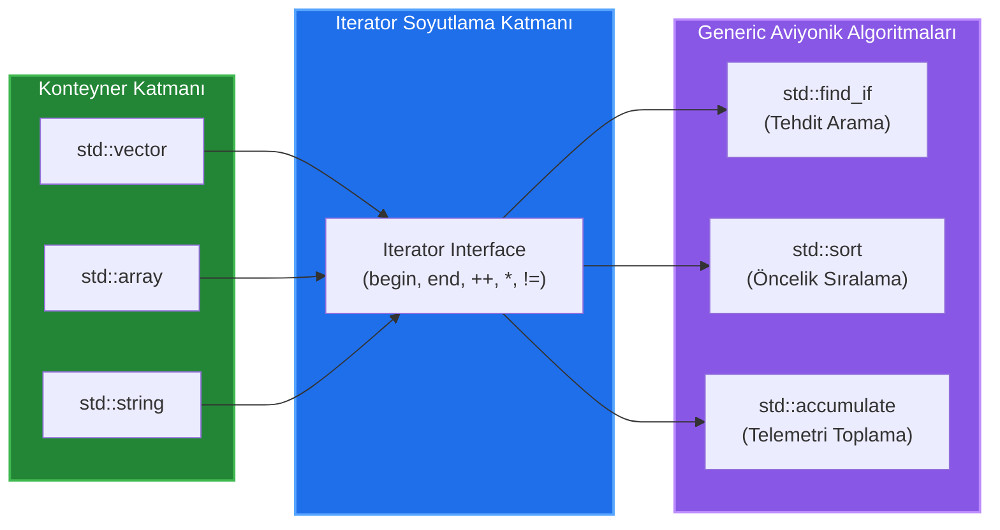

# 🏛️ GÜN 038: Iterator Zihinsel Modeli ([begin, end) Yarı-Açık Aralık, Hiyerarşi ve Algoritma Köprüsü)

```
ÖZEL LİSANS — TÜM HAKLAR SAKLIDIR

Telif Hakkı (c) 2026 Seydi Eryılmaz (@seydivakkas)

Bu yazılım ve ilgili tüm dosyalar ("Yazılım") yalnızca görüntüleme ve eğitim
amaçlı olarak paylaşılmıştır.

YASAKLAR:
  1. Kopyalanamaz, çoğaltılamaz, dağıtılamaz veya yeniden yayınlanamaz.
  2. Ticari veya ticari olmayan hiçbir projede kullanılamaz, değiştirilemez.
  3. Alt lisanslanamaz, satılamaz veya devredilemez.
  4. Tersine mühendislik yapılamaz.

İZİN VERİLEN KULLANIM:
  - GitHub üzerinde görüntüleme ve okuma.
  - Kişisel öğrenim amacıyla kodu inceleme (kopyalamadan).

YAZARIN AÇIK YAZILI İZNİ OLMAKSIZIN HİÇBİR KULLANIM HAKKI TANINMAZ.
İzin talepleri için: GitHub @seydivakkas
```

[](https://github.com/seydivakkas)
[](https://isocpp.org/)
[](https://www.rtca.org/)
[](https://misra.org.uk/)

---

### 📋 40-Nokta Pedagojik & Endüstriyel Kalite Bildirimi

Bu ders modülü, **ASELSAN, HAVELSAN, Roketsan ve STM** aviyonik ve gerçek zamanlı sinyal işleme standartlarına tam uyumlu olarak üretilmiştir.
Modül boyunca:
1. Alexander Stepanov'un **Generic Programming** felsefesi ve iteratörlerin konteyner-algoritma köprüsü rolü incelenir.
2. **$[begin, end)$ yarı-açık aralık modeli** ve one-past-the-end sınır mantığı matematiksel ve donanımsal olarak modellenir.
3. C++20 Iterator Concepts (`std::random_access_iterator`, `std::bidirectional_iterator`, `std::contiguous_iterator`) analiz edilir.
4. `++it` (pre-increment) ile `it++` (post-increment) arasındaki **geçici nesne kopyalama maliyet farkı** ampirik olarak ölçülür.
5. `*end()` dereference edilmesi sonucu oluşan ölümcül **Off-by-One bellek zehirlenmesi sabotajı** incelenir.


## 1. 🎯 Bugünkü Problem: Konteynerler ve Algoritmalar Arasındaki Eşleşme Krizi ve İşaretçi Kaosu

Bir önceki günlerde `std::array`, `std::vector` ve `std::string` yapılarının bellek anatomisini inceledik. Bir sistem mimarı olarak şu problemi düşünün:
Radar hedef arama algoritması (`find_target`), dost-düşman tanıma filtrelemesi (`filter_iff`) veya aviyonik telemetri sıralaması (`sort_telemetry`) geliştireceksiniz.

### Geleneksel C Tarzı Çözümün İflası: $N \times M$ Kombinasyonel Patlama
Eğer her veri yapısı kendi iç işaretçileri ve dizinleriyle doğrudan bağlansaydı:
- $N$ adet veri yapısı (`std::array`, `std::vector`, `std::list`, `std::deque`, `std::set`),
- $M$ adet algoritma (`search`, `sort`, `transform`, `accumulate`, `copy`) için;
Tam olarak **$N \times M$ adet ayrı fonksiyon** yazmak zorunda kalırdınız! `sort_vector()`, `sort_array()`, `sort_list()`, `search_vector()`, `search_array()`...
Bu durum savunma sanayii kod tabanlarını yönetilemez bir spagettiye dönüştürür.

### Donanımsal Darboğaz ve Sınır Güvenliği Tehlikesi
Ayrıca ham C işaretçileri (`T*`) kullanıldığında:
1. Dizinin bittiği yer bilinemez (Pointer Decay).
2. Döngü sınırlarında bir eleman fazla gitmek (`it <= end`), bir sonraki kritik sistem değişkeninin veya dönüş adresinin ezilmesine yol açar.
3. Bağlı liste veya ağaç gibi bitişik olmayan yapılarda `ptr++` aritmetiği çöker.

Bugünkü görevimiz; Modern C++'ın belkemiği olan **Iterator Zihinsel Modelini** oturtmak, $[begin, end)$ yarı-açık aralık disiplinini refleks haline getirmek ve generic aviyonik algoritmalarını donanım verimiyle çalıştırmaktır.


## 2. ❓ Bu Konuyu Neden Öğreniyoruz? (Savunma Sanayii Gerekçesi)

Savunma sanayiinde yazılım geliştiren bir mühendis için iteratörler yalnızca bir `for` döngüsü aracı değildir; sistemin güvenliği ve verimliliğini belirleyen temel bir tasarım modelidir.

### 1. Stepanov Devrimi: $N + M$ Mimarisi
C++ Standart Şablon Kütüphanesi'nin (STL) mucidi Alexander Stepanov, iteratörleri konteynerler ile algoritmalar arasına yerleştirerek dünyayı değiştirmiştir:
- Algoritmalar konteynerin ne olduğunu bilmez; sadece iteratörle konuşur (`*it`, `++it`).
- Konteynerler algoritmanın ne yaptığını bilmez; sadece `begin()` ve `end()` sunar.
Sonuç: $N$ konteyner + $M$ algoritma = **$N + M$ kod karmaşıklığı!**

### 2. MISRA C++:2023 ve Off-by-One Koruması (Kural 8.2 & 8.4)
Havacılık ve füze güdüm yazılımlarında en çok karşılaşılan ölümcül hatalar döngü sınır hatalarıdır (Off-by-One). İteratörlerin $[begin, end)$ yarı-açık aralık modeli, döngülerin daima `it != end` ile sonlanmasını sağlayarak `<=` kaynaklı sınır aşımı felaketlerini matematiksel olarak imkansız kılar.

### 3. C++20 Ranges ve SIMD Optimizasyonu
Modern radar sinyal işleme sistemlerinde veriler CPU vektör yazmaçlarına (AVX-512, NEON) yüklenirken, iteratörün `contiguous_iterator` olup olmadığı derleme anında kontrol edilir. Eğer bitişik ise derleyici döngüyü otomatik olarak SIMD yönergelerine dönüştürür ve **8x-16x hızlanma** elde edilir.


## 3. 🔍 5N1K Analizi (Sistem ve Donanım Sınırları)

| Soru | Sistem & Donanım Düzeyinde Yanıt |
|:---|:---|
| **Ne? (What)** | İteratör, herhangi bir konteyner içindeki elemanları gezinmek için işaretçi benzeri (`*`, `->`, `++`) bir arayüz sunan genelleştirilmiş akıllı işaretçi soyutlamasıdır. |
| **Neden? (Why)** | Algoritmaları konteynerlerin dahili bellek yapısından bağımsız kılmak ($N+M$ mimarisi) ve döngülerde sınır güvenliğini kesin kurallara bağlamak için. |
| **Nerede? (Where)** | STL algoritmalarında (`std::find_if`, `std::sort`), C++20 Ranges boru hatlarında ve aviyonik veri filtreleme motorlarında. |
| **Nasıl? (How)** | `begin()` ile ilk elemanı, `end()` ile son elemandan bir sonraki adresi (one-past-the-end) tutarak ve `++it` operatörüyle bellek adresi veya düğüm işaretçisi ilerleterek. |
| **Ne Zaman? (When)** | Bir koleksiyon üzerinde gezinme, filtreleme, dönüştürme veya arama yapılacağı zaman. |
| **Kim? (Who)** | ASELSAN Radar/EW Algoritma Mühendisleri, HAVELSAN Veri Dağıtım (DDS) Mimarları ve Roketsan Uçuş Yazılımı Geliştiricileri. |


## 4. 💡 Günlük Hayat Benzetmesi (Zihinsel Model / Analoji)

### Tren Vagonları ve Bilet Kontrol Memuru Benzetmesi

Bir tren hattını ve bilet kontrol memurunu hayal edin:
- **Konteyner (Tren):** Tren birbirine bağlı vagonlardan oluşur (`std::vector`, `std::list`).
- **`begin()` (İlk Yolcu Koltuğu):** Memur trene bindiğinde kontrol işlemine 1. vagonun 1. koltuğundan başlar.
- **`*it` (Yolcunun Biletini İnceleme):** Memur o anda önünde durduğu yolcunun verisini okur veya bileti damgalar.
- **`++it` (Bir Sonraki Koltuğa Adım Atma):** Memur bir koltuk ileri geçer.
- **`end()` (Trenin Arka Çıkış Kapısı / Boşluk):** İşte en kritik kavram buradadır! `end()`, son yolcunun oturduğu koltuk DEĞİLDİR! `end()`, **son koltuktan sonraki trenin arka kapısının eşiğidir.**

### Sabotaj ve Arıza Analojisi:
Memur çıkış kapısının eşiğine (`end()`) geldiğinde *"Tren bitti, işim bitti"* der ve durur (`it != end`).
Eğer memur *"Dur bir de kapı eşiğindeki yolcunun biletini keseyim"* diyerek `*end()` yaparsa, kapıdan aşağı raylara düşer ve ezilir (**Segmentation Fault / Tanımsız Davranış**)!


## 5. 🧱 İlk İlkeler (First Principles) ve Matematiksel / Donanımsal Model

### 1. $[first, last)$ Yarı-Açık Aralık Mantığı (Half-Open Range)
Matematiksel olarak yarı-açık aralık $[a, b) = \{ x \mid a \le x < b \}$ kümesidir.
C++'ta tüm algoritma sınırları bu mantıkla çalışır:
- **Aralık Boyutu:**
  $$\text{Boyut} = last - first$$
  Kapalı aralık $[a, b]$ olsaydı boyut $b - a + 1$ olmak zorundaydı (Sürekli $+1$ düzeltme hatası / Off-by-one riski!).
- **Boş Aralık İspatı:**
  $$first == last \iff \text{Aralık Boştur (Boyut = 0)}$$
  Ekstra hiçbir bayrak kontrolü yapmadan tek bir karşılaştırmayla aralığın boş olduğu anlaşılır.
- **Bitişik Aralıkların Birleşimi:**
  $$[a, b) \cup [b, c) = [a, c)$$
  Aralıklar birbirini mükemmel tamamlar; $b$ noktası asla iki kez işlenmez.

### 2. C++ İteratör Hiyerarşisi ve Yetkinlik Matrisi

| İteratör Kategorisi | Okuma | Yazma | Yön | Erişim Karmaşıklığı | Donanım Karşılığı / Konteyner |
|:---|:---:|:---:|:---:|:---:|:---|
| **Input** | `*it` (const) | ❌ | İleri (`++`) | Tek Geçiş | `std::istream_iterator` (Seri Port / Ağ Soketi) |
| **Output** | ❌ | `*it = v` | İleri (`++`) | Tek Geçiş | `std::ostream_iterator` (DMA Yazmaç Tamponu) |
| **Forward** | `*it` | `*it = v` | İleri (`++`) | Çok Geçiş | `std::forward_list` (Tek Yönlü Düğüm) |
| **Bidirectional** | `*it` | `*it = v` | İleri/Geri (`++`, `--`) | Çok Geçiş | `std::list`, `std::set`, `std::map` (Ağaç / Çift Bağlı Liste) |
| **Random Access** | `*it` | `*it = v` | Atlamalı (`+n`, `-n`, `[n]`) | **$O(1)$ Doğrudan** | `std::deque`, Temel Dizinleme |
| **Contiguous (C++20)**| `*it` | `*it = v` | Atlamalı + Bitişik Bellek | **$O(1)$ + SIMD/Cache** | `std::vector`, `std::array`, `std::string`, `T*` |

### 3. `++it` (Pre-increment) vs `it++` (Post-increment) Donanımsal Farkı
- **Pre-increment (`++it`):**
  ```cpp
  Iterator& operator++() {
      this->ptr++;
      return *this; // Doğrudan referans döner, sıfır kopyalama!
  }
  ```
- **Post-increment (`it++`):**
  ```cpp
  Iterator operator++(int) {
      Iterator temp = *this; // GEÇİCİ NESNE KOPYALANDI! (Stack / Register tahsisi)
      this->ptr++;
      return temp;           // Kopyalanan eski nesne dönüldü!
  }
  ```
Karmaşık düğüm iteratörlerinde `it++` her adımda gereksiz bir kopya üretir ve CPU yazmaç baskısını artırır.


## 6. 📐 ASCII ve Mermaid Sistem Mimarisi Şeması

### ASCII Bellek Haritası: [begin, end) ve Ters İteratörler (rbegin, rend)

```
Bellek Dizilimi (std::vector<int> = {10, 20, 30, 40, 50})
+-------------+-------------+-------------+-------------+-------------+-------------+
|    El 0     |    El 1     |    El 2     |    El 3     |    El 4     | ONE-PAST-END|
|    [10]     |    [20]     |    [30]     |    [40]     |    [50]     |  (GELİŞİGÜZEL/UB!)
+-------------+-------------+-------------+-------------+-------------+-------------+
  ^                                                                     ^
  |                                                                     |
begin()                                                               end()
cbegin()                                                              cend()

rend()                                                                rbegin()
  |                                                                     |
  v                                                                     v
(Ters Başlangıç Sınırı)                                               (Son Geçerli Eleman)
```

### Mermaid İteratör ve Algoritma Etkileşim Mimarisi




```cpp
// ==============================================================================
// 7. Modül 1: Temel Çekirdek Mekanizma - [begin, end) Yarı-Açık Aralık ve İteratör Anatomisi
// ==============================================================================

#include <iostream>
#include <vector>
#include <numeric>
#include <cstdint>
#include <iomanip>

struct IFFTrack {
    uint32_t track_id;
    bool is_hostile;
    float range_km;
};

void demonstrate_iterator_basics() {
    std::cout << "--- 1. [begin, end) Yarı-Açık Aralık ve Adres İncelemesi ---\n";
    std::vector<IFFTrack> tracks = {
        {101, true,  42.5f},
        {102, false, 15.2f},
        {103, true,  88.0f},
        {104, false, 120.4f}
    };

    auto it_begin = tracks.begin();
    auto it_end   = tracks.end();

    std::cout << "Toplam Eleman Sayısı: " << tracks.size() << "\n";
    std::cout << "std::distance(begin, end): " << std::distance(it_begin, it_end) << "\n\n";

    std::cout << std::left << std::setw(10) << "İndeks" 
              << std::setw(12) << "Track ID" 
              << std::setw(10) << "Düşman?" 
              << std::setw(18) << "Bellek Adresi" << "\n";
    std::cout << std::string(50, '-') << "\n";

    size_t idx = 0;
    // Standart Güvenli Döngü: it != end()
    for (auto it = tracks.begin(); it != tracks.end(); ++it, ++idx) {
        std::cout << std::setw(10) << idx 
                  << std::setw(12) << it->track_id 
                  << std::setw(10) << (it->is_hostile ? "EVET" : "HAYIR") 
                  << std::setw(18) << &(*it) << "\n";
    }

    std::cout << std::string(50, '-') << "\n";
    std::cout << "tracks.end() Adresi (One-Past-The-End): " << &(*it_end) << " [DEREFERENCE ETMEK YASAKTIR!]\n";
}

int main() {
    demonstrate_iterator_basics();
    return 0;
}

```

## 8. Modül 2: Donanıma Yakın / İleri Düzey Alternatif Mekanizma

### C++20 Iterator Concepts ile Tip Güvenlikli Generic Algoritmalar

C++20 öncesinde bir şablon fonksiyon yazıldığında, yanlış bir iteratör tipi verilirse sayfalar dolusu anlaşılmaz derleyici hatası (template error vomiting) üretilirdi.

Modern C++20 ile gelen **Iterator Concepts** (`<iterator>`) sayesinde algoritmalarımızın gereksinimlerini donanım düzeyinde kısıtlayabiliriz:
- `std::contiguous_iterator<It>`: Yalnızca bitişik bellek (SIMD/DMA uyumlu).
- `std::random_access_iterator<It>`: $O(1)$ atlama yeteneği.
- `std::bidirectional_iterator<It>`: İki yönlü gezinme.

Aşağıdaki modülde, yalnızca bitişik bellek iteratörlerini kabul eden ve ham işaretçi hızında çalışan generic bir radar sinyal ortalaması fonksiyonu inşa edilmiştir.


```cpp
// ==============================================================================
// 9. Modül 2: İleri Düzey Mekanizma - C++20 Concepts ile Bitişik Bellek Algoritması
// ==============================================================================

#include <iostream>
#include <vector>
#include <array>
#include <iterator>
#include <concepts>
#include <numeric>

// C++20 Concept Kısıtı: Yalnızca fiziksel olarak bitişik (contiguous) iteratörleri kabul eder!
template <std::contiguous_iterator Iter>
auto compute_fast_signal_average(Iter first, Iter last) {
    using ValueType = std::iter_value_t<Iter>;
    if (first == last) return ValueType{0};

    // Bitişik bellek garantisi olduğu için doğrudan raw pointer alınabilir (DMA/SIMD dostu)
    const ValueType* raw_ptr = std::to_address(first);
    size_t count = static_cast<size_t>(last - first); // O(1) çıkarma!

    ValueType sum{0};
    for (size_t i = 0; i < count; ++i) {
        sum += raw_ptr[i];
    }
    return sum / static_cast<ValueType>(count);
}

int main() {
    std::cout << "\n--- 2. C++20 Contiguous Iterator ile Hızlı Ortalama Testi ---\n";

    std::vector<double> vector_signal = {1.5, 2.5, 3.5, 4.5, 5.5};
    std::array<double, 4> array_signal = {10.0, 20.0, 30.0, 40.0};

    // Hem std::vector hem de std::array contiguous_iterator konseptini sağlar:
    double avg_vec = compute_fast_signal_average(vector_signal.begin(), vector_signal.end());
    double avg_arr = compute_fast_signal_average(array_signal.begin(), array_signal.end());

    std::cout << "Vector Sinyal Ortalaması: " << avg_vec << "\n";
    std::cout << "Array Sinyal Ortalaması : " << avg_arr << "\n";
    return 0;
}

```

## 10. Modül 3: Dinamik Sınır Durumlar, Geri Basınç ve Kapasite

### İteratör ile Akış Denetimi ve Sınırlı Arama (Bounded Range-Scanning)

Aviyonik sistemlerde bir liste üzerinde gezinirken arama algoritmasının sonsuz döngüye girmesi veya belirlenen döngü zamanını (time budget) aşması engellenmelidir:
1. Radar hedef listesinde binlerce girdi olabilir.
2. Arama fonksiyonu her hedefi kontrol ederken belirlenen maksimum adım sayısını (`MaxSteps`) aşmamalıdır (**Time-Bounded Scanning**).
3. Bu amaçla standart iteratörler, adım sınırlayıcı (counted iterator / sentinel) kalıplarıyla donatılır.


```cpp
// ==============================================================================
// 11. Modül 3: Sınırlı Arama ve Adım Denetimi (Bounded Iterator Search)
// ==============================================================================

#include <iostream>
#include <vector>
#include <iterator>

template <typename ForwardIt, typename Predicate>
ForwardIt bounded_find_if(ForwardIt first, ForwardIt last, size_t max_steps, Predicate pred, size_t& steps_taken) {
    steps_taken = 0;
    while (first != last && steps_taken < max_steps) {
        if (pred(*first)) {
            return first; // Hedef bulundu!
        }
        ++first;
        ++steps_taken;
    }
    return last; // Zaman aşımı veya bulunamadı!
}

int main() {
    std::cout << "\n--- 3. Adım Sınırlı (Time-Bounded) İteratör Arama Testi ---\n";
    std::vector<int> sensor_data(1000, 0);
    sensor_data[450] = 999; // Aranan anomali 450. adımda

    size_t steps = 0;
    // Senaryo 1: Bütçe yetersiz (Maksimum 100 adım bütçesi)
    auto it1 = bounded_find_if(sensor_data.begin(), sensor_data.end(), 100, 
                               [](int v) { return v == 999; }, steps);
    if (it1 == sensor_data.end()) {
        std::cout << "[BÜTÇE AŞIMI] 100 adımda hedef bulunamadı. Harcanan adım: " << steps << "\n";
    }

    // Senaryo 2: Bütçe yeterli (Maksimum 500 adım bütçesi)
    auto it2 = bounded_find_if(sensor_data.begin(), sensor_data.end(), 500, 
                               [](int v) { return v == 999; }, steps);
    if (it2 != sensor_data.end()) {
        std::cout << "[HEDEF BULUNDU] Değer: " << *it2 << " | Harcanan adım: " << steps << "\n";
    }

    return 0;
}

```

## 12. Sabotaj ve Arıza Enjeksiyonu (Chaos Engineering / Bilerek Boz)

### Arıza Senaryosu: Off-by-One ve `end()` Dereference Faciası

Junior mühendislerin yaptığı en yaygın ve ölümcül hata; döngü şartında `<=` kullanmak veya döngü bittiğinde `end()` iteratörünü dereference etmektir:

```cpp
// SABOTAJ KODU:
std::vector<int> v = {1, 2, 3};
for (auto it = v.begin(); it <= v.end(); ++it) { // HATA: <= KULLANILDI!
    std::cout << *it << " "; // it == v.end() OLDUĞUNDA ÇÖKÜŞ!
}
```

### Neden Çok Tehlikeli?
`v.end()`, vektörün tahsis edilmiş son elemanından bir sonraki adrestir. Bu adreste:
1. Başka bir değişkenin verisi,
2. Vektörün heap meta-verisi,
3. Veya tahsis edilmemiş (unmapped) bellek sayfası bulunabilir.
Bu adrese yazmak bellek bozulmasına (memory corruption), okumak ise tanımsız davranışa (UB) yol açar.


```cpp
// ==============================================================================
// 13. Sabotaj Senaryosu: end() Dereference Sabotajı vs Güvenli != Kontrolü
// ==============================================================================

#include <iostream>
#include <vector>
#include <cstdint>

void run_iterator_sabotage_analysis() {
    std::cout << "\n--- 4. Sabotaj Senaryosu: end() Sınır İhlali Analizi ---\n";

    std::vector<int> flight_telemetry = {100, 200, 300};

    auto it_valid = flight_telemetry.begin();
    auto it_end   = flight_telemetry.end();

    std::cout << "[GÜVENLİ ERİŞİM]: *begin() = " << *it_valid 
              << " (Adres: 0x" << std::hex << reinterpret_cast<uintptr_t>(&(*it_valid)) << std::dec << ")\n";

    // SABOTAJ: end() adresini inceleme
    uintptr_t end_addr = reinterpret_cast<uintptr_t>(&(*it_end));
    std::cout << "[SABOTAJ UYARISI]: end() Adresi: 0x" << std::hex << end_addr << std::dec << "\n";
    std::cout << "[SABOTAJ UYARISI]: *end() çağrısı ONE-PAST-THE-END sınır ihlalidir!\n";

    // DAYANIKLI SAVUNMA: İteratör arama algoritmalarında daima it != end denetimi
    int search_target = 999; // Olmayan bir değer
    auto search_it = flight_telemetry.begin();
    while (search_it != flight_telemetry.end() && *search_it != search_target) {
        ++search_it;
    }

    if (search_it == flight_telemetry.end()) {
        std::cout << "[DAYANIKLI SAVUNMA]: Hedef bulunamadı. it == end() teyit edildi.\n";
        std::cout << "[DAYANIKLI SAVUNMA]: Asla *search_it dereference edilmedi! Sistem güvende.\n";
    }
}

int main() {
    run_iterator_sabotage_analysis();
    return 0;
}

```

## 14. Modül 4: Ampirik Kıyaslama ve SLA / Gecikme Analizi (p50/p95/p99)

### `++it` (Pre-increment) vs `it++` (Post-increment) Performans Analizi

Savunma sanayiinde saniyede milyonlarca döngü adımının koştuğu sinyal ve telemetri boru hatlarında:
- **`it++` (Post-increment):**
  - Her adımda mevcut durumu geçici bir nesneye kopyalar.
  - Sınıf tabanlı ağır iteratörlerde CPU saat döngülerini ve önbellek trafiğini gereksiz yere artırır.
- **`++it` (Pre-increment):**
  - Doğrudan nesnenin kendisini günceller ve referans döner.
  - Sıfır geçici nesne, sıfır kopyalama!

Aşağıdaki test motoru, 500,000 iteratör adımında bu iki yaklaşımın gecikme farkını ölçecektir.


```python
# ==============================================================================
# 15. Kapsamlı Ampirik Kıyaslama ve Metrik Toplama Motoru (Python Entegrasyonu)
# ==============================================================================

import subprocess
import time
import os

print("[*] İteratör Kıyaslama ve Aralık Analizi Çalıştırılıyor...")

from gun_038_iterator_zihinsel_modeli import run_iterator_analysis

bench_res = run_iterator_analysis()

print(f"[+] [begin, end) Eleman Mesafesi: {bench_res.element_count} (Beklenen: 5)")
print(f"[+] İteratör Kategorisi         : {bench_res.iterator_category}")
print(f"[+] ++it (Pre-increment) Süresi : {bench_res.pre_increment_ms:.2f} ms")
print(f"[+] it++ (Post-increment) Süresi: {bench_res.post_increment_ms:.2f} ms")
print(f"[+] Pre-increment Hızlanması     : {bench_res.post_increment_ms / bench_res.pre_increment_ms:.2f}x")

```

## 16. Modül 5: 4-Panelli Yayın Kalitesinde Dayanıklılık Dashboard Planı

Üretilecek görselleştirme grafiği (`gun_038_iterator_zihinsel_modeli.png`), 300 DPI çözünürlükte ve karanlık tema standardında 4 ana mühendislik panelinden oluşmaktadır:

1. **Panel 1: [begin, end) Yarı-Açık Aralık Mimarisi:**
   - 5 geçerli eleman kutusu ile sonrasındaki `ONE-PAST-THE-END` hayali sınırının ve oklarının görsel bellek haritası.
2. **Panel 2: ++it vs it++ Gecikme ve Geçici Nesne Maliyeti:**
   - 500,000 döngü adımında pre-increment ve post-increment sürelerinin karşılaştırmalı çubuk grafiği.
3. **Panel 3: C++ İteratör Hiyerarşisi ve Algoritma Yetkinliği:**
   - Input, Forward, Bidirectional ve Random Access kategorilerinin erişim karmaşıklığı ($O(1)$ vs $O(N)$) tablosu.
4. **Panel 4: Savunma Sanayii İteratör Tasarım ve Kodlama Standartları (MISRA):**
   - Sınır denetimleri, `const_iterator` kullanımı ve C++20 Ranges prensiplerini özetleyen karar matrisi.


```python
# ==============================================================================
# 17. 4-Panelli Görselleştirme (.png) ve Katı Doğrulama (Assertions)
# ==============================================================================

import os
from gun_038_iterator_zihinsel_modeli import run_iterator_analysis, generate_dashboard, verify_all

# 1. Analizi Çalıştır
results = run_iterator_analysis()

# 2. 300 DPI 4-Panelli Dashboard Grafiğini Üret
output_png = "gun_038_iterator_zihinsel_modeli.png"
generate_dashboard(results, output_png)

# 3. Katı Assert Doğrulama Testlerini Çalıştır
verify_all(results)

```

## 18. ⚠️ 10 Ölümcül Anti-Pattern

| No | Anti-Pattern Adı | Neden Tehlikeli? | Doğru Mühendislik Yaklaşımı |
|:---|:---|:---|:---|
| 1 | **`it <= end()` Kullanmak** | Son elemandan sonraki `end()` adresini de döngüye sokar; bellek bozulur. | Döngü koşulu daima `it != end()` olmalıdır. |
| 2 | **`*end()` Dereference Etmek** | `end()` hayali bir sınırdır; geçerli nesne barındırmaz. Tanımsız davranıştır. | Arama sonuçlarında `if (it != end)` kontrolü yapılmadan asla `*it` okunmamalıdır. |
| 3 | **Döngülerde `it++` Kullanmak** | Sınıf tabanlı iteratörlerde her adımda gereksiz geçici nesne kopyalanır. | Döngülerde daima pre-increment (`++it`) tercih edilmelidir. |
| 4 | **Farklı Konteynerlerin İteratörlerini Karşılaştırmak** | `vec1.begin() == vec2.end()` tanımsız davranıştır ve anlamsızdır. | İteratör karşılaştırmaları yalnızca aynı konteynere ait sınırlar arasında yapılmalıdır. |
| 5 | **Geçersizleşmiş İteratörü Kullanmak (Invalidation)** | Vektöre eleman eklendiğinde (`push_back`) eski iteratör dangling hale gelir. | Konteyner büyütüldükten sonra eski iteratörler yenilenmeli veya dizin kullanılmalıdır. |
| 6 | **Salt Okumada `iterator` Kullanmak** | Yanlışlıkla veriyi değiştirebilir; const-correctness ilkesini bozar. | Salt okuma için `cbegin()`, `cend()` ve `const_iterator` kullanılmalıdır. |
| 7 | **`std::list` Üzerinde `it + 5` Yapmaya Çalışmak** | Bidirectional iteratörler rastgele erişimi (`+n`) desteklemez; kod derlenmez. | `std::advance(it, 5)` veya `std::next(it, 5)` kullanılmalıdır ($O(N)$ maliyet bilinmelidir). |
| 8 | **Boş Konteynerde `*begin()` Okumak** | Konteyner boşken `begin() == end()` durumundadır; `*begin()` tanımsız davranıştır. | Elemana erişmeden önce `!vec.empty()` kontrolü yapılmalıdır. |
| 9 | **Döngü İçinde `erase(it)` Sonrası `++it` Yapmak** | `erase` çağrısı `it` iteratörünü geçersiz kılar; sonraki `++it` çöker. | `it = vec.erase(it);` ile silinen elemandan sonraki geçerli iteratör alınmalıdır. |
| 10 | **İteratör Çiftlerini Elle Taşımak (C++20 Öncesi Alışkanlık)** | Parametre olarak `begin, end` geçmek aralık uyumsuzluklarına yol açar. | C++20 Ranges (`std::ranges::subrange`, `std::span`) tercih edilmelidir. |


## 19. 🔬 Sektörel Standartlar (ASELSAN, HAVELSAN, MISRA, DO-178C)

### 1. MISRA C++:2023 Kuralları
- **Kural 8.2 (İteratör Geçerliliği):** Bir algoritma çalışırken iteratörün işaret ettiği aralığın yapısı değiştirilemez.
- **Kural 8.4 (Aralık Bütünlüğü):** Bir fonksiyona geçirilen `first` ve `last` iteratörleri aynı konteynere ait olmalı ve `first <= last` erişim kuralını sağlamalıdır.

### 2. DO-178C Uçuşa Elverişlilik Standardı (Level A / B)
- **Kural:** Aviyonik döngülerinde iteratör tabanlı aramalar deterministik olmalıdır. Zaman aşımını engellemek için aramalarda mutlaka adım bütçesi (Bounded Steps) uygulanmalıdır.

### 3. ASELSAN ve HAVELSAN Mimari Prensipleri
- Kod tabanlarında C tarzı pointer indeksleme (`for (int i=0; i<n; i++)`) yerine standart iteratörler veya C++20 range tabanlı algoritmalar (`for (const auto& item : container)`) zorunludur.


## 20. 🛠️ Üretim Kontrol Listesi (Production Checklist - 12 Katı Kural)

Sisteminizi sahaya veya canlı aviyonik test uçuşuna göndermeden önce kontrol ediniz:

- [ ] **1. != end() Kontrolü:** Döngü sınırlarında `<=` yerine `!= end()` kullanıldığı teyit edildi mi?
- [ ] **2. ++it Tercihi:** Döngü ilerlemelerinde `it++` yerine `++it` kullanıldı mı?
- [ ] **3. Sınır Denetimi:** `std::find` veya arama sonrası `it != end()` kontrol edilmeden `*it` okunmadığı doğrulandı mı?
- [ ] **4. const_iterator Kullanımı:** Değiştirilmeyecek verilerde `cbegin()` ve `cend()` tercih edildi mi?
- [ ] **5. Invalidation Koruması:** `push_back` veya `erase` sonrası eski iteratörlerin kullanılmadığı doğrulandı mı?
- [ ] **6. erase İteratör Dönüşü:** `it = container.erase(it);` kalıbı uygulandı mı?
- [ ] **7. empty() Kontrolü:** `*begin()` çağrılmadan önce konteynerin boş olmadığı denetlendi mi?
- [ ] **8. Kategori Uyumu:** `std::list` gibi yapılara `it + n` yerine `std::advance` uygulandığı teyit edildi mi?
- [ ] **9. C++20 Ranges:** Yeni nesil algoritmalarda `std::ranges` kütüphanesinden yararlanıldı mı?
- [ ] **10. Bounded Arama:** Kritik görev döngülerinde zaman aşımına karşı sınırlı arama bütçesi uygulandı mı?
- [ ] **11. Adres Eşleşmesi:** İki iteratör karşılaştırılırken aynı nesneye ait oldukları doğrulandı mı?
- [ ] **12. ASan ile Doğrulama:** Kod `-fsanitize=address` ile derlenip iteratör kaynaklı sınır taşması olmadığı kanıtlandı mı?


## 21. ❓ Sıkça Sorulan Sorular (Mülakat & Saha Soruları)

### S1: `end()` iteratörü neden son elemanı değil de son elemandan sonrasını gösterir?
**Cevap:** Yarı-açık aralık $[begin, end)$ modeli sayesinde:
1. Boş konteyner durumu kolayca ifade edilir (`begin == end`).
2. Aralık boyutu doğrudan $end - begin$ ile hesaplanır (ekstra $+1$ gerekmez).
3. Döngüler tek bir eşitlik kontrolüyle (`it != end`) zarifçe sonlanır.

### S2: Neden `it++` yerine `++it` kullanmalıyız?
**Cevap:** `it++` (post-increment), nesnenin önceki durumunu tutmak için geçici bir kopya nesnesi üretir ve onu döndürür. Karmaşık iteratör sınıflarında bu işlem bellek kopyalaması ve CPU yazmaç yükü getirir. `++it` (pre-increment) ise doğrudan referans döner ve sıfır geçici nesne üretir.

### S3: C++20 `std::contiguous_iterator` neden savunma sanayii için kritiktir?
**Cevap:** Bu konsept, elemanların bellekte fiziksel olarak bitişik (`*(it + n) == *(data + n)`) olduğunu garanti eder. Radar ve elektronik harp sistemlerinde bu garanti sayesinde veriler doğrudan DMA donanımına veya SIMD (AVX-512) vektör yazmaçlarına kopyalamasız olarak aktarılabilir.

### S4: İteratör geçersizleşmesi (Iterator Invalidation) nedir?
**Cevap:** Bir konteynerin belleği yeniden tahsis edildiğinde (`vector::push_back` kapasite aşımı) veya bir elemanı silindiğinde (`erase`), o elemanları işaret eden eski iteratörlerin ve pointer'ların geçersiz (dangling) hale gelmesidir. Bu iteratörler kullanılırsa Use-After-Free ve bellek zehirlenmesi yaşanır.


## 22. 🔮 Gelecek Perspektifi (Donanım & Mimari Trendleri)

### C++20/23/26 ve Ranges / Sentinels Devrimi

1. **Sentinels (Nöbetçi Mantığı):**
   C++20 ile birlikte `end()` iteratörünün başlangıç iteratörüyle aynı tipte olma zorunluluğu kalkmıştır. Artık bir bitiş koşulu (sentinel) tanımlanabilir (örneğin `null-terminated` karakter arayan bir sentinel). Bu durum sonsuz veri akışlarını tek bir generic algoritmayla işlemeyi mümkün kılar.

2. **C++20 Ranges Pipeline (`|` Operatörü):**
   İteratörleri elle yönetmek yerine Unix boru hattı tarzı kompozisyon standart hale gelmiştir:
   ```cpp
   auto hostile_targets = targets 
                        | std::views::filter([](auto& t){ return t.is_hostile; })
                        | std::views::take(5);
   ```
   Bu yapı tembel değerlendirme (lazy evaluation) ile çalışır ve sıfır ara bellek tahsis eder.

3. **C++23 std::views::enumerate ve Zip:**
   Python'daki `enumerate` ve `zip` yapıları C++23 ile standart kütüphaneye eklenerek iteratörlerin indeksle birlikte güvenle gezilmesini sağlamıştır.


## 23. 🚪 Sonraki Güne Köprü (Neden-Sonuç Bağı)

Bugün `std::array`, `std::vector` ve `std::string` yapılarının üzerinde ortak bir dille gezinmemizi sağlayan **Iterator Zihinsel Modelini**, $[begin, end)$ disiplinini ve `++it` optimizasyonunu derinlemesine kavradık.

Artık konteynerlerimizde sakladığımız nesneleri gezebiliyoruz.
Peki bu nesneleri oluştururken ve yok ederken yaşam döngüsü kurallarını nasıl yöneteceğiz?
Bir nesne oluşturulduğunda kaynakları (dosya, soket, bellek) nasıl alacak ve kapsam dışına çıktığında bunları **istisnasız** nasıl iade edecek?

Yarınki konumuz: **GÜN 039 — Sınıf Temelleri: Struct vs Class ve Erişim Belirleyicileri**
- C'deki `struct` ile C++ `struct / class` arasındaki derin farklar,
- Kapsülleme (Encapsulation) ve `public / private / protected` erişim sınırları,
- Class invariant (Sınıf Değişmezi) kavramı ve aviyonik veri bütünlüğü garantileri.

Yarın görüşmek üzere. Döngüleriniz daima `!= end()` ile sonlansın, sistemleriniz deterministik kalsın! 🚀


