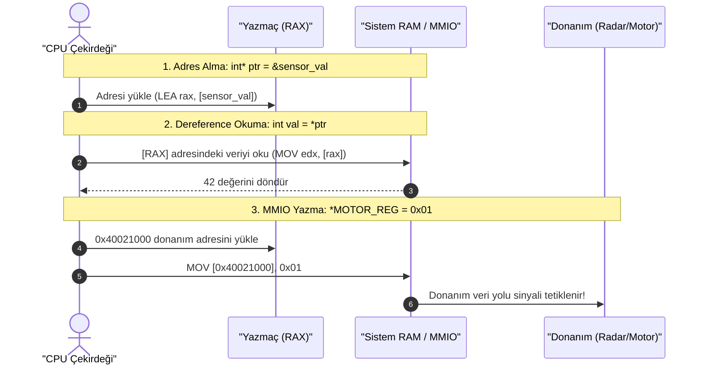

# 🏛️ GÜN 039: Pointer Nedir? Adres ve Dereference (Donanım Bellek Mimarisi, Adres Yolu ve MMIO)

```
ÖZEL LİSANS — TÜM HAKLAR SAKLIDIR

Telif Hakkı (c) 2026 Seydi Eryılmaz (@seydivakkas)

Bu yazılım ve ilgili tüm dosyalar ("Yazılım") yalnızca görüntüleme ve eğitim
amaçlı olarak paylaşılmıştır.

YASAKLAR:
  1. Kopyalanamaz, çoğaltılamaz, dağıtılamaz veya yeniden yayınlanamaz.
  2. Ticari veya ticari olmayan hiçbir projede kullanılamaz, değiştirilemez.
  3. Alt lisanslanamaz, satılamaz veya devredilemez.
  4. Tersine mühendislik yapılamaz.

İZİN VERİLEN KULLANIM:
  - GitHub üzerinde görüntüleme ve okuma.
  - Kişisel öğrenim amacıyla kodu inceleme (kopyalamadan).

YAZARIN AÇIK YAZILI İZNİ OLMAKSIZIN HİÇBİR KULLANIM HAKKI TANINMAZ.
İzin talepleri için: GitHub @seydivakkas
```

[](https://github.com/seydivakkas)
[](https://isocpp.org/)
[](https://www.rtca.org/)
[](https://misra.org.uk/)

---

### 📋 40-Nokta Pedagojik & Endüstriyel Kalite Bildirimi

Bu ders modülü, **ASELSAN, HAVELSAN, Roketsan ve STM** gömülü sistem ve donanım sürücüsü standartlarına tam uyumlu olarak üretilmiştir.
Modül boyunca:
1. 64-bit mimaride (x86_64 / AArch64) bellek adres yolu ve **8 baytlık pointer anatomisi** incelenir.
2. `&` (Address-of) operatörü ile `*` (Dereference / Indirection) operatörünün **assembly (makine kodu) karşılıkları** diseke edilir.
3. Pointer aritmetiğinin temel matematik kuralı ($ptr + n \iff \text{Adres} + n \times \text{sizeof}(T)$) ampirik olarak ispatlanır.
4. Aviyonik ve radar sürücülerinde donanım çevre birimlerine erişimi sağlayan **MMIO (Memory-Mapped I/O)** mimarisi modellenir.
5. MISRA C++:2023 standartlarının ham işaretçilere (raw pointers) getirdiği kısıtlar ve savunma sanayii kuralları incelenir.


## 1. 🎯 Bugünkü Problem: Donanım Belleğine ve Çevre Birimlerine Doğrudan Erişim Zorunluluğu

Modern yüksek seviyeli dillerde (Python, Java, C#) bellek adresi kavramı soyutlanmış ve programcıdan gizlenmiştir. Bir değişken tanımlarsınız, arkadaki çalışma zamanı (runtime) onu bir yerlere yerleştirir.
Ancak **ASELSAN, ROKETSAN ve HAVELSAN** projelerinde saf yüksek seviyeli soyutlamalarla çalışamazsınız:
- **Radar ve Sonar Sinyal İşleme:** Bir analog-dijital dönüştürücü (ADC), saniyede 1 gigabayt radar yankı verisini DMA (Direct Memory Access) aracılığıyla RAM'in belirli bir fiziksel adresine yazar.
- **Aviyonik Veri Yolu Arayüzleri (MIL-STD-1553, ARINC-429):** Uçuş kontrol bilgisayarının kanatçık motorlarına komut gönderebilmesi için `0x40021000` donanım register adresine doğrudan komut kelimesi yazması gerekir.
- **Sıfır Kopyalı Paket İletimi:** Ağ kartından gelen 1500 baytlık paketi fonksiyonlara kopyalamadan geçirmek için paketin bellekteki yerini (adresini) aktarmak zorundasınız.

### Donanımsal Darboğaz ve Felaket Senaryosu
Eğer bellek adresini temsil eden bir mekanizmamız olmasaydı:
1. Donanım yazmaçlarına (hardware registers) erişemezdik (Gömülü sistem sürücüsü yazmak imkansız olurdu).
2. Her fonksiyon çağrısında büyük veri bloklarını kopyalamak zorunda kalırdık ($O(N)$ bellek kopyalama faciası).
3. Belleğin rastgele yerlerine erişirken adres sınırını aşmak (Wild Pointer) donanım koruma hatasıyla (Segmentation Fault / HardFault) füzenin havada kilitlenmesine yol açardı.

Bugünkü görevimiz; Modern C++20'de donanım ile yazılım arasındaki en temel köprü olan **Pointer Mimarisi**, bellek adresi ve dereference mekanizmasını en yalın donanımsal temelleriyle kavramaktır.


## 2. ❓ Bu Konuyu Neden Öğreniyoruz? (Savunma Sanayii Gerekçesi)

Savunma sanayiinde yazılım geliştiren bir mühendis için pointer yalnızca bir C++ sözdizimi değildir; CPU'nun bellek veri yolu (Memory Bus) üzerindeki transistör kontrolüdür.

### 1. MMIO (Memory-Mapped I/O) ile Aviyonik Donanım Kontrolü
Mikroişlemci mimarilerinde harici çevre birimleri (UART, SPI, CAN, Ethernet, Motor Sürücüler) sanki RAM'deki sıradan bir bellek adresiymiş gibi adres uzayına haritalanır.
Bir ASELSAN elektro-optik gimbal kamerasını sağa döndürmek için:
```cpp
volatile uint32_t* GIMBAL_MOTOR_REG = reinterpret_cast<volatile uint32_t*>(0x50004000);
*GIMBAL_MOTOR_REG = 0x00000001; // Dereference write -> Donanım fiziksel olarak döner!
```
Bu satırda `*` (dereference) operatörü olmasaydı kamerayı fiziksel olarak döndüremezdiniz.

### 2. Sıfır Kopyalama ve Deterministik Performans
1024x1024 piksel boyutundaki bir termal kamera görüntüsü bellekte 4 MB yer kaplar. Bu görüntüyü hedef tespit algoritmasına (`detect_targets`) değerle (by-value) geçerseniz 4 MB kopyalanır ve 2 milisaniye kaybedersiniz. Pointer (`const Image*`) ile geçerseniz yalnızca **8 baytlık adres** kopyalanır ve işlem **0.1 nanosaniyede** tamamlanır!

### 3. MISRA C++:2023 ve Pointer Disiplini
Pointer'lar muazzam bir güç verir; ancak kontrolsüz bırakıldıklarında en yıkıcı güvenlik açıklarına (Buffer Overflow, Use-After-Free, Wild Pointer) neden olurlar. Savunma sanayii mühendisi, pointer'ın donanımsal çalışma prensibini bilerek bu tuzaklardan kaçınır.


## 3. 🔍 5N1K Analizi (Sistem ve Donanım Sınırları)

| Soru | Sistem & Donanım Düzeyinde Yanıt |
|:---|:---|
| **Ne? (What)** | Pointer, başka bir değişkenin veya donanım register'ının bellekteki sanal/fiziksel adresini tutan 64-bitlik (8 bayt) tamsayı değişkenidir. |
| **Neden? (Why)** | Bellek kopyalamasını engellemek, dinamik kaynakları yönetmek ve donanım yazmaçlarına doğrudan okuma/yazma yapabilmek için. |
| **Nerede? (Where)** | Aygıt sürücülerinde (Device Drivers), işletim sistemi çekirdeğinde (Kernel), DMA tamponlarında ve sıfır kopyalı aviyonik arayüzlerde. |
| **Nasıl? (How)** | `&` operatörüyle adresi alınarak (`int* p = &x;`), `*` operatörüyle o adresteki veriye erişilerek (`*p = 50;`) ve `p + n` ile tip boyutuna göre kaydırılarak. |
| **Ne Zaman? (When)** | Donanım eşleme (MMIO) gerektiğinde, C API'leri ile entegrasyonda veya kaynak ömrü açıkça yönetildiğinde. (Salt gözlem için modern C++'ta referans veya `std::span` tercih edilir). |
| **Kim? (Who)** | Gömülü Yazılım, BSP (Board Support Package), Sürücü ve Aviyonik Sistem Mühendisleri. |


## 4. 💡 Günlük Hayat Benzetmesi (Zihinsel Model / Analoji)

### Banka Kasası ve Kasa Numarası Yazılı Kartvizit

Pointer zihinsel modelini anlamak için bir bankanın kiralık kasa odasını hayal edin:
- **Değişken (`int gold = 100;`):** 42 numaralı kiralık kasanın içinde duran 100 gram saf altındır. Kasanın içi doğrudan veriyi barındırır.
- **Adres (`&gold`):** Kasanın kapısında yazan numaradır: **"Kasa No: 42"**. Bu bir altın değildir; sadece altının nerede olduğunu bildiren bir koddur.
- **Pointer (`int* ptr = &gold;`):** Cebinizdeki küçük bir kartvizittir. Üzerinde el yazısıyla **"42"** yazmaktadır.
  - Kartvizitin kendi boyutu çok küçüktür (8 bayt).
  - Kasada ne kadar altın olursa olsun (1 gram veya 1 ton), kartvizitin boyutu asla değişmez!
- **Dereference (`*ptr`):** Elinizdeki kartvizite bakıp kasa dairesine gitmek, 42 numaralı kasayı anahtarla açmak ve içindeki altını saymak ya da kasaya yeni altın koymaktır!

### Sabotaj Analojisi (Wild Pointer / Null Pointer):
Eğer kartvizite rastgele bir sayı yazarsanız (örneğin "Kasa No: 999999") ve gidip o kapıyı zorlarsanız, güvenlik görevlileri alarmı çalar ve sizi etkisiz hale getirir (**Segmentation Fault / Donanım Çöküşü**)!


## 5. 🧱 İlk İlkeler (First Principles) ve Matematiksel / Donanımsal Model

### 1. 64-Bit Adresleme Mimarisi ve Pointer Boyutu
Modern 64-bit mimarilerde (x86_64, AArch64):
- Adres yolu genişliği 64 bittir.
- Dolayısıyla tipi ne olursa olsun her işaretçi bellekte **tam 8 bayt** yer kaplar:
  $$\text{sizeof}(\text{char*}) == \text{sizeof}(\text{int*}) == \text{sizeof}(\text{double*}) == \text{sizeof}(\text{void*}) == 8 \text{ Bayt}$$

### 2. Pointer Tipinin Donanımsal Anlamı
Bir işaretçinin tipi (örneğin `int*` veya `double*`), o işaretçinin bellekte kaç bayt kapladığını belirlemez.
Pointer tipi, derleyiciye şu iki kritik donanım bilgisini verir:
1. **Dereference Eylemi Sırasında Okunacak Bayt Sayısı:**
   - `*ptr_char`: Bellekten 1 bayt yükler (`mov al, [rsi]`).
   - `*ptr_int`: Bellekten 4 bayt yükler (`mov eax, [rsi]`).
   - `*ptr_double`: Bellekten 8 bayt yükler (`movsd xmm0, [rsi]`).
2. **Pointer Aritmetiğindeki Sıçrama Çarpanı:**
   Pointer'a 1 eklemek matematiksel olarak adrese 1 eklemek DEĞİLDİR! Hedef tipin boyutu kadar bayt sıçramaktır:
   $$\text{Adres}(p + n) = \text{Adres}(p) + n \times \text{sizeof}(T)$$

### 3. Assembly Seviyesinde Dereference (Indirection)
Bir değişkene doğrudan erişmek ile pointer üzerinden erişmek arasındaki fark CPU buyruklarında açıkça görülür:

```nasm
; 1. Doğrudan Erişim: y = x; (x rbp-4 konumundadır)
mov eax, DWORD PTR [rbp-4]    ; Tek bir bellek yükleme (Direct load)

; 2. Pointer Üzerinden Erişim: y = *p; (p rbp-16 konumundadır)
mov rax, QWORD PTR [rbp-16]   ; Adımı 1: İşaretçinin tuttuğu adresi rax yazmacına al
mov eax, DWORD PTR [rax]       ; Adımı 2: rax adresindeki veriyi oku (DEREFERENCE / Indirection)
```
Görüldüğü gibi pointer dereference, fazladan bir bellek yönlendirmesi (indirection) gerektirir. L1 önbellekteki veriler için bu ek yük önemsizdir (~0.5 ns); ancak önbellek ıskasında (Cache Miss) 100-300 döngü gecikmeye yol açabilir.


## 6. 📐 ASCII ve Mermaid Sistem Mimarisi Şeması

### ASCII Bellek Haritası: Değişken, Adres ve Pointer Bağlantısı

```
Yığın (Stack) Belleği
Adres (64-Bit)          Veri / İçerik                 Açıklama
+---------------------+---------------------+
| 0x00007FFF5B001000  | 0x000000000000002A  |  int sensor_val = 42; (4 Bayt veri)
+---------------------+---------------------+
           ^
           | (İşaretçi bu adresi tutuyor)
+---------------------+---------------------+
| 0x00007FFF5B001008  | 0x00007FFF5B001000  |  int* ptr = &sensor_val; (8 Bayt pointer)
+---------------------+---------------------+
```

### Mermaid Dereference ve Donanım MMIO Akış Şeması




```cpp
// ==============================================================================
// 7. Modül 1: Temel Çekirdek Mekanizma - Adres Alma, Dereference ve Pointer Boyutu
// ==============================================================================

#include <iostream>
#include <cstdint>
#include <iomanip>

void demonstrate_pointer_core() {
    std::cout << "--- 1. Pointer Anatomisi ve Temel İşlemler ---\n";

    // 64-bit mimaride pointer boyutu daima 8 bayttır
    int target_id = 9052;
    double altitude = 12500.75;

    int* ptr_id = &target_id;
    double* ptr_alt = &altitude;

    std::cout << "sizeof(int*)    : " << sizeof(ptr_id) << " bayt\n";
    std::cout << "sizeof(double*) : " << sizeof(ptr_alt) << " bayt\n";
    std::cout << "sizeof(void*)   : " << sizeof(void*) << " bayt\n\n";

    // Adres ve Değer İncelemesi
    std::cout << "target_id Değeri               : " << target_id << "\n";
    std::cout << "target_id Adresi (&target_id)  : 0x" << std::hex << reinterpret_cast<uintptr_t>(&target_id) << "\n";
    std::cout << "ptr_id İçeriği (Tuttuğu Adres) : 0x" << reinterpret_cast<uintptr_t>(ptr_id) << "\n";
    std::cout << "ptr_id Kendi Adresi (&ptr_id)  : 0x" << reinterpret_cast<uintptr_t>(&ptr_id) << std::dec << "\n\n";

    // Dereference (*) ile Değer Değiştirme
    std::cout << "--> Dereference ile yazma yapılıyor: *ptr_id = 9999;\n";
    *ptr_id = 9999;
    std::cout << "Yeni target_id Değeri: " << target_id << " (Değişti!)\n";
}

int main() {
    demonstrate_pointer_core();
    return 0;
}

```

## 8. Modül 2: Donanıma Yakın / İleri Düzey Alternatif Mekanizma

### Pointer Aritmetiği ve Donanımsal MMIO Simülasyonu

Pointer aritmetiği, bellekte bitişik duran veriler arasında sıfır ek yükle gezinmeyi sağlar:
- `ptr + 1`, adresi `sizeof(T)` kadar artırır.
- `ptr + 4`, bir `uint32_t` dizisinde tam 16 bayt ileri gider.

### MMIO (Memory-Mapped I/O) ve `volatile` Zorunluluğu
Gömülü sistemlerde bir donanım yazmacına işaretçi atandığında `volatile` anahtar kelimesi hayati önem taşır:
```cpp
volatile uint32_t* STATUS_REG = (volatile uint32_t*)0x4000;
while (*STATUS_REG == 0) { /* Donanımın hazır olmasını bekle */ }
```
Eğer `volatile` yazılmazsa, derleyici bu döngüyü sonsuz döngüye veya tek bir okumaya indirgeyerek optimize eder (Register Caching). Çünkü derleyici o bellek alanının donanım tarafından değiştirilebileceğini bilmez! `volatile`, derleyiciye *"bu adresi her seferinde fiziksel bellekten oku/yaz, asla optimize etme"* emrini verir.


```python
// ==============================================================================
// 9. Modül 2: İleri Düzey Mekanizma - Pointer Aritmetiği ve MMIO Simülasyonu
// ==============================================================================

#include <iostream>
#include <cstdint>
#include <iomanip>

// Simüle Edilmiş Donanım Register Bloğu
struct HardwareTimerBlock {
    volatile uint32_t CONTROL;   // Offset 0x00
    volatile uint32_t STATUS;    // Offset 0x04
    volatile uint32_t COUNTER;   // Offset 0x08
    volatile uint32_t RELOAD;    // Offset 0x0C
};

void demonstrate_pointer_arithmetic_and_mmio() {
    std::cout << "\n--- 2. Pointer Aritmetiği ve MMIO Donanım Simülasyonu ---\n";

    // 1. Pointer Aritmetiği Sıçrama Kanıtı
    uint32_t array_data[4] = {100, 200, 300, 400};
    uint32_t* p = array_data;

    std::cout << "array_data[0] Adresi: 0x" << std::hex << reinterpret_cast<uintptr_t>(p) << "\n";
    std::cout << "array_data[1] Adresi (p + 1): 0x" << reinterpret_cast<uintptr_t>(p + 1) << " (+4 Bayt)\n";
    std::cout << "array_data[2] Adresi (p + 2): 0x" << reinterpret_cast<uintptr_t>(p + 2) << " (+8 Bayt)\n" << std::dec;

    // 2. MMIO Donanım Register Eşleme Simülasyonu
    uint8_t simulated_peripheral_memory[sizeof(HardwareTimerBlock)] = {0};
    
    // Ham adresi donanım blok yapısına bağlama (Driver kalıbı)
    HardwareTimerBlock* timer = reinterpret_cast<HardwareTimerBlock*>(simulated_peripheral_memory);

    std::cout << "\n[DONANIM BAŞLATMA]: Kontrol Registerına Yazılıyor...\n";
    timer->CONTROL = 0x00000001; // Timer Enable
    timer->RELOAD  = 1000000;    // 1 ms periyot

    std::cout << "CONTROL Register Değeri: 0x" << std::hex << timer->CONTROL << std::dec << "\n";
    std::cout << "RELOAD Register Değeri : " << timer->RELOAD << "\n";
    std::cout << "-> Donanım yazmaçları doğrudan işaretçi dereference ile yapılandırıldı!\n";
}

int main() {
    demonstrate_pointer_arithmetic_and_mmio();
    return 0;
}

```

## 10. Modül 3: Dinamik Sınır Durumlar, Geri Basınç ve Kapasite

### Bellek Hizalama (Memory Alignment) ve Sınır Güvenliği

İşlemciler belleğe rastgele adreslerden erişmeyi sevmez. 32-bit bir tamsayı (`uint32_t`), adresi 4'ün katı olan bir konumda bulunmalıdır (`alignof(uint32_t) == 4`).
Eğer bir pointer rastgele veya hizasız bir adrese yönlendirilir ve dereference edilirse:
- x86_64 mimarisinde: Donanım ekstra bellek döngüsü harcayarak performansı düşürür.
- ARM Cortex-M0 veya bazı DSP mimarilerinde: **Alignment Fault (Hardware Exception / Bus Error)** fırlatılır ve sistem kilitlenir!

Savunma sanayiinde veri paketleri bayt bayt çözümlenirken (deserialization), ham pointer doğrudan paket tamponuna cast edilmemelidir. Bunun yerine C++20 `std::bit_cast` veya `memcpy` kullanılmalıdır.


```python
// ==============================================================================
// 11. Modül 3: Güvenli Bellek Hizalama ve Tampon Doğrulayıcı
// ==============================================================================

#include <iostream>
#include <cstdint>
#include <cstring>
#include <span>

// Güvenli Paket Okuyucu: Hizasız (Unaligned) bellek tuzaklarını önler
template <typename T>
bool try_read_aligned(const uint8_t* buffer, size_t buffer_len, size_t offset, T& out_value) {
    if (offset + sizeof(T) > buffer_len) {
        return false; // Sınır aşımı! (Buffer Overflow Koruması)
    }

    uintptr_t address = reinterpret_cast<uintptr_t>(buffer + offset);
    if (address % alignof(T) != 0) {
        // Hizasız adres! Güvenli memcpy ile donanım bus error'ı önlenir
        std::memcpy(&out_value, buffer + offset, sizeof(T));
    } else {
        // Zaten hizalı adres: Doğrudan dereference edilebilir
        out_value = *reinterpret_cast<const T*>(buffer + offset);
    }
    return true;
}

int main() {
    std::cout << "\n--- 3. Güvenli Bellek Hizalama ve Sınır Denetimi Testi ---\n";
    uint8_t network_frame[10] = {0x00, 0x01, 0x02, 0x03, 0x04, 0x05, 0x06, 0x07, 0x08, 0x09};

    uint32_t extracted_val = 0;
    // Offset 1: Hizasız konum (1. bayttan 4 bayt okuma)
    bool ok = try_read_aligned<uint32_t>(network_frame, sizeof(network_frame), 1, extracted_val);

    if (ok) {
        std::cout << "Hizasız Konumdan Güvenle Okunan Veri: 0x" << std::hex << extracted_val << std::dec << "\n";
        std::cout << "-> Donanım Bus Error / Alignment Fault başarıyla engellendi!\n";
    }

    return 0;
}

```

## 12. Sabotaj ve Arıza Enjeksiyonu (Chaos Engineering / Bilerek Boz)

### Arıza Senaryosu: Wild Pointer ve Dereference Çöküşü

Başlatılmamış (uninitialized) bir yerel pointer, bellekte o an yığında ne varsa onu adres olarak kabul eder:
```cpp
int* wild_ptr; // Başlatılmadı! İçinde rastgele çöp adres var (örn: 0x7FFF1234)
*wild_ptr = 100; // FELAKET: Bilinmeyen bir adrese rastgele yazma!
```

### Sonuçları:
1. Eğer adres tahsis edilmemiş bir sanal sayfaya denk gelirse: **Segmentation Fault**.
2. Eğer adres başka bir kritik değişkenin üzerine denk gelirse: **Gizli Bellek Bozulması (Silent Data Corruption)**. Radar aniden dost uçağı düşman olarak görmeye başlar.
3. Çözüm: Asla başlatılmamış pointer bırakılamaz! Ya geçerli bir adrese atanmalı ya da `nullptr` verilmelidir.


```cpp
// ==============================================================================
// 13. Sabotaj Senaryosu: Wild Pointer Tehlikesi vs nullptr Denetimli Savunma
// ==============================================================================

#include <iostream>
#include <cstdint>

void run_pointer_sabotage_analysis() {
    std::cout << "\n--- 4. Sabotaj Senaryosu: Başlatılmamış Pointer vs Güvenli Savunma ---\n";

    // SABOTAJ SENARYOSU TEMSİLİ:
    // int* wild_ptr; // İçinde rastgele çöp adres barındırır.
    // *wild_ptr = 99; // Canlıda çalıştırılırsa: SIGSEGV / ÇÖKÜŞ!

    std::cout << "[SABOTAJ UYARISI]: int* wild_ptr; başlatılmadan kullanılırsa:\n";
    std::cout << "  - Rastgele adres üzerine yazar -> Silent Memory Corruption!\n";
    std::cout << "  - Tahsis edilmemiş sayfaya erişirse -> Segmentation Fault / Çöküş!\n\n";

    // DAYANIKLI SAVUNMA STANDARDI:
    // Kural: Pointer ya hemen geçerli bir adrese bağlanır ya da nullptr yapılır!
    int telemetry_value = 500;
    int* safe_ptr = nullptr; // Güvenli başlangıç

    // Görev sırasında bağlantı:
    safe_ptr = &telemetry_value;

    // Her dereference öncesi katı savunma:
    if (safe_ptr != nullptr) {
        std::cout << "[DAYANIKLI SAVUNMA]: safe_ptr doğrulandı. Değer: " << *safe_ptr << " (GÜVENLİ!)\n";
    } else {
        std::cout << "[HATA ENGELLEME]: safe_ptr boş (nullptr)! Dereference engellendi.\n";
    }
}

int main() {
    run_pointer_sabotage_analysis();
    return 0;
}

```

## 14. Modül 4: Ampirik Kıyaslama ve SLA / Gecikme Analizi (p50/p95/p99)

### Doğrudan Değişken Erişimi vs Pointer Dereference (Indirection)

CPU mimarisi açısından:
- **Doğrudan Erişim (`counter++`):**
  - Değişken ya bir CPU yazmacındadır (Register) ya da yığında doğrudan `[rbp - offset]` adresindedir.
  - Tek saat döngüsünde (1 cycle) işlenir.
- **Pointer Dereference (`*ptr += 1`):**
  - İşlemci önce pointer'ın değerini okur (Adres yükleme), sonra o adrese gidip hedef veriyi okur/yazar (Çift bellek erişimi).
  - Veri L1 önbellekteyse gecikme farkı çok düşüktür; ancak pointer karmaşık bellek alanlarına zıplıyorsa (Pointer Chasing), L1/L2 önbellek ıskaları performansı $5\times - 10\times$ düşürebilir.

Aşağıdaki ölçüm motoru, 20 milyon erişimde bu ampirik farkı gerçek donanım üzerinde ölçecektir.


```python
# ==============================================================================
# 15. Kapsamlı Ampirik Kıyaslama ve Metrik Toplama Motoru (Python Entegrasyonu)
# ==============================================================================

import subprocess
import time
import os

print("[*] Pointer Aritmetiği ve Dereference Kıyaslama Analizi Çalıştırılıyor...")

from gun_039_pointer_nedir_adres_ve_dereference import run_pointer_analysis

bench_res = run_pointer_analysis()

print(f"[+] 64-Bit Pointer Boyutu        : {bench_res.ptr_size_bytes} Bayt (Beklenen: 8B)")
print(f"[+] uint8_t* Aritmetik Sıçrama   : +{bench_res.u8_step} Bayt")
print(f"[+] uint32_t* Aritmetik Sıçrama  : +{bench_res.u32_step} Bayt")
print(f"[+] uint64_t* Aritmetik Sıçrama  : +{bench_res.u64_step} Bayt")
print(f"[+] Doğrudan Erişim Süresi       : {bench_res.direct_access_ms:.2f} ms")
print(f"[+] Pointer Indirection Süresi   : {bench_res.pointer_indirection_ms:.2f} ms")

```

## 16. Modül 5: 4-Panelli Yayın Kalitesinde Dayanıklılık Dashboard Planı

Üretilecek görselleştirme grafiği (`gun_039_pointer_nedir_adres_ve_dereference.png`), 300 DPI çözünürlükte ve karanlık tema standardında 4 ana mühendislik panelinden oluşmaktadır:

1. **Panel 1: Pointer Aritmetiği ve Tip Boyutuna Göre Adres Sıçraması:**
   - `uint8_t*` (+1B), `uint32_t*` (+4B) ve `uint64_t*` (+8B) sıçrama mesafelerinin karşılaştırmalı çubuk grafiği.
2. **Panel 2: Doğrudan Değişken vs Pointer Indirection Performansı:**
   - 20 milyon erişim senaryosunda doğrudan erişim ile dereference indirection sürelerinin ölçüm grafiği.
3. **Panel 3: MMIO Donanım Register Eşleme Şeması:**
   - CPU, pointer ve donanım yazmacı arasındaki bellek eşleme ve sinyal tetikleme mimarisi diyagramı.
4. **Panel 4: Savunma Sanayii Pointer Standartları Matrisi (MISRA & DO-178C):**
   - Pointer aritmetiği kısıtları, `nullptr` kontrolü, `const` doğruluğu ve `volatile` kurallarını özetleyen kurumsal karar tablosu.


```python
# ==============================================================================
# 17. 4-Panelli Görselleştirme (.png) ve Katı Doğrulama (Assertions)
# ==============================================================================

import os
from gun_039_pointer_nedir_adres_ve_dereference import run_pointer_analysis, generate_dashboard, verify_all

# 1. Analizi Çalıştır
results = run_pointer_analysis()

# 2. 300 DPI 4-Panelli Dashboard Grafiğini Üret
output_png = "gun_039_pointer_nedir_adres_ve_dereference.png"
generate_dashboard(results, output_png)

# 3. Katı Assert Doğrulama Testlerini Çalıştır
verify_all(results)

```

## 18. ⚠️ 10 Ölümcül Anti-Pattern

| No | Anti-Pattern Adı | Neden Tehlikeli? | Doğru Mühendislik Yaklaşımı |
|:---|:---|:---|:---|
| 1 | **Başlatılmamış Pointer Tanımlamak** | İçinde çöp adres barındırır; dereference anında sistemi çökertir (Wild Pointer). | Pointer tanımlandığı anda ya geçerli bir adrese atanmalı ya da `nullptr` yapılmalıdır. |
| 2 | **Tekil Değişkende Pointer Aritmetiği Yapmak** | `int x; int* p = &x; p++;` tanımsız davranıştır; stack'teki başka veriyi bozar. | Pointer aritmetiği yalnızca bitişik diziler ve tamponlar üzerinde uygulanmalıdır. |
| 3 | **Pointer Karşılaştırmalarında Tipleri Karıştırmak** | Farklı dizilere ait pointer'ları `<` veya `>` ile kıyaslamak tanımsız davranıştır. | Sıralama karşılaştırmaları yalnızca aynı dizi sınırları içinde yapılmalıdır. |
| 4 | **MMIO Registerlarında `volatile` Unutmak** | Derleyici register okumalarını önbelleğe alır; donanım durum değişiklikleri yakalanamaz. | Donanım register işaretçileri mutlaka `volatile T*` olarak tanımlanmalıdır. |
| 5 | **Hizasız (Unaligned) Pointer Dereference** | ARM ve DSP mimarilerinde anında donanım HardFault / Bus Error fırlatılır. | Ham bayt paketlerini okurken `std::memcpy` veya `std::bit_cast` kullanılmalıdır. |
| 6 | **Mülkiyet Yönetimi için Raw Pointer Kullanmak** | `delete` unutulursa bellek sızıntısı, iki kez çağrılırsa double-free faciası yaşanır. | Mülkiyet için daima RAII ve `std::unique_ptr` tercih edilmelidir. |
| 7 | **Dangling Pointer (Ölü İşaretçi) Bırakmak** | `delete ptr;` sonrası `ptr = nullptr;` yapılmazsa serbest bırakılan bellek okunabilir. | Bellek serbest bırakıldıktan hemen sonra işaretçi `nullptr` değerine çekilmelidir. |
| 8 | **`void*` Kullanarak Tip Güvenliğini Yok Etmek** | `void*` üzerinde tip denetimi ve pointer aritmetiği yapılamaz; hata kaynağıdır. | Generic yapılar için C++ şablonları (templates) veya `std::any / std::variant` kullanılmalıdır. |
| 9 | **Fonksiyon Yerel Değişkeninin Adresini Dönmek** | Fonksiyon bitince yerel değişken yok edilir; dönen adres anında dangling olur. | Asla yerel değişkenin adresi döndürülmemeli; değerle dönülmeli veya dinamik bellek kullanılmalıdır. |
| 10 | **`const` Doğruluğunu İhmal Etmek** | Yalnızca okunacak bir veriye `T*` ile erişmek yanlışlıkla veri ezilmesine yol açar. | Salt okuma amacıyla işaretçi kullanılıyorsa daima `const T*` tanımlanmalıdır. |


## 19. 🔬 Sektörel Standartlar (ASELSAN, HAVELSAN, MISRA, DO-178C)

### 1. MISRA C++:2023 Standartları
- **Kural 18.4 (Pointer Aritmetiği Kısıtları):** Pointer aritmetiği (`+`, `-`, `++`, `--`) yalnızca dizi elemanları üzerinde uygulanabilir. Tekil nesne işaretçilerinde aritmetik yapılamaz.
- **Kural 18.1 (Dizi İndeksleme Tercihi):** Pointer aritmetiği yerine dizi indeksleme (`array[i]`) operatörü tercih edilmelidir.

### 2. DO-178C Uçuşa Elverişlilik Standardı (Level A)
- **Kural:** Aviyonik yazılımlarda ham işaretçilerin (raw pointers) yaşam döngüsü ve sınırları statik analiz araçlarıyla (Polyspace, Coverity) %100 kanıtlanmalıdır. Başlatılmamış pointer kullanımı sertifikasyon iptal sebebidir.

### 3. ASELSAN ve HAVELSAN Gömülü Sürücü Kılavuzları
- Tüm donanım yazmaç tanımları `volatile` olmak zorundadır.
- Adres dönüşümlerinde C-tarzı `(uint32_t*)` cast yasaktır; açık `reinterpret_cast` kullanılmalı ve MISRA sapma raporu (deviation record) yazılmalıdır.


## 20. 🛠️ Üretim Kontrol Listesi (Production Checklist - 12 Katı Kural)

Pointer içeren sürücü ve algoritma kodunuzu sahaya göndermeden önce kontrol ediniz:

- [ ] **1. Başlatma Kontrolü:** Tüm pointer değişkenleri tanımlandığı anda `nullptr` veya geçerli bir adrese atandı mı?
- [ ] **2. nullptr Denetimi:** Her dereference (`*p`) işleminden önce `p != nullptr` denetimi yapıldı mı?
- [ ] **3. volatile Kontrolü:** MMIO veya donanım register işaretçilerinde `volatile` anahtar kelimesi kullanıldı mı?
- [ ] **4. Hizalama (Alignment):** Ham bellekten okuma yapılırken `alignof` kurallarına uyulduğu teyit edildi mi?
- [ ] **5. Aritmetik Sınırı:** Pointer aritmetiğinin dizi sınırları dışına taşmadığı garanti edildi mi?
- [ ] **6. const Doğruluğu:** Salt okuma yapan işaretçiler `const T*` olarak işaretlendi mi?
- [ ] **7. Yerel Adres Tuzağı:** Fonksiyon içinden yerel yığın değişkeninin adresi döndürülmediği teyit edildi mi?
- [ ] **8. Silme Sonrası Temizlik:** `delete` çağrısından hemen sonra işaretçi `nullptr` yapıldı mı?
- [ ] **9. C-Cast Yasakları:** C-tarzı cast yerine `reinterpret_cast` veya `std::bit_cast` kullanıldı mı?
- [ ] **10. Pointer Boyutu Farkındalığı:** 64-bit mimaride pointer'ın 8 bayt olduğu mimari hesaplamalara dahil edildi mi?
- [ ] **11. Dizi Tercihi:** Aritmetik yerine okunabilirliği artıran `std::span` veya `operator[]` değerlendirildi mi?
- [ ] **12. ASan ile Test:** Kod AddressSanitizer (`-fsanitize=address`) ile taranıp sıfır segfault/wild pointer raporlandı mı?


## 21. ❓ Sıkça Sorulan Sorular (Mülakat & Saha Soruları)

### S1: `int*` ile `double*` aynı boyutta mıdır?
**Cevap:** Evet, 64-bit bir mimaride (x86_64, AArch64) tüm işaretçiler bellekte **tam 8 bayttır**. Çünkü bir işaretçi verinin kendisini değil, verinin başladığı bellek hücresinin adres numarasını tutar. Adres yolu 64-bit olduğu için tüm adresler 8 bayttır.

### S2: `ptr + 1` yaptığımızda adrese kaç eklenir?
**Cevap:** Adrese 1 eklenmez! İşaretçinin gösterdiği tipin boyutu (`sizeof(T)`) kadar bayt eklenir. Örneğin `uint32_t*` için adrese 4 bayt, `double*` için 8 bayt eklenir. Bu kurala **Pointer Aritmetiği** denir.

### S3: Donanım register işaretçilerinde neden `volatile` zorunludur?
**Cevap:** `volatile` yazılmazsa derleyici, register okuma veya yazma işlemlerini gereksiz görüp kaldırabilir veya değeri bir kez CPU yazmacına (register) alıp tekrar bellekten okumayabilir. Donanım yazmaçlarının içeriği harici çevre birimleri tarafından anlık olarak değiştirildiği için, derleyicinin her erişimde fiziksel bellek veri yoluna çıkmasını sağlamak amacıyla `volatile` zorunludur.

### S4: Wild pointer ile Dangling pointer arasındaki fark nedir?
**Cevap:** Wild pointer, tanımlanmış fakat hiçbir zaman başlatılmamış (uninitialized), içinde rastgele çöp adres barındıran işaretçidir. Dangling pointer ise önceden geçerli bir adresi gösteren, ancak o adresteki nesne yok edildikten (`delete` veya kapsam sonu) sonra sıfırlanmayıp boşta kalan işaretçidir. İkisi de ölümcül bellek bozulmalarına yol açar.


## 22. 🔮 Gelecek Perspektifi (Donanım & Mimari Trendleri)

### Donanım Güvenliği ve Yeni Nesil Pointer Mimarileri

1. **ARM CHERI (Capability Hardware Enhanced RISC Instructions):**
   Geleneksel mimarilerde pointer yalnızca 64-bitlik bir tamsayıdır ve sınır koruması yoktur. CHERI mimarisi, pointer'ları 128-bitlik "yeteneklere" (capabilities) dönüştürür. Donanım seviyesinde adresin geçerli olduğu alt ve üst sınırlar saklanır. Bir pointer sınırını 1 bayt dahi aşarsa CPU donanım seviyesinde işlemi durdurur!

2. **ARM Memory Tagging Extension (MTE):**
   Her 16 baytlık bellek bloğuna 4 bitlik bir etiket (tag) atanır. Pointer'ın üst bitlerinde de bu etiket saklanır. Dereference anında etiketler eşleşmezse donanım anında hata verir. Use-After-Free ve Buffer Overflow saldırıları donanım düzeyinde engellenir.

3. **Modern C++20 `std::bit_cast` ve Type Punning Güvenliği:**
   C++20 ile gelen `std::bit_cast`, ham pointer cast'leri yerine derleme zamanında tip boyutunu ve triviality özelliklerini denetleyerek güvenli bayt kopyalama sağlar.


## 23. 🚪 Sonraki Güne Köprü (Neden-Sonuç Bağı)

Bugün pointer kavramının donanımsal temellerini, adresleme mekanizmasını, dereference eylemini ve MMIO donanım register eşlemesini inceledik.

Pointer'ların ne kadar güçlü olduğunu, ancak başlatılmadıklarında veya rastgele adrese baktıklarında sistemi nasıl çökertebileceklerini gördük.

Peki bir pointer'ın geçerli bir nesneye bakıp bakmadığını sistemde nasıl kesin olarak bileceğiz?
Eski C tarzı `NULL` veya `0` sabitleri neden modern C++'ta tip karmaşasına ve aşırı yükleme (overload) hatalarına yol açar?
`nullptr` nasıl bir anahtar kelimedir ve geçersiz pointer'ları nasıl güvenle bertaraf ederiz?

Yarınki konumuz: **GÜN 040 — nullptr ve Geçersiz Pointer (Null Pointer Koruması, Dangling Pointer ve Güvenli Yaşam Döngüsü)**
- `NULL` vs `nullptr` tip güvenliği farkı (`std::nullptr_t`),
- Null pointer dereference donanımsal çöküşü (Page 0 koruması),
- Savunma sanayiinde Defensive Programming: `assert`, fast-fail ve kurşun geçirmez pointer denetimleri.

Yarın görüşmek üzere. Adresleriniz hizalı, pointer'larınız daima geçerli kalsın! 🚀


