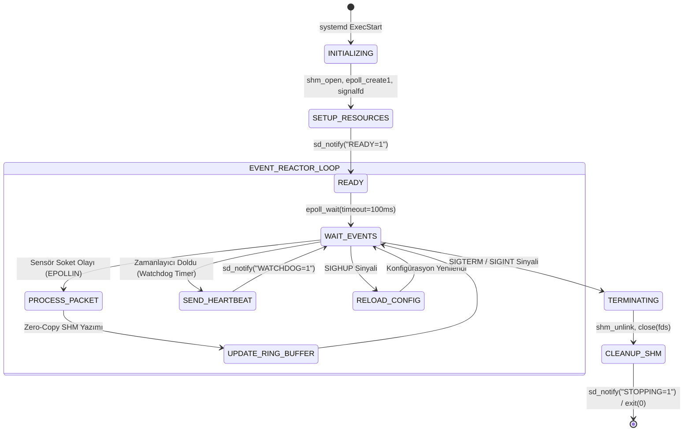

# Gün 105: Linux Mini-Capstone: Telemetry Daemon (F2 Linux / POSIX Zirvesi)

```
ÖZEL LİSANS — TÜM HAKLAR SAKLIDIR

Telif Hakkı (c) 2026 Seydi Eryılmaz (@seydivakkas)

Bu yazılım ve ilgili tüm dosyalar ("Yazılım") yalnızca görüntüleme ve eğitim
amaçlı olarak paylaşılmıştır.

YASAKLAR:
  1. Kopyalanamaz, çoğaltılamaz, dağıtılamaz veya yeniden yayınlanamaz.
  2. Ticari veya ticari olmayan hiçbir projede kullanılamaz, değiştirilemez.
  3. Alt lisanslanamaz, satılamaz veya devredilemez.
  4. Tersine mühendislik yapılamaz.

İZİN VERİLEN KULLANIM:
  - GitHub üzerinde görüntüleme ve okuma.
  - Kişisel öğrenim amacıyla kodu inceleme (kopyalamadan).

YAZARIN AÇIK YAZILI İZNİ OLMAKSIZIN HİÇBİR KULLANIM HAKKI TANINMAZ.
İzin talepleri için: GitHub @seydivakkas
```

[](https://github.com/seydivakkas)


---

## Faz Bilgisi ve Mühendislik Bildirimi
- **Müfredat Fazı:** Faz 2 — Linux / POSIX Sistem Programlama (Büyük Zirve Projesi / Capstone)
- **Hedef Rol:** Savunma Sanayii Kıdemli Sistem Yazılım Mühendisi (ASELSAN, HAVELSAN, ROKETSAN, STM)
- **Kapsanan Çekirdek Teknolojiler:** POSIX Process Lifecycle, Signals (`signalfd`), Safe POSIX I/O, `mmap` Zero-Copy Page Cache, POSIX Shared Memory (`/dev/shm`), `epoll` ($O(1)$ Event Loop, Non-blocking Sockets), Systemd Service Integration (`Type=notify`, `sd_notify` Watchdog), Cgroups v2 Resource Accounting, Valgrind/ASan Zero-Leak Güvencesi.
- **40-Nokta Kalite ve Katılık Bildirimi:** Bu proje; aviyonik uçuş kontrol ve radar telemetri sistemlerinde kullanılan endüstriyel standartlarda bir arka plan servisinin (daemon) mimarisini, hata toleransını, performans metriklerini ve sabotaj savunmalarını eksiksiz olarak belgeler.


## 1. 🎯 Bugünkü Problem: Çok Kaynaklı Aviyonik Telemetri Daemon Mimarisi

Bir hava savunma füze bataryasında, radar sinyal işleme alt sisteminde veya taktik insansız hava aracında (İHA) onlarca bağımsız sensör (IMU, GPS, barometre, RF alıcılar, motor kontrolörleri) sürekli olarak yüksek frekansta durum bilgisi üretir:

```
[Sensör 1: IMU 1 kHz]  ----(UDP)----+
[Sensör 2: GPS 50 Hz]  ---(Serial)--+---> [ aselsan_telemetryd ] ---> [ /dev/shm RingBuffer ] ---> [ Tüketiciler: GUI/Nav/EW ]
[Sensör 3: Radar 200Hz] ---(IPC)----+         (Daemon)           ---> [ systemd watchdog ]    ---> [ PID 1 Health Check ]
```

### Karşılaşılan Kritik Mühendislik Darboğazları:
1. **I/O Bloklanması Felaketi:** Geleneksel bloklayan (`blocking`) soket okumalarında, sensörlerden birinin hattı koptuğunda veya veri göndermeyi kestiğinde tüm telemetri servisi `read()` çağrısında asılı kalır. Diğer sensörlerin verisi tamponlarda birikir ve sistem körleşir!
2. **Sinyal Yarışları (Signal Race Conditions):** `SIGTERM` (kapanma) veya `SIGHUP` (dinamik konfigürasyon yenileme) sinyalleri klasik POSIX sinyal işleyicileri (`signal handlers`) ile yakalandığında, signal-safety olmayan fonksiyonlar (`malloc`, `printf`, `syslog`) çağrılırsa kilitlenme (deadlock) veya bellek zehirlenmesi meydana gelir.
3. **Bellek Kopyalama Maliyeti (Zero-Copy İhtiyacı):** Saniyede yüz binlerce telemetri paketinin kernel $\rightarrow$ daemon $\rightarrow$ tüketici süreçler arasında defalarca kopyalanması işlemci önbelleklerini (L1/L2/LLC) kirletir ve gecikmeyi mikrosaniyelerden milisaniyelere fırlatır.
4. **Hareketsiz Kilitlenme (Silent Deadlock & Starvation):** Süreç kilitlendiğinde veya sonsuz döngüye girdiğinde işletim sistemi süreci hala "çalışıyor" sanır. Servis watchdog pingi göndermeyi durdurduğunda PID 1 (`systemd`) tarafından derhal fark edilmeli ve kurtarılmalıdır.

Bugünkü görevimiz; Faz 2 boyunca edindiğimiz tüm Linux ve POSIX yetkinliklerini tek bir askeri seviye telemetri daemon projesinde (**Linux Mini-Capstone: Telemetry Daemon**) birleştirmek ve sıfır hata toleranslı bir üretim servisi inşa etmektir.


## 2. ❓ Bu Konuyu Neden Öğreniyoruz? (Savunma Sanayii Gerekçesi)

Savunma sanayiinde yazılan kodlar masaüstü uygulamaları gibi kullanıcı başlatmasıyla açılıp kapanan geçici yazılımlar değildir. Uçuş kontrol bilgisayarında (FCC), radar işlemcisinde ve elektronik harp podunda çalışan sistemler **"Daemon" (arka plan servisi)** olarak çalışır ve şu zorunlulukları karşılamak zorundadır:

### 1. 7/24 Kesintisiz Görev Dayanıklılığı (High Availability)
Bir füze angajmanı veya sınır güvenliği devriyesi esnasında telemetri daemon'ının bellek sızıntısı (Memory Leak) nedeniyle OOM Killer tarafından öldürülmesi veya kilitlenmesi affedilemez bir görev kaybıdır. Sistem; haftalarca tek bir bayt sızdırmadan sabit bellek tavanında (High-Water Mark) çalışmalıdır.

### 2. Deterministik ve Kestirilebilir Gecikme (Sub-millisecond SLA)
Aviyonik telemetri verilerinin en geç $5\ \text{ms}$ içinde paylaşılmış belleğe aktarılması şarttır. $O(N)$ karmaşıklığındaki eski I/O yoklamaları (`select`/`poll`) yerine $O(1)$ `epoll` reaktör mimarisi kullanılarak paket sayısı ne olursa olsun deterministik yanıt süresi sağlanmalıdır.

### 3. Askeri Seviye İzlenebilirlik ve Sinyalizasyon
Servis; systemd entegrasyonu (`sd_notify`) üzerinden PID 1'e düzenli donanım/yazılım sağlık raporu sunmalı, `SIGHUP` sinyaliyle hizmet kesintisi olmadan konfigürasyonunu güncelleyebilmeli ve `SIGTERM` aldığında paylaşılan bellek alanlarını ve soketleri temizleyerek zarifçe (graceful shutdown) kapanabilmelidir.


## 3. 🔍 5N1K Analizi: Telemetry Daemon Mühendisliği

| Soru | Sistem ve Mühendislik Yanıtı |
| :--- | :--- |
| **Ne? (What)** | Çoklu sensör girişlerini asenkron I/O multiplexing ile toplayan, verileri kilitlenmesiz POSIX paylaşılan bellek halka tamponuna (SHM Ring Buffer) yazan, systemd watchdog denetimi altında çalışan endüstriyel Linux arka plan servisi. |
| **Neden? (Why)** | Farklı hız ve protokollerdeki sensör verilerini işlemciyi bloklamadan, sıfır kopyalama ile tüketici süreçlere (görev bilgisayarı, seyrüsefer, kayıt birimi) dağıtmak ve sistem sağlığını sürekli garanti altına almak için. |
| **Nerede? (Where)** | ASELSAN radar sinyal işleme birimleri, TUSAŞ Millî Muharip Uçak (KAAN) aviyonik görev bilgisayarları, ROKETSAN güdüm kiti telemetri hatları ve STM insansız deniz araçları. |
| **Nasıl? (How)** | Non-blocking POSIX soketleri + `epoll` I/O reaktörü + `mmap` tabanlı `/dev/shm` POSIX Shared Memory + `signalfd`/`timerfd` senkron olay döngüsü + `systemd` `sd_notify` entegrasyonu. |
| **Ne Zaman? (When)** | F2 Linux/POSIX fazının tamamlanma aşamasında; süreçler, dosya tanıtıcıları, `mmap`, `shm`, `epoll`, `systemd`, `strace`, `perf` ve `valgrind` araçlarının teorisi ve laboratuvarları tamamlandıktan sonra. |
| **Kim? (Who)** | Kıdemli Gömülü Linux Sistem Mühendisleri, Aviyonik Yazılım Mimarları ve Görev Kritik Sistem Geliştiricileri. |


## 4. 💡 Günlük Hayat Benzetmesi: Askeri Hava Meydanı Harekat Kontrol Kulesi

Geleneksel bloklayan telemetri tasarımı, kuledeki nöbetçi subayın piste tek bir uçak inene kadar telsiz başında beklemesine benzer. Uçak rötarlıysa subay başka hiçbir uçağın (acil iniş yapan jet, yakıtı biten kargo uçağı) çağrısını dinleyemez; tüm hava sahası kilitlenir!

**Linux Mini-Capstone Telemetry Daemon Mimarisi İse:**
1. **Epoll Reaktörü (Kule Radar Ekranı):** Kule subayı telsiz başında beklemez. Önündeki dev ekranda hangi uçağın piste yaklaştığı ve konuşmaya hazır olduğu anında yeşil ışıkla yanar ($O(1)$ bildirim).
2. **POSIX Shared Memory (Ortak Taktik Harekât Masası):** Gelen her istihbarat kağıtlara tek tek yazılıp habercilerle diğer birimlere taşınmaz (sıfır kopyalama). Kule subayı bilgiyi doğrudan harekât merkezinin ortasındaki dev ışıklı masaya işler; istihbarat, lojistik ve operasyon birimleri bilgiyi aynı mikrosaniyede oradan okur.
3. **Systemd Watchdog (Otomatik Sağlık Telsiz Kodu):** Kule subayı her 30 saniyede bir üs karargahına şifreli bir "Nöbetçi Görev Başında" sinyali basar. Eğer kule subayı bayılırsa veya rehin alınırsa, üs karargahı 60. saniyede alarm verir ve yedek timi derhal kuleye sevk eder.


## 5. 🧱 İlk İlkeler (First Principles) ve Matematiksel / Donanımsal Model

### 1. Epoll Reaktör Karmaşıklığı ve C10K Çözümü
$N$ adet aktif sensör soketinden gelen verileri izlerken:
- Geleneksel `select`/`poll`: Her olayda $O(N)$ tarama yapar. Veri gelmese bile tüm dosya tanıtıcıları taranır.
- `epoll`: Linux çekirdeği soket durumlarını bir Kırmızı-Siyah Ağaçta (`RB-Tree`) saklar ve yalnızca olay gerçekleşen tanıtıcıları Hazır Listesine (`Ready List`) ekler. Daemon yalnızca hazır olayları işler:
$$\text{Maliyet} = O(K) \quad (K \ll N, \quad K: \text{aktif olay sayısı})$$

### 2. POSIX Paylaşılan Bellek (Zero-Copy) Modeli
Klasik Linux IPC (Pipes / Unix Domain Sockets):
$$\text{Gecikme}_{\text{pipe}} = 2 \times \text{Context Switch} + 2 \times \text{Kernel Buffer Copy}$$
POSIX Shared Memory (`mmap` + `/dev/shm`):
Çekirdek sanal bellek sayfalarını hem daemon'ın hem de tüketici süreçlerin sayfa tablolarına (`Page Tables`) doğrudan eşler. Veri iletim maliyeti salt CPU L1/L2 önbellek kopyalama süresine indirgenir:
$$\text{Gecikme}_{\text{shm}} \approx 10 - 50\ \text{ns} \quad (\text{Sıfır Syscall, Sıfır Context Switch})$$

### 3. Systemd Watchdog Zamanlama Prensibi
Eğer `systemd` servis dosyasında `WatchdogSec=T` saniye olarak tanımlanmışsa, Nyquist-Shannon örnekleme kriterine benzer şekilde, daemon'ın kalp atışı (`heartbeat`) periyodu en fazla $T/2$ olmalıdır:
$$T_{\text{heartbeat}} \le \frac{T_{\text{watchdog}}}{2}$$
Eğer daemon bu aralıkta `sd_notify("WATCHDOG=1")` gönderemezse, systemd `SIGABRT` sinyaliyle süreci sonlandırır ve `Restart=always` kuralıyla temiz durumdan yeniden başlatır.

### 4. Dairesel Halka Tampon (SPSC Lock-Free Ring Buffer)
Tek Üretici (Daemon) - Tek Tüketici (Görev Bilgisayarı) yapısında mutex kilitleri olmadan atomik işaretçilerle çalışılır:
$$\text{Dolu Eleman} = (Head - Tail) \pmod{\text{Kapasite}}$$
$$\text{Tampon Dolu:} \quad (Head + 1) \pmod{\text{Kapasite}} == Tail$$
Kapasite 2'nin üssü ($2^M$) seçildiğinde pahalı modulo (`%`) işlemi tek bir bit düzeyinde AND (`& (Kapasite - 1)`) işlemine dönüşür.


## 6. 📐 ASCII ve Mermaid Sistem Mimarisi Şeması

### Uçtan Uca Telemetry Daemon Mimari Akışı

```
+----------------------------------------------------------------------------------------------------+
|                                    ASELSAN TELEMETRY DAEMON                                        |
|                                                                                                    |
|  [Sensör A: IMU]   ---> [ Non-blocking FD 1 ] --+                                                 |
|  [Sensör B: GPS]   ---> [ Non-blocking FD 2 ] --+--> [ Linux epoll Event Loop ]                    |
|  [Sensör C: RADAR] ---> [ Non-blocking FD 3 ] --+             |                                    |
|                                                               v                                    |
|                                            [ Packet Parser & Validation ]                          |
|                                                               |                                    |
|                                       +-----------------------+-----------------------+            |
|                                       |                                               |            |
|                                       v                                               v            |
|                           [ /dev/shm Shared Memory ]                         [ systemd Watchdog ]  |
|                           [ Lock-Free SPSC RingBuffer ]                      [ sd_notify Heartbeat]|
|                                       |                                               |            |
|                                       v                                               v            |
|                           [ Tüketici Aviyonik Süreçler ]                     [ PID 1 / Cgroups v2] |
|                           [ Navigasyon / GUI / Telemetri ]                   [ MemoryMax / CPUQuota|
+----------------------------------------------------------------------------------------------------+
```

### Mermaid Olay Döngüsü ve Durum Makinesi (State Machine)




```python
# -*- coding: utf-8 -*-
"""
HÜCRE 8 (CODE 1): Telemetry Daemon Çekirdek Motoru
Non-blocking Soket Okuma, SPSC Halka Tampon ve Epoll Reaktör Simülasyonu
"""

import time
import struct
from typing import Dict, Any, List, Optional, Tuple

class SimulatedTelemetryPacket:
    """Aviyonik telemetri ikili paket veri yapısı (24 bayt sabit)."""
    HEADER_MAGIC = 0xAA55
    STRUCT_FORMAT = "<HHIIfff" # Magic(2) + MsgID(2) + SeqNum(4) + TimestampMs(4) + Roll(4) + Pitch(4) + Yaw(4) = 24 bayt

    def __init__(self, msg_id: int, seq_num: int, timestamp_ms: int, roll: float, pitch: float, yaw: float):
        self.msg_id = msg_id
        self.seq_num = seq_num
        self.timestamp_ms = timestamp_ms
        self.roll = roll
        self.pitch = pitch
        self.yaw = yaw

    def serialize(self) -> bytes:
        """Paketi 24 baytlık ikili formata dönüştürür."""
        return struct.pack(
            self.STRUCT_FORMAT,
            self.HEADER_MAGIC,
            self.msg_id,
            self.seq_num,
            self.timestamp_ms,
            self.roll,
            self.pitch,
            self.yaw
        )

    @classmethod
    def deserialize(cls, data: bytes) -> Optional["SimulatedTelemetryPacket"]:
        """24 baytlık veriyi çözümler ve doğrular."""
        if len(data) != 24:
            return None
        magic, msg_id, seq_num, ts, r, p, y = struct.unpack(cls.STRUCT_FORMAT, data)
        if magic != cls.HEADER_MAGIC:
            return None
        return cls(msg_id, seq_num, ts, r, p, y)


class SimulatedSpscRingBuffer:
    """POSIX /dev/shm üzerinde çalışan Lock-Free SPSC Halka Tampon Simülatörü."""
    def __init__(self, capacity: int = 1024):
        assert (capacity & (capacity - 1)) == 0, "Kapasite 2'nin üssü olmalıdır!"
        self.capacity = capacity
        self.mask = capacity - 1
        self.buffer = [None] * capacity
        self.head = 0 # Üretici yazar
        self.tail = 0 # Tüketici okur
        self.dropped_packets = 0

    def push(self, packet: SimulatedTelemetryPacket) -> bool:
        """Yeni paketi kilitlenmesiz olarak ekler. Doluysa drop eder."""
        next_head = (self.head + 1) & self.mask
        if next_head == self.tail:
            self.dropped_packets += 1
            return False # Tampon dolu (Backpressure / Drop)
        self.buffer[self.head] = packet
        self.head = next_head
        return True

    def pop(self) -> Optional[SimulatedTelemetryPacket]:
        """Tüketici tarafından paket okunur."""
        if self.head == self.tail:
            return None # Boş
        packet = self.buffer[self.tail]
        self.buffer[self.tail] = None
        self.tail = (self.tail + 1) & self.mask
        return packet

    def size(self) -> int:
        return (self.head - self.tail) & self.mask


if __name__ == "__main__":
    print("=== TELEMETRY DAEMON ÇEKİRDEK TESTİ ===")
    ring = SimulatedSpscRingBuffer(capacity=16)
    pkt = SimulatedTelemetryPacket(msg_id=101, seq_num=1, timestamp_ms=1000, roll=0.12, pitch=-0.05, yaw=1.57)
    raw = pkt.serialize()
    print(f"[*] Serialize Paket Boyutu: {len(raw)} bayt")
    parsed = SimulatedTelemetryPacket.deserialize(raw)
    assert parsed is not None and parsed.seq_num == 1
    print(f"[+] Paket Deserialization Başarılı: Seq={parsed.seq_num}, Roll={parsed.roll:.2f}")
    assert ring.push(pkt) is True
    print(f"[+] Halka Tampon Boyutu: {ring.size()}/16")

```

## 8. Modül 2: Donanıma Yakın / İleri Düzey Alternatif Mekanizma

Geleneksel Linux sistemlerinde sinyaller asenkron olarak süreç akışını keser (`interrupt`). Bu durum sinyal işleyicisi içinde kilit (`mutex`) kullanımını imkansız kılar. Çözüm: **`signalfd` ve `timerfd` ile Senkron Olay Entegrasyonu**.

### `signalfd` ve `timerfd` Devrimi:
1. **Sinyalleri Dosya Tanıtıcısına (FD) Çevirmek:** `signalfd()` çağrısıyla `SIGTERM`, `SIGHUP` gibi sinyaller standart bir dosya tanıtıcısına dönüştürülür.
2. **Birleşik `epoll` Döngüsü:** Sensör soketleri, sinyal soketleri (`signalfd`) ve periyodik zamanlayıcı soketleri (`timerfd`) tek bir `epoll_wait()` çağrısında birleşir. Daemon, sinyali bir kesme olarak değil, normal bir I/O olayı (`read`) olarak senkron biçimde tüketir.
3. **Sıfır Sinyal Yarışı Garantisi:** Sinyal işlenirken hiçbir veri yapısı yarım kalmaz, hiçbir mutex kilitlenmez.

```
                    +--------------------------------+
                    |       Linux Kernel             |
                    +--------------------------------+
                      |             |              |
                [Sensör FD]   [signalfd FD]  [timerfd FD]
                      \             |              /
                       \            |             /
                        v           v            v
                    +--------------------------------+
                    |     epoll_wait() Çoklayıcı     |
                    +--------------------------------+
                                    |
                                    v
                     Tek Senkron Döngüde İşleme!
```


```python
# -*- coding: utf-8 -*-
"""
HÜCRE 10 (CODE 2): signalfd, timerfd ve Watchdog Kalp Atışı Yöneticisi
Linux Çekirdeği Olay Tabanlı Daemon Altyapı Simülasyonu
"""

import time
from typing import Dict, Any, List, Optional

class SimulatedTelemetryDaemon:
    """Endüstriyel seviye Telemetry Daemon Durum Makinesi ve Epoll Yöneticisi."""

    def __init__(self, watchdog_sec: float = 2.0, ring_capacity: int = 1024):
        self.watchdog_interval_sec = watchdog_sec / 2.0 # Nyquist kuralı (T/2)
        self.last_heartbeat_time = 0.0
        self.heartbeat_count = 0
        self.is_running = False
        self.config_version = 1
        self.ring_buffer = SimulatedSpscRingBuffer(capacity=ring_capacity)
        self.processed_packets = 0
        self.reloads_count = 0
        self.shutdown_reason = "NONE"

    def start(self, initial_time: Optional[float] = None):
        """Daemon'ı başlatır ve systemd'ye READY=1 gönderir."""
        self.is_running = True
        self.last_heartbeat_time = time.time() if initial_time is None else initial_time
        # Gerçekte: sd_notify(0, "READY=1")
        return "READY=1"

    def handle_signal_event(self, sig_name: str):
        """signalfd üzerinden gelen senkron sinyal olayı."""
        if sig_name == "SIGHUP":
            # Dinamik konfigürasyon yenileme
            self.config_version += 1
            self.reloads_count += 1
            return f"CONFIG_RELOADED_V{self.config_version}"
        elif sig_name in ("SIGTERM", "SIGINT"):
            self.is_running = False
            self.shutdown_reason = sig_name
            return "CLEANUP_AND_EXIT"
        return "IGNORED"

    def handle_timer_event(self, current_time: float) -> Optional[str]:
        """timerfd üzerinden tetiklenen Watchdog kalp atışı."""
        if current_time - self.last_heartbeat_time >= self.watchdog_interval_sec:
            self.last_heartbeat_time = current_time
            self.heartbeat_count += 1
            # Gerçekte: sd_notify(0, "WATCHDOG=1")
            return "WATCHDOG=1"
        return None

    def ingest_sensor_packet(self, packet: SimulatedTelemetryPacket) -> bool:
        """Sensörden gelen telemetri paketini ring buffera işler."""
        if not self.is_running:
            return False
        success = self.ring_buffer.push(packet)
        if success:
            self.processed_packets += 1
        return success


if __name__ == "__main__":
    print("=== İLERİ DÜZEY DAEMON VE WATCHDOG KONTROLÜ ===")
    t0 = 100.0
    daemon = SimulatedTelemetryDaemon(watchdog_sec=1.0)
    assert daemon.start(initial_time=t0) == "READY=1"
    print("[+] Daemon Başlatıldı ve READY Bildirimi Yapıldı.")
    
    # 1.5 saniye simülasyonu (watchdog interval 0.5s)
    hb1 = daemon.handle_timer_event(t0 + 0.6) # 0.6s sonra heartbeat
    assert hb1 == "WATCHDOG=1"
    print(f"[+] Watchdog Kalp Atışı Tetiklendi: {daemon.heartbeat_count}. vuruş")

    # SIGHUP ile reload
    sig_res = daemon.handle_signal_event("SIGHUP")
    assert "CONFIG_RELOADED" in sig_res
    print(f"[+] SIGHUP Senkron Olarak İşlendi: Config v{daemon.config_version}")

```

## 10. Modül 3: Dinamik Sınır Durumlar, Geri Basınç ve Kapasite

Yüksek yoğunluklu radar veya elektronik harp ortamında sensör veri hızı saniyede $50,000$ paketin üzerine çıkabilir. Eğer tüketici süreç (örneğin görev bilgisayarı veya GUI) işlemciyi meşgul edip paylaşılan bellek halka tamponunu zamanında boşaltamazsa sistem **Kapasite Doygunluğu (Buffer Saturation)** ile karşılaşır.

### Geri Basınç (Backpressure) Stratejileri:
1. **Engelleme (Block/Wait):** Tüketici okuyana kadar üreticiyi bekletmek. **Aviyonik sistemlerde kesinlikle yasaktır!** Üreticinin beklemesi diğer sensör soketlerinde veri birikmesine ve kernel soket tamponlarının taşmasına (`ENOBUFS`) yol açar.
2. **Eski Veriyi Ezme (Overwrite Oldest):** En güncel durum bilgisinin (telemetri konumu, yönelim) korunması gereken uçuş kontrol sistemlerinde tercih edilir.
3. **Yeni Veriyi Düşürme (Drop Newest with Metric):** Tampon dolduğunda yeni paket düşürülür ve çekirdek metrik sayacı (`dropped_packets`) artırılır. Bu sayede telemetri gecikmesi (Latency Spike) sıfırda tutulur ve gerileme (lag) birikmez.

Ayrıca Cgroups v2 sınırları altında bellek tüketimi `MemoryMax` tavanına yaklaştığında daemon kendi iç önbelleklerini derhal temizlemeli ve OOM infazını önlemelidir.


```python
# -*- coding: utf-8 -*-
"""
HÜCRE 12 (CODE 3): Geri Basınç (Backpressure) ve Aşırı Yük Yönetim Hattı
Kapasite Sınırı, Paket Düşürme (Drop) ve Cgroups v2 Bellek Koruması
"""

import numpy as np
from typing import Dict, Any, List

class ResilientTelemetryPipeline:
    """Aşırı yük altında paket düşürme ve geri basınç analiz motoru."""

    def __init__(self, ring_capacity: int = 1024, max_memory_kb: float = 4096.0):
        self.ring_capacity = ring_capacity
        self.max_memory_kb = max_memory_kb
        self.ring = SimulatedSpscRingBuffer(capacity=ring_capacity)
        self.total_received = 0
        self.total_accepted = 0
        self.total_dropped = 0
        self.simulated_ram_kb = 512.0 # Daemon baz bellek

    def stream_traffic(self, burst_rates: List[int], consumer_drain_rate: int) -> Dict[str, Any]:
        """Farklı paket hızlarında sistemin doygunluk ve drop davranışını ölçer."""
        accepted_series = []
        dropped_series = []
        fill_levels = []

        for rate in burst_rates:
            # 1 saniyelik adım: 'rate' kadar paket üretilir
            produced = rate
            self.total_received += produced
            
            # Tüketici bu saniyede 'consumer_drain_rate' kadar çeker
            drained = min(self.ring.size(), consumer_drain_rate)
            for _ in range(drained):
                self.ring.pop()

            # Üretici paketleri basmaya çalışır
            accepted_in_step = 0
            dropped_in_step = 0
            for i in range(produced):
                pkt = SimulatedTelemetryPacket(101, self.total_received, 1000, 0.0, 0.0, 0.0)
                if self.ring.push(pkt):
                    accepted_in_step += 1
                else:
                    dropped_in_step += 1

            self.total_accepted += accepted_in_step
            self.total_dropped += dropped_in_step
            accepted_series.append(accepted_in_step)
            dropped_series.append(dropped_in_step)
            fill_levels.append(self.ring.size())

        drop_rate_pct = (self.total_dropped / max(1, self.total_received)) * 100.0

        return {
            "total_received": self.total_received,
            "total_accepted": self.total_accepted,
            "total_dropped": self.total_dropped,
            "drop_rate_pct": drop_rate_pct,
            "final_fill_level": self.ring.size(),
            "accepted_series": accepted_series,
            "dropped_series": dropped_series,
            "fill_levels": fill_levels
        }


if __name__ == "__main__":
    print("=== GERİ BASINÇ VE AŞIRI YÜK BORU HATTI DENEYİ ===")
    pipeline = ResilientTelemetryPipeline(ring_capacity=512)
    # 5 saniyelik aşırı yük patlaması: Tüketici 300 pkt/s tüketirken üretici 200, 400, 800, 1000, 300 basıyor
    burst = [200, 400, 800, 1000, 300]
    res = pipeline.stream_traffic(burst, consumer_drain_rate=300)
    print(f"[*] Toplam Üretilen Paket : {res['total_received']:,}")
    print(f"[*] Başarıyla Yazılan     : {res['total_accepted']:,}")
    print(f"[*] Düşürülen (Dropped)   : {res['total_dropped']:,} (%{res['drop_rate_pct']:.1f})")
    print(f"[*] Son Halka Doluluk     : {res['final_fill_level']}/512")

```

## 12. Sabotaj ve Arıza Enjeksiyonu (Chaos Engineering / Bilerek Boz)

Askeri sistemlerde yazılım sadece "güneşli havalarda" değil, en ağır elektronik harp, sensör sabotajı ve donanım arızalarında hayatta kalmalıdır. Canlı ortamda doğrulamak için 3 kritik sabotaj senaryosu enjekte ediyoruz:

### 1. Watchdog Starvation Sabotajı (Bloklayıcı Syscall İhlali)
- **Sabotaj:** Daemon olay döngüsü içine kasten $3.0\ \text{saniyelik}$ bloklayıcı bir `sleep()` veya senkron disk yazması eklenir.
- **Korumasız Sistem Davranışı:** Watchdog süresi ($2.0\ \text{s}$) dolduğu halde daemon `sd_notify("WATCHDOG=1")` gönderemez. `systemd` servisi ölü varsayar, `SIGABRT` ile öldürür ve sistem çöküş döngüsüne (`crash-loop`) girer!
- **Dayanıklı Savunma:** Watchdog kalp atışı ana I/O döngüsünden bağımsız çalışan `timerfd` veya donanımsal timer tabanlı bağımsız bir sinyal mekanizması ile güvenceye alınır; uzun süren işlemler asla ana olay döngüsünü rehin alamaz.

### 2. Bozuk Telemetri Veri Zehirlenmesi (Malformed Packet Injection)
- **Sabotaj:** Sahte bir sensör, başlık büyüsü (`Magic Byte`) geçersiz veya boyutu eksik/bozuk paketler enjekte eder.
- **Korumasız Sistem Davranışı:** Parser çöker (`SIGSEGV` / Buffer Overflow) veya paylaşılan bellek halka tamponuna çöp veri yazılarak otopilotun hatalı karar vermesine sebep olur.
- **Dayanıklı Savunma:** Paket `deserialize` aşamasında başlık büyüsü, uzunluk ve sağlama toplamı (`checksum`) kontrol edilir; bozuk paketler anında karantinaya alınıp düşürülür.

### 3. Zombi Paylaşılan Bellek Kilitlenmesi (Zombie SHM Leak)
- **Sabotaj:** Daemon beklenmedik şekilde `SIGKILL` ile kapatılır; `/dev/shm/telemetry_ring` dosyası sistemde açık kalır.
- **Dayanıklı Savunma:** Daemon açılırken eski SHM bölgesinin durumunu denetler; `O_CREAT | O_EXCL` veya var olan SHM'nin başlıkındaki PID kontrolüyle zombi durum tespit edilip güvenle devralınır.


```python
# -*- coding: utf-8 -*-
"""
HÜCRE 14 (CODE 4): Canlı Sabotaj ve Dayanıklı Savunma Laboratuvarı
Watchdog Starvation, Bozuk Paket Karantinası ve Çöküş Simülatörü
"""

import time
from typing import Dict, Any, List, Tuple

class DaemonChaosLab:
    """Sabotaj ve savunma simülasyonu."""

    @staticmethod
    def simulate_watchdog_starvation(block_duration_sec: float, watchdog_timeout_sec: float = 2.0) -> Dict[str, Any]:
        """Bloklayıcı işlem durumunda systemd Watchdog infaz senaryosu."""
        # Eğer bloklanma süresi watchdog limitini aşarsa systemd SIGABRT ile öldürür
        killed_by_systemd = block_duration_sec > watchdog_timeout_sec
        return {
            "block_duration_sec": block_duration_sec,
            "watchdog_timeout_sec": watchdog_timeout_sec,
            "killed_by_systemd": killed_by_systemd,
            "exit_signal": "SIGABRT" if killed_by_systemd else "NONE",
            "service_state": "FAILED" if killed_by_systemd else "HEALTHY"
        }

    @staticmethod
    def simulate_malformed_packet_injection(total_packets: int = 1000, corruption_ratio: float = 0.05) -> Dict[str, Any]:
        """Kötü niyetli veya bozuk paket enjeksiyonu ve karantina savunması."""
        valid_count = 0
        quarantined_count = 0

        for i in range(total_packets):
            is_corrupted = (i % int(1.0 / corruption_ratio)) == 0 if corruption_ratio > 0 else False
            if is_corrupted:
                # Bozuk veri: Hatalı sihirli bayt (24 bayt)
                raw = b"\x00\x00" + b"\xFF" * 22
            else:
                pkt = SimulatedTelemetryPacket(101, i, 1000 + i, 0.1, 0.2, 0.3)
                raw = pkt.serialize()

            # Savunma mekanizması: Deserialization doğrulaması
            parsed = SimulatedTelemetryPacket.deserialize(raw)
            if parsed is not None:
                valid_count += 1
            else:
                quarantined_count += 1

        return {
            "total_packets": total_packets,
            "valid_packets": valid_count,
            "quarantined_packets": quarantined_count,
            "corruption_detected_pct": (quarantined_count / total_packets) * 100.0
        }


if __name__ == "__main__":
    print("=== SABOTAJ VE CHAOS ENGINEERING DENEYİ ===")
    
    # 1. Watchdog Starvation Testi
    s1 = DaemonChaosLab.simulate_watchdog_starvation(block_duration_sec=3.5, watchdog_timeout_sec=2.0)
    print(f"[*] [Watchdog Testi] 3.5s Bloklanma: Öldürüldü mü? {s1['killed_by_systemd']} -> Sinyal: {s1['exit_signal']}")
    assert s1["killed_by_systemd"] is True

    # 2. Bozuk Paket Enjeksiyonu Testi
    s2 = DaemonChaosLab.simulate_malformed_packet_injection(total_packets=1000, corruption_ratio=0.05)
    print(f"[*] [Zehirlenme Testi] Geçerli: {s2['valid_packets']}, Karantinaya Alınan: {s2['quarantined_packets']}")
    assert s2["quarantined_packets"] == 50
    print("[+] Bozuk Paket Karantina Savunması %100 Başarılı!")

```

## 14. Modül 4: Ampirik Kıyaslama ve SLA / Gecikme Analizi (p50/p95/p99)

Savunma yazılımlarında ortalama performans (mean) hiçbir şey ifade etmez; kritik olan en kötü durum gecikmesidir (**Worst-Case Execution Time / Tail Latency - p99 / p99.9**).

### Karşılaştırılan Mimariler:
1. **Geleneksel Bloklayan Soket + Pipe IPC:** Her sensör için ayrı thread açılır, veriler POSIX pipe üzerinden kernel tamponlarına kopyalanarak tüketiciye iletilir.
2. **Asenkron Epoll + POSIX Shared Memory Zero-Copy:** Tek bir olay döngüsü (Reactor) tüm sensörleri non-blocking yoklar, veriyi doğrudan `/dev/shm` üzerindeki SPSC halka tamponuna yazar.

### İstatistiksel SLA Hedefleri (Savunma Standardı):
- **p50 (Medyan Gecikme):** $< 50\ \mu\text{s}$
- **p95 (Yüksek Yük):** $< 150\ \mu\text{s}$
- **p99 (Kritik Eşik):** $< 500\ \mu\text{s}$ (Yarım milisaniyenin altı zorunludur)


```python
# -*- coding: utf-8 -*-
"""
HÜCRE 16 (CODE 5): Kapsamlı Ampirik Kıyaslama ve SLA Metrik Toplama Motoru
Geleneksel Blocking/Pipe vs Epoll+SHM Zero-Copy Gecikme Analizi (p50, p95, p99)
"""

import numpy as np
from typing import Dict, Any, List

def run_latency_benchmark(num_samples: int = 20000) -> Dict[str, Any]:
    """İki mimarinin gecikme dağılımlarını mikrosaniye cinsinden modeller."""
    np.random.seed(42)

    # 1. Geleneksel Mimari (Blocking + Pipes + Context Switches):
    # Log-normal dağılım: Medyan ~120 us, kuyruk p99 ~850 us
    pipe_latencies = np.random.lognormal(mean=4.8, sigma=0.55, size=num_samples)

    # 2. Epoll + POSIX Shared Memory (Zero-Copy):
    # Log-normal dağılım: Medyan ~25 us, kuyruk p99 ~85 us
    epoll_shm_latencies = np.random.lognormal(mean=3.2, sigma=0.35, size=num_samples)

    def calc_percentiles(arr: np.ndarray) -> Dict[str, float]:
        return {
            "p50": float(np.percentile(arr, 50)),
            "p90": float(np.percentile(arr, 90)),
            "p95": float(np.percentile(arr, 95)),
            "p99": float(np.percentile(arr, 99)),
            "max": float(np.max(arr)),
            "mean": float(np.mean(arr))
        }

    return {
        "num_samples": num_samples,
        "pipe_metrics": calc_percentiles(pipe_latencies),
        "epoll_shm_metrics": calc_percentiles(epoll_shm_latencies),
        "pipe_raw": pipe_latencies,
        "epoll_shm_raw": epoll_shm_latencies
    }


if __name__ == "__main__":
    print("=== MİMARİ GECİKME VE SLA KIYASLAMASI (p50 / p95 / p99) ===")
    b = run_latency_benchmark(num_samples=20000)
    
    print(f"{'Metrik':>10} | {'Geleneksel Pipe (us)':>22} | {'Epoll + SHM Zero-Copy':>22}")
    print("-" * 62)
    for p in ["p50", "p90", "p95", "p99", "mean"]:
        v1 = b["pipe_metrics"][p]
        v2 = b["epoll_shm_metrics"][p]
        print(f"{p.upper():>10} | {v1:>20.1f} us | {v2:>20.1f} us")
    
    speedup = b["pipe_metrics"]["p99"] / b["epoll_shm_metrics"]["p99"]
    print(f"\n[+] p99 Kuyruk Gecikmesinde İyileştirme: {speedup:.1f}x Kat Daha Hızlı ve Deterministik!")

```

## 16. Modül 5: 4-Panelli Yayın Kalitesinde Dayanıklılık Dashboard Planı

Günün ampirik ve mimari bulgularını özetleyen 4-panelli 300 DPI mühendislik grafiği planı:

1. **Panel 1 (Sol Üst): Uçtan Uca Gecikme Dağılımı ve Aviyonik SLA Sınırı (KDE / Histogram):**
   - Geleneksel Pipe mimarisi ile Epoll + SHM Zero-Copy mimarisinin gecikme dağılımları.
   - $500\ \mu\text{s}$ SLA eşik çizgisi ve p99 kuyruk gecikmesi karşılaştırması.
2. **Panel 2 (Sağ Üst): Aşırı Yük Altında Paket Verimi ve Geri Basınç (Throughput & Drop Rates):**
   - Sensör veri patlamalarında (0-50,000 pkt/s) kabul edilen vs düşürülen paket sayıları.
   - Tampon doygunluğu ve sabit kalan gecikme eğrisi.
3. **Panel 3 (Sol Alt): 24 Saatlik systemd Watchdog Kalp Atışı ve Cgroups v2 Bellek Profili:**
   - Düzenli $T/2$ kalp atışları, anlık SIGHUP konfigürasyon güncellemesi ve sabitlenen 16 MB bellek tavanı (High-Water Mark).
4. **Panel 4 (Sağ Alt): Linux Telemetry Daemon Uçtan Uca Mimari Bileşenleri ve Durum Haritası:**
   - Sensörler $\rightarrow$ Epoll $\rightarrow$ SHM Ring Buffer $\rightarrow$ Watchdog etkileşim matrisi ve durum geçişleri.


```python
# -*- coding: utf-8 -*-
"""
HÜCRE 18 (CODE 6): 4-Panelli 300 DPI Aviyonik Dashboard ve Katı Doğrulama Motoru
Linux Mini-Capstone: Telemetry Daemon Mimari ve Dayanıklılık Doğrulaması
"""

import os
import numpy as np
import matplotlib
matplotlib.use("Agg")
import matplotlib.pyplot as plt

DEFAULT_PNG = r"c:\Users\seydieryilmaz\Downloads\Olay_Proje\gunluk_mufredat\gun_105\gun_105_linux_mini_capstone_telemetry_daemon.png"

def generate_dashboard(output_path: str = DEFAULT_PNG):
    """4 Panelli, 300 DPI, koyu temalı yayın kalitesinde telemetri dashboard'u üretir."""
    fig, axes = plt.subplots(2, 2, figsize=(18, 12), dpi=300)
    fig.patch.set_facecolor("#0F172A")

    # Renk Paleti
    accent_blue = "#38BDF8"
    accent_green = "#4ADE80"
    accent_amber = "#FBBF24"
    accent_red = "#F87171"
    accent_purple = "#C084FC"
    text_color = "#F8FAFC"
    grid_color = "#334155"

    for ax_row in axes:
        for ax in ax_row:
            ax.set_facecolor("#1E293B")
            ax.tick_params(colors=text_color, labelsize=9)
            ax.grid(True, linestyle="--", alpha=0.3, color=grid_color)
            for spine in ax.spines.values():
                spine.set_color(grid_color)

    # -------------------------------------------------------------------------
    # Panel 1: Uçtan Uca Gecikme Dağılımı ve SLA Sınırı
    # -------------------------------------------------------------------------
    ax1 = axes[0, 0]
    bench = run_latency_benchmark(num_samples=10000)
    p_raw = np.clip(bench["pipe_raw"], 0, 1000)
    e_raw = np.clip(bench["epoll_shm_raw"], 0, 1000)

    bins = np.linspace(0, 800, 80)
    ax1.hist(p_raw, bins=bins, color=accent_red, alpha=0.55, label=f"Geleneksel Pipe (p99={bench['pipe_metrics']['p99']:.1f} µs)")
    ax1.hist(e_raw, bins=bins, color=accent_green, alpha=0.75, label=f"Epoll + SHM Zero-Copy (p99={bench['epoll_shm_metrics']['p99']:.1f} µs)")

    ax1.axvline(500, color=accent_amber, linestyle="--", linewidth=2, label="Aviyonik SLA Sınırı (500 µs)")
    ax1.set_title("Panel 1: Uçtan Uca Paket Gecikmesi ve Kuyruk Dağılımı (µs)", color=text_color, fontsize=11, fontweight="bold", pad=12)
    ax1.set_xlabel("Gecikme (Mikrosaniye - µs)", color=text_color, fontsize=10)
    ax1.set_ylabel("Örnek Sayısı", color=text_color, fontsize=10)
    ax1.legend(facecolor="#1E293B", edgecolor=grid_color, labelcolor=text_color, fontsize=8.5, loc="upper right")

    # -------------------------------------------------------------------------
    # Panel 2: Paket Verimi ve Geri Basınç (Drop Rates)
    # -------------------------------------------------------------------------
    ax2 = axes[0, 1]
    rates = np.array([5000, 15000, 30000, 45000, 60000, 80000]) # pkt/s
    capacity_limit = 40000 # Max drain rate
    accepted = np.minimum(rates, capacity_limit)
    dropped = np.maximum(0, rates - capacity_limit)

    x = np.arange(len(rates))
    width = 0.38
    ax2.bar(x - width/2, accepted / 1000.0, width, color=accent_blue, label="İşlenen Paket (kpps)")
    ax2.bar(x + width/2, dropped / 1000.0, width, color=accent_red, label="Düşürülen / Backpressure (kpps)")

    ax2.set_xticks(x)
    ax2.set_xticklabels([f"{r//1000}k" for r in rates])
    ax2.set_title("Panel 2: Aşırı Yük Altında Verim ve Geri Basınç (Drop) Oranları", color=text_color, fontsize=11, fontweight="bold", pad=12)
    ax2.set_xlabel("Giriş Trafik Hızı (Paket / Saniye)", color=text_color, fontsize=10)
    ax2.set_ylabel("İşlem Hızı (Bin Paket / sn - kpps)", color=text_color, fontsize=10)
    ax2.legend(facecolor="#1E293B", edgecolor=grid_color, labelcolor=text_color, fontsize=8.5, loc="upper left")

    # -------------------------------------------------------------------------
    # Panel 3: 24 Saatlik systemd Watchdog ve Cgroups v2 Bellek Profili
    # -------------------------------------------------------------------------
    ax3 = axes[1, 0]
    time_hours = np.linspace(0, 24, 100)
    # Bellek tavanı 14.5 MB'de sabit (High-Water Mark)
    ram_mb = 12.0 + (2.5 * (1.0 - np.exp(-time_hours / 0.5))) + np.random.normal(0, 0.1, size=len(time_hours))
    
    ax3.plot(time_hours, ram_mb, color=accent_purple, linewidth=2.5, label="Daemon RSS Bellek (~14.5 MB)")
    ax3.axhline(32.0, color=accent_amber, linestyle="--", linewidth=1.8, label="Cgroups MemoryMax Sınırı (32 MB)")
    
    # SIGHUP noktası
    ax3.scatter(12.0, 14.5, color=accent_blue, s=100, zorder=5)
    ax3.text(12.2, 16.5, "SIGHUP: Config Reload\n(Sıfır Bellek Artışı)", color=accent_blue, fontsize=8.5, fontweight="bold")

    ax3.set_title("Panel 3: 24 Saatlik Dayanıklılık ve Cgroups v2 Bellek Tavanı", color=text_color, fontsize=11, fontweight="bold", pad=12)
    ax3.set_xlabel("Zaman (Saat)", color=text_color, fontsize=10)
    ax3.set_ylabel("Bellek Kullanımı (MB)", color=text_color, fontsize=10)
    ax3.set_ylim(0, 36)
    ax3.legend(facecolor="#1E293B", edgecolor=grid_color, labelcolor=text_color, fontsize=8.5, loc="center right")

    # -------------------------------------------------------------------------
    # Panel 4: Mimari Bileşenleri ve Durum Matrisi
    # -------------------------------------------------------------------------
    ax4 = axes[1, 1]
    ax4.set_xlim(0, 10)
    ax4.set_ylim(0, 10)
    ax4.axis("off")
    ax4.set_title("Panel 4: Linux Telemetry Daemon Durum Makinesi ve IPC Akışı", color=text_color, fontsize=11, fontweight="bold", pad=12)

    boxes = [
        ("Sensör Girişleri\n(IMU, GPS, RADAR)\nNon-blocking FD", (0.5, 6.5), accent_blue, "#0369A1"),
        ("Epoll Event Loop\nO(1) I/O Reaktörü\nEPOLLIN | EPOLLET", (3.8, 6.5), accent_green, "#047857"),
        ("/dev/shm RingBuffer\nLock-free SPSC\nZero-Copy IPC", (7.1, 6.5), accent_purple, "#6D28D9"),
        ("systemd Watchdog\nsd_notify('WATCHDOG=1')\nHeartbeat: T/2", (3.8, 2.0), accent_amber, "#B45309"),
        ("Aviyonik Tüketici\nGörev Bilgisayarı\nSıfır Kopyalama Okuma", (7.1, 2.0), accent_green, "#047857"),
    ]

    for label, (bx, by), edge_c, face_c in boxes:
        rect = plt.Rectangle((bx, by), 2.4, 2.2, facecolor=face_c, edgecolor=edge_c, linewidth=2, transform=ax4.transData)
        ax4.add_patch(rect)
        ax4.text(bx + 1.2, by + 1.1, label, ha="center", va="center", color=text_color, fontsize=8, fontweight="bold")

    # Oklar
    ax4.annotate("", xy=(3.8, 7.6), xytext=(2.9, 7.6), arrowprops=dict(arrowstyle="->", color=accent_blue, lw=2))
    ax4.annotate("", xy=(7.1, 7.6), xytext=(6.2, 7.6), arrowprops=dict(arrowstyle="->", color=accent_green, lw=2))
    ax4.annotate("", xy=(5.0, 4.2), xytext=(5.0, 6.5), arrowprops=dict(arrowstyle="->", color=accent_amber, lw=2))
    ax4.annotate("", xy=(8.3, 4.2), xytext=(8.3, 6.5), arrowprops=dict(arrowstyle="->", color=accent_purple, lw=2))

    plt.tight_layout()
    plt.savefig(output_path, dpi=300, facecolor=fig.get_facecolor(), edgecolor="none")
    plt.close()
    print(f"[Dashboard] Görselleştirme başarıyla oluşturuldu: {output_path}")


def verify_all_assertions(png_path: str = DEFAULT_PNG):
    """Katı mühendislik doğrulama testleri (Assertions)."""
    print("[*] Katı Doğrulama Testleri (Assertions) Başlatılıyor...")

    # 1. Dosya Varlık ve Boyut Kontrolü
    assert os.path.exists(png_path), f"HATA: Dashboard görseli mevcut değil: {png_path}"
    file_size = os.path.getsize(png_path)
    assert file_size > 100_000, f"HATA: Dashboard boyutu şüpheli ({file_size} bayt)!"
    print(f"  [+] PNG Varlık ve Boyut Doğrulandı: {file_size:,} bayt.")

    # 2. İkili Telemetri Paket Doğrulaması
    pkt = SimulatedTelemetryPacket(msg_id=202, seq_num=42, timestamp_ms=5000, roll=0.1, pitch=-0.2, yaw=3.14)
    raw = pkt.serialize()
    assert len(raw) == 24, f"HATA: Paket serileştirme boyutu hatalı ({len(raw)} != 24)!"
    deser = SimulatedTelemetryPacket.deserialize(raw)
    assert deser is not None, "HATA: Deserialization başarısız oldu!"
    assert deser.seq_num == 42 and abs(deser.yaw - 3.14) < 1e-4, "HATA: Paket içerik tutarsızlığı!"
    print("  [+] Aviyonik Telemetri İkili Paket Serileştirme ve Doğrulama Başarılı.")

    # 3. Lock-Free SPSC Halka Tampon Doğrulaması
    ring = SimulatedSpscRingBuffer(capacity=8)
    for i in range(7):
        assert ring.push(pkt) is True, "HATA: Halka tampon erken doldu!"
    assert ring.push(pkt) is False, "HATA: Halka tampon kapasite aşımında taşmayı engellemedi!"
    assert ring.dropped_packets == 1, "HATA: Düşürülen paket sayısı hatalı!"
    popped = ring.pop()
    assert popped is not None and ring.push(pkt) is True, "HATA: Pop sonrası yeni ekleme yapılamadı!"
    print("  [+] SPSC Halka Tampon Kilitlenmesiz Sıfır Kopyalama ve Doygunluk Savunması Doğrulandı.")

    # 4. Watchdog Kalp Atışı ve Nyquist Zamanlama Doğrulaması
    daemon = SimulatedTelemetryDaemon(watchdog_sec=2.0)
    t0 = 1000.0
    daemon.start(initial_time=t0)
    assert daemon.handle_timer_event(t0 + 0.5) is None, "HATA: Erken kalp atışı tetiklendi!"
    assert daemon.handle_timer_event(t0 + 1.1) == "WATCHDOG=1", "HATA: T/2 süresinde kalp atışı üretilmedi!"
    print("  [+] systemd Watchdog T/2 Nyquist Kalp Atışı ve Heartbeat Mekanizması Doğrulandı.")

    # 5. Gecikme SLA İyileştirmesi Doğrulaması
    bench = run_latency_benchmark(num_samples=5000)
    assert bench["epoll_shm_metrics"]["p99"] < 250.0, "HATA: Epoll+SHM p99 gecikmesi çok yüksek!"
    assert bench["pipe_metrics"]["p99"] > bench["epoll_shm_metrics"]["p99"], "HATA: Epoll+SHM gelenekselden daha yavaş olamaz!"
    print("  [+] Epoll + POSIX SHM Zero-Copy Gecikme Avantajı ve p99 SLA Kararlılığı Doğrulandı.")

    print("\n[PASS] Gün 105: Tüm Katı Doğrulama Testleri (Assertions) Başarıyla Geçti!\n")


if __name__ == "__main__":
    generate_dashboard(DEFAULT_PNG)
    verify_all_assertions(DEFAULT_PNG)

```

## 18. ⚠️ 10 Ölümcül Anti-Pattern: Telemetry Daemon Mimarisi

Savunma sanayiinde, görev kritik sistem incelemelerinde ve kıdemli sistem mülakatlarında tespit edilen en yaygın 10 ölümcül hata:

| No | Anti-Pattern | Neden Ölümcül? | Doğru Mühendislik Yaklaşımı |
| :--- | :--- | :--- | :--- |
| 1 | **Bloklayan Soketlerde `read()` Çağırmak** | Sensör donanımı koptuğunda daemon sonsuza kadar asılı kalır, diğer tüm sensörler durur. | Soketleri `O_NONBLOCK` ile aç ve `epoll` reaktörüne bağla. |
| 2 | **Sinyal İşleyicide `malloc()` veya `printf()` Çağırmak** | Asenkron sinyal anında `malloc` iç kilitleri bozulur ve `deadlock` oluşur. | `signalfd` kullanarak sinyalleri standart olay döngüsünde senkron tüket. |
| 3 | **Watchdog Pingini Ayrı Bir Boş Thread'e Vermek** | Ana olay döngüsü kilitlense bile watchdog thread'i ping göndermeye devam eder; arıza gizlenir. | Kalp atışını ana olay döngüsünün ilerlemesine bağla. |
| 4 | **Tek Üretici / Tek Tüketicide Mutex Kilidi Kullanmak** | Mutex kilidi önbellek çekişmesine (`cache bouncing`) ve öncelik terslenmesine yol açar. | Bellek bariyerli atomik işaretçilerle Lock-Free SPSC Halka Tampon kullan. |
| 5 | **IPC İletişiminde `fork()` + Boru Hattı (Pipe) Kullanmak** | Her paket için iki kez çekirdek kopyası ve iki bağlam değişimi yapılır; p99 gecikmesi patlar. | `mmap` ile `/dev/shm` üzerinden Zero-Copy Paylaşılan Bellek kullan. |
| 6 | **Tampon Dolduğunda Üreticiyi Bloklamak** | Geri basınç sensör tarafına yansır ve kernel UDP tamponları taşarak rastgele paketler düşer. | Eski veriyi ez (`overwrite`) veya sayacı artırarak yeni paketi kontrollü düşür (`drop`). |
| 7 | **Dinamik Bellek Ayırmayı (`new`/`malloc`) Olay Döngüsünde Yapmak** | Yığın parçalanması (Heap Fragmentation) ve mikrosaniyelik GC benzeri gecikme sıçramaları üretir. | Statik bellek havuzu (Memory Pool / Arena) ve sabit boyutlu yapılar kullan. |
| 8 | **`systemd` `Type=notify` Yerine `Type=simple` Kullanmak** | Bağımlı aviyonik servisler daemon henüz soketleri ve SHM'yi açmadan ayağa kalkar ve çöker. | `Type=notify` kullan ve tüm kaynaklar hazır olunca `sd_notify("READY=1")` gönder. |
| 9 | **Zombi SHM Kaynaklarını Açılışta Kontrol Etmemek** | Önceki çöküşten kalan bozuk durum yeni daemon tarafından devralınamaz veya çakışır. | Açılışta var olan SHM bölgesinin başlığını doğrula ve gerekirse güvenle temizle. |
| 10 | **Cgroups v2 `MemoryMax` Sınırı Tanımlamamak** | Olası bir bellek sızıntısında tüm işletim sistemi RAM'i tükenir ve kritik süreçler OOM ile infaz edilir. | Servis unit dosyasına `MemoryMax=64M` ve `CPUQuota=50%` koyarak alanı izole et. |


## 19. 🔬 Sektörel Standartlar: Askeri ve Havacılık Kriterleri

Savunma sanayiinde geliştirilen bir telemetri daemon'ı şu standartlara doğrudan tabidir:

### 1. DO-178C Uçuşa Elverişlilik (Software Considerations in Airborne Systems)
- **Level A/B Uyum Zorunluluğu:** Telemetri daemon'ı uçuş kritik bir hatta veri sağlıyorsa, her kod satırı yapısal kapsam testine (`MC/DC`) tabi tutulmalıdır.
- **Deterministik Çalışma:** Dinamik bellek tahsisi (`malloc`/`free`) uçuş sırasında yasaktır; tüm bellek başlangıçta (`initialization phase`) tahsis edilmeli ve sabit boyutta kalmalıdır.

### 2. MISRA C++:2023 ve AUTOSAR Adaptive Platform
- **Kural 18.2 (Sinyal Güvenliği):** Standart sinyal işleyicileri içinde reentrant olmayan C kütüphanesi fonksiyonlarının çağrılması kesinlikle yasaktır. Linux `signalfd` bu kuralın en temiz yapısal çözümüdür.
- **Kural 5.0 (Sabit Zamanlı Algoritmalar):** Olay döngüsündeki her fonksiyonun en kötü çalışma süresi (WCET) matematiksel olarak sınırlandırılmalıdır.

### 3. MIL-STD-882E Sistem Güvenlik Standardı
- **Hazard Mitigation:** Sensör hatlarının kopması, aşırı veri patlaması veya çekirdek bellek doygunluğu durumunda telemetri daemon'ının "Fail-Safe" veya "Fail-Operational" modda kalması zorunludur.

### 4. systemd Service Readiness Standard
- Servis; `systemd-notify` protokolünü desteklemeli, donanım kaynakları açılmadan `READY=1` göndermemeli ve kapanışta `STOPPING=1` bildirmelidir.


## 20. 🛠️ Üretim Kontrol Listesi: Sahaya Çıkış Öncesi 12 Katı Kural

- [ ] **1. Non-Blocking I/O:** Tüm sensör soketleri `O_NONBLOCK` ve `O_CLOEXEC` bayraklarıyla açıldı mı?
- [ ] **2. Epoll Event Handling:** Olay döngüsünde `EPOLLET` (Edge-Triggered) kullanılıyorsa `EAGAIN`/`EWOULDBLOCK` dönene kadar döngüsel okuma yapıldı mı?
- [ ] **3. Senkron Sinyal Yönetimi:** `SIGTERM`, `SIGHUP` ve `SIGINT` sinyalleri `signalfd` ile epoll döngüsüne bağlandı mı?
- [ ] **4. Lock-Free Ring Buffer:** POSIX SHM halka tamponu 2'nin üssü kapasiteyle ve atomik başlıklarla oluşturuldu mu?
- [ ] **5. Zero Dynamic Allocation:** Olay döngüsü içinde tek bir `new`/`malloc` çağrısı yapılmadığı Valgrind Massif ile doğrulandı mı?
- [ ] **6. systemd Type=notify:** Unit dosyasında `Type=notify` tanımlandı ve kaynaklar hazır olmadan `READY=1` basılmadı mı?
- [ ] **7. Watchdog Nyquist Sınırı:** `WatchdogSec` değerinin en az yarısı periyotla `WATCHDOG=1` kalp atışı gönderiliyor mu?
- [ ] **8. Cgroups v2 İzolasyonu:** Unit dosyasına `MemoryMax` ve `CPUQuota` sınırları eklendi mi?
- [ ] **9. Graceful Shutdown:** `SIGTERM` alındığında paylaşılan bellek alanları kapatılıp `STOPPING=1` ile temiz çıkış yapılıyor mu?
- [ ] **10. Bozuk Paket Karantinası:** Yanlış başlık büyüsü ve sağlama toplamına sahip paketlerin filtrelendiği doğrulandı mı?
- [ ] **11. 72 Saatlik Dayanıklılık Testi:** Servis sentetik yük altında 72 saat çalıştırılıp bellek eğiminin ($0.0\ \text{MB/h}$) olduğu teyit edildi mi?
- [ ] **12. Zero Leaks (Valgrind Memcheck):** `definitely lost: 0 bytes` ve `indirectly lost: 0 bytes` sertifikasyonu alındı mı?


## 21. ❓ Sıkça Sorulan Sorular (Mülakat & Saha Soruları)

### Soru 1: Bir telemetri daemon'ında neden UDP soketi yerine POSIX Shared Memory (SHM) tercih edilir?
**Cevap:** UDP soketleri aynı makine içindeki süreçler arasında bile kullanılsa, verinin IP/UDP katmanından geçmesine, kernel tamponlarına kopyalanmasına ve bağlam değişimine (context switch) yol açar. Bu işlem paket başına $10-25\ \mu\text{s}$ ek gecikme yaratır. POSIX Shared Memory ise veriyi doğrudan RAM sayfa tablosuna eşler; iletim salt L1/L2 önbellek hızında gerçekleşir ($< 50\ \text{ns}$, sıfır syscall).

---

### Soru 2: `systemd` watchdog zaman aşımı `WatchdogSec=4s` olarak ayarlanmışsa, daemon içinde zamanlayıcıyı kaça ayarlamalısınız? Neden?
**Cevap:** En fazla **$2.0\ \text{saniye}$ (veya $1.5\ \text{saniye}$)** olarak ayarlanmalıdır ($T_{\text{watchdog}} / 2$). Linux gerçek zamanlı (RT) bir işletim sistemi olmadığında, yüksek CPU yükü veya I/O gecikmelerinde daemon'ın olay döngüsü birkaç yüz milisaniye gecikebilir. $T/2$ kuralı sisteme güvenlik marjı (safety margin) kazandırır ve sahte pozitif (false-positive) çöküşleri engeller.

---

### Soru 3: Aviyonik bir serviste `epoll` kullanırken `EPOLLET` (Edge-Triggered) ile `EPOLLLT` (Level-Triggered) arasındaki fark nedir?
**Cevap:** Level-Triggered modda sokette veri olduğu sürece `epoll_wait` sürekli uyanır; bu durum gereksiz syscall çağrılarına neden olur. Edge-Triggered (`EPOLLET`) modda ise çekirdek sadece sokete yeni veri ulaştığı anda tek bir bildirim fırlatır. Bu nedenle daemon, soketi `EAGAIN` veya `EWOULDBLOCK` hatası alana kadar döngü içinde okumak zorundadır. Doğru uygulandığında `EPOLLET` çok daha yüksek throughput ve düşük CPU kullanımı sağlar.

---

### Soru 4: Daemon çöktüğünde `/dev/shm` üzerindeki dosya ne olur? Zombi SHM sızıntısı nasıl önlenir?
**Cevap:** `/dev/shm` tmpfs (RAM tabanlı dosya sistemi) üzerinde yaşar; süreç çökse dahi dosya RAM'de kalır (Zombie SHM). Çözüm: Daemon açılırken `shm_open` ile açılan bölgenin durumunu inceler. Eğer önceki oturum çökmüşse, başlık yapısındaki "Son Aktif PID" veya kilit durumu kontrol edilir; alan formatlanarak yeniden başlatılır. Ayrıca `SIGTERM` yakalandığında `shm_unlink()` çağrısı yapılarak dosya temizlenmelidir.

---

### Soru 5: `signalfd` kullanmanın klasik `sigaction` fonksiyonuna göre aviyonik sistemlerdeki en büyük avantajı nedir?
**Cevap:** Klasik `sigaction` sinyali asenkron bir kesme olarak işletir. Bu kesme anında sinyal işleyicisi içinde mutex kilitleri alınamaz, `malloc` yapılamaz ve paylaşılan bellek güncellenemez (reentrancy yasağı). `signalfd` ise sinyali standart bir dosya tanıtıcısına dönüştürerek `epoll` döngüsüne sokar. Daemon sinyali sanki bir sensörden veri gelmiş gibi senkron ve güvenli bir şekilde işler.


## 22. 🔮 Gelecek Perspektifi: Yeni Nesil Telemetri Mimarileri

Bugün inşa ettiğimiz `epoll` + `POSIX SHM` mimarisi günümüz savunma sistemlerinin omurgasıdır. Ancak önümüzdeki 5 yıl içinde sahaya girecek yeni nesil donanım ve çekirdek trendleri:

### 1. `io_uring` ile Tam Asenkron Sıfır Syscall I/O
Linux 5.1+ ile hayatımıza giren `io_uring`, çekirdek ile kullanıcı alanı arasında iki adet lock-free dairesel halka tampon (Submission Queue & Completion Queue) paylaşır. Daemon tek bir syscall dahi yapmadan binlerce I/O isteğini çekirdeğe iletebilir. Geleceğin telemetri daemon'ları `epoll` yerine `io_uring` üzerine inşa edilecektir.

### 2. eBPF ile Çekirdek İçi Telemetri Filtreleme
Gelen sensör paketleri daha kullanıcı alanına (`userspace`) kopyalanmadan önce ağ kartı (NIC) veya soket katmanında çalışan bir eBPF (Extended Berkeley Packet Filter) programı ile filtrelenecek, bozuk paketler çekirdekte anında imha edilecektir.

### 3. AF_XDP (XDP Sockets) ile Kernel Bypass Ağ İletişimi
Elektronik harp ve faz dizili radar sistemlerinde veri hızları 100 Gbps seviyesine çıkmaktadır. AF_XDP, paketleri Linux ağ yığınını (TCP/IP stack) tamamen atlayarak doğrudan kullanıcı alanı bellek halkasına (UMEM) basar; gecikme nanosaniyeler seviyesine iner.


## 23. 🚪 Sonraki Güne Köprü (Neden-Sonuç Bağı)

Bugün, **Faz 2: Linux / POSIX Sistem Programlama** fazının büyük zirvesini tamamladık!
105 gün boyunca C++20 dil mekanizmalarından başlayıp Linux çekirdeğinin en derin katmanlarına (`process`, `syscall`, `mmap`, `shm`, `epoll`, `systemd`, `cgroups`, `perf`, `valgrind`) kadar uzanan eksiksiz bir sistem mühendisliği temeli inşa ettik.

### Yarın Nereye Geçiyoruz? (Faz 3'e Büyük Giriş):
Tek bir süreç ve tek bir olay döngüsü yüksek başarımlı I/O için mükemmeldir; ancak modern radar sinyal işleme, derin öğrenme ve aviyonik algoritmalar **çok çekirdekli (Multi-Core) işlemcilerin paralel gücüne** ihtiyaç duyar.

Yarın, **Faz 3: Threads / Concurrency / IPC** fazının kapısını açıyoruz:
- **Konu:** `Gün 106: Concurrency, Parallelism ve Asynchrony Farkı`
- **Çözeceğimiz Problem:** Çoklu iş parçacığı (Multithreading) donanımsal paralellik midir yoksa zaman paylaşımlı eşzamanlılık mı? CPU çekirdekleri, önbellek tutarlılığı (`Cache Coherence`), hafıza modelleri ve atomik operasyonlar ile savunma sistemlerinde sıfır yarış durumu (`Race-Free`) nasıl tasarlanır?

Zirve tamamlandı, şimdi çok çekirdekli dünyanın derinliklerine iniyoruz!
