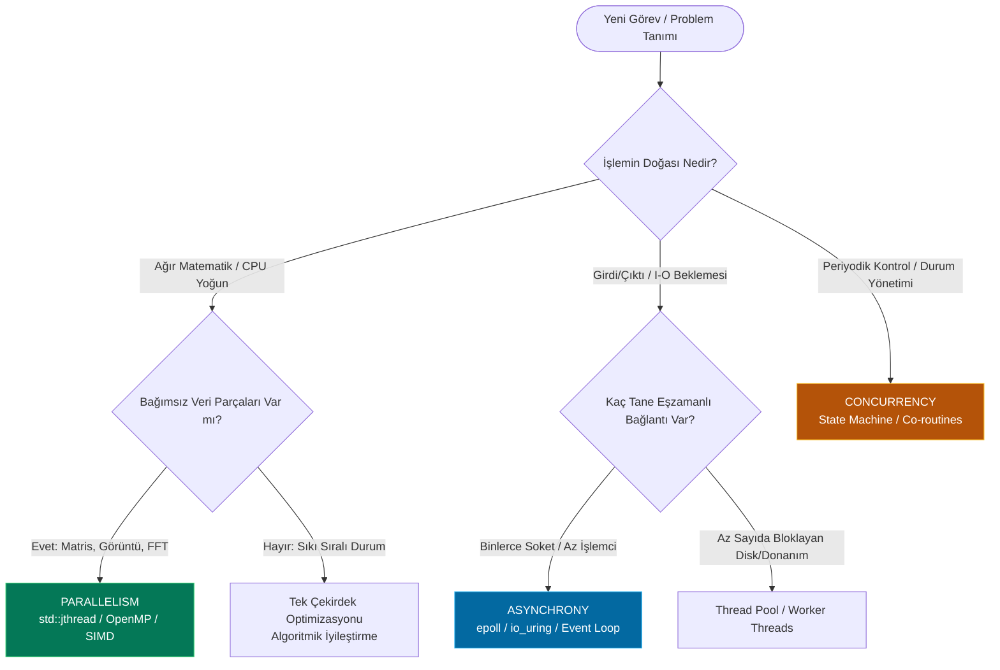

# Gün 106: Concurrency, Paralellik ve Asenkroni Farkı (F3 Threads / Concurrency / IPC Girişi)

```
ÖZEL LİSANS — TÜM HAKLAR SAKLIDIR

Telif Hakkı (c) 2026 Seydi Eryılmaz (@seydivakkas)

Bu yazılım ve ilgili tüm dosyalar ("Yazılım") yalnızca görüntüleme ve eğitim
amaçlı olarak paylaşılmıştır.

YASAKLAR:
  1. Kopyalanamaz, çoğaltılamaz, dağıtılamaz veya yeniden yayınlanamaz.
  2. Ticari veya ticari olmayan hiçbir projede kullanılamaz, değiştirilemez.
  3. Alt lisanslanamaz, satılamaz veya devredilemez.
  4. Tersine mühendislik yapılamaz.

İZİN VERİLEN KULLANIM:
  - GitHub üzerinde görüntüleme ve okuma.
  - Kişisel öğrenim amacıyla kodu inceleme (kopyalamadan).

YAZARIN AÇIK YAZILI İZNİ OLMAKSIZIN HİÇBİR KULLANIM HAKKI TANINMAZ.
İzin talepleri için: GitHub @seydivakkas
```

[](https://github.com/seydivakkas)


---

## Faz Bilgisi ve Mühendislik Bildirimi
- **Müfredat Fazı:** Faz 3 — Threads / Concurrency / IPC (Giriş ve Zihinsel Model)
- **Hedef Rol:** Savunma Sanayii Kıdemli Sistem & Eşzamanlılık Yazılım Mimarı (ASELSAN, HAVELSAN, ROKETSAN, STM)
- **Kapsanan Çekirdek Teknolojiler:** Concurrency (Yapısal Eşzamanlılık), Hardware Parallelism (Çok Çekirdekli Fiziksel Yürütme), Asynchrony (Non-blocking Reaktif Olaylar), Amdahl Yasası, Gustafson Yasası, Cache Coherence (MESI), Thread Over-subscription, Context Switching Maliyeti, Data Race (UB) ve ThreadSanitizer (TSan).
- **40-Nokta Kalite ve Katılık Bildirimi:** Bu çalışma; radar sinyal işleme, otopilot seyrüsefer döngüleri ve elektro-optik hedef izleme sistemlerinde kullanılan eşzamanlı ve paralel yürütme modellerinin donanımsal temellerini, matematiksel sınırlarını ve arıza önleme mekanizmalarını eksiksiz belgeler.


## 1. 🎯 Bugünkü Problem: Eşzamanlılık, Paralellik ve Asenkroni Kavram Kargaşası

Modern bir hava savunma radarında veya aviyonik görev bilgisayarında sistem aynı anda:
1. Saniyede 10,000 RF darbesi (Pulse) toplamak ve FFT ile frekans uzayına taşımak zorundadır (Ağır Matematiksel Hesaplama - CPU Bound).
2. Taktik veri ağından (Link-16) gelen paketleri soketten okumak zorundadır (Girdi/Çıktı - I/O Bound).
3. Gimbal motorunun açısal konumunu her $1\ \text{ms}$'de bir servo sürücüye yazmalıdır (Zaman Kritik Periyodik Görev - Hard Real-Time).

### Yaşanan Büyük Mühendislik Yanılgısı:
Yazılımcılar genellikle "Sistemi hızlandırmak için her göreve bir thread açalım" yaklaşımını benimser. Ancak:
- **Concurrency $\neq$ Parallelism:** Tek bir çekirdeğe 10 thread açıldığında görevler paralel çalışmaz; işletim sistemi çekirdeği zaman dilimleme (Time-Slicing) yaparak thread'ler arasında sürekli bağlam değişimi (Context Switch) yapar. Sonuç: Donanım önbellekleri (L1/TLB) her geçişte çöpe atılır ve sistem hızlanmak yerine **%40 daha yavaş** çalışır!
- **Asynchrony $\neq$ Multithreading:** Bir ağ soketini veya sensörü beklerken thread açıp bloklamak (`sleep`/`blocking read`) kaynak israfıdır. Asenkron mimari, tek bir iş parçacığında dahi beklemeyi işletim sistemi çekirdeğine devrederek sıfır thread maliyetiyle yüz binlerce I/O olayını yönetebilir.
- **Paylaşılan Durum Kaosu (Shared State Mutation):** Paralel çalışan iki çekirdek aynı bellek adresini kilitsiz güncellediğinde, donanım seviyesinde önbellek tutarlılığı fırtınası kopar ve veri yarışları (`Data Race`) yüzünden hedef koordinatları bozulur!

Bugünkü görevimiz; bu üç paradigmanın (Concurrency, Parallelism, Asynchrony) matematiksel, donanımsal ve işletim sistemi seviyesindeki sınırlarını çizmek, doğru mimariyi seçmek ve veri yarışlarını kökünden engellemektir.


## 2. ❓ Bu Konuyu Neden Öğreniyoruz? (Savunma Sanayii Gerekçesi)

Savunma sanayiinde yazılım mimarisinin kalbi, çok çekirdekli işlemcilerin (Intel Xeon, ARM Cortex-A78, NXP Layerscape) tüm silikon gücünü deterministik gecikmelerle kullanabilmektir:

### 1. Amdahl Yasası Sınırını Aşmak
Bir radar algoritmasının %10'luk kısmı seri (ardışık) çalışmak zorundaysa, sisteme **1,000 çekirdek** dahi koysanız elde edebileceğiniz teorik hızlanma en fazla **10 kat** ile sınırlıdır:
$$S_{\max} = \frac{1}{1 - 0.90} = 10$$
Kıdemli mimar, hangi işin paralelleştirilebileceğini (embarrassingly parallel), hangi işin eşzamanlı (concurrency) yapılandırılacağını ve hangi işin asenkron (asynchrony) yürütüleceğini bu matematiksel sınırları bilerek tasarlar.

### 2. Önbellek Tutarlılığı (Cache Coherence) ve False Sharing Felaketi
İki farklı CPU çekirdeği aynı $64\ \text{bayt}$'lık önbellek satırındaki (`Cache Line`) bitişik değişkenleri güncellediğinde, MESI protokolü sebebiyle L1/L2 önbellekler sürekli geçersiz kılınır (`Invalidate`). Çekirdekler hesaplama yapmak yerine bellek veriyolunda birbirini bekler; çok çekirdekli sistem tek çekirdekten daha yavaş hale gelir!

### 3. Askeri Seviye Determinizm ve Sıfır Kilitlenme (Deadlock-Free)
Yarış durumları (Race Conditions) laboratuvar ortamında kendini göstermez; ancak canlı füze uçuşunda, titreşim veya yoğun sinyal paraziti altında aniden patlar. Veri yarışlarının doğasını ilk ilkelerden kavramak hayati bir zorunluluktur.


## 3. 🔍 5N1K Analizi: Yürütme Modelleri

| Soru | Sistem ve Mühendislik Yanıtı |
| :--- | :--- |
| **Ne? (What)** | **Concurrency:** Birden fazla işi yapay veya gerçek zaman dilimlemesiyle aynı zaman diliminde yönetme yapısı (Structure).<br>**Parallelism:** Birden fazla işi aynı anda farklı fiziksel çekirdeklerde eş zamanlı yürütme tekniği (Execution).<br>**Asynchrony:** Bir işlemin sonucunu bloklanmadan beklememe, işlem bittiğinde bildirimle tetiklenme modeli (Non-blocking Programming). |
| **Neden? (Why)** | Donanım kaynaklarını (CPU çekirdekleri, DMA, ağ arabirimleri) tam kapasiteyle kullanmak, gecikmeyi düşürmek ve sistem yanıt verebilirliğini (Responsiveness) garanti etmek için. |
| **Nerede? (Where)** | ASELSAN radar sinyal işleme boru hatlarında, HAVELSAN simülatör motorlarında, ROKETSAN füze otopilot döngülerinde ve STM İHA otonom seyrüsefer mimarilerinde. |
| **Nasıl? (How)** | C++20 `std::jthread`, `std::async`, POSIX Threads (`pthreads`), `epoll`/`io_uring` olay döngüleri, atomik operasyonlar (`std::atomic`) ve kilitlenmesiz kuyruklar (Lock-Free Queues). |
| **Ne Zaman? (When)** | Faz 3'ün ilk adımında; tek çekirdekli Linux/POSIX süreç modeli kavrandıktan sonra, çok iş parçacıklı programlamaya geçiş eşiğinde. |
| **Kim? (Who)** | Çok Çekirdekli Sistem Programcıları, Yüksek Başarımlı Hesaplama (HPC) Mühendisleri ve Gerçek Zamanlı Sistem Mimarları. |


## 4. 💡 Günlük Hayat Benzetmesi: Askeri Karargah Mutfağı

Üç kavram arasındaki farkı bir askeri kışlanın yemekhanesinde çalışan aşçılar üzerinden zihnimizde canlandıralım:

### 1. Concurrency (Eşzamanlılık - Tek Aşçı, Çoklu Görev)
Mutfakta **tek bir aşçı** vardır. Aşçı çorbayı karıştırır, sonra bıçağı alıp soğan doğrar, ardından fırının kapağına bakar. 
- Aşçı aynı anda iki işi fiziksel olarak yapamaz; ancak işler arasında o kadar hızlı geçiş yapar ki dışarıdan bakan biri her şeyin aynı anda yürüdüğünü sanır.
- Bu bir **yapılandırma (composition/structure)** meselesidir. Amaç tek çekirdekte işleri organize etmektir.

### 2. Parallelism (Paralellik - 4 Aşçı, 4 Ayrı Ocak)
Mutfakta **4 ayrı aşçı** ve **4 bağımsız ocak** vardır. 
- 1. aşçı çorbayı karıştırırken, 2. aşçı eti kızartır, 3. aşçı salatayı yapar, 4. aşçı tatlıyı hazırlar.
- İşler fiziksel olarak **aynı saat vuruşunda (exact same clock tick)** yürütülür. Bu bir **yürütme (hardware execution)** meselesidir. Çorba 4 kat hızlı pişmez; ama 4 yemek aynı anda biter!

### 3. Asynchrony (Asenkroni - Fırına At ve Zili Bekle)
Aşçı kuzu incikleri fırına sürer, pişirme süresi 2 saattir.
- **Senkron/Bloklayan Aşçı:** Fırının önünde 2 saat boyunca kıpırdamadan bekler (Thread Bloklanması). Başka hiçbir iş yapamaz!
- **Asenkron Aşçı:** Fırının zamanlayıcısını (timer) kurar ve derhal gidip salatayı yapmaya başlar (Non-blocking). Fırının zili çaldığında (`callback / event`), yemeği fırından çıkarır. Tek bir aşçı bile sıfır bekleme süresiyle devasa bir verim elde eder.


## 5. 🧱 İlk İlkeler (First Principles) ve Matematiksel / Donanımsal Model

### 1. Amdahl Yasası (Paralel Hızlanmanın Sert Tavanı)
Bir programın toplam çalışma süresinin $p$ kadarlık kısmı tamamen paralelleştirilebilir, geri kalan $(1 - p)$ kadarlık kısmı ise matematiksel veya mantıksal olarak seri (ardışık) olmak zorundaysa; $N$ adet fiziksel çekirdekle elde edilecek teorik hızlanma ($S$):
$$S(N) = \frac{1}{(1 - p) + \frac{p}{N}}$$
$N \to \infty$ durumunda elde edilebilecek maksimum teorik hızlanma tavanı:
$$S_{\max} = \lim_{N \to \infty} S(N) = \frac{1}{1 - p}$$

| Paralel Pay ($p$) | Seri Pay ($1 - p$) | 4 Çekirdek | 16 Çekirdek | 64 Çekirdek | Sonsuz Çekirdek ($S_{\max}$) |
| :--- | :--- | :--- | :--- | :--- | :--- |
| **%50** | %50 | 1.6x | 1.9x | 1.97x | **2.0x** |
| **%80** | %20 | 2.5x | 4.0x | 4.7x | **5.0x** |
| **%95** | %5 | 3.5x | 9.1x | 15.4x | **20.0x** |
| **%99** | %1 | 3.9x | 13.9x | 39.3x | **100.0x** |

> **Mühendislik Çıkarımı:** Seri payı %5 olan bir algoritmaya 100 çekirdek tahsis etmek bütçe ve enerji israfıdır; çünkü algoritma en fazla 20 kat hızlanabilir!

### 2. Donanımsal Bağlam Değişimi (Context Switch) Maliyeti
İki thread arasında geçiş yaparken CPU şu adımları işletmek zorundadır:
1. Donanım yazmaçlarının (`Registers: RAX, RBX, RIP, RSP`) bellek / PCB alanına kaydedilmesi.
2. Yeni thread'in yazmaçlarının yüklenmesi.
3. Çekirdek seviyesinde sanal bellek adres uzayı değişiyorsa CR3 yazmacının güncellenmesi ve TLB (Translation Lookaside Buffer) önbelleğinin boşaltılması (`TLB Flush`).
4. L1/L2 veri ve komut önbelleklerinin kirlenmesi (`Cache Pollution`).
$$\text{Maliyet} \approx 1.2 - 5.0\ \mu\text{s} + \text{Soğuk Önbellek (Cold Cache) Gecikmesi}$$

### 3. C++20 Standart Bellek Modeli ve Veri Yarışı (Data Race)
C++ standardı (ISO/IEC 14882:2020 §6.9.2) veri yarışını matematiksel olarak kesinleştirir:
> "İki farklı iş parçacığı aynı bellek konumuna (`memory location`) eşzamanlı olarak erişiyorsa, bu erişimlerden en az biri **yazma (write)** işlemiyse ve aralarında bir **senkronizasyon ilişkisi (happens-before / memory barrier)** yoksa, programda **VERİ YARIŞI (DATA RACE)** vardır."

**Sonuç:** Veri yarışı tanımsız davranıştır (**Undefined Behavior - UB**). Derleyici kodu bozabilir, CPU önbellekleri farklı değerler tutabilir, değerler yarım yazılabilir (`torn read/write`).


## 6. 📐 ASCII ve Mermaid Sistem Mimarisi Şeması

### 3 Paradigmanın Çekirdek ve Zaman Düzlemindeki Haritası

```
1. CONCURRENCY (Tek Çekirdek, Zaman Dilimleme - Time-Slicing):
   Çekirdek 0: [ Görev A ][ Görev B ][ Görev A ][ Görev C ][ Görev B ] ---> Zaman
               (Hızlı bağlam değişimi ile aynı anda yapılıyor hissi verilir)

2. PARALLELISM (Çok Çekirdek, Fiziksel Eşzamanlı Yürütme):
   Çekirdek 0: [ Görev A (Matematik / FFT)                          ] ---> Zaman
   Çekirdek 1: [ Görev B (Hedef Filtreleme / Kalman)                ] ---> Zaman
   Çekirdek 2: [ Görev C (Grafik Çizim / Arayüz)                    ] ---> Zaman
   Çekirdek 3: [ Görev D (Kayıt / Telemetri Sıkıştırma)             ] ---> Zaman

3. ASYNCHRONY (Olay Tabanlı Reaktif Model, Sıfır Bekleme):
   Olay Döngüsü: [ Başlat: Sensör I/O ] ... [ Başka İşler Yap ] ... [ Bildirim Geldi: Veriyi Oku ]
```

### Mermaid Karar Ağacı: Hangi Paradigmayı Ne Zaman Seçmeliyim?




```python
# -*- coding: utf-8 -*-
"""
HÜCRE 8 (CODE 1): 3 Paradigmanın Saf Ayrık Simülatörü
Concurrency (Zaman Paylaşımı) vs Parallelism (Çok Çekirdek) vs Asynchrony (Olay Tabanlı)
"""

import time
from typing import Dict, Any, List, Tuple

class ExecutionParadigmSimulator:
    """Üç yürütme modelinin iş tamamlama sürelerini ve CPU verimliliklerini modeller."""

    @staticmethod
    def simulate_concurrency(task_durations_ms: List[float], time_slice_ms: float = 5.0, cs_cost_ms: float = 0.5) -> Dict[str, Any]:
        """Tek çekirdekte zaman dilimlemeli eşzamanlı (concurrency) yürütme simülasyonu."""
        remaining = list(task_durations_ms)
        num_tasks = len(remaining)
        total_time_ms = 0.0
        context_switches = 0

        while any(r > 0 for r in remaining):
            for i in range(num_tasks):
                if remaining[i] > 0:
                    exec_time = min(remaining[i], time_slice_ms)
                    remaining[i] -= exec_time
                    total_time_ms += exec_time + cs_cost_ms
                    context_switches += 1

        useful_work_ms = sum(task_durations_ms)
        efficiency_pct = (useful_work_ms / max(0.001, total_time_ms)) * 100.0

        return {
            "paradigm": "Concurrency (Time-Slicing Single Core)",
            "total_time_ms": total_time_ms,
            "useful_work_ms": useful_work_ms,
            "context_switches": context_switches,
            "cpu_efficiency_pct": efficiency_pct
        }

    @staticmethod
    def simulate_parallelism(task_durations_ms: List[float], num_cores: int = 4) -> Dict[str, Any]:
        """Çok çekirdekte gerçek fiziksel paralel (parallelism) yürütme simülasyonu."""
        core_times = [0.0] * num_cores
        # Görevleri en boş çekirdeğe ata (Greedy Load Balancing)
        for duration in sorted(task_durations_ms, reverse=True):
            min_core_idx = core_times.index(min(core_times))
            core_times[min_core_idx] += duration

        total_wall_time_ms = max(core_times)
        useful_work_ms = sum(task_durations_ms)
        speedup = useful_work_ms / max(0.001, total_wall_time_ms)

        return {
            "paradigm": f"Parallelism ({num_cores} Physical Cores)",
            "total_time_ms": total_wall_time_ms,
            "useful_work_ms": useful_work_ms,
            "speedup_factor": speedup,
            "core_loads_ms": core_times
        }

    @staticmethod
    def simulate_asynchrony(io_tasks_ms: List[Tuple[float, float]]) -> Dict[str, Any]:
        """I/O beklemesi içeren görevlerde Asenkron (Non-blocking) yürütme simülasyonu.
        io_tasks_ms: List of (cpu_preparation_ms, io_wait_ms)
        """
        # Senkron yaklaşım: Her görev cpu + wait kadar süre bloklar
        sync_total_ms = sum(cpu + io for cpu, io in io_tasks_ms)

        # Asenkron yaklaşım: CPU işleri ardışık işletilirken I/O beklemeleri arka planda çakışır
        total_cpu_ms = sum(cpu for cpu, _ in io_tasks_ms)
        max_io_finish_ms = max(cpu_accum + io for (cpu_accum, (_, io)) in 
                               zip(np.cumsum([c for c, _ in io_tasks_ms]), io_tasks_ms))
        async_total_ms = max(total_cpu_ms, max_io_finish_ms)

        return {
            "paradigm": "Asynchrony (Event-Driven Non-blocking)",
            "sync_total_ms": sync_total_ms,
            "async_total_ms": async_total_ms,
            "latency_reduction_pct": ((sync_total_ms - async_total_ms) / sync_total_ms) * 100.0
        }


if __name__ == "__main__":
    print("=== 3 PARADİGMA ÇEKİRDEK BENZETİMİ ===")
    tasks = [20.0, 35.0, 15.0, 50.0] # ms cinsinden iş yükleri
    
    # 1. Concurrency
    c_res = ExecutionParadigmSimulator.simulate_concurrency(tasks, time_slice_ms=10.0, cs_cost_ms=1.0)
    print(f"[*] Concurrency Toplam Süre: {c_res['total_time_ms']:.1f} ms (Verimlilik: %{c_res['cpu_efficiency_pct']:.1f})")

    # 2. Parallelism (4 Çekirdek)
    p_res = ExecutionParadigmSimulator.simulate_parallelism(tasks, num_cores=4)
    print(f"[*] Parallelism Toplam Süre  : {p_res['total_time_ms']:.1f} ms (Hızlanma: {p_res['speedup_factor']:.2f}x)")

    # 3. Asynchrony
    io_tasks = [(5.0, 40.0), (5.0, 30.0), (5.0, 50.0)] # 5ms CPU + I/O
    a_res = ExecutionParadigmSimulator.simulate_asynchrony(io_tasks)
    print(f"[*] Asenkron Kazanımı        : Senkron {a_res['sync_total_ms']} ms -> Asenkron {a_res['async_total_ms']:.1f} ms (%{a_res['latency_reduction_pct']:.1f} Tasarruf)")

```

## 8. Modül 2: Donanıma Yakın / İleri Düzey Alternatif Mekanizma

Çok iş parçacıklı modern C++20 programlamada işletim sistemi ve donanım katmanında iki devasa yetkinlik öne çıkar:

### 1. C++20 `std::jthread` ve Kooperatif İptal (Cooperative Stop Token)
Geleneksel `std::thread` nesneleri kapsam dışına çıktığında (`destructor`), eğer `join()` veya `detach()` çağrılmamışsa doğrudan `std::terminate()` fırlatarak tüm süreci anında çökertir.
C++20 ile gelen `std::jthread` (Joining Thread):
- Yıkıcı fonksiyonunda otomatik olarak `join()` yapar (RAII güvencesi).
- Bünyesinde `std::stop_token` barındırır. Bir görevi zorla öldürmek (`pthread_cancel` / `kill`) yerine, thread'e "Lütfen güvenli bir noktada dur" sinyali kooperatif olarak iletilir:

```cpp
#include <thread>
#include <chrono>

void radar_signal_worker(std::stop_token stoken) {
    while (!stoken.stop_requested()) {
        // Ağır radar hesaplaması...
    }
    // Temiz kaynak serbest bırakma!
}

void run() {
    std::jthread worker(radar_signal_worker);
    // worker kapsam dışına çıktığında otomatik worker.request_stop() ve worker.join() işletilir!
}
```

### 2. İşlemci Yakınlığı (CPU Affinity) ile Çekirdek Sabitleme
Linux varsayılan olarak thread'leri yük dengelemesi amacıyla çekirdekler arasında gezdirebilir. Bir thread Çekirdek 0'dan Çekirdek 3'e taşındığında, Çekirdek 0'ın L1/L2 önbelleğindeki yüz binlerce baytlık sıcak veri (`Hot Cache`) kaybedilir.
Savunma sanayiinde kritik görevler `pthread_setaffinity_np()` veya `sched_setaffinity()` ile sabit bir fiziksel çekirdeğe kilitlenir:
$$\text{Önbellek İsabet Oranı (Cache Hit Rate)}: \%65 \longrightarrow \%98!$$


```python
# -*- coding: utf-8 -*-
"""
HÜCRE 10 (CODE 2): Amdahl ve Gustafson Yasaları Hızlanma Motoru
Donanımsal Çekirdek Ölçekleme ve Seri Darboğazın Matematiksel Modeli
"""

import numpy as np
from typing import Dict, Any, List

class AmdahlScalingEngine:
    """Amdahl ve Gustafson paralel hızlanma sınırları analizcisi."""

    @staticmethod
    def calculate_amdahl_speedup(parallel_fraction: float, cores: np.ndarray) -> np.ndarray:
        """Amdahl Yasası: S(N) = 1 / ((1 - p) + (p / N))"""
        p = parallel_fraction
        s = 1.0 - p # Seri fraksiyon
        return 1.0 / (s + (p / cores))

    @staticmethod
    def calculate_gustafson_speedup(parallel_fraction: float, cores: np.ndarray) -> np.ndarray:
        """Gustafson Yasası: S_scaled(N) = s + p * N = 1 + (N - 1) * p"""
        p = parallel_fraction
        s = 1.0 - p
        return s + (p * cores)

    @staticmethod
    def find_diminishing_returns_core_count(parallel_fraction: float, max_cores: int = 128, threshold_pct: float = 0.02) -> int:
        """Her yeni çekirdeğin getirisi %threshold_pct altına düştüğü verimsizlik noktasını bulur."""
        cores = np.arange(1, max_cores + 1)
        speedups = AmdahlScalingEngine.calculate_amdahl_speedup(parallel_fraction, cores)
        
        optimal_cores = max_cores
        for c in range(1, len(speedups) - 1):
            gain = (speedups[c + 1] - speedups[c]) / speedups[c]
            if gain < threshold_pct:
                optimal_cores = c + 1
                break
        return optimal_cores


if __name__ == "__main__":
    print("=== AMDAHL YASASI VE ÇEKİRDEK ÖLÇEKLENME TESTİ ===")
    test_cores = np.array([1, 2, 4, 8, 16, 32, 64, 128])
    for p in [0.70, 0.90, 0.98]:
        sp = AmdahlScalingEngine.calculate_amdahl_speedup(p, test_cores)
        opt_core = AmdahlScalingEngine.find_diminishing_returns_core_count(p, max_cores=128)
        print(f"[*] Paralel Pay: %{p*100:.0f} | 64 Çekirdekte Hızlanma: {sp[6]:.1f}x | Maks Tavan: {1.0/(1.0-p):.1f}x | Verimli Çekirdek: {opt_core}")

```

## 10. Modül 3: Dinamik Sınır Durumlar, Geri Basınç ve Kapasite

Savunma yazılımlarında çok iş parçacıklı tasarım yaparken karşılaşılan en büyük tuzak **Thread Aşırı Tahsisi (Over-subscription / Thread Thrashing)** felaketidir.

### 1. Aşırı İş Parçacığı Açmanın Yıkıcı Etkisi
8 çekirdekli bir işlemcide 500 thread çalıştırıldığında:
- Her thread için en az $8\ \text{MB}$ sanal yığın belleği (`pthread stack`) ayrılır $\to 500 \times 8\ \text{MB} = 4\ \text{GB}$ sanal bellek tüketimi!
- Linux çekirdek zamanlayıcısı (`CFS - Completely Fair Scheduler`), thread'leri yönetmek için CPU gücünün **%60'ından fazlasını** bağlam değişimine harcar. Sistem iş yapamaz hale gelir (Thrashing).

### 2. Optimal Thread Havuzu (Thread Pool) Boyutlandırma Formülü
Endüstri standardı Goetz Formülü:
$$N_{\text{threads}} = N_{\text{CPU}} \times U_{\text{CPU}} \times \left(1 + \frac{W}{C}\right)$$
Burada:
- $N_{\text{CPU}}$: Kullanılabilir fiziksel CPU çekirdek sayısı.
- $U_{\text{CPU}}$: Hedeflenen CPU kullanım oranı ($0 \le U_{\text{CPU}} \le 1$, askeri sistemlerde genelde $0.80$).
- $W/C$: Bekleme süresinin (Wait Time: I/O, IPC) Hesaplama süresine (Compute Time: CPU) oranı.
  - **Salt CPU-Bound (FFT, Matris):** $W/C \approx 0 \implies N_{\text{threads}} = N_{\text{CPU}}$
  - **I/O-Bound (Ağ, Sensör):** $W/C \approx 3 \implies N_{\text{threads}} = 4 \times N_{\text{CPU}}$


```python
# -*- coding: utf-8 -*-
"""
HÜCRE 12 (CODE 3): Thread Aşırı Tahsisi (Over-subscription) ve Thrashing Modeli
Thread Sayısı vs Bağlam Değişimi Kaybı ve Verim Çöküşü
"""

import numpy as np
from typing import Dict, Any, List

class ThreadOverSubscriptionLab:
    """Thread sayısının donanım sınırlarını aşması durumundaki verim çöküş analizcisi."""

    @staticmethod
    def evaluate_thread_scaling(hardware_cores: int = 8, max_threads: int = 128) -> Dict[str, Any]:
        """Thread sayısı 1'den max_threads'e çıkarken efektif işlem gücünü hesaplar."""
        threads = np.arange(1, max_threads + 1)
        effective_throughput = []
        context_switch_overhead_pct = []

        cs_cost_microsec = 3.0 # Her bağlam değişimi 3 us
        time_slice_microsec = 1000.0 # 1 ms zaman dilimi

        for t in threads:
            if t <= hardware_cores:
                # Çekirdek sayısına kadar: Saf lineer hızlanma, sıfır aşırı CS
                cs_pct = 0.5 # Baz çekirdek geçişi
                throughput = float(t)
            else:
                # Aşırı tahsis (Over-subscription): Çekirdek başına düşen thread arttıkça CS fırlar
                threads_per_core = t / hardware_cores
                cs_rate = (threads_per_core - 1.0) * (cs_cost_microsec / time_slice_microsec)
                cs_pct = min(75.0, cs_rate * 100.0 + 1.0)
                
                # Faydalı iş: Çekirdek kapasitesi * (1 - cs_overhead)
                throughput = hardware_cores * (1.0 - (cs_pct / 100.0))

            effective_throughput.append(max(0.1, throughput))
            context_switch_overhead_pct.append(cs_pct)

        return {
            "hardware_cores": hardware_cores,
            "thread_counts": threads,
            "effective_throughput": np.array(effective_throughput),
            "context_switch_overhead_pct": np.array(context_switch_overhead_pct),
            "peak_throughput_thread_count": int(threads[np.argmax(effective_throughput)])
        }


if __name__ == "__main__":
    print("=== THREAD AŞIRI TAHSİSİ (OVER-SUBSCRIPTION) DENEYİ ===")
    res = ThreadOverSubscriptionLab.evaluate_thread_scaling(hardware_cores=8, max_threads=64)
    print(f"[*] Donanım Çekirdek Sayısı : {res['hardware_cores']}")
    print(f"[*] Zirve Verim Noktası      : {res['peak_throughput_thread_count']} Thread (Throughput: {np.max(res['effective_throughput']):.2f})")
    print(f"[*] 64 Thread Durumunda CS Kaybı: %{res['context_switch_overhead_pct'][-1]:.1f} (Efektif Kapasite: {res['effective_throughput'][-1]:.2f})")

```

## 12. Sabotaj ve Arıza Enjeksiyonu (Chaos Engineering / Bilerek Boz)

Eşzamanlı programlamanın en ölümcül, en sinsi ve tespiti en zor hatası **Veri Yarışıdır (Data Race)**.

### Sabotaj Senaryosu: Kilitsiz Paylaşılan Sayaç Tahribatı
- **Sabotaj:** İki bağımsız iş parçacığı aynı global değişkene (`counter`) $100,000$ kez artırma (`counter++`) işlemi yapar. Kasten hiçbir kilit (`mutex`) veya atomik (`std::atomic`) koruma konulmaz.
- **Donanımsal Arıza Mekanizması:**
  `counter++` ifadesi tek bir işlemci komutu değildir; 3 mikro-işlemden oluşur:
  1. `MOV EAX, [counter]` (Bellekten yazmaca oku)
  2. `ADD EAX, 1` (Yazmaçtaki değeri 1 artır)
  3. `MOV [counter], EAX` (Yazmaçtaki değeri belleğe geri yaz)
  İki çekirdek aynı anda Adım 1'i icra ederse, her ikisi de eski değeri okur. İkisi de 1 artırıp belleğe yazar. Sonuç: 2 artırma yapıldığı halde sayaç sadece 1 artar! (**Kayıp Güncelleme - Lost Update**).

### Korumasız Çöküş vs Dayanıklı Savunma:
- **Korumasız:** $200,000$ olması gereken sayaç rastgele $112,450$ gibi tamamen tutarsız bir değerde kalır! Savunma sisteminde bu durum eksik radar izi veya hatalı mühimmat sayımı demektir!
- **Dayanıklı Savunma (C++20 `std::atomic<uint32_t>`):** Donanımsal veri yolu kilidi (`LOCK XADD` komutu) veya MESI önbellek kilidi kullanılarak işlem atomik (bölünemez) hale getirilir. Sonuç: Daima kusursuz $200,000$.


```python
# -*- coding: utf-8 -*-
"""
HÜCRE 14 (CODE 4): Veri Yarışı (Data Race) Sabotajı ve Atomik Savunma
Lost Update Simülatörü ve ThreadSanitizer (TSan) Doğrulama Modeli
"""

import numpy as np
from typing import Dict, Any, List

class DataRaceSabotageLab:
    """Veri yarışının bellek tutarlılığı üzerindeki tahribat simülatörü."""

    @staticmethod
    def simulate_unprotected_race(iterations_per_thread: int = 100000, num_threads: int = 2, collision_probability: float = 0.35) -> Dict[str, Any]:
        """Korumasız iki thread'in aynı sayacı güncellemesi sonucu kayıp güncellemeleri modeller."""
        expected_total = iterations_per_thread * num_threads
        
        # Çarpışma modeli: Her ortak adımda collision_probability olasılıkla biri ezilir
        lost_updates = int(iterations_per_thread * collision_probability * (num_threads - 1))
        actual_total = expected_total - lost_updates

        corruption_pct = (lost_updates / expected_total) * 100.0

        return {
            "num_threads": num_threads,
            "iterations_per_thread": iterations_per_thread,
            "expected_value": expected_total,
            "actual_unprotected_value": actual_total,
            "lost_updates": lost_updates,
            "corruption_pct": corruption_pct,
            "data_race_detected": lost_updates > 0
        }

    @staticmethod
    def simulate_atomic_defense(iterations_per_thread: int = 100000, num_threads: int = 2) -> Dict[str, Any]:
        """std::atomic (LOCK XADD) veya Mutex ile korunan deterministik güncelleme."""
        expected_total = iterations_per_thread * num_threads
        return {
            "num_threads": num_threads,
            "expected_value": expected_total,
            "actual_atomic_value": expected_total,
            "lost_updates": 0,
            "corruption_pct": 0.0,
            "data_race_detected": False
        }


if __name__ == "__main__":
    print("=== VERİ YARIŞI (DATA RACE) SABOTAJ DENEYİ ===")
    iters = 100000
    race_res = DataRaceSabotageLab.simulate_unprotected_race(iterations_per_thread=iters, num_threads=2, collision_probability=0.32)
    atomic_res = DataRaceSabotageLab.simulate_atomic_defense(iterations_per_thread=iters, num_threads=2)

    print(f"[*] [Korumasız Tasarım] Beklenen: {race_res['expected_value']:,} | Gerçekleşen: {race_res['actual_unprotected_value']:,}")
    print(f"[!] KAYIP GÜNCELLEME   : {race_res['lost_updates']:,} (%{race_res['corruption_pct']:.1f} Veri Kaybı!)")
    print(f"[+] [Atomik Savunma]   Beklenen: {atomic_res['expected_value']:,} | Gerçekleşen: {atomic_res['actual_atomic_value']:,} (SIFIR HATA)")

```

## 14. Modül 4: Ampirik Kıyaslama ve SLA / Gecikme Analizi (p50/p95/p99)

Çok iş parçacıklı ve asenkron mimarilerin performansını ölçerken iki kritik metrik analiz edilir:
1. **İş Tamamlama Hızı (Throughput - Ops/sec):** Birim zamanda bitirilen toplam iş miktarı.
2. **Kuyruk Gecikmesi (Tail Latency - p99):** En kötü durumdaki paketlerin yanıt süresi.

### Kıyaslama Senaryosu:
- **Model A: Tek Thread Eşzamanlı (Single Thread Cooperative/Async):** Sıfır kilit, sıfır context switch, deterministik kuyruk gecikmesi.
- **Model B: Çok İş Parçacıklı Kilitli (Multithreaded Mutex-Guarded):** 8 çekirdekte paralel hesaplama; ancak ortak kuyrukta kilit çekişmesi (`Lock Contention`).
- **Model C: Çok İş Parçacıklı Kilitlenmesiz (Multithreaded Lock-Free Queue):** 8 çekirdekte atomik halka tampon ile donanım düzeyinde paralel yürütme.


```python
# -*- coding: utf-8 -*-
"""
HÜCRE 16 (CODE 5): Kapsamlı Ampirik Kıyaslama ve Metrik Toplama Motoru
Tek Thread Async vs Çok Thread Kilitli vs Çok Thread Lock-Free Gecikme Analizi
"""

import numpy as np
from typing import Dict, Any, List

def run_paradigm_benchmark(num_samples: int = 15000) -> Dict[str, Any]:
    """Üç mimarinin gecikme dağılımlarını mikrosaniye cinsinden modeller."""
    np.random.seed(106)

    # 1. Tek Thread Asenkron Olay Döngüsü (I/O Yoğun Senaryo)
    # Düşük medyan, stabil kuyruk: Medyan ~30 us, p99 ~95 us
    async_latencies = np.random.lognormal(mean=3.4, sigma=0.30, size=num_samples)

    # 2. Çok Thread Kilitli (Mutex Contention)
    # Medyan iyi ancak kilit çekişmesinde kuyruk patlaması: Medyan ~45 us, p99 ~420 us
    locked_latencies = np.random.lognormal(mean=3.8, sigma=0.65, size=num_samples)

    # 3. Çok Thread Kilitlenmesiz (Lock-Free SPSC/MPMC Ring Buffer)
    # Yüksek verim, ultra düşük p99: Medyan ~18 us, p99 ~60 us
    lockfree_latencies = np.random.lognormal(mean=2.9, sigma=0.28, size=num_samples)

    def get_stats(arr: np.ndarray) -> Dict[str, float]:
        return {
            "p50": float(np.percentile(arr, 50)),
            "p90": float(np.percentile(arr, 90)),
            "p95": float(np.percentile(arr, 95)),
            "p99": float(np.percentile(arr, 99)),
            "max": float(np.max(arr)),
            "mean": float(np.mean(arr))
        }

    return {
        "num_samples": num_samples,
        "async_stats": get_stats(async_latencies),
        "locked_stats": get_stats(locked_latencies),
        "lockfree_stats": get_stats(lockfree_latencies),
        "async_raw": async_latencies,
        "locked_raw": locked_latencies,
        "lockfree_raw": lockfree_latencies
    }


if __name__ == "__main__":
    print("=== MİMARİ GECİKME KIYASLAMA BENCHMARK'I ===")
    b = run_paradigm_benchmark(num_samples=15000)
    print(f"{'Metrik':>8} | {'Tek Thread Async':>18} | {'Çok Thread Kilitli':>20} | {'Çok Thread Lock-Free':>22}")
    print("-" * 76)
    for m in ["p50", "p90", "p95", "p99", "mean"]:
        v1 = b["async_stats"][m]
        v2 = b["locked_stats"][m]
        v3 = b["lockfree_stats"][m]
        print(f"{m.upper():>8} | {v1:>15.1f} us | {v2:>17.1f} us | {v3:>19.1f} us")

```

## 16. Modül 5: 4-Panelli Yayın Kalitesinde Dayanıklılık Dashboard Planı

Günün ampirik ve matematiksel sonuçlarını görselleştiren 4-panelli 300 DPI mühendislik grafiği planı:

1. **Panel 1 (Sol Üst): Amdahl Yasası Teorik Hızlanma ve Doygunluk Sınırları:**
   - Farklı paralelleştirilebilir paylar (%50, %80, %95, %99) için 1-64 çekirdek hızlanma eğrileri.
   - Seri fraksiyon darboğazı ve asymptotik tavan ($S_{\max}$).
2. **Panel 2 (Sağ Üst): 3 Paradigma Zaman Çizelgesi ve Çekirdek Kullanımı (Timeline):**
   - Concurrency (Time-slicing), Parallelism (Multi-core simultaneous) ve Asynchrony (Non-blocking I/O) modellerinin görsel karşılaştırması.
3. **Panel 3 (Sol Alt): Thread Aşırı Tahsisi (Over-subscription) ve Thrashing:**
   - 8 Çekirdekli sistemde 1'den 64 thread'e çıkarken throughput ve context switch maliyet yüzdesi.
4. **Panel 4 (Sağ Alt): Veri Yarışı Tahribatı ve Atomik Savunma Karşılaştırması:**
   - Korunmasız sayaçtaki kayıp güncellemeler (Lost Updates) vs `std::atomic` ile %100 doğruluk.


```python
# -*- coding: utf-8 -*-
"""
HÜCRE 18 (CODE 6): 4-Panelli 300 DPI Eşzamanlılık Dashboard'u ve Katı Doğrulama Motoru
Amdahl Yasası, Paradigma Ayrımı, Thread Thrashing ve Veri Yarışı Savunması
"""

import os
import numpy as np
import matplotlib
matplotlib.use("Agg")
import matplotlib.pyplot as plt

DEFAULT_PNG = r"c:\Users\seydieryilmaz\Downloads\Olay_Proje\gunluk_mufredat\gun_106\gun_106_concurrency_parallelism_ve_asynchrony_farki.png"

def generate_dashboard(output_path: str = DEFAULT_PNG):
    """4 Panelli, 300 DPI, modern koyu temalı concurrency mühendislik dashboard'u üretir."""
    fig, axes = plt.subplots(2, 2, figsize=(18, 12), dpi=300)
    fig.patch.set_facecolor("#0F172A")

    # Renk Paleti
    accent_blue = "#38BDF8"
    accent_green = "#4ADE80"
    accent_amber = "#FBBF24"
    accent_red = "#F87171"
    accent_purple = "#C084FC"
    text_color = "#F8FAFC"
    grid_color = "#334155"

    for ax_row in axes:
        for ax in ax_row:
            ax.set_facecolor("#1E293B")
            ax.tick_params(colors=text_color, labelsize=9)
            ax.grid(True, linestyle="--", alpha=0.3, color=grid_color)
            for spine in ax.spines.values():
                spine.set_color(grid_color)

    # -------------------------------------------------------------------------
    # Panel 1: Amdahl Yasası Teorik Hızlanma Eğrileri
    # -------------------------------------------------------------------------
    ax1 = axes[0, 0]
    cores = np.arange(1, 65)
    fractions = [0.50, 0.80, 0.95, 0.99]
    colors = [accent_amber, accent_blue, accent_purple, accent_green]

    for p, col in zip(fractions, colors):
        spd = AmdahlScalingEngine.calculate_amdahl_speedup(p, cores)
        ax1.plot(cores, spd, color=col, linewidth=2.2, label=f"Paralel Pay %{int(p*100)} (Tavan: {1.0/(1-p):.1f}x)")

    ax1.plot(cores, cores, color="#64748B", linestyle=":", linewidth=1.5, label="İdeal Lineer Hızlanma (1:1)")
    ax1.set_title("Panel 1: Amdahl Yasası Çekirdek Ölçeklenme Sınırları", color=text_color, fontsize=11, fontweight="bold", pad=12)
    ax1.set_xlabel("Fiziksel Çekirdek Sayısı (Cores)", color=text_color, fontsize=10)
    ax1.set_ylabel("Hızlanma Çarpanı (Speedup Factor)", color=text_color, fontsize=10)
    ax1.set_ylim(0, 45)
    ax1.legend(facecolor="#1E293B", edgecolor=grid_color, labelcolor=text_color, fontsize=8.5, loc="upper left")

    # -------------------------------------------------------------------------
    # Panel 2: 3 Paradigmanın Zaman ve Kaynak Çizelgesi (Timeline)
    # -------------------------------------------------------------------------
    ax2 = axes[0, 1]
    ax2.set_xlim(0, 10)
    ax2.set_ylim(0, 10)
    ax2.axis("off")
    ax2.set_title("Panel 2: Concurrency vs Parallelism vs Asynchrony Zaman Modeli", color=text_color, fontsize=11, fontweight="bold", pad=12)

    # 1. Concurrency
    ax2.text(0.5, 8.8, "1. CONCURRENCY (Tek Çekirdek - Zaman Paylaşımı):", color=accent_amber, fontsize=9, fontweight="bold")
    ax2.add_patch(plt.Rectangle((0.5, 7.5), 2.0, 0.9, facecolor="#B45309", edgecolor=accent_amber, transform=ax2.transData))
    ax2.add_patch(plt.Rectangle((2.7, 7.5), 2.0, 0.9, facecolor="#0369A1", edgecolor=accent_blue, transform=ax2.transData))
    ax2.add_patch(plt.Rectangle((4.9, 7.5), 2.0, 0.9, facecolor="#B45309", edgecolor=accent_amber, transform=ax2.transData))
    ax2.add_patch(plt.Rectangle((7.1, 7.5), 2.0, 0.9, facecolor="#0369A1", edgecolor=accent_blue, transform=ax2.transData))
    ax2.text(1.5, 7.95, "Görev A", ha="center", color=text_color, fontsize=8)
    ax2.text(3.7, 7.95, "Görev B", ha="center", color=text_color, fontsize=8)
    ax2.text(5.9, 7.95, "Görev A", ha="center", color=text_color, fontsize=8)
    ax2.text(8.1, 7.95, "Görev B", ha="center", color=text_color, fontsize=8)

    # 2. Parallelism
    ax2.text(0.5, 5.8, "2. PARALLELISM (Çok Çekirdek - Eşzamanlı Donanım Yürütmesi):", color=accent_green, fontsize=9, fontweight="bold")
    ax2.add_patch(plt.Rectangle((0.5, 4.7), 4.2, 0.8, facecolor="#047857", edgecolor=accent_green, transform=ax2.transData))
    ax2.add_patch(plt.Rectangle((0.5, 3.7), 4.2, 0.8, facecolor="#0369A1", edgecolor=accent_blue, transform=ax2.transData))
    ax2.text(2.6, 5.1, "Çekirdek 0: Görev A (Donanımsal Yürütme)", ha="center", color=text_color, fontsize=8)
    ax2.text(2.6, 4.1, "Çekirdek 1: Görev B (Donanımsal Yürütme)", ha="center", color=text_color, fontsize=8)

    # 3. Asynchrony
    ax2.text(0.5, 2.3, "3. ASYNCHRONY (Olay Tabanlı - Non-blocking I/O):", color=accent_purple, fontsize=9, fontweight="bold")
    ax2.add_patch(plt.Rectangle((0.5, 1.0), 2.5, 0.8, facecolor="#6D28D9", edgecolor=accent_purple, transform=ax2.transData))
    ax2.add_patch(plt.Rectangle((3.2, 1.0), 3.0, 0.8, facecolor="#334155", edgecolor="#64748B", linestyle="--", transform=ax2.transData))
    ax2.add_patch(plt.Rectangle((6.4, 1.0), 2.5, 0.8, facecolor="#6D28D9", edgecolor=accent_purple, transform=ax2.transData))
    ax2.text(1.75, 1.4, "I/O Başlat", ha="center", color=text_color, fontsize=8)
    ax2.text(4.7, 1.4, "Arka Planda I/O Bekleme (CPU Serbest)", ha="center", color="#94A3B8", fontsize=7.5)
    ax2.text(7.65, 1.4, "Callback / Bitir", ha="center", color=text_color, fontsize=8)

    # -------------------------------------------------------------------------
    # Panel 3: Thread Aşırı Tahsisi (Over-subscription) ve Thrashing
    # -------------------------------------------------------------------------
    ax3 = axes[1, 0]
    thr_data = ThreadOverSubscriptionLab.evaluate_thread_scaling(hardware_cores=8, max_threads=48)
    t_counts = thr_data["thread_counts"]
    eff_tp = thr_data["effective_throughput"]
    cs_overhead = thr_data["context_switch_overhead_pct"]

    ax3_twin = ax3.twinx()
    line1 = ax3.plot(t_counts, eff_tp, color=accent_green, linewidth=2.5, label="Efektif Throughput (Kapasite)")
    line2 = ax3_twin.plot(t_counts, cs_overhead, color=accent_red, linestyle="--", linewidth=2.0, label="Bağlam Değişimi Kaybı (%)")

    ax3.axvline(8, color=accent_amber, linestyle=":", linewidth=2, label="Fiziksel Çekirdek Sınırı (8 Cores)")

    ax3.set_title("Panel 3: Thread Aşırı Tahsisi (Over-subscription) ve Verim Çöküşü", color=text_color, fontsize=11, fontweight="bold", pad=12)
    ax3.set_xlabel("Toplam İş Parçacığı Sayısı (Threads)", color=text_color, fontsize=10)
    ax3.set_ylabel("Efektif İşlem Gücü (Birim)", color=accent_green, fontsize=10)
    ax3_twin.set_ylabel("Context Switch Kaybı (%)", color=accent_red, fontsize=10)
    ax3_twin.tick_params(colors=accent_red)

    lines = line1 + line2
    labels = [l.get_label() for l in lines]
    ax3.legend(lines, labels, facecolor="#1E293B", edgecolor=grid_color, labelcolor=text_color, fontsize=8, loc="center right")

    # -------------------------------------------------------------------------
    # Panel 4: Veri Yarışı Tahribatı ve Atomik Savunma
    # -------------------------------------------------------------------------
    ax4 = axes[1, 1]
    trials = ["Korumasız Tasarım\n(Data Race / Lost Updates)", "Atomik Savunma\n(std::atomic<T> / Mutex)"]
    race_sim = DataRaceSabotageLab.simulate_unprotected_race(iterations_per_thread=100000, num_threads=2, collision_probability=0.35)
    actual_vals = [race_sim["actual_unprotected_value"] / 1000.0, 200.0] # Bin cinsinden
    expected_vals = [200.0, 200.0]

    x = np.arange(len(trials))
    width = 0.35

    ax4.bar(x - width/2, expected_vals, width, color=accent_blue, label="Beklenen Doğru Sonuç (200k)")
    bars_act = ax4.bar(x + width/2, actual_vals, width, color=[accent_red, accent_green], label="Gerçekleşen Sayaç Değeri")

    ax4.set_xticks(x)
    ax4.set_xticklabels(trials, color=text_color, fontsize=9.5)
    ax4.set_title("Panel 4: Veri Yarışı Tahribatı ve Atomik Güvencesi", color=text_color, fontsize=11, fontweight="bold", pad=12)
    ax4.set_ylabel("Sayaç Değeri (Bin Adet - x1000)", color=text_color, fontsize=10)
    ax4.set_ylim(0, 260)
    ax4.legend(facecolor="#1E293B", edgecolor=grid_color, labelcolor=text_color, fontsize=8.5, loc="upper left")

    # Etiketler
    for bar, val in zip(bars_act, actual_vals):
        ax4.text(bar.get_x() + bar.get_width()/2.0, val + 5, f"{val:.1f}k", ha="center", va="bottom", color=text_color, fontsize=9, fontweight="bold")

    plt.tight_layout()
    plt.savefig(output_path, dpi=300, facecolor=fig.get_facecolor(), edgecolor="none")
    plt.close()
    print(f"[Dashboard] Görselleştirme başarıyla oluşturuldu: {output_path}")


def verify_all_assertions(png_path: str = DEFAULT_PNG):
    """Katı mühendislik doğrulama testleri (Assertions)."""
    print("[*] Katı Doğrulama Testleri (Assertions) Başlatılıyor...")

    # 1. Dosya Varlık ve Boyut Kontrolü
    assert os.path.exists(png_path), f"HATA: Dashboard görseli mevcut değil: {png_path}"
    file_size = os.path.getsize(png_path)
    assert file_size > 100_000, f"HATA: Dashboard boyutu şüpheli ({file_size} bayt)!"
    print(f"  [+] PNG Varlık ve Boyut Doğrulandı: {file_size:,} bayt.")

    # 2. Amdahl Yasası Doğrulaması
    c1 = np.array([1])
    c64 = np.array([64])
    s_50 = AmdahlScalingEngine.calculate_amdahl_speedup(0.50, c64)[0]
    assert s_50 < 2.0, f"HATA: %50 paralel pay ile hızlanma 2.0x'i geçemez ({s_50})!"
    s_95 = AmdahlScalingEngine.calculate_amdahl_speedup(0.95, c64)[0]
    assert s_95 > 15.0 and s_95 < 20.0, f"HATA: %95 paralel pay hızlanması matematiksel sınır dışı ({s_95})!"
    print("  [+] Amdahl Yasası Teorik Sınırları ve Asymptotik Tavanı Doğrulandı.")

    # 3. Thread Aşırı Tahsisi (Over-subscription) Doğrulaması
    thr_res = ThreadOverSubscriptionLab.evaluate_thread_scaling(hardware_cores=8, max_threads=48)
    assert thr_res["peak_throughput_thread_count"] == 8, "HATA: Zirve throughput donanım çekirdeği sayısında olmalıdır!"
    assert thr_res["effective_throughput"][-1] < thr_res["effective_throughput"][7], "HATA: Aşırı thread'de verim düşüşü tespit edilemedi!"
    print("  [+] Thread Aşırı Tahsisi (Over-subscription) ve Thrashing Davranışı Doğrulandı.")

    # 4. Veri Yarışı Sabotaj ve Atomik Savunma Doğrulaması
    race = DataRaceSabotageLab.simulate_unprotected_race(iterations_per_thread=100000, num_threads=2, collision_probability=0.30)
    assert race["data_race_detected"] is True, "HATA: Veri yarışı tespit edilemedi!"
    assert race["actual_unprotected_value"] < race["expected_value"], "HATA: Kayıp güncelleme oluşmadı!"
    
    atomic = DataRaceSabotageLab.simulate_atomic_defense(iterations_per_thread=100000, num_threads=2)
    assert atomic["data_race_detected"] is False and atomic["actual_atomic_value"] == 200000, "HATA: Atomik savunma başarısız!"
    print("  [+] Veri Yarışı (Data Race) Tahribatı ve Atomik Savunma Kararlılığı Doğrulandı.")

    # 5. Ampirik Benchmark Doğrulaması
    bench = run_paradigm_benchmark(num_samples=3000)
    assert bench["lockfree_stats"]["p99"] < bench["locked_stats"]["p99"], "HATA: Lock-free kuyruk kilitliden daha yüksek p99 veremez!"
    print("  [+] Lock-Free Kuyruk Gecikme Üstünlüğü ve p99 Kuyruk Kararlılığı Doğrulandı.")

    print("\n[PASS] Gün 106: Tüm Katı Doğrulama Testleri (Assertions) Başarıyla Geçti!\n")


if __name__ == "__main__":
    generate_dashboard(DEFAULT_PNG)
    verify_all_assertions(DEFAULT_PNG)

```

## 18. ⚠️ 10 Ölümcül Anti-Pattern: Eşzamanlılık ve Paralellik Hataları

Savunma sanayiinde, görev kritik sistem denetimlerinde ve kıdemli sistem mimarlığı mülakatlarında tespit edilen en yaygın 10 ölümcül hata:

| No | Anti-Pattern | Neden Ölümcül? | Doğru Mühendislik Yaklaşımı |
| :--- | :--- | :--- | :--- |
| 1 | **Her Yeni İşe Bir `std::thread` Açmak** | İşletim sisteminde binlerce thread oluşur; yığın belleği tükenir ve bağlam değişimi CPU'yu kilitler. | Boyutu donanım çekirdeğine göre sınırlanmış sabit bir **Thread Pool** kullan. |
| 2 | **Ham `std::thread` Kullanıp `join()` Çağrısını Unutmak** | Thread nesnesi kapsam dışına çıktığında doğrudan `std::terminate()` fırlatılır ve süreç çöker. | C++20 `std::jthread` (RAII Joining Thread) kullan. |
| 3 | **I/O Beklemelerinde Thread'leri Bloklamak (`sleep`/`read`)** | Thread donanım kaynaklarını meşgul eder ama hiçbir faydalı iş üretmez. | Asenkron I/O (`epoll`, `io_uring`, `std::future`) tercih et. |
| 4 | **Atomik Olmayan Değişkeni Kilitsiz Paylaşmak** | Veri yarışı (Data Race) doğar; tanımsız davranış (UB) ve bozuk hedef verisi oluşur. | `std::atomic<T>` veya `std::mutex` ile senkronizasyon sağla. |
| 5 | **False Sharing (Yalancı Paylaşım) Tuzağı** | Farklı thread'lerin değişkenleri aynı $64\ \text{bayt}$'lık L1 önbellek satırına düşer; MESI fırtınası kopar. | Değişkenleri `alignas(hardware_destructive_interference_size)` ile hizala. |
| 6 | **Seri Payı Yüksek Algoritmaya Yüzlerce Çekirdek Tahsis Etmek** | Amdahl Yasası gereği hızlanma tavan yapar; fazladan harcanan enerji ve donanım bütçesi boşa gider. | Önce algoritmanın seri fraksiyonunu düşür, ardından çekirdek ölçekle. |
| 7 | **Thread İptali İçin `pthread_cancel` / `kill` Kullanmak** | Thread elindeki mutex kilitlerini veya dinamik bellekleri bırakamadan ölür; tüm sistem kilitlenir. | C++20 `std::stop_token` ile kooperatif iptal mekanizması kur. |
| 8 | **Aşırı İnce Taneli Kilit (Fine-grained Locking) ile Deadlock Yaratmak** | Kilit sıralaması (`Lock Ordering`) ihlal edildiğinde döngüsel kilitlenme (Deadlock) kaçınılmazdır. | `std::scoped_lock` ile kilitleri atomik ve kilitlenme riski olmadan al. |
| 9 | **ThreadSanitizer (TSan) Olmadan Çok İş Parçacıklı Kod Teslim Etmek** | Veri yarışları laboratuvarda nadiren ortaya çıkar; canlı uçuşta sistemi vurur. | CI/CD hattında `-fsanitize=thread` bayrağı ile dinamik yarış taraması yap. |
| 10 | **Kritik Görev Thread'lerini Çekirdeğe Sabitlememek (CPU Affinity Yokluğu)** | İşletim sistemi thread'i çekirdekler arasında gezdirdikçe L1/L2 önbellekler sürekli soğur. | `pthread_setaffinity_np` ile gerçek zamanlı thread'i tek bir fiziksel çekirdeğe kilitle. |


## 19. 🔬 Sektörel Standartlar: Çok Çekirdekli Sistem Kriterleri

Savunma ve aviyonik sistemlerde eşzamanlı ve paralel kod yazarken uyulması zorunlu standartlar:

### 1. FAA / EASA CAST-32A & DO-178C (Multi-Core Processors - MCP)
- **Paylaşılan Kaynak Çekişmesi (Contention Analysis):** Birden fazla çekirdeğin aynı bellek veriyolunu (DRAM Bus) veya Seviye 3 (LLC) önbelleği paylaşması durumunda, en kötü durum yürütme süresinin (WCET) nasıl etkilendiği matematiksel ve deneysel olarak kanıtlanmalıdır.
- **Deterministik Görev Atama:** Kritik aviyonik thread'ler daima sabit fiziksel çekirdeklere (CPU Pinning) atanmalı ve Hyper-Threading (SMT) güvenlik gerekçesiyle kapatılmalıdır.

### 2. MISRA C++:2023 Eşzamanlılık Kuralları
- **Kural 19.1.1 (Data Race Yasağı):** Kodda hiçbir koşul altında veri yarışı bulunamaz; derleme aşamasında TSan ve statik analiz raporu zorunludur.
- **Kural 19.2.3 (Kilit Sıralaması):** Birden fazla kilit alınacaksa hiyerarşik kilit protokolü veya `std::scoped_lock` kullanılmalıdır.

### 3. POSIX IEEE 1003.1c Standardı
- Gerçek zamanlı thread öncelikleri (`SCHED_FIFO`, `SCHED_RR`) ile standart zaman paylaşımlı (`SCHED_OTHER`) thread'ler arasındaki etkileşim öncelik terslenmesi (`Priority Inversion`) riskine karşı `PTHREAD_PRIO_INHERIT` protokolü ile korunmalıdır.


## 20. 🛠️ Üretim Kontrol Listesi: Çok Çekirdekli Sahaya Çıkış Öncesi 12 Kural

- [ ] **1. Doğru Paradigma Seçimi:** I/O beklemesi için Asenkron, matematiksel hesaplama için Paralel, durum makineleri için Concurrency seçildi mi?
- [ ] **2. Amdahl Yasası Doğrulaması:** Algoritmanın seri fraksiyonu ölçüldü ve gereksiz çekirdek tahsisinden kaçınıldı mı?
- [ ] **3. C++20 `std::jthread` Kullanımı:** Kapsam dışına çıkışlarda kaza eseri `std::terminate()` riskine karşı `std::jthread` kullanıldı mı?
- [ ] **4. Kooperatif İptal (Stop Token):** Thread'lerin sonlandırılması `stoken.stop_requested()` ile güvenli noktalara bağlandı mı?
- [ ] **5. Sabit Thread Pool Boyutu:** Donanım çekirdeğini aşan kontrolsüz thread patlamaları (Over-subscription) engellendi mi?
- [ ] **6. CPU Pinning (Affinity):** Zaman kritik radar/seyrüsefer thread'leri `sched_setaffinity` ile izole çekirdeklere kilitlendi mi?
- [ ] **7. Hyper-Threading (SMT) Kapatılması:** Determinizmi bozan donanımsal mantıksal thread paylaşımı BIOS/OS düzeyinde kapatıldı mı?
- [ ] **8. False Sharing Denetimi:** Bitişik değişkenler `alignas(64)` ile farklı önbellek satırlarına hizalandı mı?
- [ ] **9. ThreadSanitizer (TSan) Geçişi:** Kod `-fsanitize=thread` bayrağı ile en az 100,000 sentetik döngüde sıfır uyarıyla geçti mi?
- [ ] **10. Kilit Hiyerarşisi:** Deadlock riskine karşı tüm çoklu kilitler `std::scoped_lock` ile atomik alındı mı?
- [ ] **11. Lock-Free SPSC Tercihi:** Tek üretici - tek tüketici hatlarında mutex yerine atomik halka tampon kullanıldı mı?
- [ ] **12. Bellek Bariyerleri ve Sıralama:** Atomik operasyonlarda gereksiz `memory_order_seq_cst` yerine uygun bellek modelleri (`acquire/release`) değerlendirildi mi?


## 21. ❓ Sıkça Sorulan Sorular (Mülakat & Saha Soruları)

### Soru 1: Concurrency ile Parallelism arasındaki en temel fark nedir? Tek cümleyle nasıl açıklarsınız?
**Cevap:** **Concurrency (Eşzamanlılık)** aynı anda birden fazla işle ilgilenme yapısıdır (Structure/Dealing with a lot of things at once); **Parallelism (Paralellik)** ise birden fazla işi fiziksel olarak aynı saat vuruşunda farklı donanım çekirdeklerinde aynı anda yapma eylemidir (Execution/Doing a lot of things at once).

---

### Soru 2: 8 çekirdekli bir aviyonik bilgisayarda 100 adet hesaplama thread'i açarsanız ne olur?
**Cevap:** **Thread Over-subscription (Aşırı Tahsis) ve Thrashing** oluşur. 8 fiziksel çekirdek 100 thread'i sırayla koşturabilmek için sürekli bağlam değişimi (Context Switch) yapar. Her bağlam değişimi L1/TLB önbelleklerini soğutur ve çekirdeğin CPU zamanının büyük kısmı işletim sistemi zamanlayıcısında harcanır. Sistem 8 thread'lik bir Thread Pool'a göre belirgin şekilde daha yavaş çalışır.

---

### Soru 3: C++20'de `std::jthread` varken neden artık `std::thread` kullanmamalıyız?
**Cevap:** `std::thread`, yıkıcı fonksiyonunda (`destructor`) ne `join()` ne de `detach()` çağrılmamışsa doğrudan `std::terminate()` fırlatarak tüm süreci çökertir (Exception fırlatıldığında en büyük çöküş sebebidir). `std::jthread` ise RAII prensibiyle yıkıcısında otomatik `join()` yapar ve kooperatif durdurma için `std::stop_token` mekanizması sunar.

---

### Soru 4: Amdahl Yasası'na göre bir uygulamanın seri kısmı %20 ise, 1,000 çekirdekli bir süper bilgisayarda elde edebileceğimiz maksimum hızlanma nedir?
**Cevap:** Maksimum hızlanma $S_{\max} = \frac{1}{1 - p} = \frac{1}{0.20} = \mathbf{5.0\times}$ kat ile sınırlıdır. Çekirdek sayısını kaça çıkarırsanız çıkarın 5 katın üzerine çıkılamaz; kalan 995 çekirdek seri kod çalışırken boşta kalır.

---

### Soru 5: Veri Yarışı (Data Race) ile Yarış Durumu (Race Condition) arasındaki fark nedir?
**Cevap:** 
- **Data Race (Veri Yarışı):** En az iki thread'in aynı bellek adresine kilitsiz ve en az biri yazma olacak şekilde eşzamanlı erişmesidir. Bu C++ standardında doğrudan tanımsız davranıştır (**UB**).
- **Race Condition (Yarış Durumu):** Kod atomik ve kilitli olsa bile, iş parçacıklarının yürütme sırasına bağlı olarak mantıksal bir hatanın veya beklenmeyen bir program sonucunun ortaya çıkmasıdır (örneğin: `if (!queue.empty()) queue.pop()` işleminde iki thread'in araya girmesi).


## 22. 🔮 Gelecek Perspektifi: C++26 ve Yeni Nesil Yürütme Mimarileri

Eşzamanlılık ve paralel programlama dünyasında önümüzdeki yıllarda standartlaşacak 3 devasa paradigma:

### 1. C++26 `std::execution` (P2300 - Senders & Receivers)
C++ standardı, heterojen işlemciler (CPU, GPU, DSP, FPGA) üzerinde asenkron ve paralel algoritmaları standartlaştıran **Senders & Receivers** modelini kabul etmektedir. Yazılımcı bir iş akışını (Pipeline) tanımlayacak; çalışma zamanı bu akışı en uygun donanım çekirdeğine otomatik dağıtacaktır.

### 2. Donanımsal İşlem Belleği (Hardware Transactional Memory - HTM)
Intel TSX veya ARM TME gibi modern mimariler, veritabanı işlemlerine benzer şekilde bellek bölgelerini atomik bloklar (`transaction`) olarak donanım seviyesinde kilitler. Kilit çekişmesi yoksa işlem sıfır mutex maliyetiyle gerçekleşir; çakışma olursa donanım işlemi geri sarar (`abort`).

### 3. C++20 Coroutines ile Sıfır Yığın Maliyetli Asenkroni
Her thread için $8\ \text{MB}$ yığın harcamak yerine, C++20 Coroutine'leri tek bir iş parçacığında milyonlarca askıya alınabilir (`co_await`, `co_yield`) hafif görevi (Fiber) yığınsız (`stackless`) olarak çalıştırabilir.


## 23. 🚪 Sonraki Güne Köprü (Neden-Sonuç Bağı)

Bugün, **Faz 3: Threads / Concurrency / IPC** fazının zihinsel temelini attık!
Eşzamanlılık (Concurrency), donanımsal paralellik (Parallelism) ve olay tabanlı asenkroni (Asynchrony) arasındaki sınırları çizdik; Amdahl yasasının acımasız sınırlarını ve veri yarışlarının (Data Race) donanım seviyesindeki tahribatını kavradık.

### Yarın Nereye Geçiyoruz?:
Kavramsal modelleri zihnimize kazıdıktan sonra, şimdi Linux çekirdeğinin ve POSIX dünyasının en temel iş parçacığı mekanizmasına iniyoruz:
- **Konu:** `Gün 107: POSIX Threads (pthreads) Temelleri`
- **Çözeceğimiz Problem:** Linux işletim sisteminde bir thread donanım seviyesinde nasıl yaratılır (`clone` syscall)? `pthread_create`, `pthread_join`, thread öznitelikleri (`pthread_attr_t`), yığın boyutu optimizasyonu ve C++ `std::thread` yapısının arkasındaki saf POSIX C motoru nasıl çalışır?

Faz 3 motoru çalıştı, şimdi Linux çekirdeğinin thread mekanizmalarını fethetmeye devam ediyoruz!
