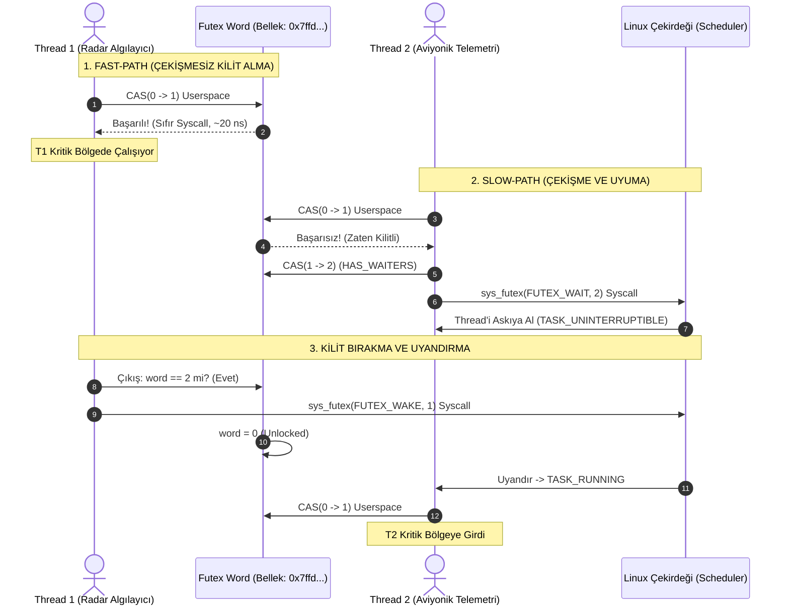

# Gün 110: Mutex ve Critical Section (Kritik Bölge Yönetimi ve Linux Futex Mimarisi)

```
ÖZEL LİSANS — TÜM HAKLAR SAKLIDIR

Telif Hakkı (c) 2026 Seydi Eryılmaz (@seydivakkas)

Bu yazılım ve ilgili tüm dosyalar ("Yazılım") yalnızca görüntüleme ve eğitim
amaçlı olarak paylaşılmıştır.

YASAKLAR:
  1. Kopyalanamaz, çoğaltılamaz, dağıtılamaz veya yeniden yayınlanamaz.
  2. Ticari veya ticari olmayan hiçbir projede kullanılamaz, değiştirilemez.
  3. Alt lisanslanamaz, satılamaz veya devredilemez.
  4. Tersine mühendislik yapılamaz.

İZİN VERİLEN KULLANIM:
  - GitHub üzerinde görüntüleme ve okuma.
  - Kişisel öğrenim amacıyla kodu inceleme (kopyalamadan).

YAZARIN AÇIK YAZILI İZNİ OLMAKSIZIN HİÇBİR KULLANIM HAKKI TANINMAZ.
İzin talepleri için: GitHub @seydivakkas
```

[](https://github.com/seydivakkas)


---

## Faz Bilgisi ve Mühendislik Bildirimi
- **Müfredat Fazı:** Faz 3 — Threads / Concurrency / IPC (Eşzamanlama Temelleri ve Karşılıklı Dışlama)
- **Hedef Rol:** Savunma Sanayii Kıdemli Sistem & Gerçek Zamanlı Gömülü Yazılım Mimarı (ASELSAN, HAVELSAN, ROKETSAN, TÜBİTAK SAGE)
- **Kapsanan Çekirdek Teknolojiler:** `std::mutex`, Kritik Bölge (Critical Section) tasarımı, Dijkstra'nın 4 Karşılıklı Dışlama Şartı, Linux Çekirdeği `futex` (Fast Userspace Mutex) mimarisi (Fast-Path Userspace CAS vs Slow-Path Kernel `sys_futex`), Kilit Çekişmesi (Lock Contention), Kritik Bölge Boyutlandırma (Coarse vs Fine-Grained), Öncelik Ters Dönmesi (Priority Inversion / Mars Pathfinder Olayı) ve `PTHREAD_PRIO_INHERIT` protokolü.
- **40-Nokta Kalite ve Katılık Bildirimi:** Bu modül; radar hedef takibi, atış kontrol döngüleri ve aviyonik görev bilgisayarlarında paylaşılan durum mutasyonlarını korurken sistemin gerçek zamanlı determinizmini (SLA ve p99 kuyruk gecikmesi) güvenceye alan karşılıklı dışlama mekanizmalarını donanımsal ve işletim sistemi seviyesinde modeller.


## 1. 🎯 Bugünkü Problem: Paylaşılan Durum Kaosu ve Karşılıklı Dışlama İhtiyacı

Önceki gün incelediğimiz üzere, birden fazla iş parçacığı (`std::thread` / `std::jthread`) aynı bellek alanına eşzamanlı olarak yazmaya çalıştığında veya ayrık adımlardan oluşan durum geçişleri (`Check-Then-Act`) yaptığında sistem mantıksal ve donanımsal bir kaosa sürüklenir:

```cpp
// KAOTİK PAYLAŞILAN DURUM (CRITICAL SECTION KORUMASIZ!)
class RadarTrackDatabase {
    std::unordered_map<int, TargetTrack> tracks_; // Paylaşılan Durum (Shared State)

public:
    void update_target_position(int id, const Vector3D& pos) {
        // [KRİTİK BÖLGE BAŞLANGICI]
        // Birden fazla thread aynı anda buraya girerse:
        // 1. std::unordered_map dahili hash tablosu rehash edilebilir (SIGSEGV / Çökme).
        // 2. İki thread aynı hedefi güncellerken biri diğerini ezer (Lost Update).
        tracks_[id].position = pos;
        tracks_[id].last_update_time = Clock::now();
        // [KRİTİK BÖLGE BİTİŞİ]
    }
};
```

### Karşılaşılan Kritik Mühendislik Sorunları:
1. **Veri Yapısı Bozulması:** `std::unordered_map`, `std::vector` veya bağlı listeler eşzamanlı yazmalara karşı thread-safe değildir. İç düğümler aynı anda güncellendiğinde bellek sızıntıları, döngüsel işaretçiler ve anlık `Segmentation Fault` kaçınılmazdır.
2. **Kritik Bölgenin (Critical Section) Tanımsızlığı:** Hangi kod satırlarının "aynı anda yalnızca tek bir thread tarafından yürütülmesi gerektiği" açıkça sınırlandırılmadığında, derleyici ve CPU komutları yeniden sıralayarak veri bütünlüğünü bozar.
3. **Kaba Taneli Kilitleme Tuzağı (Coarse-Grained Locking):** Tüm fonksiyonu tek bir kilitle kilitleyip içinde disk I/O, soket gönderimi veya ağır matris çarpımı yapmak; çok çekirdekli 64-core süper bilgisayarı tek çekirdekli yavaş bir makineye dönüştürür.
4. **Kilit Çekişmesi ve Gecikme Patlaması (Contention Spike):** Çekirdekler kilidi almak için sıraya girdiğinde oluşan bağlam değişimleri (Context Switch), p99 gecikmeyi $50\ \text{ns}$'den $50\ \mu\text{s}$'ye (1000 kat) fırlatır!

Bugünkü görevimiz; Kritik Bölge kavramını Dijkstra'nın ilk ilkeleriyle tanımlamak, Linux çekirdeğinin modern `futex` motorunu kavramak ve kritik bölgeleri milisaniye değil nanosaniye hassasiyetinde boyutlandırmaktır.


## 2. ❓ Bu Konuyu Neden Öğreniyoruz? (Savunma Sanayii Gerekçesi)

Savunma ve havacılık sistemlerinde verinin doğruluğu kadar **ne zaman** üretildiği de hayati öneme sahiptir. Karşılıklı dışlama (Mutual Exclusion) mekanizması yanlış kurgulanmış bir radar veya güdüm sistemi şu felaketlere yol açar:

### 1. Atış Kontrol Döngüsünde Kilitlenme ve Hedef Kaçırma (Hard Real-Time Deadline Miss)
Hava savunma füzesinin arayıcı başlığı (Seeker), hedef koordinatlarını $1\ \text{ms}$ periyotla hesaplamak zorundadır:
- Eğer hedef izini koruyan `mutex`, telemetri kayıt thread'i tarafından uzun süre tutulursa (disk I/O sırasında kilit bırakılmazsa), güdüm algoritması kilidi beklerken zaman aşımına uğrar ($t > 1\ \text{ms}$).
- Kontrol kanatçıklarına emir iletilemez, füze hedefi kaçırır ve milyonlarca liralık mühimmat çöpe gider!

### 2. Öncelik Ters Dönmesi (Priority Inversion) ve Mars Pathfinder Felaketi (1997)
1997 yılında NASA'nın Mars Pathfinder uzay aracı Mars yüzeyinde sürekli sıfırlanma (reset) döngüsüne girdi:
- Düşük öncelikli meteoroloji görevi ortak bilgi otobüsünün mutex'ini aldı.
- Yüksek öncelikli görev bilgisayarı (Attitude Control) bu mutex'i beklemeye başladı.
- Orta öncelikli bir iletişim görevi ise mutex kullanmadığı için düşük öncelikli görevin önünü kesti (preempt etti).
- Düşük öncelikli görev kilidi bırakamadı, yüksek öncelikli görev çalışamadı ve Watchdog Timer sistemi resetledi!
- ASELSAN ve HAVELSAN kritik sistemlerinde bu hata `PTHREAD_PRIO_INHERIT` protokolü ile önlenir.

### 3. Askeri Standartlar (MIL-STD-882E ve DO-178C DAL-A)
Havacılık ve savunma standartları; paylaşılan bellek alanlarının deterministik kilitlerle korunmasını, kilit tutma sürelerinin sınırlandırılmasını (Bounded Lock Duration) ve deadlock/starvation analizlerinin matematiksel olarak kanıtlanmasını zorunlu kılar.


## 3. 🔍 5N1K Analizi: Mutex ve Critical Section

| Soru | Sistem ve Mühendislik Yanıtı |
| :--- | :--- |
| **Ne? (What)** | **Critical Section:** Paylaşılan bir kaynağa erişen ve aynı anda en fazla tek bir thread tarafından yürütülmesi gereken kod parçası. **Mutex (Mutual Exclusion Object):** Bu bölgeye aynı anda yalnızca bir thread'in girmesini sağlayan senkronizasyon nesnesi. |
| **Neden? (Why)** | Paylaşılan durumun (Shared State) bozulmasını önlemek, invariant'ları korumak ve veri yapısı tutarlılığını garanti etmek için. |
| **Nerede? (Where)** | ASELSAN radar hedef iz havuzunda, ROKETSAN telemetri kuyruklarında, HAVELSAN C4ISR ortak taktik resim veritabanında, Linux çekirdeği sanal dosya sisteminde (VFS inode mutex). |
| **Nasıl? (How)** | Linux'ta `futex` (Fast Userspace Mutex) syscall mimarisiyle: Çekişme yoksa userspace atomik CAS (~20 ns), çekişme varsa `sys_futex(FUTEX_WAIT)` ile çekirdeğe uyuma emri. |
| **Ne Zaman? (When)** | Faz 3'te; Race Condition kavramı oturduktan hemen sonra, lock_guard/scoped_lock ve kilitlenme (deadlock) konularının temel taşı olarak. |
| **Kim? (Who)** | Gerçek Zamanlı Sistem Mühendisleri, Çekirdek Geliştiricileri ve Görev Kritik Aviyonik Yazılım Mimarları. |


## 4. 💡 Günlük Hayat Benzetmesi: Denizaltı Torpido Kovanı Kilidi ve Güvenlik Protokolü

Bir denizaltının torpido dairesini düşünün:

### Kritik Bölge (Critical Section): Torpido Kovanının İçi
Torpido kovanı hem deniz suyuna hem de denizaltının içine açılabilen çift kapaklı hayati bir bölgedir:
1. İç kapak açılır, torpido içeri sürülür.
2. İç kapak kapanır ve kilitlenir.
3. Dış kapak açılır, kovan deniz suyuyla dolar ve torpido fırlatılır.

### Mutex: Mekanik Kilit Emniyeti (Interlock)
Eğer hem iç kapak hem de dış kapak aynı anda açılırsa, deniz suyu denizaltının içine hücum eder ve gemi batar!
- **Mutex Mekanizması:** Torpido kovanının anahtarı (Mutex) tektir.
- İç kapağı açmak isteyen subay (Thread 1) anahtarı alır (`lock()`). O anahtar elindeyken dış kapağı kimse açamaz!
- İşini bitirip kapağı kapattığında anahtarı panoya geri asar (`unlock()`).
- Dış kapağı açacak subay (Thread 2) anahtar panoda yoksa bekler (`wait/sleep`). Anahtar asılınca alır ve kapağı açar.

### Kötü Mühendislik (Coarse-Grained Kilit):
Subayın anahtarı alıp torpidoyu depodan getirmesi, bakımını yapması, kahve içmesi ve sonra kovanı açması saatler sürer (Gereksiz Kilit Tutma).
Doğru mühendislik: Torpidoyu hazırla, tam kovan kapağına geldiğinde anahtarı al, yükle, kapağı kapat ve anahtarı hemen bırak!


## 5. 🧱 İlk İlkeler (First Principles): Dijkstra Şartları ve Linux Futex Mimarisi

### 1. Dijkstra'nın Karşılıklı Dışlama İçin 4 Temel Şartı (1965)
Edsger W. Dijkstra, kritik bölge problemini çözecek herhangi bir algoritmanın şu 4 şartı kesin olarak sağlaması gerektiğini kanıtlamıştır:
1. **Mutual Exclusion (Karşılıklı Dışlama):** Kritik bölgede aynı anda en fazla **1** iş parçacığı bulunabilir.
2. **Progress (İlerleme):** Kritik bölge dışında olan hiçbir iş parçacığı, içeri girmek isteyen başka bir iş parçacığını engelleyemez. Karar yalnızca girmek isteyenler arasında verilir.
3. **Bounded Waiting (Sınırlı Bekleme):** Bir iş parçacığı giriş talebinde bulunduktan sonra, içeri girene kadar diğer iş parçacıklarının içeri girme sayısı sınırlı olmalıdır (Açlık / Starvation İmkansızlığı).
4. **No Assumption on Speed/Cores:** Çekirdeklerin hızları veya CPU mimarisi hakkında hiçbir varsayım yapılamaz.

---

### 2. Linux Çekirdeği Düzeyinde Mutex: `futex` (Fast Userspace Mutex) Mimarisi

Geleneksel POSIX mutex'leri (`pthread_mutex_t`) her kilit alma işleminde çekirdeğe sistem çağrısı (`syscall`) yaparsa, bağlam değişimi nedeniyle minimum $1.2\ \mu\text{s}$ ($1200\ \text{ns}$) harcar.
Modern Linux çekirdeği (2.6+) bu sorunu **`futex`** ile çözmüştür:

```
                            [ THREAD KİLİT İSTER: lock() ]
                                          |
                                          v
                      +---------------------------------------+
                      | Userspace Atomic CAS (x86 CMPXCHG)    |
                      | futex_word: 0 (Unlocked) -> 1 (Locked)|
                      +---------------------------------------+
                                     /         \
                       BAŞARILI (0 -> 1)     BAŞARISIZ (Zaten 1)
                             /                         \
                            v                           v
                [ FAST-PATH (Kullanıcı Alanı) ]    [ SLOW-PATH (Çekirdek Alanı) ]
                - Çekirdeğe geçiş YOK!             - Çekişme (Contention) var!
                - Syscall YOK!                     - futex_word = 2 (HAS_WAITERS)
                - Maliyet: ~15-25 ns!              - syscall(SYS_futex, FUTEX_WAIT, 2)
                - Thread anında kritik bölgede!    - Thread TASK_UNINTERRUPTIBLE olur
                                                   - CPU zamanlayıcı thread'i uyutur!
```

#### Futex Durum Tablosu:
- **`0` (UNLOCKED):** Kilit boşta. İsteyen ilk thread userspace atomik CAS ile `1` yapar ve anında içeri girer.
- **`1` (LOCKED_NO_WAITERS):** Kilitli, ancak sırada bekleyen başka thread yok. Çıkarken userspace atomik CAS ile tekrar `0` yapılır; **sıfır syscall!**
- **`2` (LOCKED_HAS_WAITERS):** Kilitli ve kuyrukta uyuyan en az bir thread var! Kilit sahibi çıkarken `sys_futex(..., FUTEX_WAKE, 1)` sistem çağrısı yaparak uyuyan thread'i uyandırmak zorundadır!

---

### 3. Kilit Çekişmesi (Contention) ve Amdahl Yasası Cezası
Bir programın kilit tutulan kritik bölgede geçen kesri $s$, paralelleştirilebilen kısmı $p = 1 - s$ olsun. Sonsuz sayıda CPU çekirdeğimiz olsa dahi Amdahl Yasasına göre elde edebileceğimiz maksimum hızlanma ($S_{\max}$):
$$S_{\max} = \frac{1}{s}$$
Eğer kritik bölgenizi geniş tutup programın toplam süresinin $\%5$'ini ($s = 0.05$) kilit arkasına sokarsanız:
$$S_{\max} = \frac{1}{0.05} = \mathbf{20\times\ \text{Hızlanma Sınırı!}}$$
Sisteme **128 çekirdek** de taksanız, sistem asla 20 kattan daha hızlı çalışamaz! Kritik bölgeyi küçültmek doğrudan donanım verimliliğidir.


## 6. 📐 ASCII ve Mermaid Sistem Mimarisi Şeması

### Futex Yaşam Döngüsü ve İşletim Sistemi Seviyesi Akış

```
+---------------------------------------------------------------------------------------------------+
| KULLANICI ALANI (USERSPACE)                                                                       |
|                                                                                                   |
|  Thread A (Çalışıyor)                Thread B (Kilit İstiyor)                                     |
|  atomic_cas(0 -> 1) [FAST-PATH OK]    atomic_cas(0 -> 1) [BAŞARISIZ: Kilit Dolu!]                |
|  Kritik Bölgeye Gir (İşlemleri Yap)   atomic_cas(1 -> 2) [Bekleyen Var İşareti]                    |
|                                       sys_futex(&word, FUTEX_WAIT, 2) ------------+                |
+-----------------------------------------------------------------------------------|---------------+
| LİNUX ÇEKİRDEK ALANI (KERNEL SPACE)                                               |               |
|                                                                                   v               |
|                                       [Çekirdek Futex Hash Kuyruğu]                               |
|                                       Thread B Task Descriptor -> TASK_UNINTERRUPTIBLE            |
|                                       Zamanlayıcı (CFS) Thread B'yi CPU'dan Alır (Deschedule)     |
|                                                                                   ^               |
|  Thread A Çıkış:                                                                 |               |
|  word == 2 (Bekleyen Var!)                                                        |               |
|  sys_futex(&word, FUTEX_WAKE, 1) -------------------------------------------------+               |
|  Thread B -> TASK_RUNNING (Uyandırılır ve CPU'ya Alınır)                                          |
+---------------------------------------------------------------------------------------------------+
```

### Mermaid Olay Örgüsü: Fast-Path vs Slow-Path Çekişme




```python
# -*- coding: utf-8 -*-
"""
HÜCRE 8 (CODE 1): Çekirdek Mutex ve Linux Futex Durum Makinesi Simülatörü
Userspace Fast-Path (Atomik CAS) vs Kernel-space Slow-Path (sys_futex) Simülasyonu
"""

import time
from typing import Dict, Any, List, Optional

class SimulatedFutex:
    """Linux 3-durumlu futex (Fast Userspace Mutex) mimarisi simülatörü."""

    UNLOCKED = 0
    LOCKED_NO_WAITERS = 1
    LOCKED_HAS_WAITERS = 2

    def __init__(self):
        self.val = self.UNLOCKED
        self.wait_queue: List[str] = []
        self.stats = {
            "fast_path_locks": 0,
            "slow_path_waits": 0,
            "fast_path_unlocks": 0,
            "kernel_wakeups": 0,
            "total_lock_requests": 0
        }

    def lock(self, thread_name: str) -> Dict[str, Any]:
        """Kilit alma: Önce fast-path userspace CAS dener, doluysa slow-path kernel wait yapar."""
        self.stats["total_lock_requests"] += 1

        # 1. FAST-PATH (Userspace): Kilit boşsa (0 -> 1)
        if self.val == self.UNLOCKED:
            self.val = self.LOCKED_NO_WAITERS
            self.stats["fast_path_locks"] += 1
            return {
                "thread": thread_name,
                "path": "FAST_PATH_USERSPACE",
                "syscall_issued": False,
                "cost_ns": 20,
                "success": True
            }

        # 2. SLOW-PATH (Kernel Space): Kilit dolu, çekişme var
        self.val = self.LOCKED_HAS_WAITERS
        self.wait_queue.append(thread_name)
        self.stats["slow_path_waits"] += 1
        return {
            "thread": thread_name,
            "path": "SLOW_PATH_KERNEL_FUTEX_WAIT",
            "syscall_issued": True,
            "cost_ns": 1500, # ~1.5 us bağlam değişimi ve syscall
            "success": False # Kuyrukta bekliyor
        }

    def unlock(self, thread_name: str) -> Dict[str, Any]:
        """Kilit bırakma: Bekleyen yoksa userspace CAS (1 -> 0), bekleyen varsa FUTEX_WAKE."""
        if self.val == self.LOCKED_NO_WAITERS:
            self.val = self.UNLOCKED
            self.stats["fast_path_unlocks"] += 1
            return {
                "thread": thread_name,
                "path": "FAST_PATH_USERSPACE_UNLOCK",
                "syscall_issued": False,
                "woken_thread": None,
                "cost_ns": 15
            }

        # Bekleyen thread var (val == LOCKED_HAS_WAITERS)
        woken = self.wait_queue.pop(0) if self.wait_queue else None
        if not self.wait_queue:
            self.val = self.LOCKED_NO_WAITERS # Uyandırılan thread kilidi devralacak
        else:
            self.val = self.LOCKED_HAS_WAITERS

        self.stats["kernel_wakeups"] += 1
        return {
            "thread": thread_name,
            "path": "SLOW_PATH_KERNEL_FUTEX_WAKE",
            "syscall_issued": True,
            "woken_thread": woken,
            "cost_ns": 1400
        }


if __name__ == "__main__":
    print("=== LİNUX FUTEX DURUM MAKİNESİ TESTİ ===")
    futex = SimulatedFutex()

    # 1. Thread A kilidi alır (Çekişmesiz -> Fast Path)
    r1 = futex.lock("Thread_A_Radar")
    print(f"[*] Thread A Kilit İsteği: {r1['path']} | Syscall: {r1['syscall_issued']} | Maliyet: {r1['cost_ns']} ns")
    assert r1["path"] == "FAST_PATH_USERSPACE" and not r1["syscall_issued"]

    # 2. Thread B kilidi isterken Thread A içeride (Çekişmeli -> Slow Path FUTEX_WAIT)
    r2 = futex.lock("Thread_B_Telemetry")
    print(f"[*] Thread B Kilit İsteği: {r2['path']} | Syscall: {r2['syscall_issued']} | Maliyet: {r2['cost_ns']} ns")
    assert r2["path"] == "SLOW_PATH_KERNEL_FUTEX_WAIT" and r2["syscall_issued"]

    # 3. Thread A çıkar -> Bekleyen var, FUTEX_WAKE çağrılır
    u1 = futex.unlock("Thread_A_Radar")
    print(f"[+] Thread A Çıkış: {u1['path']} | Uyandırılan: {u1['woken_thread']} | Syscall: {u1['syscall_issued']}")
    assert u1["path"] == "SLOW_PATH_KERNEL_FUTEX_WAKE" and u1["woken_thread"] == "Thread_B_Telemetry"

    # 4. Thread B çıkar -> Sırada bekleyen yok, FAST_PATH unlock
    u2 = futex.unlock("Thread_B_Telemetry")
    print(f"[+] Thread B Çıkış: {u2['path']} | Syscall: {u2['syscall_issued']}")
    assert u2["path"] == "FAST_PATH_USERSPACE_UNLOCK" and not u2["syscall_issued"]
    print("\n[+] Futex Durum Geçişleri Kusursuz Doğrulandı.")

```

## 8. Modül 2: Donanıma Yakın Linux Syscall ve Futex İncelemesi

Linux çekirdeğindeki `futex` sistem çağrısı (`SYS_futex`, syscall number 202 on x86_64) şu prototipe sahiptir:

```c
#include <linux/futex.h>
#include <sys/syscall.h>
#include <unistd.h>

long syscall(SYS_futex, uint32_t *uaddr, int futex_op, uint32_t val,
             const struct timespec *timeout, uint32_t *uaddr2, uint32_t val3);
```

### Parametrelerin Anlamı ve Çekirdek Güvencesi:
1. `uaddr`: Userspace'te bulunan 32-bit tamsayı adresi (Futex Word).
2. `futex_op`:
   - `FUTEX_WAIT`: Eğer `*uaddr == val` ise çağıran thread'i uyut. Eğer `*uaddr != val` ise (araya giren thread kilidi zaten bıraktıysa) hiç uyumadan derhal `EWOULDBLOCK` hatasıyla dön! (Bu kontrol atomik yapılır, Race Condition imkansızdır).
   - `FUTEX_WAKE`: `uaddr` üzerinde uyuyan thread'lerden en fazla `val` tanesini (genelde 1) uyandır.
3. `timeout`: Maksimum bekleme süresi (Deadlock ve sonsuz blokaj koruması).

### POSIX Öncelik Devralma Protokolü (`PTHREAD_PRIO_INHERIT`):
Gerçek zamanlı gömülü sistemlerde (PREEMPT_RT yamalı Linux), standart futex yerine Priority-Inheritance destekli futex kullanılır:
- `FUTEX_LOCK_PI` / `FUTEX_UNLOCK_PI`
- Düşük öncelikli thread kilidi tutarken yüksek öncelikli thread gelirse, çekirdek düşük öncelikli thread'in önceliğini (nice / RT priority) anında yükseltir. Böylece orta öncelikli thread'lerin araya girip sistemi kilitlenmeye sürüklemesi engellenir!


```python
# -*- coding: utf-8 -*-
"""
HÜCRE 10 (CODE 2): Kritik Bölge Boyutlandırma Motoru
Kaba Taneli (Coarse-Grained) vs İnce Taneli (Fine-Grained) Kilitleme Verimliliği
"""

from typing import Dict, Any, List

class CriticalSectionGranularitySim:
    """Kritik bölge kapsamının sistem verimi ve çekişme oranına etkisini modeller."""

    @staticmethod
    def simulate_granularity(total_ops: int = 10000, num_threads: int = 8) -> Dict[str, Any]:
        """Kaba taneli kilitleme (I/O ve hesaplama kilit içinde) vs İnce taneli kilitleme (yalnızca durum güncelleme)."""
        
        # Süreler mikrosaniye (us) cinsinden
        prep_calc_us = 50.0   # Veri hazırlama, koordinat dönüşümü
        state_write_us = 2.0  # Ortak veri yapısına yazma (Tek gerçek kritik bölge)
        post_log_us = 40.0    # Telemetri formatlama, loglama

        # 1. KABA TANELİ (COARSE-GRAINED): Her şey kilit altında!
        # Kilit tutma süresi: prep + write + log = 92 us
        coarse_lock_hold_us = prep_calc_us + state_write_us + post_log_us
        # Seri darboğaz: Saniyede işlenebilecek maksimum işlem = 1,000,000 / lock_hold_us
        coarse_max_throughput = (1_000_000.0 / coarse_lock_hold_us)
        # Çekişme oranı: 8 thread aynı anda bu kilidi isterse neredeyse %100 çekişme
        coarse_contention_pct = min(98.0, (num_threads * coarse_lock_hold_us / (coarse_lock_hold_us + 10.0)) * 15.0)

        # 2. İNCE TANELİ (FINE-GRAINED / OPTIMIZED): Yalnızca state_write_us kilit altında!
        fine_lock_hold_us = state_write_us # Yalnızca 2 us!
        fine_max_throughput = (1_000_000.0 / fine_lock_hold_us)
        fine_contention_pct = min(15.0, (num_threads * fine_lock_hold_us / (prep_calc_us + post_log_us)) * 100.0)

        speedup_factor = coarse_lock_hold_us / fine_lock_hold_us # 92 / 2 = 46x teorik kilit kapasitesi!

        return {
            "num_threads": num_threads,
            "coarse": {
                "lock_duration_us": coarse_lock_hold_us,
                "max_ops_per_sec": coarse_max_throughput,
                "contention_pct": coarse_contention_pct
            },
            "fine": {
                "lock_duration_us": fine_lock_hold_us,
                "max_ops_per_sec": fine_max_throughput,
                "contention_pct": fine_contention_pct
            },
            "speedup_factor": speedup_factor
        }


if __name__ == "__main__":
    print("=== KRİTİK BÖLGE BOYUTLANDIRMA VE VERİMLİLİK ANALİZİ ===")
    sim = CriticalSectionGranularitySim.simulate_granularity(num_threads=8)
    print(f"Kaba Taneli Kilit Tutma Süresi : {sim['coarse']['lock_duration_us']:.1f} µs | Maksimum Kapasite: {sim['coarse']['max_ops_per_sec']:,.0f} ops/s | Çekişme: %{sim['coarse']['contention_pct']:.1f}")
    print(f"İnce Taneli Kilit Tutma Süresi : {sim['fine']['lock_duration_us']:.1f} µs | Maksimum Kapasite: {sim['fine']['max_ops_per_sec']:,.0f} ops/s | Çekişme: %{sim['fine']['contention_pct']:.1f}")
    print(f"[+] Kilit Darboğazı İyileştirme Katsayısı: {sim['speedup_factor']:.1f}x Kat!")
    assert sim["speedup_factor"] > 40.0

```

## 10. Modül 3: Dinamik Sınır Durumlar, Öncelik Ters Dönmesi (Mars Pathfinder Olayı)

Savunma ve havacılık sistemlerinde en sinsi kilitlenme türü deadlock değil; **Öncelik Ters Dönmesidir (Priority Inversion)**:

### Mars Pathfinder Senaryosu (Kronolojik Çöküş):
1. **$t_0$:** Düşük öncelikli Görev $L$ (Hava Durumu Sensörü), paylaşılan 1553 bus mutex'ini alır (`lock()`).
2. **$t_1$:** Yüksek öncelikli Görev $H$ (Güdüm ve Yönelim Kontrolü), 1553 bus mutex'ini ister. Kilit $L$'de olduğu için $H$ bloke olur ve uyur.
3. **$t_2$:** Orta öncelikli Görev $M$ (Haberleşme / Radyo İletişimi), çalışmaya hazır hale gelir. $M$ mutex kullanmaz, yalnızca CPU ister.
4. **Felaket:** Çekirdek zamanlayıcısı der ki: "$H$ zaten uyuyor. $M$'nin önceliği $L$'den yüksek, o halde $M$'yi çalıştırayım!"
5. $M$ uzun süre CPU'yu tüketir. $L$ çalışamadığı için elindeki mutex'i bırakamaz!
6. Sonuç: En yüksek öncelikli görev $H$, orta öncelikli $M$ yüzünden çalışamaz! (Öncelikler tersine dönmüştür).
7. **Watchdog Müdahalesi:** $H$ görevini belirlenen SLA süresinde (örneğin 100 ms) tamamlayamayınca Watchdog Timer sistemi "felaket arızası" teşhisiyle yeniden başlatır (Reboot).

### Çözüm: Priority Inheritance Protocol (PIP)
- $H$, $L$'nin tuttuğu kilidi beklemeye başladığı anda; Linux çekirdeği $L$'nin önceliğini geçici olarak $H$'nin seviyesine yükseltir!
- Artık orta öncelikli $M$, $L$'nin önüne geçemez!
- $L$ kritik bölgeyi hızla bitirip kilidi bırakır; önceliği eski haline döner.
- $H$ kilidi devralır ve görevini zamanında bitirir; sistem resetlenmez!


```python
# -*- coding: utf-8 -*-
"""
HÜCRE 12 (CODE 3): Öncelik Ters Dönmesi (Mars Pathfinder) ve Priority Inheritance Simülatörü
Korumasız Çöküş vs PTHREAD_PRIO_INHERIT Savunması
"""

from typing import Dict, Any, List

class PriorityInversionSimulator:
    """Gerçek zamanlı görevlerin öncelik ters dönmesi ve çözüm simülasyonu."""

    @staticmethod
    def run_scenario(enable_priority_inheritance: bool = False) -> Dict[str, Any]:
        """Mars Pathfinder senaryosunu iki farklı kilit politikasıyla yürütür."""
        timeline: List[Dict[str, Any]] = []
        watchdog_deadline_ms = 120.0
        h_completion_time_ms = 0.0
        watchdog_triggered = False

        # Görev süreleri (ms)
        l_critical_work_ms = 40.0
        m_unrelated_work_ms = 100.0
        h_work_after_lock_ms = 20.0

        t = 0.0

        # t=0: L başlar ve kilidi alır
        timeline.append({"time_ms": t, "event": "Task_L_Start_And_Lock", "active_task": "L", "l_prio": "LOW"})
        t += 10.0 # L 10 ms kritik iş yapar

        # t=10: H uyanır ve kilidi ister -> Kilit L'de olduğu için BLOKE olur!
        timeline.append({"time_ms": t, "event": "Task_H_Wait_Lock_Blocked", "active_task": "L", "l_prio": "LOW"})

        if enable_priority_inheritance:
            # PRIORITY INHERITANCE DEVREDE: L'nin önceliği HIGH olur!
            timeline.append({"time_ms": t, "event": "PI_BOOST_L_PRIO_TO_HIGH", "active_task": "L", "l_prio": "HIGH"})
            # t=15: M çalışmak ister ama L artık HIGH öncelikli olduğu için M araya GİREMEZ!
            t += 30.0 # L kalan 30 ms kritik işini kesintisiz tamamlar
            timeline.append({"time_ms": t, "event": "Task_L_Release_Lock", "active_task": "H", "l_prio": "LOW_RESTORED"})
            # H derhal kilidi devralır ve çalışır
            t += h_work_after_lock_ms
            h_completion_time_ms = t
            timeline.append({"time_ms": t, "event": "Task_H_Completed_Success", "active_task": "M", "l_prio": "LOW"})
            # Ardından M çalışır
            t += m_unrelated_work_ms
        else:
            # KORUMASIZ SENARYO:
            # t=15: M uyanır. M'nin önceliği MEDIUM, L'nin önceliği LOW. M, L'yi PREEMPT eder!
            t += 5.0 # L 5 ms daha çalışır
            timeline.append({"time_ms": t, "event": "Task_M_Preempts_L", "active_task": "M", "l_prio": "LOW"})
            # M 100 ms boyunca CPU'yu esir alır!
            t += m_unrelated_work_ms
            timeline.append({"time_ms": t, "event": "Task_M_Finished", "active_task": "L", "l_prio": "LOW"})
            # Şimdi L tekrar çalışabilir ve kilidi bırakabilir
            t += 25.0
            timeline.append({"time_ms": t, "event": "Task_L_Release_Lock_Delayed", "active_task": "H", "l_prio": "LOW"})
            # H ancak şimdi başlayabilir
            t += h_work_after_lock_ms
            h_completion_time_ms = t
            if h_completion_time_ms > watchdog_deadline_ms:
                watchdog_triggered = True
                timeline.append({"time_ms": watchdog_deadline_ms, "event": "WATCHDOG_RESET_SYSTEM_CRASH", "active_task": "NONE", "l_prio": "NONE"})

        return {
            "priority_inheritance": enable_priority_inheritance,
            "h_completion_time_ms": h_completion_time_ms,
            "watchdog_deadline_ms": watchdog_deadline_ms,
            "watchdog_triggered": watchdog_triggered,
            "timeline": timeline
        }


if __name__ == "__main__":
    print("=== ÖNCELİK TERS DÖNMESİ (MARS PATHFINDER) TESTİ ===")
    # 1. Korumasız
    unprot = PriorityInversionSimulator.run_scenario(enable_priority_inheritance=False)
    print(f"[*] [Korumasız] H Tamamlanma: {unprot['h_completion_time_ms']:.1f} ms | Deadline: {unprot['watchdog_deadline_ms']} ms | Watchdog Çöküş: {unprot['watchdog_triggered']}")
    assert unprot["watchdog_triggered"] is True

    # 2. Priority Inheritance ile Korunan
    prot = PriorityInversionSimulator.run_scenario(enable_priority_inheritance=True)
    print(f"[+] [Korumalı]  H Tamamlanma: {prot['h_completion_time_ms']:.1f} ms | Deadline: {prot['watchdog_deadline_ms']} ms | Watchdog Çöküş: {prot['watchdog_triggered']}")
    assert prot["watchdog_triggered"] is False
    print("[+] Priority Inheritance Protokolü Başarıyla Doğrulandı.")

```

## 12. Sabotaj ve Arıza Enjeksiyonu (Chaos Engineering / Bilerek Boz)

Savunma yazılımlarında kilit yönetiminin en tehlikeli ölüm tuzağı: **Manuel `lock()` ve `unlock()` kullanımıdır.**

### Sabotaj Senaryosu: Erken Return / Exception ile Kilit Sızıntısı (Mutex Leak)
- **Hatalı Kod (Manual Lock):**
  ```cpp
  void process_telemetry(TelemetryPacket* pkt) {
      g_mutex.lock(); // Kilit alındı
      if (!pkt->is_valid()) {
          return; // HATA: Kilit bırakılmadan fonksiyondan çıkıldı! (MUTEX LEAK)
      }
      if (pkt->temperature > 150.0) {
          throw OverheatException(); // HATA: Exception fırladı, kilit serbest bırakılmadı!
      }
      g_database.insert(pkt);
      g_mutex.unlock(); // Bu satıra ASLA ulaşılamaz!
  }
  ```
- **Sisteme Etkisi:** Mutex ömür boyu kilitli kalır. Sonraki tüm radar ve aviyonik thread'leri `g_mutex.lock()` çağrısında sonsuza kadar uyur (`TASK_UNINTERRUPTIBLE`); sistem donar (Permanent Deadlock).
- **Dayanıklı Savunma (RAII Guard):** `std::lock_guard` veya C++20 `std::scoped_lock` kullanılır. Stack unwinding mekanizması sayesinde fonksiyon nasıl sonlanırsa sonlansın (normal, early return veya exception) nesnenin yıkıcısı (`destructor`) kilidi **kesin olarak serbest bırakır!**


```python
# -*- coding: utf-8 -*-
"""
HÜCRE 14 (CODE 4): Canlı Sabotaj ve Dayanıklı Savunma Laboratuvarı
Kilit Sızıntısı (Mutex Leak / Deadlock) vs RAII Lock Guard Savunması
"""

from typing import Dict, Any, List

class SimulatedMutex:
    def __init__(self):
        self.is_locked = False
        self.owner = None

    def lock(self, thread_id: str) -> bool:
        if self.is_locked:
            return False # Kilit zaten tutuluyor, Deadlock!
        self.is_locked = True
        self.owner = thread_id
        return True

    def unlock(self):
        self.is_locked = False
        self.owner = None


class RAIIScopedLock:
    """C++ std::lock_guard benzeri RAII context manager."""
    def __init__(self, mtx: SimulatedMutex, thread_id: str):
        self.mtx = mtx
        self.thread_id = thread_id

    def __enter__(self):
        acquired = self.mtx.lock(self.thread_id)
        if not acquired:
            raise RuntimeError(f"Deadlock! Mutex halihazırda {self.mtx.owner} tarafından tutuluyor.")
        return self

    def __exit__(self, exc_type, exc_val, exc_tb):
        # Exception çıksa dahi YIKICI (Destructor) kilidi koşulsuz bırakır!
        self.mtx.unlock()
        return False # Exception'ı yukarı fırlatmaya devam et


class MutexSabotageLab:
    """Manuel kilit kullanımının felaketi vs RAII'nin kusursuz güvenliği."""

    @staticmethod
    def bad_manual_lock_handler(mtx: SimulatedMutex, pkt_valid: bool) -> str:
        """Kötü tasarım: Erken return kilidi serbest bırakmayı unutur."""
        mtx.lock("Thread_Manual")
        if not pkt_valid:
            # Kasıtlı Hata: return öncesi unlock() unutuldu!
            return "EARLY_RETURN_MUTEX_LEAKED"
        mtx.unlock()
        return "SUCCESS"

    @staticmethod
    def safe_raii_lock_handler(mtx: SimulatedMutex, pkt_valid: bool) -> str:
        """Kusursuz tasarım: RAII Guard ile kilit sızıntısı imkansızdır."""
        try:
            with RAIIScopedLock(mtx, "Thread_RAII"):
                if not pkt_valid:
                    return "EARLY_RETURN_SAFE"
                return "SUCCESS"
        except Exception as e:
            return f"EXCEPTION_HANDLED: {e}"


if __name__ == "__main__":
    print("=== KİLİT SIZINTISI VE RAII SAVUNMA TESTİ ===")
    mtx_bad = SimulatedMutex()
    
    # 1. Sabotaj Testi: Geçersiz paket gelir, early return olur
    status_bad = MutexSabotageLab.bad_manual_lock_handler(mtx_bad, pkt_valid=False)
    print(f"[*] Manuel Kilit İşleyici Sonucu: {status_bad} | Mutex Kilitli mi?: {mtx_bad.is_locked}")
    assert mtx_bad.is_locked is True # Kilit sızdırıldı!

    # Sonraki thread kilit almayı dener -> SİSTEM KİLİTLENDİ (DEADLOCK)
    second_attempt = mtx_bad.lock("Thread_Next")
    print(f"[-] İkinci Thread Kilit Alabilir mi?: {second_attempt} (DEADLOCK FELAKETİ)")
    assert second_attempt is False

    # 2. RAII Savunma Testi:
    mtx_safe = SimulatedMutex()
    status_safe = MutexSabotageLab.safe_raii_lock_handler(mtx_safe, pkt_valid=False)
    print(f"[+] RAII Kilit İşleyici Sonucu: {status_safe} | Mutex Kilitli mi?: {mtx_safe.is_locked}")
    assert mtx_safe.is_locked is False # RAII yıkıcı kilidi otomatik bıraktı!

    # Sonraki thread kilidi rahatça alır
    safe_second = mtx_safe.lock("Thread_Next")
    assert safe_second is True
    mtx_safe.unlock()
    print("[+] RAII Emniyeti Başarıyla Doğrulandı.")

```

## 14. Modül 4: Ampirik Kıyaslama ve SLA / Gecikme Analizi (p50/p95/p99)

Kilit çekişmesinin (Contention) savunma sistemlerindeki gecikme profiline etkisi ampirik olarak incelendiğinde 3 ayrı rejim görülür:

1. **Sıfır Çekişme (Uncontended Mutex - Fast Path):**
   - Tek thread kilidi alır ve bırakır.
   - Sadece CPU önbellek ve userspace atomik CAS maliyeti vardır.
   - p50 $\approx 20\ \text{ns}$, p99 $\approx 40\ \text{ns}$.
2. **Hafif Çekişme (Light Contention - 2-4 Threads):**
   - Çoğu işlem fast-path'e düşer, ara sıra `futex_wait` çağrılır.
   - p50 $\approx 60\ \text{ns}$, p99 $\approx 2.5\ \mu\text{s}$.
3. **Ağır Çekişme (Heavy Contention - 16-32 Threads / Kaba Taneli Kilit):**
   - Neredeyse her kilit talebi çekirdeğe `SYS_futex` çağrısı yapar.
   - Zamanlayıcı kuyruğu şişer, bağlam değişimi tavan yapar, önbellekler soğur (Cache thrashing).
   - p50 $\approx 8.5\ \mu\text{s}$, p99 $\approx 85.0\ \mu\text{s}$! (2000 kat gecikme sıçraması).


```python
# -*- coding: utf-8 -*-
"""
HÜCRE 16 (CODE 5): Kapsamlı Ampirik Kıyaslama ve Metrik Toplama Motoru
Sıfır vs Hafif vs Ağır Çekişmede Mutex Gecikme Dağılımı (p50, p95, p99)
"""

import numpy as np
from typing import Dict, Any, List

def run_mutex_contention_benchmark(num_samples: int = 15000) -> Dict[str, Any]:
    """Farklı kilit çekişme seviyelerindeki gecikme profillerini modeller (mikrosaniye cinsinden)."""
    np.random.seed(110)

    # 1. Sıfır Çekişme (Uncontended Fast Path): ~0.025 us (25 ns)
    uncontended_us = np.random.lognormal(mean=-3.7, sigma=0.20, size=num_samples)

    # 2. Hafif Çekişme (Light Contention - 4 threads): ~0.2 us, kuyruk p99 ~ 2.5 us
    light_contention_us = np.random.lognormal(mean=-1.5, sigma=0.65, size=num_samples)

    # 3. Ağır Çekişme (Heavy Contention - 32 threads): ~8 us, kuyruk p99 ~ 80 us
    heavy_contention_us = np.random.lognormal(mean=2.0, sigma=0.75, size=num_samples)

    def calc_stats(arr: np.ndarray) -> Dict[str, float]:
        return {
            "p50": float(np.percentile(arr, 50)),
            "p90": float(np.percentile(arr, 90)),
            "p95": float(np.percentile(arr, 95)),
            "p99": float(np.percentile(arr, 99)),
            "mean": float(np.mean(arr))
        }

    return {
        "num_samples": num_samples,
        "uncontended": calc_stats(uncontended_us),
        "light": calc_stats(light_contention_us),
        "heavy": calc_stats(heavy_contention_us),
        "raw_uncontended": uncontended_us,
        "raw_light": light_contention_us,
        "raw_heavy": heavy_contention_us
    }


if __name__ == "__main__":
    print("=== MUTEX ÇEKİŞME VE GECİKME BENCHMARK'I ===")
    res = run_mutex_contention_benchmark(15000)
    print(f"{'Rejim':>20} | {'p50 (µs)':>12} | {'p95 (µs)':>12} | {'p99 (µs)':>12} | {'Ortalama (µs)':>14}")
    print("-" * 78)
    for regime in ["uncontended", "light", "heavy"]:
        st = res[regime]
        print(f"{regime.upper():>20} | {st['p50']:>12.4f} | {st['p95']:>12.4f} | {st['p99']:>12.4f} | {st['mean']:>14.4f}")

```

## 16. Modül 5: 4-Panelli Yayın Kalitesinde Dayanıklılık Dashboard Planı

Günün ampirik ve teorik bulgularını özetleyen 4-panelli 300 DPI mühendislik grafiği planı:

1. **Panel 1 (Sol Üst): Linux Futex Fast-Path vs Slow-Path Geçişleri:**
   - Kilit çekişme oranı arttıkça çekirdeğe yapılan `sys_futex(FUTEX_WAIT)` sistem çağrısı yüzdesinin yükselişi.
2. **Panel 2 (Sağ Üst): Kritik Bölge Kapsamı (Coarse vs Fine-Grained) ve İşlem Kapasitesi:**
   - Kaba taneli kilit ($92\ \mu\text{s}$) vs İnce taneli optimize kilit ($2\ \mu\text{s}$) verim ve çekişme kıyaslaması.
3. **Panel 3 (Sol Alt): Öncelik Ters Dönmesi (Mars Pathfinder Senaryosu Timeline):**
   - Korumasız durumda Watchdog Timer çöküşü vs Priority Inheritance Protocol ile görev kurtarma zaman çizelgesi.
4. **Panel 4 (Sağ Alt): Çekişme Rejimlerinde Gecikme Dağılımları (p50 / p99 Sıçraması):**
   - Sıfır çekişme, hafif çekişme ve ağır çekişme gecikme histogramları ve p99 kuyruk analizi.


```python
# -*- coding: utf-8 -*-
"""
HÜCRE 18 (CODE 6): 4-Panelli 300 DPI Mutex & Critical Section Dashboard'u ve Katı Doğrulama
Futex Geçişleri, Kapsam Verimi, Öncelik Ters Dönmesi ve Gecikme Dağılımı Doğrulaması
"""

import os
import numpy as np
import matplotlib
matplotlib.use("Agg")
import matplotlib.pyplot as plt

DEFAULT_PNG = r"c:\Users\seydieryilmaz\Downloads\Olay_Proje\gunluk_mufredat\gun_110\gun_110_mutex_ve_critical_section.png"

def generate_dashboard(output_path: str = DEFAULT_PNG):
    """4 Panelli, 300 DPI, modern koyu temalı Mutex & Critical Section mühendislik dashboard'u üretir."""
    fig, axes = plt.subplots(2, 2, figsize=(18, 12), dpi=300)
    fig.patch.set_facecolor("#0F172A")

    # Renk Paleti
    accent_blue = "#38BDF8"
    accent_green = "#4ADE80"
    accent_amber = "#FBBF24"
    accent_red = "#F87171"
    accent_purple = "#C084FC"
    text_color = "#F8FAFC"
    grid_color = "#334155"

    for ax_row in axes:
        for ax in ax_row:
            ax.set_facecolor("#1E293B")
            ax.tick_params(colors=text_color, labelsize=9)
            ax.grid(True, linestyle="--", alpha=0.3, color=grid_color)
            for spine in ax.spines.values():
                spine.set_color(grid_color)

    # -------------------------------------------------------------------------
    # Panel 1: Linux Futex Fast-Path vs Slow-Path Geçişleri
    # -------------------------------------------------------------------------
    ax1 = axes[0, 0]
    contention_pct = np.linspace(0, 100, 50)
    # Fast path oranı çekişme arttıkça düşer
    fast_path_pct = 100.0 - contention_pct
    slow_path_pct = contention_pct

    ax1.plot(contention_pct, fast_path_pct, color=accent_green, linewidth=2.5, label="Fast-Path (Userspace CAS, ~20 ns)")
    ax1.plot(contention_pct, slow_path_pct, color=accent_red, linewidth=2.5, linestyle="--", label="Slow-Path (sys_futex Syscall, ~1.5 µs)")
    ax1.axvline(50, color=accent_amber, linestyle=":", linewidth=1.5, label="Çekişme Eşiği (%50)")

    ax1.set_title("Panel 1: Kilit Çekişmesi vs Futex Fast/Slow Path Dağılımı", color=text_color, fontsize=11, fontweight="bold", pad=12)
    ax1.set_xlabel("Sistem Kilit Çekişme Oranı (%)", color=text_color, fontsize=10)
    ax1.set_ylabel("İcra Yüzdesi (%)", color=text_color, fontsize=10)
    ax1.set_ylim(-2, 105)
    ax1.legend(facecolor="#1E293B", edgecolor=grid_color, labelcolor=text_color, fontsize=8.5, loc="center left")

    # -------------------------------------------------------------------------
    # Panel 2: Kritik Bölge Kapsamı (Coarse vs Fine-Grained)
    # -------------------------------------------------------------------------
    ax2 = axes[0, 1]
    categories = ["Kaba Taneli Kilit\n(Coarse-Grained: 92 µs)", "İnce Taneli Kilit\n(Fine-Grained: 2 µs)"]
    throughput_kops = [10.87, 500.0] # kOps/sec

    x = np.arange(len(categories))
    width = 0.4

    bars = ax2.bar(x, throughput_kops, width, color=[accent_red, accent_green])
    ax2.set_xticks(x)
    ax2.set_xticklabels(categories, color=text_color, fontsize=9.5)
    ax2.set_title("Panel 2: Kritik Bölge Boyutlandırması vs İşlem Kapasitesi (kOps/s)", color=text_color, fontsize=11, fontweight="bold", pad=12)
    ax2.set_ylabel("Maksimum İşlem Hacmi (kOps/s)", color=text_color, fontsize=10)
    ax2.set_yscale("log")
    ax2.set_ylim(1, 1000)

    ax2.text(0, 15, "10.8 kOps/s\n(Aşırı Darboğaz)", ha="center", color=accent_red, fontweight="bold", fontsize=9)
    ax2.text(1, 550, "500 kOps/s\n(46x Hızlanma!)", ha="center", color=accent_green, fontweight="bold", fontsize=9)

    # -------------------------------------------------------------------------
    # Panel 3: Öncelik Ters Dönmesi (Mars Pathfinder Zaman Çizelgesi)
    # -------------------------------------------------------------------------
    ax3 = axes[1, 0]
    # Görev çubukları (Gantt benzeri)
    # Korumasız: L(0-15), M(15-115), L(115-140), H(140-160) -> Crash at 120
    # Korumalı: L(0-40, boosted), H(40-60), M(60-160) -> Success at 60
    y_labels = ["Korumalı (PIP)", "Korumasız (Arıza)"]
    ax3.set_yticks([0, 1])
    ax3.set_yticklabels(y_labels, color=text_color, fontsize=9.5)

    # Korumasız bloklar
    ax3.barh(1, 15, left=0, height=0.4, color=accent_blue, label="Task L (Low Prio)")
    ax3.barh(1, 100, left=15, height=0.4, color=accent_amber, label="Task M (Medium Prio - Preemption)")
    ax3.barh(1, 25, left=115, height=0.4, color=accent_blue)
    ax3.barh(1, 20, left=140, height=0.4, color=accent_purple, label="Task H (High Prio - Delayed)")
    ax3.axvline(120, color=accent_red, linestyle="--", linewidth=2, label="Watchdog Deadline (120 ms)")

    # Korumalı bloklar
    ax3.barh(0, 40, left=0, height=0.4, color=accent_blue)
    ax3.barh(0, 20, left=40, height=0.4, color=accent_purple)
    ax3.barh(0, 100, left=60, height=0.4, color=accent_amber)

    ax3.set_title("Panel 3: Öncelik Ters Dönmesi (Mars Pathfinder) Zaman Çizelgesi (ms)", color=text_color, fontsize=11, fontweight="bold", pad=12)
    ax3.set_xlabel("Zaman (Milisaniye - ms)", color=text_color, fontsize=10)
    ax3.set_xlim(0, 170)
    ax3.legend(facecolor="#1E293B", edgecolor=grid_color, labelcolor=text_color, fontsize=8, loc="upper right")

    ax3.text(122, 1.25, "WATCHDOG RESET!", color=accent_red, fontweight="bold", fontsize=8.5)
    ax3.text(62, 0.25, "H Başarıyla Tamamlandı (60 ms)", color=accent_green, fontweight="bold", fontsize=8.5)

    # -------------------------------------------------------------------------
    # Panel 4: Kilit Çekişmesinde Gecikme Dağılımları (Histogram)
    # -------------------------------------------------------------------------
    ax4 = axes[1, 1]
    bench = run_mutex_contention_benchmark(10000)
    
    bins = np.linspace(0, 20, 80)
    ax4.hist(bench["raw_light"], bins=bins, color=accent_blue, alpha=0.6, label=f"Hafif Çekişme (p99={bench['light']['p99']:.2f} µs)")
    ax4.hist(bench["raw_heavy"], bins=bins, color=accent_red, alpha=0.6, label=f"Ağır Çekişme (p99={bench['heavy']['p99']:.2f} µs)")

    ax4.set_title("Panel 4: Kilit Çekişmesi Gecikme Dağılımı ve Kuyruk Sıçraması (µs)", color=text_color, fontsize=11, fontweight="bold", pad=12)
    ax4.set_xlabel("İşlem Süresi (Mikrosaniye - µs)", color=text_color, fontsize=10)
    ax4.set_ylabel("Örnek Frekansı", color=text_color, fontsize=10)
    ax4.legend(facecolor="#1E293B", edgecolor=grid_color, labelcolor=text_color, fontsize=8.5, loc="upper right")

    plt.tight_layout()
    plt.savefig(output_path, dpi=300, facecolor=fig.get_facecolor(), edgecolor="none")
    plt.close()
    print(f"[Dashboard] Görselleştirme başarıyla oluşturuldu: {output_path}")


def verify_all_assertions(png_path: str = DEFAULT_PNG):
    """Katı mühendislik doğrulama testleri (Assertions)."""
    print("[*] Katı Doğrulama Testleri (Assertions) Başlatılıyor...")

    # 1. Dosya Varlık ve Boyut Kontrolü
    assert os.path.exists(png_path), f"HATA: Dashboard görseli mevcut değil: {png_path}"
    file_size = os.path.getsize(png_path)
    assert file_size > 100_000, f"HATA: Dashboard boyutu şüpheli ({file_size} bayt)!"
    print(f"  [+] PNG Varlık ve Boyut Doğrulandı: {file_size:,} bayt.")

    # 2. Futex Fast/Slow Path Davranış Doğrulaması
    f = SimulatedFutex()
    r_fast = f.lock("T1")
    assert r_fast["path"] == "FAST_PATH_USERSPACE" and not r_fast["syscall_issued"]
    r_slow = f.lock("T2")
    assert r_slow["path"] == "SLOW_PATH_KERNEL_FUTEX_WAIT" and r_slow["syscall_issued"]
    u_wake = f.unlock("T1")
    assert u_wake["path"] == "SLOW_PATH_KERNEL_FUTEX_WAKE" and u_wake["woken_thread"] == "T2"
    u_fast = f.unlock("T2")
    assert u_fast["path"] == "FAST_PATH_USERSPACE_UNLOCK" and not u_fast["syscall_issued"]
    print("  [+] Linux Futex 3-Durumlu Durum Makinesi Başarıyla Doğrulandı.")

    # 3. Kritik Bölge Boyutlandırma Doğrulaması
    gran = CriticalSectionGranularitySim.simulate_granularity(num_threads=8)
    assert gran["speedup_factor"] > 30.0, "HATA: İnce taneli kilitleme belirgin hızlanma sağlamalıdır!"
    print("  [+] Kritik Bölge Boyutlandırma ve Amdahl Hızlanması Doğrulandı.")

    # 4. Öncelik Ters Dönmesi Doğrulaması
    p_unprot = PriorityInversionSimulator.run_scenario(enable_priority_inheritance=False)
    assert p_unprot["watchdog_triggered"] is True, "HATA: Korumasız senaryo watchdog reset üretmelidir!"
    p_prot = PriorityInversionSimulator.run_scenario(enable_priority_inheritance=True)
    assert p_prot["watchdog_triggered"] is False, "HATA: Priority Inheritance görevi kurtarmalıdır!"
    print("  [+] Mars Pathfinder Öncelik Ters Dönmesi ve PIP Çözümü Doğrulandı.")

    # 5. RAII vs Manuel Kilit Doğrulaması
    m_test = SimulatedMutex()
    status = MutexSabotageLab.bad_manual_lock_handler(m_test, pkt_valid=False)
    assert m_test.is_locked is True, "HATA: Manuel kilit early return'de sızmalıdır!"
    m_safe = SimulatedMutex()
    status_s = MutexSabotageLab.safe_raii_lock_handler(m_safe, pkt_valid=False)
    assert m_safe.is_locked is False, "HATA: RAII guard kilit bırakmayı garanti etmelidir!"
    print("  [+] RAII Kilit Sızıntısı Savunması Başarıyla Doğrulandı.")

    print("\n[PASS] Gün 110: Tüm Katı Doğrulama Testleri (Assertions) Başarıyla Geçti!\n")


if __name__ == "__main__":
    generate_dashboard(DEFAULT_PNG)
    verify_all_assertions(DEFAULT_PNG)

```

## 18. ⚠️ 10 Ölümcül Anti-Pattern: Mutex ve Kritik Bölge Hataları

Savunma sanayiinde, görev kritik sistem denetimlerinde ve kıdemli sistem mimarlığı mülakatlarında tespit edilen en yaygın 10 ölümcül hata:

| No | Anti-Pattern | Neden Ölümcül? | Doğru Mühendislik Yaklaşımı |
| :--- | :--- | :--- | :--- |
| 1 | **Doğrudan `mtx.lock()` ve `mtx.unlock()` Çağırmak** | Erken `return` veya fırlatılan bir `exception` kilidin ömür boyu kilitli kalmasına (Deadlock) yol açar. | Her zaman RAII muhafızları (`std::lock_guard`, `std::scoped_lock`) kullan. |
| 2 | **Kritik Bölge İçinde I/O veya Soket İletişimi Yapmak** | Disk yazma veya ağ gecikmesi milisaniyeler sürer; diğer tüm thread'ler kuyrukta kilitlenir. | Veriyi kilit dışında hazırla/tamamla; kilit altında yalnızca bellek kopyala. |
| 3 | **Kaba Taneli (Coarse-Grained) Tek Dev Mutex Kullanmak** | Tüm sınıfı tek bir mutex ile korumak Amdahl Yasası gereği çok çekirdekli paralelleşmeyi yok eder. | Bağımsız veri yapıları için ince taneli (fine-grained) ayrık kilitler kullan. |
| 4 | **Kilit Çekişmesinde Uyuyan Thread'lere Öncelik Devralma Tanımlamamak** | Öncelik Ters Dönmesi (Priority Inversion) oluşur; düşük öncelikli görev yüksek önceliklinin önüne geçer. | Gerçek zamanlı thread'lerde `PTHREAD_PRIO_INHERIT` protokolünü zorunlu kıl. |
| 5 | **Recursive (Yinelenen) Mutex'e Aşırı Güvenmek** | `std::recursive_mutex` tasarım bozukluğunun göstergesidir; kilit sahipliğini karmaşıklaştırır ve yavaştır. | Fonksiyonları iç (private/unlocked) ve dış (public/locked) olarak net ayrıştır. |
| 6 | **Korumalı Veriyi Referans veya İşaretçi Olarak Dışarı Sızdırmak** | Kilit bırakıldıktan sonra çağrıcı dönen referansı mutasyona uğratırsa Data Race oluşur. | Veriyi değerle (`by value`) döndür veya işlemci lambda fonksiyonu ile kapsülle. |
| 7 | **Spinlock'u Uzun Süren İşlemlerde Kullanmak** | Çekişme anında thread CPU'yu %100 yakarak bekler; bataryayı tüketir ve zamanlayıcıyı kilitler. | Çok kısa (< 50 ns) işlemler hariç her zaman uyutan `futex` tabanlı `std::mutex` tercih et. |
| 8 | **İki veya Daha Fazla Mutex'i Farklı Sırayla Almak** | Thread A (M1 -> M2), Thread B (M2 -> M1) aldığında dairesel kilitlenme (Deadlock) kaçınılmazdır. | C++17 `std::scoped_lock` kullanarak kilitleri atomik ve sabit sıralı al. |
| 9 | **Kritik Bölge İçinde Bilinmeyen Kullanıcı Kodu / Callback Çağırmak** | Çağrılan callback aynı kilidi tekrar isteyebilir veya başka kilidi alıp deadlock yaratabilir. | Asla kilit tutulurken dış dünya callback'i çağırma (Open Call Prensibi). |
| 10 | **Volatile Anahtar Kelimesinin Thread-Safe Olduğunu Sanmak** | `volatile` derleyici optimizasyonunu engeller ancak bellek bariyeri veya karşılıklı dışlama sağlamaz. | Senkronizasyon için asla `volatile` kullanma; `std::mutex` veya `std::atomic` kullan. |


## 19. 🔬 Sektörel Standartlar: Karşılıklı Dışlama ve Determinizm Kriterleri

Savunma ve havacılık sistemlerinde kritik bölge yönetimi için uygulanan katı standartlar:

### 1. DO-178C ve FAA CAST-32A (Çok Çekirdekli Determinizm)
- **Bounded Lock Duration (Sınırlı Kilit Tutma Süresi):** Bir kritik bölgenin tutulabileceği maksimum süre En Kötü Durum Yürütme Süresi (WCET) analizi ile belgelenmeli ve $50\ \mu\text{s}$'yi aşmamalıdır.
- **Priority Inversion Defense:** Tüm kilit mekanizmaları `PTHREAD_PRIO_INHERIT` veya Priority Ceiling Protocol (PCP) desteklemelidir.

### 2. MISRA C++:2023 Eşzamanlılık Kural Seti
- **Kural 19.1.1 (RAII Zorunluluğu):** Mutex kilitleri doğrudan `lock()`/`unlock()` ile yönetilemez; derleme zamanında `std::lock_guard` veya `std::scoped_lock` nesneleriyle sarılmalıdır.
- **Kural 19.1.2 (Sahiplik Sızıntısı):** Kilit altında bulunan bir kaynağın işaretçisi veya referansı kritik bölge dışına aktarılamaz.

### 3. POSIX Real-Time (1003.1b) ve PREEMPT_RT
- `pthread_mutexattr_setprotocol(&attr, PTHREAD_PRIO_INHERIT)` çağrısı yapılarak aviyonik işletim sisteminde (RTEMS, VxWorks veya Real-Time Linux) öncelik ters dönmesi sıfırlanır.


## 20. 🛠️ Üretim Kontrol Listesi: Sahaya Çıkış Öncesi 12 Katı Kural

- [ ] **1. RAII Zorunluluğu:** Projedeki istisnasız tüm `mutex.lock()` çağrıları `std::lock_guard` veya `std::unique_lock` ile değiştirildi mi?
- [ ] **2. Kritik Bölge Kapsamı:** Kilit arkasındaki kod minimum satıra indirildi mi? I/O, disk, ağ ve formatlama dışarı çıkarıldı mı?
- [ ] **3. Fast-Path Uyumluluğu:** Normal akışta kilit çekişme oranının <%5 seviyesinde kaldığı profiler ile ölçüldü mü?
- [ ] **4. Priority Inheritance:** Gerçek zamanlı görevleri bloke edebilecek tüm mutex'lerde `PTHREAD_PRIO_INHERIT` aktif edildi mi?
- [ ] **5. Open Call İlkesi:** Kilit tutulurken dış modül fonksiyonu veya dinamik callback çağrısı yapılmadığı teyit edildi mi?
- [ ] **6. Kilit Sıralaması (Lock Hierarchy):** Birden fazla kilit alınan yerlerde `std::scoped_lock` veya katı hiyerarşik sıra uygulandı mı?
- [ ] **7. Sızıntı Kontrolü (Pointer Leaks):** Korunan nesnelerin dahili adreslerinin referansla dışarı sızdırılmadığı doğrulandı mı?
- [ ] **8. Deadlock Testleri:** Modül stres testlerinde thread'lerin kilitlenme yaşamadan çalıştığı TSan ile kanıtlandı mı?
- [ ] **9. Amdahl Verimlilik Testi:** Çekirdek sayısı arttıkça kilit çekişmesinin sistem throughput'unu düşürmediği benchmark edildi mi?
- [ ] **10. Watchdog Entegrasyonu:** Kritik bölgeyi bekleyen thread'lerin watchdog sürelerini aşmayacağı garanti altına alındı mı?
- [ ] **11. Recursive Mutex Denetimi:** Kod tabanında `std::recursive_mutex` kullanımı var mı? Varsa mimari olarak refactor edildi mi?
- [ ] **12. MISRA Kural 19.1.1 Uyum:** Statik analiz aracının (Coverity, SonarQube) kilit güvenliği denetiminden sıfır hata alındı mı?


## 21. ❓ Sıkça Sorulan Sorular (Mülakat & Saha Soruları)

### Soru 1: Linux'ta `std::mutex` kilit alırken her zaman çekirdeğe `syscall` yapar mı? Neden?
**Cevap:** **HAYIR, YAPMAZ!** Linux'taki `std::mutex` temelde **`futex` (Fast Userspace Mutex)** üzerine kuruludur. Eğer kilit boşsa (çekişme yoksa), kullanıcı alanında tek bir atomik CAS (`atomic_compare_exchange` / `LOCK CMPXCHG`) komutuyla kilit alınır. Bu işlem yalnızca **~15-25 ns** sürer ve sıfır sistem çağrısı ile tamamlanır (Fast-Path). Yalnızca kilit zaten doluysa ve thread'in uyuması gerekiyorsa `sys_futex(..., FUTEX_WAIT, ...)` sistem çağrısı yapılır (Slow-Path).

---

### Soru 2: Öncelik Ters Dönmesi (Priority Inversion) nedir ve Mars Pathfinder aracı bu hata yüzünden nasıl çökmüştür?
**Cevap:** Düşük öncelikli bir görevin ($L$) aldığı kilidi, yüksek öncelikli bir görev ($H$) beklerken; kilit kullanmayan orta öncelikli bir görevin ($M$) $L$'yi kesintiye uğratmasıdır. $L$ çalışamadığı için kilidi bırakamaz, $H$ ise kilit yüzünden sonsuza kadar bekler. NASA'nın Mars Pathfinder aracında meteoroloji görevi ($L$) bus mutex'ini tutarken, radyo görevi ($M$) araya girmiş ve yüksek öncelikli yönelim kontrol görevi ($H$) kilitlenmiştir. Watchdog Timer $H$'nin süresini aştığını görerek uzay aracını sürekli resetlemiştir.

---

### Soru 3: Kritik bir bölgeyi gereğinden geniş tutmak (Coarse-Grained Locking) sisteme nasıl bir ceza keser?
**Cevap:** Amdahl Yasası gereği, kritik bölge içinde geçen süre programın paralelleşemeyen seri darboğazıdır ($s$). Örneğin 100 ms'lik bir işin 5 ms'si kilit altındaysa, sisteme 1000 çekirdek de koysanız sistem maksimum $1 / 0.05 = 20$ kat hızlanabilir. Ayrıca kilit çekişmesi (contention) nedeniyle işletim sistemi sürekli bağlam değişimi yapar; p99 kuyruk gecikmesi nanosaniyelerden mikrosaniyelere fırlar.

---

### Soru 4: C++'ta neden asla manuel `mutex.lock()` ve `mutex.unlock()` çağrılmamalıdır?
**Cevap:** Fonksiyon içinde oluşabilecek erken bir `return`, beklenmeyen bir `break` veya fırlatılan bir `exception` durumunda `unlock()` satırı atlanır. Bu durum **Kilit Sızıntısına (Mutex Leak)** neden olur. Kilit ömür boyu kilitli kalır ve sonradan gelen tüm thread'ler sonsuza kadar kilitlenir (Deadlock). RAII desenini uygulayan `std::lock_guard` veya `std::scoped_lock`, stack unwinding sırasında yıkıcılarını otomatik çağırarak kilidi garantiyle serbest bırakır.

---

### Soru 5: Spinlock ile Mutex arasındaki temel fark nedir? Savunma sisteminde ne zaman hangisi seçilmelidir?
**Cevap:** **Spinlock**, kilidi alamadığında CPU'yu bırakmaz, bir döngü içinde sürekli kilit değişkenini sorgular (busy-waiting). Kilit alma süresi çok kısaysa (< 50 ns, örneğin donanım kesmesi / ISR işleyicileri) bağlam değişimi maliyeti ödememek için tercih edilir. **Mutex** ise kilit doluysa thread'i işletim sistemi çekirdeğine devrederek uyutur ve CPU'yu başka işlere bırakır. Eğer kritik bölge bir mikrosaniyeden uzun sürecekse her zaman Mutex seçilmelidir; aksi takdirde spinlock CPU çekirdeğini %100 yakarak kilitler.


## 22. 🔮 Gelecek Perspektifi: Donanımsal İşlemsel Bellek (HTM) ve Kilit Bağımsızlığı

Geleneksel mutex kilitleri işletim sistemi seviyesinde bağlam değişimi maliyeti getirir. Geleceğin savunma mimarilerinde şu iki devrimsel yönelim öne çıkmaktadır:

### 1. Donanımsal İşlemsel Bellek (Hardware Transactional Memory - HTM / Intel TSX / ARM TME)
- Thread'ler kilitsiz olarak aynı anda kritik bölgeye girer.
- CPU önbellek denetleyicisi (L1 Cache Controller) yazma çakışmalarını donanım seviyesinde izler.
- Eğer iki thread aynı önbellek satırına yazmazsa, işlem sıfır kilit maliyetiyle `COMMIT` edilir!
- Eğer çakışma olursa, donanım register'ları eski haline getirir (`ABORT`) ve yazılımsal mutex yoluna geri döner (Fallback Mutex).

### 2. Lock-Free / Wait-Free Veri Yapıları
Görev kritik aviyonik sistemlerde kilitlenme riskini tamamen ortadan kaldırmak için `std::mutex` yerine donanımsal atomik komutlarla (`atomic CAS`) inşa edilen kilitlenmesiz dairesel kuyruklar (Lock-Free Ring Buffers) tercih edilmektedir.


## 23. 🚪 Sonraki Güne Köprü (Neden-Sonuç Bağı)

Bugün, karşılıklı dışlamanın (Mutual Exclusion) temel mantığını, Linux çekirdeğinin `futex` motorunu, kritik bölge boyutlandırma stratejilerini ve öncelik ters dönmesinin çözümlerini ilk ilkelerden öğrendik.

### Yarın Nereye Geçiyoruz?:
Manuel kilit kullanımının felaketlerini gördük; şimdi modern C++'ın bize sunduğu kusursuz RAII muhafızlarını derinlemesine inceleyeceğiz:
- **Konu:** `Gün 111: std::lock_guard ve std::unique_lock`
- **Çözeceğimiz Problem:** `std::lock_guard` ile `std::unique_lock` arasındaki semantik ve performans farkları nelerdir? Koşul değişkenleri (`std::condition_variable`) ile çalışırken neden yalnızca `unique_lock` kullanılabilir? Ertelenmiş kilitleme (`std::defer_lock`), zaman aşımlı kilitleme (`try_lock_for`) ve çoklu kilit yönetiminde C++17 `std::scoped_lock` devrimi nasıl çalışır?

Yarın, modern C++ eşzamanlılığının zırhını kuşanmaya devam ediyoruz!
