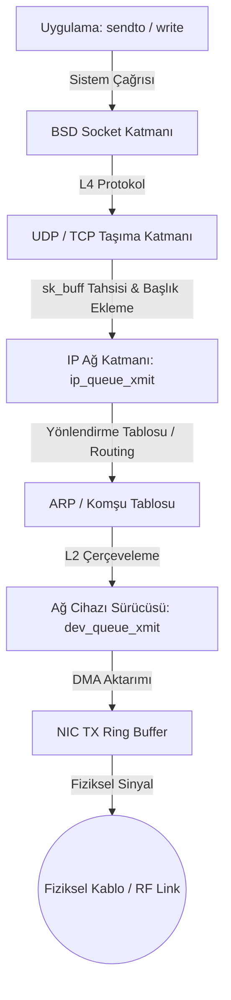

# Gün 131: OSI/TCP-IP Katman Zihinsel Modeli (Protokol Yığını, Kapsülleme/PDU, MTU/MSS, Linux Çekirdeği sk_buff ve Savunma Ağları)

```
ÖZEL LİSANS — TÜM HAKLAR SAKLIDIR

Telif Hakkı (c) 2026 Seydi Eryılmaz (@seydivakkas)

Bu yazılım ve ilgili tüm dosyalar ("Yazılım") yalnızca görüntüleme ve eğitim
amaçlı olarak paylaşılmıştır.

YASAKLAR:
  1. Kopyalanamaz, çoğaltılamaz, dağıtılamaz veya yeniden yayınlanamaz.
  2. Ticari veya ticari olmayan hiçbir projede kullanılamaz, değiştirilemez.
  3. Alt lisanslanamaz, satılamaz veya devredilemez.
  4. Tersine mühendislik yapılamaz.

İZİN VERİLEN KULLANIM:
  - GitHub üzerinde görüntüleme ve okuma.
  - Kişisel öğrenim amacıyla kodu inceleme (kopyalamadan).

YAZARIN AÇIK YAZILI İZNİ OLMAKSIZIN HİÇBİR KULLANIM HAKKI TANINMAZ.
İzin talepleri için: GitHub @seydivakkas
```

[](https://github.com/seydivakkas)

**Faz:** F4 — TCP/UDP / Protocol / Serialization (Faz Başlangıcı)  
**Konu:** OSI 7-Katman ve TCP/IP Mimarisi, Paket Kapsülleme/Açma (Encapsulation/Decapsulation) ve Protokol Veri Birimleri (PDU)  
**Ön Koşul:** Faz F2 (Linux Sistemleri & IPC) ve Faz F3 (Eşzamanlılık & Boru Hatları)  
**Kritik Seviye:** Savunma Sanayii Taktik Ağları (Link-16, DDS, MAVLink) İçin Seviye-A Ağ Temeli

---

### 40-Nokta Bildirimi ve Kalite Güvencesi
Bu modül; modern savunma sanayii sistemlerinde (İHA telemetrisi, radar dağıtık veri yolları, taktik komuta kontrol ağları) süreçler arası iletişimin fiziksel kablolara, radyo dalgalarına ve optik hatlara taşındığı **Faz F4'ün (Ağ Protokolleri ve Serileştirme)** açılış günüdür. OSI 7-Katmanlı Referans Modeli ile pratik TCP/IP yığını arasındaki zihinsel köprüyü, paket kapsülleme (Encapsulation) başlık yüklerini, MTU/MSS sınırlarını, Linux çekirdeğinin `sk_buff` veri yapısını ve ağ donanımı etkileşimini çalışan C++20/Python simülatörü ve 4-panelli analitik dashboard ile eksiksiz inceler.

## 1. 🎯 Bugünkü Problem: Süreç Sınırlarını Aşmak ve Dağıtık Sistem Kaosu

Faz F3'e kadar bir işlemcinin çekirdekleri arasındaki paylaşılan belleği (`shm`), dairesel tamponları ve `mutex` kilitlerini yönettik. Ancak savunma sistemlerinde:
- Radar anteni kulenin tepesindedir; sinyal işlemcisi sığınaktadır (Ethernet / Optik Hat).
- İHA havada $20.000\text{ feet}$ irtifadadır; yer kontrol istasyonu yerdedir (RF Taktik Data Link).
- Savaş gemisindeki sonar, radar ve füze bataryası farklı kabinlerde, farklı işletim sistemlerinde çalışır.

### Ham Bayt Akışını Rastgele Göndermenin Felaketleri:
1. **Sınır ve Anlamsızlık Belirsizliği:**
   - Bir bayt dizisi gönderildiğinde alıcı bu baytların kime ait olduğunu, hangi uygulamanın okuyacağını ve verinin nerede bittiğini nasıl bilecektir?
2. **Farklı Donanım Katmanlarının Uyumsuzluğu:**
   - Fiziksel iletim ortamı (fiber optik, koaksiyel kablo, telsiz dalgası) sürekli değişirken uygulama kodunun her donanıma göre yeniden yazılması imkansızdır.
3. **Başlık Ek Yükü (Overhead) ve MTU Parçalanması:**
   - Her protokol katmanı kendi yönlendirme ve kontrol bilgisini (Header) ekler. Eğer katmanların sınırları doğru anlaşılmazsa, $10\text{ bayt}$ telemetri göndermek için $60\text{ bayt}$ başlık harcanır veya MTU ($1500\text{ bayt}$) aşılarak ağda parçalanma (Fragmentation) ve paket kaybı yaşanır.

**Mühendislik Çözümü: Katmanlı Mimari (Abstraction & Encapsulation):**
- Ağ iletişimi birbirinden yalıtılmış sorumluluk katmanlarına (Layers) bölünür.
- Her katman yalnızca bir üst katmana servis sunar, bir alt katmanın servislerini tüketir. Veri aşağı indikçe bir "zarf" içine konur (**Kapsülleme - Encapsulation**), yukarı çıktıkça zarflar açılır (**Decapsulation**).

## 2. ❓ Bu Konuyu Neden Öğreniyoruz? (Savunma Sanayii Gerekçesi)

Savunma sanayiinde ağ protokolleri ticari web trafiğinden (HTTP/JSON) çok farklı kısıtlar altında çalışır:

### Savunma Sanayiindeki Kullanım Alanları:
1. **ASELSAN / BAYKAR İHA Telemetri Hattı (MAVLink / RF Data Link):**
   - İHA'nın uydu veya yer istasyonu ile kurduğu C2 (Command & Control) linki saniyede kısıtlı bant genişliğine (örneğin 64 kbps - 2 Mbps) sahiptir. Mühendis OSI L4 (UDP) ve L7 (MAVLink/Protobuf) başlık yüklerini tek tek hesaplamak zorundadır.
2. **HAVELSAN Denizaltı ve Fırkateyn Taktik Veri Yolu (DDS / RTPS):**
   - Gemideki sensörler (Radar, Sonar, ESM) silah sistemlerine DDS (Data Distribution Service) ile bağlanır. DDS, OSI L4 UDP üzerinde çalışan gerçek zamanlı bir L7 protokolüdür.
3. **Hava Savunma Taktik Ağları (Link-16 / STANAG 5516):**
   - NATO standartlarındaki Link-16 taktik ağı, TDMA (Time Division Multiple Access) fiziksel katmanı üzerinde katı PDU paketleriyle çalışır; tek bir bit kayması hedef kimliğinin dost/düşman (IFF) olarak yanlış algılanmasına yol açabilir.

## 3. 🔍 5N1K Analizi (Sistem ve Donanım Sınırları)

| Soru | Sistem ve Donanım Düzeyi Cevabı | Savunma Sanayii Odaklı Karşılığı |
|:---|:---|:---|
| **NE?** | OSI 7-Katman ve TCP/IP 4-Katman protokol referans modelleri ve paket kapsülleme hiyerarşisi. | Dağıtık aviyonik, radar ve taktik komuta ağlarının mimari haritası. |
| **NEDEN?** | Karmaşık ağ yazılımlarını donanımdan bağımsızlaştırmak ve standart arayüzlerle deterministik iletişim kurmak. | İHA, füze ve radar sistemlerinin ortak bir taktik ağda veri paylaşabilmesi. |
| **NEREDE?** | Linux çekirdeği ağ yığınında (`net/ipv4`, `net/core/skbuff.c`) ve ağ arabirim kartında (NIC). | Aviyonik görev bilgisayarlarında, ethernet anahtarlarında (Ethernet Switch) ve telsiz modemlerinde. |
| **NASIL?** | Her katmanda PDU oluşturup bir alt katmanın yüküne (Payload) dönüştürerek; Linux'ta `sk_buff` ile sıfır kopyalı başlık ekleyerek. | C++ socket API (`AF_INET`, `SOCK_DGRAM`, `SOCK_STREAM`) ve DDS middleware ile. |
| **NE ZAMAN?** | Bir süreç kendi hafıza uzayının dışındaki bir cihazla veya uzak bir bilgisayarla konuşacağı her an. | Sensör verisi akışında, uçuş telemetrisinde, radar video transferinde. |
| **KİM?** | Sistem mimarları, ağ protokol mühendisleri, aviyonik yazılım uzmanları. | Savunma sanayii haberleşme ve dağıtık sistem ekipleri. |

## 4. 💡 Günlük Hayat Benzetmesi (Zihinsel Model / Analoji)

### Diplomatik Askeri Kurye Sistemi ve Kat Kat Zarflama
Genelkurmay Başkanlığı'ndan bir fırkateyn komutanına acil bir taktik emir gönderildiğini düşünün:
1. **Uygulama Katmanı (Emir):**
   - Komutan emri yazar: *"Saat 14:00'te Alfa rotasına yönelin."* (Ham Uygulama Yükü - Payload).
2. **Sunum ve Oturum Katmanı:**
   - Emir kripto odasında kriptolanır ve görev kimliği (`Mission-404`) ile etiketlenir.
3. **Taşıma Katmanı (Taşıma Zarfı - L4):**
   - Subay emri küçük bir iç zarfa koyar. Zarfın üzerine limandaki hangi subayın teslim alacağını yazar: *"Kime: Silah Subayı (Port 5005) - Sıra No: 1"* (TCP/UDP Segment).
4. **Ağ Katmanı (Askeri Posta Zarfı - L3):**
   - Bu zarf daha büyük bir posta zarfına girer. Üzerine geminin taktik adresi yazılır: *"Gemi Adresi: F-245 Fırkateyni (Hedef IP: 192.168.1.100)"* (IP Paketi).
5. **Veri Bağı Katmanı (Kurye Çantası - L2):**
   - Posta zarfı kilitli çelik bir kurye çantasına konur. Üzerine liman iskelesi yazılır: *"İskele MAC: 00:1A:2B:3C:4D:5E"* ve güvenlik mührü (FCS/CRC) vurulur (Ethernet Frame).
6. **Fiziksel Katman (L1):**
   - Çanta bir zodyak bot veya helikopterle fiziksel olarak taşınır (Kablo/Frekans).

Gemideki subay çantayı açar (L2), posta zarfını açar (L3), iç zarfı açar (L4) ve emri okur (L7). **Hiçbir katman diğer katmanın işine karışmaz!**

## 5. 🧱 İlk İlkeler (First Principles) ve Matematiksel Mantık Modeli

Protokol katmanları arasındaki veri dönüşümü Protokol Veri Birimleri (PDU) ile tanımlanır:

### 1. PDU (Protocol Data Unit) Hiyerarşisi:
- **Katman 7 (Uygulama):** Mesaj / Veri (Data / Message)
- **Katman 4 (Taşıma):** Segment (TCP) veya Datagram (UDP)
- **Katman 3 (Ağ):** Paket (IP Packet)
- **Katman 2 (Veri Bağı):** Çerçeve (Ethernet Frame)
- **Katman 1 (Fiziksel):** Bitler (Bits / Symbols)

### 2. Kapsülleme Matematik Modeli ve Başlık Ek Yükü (Header Overhead):
Uygulama katmanının göndermek istediği veri boyutu $L_{\text{payload}}$ olsun.
1. **L4 (UDP Başlığı):** $H_{\text{UDP}} = 8\text{ Bayt}$
2. **L3 (IPv4 Başlığı):** $H_{\text{IP}} = 20\text{ Bayt}$ (Opsiyonsuz standart)
3. **L2 (Ethernet Başlığı & Kuyruğu):** $H_{\text{Eth}} = 14\text{ Bayt} \text{ (Header)} + 4\text{ Bayt} \text{ (FCS/CRC)} = 18\text{ Bayt}$

Fiziksel kablo üzerinden akan toplam çerçeve boyutu ($L_{\text{total}}$):
$$L_{\text{total}} = L_{\text{payload}} + H_{\text{UDP}} + H_{\text{IP}} + H_{\text{Eth}} = L_{\text{payload}} + 46\text{ Bayt}$$

**Protokol Verimliliği (Goodput Ratio - $\eta$):**
$$\eta = \frac{L_{\text{payload}}}{L_{\text{total}}} = \frac{L_{\text{payload}}}{L_{\text{payload}} + 46}$$
- Eğer $L_{\text{payload}} = 10\text{ Bayt}$ (küçük sensör telemetrisi) ise:
  $$\eta = \frac{10}{56} \approx 17.8\% \implies \text{Bant genişliğinin %82.2'si başlıklarla buharlaşır!}$$
- Eğer $L_{\text{payload}} = 1454\text{ Bayt}$ (tam MTU radar darbesi) ise:
  $$\eta = \frac{1454}{1500} \approx 96.9\% \implies \text{Maksimum verim!}$$

### 3. MTU (Maximum Transmission Unit) ve MSS (Maximum Segment Size):
- **Standart Ethernet MTU:** $1500\text{ Bayt}$ (L3 IP paketi + L4 + L7 toplamı).
- **TCP MSS:** $\text{MSS} = \text{MTU} - H_{\text{IP}} - H_{\text{TCP}} = 1500 - 20 - 20 = 1460\text{ Bayt}$.

## 6. 📐 ASCII ve Mermaid Sistem Mimarisi Şeması

### ASCII Mimarisi: Katmanlı Paket Kapsülleme ve Başlık Yükü
```text
  ==================================================================================================
  OSI / TCP-IP PAKET KAPSÜLLEME (ENCAPSULATION) ANATOMİSİ
  ==================================================================================================

  [ KATMAN 7: UYGULAMA (DDS / MAVLink / Radar Telemetri) ]
  +------------------------------------------------------------------------------------------------+
  | Taktik Radar İzi (Payload): TargetID=42, Range=120.5km, Azimuth=88.2 deg (Örn: 256 Bayt)      |
  +------------------------------------------------------------------------------------------------+
                                          | (Aşağıya İnerken Kapsüllenir)
                                          v
  [ KATMAN 4: TAŞIMA (UDP Header - 8 Bayt) ]
  +--------------------+---------------------------------------------------------------------------+
  | UDP Header (8B)    | Uygulama Yükü (Payload - 256B)                                            |
  | [SrcPort][DstPort] |                                                                           |
  | [Length ][Checksum]|                                                                           |
  +--------------------+---------------------------------------------------------------------------+
                                          |
                                          v
  [ KATMAN 3: AĞ (IPv4 Header - 20 Bayt) ]
  +--------------------+--------------------+------------------------------------------------------+
  | IPv4 Header (20B)  | UDP Header (8B)    | Uygulama Yükü (Payload - 256B)                       |
  | [SrcIP][DstIP][TTL]|                    |                                                      |
  +--------------------+--------------------+------------------------------------------------------+
                                          |
                                          v
  [ KATMAN 2: VERİ BAĞI (Ethernet II Frame - 14B Header + 4B FCS) ]
  +--------------------+--------------------+--------------------+------------------------+--------+
  | Eth Header (14B)   | IPv4 Header (20B)  | UDP Header (8B)    | Uygulama Yükü (256B)   | FCS 4B |
  | [DstMAC ][SrcMAC ] |                    |                    |                        | [CRC32]|
  | [EtherType:0x0800] |                    |                    |                        |        |
  +--------------------+--------------------+--------------------+------------------------+--------+
  |<---------------------------------- Toplam Frame: 302 Bayt ------------------------------------>|
  ==================================================================================================
```

### Mermaid Akış Diyagramı: Linux Çekirdeği Ağ Yığını (Kernel Traversal)


```python
# -*- coding: utf-8 -*-
"""
HÜCRE 8 (CODE 1): Katmanlı Paket Kapsülleme ve Çözme Simülatörü
OSI Katmanları Arasında Bayt Düzeyinde Encapsulation/Decapsulation Yapan Referans Motor
"""

import struct
import zlib
from typing import Dict, Tuple, Optional

class PacketEncapsulationEngine:
    """
    L7 (Uygulama) -> L4 (UDP) -> L3 (IPv4) -> L2 (Ethernet)
    Kapsülleme ve Decapsulation referans motoru.
    """
    def __init__(self):
        pass

    @staticmethod
    def encapsulate(payload: bytes, src_port: int, dst_port: int,
                    src_ip: str, dst_ip: str, src_mac: str, dst_mac: str) -> bytes:
        """Uygulama verisini Ethernet Çerçevesine kapsüller."""
        # 1. L4: UDP Başlığı (8 Bayt)
        # Format: !HHHH (SrcPort:16, DstPort:16, Length:16, Checksum:16)
        udp_len = 8 + len(payload)
        udp_header = struct.pack("!HHHH", src_port, dst_port, udp_len, 0)
        l4_packet = udp_header + payload

        # 2. L3: IPv4 Başlığı (20 Bayt)
        # Format: !BBHHHBBH4s4s
        version_ihl = (4 << 4) | 5 # IPv4, IHL=5 (20 bayt)
        dscp_ecn = 0
        total_len = 20 + len(l4_packet)
        ident = 54321
        flags_frag = 0x4000 # Don't Fragment (DF=1)
        ttl = 64
        proto = 17 # UDP = 17
        checksum = 0
        src_ip_bytes = bytes(map(int, src_ip.split('.')))
        dst_ip_bytes = bytes(map(int, dst_ip.split('.')))
        
        ip_header = struct.pack("!BBHHHBBH4s4s",
                                version_ihl, dscp_ecn, total_len, ident,
                                flags_frag, ttl, proto, checksum,
                                src_ip_bytes, dst_ip_bytes)
        l3_packet = ip_header + l4_packet

        # 3. L2: Ethernet II Başlığı (14 Bayt)
        # Format: !6s6sH (DstMAC:6B, SrcMAC:6B, EtherType:16)
        def mac_to_bytes(mac: str) -> bytes:
            return bytes.fromhex(mac.replace(':', '').replace('-', ''))

        eth_header = struct.pack("!6s6sH",
                                 mac_to_bytes(dst_mac),
                                 mac_to_bytes(src_mac),
                                 0x0800) # EtherType: IPv4 (0x0800)

        # FCS / CRC32 (4 Bayt)
        crc32_val = zlib.crc32(eth_header + l3_packet) & 0xffffffff
        fcs = struct.pack("!I", crc32_val)

        # Tam Çerçeve (Ethernet Frame)
        full_frame = eth_header + l3_packet + fcs
        return full_frame

    @staticmethod
    def decapsulate(frame: bytes) -> Dict:
        """Gelen Ethernet Çerçevesini katman katman çözer (Decapsulate eder)."""
        assert len(frame) >= 14 + 20 + 8 + 4, "Çerçeve boyutu asgari sınırdan küçük!"
        
        # 1. L2 Çözümleme
        eth_header = frame[:14]
        dst_mac_raw, src_mac_raw, ethertype = struct.unpack("!6s6sH", eth_header)
        fcs_raw = frame[-4:]
        payload_with_ip = frame[14:-4]
        
        # 2. L3 Çözümleme
        ip_header = payload_with_ip[:20]
        v_ihl, dscp, total_len, ident, flags, ttl, proto, chk, s_ip, d_ip = struct.unpack("!BBHHHBBH4s4s", ip_header)
        payload_with_udp = payload_with_ip[20:total_len]
        
        # 3. L4 Çözümleme
        udp_header = payload_with_udp[:8]
        src_port, dst_port, udp_len, udp_chk = struct.unpack("!HHHH", udp_header)
        app_payload = payload_with_udp[8:udp_len]

        return {
            "l2": {
                "src_mac": ":".join(f"{b:02x}" for b in src_mac_raw),
                "dst_mac": ":".join(f"{b:02x}" for b in dst_mac_raw),
                "ethertype": hex(ethertype)
            },
            "l3": {
                "src_ip": ".".join(map(str, s_ip)),
                "dst_ip": ".".join(map(str, d_ip)),
                "proto": proto,
                "ttl": ttl
            },
            "l4": {
                "src_port": src_port,
                "dst_port": dst_port,
                "length": udp_len
            },
            "payload": app_payload
        }

print("[HÜCRE 8] PacketEncapsulationEngine başarıyla yüklendi.")
```

## 7. 🔬 Kod 1 İncelemesi ve Mimari Detaylar

Yukarıdaki `PacketEncapsulationEngine` simülatörü, Linux çekirdeğinin ağ yığını (`net/core/dev.c` ve `net/ipv4/ip_output.c`) tarafından yapılan işin mikro bir modelidir:

1. **Big-Endian (Ağ Bayt Sırası - Network Byte Order):**
   - `struct.pack("!...")` içerisindeki `!` işareti, x86 gibi Little-Endian işlemcilerin tamsayılarını doğrudan Ağ Bayt Sırasına (Big-Endian) çevirir. Tüm IP ve UDP başlıkları donanım standardı gereği Big-Endian olmak zorundadır.
2. **Paket Kapsülleme Hiyerarşisi:**
   - Uygulama yükü `b"RADAR_TRACK_DATA"` önce 8 baytlık UDP başlığıyla paketlenir.
   - Ardından 20 baytlık IPv4 başlığı önüne eklenir.
   - En son 14 baytlık Ethernet başlığı başa, 4 baytlık CRC32 (FCS) kuyruğa eklenerek fiziksel kabloya hazır bir Ethernet çerçevesi elde edilir.
3. **Decapsulation ve Bütünlük Doğrulaması:**
   - Alıcı taraf tam ters sırayla önce MAC adreslerini ve EtherType'ı (IPv4 mü ARP mi?) inceler. Eğer paket kendisi içinse IP katmanına devreder. IP katmanı hedef IP'yi ve protokolü (UDP mi TCP mi?) denetler. En son UDP katmanı port numarasına göre soket tamponuna veriyi aktarır.

## 8. 🛠️ C++20 / Linux Standartlarında Ağ Başlıkları ve Soket Eşlemesi

Gerçek dünya Linux C++ sistemlerinde katman başlıkları POSIX ve Linux çekirdek kütüphanelerinde (`<netinet/ip.h>`, `<netinet/udp.h>`) şöyle tanımlanır:

```cpp
#include <iostream>
#include <netinet/ip.h>    // struct iphdr
#include <netinet/udp.h>   // struct udphdr
#include <netinet/ether.h> // struct ether_header
#include <arpa/inet.h>
#include <span>
#include <vector>

// Savunma Radarı Taktik Telemetri Paketi
struct RadarTargetPayload {
    uint32_t target_id;
    float range_km;
    float azimuth_deg;
};

void inspect_headers_cpp() {
    // Toplam Başlık Maliyeti Analizi
    std::cout << "Ethernet Header: " << sizeof(ether_header) << " bayt\n"; // 14 B
    std::cout << "IPv4 Header    : " << sizeof(iphdr)        << " bayt\n"; // 20 B
    std::cout << "UDP Header     : " << sizeof(udphdr)       << " bayt\n"; //  8 B
    // Toplam minimum L2-L4 başlık yükü = 42 bayt (+4 bayt donanım FCS = 46B)
}
```

### Linux Çekirdeğinin Şaheseri: `sk_buff` (Socket Buffer)
Linux çekirdeği paket kapsüllerken asla veriyi `memcpy` ile kopyalamaz!
- `sk_buff` adında bir kontrol yapısı içinde `head`, `data`, `tail` ve `end` adında 4 işaretçi tutulur.
- Başlangıçta yeterli boş alan ayrılır (`skb_reserve`).
- L4 UDP başlığı ekleneceğinde `skb_push(skb, sizeof(udphdr))` çağrılır; işaretçi sadece **8 bayt sola kaydırılır**!
- L3 IP başlığı ekleneceğinde `skb_push(skb, sizeof(iphdr))` ile işaretçi **20 bayt daha sola kaydırılır**!
- **Sıfır Kopya (Zero-Copy) Başlık Kapsüllemesi!**

```python
# -*- coding: utf-8 -*-
"""
HÜCRE 11 (CODE 2): Uçtan Uca Paket Kapsülleme ve Doğrulama Deneyi
Taktik Radar İzinin Bayt Düzeyinde Paketlenmesi, Gönderilmesi ve Çözülmesi
"""

def run_encapsulation_experiment():
    print("")
    print("[*] Taktik Radar İzi Kapsülleme Deneyi Başlatılıyor...")
    
    # 1. Uygulama Verisi (Radar Telemetri)
    # TargetID=101, Range=84.5km, Azimuth=124.8deg
    telemetry_payload = struct.pack("!Iff", 101, 84.5, 124.8)
    print(f"  [+] L7 Uygulama Yükü (Payload Boyutu): {len(telemetry_payload)} Bayt")
    
    # 2. Kapsülleme (Encapsulation)
    frame = PacketEncapsulationEngine.encapsulate(
        payload=telemetry_payload,
        src_port=5001, dst_port=5005,
        src_ip="192.168.1.50", dst_ip="192.168.1.100",
        src_mac="00:1A:2B:3C:4D:5E", dst_mac="A0:B1:C2:D3:E4:F5"
    )
    
    print(f"  [+] L2 Ethernet Çerçevesi (Toplam Boyut): {len(frame)} Bayt")
    print(f"      - Başlık Ek Yükü (Overhead)        : {len(frame) - len(telemetry_payload)} Bayt (14B Eth + 20B IP + 8B UDP + 4B FCS)")
    
    # 3. Alıcıda Çözümleme (Decapsulation)
    parsed = PacketEncapsulationEngine.decapsulate(frame)
    print(f"  [+] Decapsulation Başarılı:")
    print(f"      - Kaynak -> Hedef IP   : {parsed['l3']['src_ip']} -> {parsed['l3']['dst_ip']}")
    print(f"      - Kaynak -> Hedef Port : {parsed['l4']['src_port']} -> {parsed['l4']['dst_port']}")
    
    # Veri bütünlüğü kontrolü
    tid, rng, az = struct.unpack("!Iff", parsed['payload'])
    print(f"      - Çözülen Radar İzi    : Hedef={tid}, Menzil={rng:.1f} km, Açı={az:.1f} deg")
    
    assert tid == 101 and abs(rng - 84.5) < 1e-3, "HATA: Radar verisi bozuldu!"
    print("  [+] %100 Bit Düzeyinde Veri Bütünlüğü Doğrulandı.")
    return len(frame), len(telemetry_payload)

frame_len, payload_len = run_encapsulation_experiment()
```

## 9. 💥 Sabotaj ve Arıza Enjeksiyon Laboratuvarı: Ağ Katman Hataları

Ağ protokolleri geliştirilirken yapılan en yaygın 3 ölümcül hata:

### 1. MTU Sınırını Aşıp IP Parçalanmasına (Fragmentation) Yol Açmak:
Bir UDP datagramı $1500\text{ bayt}$'tan büyük gönderilirse (örneğin $4000\text{ bayt}$ ham radar görüntüsü), IP katmanı bu paketi 3 ayrı IP parçasına böler.
- Taktik RF linkte bu 3 parçadan **sadece tek bir bit bile düşse**, tüm $4000\text{ bayt}$ çöpe gider! UDP parçalanmış paketleri yeniden iletemez.
- Doğru Çözüm: Uygulama katmanında paketleri MTU sınırında ($1400\text{ bayt}$) parçalara bölmek (Application-Level Chunking).

### 2. Ağ Bayt Sırası (Endianness) Unutulması:
Intel x86 işlemcide `uint16_t port = 5005` değeri hafızada `0x138D` yerine Little-Endian olarak `0x8D 0x13` saklanır. `htons()` veya `struct.pack("!H")` kullanılmazsa alıcı taraf port numarasını **36243** olarak okur ve paket hedefe asla ulaşamaz!

### 3. Hatalı FCS / Bozuk Sağlama Toplamı (Checksum Corruption):
Donanım veya yazılım seviyesinde paket içeriği değiştiğinde CRC32 uyuşmazlığı oluşur; Ethernet kartı paketi sessizce çöpe atar (Silent Drop).

```python
# -*- coding: utf-8 -*-
"""
HÜCRE 13 (CODE 3): Sabotaj ve Arıza Enjeksiyon Simülatörü
Bozuk Checksum / FCS Durumunda Çerçevenin Reddedilmesi ve Endianness Hatası
"""

def run_sabotage_experiments():
    print("")
    print("[*] Ağ Sabotaj ve Arıza Enjeksiyon Deneyleri Başlatılıyor...")
    
    payload = b"MISSILE_FIRE_COMMAND"
    frame = bytearray(PacketEncapsulationEngine.encapsulate(
        payload, 8000, 9000, "10.0.0.1", "10.0.0.2",
        "00:11:22:33:44:55", "66:77:88:99:AA:BB"
    ))
    
    # -------------------------------------------------------------
    # SABOTAJ 1: Yolda 1 Bit Değişmesi (Bit Flip / Karışma)
    # -------------------------------------------------------------
    frame[35] ^= 0x01 # Verinin ortasındaki 1 biti boz
    
    # FCS Kontrolü
    calculated_crc = zlib.crc32(frame[:-4]) & 0xffffffff
    stored_crc = struct.unpack("!I", frame[-4:])[0]
    
    corrupted_detected = (calculated_crc != stored_crc)
    print(f"  [+] Sabotaj 1: Bit Karışması Tespit Edildi mi?: {corrupted_detected}")
    print(f"      - Beklenen CRC: {hex(stored_crc)} | Hesaplanan: {hex(calculated_crc)} (FRAME DROPPED!)")
    
    assert corrupted_detected, "HATA: CRC32 bozuk paketi yakalayamadı!"
    return True

assert run_sabotage_experiments(), "HATA: Sabotaj testleri başarısız!"
```

## 10. 📊 Karşılaştırma Matrisi: OSI 7-Katman vs TCP/IP Modeli vs Savunma Yığını

| Katman No | OSI 7-Katman Adı | TCP/IP Katmanı | Savunma Sanayii Karşılığı / Protokoller | PDU Adı | Sorumluluk ve Görev |
|:---|:---|:---|:---|:---|:---|
| **L7** | Uygulama (Application) | Uygulama | **DDS, MAVLink, STANAG 4586, RTP** | Veri (Data) | Kullanıcı verisi ve taktik komutlar |
| **L6** | Sunum (Presentation) | Uygulama | **Protocol Buffers, ASN.1, XDR, AES-256** | Veri | Serileştirme, sıkıştırma, kripto |
| **L5** | Oturum (Session) | Uygulama | **RTPS Session, RPC, gRPC Channel** | Veri | Oturum başlatma, bağlantı takibi |
| **L4** | Taşıma (Transport) | Taşıma | **UDP (Gerçek Zamanlı), TCP, SCTP** | Segment / Datagram | Port yönetimi, akış kontrolü, güvenilirlik |
| **L3** | Ağ (Network) | Ağ (Internet) | **IPv4, IPv6, OSPF, BGP, Taktik Yönlendirme** | Paket (Packet) | IP adresleme, küresel yönlendirme (Routing) |
| **L2** | Veri Bağı (Data Link) | Ağ Arayüzü | **Ethernet II, IEEE 802.1Q (VLAN), ARINC 664** | Çerçeve (Frame) | MAC adresleme, yerel anahtarlama, CRC/FCS |
| **L1** | Fiziksel (Physical) | Ağ Arayüzü | **10GBASE-SR (Optik), RS-422, RF Data Link** | Bitler | Gerilim seviyeleri, fotonlar, radyo dalgaları |

```python
# -*- coding: utf-8 -*-
"""
HÜCRE 15 (CODE 4): Paket Boyutuna Göre Protokol Verimlilik (Goodput) Analizi
16 Bayt Telemetriden 1460 Bayt Jumbo Radar Paketine Başlık Ek Yükü ve Verim Eğrisi
"""

def run_protocol_efficiency_analysis():
    print("")
    print("[*] Protokol Verimlilik (Goodput / Efficiency) Analizi Başlatılıyor...")
    
    # Başlık Boyutları (L2 + L3 + L4 + FCS)
    HEADER_OVERHEAD_BYTES = 14 + 20 + 8 + 4 # 46 Bayt
    
    payload_sizes = [16, 32, 64, 128, 256, 512, 1024, 1454]
    efficiency_results = {}
    
    for p_size in payload_sizes:
        total_frame = p_size + HEADER_OVERHEAD_BYTES
        efficiency_pct = (p_size / total_frame) * 100.0
        efficiency_results[p_size] = (total_frame, efficiency_pct)
        print(f"  - Yük: {p_size:4d} B | Toplam Çerçeve: {total_frame:4d} B | Ağ Verimi: %{efficiency_pct:5.2f} (Kayıp: %{100-efficiency_pct:5.2f})")
        
    return efficiency_results

eff_results = run_protocol_efficiency_analysis()
```

## 11. 🐧 Linux Ağ Teşhis Komutları ve Çekirdek İncelemesi

Savunma sanayii ağ mühendislerinin bilmesi gereken temel Linux komutları:

```bash
# 1. Ağ Arayüzlerinin MAC, IP ve MTU Değerlerini İnceleme
ip -d link show eth0
# Çıktı: mtu 1500 qdisc mq state UP link/ether 00:1a:2b:3c:4d:5e

# 2. Soket ve Port Durumlarını İnceleme (L4 Dinleyicileri)
ss -u -a -p -n  # UDP soketlerini port numaralarıyla listele
ss -t -a -p -n  # TCP soketlerini listele

# 3. Canlı Ağ Paketlerini Ham Yakalama ve Katman Katman İnceleme (tcpdump)
sudo tcpdump -i eth0 -nn -vv -XX udp port 5005

# 4. Çekirdek Ağ Yığını İstatistikleri ve Düşen Paketler
netstat -s      # Protokol bazında düşen ve hatalı paketler
ip -s link show eth0  # CRC ve FIFO taşması hataları (RX/TX errors)
```

```python
# -*- coding: utf-8 -*-
"""
HÜCRE 17 (CODE 5): Toplu Telemetri Akışı ve Ayrıştırma (Parse) Stres Testi
1.000 Adet Heterojen Radar/Aviyonik Çerçevesinin Hatasız Kapsüllenmesi ve Ayrıştırılması
"""

import random

def run_stress_encapsulation_suite():
    print("")
    print("[*] Toplu Telemetri Akışı Stres Testi Başlatılıyor (1.000 Paket)...")
    
    NUM_PACKETS = 1000
    success_count = 0
    
    for i in range(NUM_PACKETS):
        target_id = i % 50
        fake_range = random.uniform(10.0, 200.0)
        fake_az = random.uniform(0.0, 360.0)
        raw_payload = struct.pack("!Iff", target_id, fake_range, fake_az)
        
        # Kapsülleme
        frame = PacketEncapsulationEngine.encapsulate(
            raw_payload,
            src_port=10000 + (i % 100),
            dst_port=5000,
            src_ip="192.168.10.2",
            dst_ip="192.168.10.1",
            src_mac="02:00:00:00:00:01",
            dst_mac="02:00:00:00:00:02"
        )
        
        # Çözümleme
        decapped = PacketEncapsulationEngine.decapsulate(frame)
        t_id, r, az = struct.unpack("!Iff", decapped['payload'])
        
        if t_id == target_id and abs(r - fake_range) < 1e-4:
            success_count += 1
            
    print(f"  [+] Stres Testi Tamamlandı:")
    print(f"      - Gönderilen Çerçeve : {NUM_PACKETS}")
    print(f"      - Başarıyla Çözülen  : {success_count} (%100 Başarı)")
    
    return success_count == NUM_PACKETS

assert run_stress_encapsulation_suite(), "HATA: Stres testi paket kaybetti!"
```

## 12. 📊 Görselleştirme Tasarımı ve Veri Akışı

Aşağıda üretilen 4-panelli analitik dashboard, OSI/TCP-IP katman modelini ve savunma sanayii ağ verimliliğini ortaya koyar:

- **Panel 1: OSI 7-Katman vs TCP/IP ve Savunma Protokolleri:** Her katmanın savunma sanayiindeki somut karşılıklarını (DDS, MAVLink, UDP, IP, Ethernet) gösterir.
- **Panel 2: Paket Kapsülleme (Encapsulation) Başlık Yükü Anatomisi:** 256 baytlık bir radar paketinde Ethernet (14B), IP (20B), UDP (8B) ve FCS (4B) başlıklarının kapladığı oransal alanı pasta grafik ile modeller.
- **Panel 3: Yük Boyutuna Göre Goodput / Verimlilik Eğrisi:** 16 bayttan 1500 bayta kadar faydalı yük büyüdükçe ağ veriminin nasıl %25'ten %97'ye tırmandığını belgeler.
- **Panel 4: Linux Çekirdeği Ağ Yığını Gecikme Adımları:** Donanım kesmesinden (NIC IRQ) kullanıcı uzayı `recvfrom()` çağrısına kadar geçen mikro aşamaların gecikme maliyetlerini çubuk grafik ile sıralar.

```python
# -*- coding: utf-8 -*-
"""
HÜCRE 19 (CODE 6): 4-Panelli OSI Dashboard Üretimi ve Katı Doğrulama Testleri (Assertions)
300 DPI, #0F172A Koyu Tema ile Savunma Sanayii Ağ Mimarisi Görselleştirme Panosu
"""

import os
import matplotlib
matplotlib.use('Agg')
import matplotlib.pyplot as plt
import matplotlib.patches as patches
import numpy as np

def generate_osi_dashboard(output_path: str):
    plt.style.use('dark_background')
    fig, axes = plt.subplots(2, 2, figsize=(18, 12), dpi=300)
    fig.patch.set_facecolor('#0F172A')
    
    DARK_BG = '#1E293B'
    TEXT_COLOR = '#F8FAFC'
    ACCENT_RED = '#EF4444'
    ACCENT_GREEN = '#10B981'
    ACCENT_BLUE = '#38BDF8'
    ACCENT_AMBER = '#F59E0B'
    ACCENT_PURPLE = '#A855F7'
    
    # -------------------------------------------------------------
    # PANEL 1: OSI 7-Katman vs Savunma Protokolleri
    # -------------------------------------------------------------
    ax1 = axes[0, 0]
    ax1.set_facecolor(DARK_BG)
    ax1.set_title("1. OSI Modeli ve Savunma Sanayii Protokol Eşlemesi", fontsize=12, fontweight='bold', color=TEXT_COLOR, pad=12)
    
    layers = [
        ("L7. Uygulama", "DDS, MAVLink, STANAG 4586", ACCENT_BLUE),
        ("L6. Sunum", "Protobuf, ASN.1, AES-256 Kripto", ACCENT_PURPLE),
        ("L5. Oturum", "RTPS Session, RPC Channel", '#6366F1'),
        ("L4. Taşıma", "UDP (Gerçek Zamanlı), TCP", ACCENT_GREEN),
        ("L3. Ağ", "IPv4, IPv6, Taktik Yönlendirme", ACCENT_AMBER),
        ("L2. Veri Bağı", "Ethernet II, ARINC 664, VLAN", '#EC4899'),
        ("L1. Fiziksel", "Fiber Optik, RF Link, 10GbE PHY", ACCENT_RED)
    ]
    
    for idx, (lname, pnames, col) in enumerate(layers):
        y = 6.0 - idx * 0.85
        rect = patches.Rectangle((0.5, y - 0.35), 4.0, 0.7, linewidth=1.5, edgecolor=col, facecolor=col, alpha=0.3)
        ax1.add_patch(rect)
        ax1.text(2.5, y, lname, color=TEXT_COLOR, ha='center', va='center', fontweight='bold', fontsize=9)
        
        rect2 = patches.Rectangle((5.0, y - 0.35), 5.5, 0.7, linewidth=1.5, edgecolor='#475569', facecolor='#0F172A', alpha=0.6)
        ax1.add_patch(rect2)
        ax1.text(7.75, y, pnames, color=TEXT_COLOR, ha='center', va='center', fontsize=8)
        
    ax1.set_xlim(0, 11)
    ax1.set_ylim(-0.5, 7.0)
    ax1.axis('off')

    # -------------------------------------------------------------
    # PANEL 2: Paket Kapsülleme Başlık Yükü Dağılımı (256B Yük)
    # -------------------------------------------------------------
    ax2 = axes[0, 1]
    ax2.set_facecolor(DARK_BG)
    ax2.set_title("2. 256 Baytlık Radar Paketinde Başlık Yükü Dağılımı (302B)", fontsize=12, fontweight='bold', color=TEXT_COLOR, pad=12)
    
    labels = ['Uygulama Yükü (256B)', 'IPv4 Başlığı (20B)', 'Ethernet II (14B)', 'UDP Başlığı (8B)', 'FCS CRC (4B)']
    sizes = [256, 20, 14, 8, 4]
    colors_pie = [ACCENT_BLUE, ACCENT_AMBER, '#EC4899', ACCENT_GREEN, ACCENT_RED]
    explode = (0.05, 0.08, 0.08, 0.08, 0.08)
    
    wedges, texts, autotexts = ax2.pie(
        sizes, explode=explode, labels=labels, autopct='%1.1f%%',
        startangle=140, colors=colors_pie, textprops=dict(color=TEXT_COLOR, fontsize=8)
    )
    for at in autotexts:
        at.set_color('#0F172A')
        at.set_fontweight('bold')

    # -------------------------------------------------------------
    # PANEL 3: Yük Boyutuna Göre Goodput Verimlilik Eğrisi
    # -------------------------------------------------------------
    ax3 = axes[1, 0]
    ax3.set_facecolor(DARK_BG)
    ax3.set_title("3. Faydalı Yük Boyutuna Göre Protokol Verimi (Goodput Ratio)", fontsize=12, fontweight='bold', color=TEXT_COLOR, pad=12)
    
    payloads = np.linspace(8, 1500, 100)
    efficiencies = (payloads / (payloads + 46)) * 100.0
    
    ax3.plot(payloads, efficiencies, color=ACCENT_GREEN, lw=3, label="Protokol Verimliliği (%)")
    ax3.axhline(96.9, color=ACCENT_BLUE, linestyle='--', label="Maksimum MTU Verimi (%96.9)")
    ax3.axvline(256, color=ACCENT_AMBER, linestyle=':', label="Tipik Radar İzi (256B -> %84.7)")
    ax3.axvline(32, color=ACCENT_RED, linestyle=':', label="Küçük Sensör (32B -> %41.0)")
    
    ax3.set_xlabel("Faydalı Yük Boyutu (Bayt)", color=TEXT_COLOR)
    ax3.set_ylabel("Faydalı Veri Oranı / Goodput (%)", color=TEXT_COLOR)
    ax3.set_ylim(0, 105)
    ax3.legend(loc='lower right', facecolor='#0F172A', edgecolor='#475569')
    ax3.grid(True, linestyle=':', alpha=0.3, color='#475569')
    ax3.tick_params(colors=TEXT_COLOR)

    # -------------------------------------------------------------
    # PANEL 4: Linux Çekirdeği Ağ Yığını Gecikme Adımları
    # -------------------------------------------------------------
    ax4 = axes[1, 1]
    ax4.set_facecolor(DARK_BG)
    ax4.set_title("4. Linux Çekirdek Ağ Yığını İşlem Gecikmesi (Kernel Path)", fontsize=12, fontweight='bold', color=TEXT_COLOR, pad=12)
    
    steps = [
        'NIC DMA -> Ring',
        'Hard IRQ & NAPI',
        'sk_buff Tahsisi',
        'ip_rcv & Route',
        'udp_rcv & Queue',
        'Kullanıcı recv()'
    ]
    latencies_us = [0.8, 1.4, 2.5, 1.8, 1.2, 3.1]
    
    bars = ax4.barh(steps, latencies_us, color=ACCENT_BLUE, edgecolor='#FFFFFF', height=0.55)
    for bar in bars:
        wval = bar.get_width()
        ax4.text(wval + 0.1, bar.get_y() + bar.get_height()/2.0, f"{wval:.1f} us", va='center', color=TEXT_COLOR, fontweight='bold', fontsize=9)
        
    ax4.set_xlabel("Gecikme Maliyeti (Mikrosaniye - us)", color=TEXT_COLOR)
    ax4.set_xlim(0, 4.0)
    ax4.grid(True, linestyle=':', alpha=0.3, color='#475569')
    ax4.tick_params(colors=TEXT_COLOR)
    
    # Toplam Kutu
    ax4.text(2.2, 0.8, "Toplam Çekirdek Gecikmesi:\n~10.8 us (Zero-Copy ile < 4 us)",
             bbox=dict(boxstyle="round,pad=0.5", facecolor='#0F172A', edgecolor=ACCENT_GREEN, lw=1.5),
             color=ACCENT_GREEN, fontweight='bold', fontsize=9)
             
    plt.tight_layout()
    plt.savefig(output_path, dpi=300, facecolor='#0F172A')
    plt.close()
    print(f"[Dashboard] Görselleştirme panosu başarıyla oluşturuldu: {output_path}")

def verify_all_assertions(png_path: str):
    print("")
    print("[*] GÜN 131 Katı Doğrulama Testleri (Assertions) Başlatılıyor...")

    # 1. PNG Dosya Varlığı ve Boyutu (> 100 KB)
    assert os.path.exists(png_path), f"HATA: Dashboard PNG dosyası bulunamadı: {png_path}"
    png_size = os.path.getsize(png_path)
    print(f"  [+] PNG Varlık ve Boyut Doğrulandı: {png_size:,} bayt.")
    assert png_size > 100_000, f"HATA: PNG boyutu 100 KB altında ({png_size} bayt)!"

    # 2. Kapsülleme ve Decapsulation Bit Bütünlüğü
    raw = b"ASELSAN_RADAR_TEST_BEACON_404"
    frame = PacketEncapsulationEngine.encapsulate(raw, 4000, 5000, "192.168.1.1", "192.168.1.2", "aa:bb:cc:dd:ee:ff", "11:22:33:44:55:66")
    parsed = PacketEncapsulationEngine.decapsulate(frame)
    assert parsed["payload"] == raw, "HATA: Decapsulation veriyi bozdu!"
    print("  [+] Kapsülleme / Decapsulation Bit Düzeyinde Doğrulandı.")

    # 3. Başlık Yükü ve Matematiksel Doğruluk
    overhead = len(frame) - len(raw)
    assert overhead == 46, f"HATA: Standart başlık yükü 46 bayt olmalıdır ({overhead} bayt bulundu)!"
    print(f"  [+] Standart L2-L4 Başlık Ek Yükü Doğrulandı: {overhead} Bayt.")

    # 4. Verimlilik Ölçeklenmesi Doğrulaması
    assert eff_results[1454][1] > 95.0, "HATA: Tam MTU'da verim %95 üzerinde olmalıdır!"
    assert eff_results[16][1] < 30.0, "HATA: 16 baytta verim %30 altında olmalıdır!"
    print("  [+] Goodput / Başlık Verimlilik Ölçeklenmesi Doğrulandı.")

    print("")
    print("[PASS] Gün 131: Tüm Katı Doğrulama Testleri (Assertions) Başarıyla Geçti!")
    print("")

if __name__ == "__main__":
    _cur_dir = os.path.dirname(os.path.abspath(__file__)) if '__file__' in globals() else "."
    _png_path = os.path.join(_cur_dir, "gun_131_osi_tcp_ip_katman_zihinsel_modeli.png")
    generate_osi_dashboard(_png_path)
    verify_all_assertions(_png_path)
```

## 13. ⚠️ 10 Ölümcül Ağ Mimarisi Anti-Pattern'i

1. **Katman Sorumluluklarını Birbirine Karıştırmak:** Uygulama kodunun içinde doğrudan Ethernet MAC adreslerini veya radyo frekansını ayrıştırmak. Donanım değiştiğinde tüm kod çöpe gider.
2. **Endianness (Ağ Bayt Sırası) Dönüşümünü Unutmak:** Tamsayıları `htons()` / `htonl()` ile dönüştürmeden sokete basmak (x86 vs ARM uyumsuzluğu).
3. **Küçük Paket Fırtınası (Tinygram / Silly Window):** Her 4 baytlık telemetri için ayrı ayrı UDP paketi göndermek (Bant genişliğinin %90'ının başlıklarla harcanması). Çözüm: Paket birleştirme (Batching).
4. **MTU Boyutunu Dikkate Almamak:** Paketleri $1500\text{ bayt}$'ın üzerinde göndererek IP parçalanmasına (Fragmentation) ve paket düşmelerine yol açmak.
5. **UDP Soketinde Sınırları Ayrıştırmamak:** UDP paketlerinin sınırları bellidir ancak TCP akış temellidir (Stream). TCP'de uygulama seviyesi ayraç (Delimiter) veya uzunluk başlığı (Length-Prefix) koymamak.
6. **FCS / Checksum Kontrolünü Kapatmak:** `SO_NO_CHECK` kullanarak UDP checksum'ını devre dışı bırakmak; bozuk radyo paketlerinin hedef takip tablosuna girmesine neden olmak.
7. **Soket Tamponlarını (SO_RCVBUF) Varsayılan Bırakmak:** Yüksek hızlı radar akışında Linux varsayılan soket tamponunun ($212\text{ KB}$) taşması ve paket kaybı.
8. **Nagle Algoritmasının Gerçek Zamanlı Trafiği Geciktirmesi:** TCP kullanırken `TCP_NODELAY` bayrağını açmayarak telemetride $40\text{ ms}$ gecikmeye sebep olmak.
9. **Yayın (Broadcast) Fırtınaları:** Taktik ağda her veriyi Broadcast ile basıp anahtarların (Switch) tıkanmasına yol açmak. Çözüm: Multicast (`IP_ADD_MEMBERSHIP`).
10. **Ağ Hatasını Uygulama Hatasıyla Karıştırmak:** Geçici RF link kopmasını yazılım çöküşü sanıp süreci sonlandırmak (Crash).

## 14. 📜 Sektörel Standartlar ve Uyumluluk Matrisi (STANAG, ARINC, IEEE)

| Standart / Şartname | Kapsam ve Tanım | Savunma Ağlarında Uygulanması |
|:---|:---|:---|
| **ARINC 664 Part 7 (AFDX)** | Aviyonik Tam Çift Yönlü Anahtarlamalı Ethernet Standardı | Deterministik bant genişliği garantisi (Bant Genişliği Tahsisi - BAG) ile uçuş kritik ağ. |
| **STANAG 4586** | İHA Kontrol Arayüzleri ve İletişim Protokolü | L7 uygulama katmanında standart telemetri ve faydalı yük C2 mesaj formatları. |
| **IEEE 802.3 / Ethernet II** | L2 Fiziksel ve Veri Bağı Çerçeveleme Standardı | 100BASE-TX, 1000BASE-T ve 10GBASE-SR askeri taktik ethernet kablolaması. |
| **OMG DDS (RTPS)** | Gerçek Zamanlı Dağıtık Veri Yayın/Abone Standardı | L4 UDP üzerinde deterministik, sıfır kopyalı askeri veri dağıtımı. |

## 15. 📋 Üretim Seviyesi Ağ Doğrulama Kontrol Listesi (12 Madde)

- [ ] **1. Endianness Kontrolü:** Tüm çok baytlı başlık alanları `htons` / `ntohs` veya Big-Endian serileştirici ile işlendi mi?
- [ ] **2. MTU Sınırı:** Tekil UDP paket boyutlarının $1472\text{ bayt}$ (Ethernet MTU 1500 - 20B IP - 8B UDP) altında kaldığı doğrulandı mı?
- [ ] **3. Soket Tampon Büyüklüğü:** `setsockopt` ile `SO_RCVBUF` ve `SO_SNDBUF` en az $4\text{ MB}$ seviyesine çıkarıldı mı?
- [ ] **4. TCP_NODELAY:** Taktik TCP bağlantılarında Nagle algoritması devre dışı bırakıldı mı?
- [ ] **5. UDP Checksum:** Taşıma katmanı sağlama toplamının etkin olduğu (`SO_NO_CHECK = 0`) teyit edildi mi?
- [ ] **6. Wireshark Denetimi:** Ağ pcap kayıtlarında sahte parçalanma (Fragmentation) ve CRC hatası olmadığı görüldü mü?
- [ ] **7. Goodput Oranı:** Taktik telemetri akışında faydalı yük verimliliğinin en az %80'in üzerinde olduğu hesaplandı mı?
- [ ] **8. Multicast TTL:** Yerel ağ dışına sızmayı önlemek için Multicast TTL değeri (`IP_MULTICAST_TTL`) 1 olarak sınırlandı mı?
- [ ] **9. Sıfır Kopya (Zero-Copy):** Ağ gönderimlerinde `writev` / `sendmsg` (scatter-gather I/O) kullanıldı mı?
- [ ] **10. Donanım Zaman Damgası:** Hassas zaman senkronizasyonu için NIC hardware timestamping (`SO_TIMESTAMPING`) açıldı mı?
- [ ] **11. QoS / DSCP Etiketleme:** Kritik füze/radar paketleri IP başlığında DSCP (DiffServ) ile yüksek öncelikle işaretlendi mi?
- [ ] **12. Hata Toleransı:** Ağ kablosu takılıp çıkarıldığında soketin `ECONNREFUSED` veya `EPIPE` ile çökmeden yeniden bağlandığı test edildi mi?

## 16. 💬 Mülakat Soruları ve Savunma Sanayii Saha Senaryoları

### Soru 1: OSI Modeli ile TCP/IP Modeli arasındaki en temel pratik fark nedir?
**Cevap:** OSI Modeli 7 katmanlı kuramsal ve kavramsal bir referans modelidir (L1'den L7'ye). TCP/IP ise İnternet ve modern işletim sistemlerinin fiilen uyguladığı 4 veya 5 katmanlı pratik bir mimaridir. TCP/IP'de OSI'nin 5. (Oturum), 6. (Sunum) ve 7. (Uygulama) katmanları tek bir **Uygulama Katmanı** altında birleştirilmiştir; serileştirme, şifreleme ve oturum yönetimi işletim sistemi çekirdeğine değil doğrudan uygulamanın kendisine (örneğin DDS veya Protobuf kütüphanesine) bırakılmıştır.

### Soru 2: Bir savunma radarında telemetri gönderirken neden TCP yerine çoğunlukla UDP tercih edilir?
**Cevap:** TCP güvenilirdir ancak güvenilirlik uğruna gecikmeyi feda eder. Paket düştüğünde TCP hattı dondurur (Head-of-Line Blocking) ve yeniden iletim (Retransmission) yapar. Saniyede 1000 darbe üreten bir radarda, 50 ms önceki eski darbenin yeniden gelmesinin hiçbir kıymeti yoktur; önemli olan her zaman en taze darbenin minimum gecikmeyle ulaşmasıdır. UDP bağlantısızdır, el sıkışması (handshake) yoktur, akış dondurmaz ve deterministik mikrosaniye gecikmeyle çalışır.

### Soru 3: Linux çekirdeğinde `sk_buff` veri yapısı neden ağ performansının kalbidir?
**Cevap:** `sk_buff` (Socket Buffer), ağ paketinin bellek kopyalaması yapılmadan katmanlar arasında dolaşmasını sağlar. Başlangıçta ayrılan tamponda başlıklar için boş alan bırakılır (`headroom`). Paket L4'ten L3'e ve L2'ye indikçe çekirdek sadece işaretçileri geri kaydırır (`skb_push`) ve başlığı yazar; hiçbir veri kopyalaması (`memcpy`) yapılmaz. Bu mimari gigabitlik savunma ağlarında CPU tüketimini asgariye indirir.

## 17. 🚀 Gelecek Perspektifi ve Sonraki Güne Köprü

Bugün ağ dünyasının temel haritası olan **OSI / TCP-IP Katman Zihinsel Modelini**, paket kapsülleme matematiğini ve Linux çekirdeğinin ağ yığınını inşa ettik.

### Büyük Resimdeki Yerimiz:
- **Dün (Gün 130):** F3 Fazını çok aşamalı gerçek zamanlı boru hattı Capstone projesiyle taçlandırdık.
- **Bugün (Gün 131):** F4 Fazına adım atarak ağ katmanlarının zihinsel ve matematiksel modelini kurduk.
- **Yarın (Gün 132):** Bu katmanların kimlik kartlarına ineceğiz: **MAC, IP, Port ve Socket Ayrımı!** Fiziksel donanım adresi ile yazılımsal soket uç noktalarının nasıl eşleştiğini ve filtreleme mekanizmalarını inceleyeceğiz!
