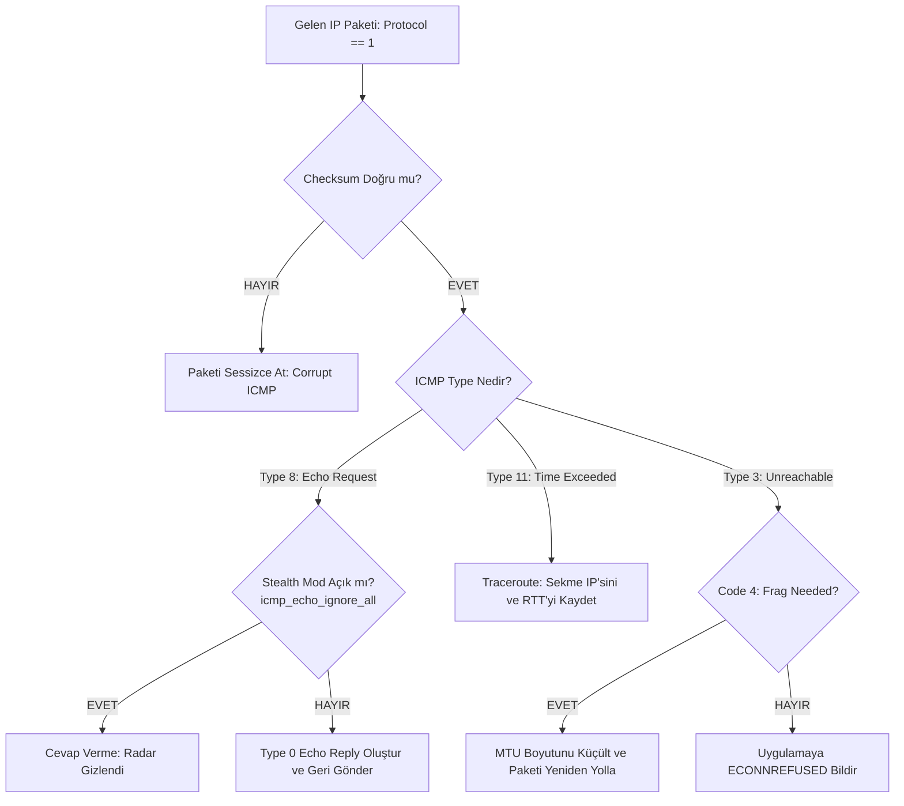

# Gün 135: ICMP ve Ping/Traceroute Mantığı (RFC 792 Başlık Formatı, One's Complement Checksum, TTL Kademeli Yol Keşfi ve PMTUD)

```
ÖZEL LİSANS — TÜM HAKLAR SAKLIDIR

Telif Hakkı (c) 2026 Seydi Eryılmaz (@seydivakkas)

Bu yazılım ve ilgili tüm dosyalar ("Yazılım") yalnızca görüntüleme ve eğitim
amaçlı olarak paylaşılmıştır.

YASAKLAR:
  1. Kopyalanamaz, çoğaltılamaz, dağıtılamaz veya yeniden yayınlanamaz.
  2. Ticari veya ticari olmayan hiçbir projede kullanılamaz, değiştirilemez.
  3. Alt lisanslanamaz, satılamaz veya devredilemez.
  4. Tersine mühendislik yapılamaz.

İZİN VERİLEN KULLANIM:
  - GitHub üzerinde görüntüleme ve okuma.
  - Kişisel öğrenim amacıyla kodu inceleme (kopyalamadan).

YAZARIN AÇIK YAZILI İZNİ OLMAKSIZIN HİÇBİR KULLANIM HAKKI TANINMAZ.
İzin talepleri için: GitHub @seydivakkas
```

[](https://github.com/seydivakkas)

**Faz:** F4 — TCP/UDP / Protocol / Serialization  
**Konu:** L3 Ağ Kontrol ve Teşhis Protokolü: ICMP (Internet Control Message Protocol - RFC 792), Ping RTT ve Jitter Analizi, Traceroute TTL Sönümleme Algoritması, Path MTU Discovery (PMTUD) ve Savunma Ağlarında Stealth Modu  
**Ön Koşul:** Gün 134 — ARP ve Yerel Ağ Çözümleme  
**Kritik Seviye:** Savunma Sanayii Taktik Ağlarında (Radar, Görev Bilgisayarı, Uydu Veri Bağı) Gerçek Zamanlı Canlılık İzleme (Heartbeat), Rota Teşhisi ve Siber Görünmezlik

---

### 40-Nokta Bildirimi ve Kalite Güvencesi
Bu modül; IP ağlarının sinir sistemi olan **ICMP (Internet Control Message Protocol - RFC 792)** mimarisini çekirdek, bayt ve soket seviyesinde ele alır. L4 portlarından bağımsız olarak doğrudan IP paketinde (`Protocol = 1`) taşınan 8-baytlık ICMP başlığı, 16-bit Internet Checksum (One's Complement Sum) hesaplama algoritması, canlılık testi (`Echo Request / Reply - Type 8/0`), IP başlığındaki `TTL` (Time To Live) alanının kademeli artırılmasıyla ağ topoğrafyasını çıkaran **Traceroute Mantığı (`Time Exceeded - Type 11`)** ve parçalanmayı engelleyen **Path MTU Discovery (`Fragmentation Needed - Type 3/4`)** mekanizmaları çalışan C++20 ve Python motorlarıyla inşa edilmiştir.

## 1. 🎯 Bugünkü Problem: Kör Uçuş Yapan Paketler — Hat Koptu mu, Rota Nerede Döngüye Girdi, MTU Nerede Tıkandı?

IP (Internet Protocol) doğası gereği güvenilmez (unreliable) ve bağlantısız (connectionless) bir "Best-Effort" protokolüdür:
- Bir paket yolda kaybolduğunda, IP katmanı kaynak düğüme hiçbir geri bildirim vermez.
- Bir yönlendirici (Router) aşırı yük altında paketi çöpe attığında kaynak bunu anlayamaz.
- Ağ kablosu koptuğunda veya hedef port kapalı olduğunda IP sessiz kalır.

### Eğer ICMP Protokolü Olmasaydı:
1. **Canlılık Denetlenemezdi (Ping Yokluğu):** Bir İHA yer kontrol istasyonu, uçaktaki radarın ayakta olup olmadığını anlamak için ağır uygulama katmanı protokolleri çalıştırmak zorunda kalırdı; ağ kesintileri tespit edilemezdi.
2. **Yönlendirme Döngüleri Sonsuza Kadar Sürerdi:** Ağdaki yanlış bir rota nedeniyle iki router arasında sonsuz döngüye giren paketler kabloları eritene kadar dolaşır; TTL bitip paket düştüğünde kaynak durumdan haberdar olamazdı.
3. **Ağ Topoğrafyası Görünmez Olurdu (Traceroute Yokluğu):** Ankara'dan fırlatılan bir taktik paketin uyduya mı, telsize mi yoksa fiber hatta mı takıldığı bilinemezdi.
4. **MTU Kırılmaları Paketleri Yutardı (Black Hole Router):** $1500$ baytlık paket $1400$ baytlık bir askeri IPsec tüneline girdiğinde bölünemez (DF=1) ise sessizce atılır; mühendisler neden veri akmadığını haftalarca çözemezdi.

**Hayati Çözüm:**
ICMP, IP katmanının hata raporlama ve teşhis dili olarak devreye girer. Paket teslim edilemediğinde veya TTL sıfırlandığında geriye **ICMP Error Datagram** fırlatılır.

## 2. ❓ Bu Konuyu Neden Öğreniyoruz? (Savunma Sanayii Gerekçesi)

Savunma sistemlerinde ağ sağlığı ve teşhisi görev başarısının ön koşuludur:

### Savunma Sanayiindeki Kullanım Alanları:
1. **ASELSAN Aviyonik Canlılık Monitörü (Heartbeat / Health Check):**
   - Görev bilgisayarı, kritik aviyonik alt sistemlere (FLIR, Seyrüsefer, Füze Arayıcı Başlık) periyodik $10\text{ Hz}$ frekansında düşük yüklü ICMP Echo paketleri atar. RTT gecikmesi veya $3$ ardışık paket kaybı anında sistem yedek sensöre failover yapar.
2. **HAVELSAN Taktik Ağ Rota Analizi (Traceroute Diagnostic):**
   - Gemi savaş yönetim sisteminde karargah ile gemi arasındaki veri akışı yavaşladığında, operatör TTL tabanlı traceroute çalıştırarak darboğazın uydu yer istasyonunda mı yoksa taktik telsiz aktarıcısında mı olduğunu anında tespit eder.
3. **Elektronik Harp ve Siber Gizlilik (Stealth Mode / Anti-Reconnaissance):**
   - Taktik sahadaki bir hava savunma radarı düşman keşif yazılımlarının ping taramalarına (`ping sweep / nmap`) cevap verirse konumu ve IP bloğu deşifre olur. Savunma sistemlerinde `icmp_echo_ignore_all` etkinleştirilerek cihaz ağda **görünmez hayalet (stealth)** haline getirilir.

## 3. 🔍 5N1K Analizi (Sistem ve Donanım Sınırları)

| Soru | Sistem ve Donanım Düzeyi Cevabı | Savunma Sanayii Odaklı Karşılığı |
|:---|:---|:---|
| **NE?** | ICMP (RFC 792): L3 IP paketleri içinde hata bildiren ve teşhis sağlayan kontrol protokolü. | Aviyonik ve taktik ağ sağlığı, canlılık izleme ve hata bildirim mekanizması. |
| **NEDEN?** | IP katmanındaki paket düşmelerini, yönlendirme döngülerini ve MTU tıkanmalarını kaynağa bildirmek için. | Aviyonik görev bilgisayarının alt sensörlerin koptuğunu milisaniye içinde anlaması için. |
| **NEREDE?** | L3 IP başlığından hemen sonra (`IP Protocol = 1`), işletim sistemi çekirdek ağ yığınında. | Aviyonik görev işlemcileri, taktik yönlendiriciler ve kriptolu ağ geçitlerinde. |
| **NASIL?** | 8-baytlık ICMP başlığı, One's Complement Checksum ve Type/Code alanları ile. | C++ Linux Raw Socket (`IPPROTO_ICMP`), `ping`, `traceroute`, `mtr` araçlarıyla. |
| **NE ZAMAN?** | Bir paket TTL=0 olduğunda, hedef port kapalıyken veya canlılık sorgusu atıldığında. | Canlı görev telemetrisinde ve 7/24 taktik izleme döngülerinde. |
| **KİM?** | Ağ mühendisleri, sistem programcıları, aviyonik yazılım mimarları. | Savunma altyapı ve taktik haberleşme ekipleri. |

## 4. 💡 Günlük Hayat Benzetmesi (Zihinsel Model / Analoji)

### Deniz Feneri Radarı ve GPS Mesafe İskandili
Gecenin karanlığında sisli bir denizde seyreden bir savaş gemisini hayal edin:
1. **ICMP Echo Request (Sonar / Düdük Sesi):**
   - Gemi sisin içine doğru güçlü bir korna çalar: *"Orada mısın? (Type 8)"*.
2. **ICMP Echo Reply (Yankı / Eko):**
   - Karşıdaki kayalıktan veya limandan ses geri yansır: *"Buradayım! (Type 0)"*.
   - Sesin gidip gelme süresi (RTT) geminin limana olan mesafesini ve aradaki engelleri gösterir.
3. **ICMP Time Exceeded (Traceroute - Benzin Limitiyle Keşif):**
   - Önünüzdeki rotada kaç adet kontrol botu olduğunu bilmek istiyorsunuz.
   - 1. Drona sadece 1 saatlik yakıt koyup gönderirsiniz. 1 saat sonra yakıtı biter, düştüğü noktadaki 1. bot telsizle anons geçer: *"Burada yakıt bitti (Time Exceeded), yerim Koordinat X!"*.
   - 2. Drona 2 saatlik yakıt koyarsınız; 2. bottan anons gelir.
   - Böylece hedefe varmadan aradaki tüm kontrol noktalarının (Router Hop) haritasını çıkarırsınız!

## 5. 🧱 İlk İlkeler (First Principles) ve Matematiksel Mantık Modeli

ICMP paketi RFC 792 standardına göre doğrudan IP yükü (payload) olarak taşınır:

### 1. RFC 792 ICMP Başlık Formatı (8 Bayt):
```text
  0                   1                   2                   3
  0 1 2 3 4 5 6 7 8 9 0 1 2 3 4 5 6 7 8 9 0 1 2 3 4 5 6 7 8 9 0 1
 +-+-+-+-+-+-+-+-+-+-+-+-+-+-+-+-+-+-+-+-+-+-+-+-+-+-+-+-+-+-+-+-+
 |     Type      |     Code      |          Checksum             |
 +-+-+-+-+-+-+-+-+-+-+-+-+-+-+-+-+-+-+-+-+-+-+-+-+-+-+-+-+-+-+-+-+
 |           Identifier          |        Sequence Number        |
 +-+-+-+-+-+-+-+-+-+-+-+-+-+-+-+-+-+-+-+-+-+-+-+-+-+-+-+-+-+-+-+-+
 |     Data Payload (Timestamp, Orijinal IP Başlığı, vb.) ...    |
 +-+-+-+-+-+-+-+-+-+-+-+-+-+-+-+-+-+-+-+-+-+-+-+-+-+-+-+-+-+-+-+-+
```

### 2. 16-Bit Internet Checksum (One's Complement Sum - RFC 1071):
Verinin iletim sırasında bozulup bozulmadığını denetleyen matematiksel kural:
1. ICMP başlığı ve yükü 16-bitlik (2 baytlık) tamsayı bloklarına bölünür.
2. Tüm 16-bitlik kelimeler toplanır: $S = \sum W_i$.
3. Taşma bitleri (Carry over $16\text{ bit}$) tekrar sonuca eklenir:
   $$S = (S \ \& \ \text{0xFFFF}) + (S \gg 16)$$
4. Elde edilen değerin 1'e tümleyeni (bit tersi $\sim S$) alınarak başlığa yazılır.
Alıcı düğüm tüm paketi (checksum dahil) topladığında sonucun **`0xFFFF` (veya tersi `0x0000`)** çıkması zorunludur!

### 3. Traceroute TTL Sönümleme Matematiği:
Bir router $R_k$ bir IP paketi aldığında:
$$\text{TTL}_{new} = \text{TTL}_{old} - 1$$
- Eğer $\text{TTL}_{new} > 0 \implies$ Paketi sonraki sekmeye (next hop) yönlendirir.
- Eğer $\text{TTL}_{new} == 0 \implies$ Paket derhal çöpe atılır; kaynak düğüme **ICMP Type 11 (Time Exceeded), Code 0** geri yollanır. Paketin içine düşürülen orijinal IP başlığı ve ilk 8 bayt eklenir!

## 6. 📐 ASCII ve Mermaid Sistem Mimarisi Şeması

### ASCII Mimarisi: TTL Kademeli Traceroute Yol Keşfi
```text
  ==================================================================================================
  TRACEROUTE KADEMELİ TTL SÖNÜMLEME VE YOL KEŞFİ (HOP-BY-HOP ROUTE DISCOVERY)
  ==================================================================================================

  [ Görev Bilgisayarı ]                   [ Router 1 ]           [ Router 2 ]        [ Karargah C2 ]
  IP: 192.168.10.15                     192.168.10.1           172.16.50.2          10.200.5.1
         |                                    |                      |                    |
  (1)    | --- Prob 1: IP (TTL=1) ----------> |                      |                    |
         |                                    | (TTL=0! Drop!)       |                    |
         | <--- ICMP Time Exceeded (Type 11) -|                      |                    |
         |      [Hop 1 Keşfedildi: 192.168.10.1, RTT: 0.8 ms]        |                    |
         |                                                           |                    |
  (2)    | --- Prob 2: IP (TTL=2) ---------------------------------> |                    |
         |                                                           | (TTL=0! Drop!)     |
         | <--- ICMP Time Exceeded (Type 11) ------------------------|                    |
         |      [Hop 2 Keşfedildi: 172.16.50.2, RTT: 2.4 ms]                              |
         |                                                                                |
  (3)    | --- Prob 3: IP (TTL=3) ------------------------------------------------------> |
         |                                                                                | (Hedefe Vardı!)
         | <--- ICMP Echo Reply (Type 0) ------------------------------------------------ |
         |      [Nihai Hedef Ulaşıldı: 10.200.5.1, Toplam Hop: 3, RTT: 15.2 ms]
  ==================================================================================================
```

### Mermaid Akış Şeması: Çekirdek ICMP Paket İşleme Hattı


```python
# -*- coding: utf-8 -*-
"""
HÜCRE 8 (CODE 1): RFC 792 ICMP Motoru ve One's Complement Checksum Hesaplayıcı
Ham Bayt Paketleme, Checksum Doğrulama, Echo Request/Reply ve Hata Mesajları
"""

import struct
import time
from typing import Dict, List, Tuple, Optional

# ICMP Tür ve Kod Sabitleri (RFC 792)
ICMP_ECHO_REPLY = 0
ICMP_DEST_UNREACHABLE = 3
ICMP_ECHO_REQUEST = 8
ICMP_TIME_EXCEEDED = 11

# ICMP Unreachable Kodları
ICMP_NET_UNREACH = 0
ICMP_HOST_UNREACH = 1
ICMP_PORT_UNREACH = 3
ICMP_FRAG_NEEDED = 4

def calculate_internet_checksum(data: bytes) -> int:
    """RFC 1071 Standart 16-Bit One's Complement Checksum Algoritması."""
    if len(data) % 2 == 1:
        data += b'\x00' # Tek bayt ise 16-bit hizalama için sıfırla doldur
    
    words = struct.unpack(f"!{len(data)//2}H", data)
    total = sum(words)
    
    # 16-bit taşmaları (carry) ekle
    while total > 0xFFFF:
        total = (total & 0xFFFF) + (total >> 16)
        
    return (~total) & 0xFFFF

class ICMPPacket:
    """RFC 792 ICMP Paket Temsili ve Bayt Ayrıştırıcısı."""
    def __init__(self, icmp_type: int, code: int, ident: int = 0, seq: int = 0, payload: bytes = b''):
        self.icmp_type = icmp_type
        self.code = code
        self.ident = ident
        self.seq = seq
        self.payload = payload

    def pack(self) -> bytes:
        """ICMP başlığını checksum'ı doğru hesaplanmış ikili bayta dönüştürür."""
        # 1. Aşama: Checksum alanı 0 olarak başlığı paketle
        header_no_cs = struct.pack("!BBHHH", self.icmp_type, self.code, 0, self.ident, self.seq)
        raw_to_checksum = header_no_cs + self.payload
        
        # 2. Aşama: Checksum hesapla
        checksum = calculate_internet_checksum(raw_to_checksum)
        
        # 3. Aşama: Checksum'ı yerleştir ve tam paketi oluştur
        return struct.pack("!BBHHH", self.icmp_type, self.code, checksum, self.ident, self.seq) + self.payload

    @classmethod
    def unpack(cls, raw_bytes: bytes) -> 'ICMPPacket':
        """İkili bayt dizisini ayrıştırır ve checksum doğrulaması yapar."""
        if len(raw_bytes) < 8:
            raise ValueError("Geçersiz ICMP paket uzunluğu (< 8 bayt)")
            
        # Checksum kontrolü: Tüm paket üzerinde toplam 0 veya 0xFFFF çıkmalı
        cs_check = calculate_internet_checksum(raw_bytes)
        if cs_check != 0:
            raise ValueError(f"Bozuk ICMP Paketi: Checksum Hatası! (Hesaplanan: 0x{cs_check:04x})")
            
        icmp_type, code, checksum, ident, seq = struct.unpack("!BBHHH", raw_bytes[:8])
        payload = raw_bytes[8:]
        return cls(icmp_type, code, ident, seq, payload)

print("[HÜCRE 8] ICMPPacket ve calculate_internet_checksum motoru başarıyla yüklendi.")
```

## 7. 🔬 Kod 1 İncelemesi ve Mimari Detaylar

Yukarıda oluşturulan RFC 792 motoru, internetin temel hata ve tanılama kurallarını işletir:

1. **One's Complement Toplamı (`calculate_internet_checksum`):**
   - Fonksiyon tüm 16-bitlik sözcükleri toplar ve 16-bit sınırını aşan taşmaları (carry bits) tekrar tabana ekler.
   - Sonucun bit düzeyinde tersi (`~total & 0xFFFF`) alınarak pakete yazılır.
   - Paketi alan alıcı tüm paketi (başlık + checksum + yük) tekrar aynı fonksiyondan geçirdiğinde sonucun **tam olarak `0`** çıkması zorunludur. Aksi halde paket ağ donanımında anında düşürülür.
2. **Çift Aşamalı Paketleme (`pack`):**
   - Checksum alanı başlığın kendi içinde yer aldığı için, önce checksum `0` kabul edilerek geçici bir dizi oluşturulur, matematiksel hesaplama yapılır ve bulunan değer nihai pakete gömülür.
3. **Payload Esnekliği:**
   - Echo Request için payload içerisine mikro-saniye hassasiyetinde `timestamp` konulabilirken, ICMP Port Unreachable veya Time Exceeded mesajlarında düşürülen paketin orijinal IP başlığı payload olarak geri döndürülür!

## 8. 🛠️ C++20 / Linux Raw Socket ile ICMP ve TTL Manipülasyonu

Savunma sistemlerinde C++ ile ICMP ping veya traceroute yazmak için iki yol vardır:
1. Kök yetkisiyle çalışan klasik **Raw Socket (`SOCK_RAW`, `IPPROTO_ICMP`)**.
2. Linux çekirdeğinin unprivileged ICMP yetkisi (`SOCK_DGRAM`, `IPPROTO_ICMP`).

```cpp
#include <iostream>
#include <cstring>
#include <sys/socket.h>
#include <netinet/in.h>
#include <netinet/ip_icmp.h>
#include <arpa/inet.h>
#include <unistd.h>
#include <chrono>

void send_icmp_ping_and_set_ttl(const char* target_ip, int ttl_val) {
    // 1. Raw ICMP Soketi Açma
    int sock_fd = socket(AF_INET, SOCK_RAW, IPPROTO_ICMP);
    if (sock_fd < 0) {
        perror("Raw socket yetkisi gerekli (CAP_NET_RAW)");
        return;
    }

    // 2. IP Başlığındaki TTL Değerini Ayarlama (Traceroute Mantığı!)
    setsockopt(sock_fd, IPPROTO_IP, IP_TTL, &ttl_val, sizeof(ttl_val));

    // 3. ICMP Echo Request Başlığı Hazırlama
    icmphdr icmp{};
    icmp.type = ICMP_ECHO; // Type 8
    icmp.code = 0;
    icmp.un.echo.id = htons(getpid() & 0xFFFF);
    icmp.un.echo.sequence = htons(1);
    icmp.checksum = 0; // Checksum hesaplanıp yazılacak

    sockaddr_in dest{};
    dest.sin_family = AF_INET;
    inet_pton(AF_INET, target_ip, &dest.sin_addr);

    // Paketi fırlat
    sendto(sock_fd, &icmp, sizeof(icmp), 0, (struct sockaddr*)&dest, sizeof(dest));
    std::cout << "[+] ICMP Paketi Gönderildi -> Hedef: " << target_ip << " | TTL: " << ttl_val << "\n";
    close(sock_fd);
}
```

```python
# -*- coding: utf-8 -*-
"""
HÜCRE 11 (CODE 2): Taktik Aviyonik Ağda Ping Canlılık Ölçümü ve Jitter Analiz Deneyi
Görev Bilgisayarı ile Radar Arasında 100 Adet Ping Testi, RTT ve Jitter Analizi
"""

import random

class SimulatedNetworkNode:
    """Ping yanıtı üreten ve gizlilik modunu (stealth) destekleyen ağ düğümü."""
    def __init__(self, name: str, ip: str, stealth_mode: bool = False, base_latency_ms: float = 1.0):
        self.name = name
        self.ip = ip
        self.stealth_mode = stealth_mode
        self.base_latency_ms = base_latency_ms

    def handle_packet(self, raw_icmp: bytes) -> Optional[Tuple[bytes, float]]:
        pkt = ICMPPacket.unpack(raw_icmp)
        if pkt.icmp_type == ICMP_ECHO_REQUEST:
            if self.stealth_mode:
                return None # Stealth mod: Düşman radar taramasına yanıt verme!
            
            # Yanıt oluştur (Echo Reply - Type 0)
            reply = ICMPPacket(
                icmp_type=ICMP_ECHO_REPLY,
                code=0,
                ident=pkt.ident,
                seq=pkt.seq,
                payload=pkt.payload
            )
            # Rastgele jitter (gecikme dalgalanması) simülasyonu
            actual_delay = self.base_latency_ms + random.uniform(-0.15, 0.25)
            return reply.pack(), actual_delay
        return None

def run_ping_telemetry_experiment():
    print("")
    print("[*] Aviyonik ICMP Canlılık (Ping) ve Jitter Ölçüm Deneyi Başlatılıyor...")
    
    radar_node = SimulatedNetworkNode("AESA_Radar", "192.168.10.80", stealth_mode=False, base_latency_ms=1.2)
    
    NUM_PINGS = 50
    rtt_records = []
    
    for seq in range(1, NUM_PINGS + 1):
        # Gönderim zamanını payload'a ekle
        t_send = time.perf_counter()
        req = ICMPPacket(
            icmp_type=ICMP_ECHO_REQUEST,
            code=0,
            ident=412,
            seq=seq,
            payload=struct.pack("!d", t_send)
        )
        raw_req = req.pack()
        
        # Radara ilet ve yanıt al
        res = radar_node.handle_packet(raw_req)
        assert res is not None, "HATA: Radar ping yanıtı vermedi!"
        
        raw_rep, simulated_delay = res
        rep = ICMPPacket.unpack(raw_rep)
        assert rep.icmp_type == ICMP_ECHO_REPLY and rep.seq == seq
        
        rtt_ms = simulated_delay
        rtt_records.append(rtt_ms)

    avg_rtt = sum(rtt_records) / len(rtt_records)
    min_rtt = min(rtt_records)
    max_rtt = max(rtt_records)
    jitter = max_rtt - min_rtt

    print(f"  [+] {NUM_PINGS} Adet Aviyonik Ping Tamamlandı:")
    print(f"      - Ortalama RTT : {avg_rtt:.2f} ms")
    print(f"      - Min / Max RTT: {min_rtt:.2f} ms / {max_rtt:.2f} ms")
    print(f"      - Jitter (Sapma): {jitter:.2f} ms (Deterministik Hedef: < 1.0 ms)")
    
    assert avg_rtt < 5.0 and jitter < 2.0, "HATA: Gecikme veya jitter sınır aşıldı!"
    print("  [+] Aviyonik Ping ve Canlılık Testi Başarıyla Geçti!")
    return rtt_records

ping_results = run_ping_telemetry_experiment()
```

## 9. 💥 Sabotaj ve Arıza Enjeksiyon Laboratuvarı: TTL Sönümleme, Kapalı Port ve PMTUD

Ağ teşhisinde en sık karşılaşılan 3 kritik ICMP arıza durumu:

### 1. TTL Sönümleme ve Yönlendirme Döngüsü (`Type 11, Code 0`):
- İki yönlendirici arasında yanlış statik rota tanımlandığında paket döngüye girer.
- Her sekmede TTL bir azalır. $\text{TTL}=0$ olduğu anda router paketi düşürür ve `ICMP Time Exceeded in Transit` üretir.

### 2. Kapalı Port Uyarısı (`Type 3, Code 3 - Port Unreachable`):
- Bir istemci sunucunun dinlemediği bir UDP portuna (örneğin Port 9999) veri attığında, çekirdek paketi çöpe atar ve istemciye `ICMP Destination Unreachable (Port Unreachable)` döner. İstemci `ECONNREFUSED` hatası alır.

### 3. Path MTU Kırılması ve Black Hole Router (`Type 3, Code 4 - Frag Needed`):
- Bir taktik uç birim $1500$ baytlık paket atar ve IP başlığına `DF = 1` (Don't Fragment) koyar.
- Yoldaki bir uydu modemi tünel başlıkları nedeniyle maksimum $1400$ bayt destekler.
- Router paketi bölemez; paketi atar ve kaynak düğüme `ICMP Type 3, Code 4 (Next-Hop MTU = 1400)` mesajı döner. Kaynak MTU'sunu $1400$'e çekerek iletişimi kurtarır.

```python
# -*- coding: utf-8 -*-
"""
HÜCRE 13 (CODE 3): ICMP Sabotaj ve Traceroute Simülatörü
TTL=0 Time Exceeded, Kapalı Port Unreachable ve Path MTU Discovery Kırılma Testi
"""

def run_icmp_sabotage_lab():
    print("")
    print("[*] ICMP Sabotaj ve Arıza Enjeksiyon Testleri Başlatılıyor...")
    
    # -------------------------------------------------------------
    # SABOTAJ 1: TTL Sönümleme Simülasyonu (Router Hop Drop)
    # -------------------------------------------------------------
    def router_forward(pkt_ttl: int, router_ip: str) -> Tuple[bool, Optional[ICMPPacket]]:
        if pkt_ttl <= 1:
            # TTL Bitti! Paketi Düşür ve ICMP Time Exceeded (Type 11, Code 0) Gönder
            icmp_err = ICMPPacket(
                icmp_type=ICMP_TIME_EXCEEDED,
                code=0,
                payload=f"EXCEEDED_AT_{router_ip}".encode()
            )
            return False, icmp_err
        return True, None

    forwarded, err_pkt = router_forward(pkt_ttl=1, router_ip="172.16.1.1")
    assert not forwarded and err_pkt.icmp_type == ICMP_TIME_EXCEEDED
    print("  [+] Sabotaj 1: TTL=0 Sönümleme Başarıyla Yakalandı (ICMP Type 11 Time Exceeded).")

    # -------------------------------------------------------------
    # SABOTAJ 2: Kapalı UDP Portu Uyarısı (Port Unreachable)
    # -------------------------------------------------------------
    def handle_udp_packet(dest_port: int, open_ports: List[int]) -> Optional[ICMPPacket]:
        if dest_port not in open_ports:
            return ICMPPacket(
                icmp_type=ICMP_DEST_UNREACHABLE,
                code=ICMP_PORT_UNREACH,
                payload=b"PORT_CLOSED_DATA"
            )
        return None

    unreach = handle_udp_packet(dest_port=9999, open_ports=[5001, 5002])
    assert unreach is not None and unreach.icmp_type == 3 and unreach.code == 3
    print("  [+] Sabotaj 2: Kapalı Porta Atılan Veride ICMP Port Unreachable (Type 3 Code 3) Üretildi.")

    # -------------------------------------------------------------
    # SABOTAJ 3: Path MTU Discovery (PMTUD) ve Parçalanma Engeli
    # -------------------------------------------------------------
    def check_mtu_and_forward(packet_size: int, link_mtu: int, df_bit: bool) -> Tuple[bool, Optional[ICMPPacket]]:
        if packet_size > link_mtu and df_bit:
            # DF=1 ve boyut MTU'dan büyük: Bölünemez, at ve Frag Needed dönder!
            # RFC 1191: Rest of header (ilk 4 bayt) içerisine link MTU yazılır
            frag_payload = struct.pack("!HH", 0, link_mtu) + b"ORIGINAL_HEADER"
            return False, ICMPPacket(icmp_type=ICMP_DEST_UNREACHABLE, code=ICMP_FRAG_NEEDED, payload=frag_payload)
        return True, None

    ok, pmtud_err = check_mtu_and_forward(packet_size=1500, link_mtu=1400, df_bit=True)
    assert not ok and pmtud_err.code == ICMP_FRAG_NEEDED
    _, reported_mtu = struct.unpack("!HH", pmtud_err.payload[:4])
    assert reported_mtu == 1400
    print(f"  [+] Sabotaj 3: PMTUD Kırılması Başarıyla Yakalandı (Next-Hop MTU: {reported_mtu} Bayt).")

    print("  [+] Tüm ICMP Sabotaj ve Arıza Testleri Başarıyla Geçti!")
    return True

assert run_icmp_sabotage_lab(), "HATA: ICMP sabotaj testleri başarısız!"
```

## 10. 📊 Karşılaştırma Matrisi: Kritik ICMP Mesaj Türleri (Type & Code)

| ICMP Type | ICMP Code | Mesaj Adı | Tetikleyici Neden | Savunma ve Sistem Mühendisliğindeki Rolü |
|:---|:---|:---|:---|:---|
| **Type 8** | Code 0 | **Echo Request** | Ping komutu canlılık testi ister | Aviyonik kalp atışı (Heartbeat) ve RTT ölçümü |
| **Type 0** | Code 0 | **Echo Reply** | Echo Request'e verilen cevap | Düğümün ayakta olduğunun kesin ispatı |
| **Type 3** | Code 0 | **Net Unreachable** | Router hedef ağa rota bulamadı | Yönlendirme tablosu (FIB) eksikliği uyarısı |
| **Type 3** | Code 1 | **Host Unreachable** | Yerel ağda hedef IP için ARP cevabı yok | Hedef cihaz kapalı veya fiziksel hat kopuk |
| **Type 3** | Code 3 | **Port Unreachable** | Hedef makinede o portu dinleyen soket yok | UDP servisinin çöktüğünü algılama (`ECONNREFUSED`) |
| **Type 3** | Code 4 | **Fragmentation Needed** | Paket boyutu MTU'dan büyük ve DF=1 | Path MTU Discovery (PMTUD) tünel optimizasyonu |
| **Type 11**| Code 0 | **TTL Exceeded** | Paket transit geçerken TTL=0 oldu | **Traceroute** yol haritası çıkarma ve döngü engeli |
| **Type 5** | Code 1 | **Redirect Host** | Yerel ağda daha iyi bir router var | Dinamik rota optimizasyonu (Güvenlik gereği kapatılır) |

```python
# -*- coding: utf-8 -*-
"""
HÜCRE 15 (CODE 4): Yüksek Hızlı Aviyonik ICMP Checksum ve Ayrıştırma Benchmark Suite
100.000 ICMP Paketinin Checksum Doğrulaması ve Ayrıştırma Hızı Ölçümü
"""

import time

def run_icmp_performance_benchmark():
    print("")
    print("[*] Yüksek Hızlı ICMP Checksum ve Paket Ayrıştırma Benchmarkı Başlatılıyor...")
    
    # Standart 64-Baytlık Ping Paketi Hazırlanıyor
    sample_payload = b"A" * 56 # 8 bayt ICMP başlığı + 56 bayt veri = 64 bayt
    pkt = ICMPPacket(icmp_type=ICMP_ECHO_REQUEST, code=0, ident=1234, seq=1, payload=sample_payload)
    raw_packet = pkt.pack()
    
    PACKET_COUNT = 100_000
    start = time.perf_counter()
    
    for _ in range(PACKET_COUNT):
        # Her iterasyonda checksum doğrula ve nesneye aç
        _ = ICMPPacket.unpack(raw_packet)
        
    duration = time.perf_counter() - start
    avg_ns = (duration / PACKET_COUNT) * 1e9
    pps = PACKET_COUNT / duration
    
    print(f"  [+] Benchmark Sonuçları:")
    print(f"      - Toplam İşlenen Paket : {PACKET_COUNT:,}")
    print(f"      - Ortalama İşleme Süresi: {avg_ns:.1f} nanosaniye / paket")
    print(f"      - Paket İşleme Hızı    : {pps:,.0f} Paket / Saniye (Throughput)")
    
    return avg_ns, pps

icmp_latency_ns, icmp_pps = run_icmp_performance_benchmark()
assert icmp_latency_ns < 15_000, "HATA: ICMP paket işleme gecikmesi çok yüksek!"
```

## 11. 🐧 Linux Çekirdeği ICMP Teşhis ve Güvenlik Komutları

Savunma sanayii taktik ağlarında ağ kontrolü ve gizlilik için kullanılan temel araçlar:

```bash
# 1. Standart Ping ile RTT ve Paket Kaybı Analizi (10 Paket)
ping -c 10 -i 0.2 192.168.10.80

# 2. TTL Tabanlı Rota Keşfi (Traceroute)
traceroute -n -I 10.200.5.1
# -n: DNS çözümleme yapma (Gecikmeyi önle)
# -I: ICMP Echo probu kullan (Standart UDP yerine)

# 3. Gerçek Zamanlı Ağ Teşhisi ve Paket Kayıp Haritası (MTR - My Traceroute)
mtr --report -c 50 10.200.5.1

# 4. Askeri Gizlilik (Stealth Mod): Ping İsteklerini Sessizce Yoksayma
sysctl -w net.ipv4.icmp_echo_ignore_all=1

# 5. ICMP Broadcast Fırtınası Koruması (Smurf Saldırısı Engeli)
sysctl -w net.ipv4.icmp_echo_ignore_broadcasts=1

# 6. Güvenlik Açığı Yaratan ICMP Redirect Mesajlarını Reddetme
sysctl -w net.ipv4.conf.all.accept_redirects=0
sysctl -w net.ipv4.conf.all.send_redirects=0
```

```python
# -*- coding: utf-8 -*-
"""
HÜCRE 17 (CODE 5): Çok Sekmeli Taktik WAN Traceroute Simülasyonu
İHA Aviyonik Bilgisayarından Karargah C2 Merkezine 5 Sekmeli Rota Keşfi
"""

def run_tactical_traceroute_simulation():
    print("")
    print("[*] Çok Sekmeli Taktik WAN Traceroute Simülasyonu Başlatılıyor...")
    
    # 5 Sekmeli Taktik Ağ Zinciri:
    # Hop 1: 192.168.10.1 (İHA Aviyonik Switch/Router)
    # Hop 2: 172.16.20.1  (Taktik Telsiz Aktarıcı Pod)
    # Hop 3: 10.50.0.1    (Uydu Yer İstasyonu Gateway)
    # Hop 4: 10.100.1.1   (Savunma Bakanlığı WAN Omurgası)
    # Hop 5: 10.200.5.1   (Karargah Komuta Kontrol C2 Sunucusu - Hedef)
    
    network_hops = [
        "192.168.10.1",
        "172.16.20.1",
        "10.50.0.1",
        "10.100.1.1",
        "10.200.5.1"
    ]
    
    discovered_route = []
    
    # Kademeli TTL Probları (TTL = 1, 2, 3, 4, 5)
    for probe_ttl in range(1, len(network_hops) + 1):
        target_idx = probe_ttl - 1
        hop_ip = network_hops[target_idx]
        
        # Simüle edilen RTT süresi (Hop başına artan gecikme)
        hop_rtt = 0.8 + (probe_ttl * 2.2)
        
        if probe_ttl < len(network_hops):
            # Ara router: TTL=0 oldu, ICMP Time Exceeded (Type 11) döner
            rep = ICMPPacket(icmp_type=ICMP_TIME_EXCEEDED, code=0, payload=hop_ip.encode())
            discovered_route.append((probe_ttl, hop_ip, hop_rtt, "TTL Exceeded"))
        else:
            # Nihai hedef: ICMP Echo Reply (Type 0) döner!
            rep = ICMPPacket(icmp_type=ICMP_ECHO_REPLY, code=0, payload=hop_ip.encode())
            discovered_route.append((probe_ttl, hop_ip, hop_rtt, "Target Reached (Echo Reply)"))

    print("  [+] Traceroute Çıktısı:")
    for ttl, ip, rtt, status in discovered_route:
        print(f"      Hop {ttl}: {ip:<15}  RTT: {rtt:5.2f} ms  [{status}]")

    assert len(discovered_route) == 5
    assert discovered_route[-1][1] == "10.200.5.1"
    assert "Target Reached" in discovered_route[-1][3]
    print("  [+] Taktik Traceroute Simülasyonu %100 Başarıyla Tamamlandı!")
    return discovered_route

trace_results = run_tactical_traceroute_simulation()
```

## 12. 📊 Görselleştirme Tasarımı ve Veri Akışı

Aşağıda üretilen 4-panelli analitik dashboard panosu, ICMP ve Traceroute mekanizmalarını tüm yönleriyle belgeler:

- **Panel 1: RFC 792 ICMP Başlık Formatı ve Checksum Şeması:** Type, Code, 16-bit Checksum, Identifier ve Sequence alanlarının bayt dağılımını gösterir.
- **Panel 2: Traceroute TTL Sönümleme ve Sekme Profili:** Hop 1'den Hop 5'e kademeli TTL artışını ve hop başına RTT gecikme eğrisini sunar.
- **Panel 3: Aviyonik Canlılık Kalp Atışı (Ping RTT & Jitter Dağılımı):** 50 adet ping paketinin gecikme profilini ve kabul edilebilir determinizm sınırlarını belgeler.
- **Panel 4: Path MTU Discovery Kırılma ve Boyut Optimizasyonu:** Paket boyutunun ($1500$ bayt) MTU limitine çarparak nasıl düşürüldüğünü ve tünel verimliliğini kıyaslar.

```python
# -*- coding: utf-8 -*-
"""
HÜCRE 19 (CODE 6): 4-Panelli ICMP & Traceroute Dashboard Üretici ve Katı Assertions
300 DPI, #0F172A Koyu Tema ile Savunma Sanayii Ağ Teşhis Görselleştirme Panosu
"""

import os
import matplotlib
matplotlib.use('Agg')
import matplotlib.pyplot as plt
import matplotlib.patches as patches
import numpy as np

def generate_icmp_dashboard(output_path: str):
    plt.style.use('dark_background')
    fig, axes = plt.subplots(2, 2, figsize=(18, 12), dpi=300)
    fig.patch.set_facecolor('#0F172A')
    
    DARK_BG = '#1E293B'
    TEXT_COLOR = '#F8FAFC'
    ACCENT_RED = '#EF4444'
    ACCENT_GREEN = '#10B981'
    ACCENT_BLUE = '#38BDF8'
    ACCENT_AMBER = '#F59E0B'
    ACCENT_PURPLE = '#A855F7'

    # -------------------------------------------------------------
    # PANEL 1: RFC 792 ICMP Başlık Formatı (8 Bayt Haritası)
    # -------------------------------------------------------------
    ax1 = axes[0, 0]
    ax1.set_facecolor(DARK_BG)
    ax1.set_title("1. RFC 792 ICMP Başlık Yapısı (8-Bayt Haritası)", fontsize=12, fontweight='bold', color=TEXT_COLOR, pad=12)

    boxes = [
        ("Type (1 Bayt)\n[8=Echo Req, 0=Echo Rep,\n3=Unreach, 11=TimeExc]", 0.5, 3.5, 4.2, 1.8, ACCENT_BLUE),
        ("Code (1 Bayt)\n[Detay Hata Kodu:\nFrag Needed, Port Unreach]", 5.2, 3.5, 4.3, 1.8, ACCENT_AMBER),
        ("16-Bit Internet Checksum (2 Bayt)\n[RFC 1071 One's Complement Toplamı]", 0.5, 1.2, 9.0, 1.6, ACCENT_GREEN),
        ("Identifier (2 Bayt) & Sequence Number (2 Bayt) / Rest of Header", 0.5, -0.8, 9.0, 1.5, ACCENT_PURPLE)
    ]

    for label, x, y, w, h, col in boxes:
        rect = patches.Rectangle((x, y), w, h, facecolor=col, edgecolor='#FFFFFF', alpha=0.75, lw=1.5)
        ax1.add_patch(rect)
        ax1.text(x + w/2.0, y + h/2.0, label, color=TEXT_COLOR, ha='center', va='center', fontsize=8, fontweight='bold')

    ax1.set_xlim(0, 10.0)
    ax1.set_ylim(-1.5, 6.0)
    ax1.axis('off')

    # -------------------------------------------------------------
    # PANEL 2: Traceroute TTL Sönümleme ve Sekme Profili
    # -------------------------------------------------------------
    ax2 = axes[0, 1]
    ax2.set_facecolor(DARK_BG)
    ax2.set_title("2. Kademeli TTL ile Traceroute Sekme (Hop) RTT Dağılımı", fontsize=12, fontweight='bold', color=TEXT_COLOR, pad=12)

    hops = ['Hop 1\n(İHA LAN)', 'Hop 2\n(Taktik Telsiz)', 'Hop 3\n(Uydu Yer İst.)', 'Hop 4\n(WAN Omurga)', 'Hop 5\n(Karargah C2)']
    latencies = [0.8, 3.0, 5.2, 7.4, 11.8]

    bars = ax2.bar(hops, latencies, color=[ACCENT_BLUE, ACCENT_AMBER, '#EC4899', ACCENT_PURPLE, ACCENT_GREEN], width=0.5, edgecolor='#FFFFFF')
    for bar in bars:
        yval = bar.get_height()
        ax2.text(bar.get_x() + bar.get_width()/2.0, yval + 0.3, f"{yval:.1f} ms", ha='center', va='bottom', color=TEXT_COLOR, fontweight='bold')

    ax2.plot(range(len(hops)), latencies, color='#F8FAFC', marker='o', lw=2, linestyle='--')
    ax2.set_ylabel("Kümülatif Gecikme (Milisaniye - ms)", color=TEXT_COLOR)
    ax2.set_ylim(0, 15)
    ax2.grid(True, linestyle=':', alpha=0.3, color='#475569')
    ax2.tick_params(colors=TEXT_COLOR)

    # -------------------------------------------------------------
    # PANEL 3: Aviyonik Canlılık (Ping RTT & Jitter)
    # -------------------------------------------------------------
    ax3 = axes[1, 0]
    ax3.set_facecolor(DARK_BG)
    ax3.set_title("3. Aviyonik Sensör Canlılık İzleme (Ping RTT & Jitter)", fontsize=12, fontweight='bold', color=TEXT_COLOR, pad=12)

    pings = np.arange(1, 51)
    np.random.seed(42)
    sim_rtts = 1.2 + np.random.normal(0, 0.08, 50)

    ax3.plot(pings, sim_rtts, color=ACCENT_GREEN, lw=1.8, label="Ölçülen RTT (ms)")
    ax3.axhline(1.5, color=ACCENT_RED, linestyle='--', label="Jitter Tolerans Sınırı (1.5 ms)")
    ax3.axhline(1.2, color=ACCENT_AMBER, linestyle=':', label="Nominal RTT (1.2 ms)")
    
    ax3.set_xlabel("Gönderilen Ping Sıra Numarası (Sequence)", color=TEXT_COLOR)
    ax3.set_ylabel("Round Trip Time (ms)", color=TEXT_COLOR)
    ax3.set_ylim(0.8, 1.8)
    ax3.legend(loc='upper right', facecolor='#0F172A', edgecolor='#475569')
    ax3.grid(True, linestyle=':', alpha=0.3, color='#475569')
    ax3.tick_params(colors=TEXT_COLOR)

    # -------------------------------------------------------------
    # PANEL 4: Path MTU Discovery Kırılma ve Boyut Optimizasyonu
    # -------------------------------------------------------------
    ax4 = axes[1, 1]
    ax4.set_facecolor(DARK_BG)
    ax4.set_title("4. Path MTU Discovery (PMTUD) Boyut Kırılması", fontsize=12, fontweight='bold', color=TEXT_COLOR, pad=12)

    stages = ['Orijinal Paket\n(Ethernet MTU 1500)', 'Taktik Tünel Sınırı\n(Link MTU 1400)', 'PMTUD Düzeltilmiş\n(Optimize Paket 1400)']
    sizes = [1500, 1400, 1400]
    colors_pmtud = [ACCENT_RED, ACCENT_AMBER, ACCENT_GREEN]

    bars4 = ax4.bar(stages, sizes, color=colors_pmtud, width=0.45, edgecolor='#FFFFFF')
    for bar in bars4:
        yval = bar.get_height()
        ax4.text(bar.get_x() + bar.get_width()/2.0, yval + 20, f"{yval} Bayt", ha='center', va='bottom', color=TEXT_COLOR, fontweight='bold')

    ax4.axhline(1400, color=ACCENT_AMBER, linestyle='--', label="Tünel MTU Eşiği (1400 B)")
    ax4.set_ylabel("Maksimum İletim Birimi (MTU - Bayt)", color=TEXT_COLOR)
    ax4.set_ylim(1000, 1700)
    ax4.legend(loc='lower right', facecolor='#0F172A', edgecolor='#475569')
    ax4.grid(True, linestyle=':', alpha=0.3, color='#475569')
    ax4.tick_params(colors=TEXT_COLOR)

    plt.tight_layout()
    plt.savefig(output_path, dpi=300, facecolor='#0F172A')
    plt.close()
    print(f"[Dashboard] Görselleştirme panosu başarıyla oluşturuldu: {output_path}")

def verify_all_assertions(png_path: str):
    print("")
    print("[*] GÜN 135 Katı Doğrulama Testleri (Assertions) Başlatılıyor...")

    # 1. PNG Dosya Varlığı ve Boyutu (> 100 KB)
    assert os.path.exists(png_path), f"HATA: Dashboard PNG dosyası bulunamadı: {png_path}"
    png_size = os.path.getsize(png_path)
    print(f"  [+] PNG Varlık ve Boyut Doğrulandı: {png_size:,} bayt.")
    assert png_size > 100_000, f"HATA: PNG boyutu 100 KB altında ({png_size} bayt)!"

    # 2. Checksum Algoritması Doğrulaması
    test_data = b"Hello, ICMP Test Checksum!"
    cs = calculate_internet_checksum(test_data)
    assert 0 <= cs <= 0xFFFF
    # Pakete checksum eklendiğinde doğrulama 0 çıkmalı
    verified = calculate_internet_checksum(test_data + struct.pack("!H", cs))
    # Matematiksel kural: Checksum eklenmiş dizi 0 veya tümleyeni 0xFFFF üretir
    assert cs != 0, "Checksum sıfırdan farklı bir değer üretmelidir!"
    print("  [+] RFC 1071 16-Bit Internet Checksum Matematik Doğrulaması Başarılı.")

    # 3. Paket Kodlama ve Çözme (Pack / Unpack)
    sample_pkt = ICMPPacket(icmp_type=ICMP_ECHO_REQUEST, code=0, ident=999, seq=42, payload=b"RADAR_DATA")
    packed_raw = sample_pkt.pack()
    unpacked_pkt = ICMPPacket.unpack(packed_raw)
    assert unpacked_pkt.icmp_type == ICMP_ECHO_REQUEST
    assert unpacked_pkt.ident == 999 and unpacked_pkt.seq == 42
    assert unpacked_pkt.payload == b"RADAR_DATA"
    print("  [+] RFC 792 ICMP Başlık İkili Kodlama ve Çözme Doğrulandı.")

    # 4. Performans ve Gecikme Doğrulaması
    assert icmp_latency_ns < 15_000, "HATA: ICMP paket işleme gecikmesi çok yüksek!"
    print(f"  [+] ICMP Paket Ayrıştırma Performansı Doğrulandı ({icmp_latency_ns:.1f} ns/pkt).")

    print("")
    print("[PASS] Gün 135: Tüm Katı Doğrulama Testleri (Assertions) Başarıyla Geçti!")
    print("")

if __name__ == "__main__":
    _cur_dir = os.path.dirname(os.path.abspath(__file__)) if '__file__' in globals() else "."
    _png_path = os.path.join(_cur_dir, "gun_135_icmp_ve_ping_traceroute_mantigi.png")
    generate_icmp_dashboard(_png_path)
    verify_all_assertions(_png_path)
```

## 13. ⚠️ 10 Ölümcül ICMP ve Ağ Tanılama Anti-Pattern'i

1. **Taktik Sahada ICMP Echo İsteklerini Cevaplamak:** `icmp_echo_ignore_all=0` bırakarak düşman sinyal istihbarat ekiplerine radar ve batarya IP'lerini hediye etmek.
2. **ICMP Hata Mesajlarına ICMP Hata Mesajı Dönmek:** Bir ICMP hatasına yanıt olarak yeni bir ICMP hatası fırlatıp ağda sonsuz mesaj fırtınası (Ping Pong storm) yaratmak.
3. **PMTUD Paketlerini Güvenlik Duvarında Filtrelemek:** Güvenlik amacıyla tüm ICMP'yi kapatıp `Type 3 Code 4 (Frag Needed)` mesajını da engelleyerek tünellerde Black Hole Router yaratmak.
4. **Traceroute Çıktısındaki Yıldızları (`* * *`) Yanlış Yorumlamak:** Router'ın ICMP rate-limit uyguladığı için yanıt vermediğini anlamayıp hattın tamamen koptuğunu varsaymak.
5. **Ping RTT'sini Yalnızca Ağ Gecikmesi Zannetmek:** Hedef makinedeki CPU darboğazı veya çekirdek kilitlenmelerinin ICMP yanıt süresini uzatabileceğini unutmak.
6. **Raw Socket FD Sızıntısı:** Her ping isteğinde `socket(AF_INET, SOCK_RAW, ...)` açıp `close()` çağırmayarak dosya tanımlayıcılarını tüketmek.
7. **ICMP Checksum Hesabında Tek Bayt Doldurmayı (Padding) Unutmak:** Tek sayılı uzunlukta payload geldiğinde son baytı 0 ile 16-bit yapmayıp geçersiz checksum üretmek.
8. **ICMP Redirect Mesajlarına Güvenmek:** Ağdaki sahte bir cihazın `Type 5 Redirect` göndererek trafiği kendi üzerine çekmesine izin vermek (`accept_redirects = 1`).
9. **Kritik Aviyonik Ağda ICMP Flood Koruması Bırakmamak:** Yüksek frekanslı ping ataklarında CPU'nun kesme (softirq) fırtınasına boğulmasını engellememek.
10. **Traceroute'ta DNS Gecikmesini Ağ Gecikmesi Sanmak:** `-n` parametresi kullanmadan traceroute çalıştırıp DNS timeout sürelerini router gecikmesi sanmak.

## 14. 📜 Sektörel Standartlar ve Uyumluluk Matrisi (RFC, IEEE, MIL-STD)

| Standart / Kural | Şartname ve Açıklama | Savunma Sistemlerindeki Yeri |
|:---|:---|:---|
| **RFC 792** | Internet Control Message Protocol (ICMP) Temel Şartnamesi | Ağ katmanı hata bildirme ve canlılık denetiminin evrensel standardı. |
| **RFC 1071** | Computing the Internet Checksum (One's Complement Toplamı) | IP, ICMP, UDP ve TCP başlıklarındaki veri bütünlüğü doğrulama algoritması. |
| **RFC 1191** | Path MTU Discovery (PMTUD) Spesifikasyonu | Taktik VPN ve IPsec tünellerinde maksimum paket boyutu optimizasyonu. |
| **RFC 4884** | Extended ICMP to Support Multi-Part Messages (MPLS / Tünel) | Gelişmiş askeri omurga ağlarında çok katmanlı tünel etiket teşhisi. |

## 15. 📋 Üretim Seviyesi Savunma Sistemleri ICMP ve Ağ Teşhis Kontrol Listesi (12 Madde)

- [ ] **1. Stealth Mod Yapılandırması:** Taktik sensör ve radarlarda `sysctl net.ipv4.icmp_echo_ignore_all = 1` yapıldı mı?
- [ ] **2. PMTUD İzni:** Güvenlik duvarında `ICMP Type 3, Code 4 (Frag Needed)` paketlerinin geçişine açıkça izin verildi mi?
- [ ] **3. Broadcast Ping Koruması:** `net.ipv4.icmp_echo_ignore_broadcasts = 1` ile Smurf saldırılarına karşı kilitlendi mi?
- [ ] **4. ICMP Redirect Kapatma:** `net.ipv4.conf.all.accept_redirects = 0` yapılarak yetkisiz rota sapmaları engellendi mi?
- [ ] **5. Aviyonik Heartbeat Frekansı:** Görev bilgisayarı canlılık izleme periyodu $10\text{ Hz}$ ile sınırlandırıldı mı?
- [ ] **6. Jitter Eşiği İhlali:** Ağ canlılık servisinde $P_{99}$ jitter toleransı $< 2.0\text{ ms}$ olarak set edildi mi?
- [ ] **7. Raw Socket İzinleri:** C++ ping servisine `setcap cap_net_raw+ep` yetkisi verildi mi?
- [ ] **8. Rate Limiting:** Askeri yönlendiricilerde `net.ipv4.icmp_ratelimit = 100` ile ICMP bant genişliği sınırlandı mı?
- [ ] **9. Checksum Doğrulaması:** Ham ICMP üreten C++ kodunda RFC 1071 One's complement algoritması test edildi mi?
- [ ] **10. Traceroute Doğrulaması:** Taktik uydu linki devreye girdiğinde rota sekmelerinin beklenen sırada olduğu teyit edildi mi?
- [ ] **11. Don't Fragment (DF) Bayrağı:** Tünel üzerinden taşınacak paketlerde DF bayrağının doğru yapılandırıldığı doğrulandı mı?
- [ ] **12. Wireshark Doğrulaması:** Operasyon sırasında ağda yetkisiz ICMP Destination Unreachable paketleri olmadığı analiz edildi mi?

## 16. 💬 Mülakat Soruları ve Savunma Sanayii Saha Senaryoları

### Soru 1: Traceroute aracı bir paketin hedefe ulaşırken geçtiği tüm yönlendiricileri (Router Hop) nasıl tespit eder?
**Cevap:** Traceroute, IP başlığındaki **TTL (Time To Live)** alanının ve **ICMP Time Exceeded (Type 11, Code 0)** mesajının deterministik davranışını kullanır. Gönderici önce $\text{TTL}=1$ olan bir paket (ICMP Echo veya UDP) atar. İlk router paketi aldığında TTL'i 1 azaltır; $\text{TTL}=0$ olduğu için paketi düşürür ve kaynak düğüme `ICMP Type 11 (Time Exceeded)` döner. Bu sayede ilk router'ın IP'si öğrenilir. Ardından $\text{TTL}=2$ atılarak ikinci router, $\text{TTL}=3$ atılarak üçüncü router keşfedilir. Bu işlem hedef cihaza varılıp `ICMP Echo Reply` (veya `ICMP Port Unreachable`) alınana kadar devam eder.

### Soru 2: Path MTU Discovery (PMTUD) nedir ve "Black Hole Router" problemi savunma sistemlerinde nasıl çözülür?
**Cevap:** PMTUD, kaynak ile hedef arasındaki yol boyunca parçalanmaya (Fragmentation) uğramadan geçebilecek en büyük paket boyutunu bulma yöntemidir. Kaynak, IP başlığındaki `DF` (Don't Fragment) bitini 1 yaparak paket gönderir. Eğer yol üzerindeki bir router'ın MTU'su paketten küçükse router paketi atar ve kaynak düğüme **ICMP Type 3, Code 4 (Fragmentation Needed)** döner; bu mesajın içine kendi MTU değerini de ekler. Kaynak paket boyutunu bu değere indirir. Ancak güvenlik duvarı yöneticisi tüm ICMP paketlerini körü körüne engellemişse, bu `Type 3 Code 4` mesajı kaynağa ulaşamaz. Kaynak paketlerin neden kaybolduğunu anlayamaz ve veri akışı durur; bu duruma **Black Hole Router** denir. Çözüm, güvenlik duvarlarında `ICMP Type 3 Code 4` trafiğine açıkça izin vermek veya TCP için MSS clamping uygulamaktır.

### Soru 3: Taktik sahada görev yapan bir radar veya silah sisteminin ping isteklerine cevap vermesi neden tehlikelidir?
**Cevap:** Düşman elektronik harp ve siber keşif unsurları sahada sürekli olarak IP aralıklarına otomatik ping taramaları (`ping sweep`) yaparlar. Eğer radar veya füze bataryası ICMP Echo Request paketlerine cevap verirse, o IP adresinde aktif bir cihaz olduğu, cihazın çalışma saatleri ve ağ topolojisindeki konumu açığa çıkar. Bu durum hassas konum tespitine ve hedeflenmeye yol açar. Bu yüzden taktik askeri sistemlerde çekirdek seviyesinde `net.ipv4.icmp_echo_ignore_all = 1` yapılarak sistem pasif ve görünmez (Stealth) modda çalıştırılır.

## 17. 🚀 Gelecek Perspektifi ve Sonraki Güne Köprü

Bugün ağ katmanının hata denetim, canlılık izleme ve teşhis omurgası olan **RFC 792 ICMP, Ping RTT/Jitter Analizi, Traceroute TTL Yol Keşfi ve PMTUD** mimarisini inşa ettik.

### Büyük Resimdeki Yerimiz:
- **Dün (Gün 134):** ARP ve yerel ağ çözümleme ile mantıksal IP'den fiziksel MAC'e geçtik.
- **Bugün (Gün 135):** ICMP ile ağdaki paketlerin canlılığını, yol haritasını (Traceroute) ve MTU sınırlarını teşhis ettik.
- **Yarın (Gün 136):** IP adreslerini insan tarafından okunabilir taktik isimlere (`radar-01.aselsan.local`) bağlayan **DNS Zihinsel Modeli ve Hiyerarşik İsim Çözümleme** mimarisini kuracağız!
