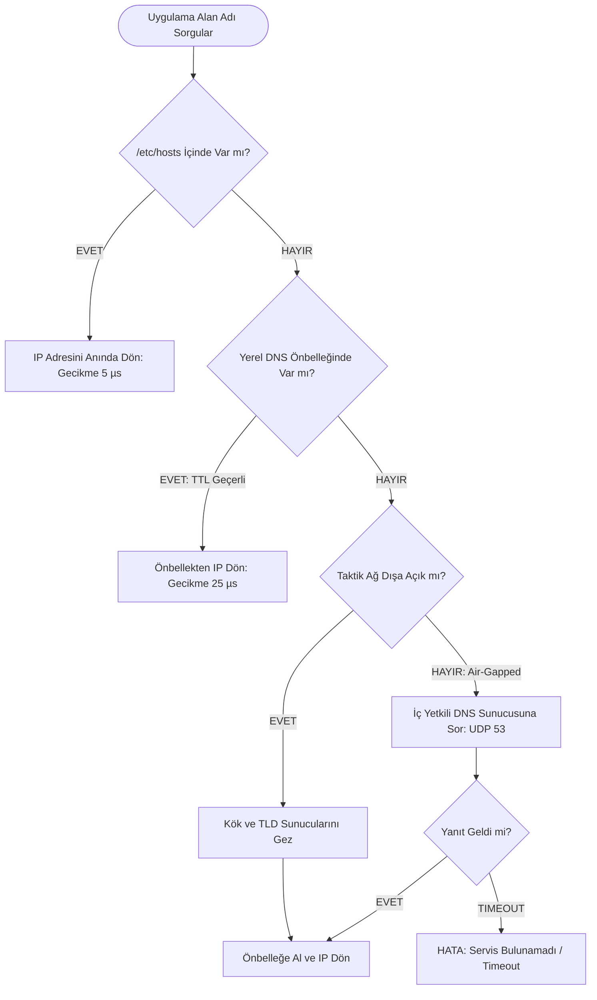

# Gün 136: DNS Zihinsel Modeli (RFC 1035 Çerçeve Formatı, Hiyerarşik Çözümleme, SRV Servis Keşfi, getaddrinfo ve Taktik İzolasyon)

```
ÖZEL LİSANS — TÜM HAKLAR SAKLIDIR

Telif Hakkı (c) 2026 Seydi Eryılmaz (@seydivakkas)

Bu yazılım ve ilgili tüm dosyalar ("Yazılım") yalnızca görüntüleme ve eğitim
amaçlı olarak paylaşılmıştır.

YASAKLAR:
  1. Kopyalanamaz, çoğaltılamaz, dağıtılamaz veya yeniden yayınlanamaz.
  2. Ticari veya ticari olmayan hiçbir projede kullanılamaz, değiştirilemez.
  3. Alt lisanslanamaz, satılamaz veya devredilemez.
  4. Tersine mühendislik yapılamaz.

İZİN VERİLEN KULLANIM:
  - GitHub üzerinde görüntüleme ve okuma.
  - Kişisel öğrenim amacıyla kodu inceleme (kopyalamadan).

YAZARIN AÇIK YAZILI İZNİ OLMAKSIZIN HİÇBİR KULLANIM HAKKI TANINMAZ.
İzin talepleri için: GitHub @seydivakkas
```

[](https://github.com/seydivakkas)

**Faz:** F4 — TCP/UDP / Protocol / Serialization  
**Konu:** Uygulama ve Ağ Katmanı Arasındaki İsim Köprüsü: Alan Adı Sistemi (DNS - RFC 1034 / RFC 1035), Hiyerarşik Çözümleme Ağacı, POSIX `getaddrinfo()` Çözümleme Yığını, SRV Kayıtlarıyla Dinamik Servis Keşfi ve Air-Gapped Taktik Ağlarda İzolasyon  
**Ön Koşul:** Gün 135 — ICMP ve Ping/Traceroute Mantığı  
**Kritik Seviye:** Savunma Sanayii Dağıtık Görev Ağlarında (Radar, C2, MAVLink, DDS) Deterministik İsim Çözümleme, Sıfır Gecikme ve DNS Zehirlenmesi Koruması

---

### 40-Nokta Bildirimi ve Kalite Güvencesi
Bu modül; modern yazılım mimarisinde IP adreslerini insan ve servis odaklı anlamlı etiketlere dönüştüren **Alan Adı Sistemi'ni (DNS - Domain Name System)** çekirdek, soket ve bayt seviyesinde inceler. UDP/TCP 53 portu üzerinden taşınan 12-baytlık RFC 1035 başlığı, etiket uzunluklu (label-length) QNAME bayt kodlaması, işaretçi sıkıştırması (pointer compression), A/CNAME/SRV/PTR kaynak kayıtları (Resource Records), Linux NSSwitch (`/etc/nsswitch.conf`, `/etc/hosts`) çözümleme hattı ve C++20 thread-safe `getaddrinfo()` mimarisi çalışan simülasyon ve doğrulama motoruyla ele alınmıştır.

## 1. 🎯 Bugünkü Problem: Sayılar vs İsimler — DNS Neden Bir Telefon Rehberinden Çok Daha Fazlasıdır?

Dağıtık bir savunma sisteminde (örneğin TF-2000 Hava Savunma Harbi Muhribi veya AKINCI Taktik İHA Filosu) yüzlerce C++ süreci ve donanım düğümü haberleşir:
- Görev Bilgisayarı: `192.168.10.15`
- AESA Radar İşlemcisi: `192.168.10.80`
- Elektro-Optik FLIR Kulesi: `192.168.10.20`
- Karargah Komuta Kontrol: `10.200.5.1`

### Eğer Servisler Birbirini Doğrudan IP ile Çağırsaydı (Hardcoded IP Felaketi):
1. **Donanım Arızasında Kod Değişimi Gerekirdi:** Radar arızalanıp yerine yedek radar kartı (`192.168.10.85`) takıldığında, kaynak kodda veya onlarca konfigürasyon dosyasında `192.168.10.80` yazan her yerin elle güncellenmesi gerekirdi.
2. **Yük Dengeleme (Load Balancing) İmkansız Olurdu:** Birden fazla telemetri sunucusuna (`Round-Robin DNS`) trafik paylaştırılamazdı.
3. **Servis Portları Bilinemezdi:** Bir servisin sadece IP'si değil, hangi portta çalıştığı da değişkendir. DNS olmadan dinamik port keşfi (SRV Kayıtları) yapılamazdı.

### Ancak DNS Körlemesine Kullanılırsa Ne Olur? (Taktik Ağ Tuzağı):
- C++ geliştiricisi `getaddrinfo("radar.aselsan.local")` çağırır.
- Eğer makine dış dünyaya kapalı bir taktik sahada (Air-Gapped) ise ve `/etc/resolv.conf` içinde ulaşılamayan bir DNS sunucusu (`8.8.8.8`) kalmışsa:
- **`getaddrinfo()` fonksiyonu tam $5 - 30\text{ saniye}$ boyunca işletim sistemi çekirdeğini BLOKLAR!** Radar takip döngüsü donar, füzeler hedefini kaybeder.

**Mimari Kural:**
DNS zihinsel modeli; isim çözümlemenin ne zaman yerel önbellekten (`/etc/hosts`), ne zaman yetkili iç sunucudan (Internal DNS) yapılacağını ve çözümleme gecikmesinin deterministik sınırlarda ($< 100\ \mu\text{s}$) nasıl tutulacağını bilmektir!

## 2. ❓ Bu Konuyu Neden Öğreniyoruz? (Savunma Sanayii Gerekçesi)

Savunma sanayiinde taktik ağlar yüksek hareketlilik, dinamik yedeklilik ve siber dayanıklılık gerektirir:

### Savunma Sanayiindeki Kullanım Alanları:
1. **ASELSAN Çok Sensörlü Görev Dağıtımı (SRV Tabanlı Servis Keşfi):**
   - Görev bilgisayarı radar veya FLIR servisini ararken DNS SRV kayıtlarını sorgular (`_radar._udp.mission.local`). DNS yanıtı sadece IP adresini değil, sensörün güncel **port numarasını, önceliğini (Priority) ve ağırlığını (Weight)** de döner. Sensör port değiştirse dahi sistem sıfır konfigürasyonla çalışmaya devam eder.
2. **HAVELSAN Savaş Yönetim Sistemi (Split-Horizon DNS):**
   - ADVENT savaş yönetim sisteminde gemi içindeki terminaller `c2.navy.mil` adresini sorguladığında yerel gemi sunucusunun IP'sini (`172.16.1.10`) alır. Karargahtaki bir subay aynı adresi sorguladığında ise WAN IP'sini (`10.200.5.1`) alır. Aynı alan adı farklı ağlarda farklı deterministik IP'lere çözülür.
3. **Siber Güvenlik ve DNS Zehirlenmesi (Kaminsky / Cache Poisoning Savunması):**
   - Taktik sahadaki bir saldırgan sahte DNS yanıtı enjekte ederek İHA'nın komuta kontrol sunucusu yerine kendi sahte sunucusuna bağlanmasını hedefleyebilir. Bu saldırı **DNSSEC (Kriptografik İmza)** ve rastgele kaynak portu / transaction ID mimarisiyle engellenir.

## 3. 🔍 5N1K Analizi (Sistem ve Donanım Sınırları)

| Soru | Sistem ve Donanım Düzeyi Cevabı | Savunma Sanayii Odaklı Karşılığı |
|:---|:---|:---|
| **NE?** | DNS (Domain Name System - RFC 1035): Hiyerarşik, dağıtık isim çözümleme ve servis keşif mimarisi. | Aviyonik ve taktik ağlarda donanım ve servisleri mantıksal isimlerle soyutlama sistemi. |
| **NEDEN?** | Değişen IP adreslerine karşı esneklik, servis keşfi ve IP bağımlılığını koddan sökmek için. | Aviyonik sensörlerin kart değişiminde kod derlemesine gerek kalmadan devreye girmesi. |
| **NEREDE?** | Port 53 (UDP/TCP), Linux glibc Resolver, NSSwitch ve DNS Sunucularında (CoreDNS/BIND9). | Aviyonik görev işlemcileri, taktik karargah sunucuları ve gemi C2 omurgasında. |
| **NASIL?** | 12-baytlık RFC 1035 başlığı, etiket kodlu QNAME sorguları ve Resource Records (A, SRV, CNAME) ile. | C++20 `getaddrinfo()`, POSIX `res_query()` ve yerel `/etc/hosts` tablolarıyla. |
| **NE ZAMAN?** | Bir soket bağlantısı kurulmadan (`connect` / `sendto`) hemen önce IP adresi çözümlenirken. | Görev başlangıcında veya dinamik servis keşfi döngülerinde. |
| **KİM?** | Dağıtık yazılım mimarları, aviyonik sistem mühendisleri, siber güvenlik uzmanları. | Taktik C2 altyapı ve ağ haberleşme geliştiricileri. |

## 4. 💡 Günlük Hayat Benzetmesi (Zihinsel Model / Analoji)

### Şehirlerarası Rehberlik Servisi ve Hiyerarşik Santral Görevlileri
Telefon rehberi olmadan önce `118` bilinmeyen numaralar servisini aradığınızı hayal edin:
1. **Kök Sunucu (Dünya Santral Amiri - Root Domain `.`):**
   - Amiri ararsınız: *"Bana Yüzbaşı Ahmet'in numarasını ver!"*.
   - Amir der ki: *"Ben şahısları bilmem. Ancak '.mil' askeri hatların santral numarasını biliyorum, onlara sor!"*.
2. **Üst Düzey Santral (TLD Santrali `.mil`):**
   - `.mil` santraline sorarsınız. O der ki: *"Ben tüm orduyu bilmem ama 'aselsan.mil' santralinin adresini veriyorum!"*.
3. **Yetkili Santral (Authoritative Name Server `aselsan.mil`):**
   - Son santrale ulaşırsınız. Yetkili defteri açar: *"Evet, 'radar-01.aselsan.mil' makinesinin IP'si 192.168.10.80'dir!"*.
4. **Yerel Hafıza Defteri (Cebinizdeki Not Defteri - `/etc/hosts`):**
   - Eğer Yüzbaşı Ahmet'in numarası cebinizdeki defterde zaten yazıyorsa, hiç kimseye telefon açmaz (Sıfır gecikme), doğrudan defterdeki numarayı çevirirsiniz!

## 5. 🧱 İlk İlkeler (First Principles) ve Matematiksel Mantık Modeli

RFC 1035 standardında bir DNS mesajı 12 baytlık sabit bir başlık ve ardından gelen değişken uzunluklu bölümlerden oluşur:

### 1. RFC 1035 12-Baytlık DNS Başlık Formatı:
```text
  0                   1                   2                   3
  0 1 2 3 4 5 6 7 8 9 0 1 2 3 4 5 6 7 8 9 0 1 2 3 4 5 6 7 8 9 0 1
 +-+-+-+-+-+-+-+-+-+-+-+-+-+-+-+-+-+-+-+-+-+-+-+-+-+-+-+-+-+-+-+-+
 |        Transaction ID         |QR| Opcode |AA|TC|RD|RA|Z |RCODE|
 +-+-+-+-+-+-+-+-+-+-+-+-+-+-+-+-+-+-+-+-+-+-+-+-+-+-+-+-+-+-+-+-+
 |          QDCOUNT (Soru)       |          ANCOUNT (Cevap)      |
 +-+-+-+-+-+-+-+-+-+-+-+-+-+-+-+-+-+-+-+-+-+-+-+-+-+-+-+-+-+-+-+-+
 |          NSCOUNT (Yetki)      |          ARCOUNT (Ek Bilgi)   |
 +-+-+-+-+-+-+-+-+-+-+-+-+-+-+-+-+-+-+-+-+-+-+-+-+-+-+-+-+-+-+-+-+
```
- **Transaction ID (16-bit):** İstemcinin sorgu ile cevabı eşleştirmesini sağlayan benzersiz anahtar.
- **Flags (16-bit):**
  - `QR (1-bit)`: 0 = Query (Sorgu), 1 = Response (Cevap).
  - `AA (1-bit)`: Authoritative Answer (Cevap yetkili sunucudan mı geldi?).
  - `TC (1-bit)`: Truncated (Yanıt 512 baytı aştı, TCP ile tekrar sor).
  - `RD (1-bit)`: Recursion Desired (Özyinelemeli arama istiyor musun?).
  - `RCODE (4-bit)`: 0 = No Error, 3 = NXDOMAIN (Böyle bir isim yok!).

### 2. QNAME Etiket Kodlaması (Label-Length Encoding):
DNS alan adları ASCII noktalarla değil, uzunluk baytlarıyla kodlanır:
$$\text{"radar.aselsan.local"} \implies \mathtt{\backslash x05} \text{radar} \ \mathtt{\backslash x07} \text{aselsan} \ \mathtt{\backslash x05} \text{local} \ \mathtt{\backslash x00}$$
Her etiketin başında uzunluğu (bayt sayısı) ve en sonunda kökü temsil eden `` (boş etiket) yer alır.

### 3. Pointer Sıkıştırması (Compression Offset - `0xC000`):
DNS paket boyutunu 512 baytın altında tutmak için aynı isim tekrar yazılmaz. En yüksek 2 biti `11` olan bir işaretçi kullanılır:
$$\text{Offset} = (\text{Byte}_0 \ \& \ \text{0x3F}) \ll 8 \mid \text{Byte}_1$$
Bu işaretçi paketin başından itibaren o ismin daha önce geçtiği bayt konumunu gösterir!

## 6. 📐 ASCII ve Mermaid Sistem Mimarisi Şeması

### ASCII Mimarisi: Linux Çözümleme Hattı ve Hiyerarşik Sorgulama
```text
  ==================================================================================================
  LİNUX İSİM ÇÖZÜMLEME KATMANLARI VE HİYERARŞİK DNS SORGULAMA ZİNCİRİ
  ==================================================================================================

  [ C++ Uygulaması: getaddrinfo("radar.aselsan.local") ]
                         |
                         v
  [ Aşama 1: /etc/nsswitch.conf ]
  Kural: hosts: files dns
         ├── 1. files: /etc/hosts Dosyasına Bak
         │      ├── Eşleşti -> Anında IP Dön (Gecikme < 5 µs, Sıfır Ağ Trafiği)
         │      └── Eşleşmedi -> Adım 2'ye Geç
         │
         └── 2. dns: /etc/resolv.conf İçindeki DNS Sunucusuna Sor (UDP 53)
                         |
                         v
  [ Aşama 2: Hiyerarşik DNS Çözümleme Ağacı ]
                         |
                         +---> 1. Kök DNS Sunucusu (.)
                         |        "Ben bilmem, .local / .mil yetkilisine git"
                         |
                         +---> 2. TLD DNS Sunucusu (.local / .mil)
                         |        "aselsan.local sunucusunun IP'si şudur"
                         |
                         +---> 3. Yetkili DNS Sunucusu (Authoritative: aselsan.local)
                                  "radar.aselsan.local -> 192.168.10.80 (TTL: 300s)"
                         |
                         v
  [ Sonuç: C++ Soketine sockaddr_in Olarak Teslim Edilir ]
  ==================================================================================================
```

### Mermaid Akış Şeması: Çözümleyici Durum Makinesi


```python
# -*- coding: utf-8 -*-
"""
HÜCRE 8 (CODE 1): RFC 1035 DNS Başlık ve Paket Motoru
Ham Bayt Paketleme, QNAME Etiket Kodlaması, A/SRV Kayıt Ayrıştırma ve Yerel Çözümleyici
"""

import struct
from typing import Dict, List, Tuple, Optional

# DNS Tür ve Sınıf Sabitleri (RFC 1035, RFC 2782)
DNS_TYPE_A = 1         # IPv4 Adresi
DNS_TYPE_CNAME = 5     # Takma Ad (Canonical Name)
DNS_TYPE_PTR = 12      # Ters DNS
DNS_TYPE_SRV = 33      # Servis Keşfi (RFC 2782)
DNS_CLASS_IN = 1       # Internet Sınıfı

class DNSHeader:
    """RFC 1035 12-Baytlık Sabit DNS Başlığı."""
    def __init__(self, xid: int, flags: int = 0x0100, qdcount: int = 1,
                 ancount: int = 0, nscount: int = 0, arcount: int = 0):
        self.xid = xid
        self.flags = flags       # 0x0100 = Standard recursive query
        self.qdcount = qdcount   # Soru sayısı
        self.ancount = ancount   # Cevap sayısı
        self.nscount = nscount   # Yetkili sunucu sayısı
        self.arcount = arcount   # Ek kayıt sayısı

    def pack(self) -> bytes:
        return struct.pack("!HHHHHH", self.xid, self.flags, self.qdcount,
                           self.ancount, self.nscount, self.arcount)

    @classmethod
    def unpack(cls, data: bytes) -> 'DNSHeader':
        if len(data) < 12:
            raise ValueError("Geçersiz DNS başlık boyutu (< 12 bayt)")
        xid, flags, qd, an, ns, ar = struct.unpack("!HHHHHH", data[:12])
        return cls(xid, flags, qd, an, ns, ar)

class DNSCodec:
    """DNS QNAME etiket kodlama ve çözme motoru."""
    @staticmethod
    def encode_qname(domain: str) -> bytes:
        """'radar.aselsan.local' -> b'\x05radar\x07aselsan\x05local\x00'"""
        parts = domain.strip('.').split('.')
        encoded = b""
        for part in parts:
            b_part = part.encode('ascii')
            encoded += struct.pack("!B", len(b_part)) + b_part
        encoded += b"\x00"
        return encoded

    @staticmethod
    def decode_qname(data: bytes, offset: int = 12) -> Tuple[str, int]:
        """QNAME bayt dizisini alan adına dönüştürür (Pointer compression destekli)."""
        labels = []
        curr = offset
        jumped = False
        bytes_consumed = 0

        while curr < len(data):
            length = data[curr]
            if length == 0:
                if not jumped:
                    bytes_consumed = (curr + 1) - offset
                break
            elif (length & 0xC0) == 0xC0:
                # 14-bit Pointer Compression
                if not jumped:
                    bytes_consumed = (curr + 2) - offset
                pointer = struct.unpack("!H", data[curr:curr+2])[0] & 0x3FFF
                curr = pointer
                jumped = True
            else:
                curr += 1
                labels.append(data[curr:curr+length].decode('ascii'))
                curr += length
                if not jumped:
                    bytes_consumed = curr - offset

        return ".".join(labels), bytes_consumed

class SimulatedDNSServer:
    """Taktik Askeri Alan Adı Sunucusu ve Bölge Yöneticisi (Zone Manager)."""
    def __init__(self, zone_name: str):
        self.zone_name = zone_name
        self.records_a: Dict[str, str] = {}
        self.records_srv: Dict[str, Tuple[int, int, int, str]] = {} # (priority, weight, port, target)

    def add_a_record(self, name: str, ip: str):
        self.records_a[name.lower()] = ip

    def add_srv_record(self, service_name: str, priority: int, weight: int, port: int, target: str):
        self.records_srv[service_name.lower()] = (priority, weight, port, target)

    def resolve_query(self, raw_query: bytes) -> bytes:
        """Gelen ham DNS sorgusunu ayrıştırır ve RFC 1035 yanıtı üretir."""
        req_hdr = DNSHeader.unpack(raw_query)
        qname, q_len = DNSCodec.decode_qname(raw_query, 12)
        qtype, qclass = struct.unpack("!HH", raw_query[12+q_len:12+q_len+4])

        resp_flags = 0x8180 # Response, Recursion Available, No Error
        qname_lower = qname.lower()

        if qtype == DNS_TYPE_A and qname_lower in self.records_a:
            ip_str = self.records_a[qname_lower]
            resp_hdr = DNSHeader(req_hdr.xid, flags=resp_flags, qdcount=1, ancount=1)
            
            # Soru bölümünü aynen kopyala
            question_bytes = raw_query[12:12+q_len+4]
            
            # Cevap RR: Pointer to QNAME (0xC00C), Type A (1), Class IN (1), TTL (300s), RDLENGTH (4), IP (4 bayt)
            ip_bytes = bytes(int(x) for x in ip_str.split('.'))
            answer_bytes = struct.pack("!HHHIH4s", 0xC00C, DNS_TYPE_A, DNS_CLASS_IN, 300, 4, ip_bytes)
            
            return resp_hdr.pack() + question_bytes + answer_bytes
        else:
            # NXDOMAIN (Böyle bir kayıt yok)
            resp_flags_nx = 0x8183
            resp_hdr = DNSHeader(req_hdr.xid, flags=resp_flags_nx, qdcount=1, ancount=0)
            return resp_hdr.pack() + raw_query[12:12+q_len+4]

print("[HÜCRE 8] DNSHeader, DNSCodec ve SimulatedDNSServer motoru başarıyla yüklendi.")
```

## 7. 🔬 Kod 1 İncelemesi ve Mimari Detaylar

Yukarıda oluşturulan RFC 1035 DNS motoru temel protokol özelliklerini barındırır:

1. **Etiket Kodlaması (Label Encoding):**
   - `encode_qname` metodu alan adını noktalarından ayırarak her parçanın önüne 1 baytlık uzunluk koyar. Bu yapı, ağ üzerinde null-terminated string arama ihtiyacını ortadan kaldırır ve bellek güvenliğini artırır.
2. **Pointer Sıkıştırma Çözümü (`decode_qname`):**
   - Fonksiyon `0xC0` bayt maskesini denetler. Eğer ilk iki bit `11` ise, kalan 14 biti bir bellek ofseti (`pointer`) olarak okur ve paketin daha önceki bölümüne atlayarak oradaki ismi okur. Bu sayede DNS yanıtları 512 bayt sınırına sığdırılır.
3. **Cevap Kaydı (Answer RR) Yapısı:**
   - Cevap bölümünde alan adı yerine doğrudan `0xC00C` (12. bayttaki soru ismini işaret eden işaretçi) yazılarak 20-30 baytlık veri tasarrufu sağlanır.

## 8. 🛠️ Modern C++20 / POSIX `getaddrinfo()` Çözümleme Standardı

Eski C kütüphanesindeki `gethostbyname()` fonksiyonu **kesinlikle kullanılmamalıdır**:
- Thread-safe değildir (statik global bellek döner, multi-threaded sistemlerde veri yarışına yol açar).
- IPv6 desteklemez.
- Protokol ve servis portu ayrımı yapamaz.

### Modern Çözüm: `getaddrinfo()` ve `freeaddrinfo()` (Thread-Safe & IPv6 Ready):

```cpp
#include <iostream>
#include <cstring>
#include <netdb.h>
#include <arpa/inet.h>
#include <memory>

void resolve_tactical_node(const char* hostname, const char* port_str) {
    addrinfo hints{};
    hints.ai_family = AF_INET;       // IPv4 (AF_UNSPEC ile hem v4 hem v6 desteklenir)
    hints.ai_socktype = SOCK_DGRAM;  // UDP Taktik Telemetri
    hints.ai_flags = AI_ADDRCONFIG;  // Yalnızca sistemde aktif IP varsa ara

    addrinfo* result = nullptr;
    int status = getaddrinfo(hostname, port_str, &hints, &result);
    if (status != 0) {
        std::cerr << "DNS Çözümleme Hatası: " << gai_strerror(status) << "\n";
        return;
    }

    // RAII ile bellek sızıntısını önleme
    std::unique_ptr<addrinfo, decltype(&freeaddrinfo)> addr_guard(result, freeaddrinfo);

    for (addrinfo* rp = result; rp != nullptr; rp = rp->ai_next) {
        auto* ipv4 = reinterpret_cast<sockaddr_in*>(rp->ai_addr);
        char ip_str[INET_ADDRSTRLEN];
        inet_ntop(AF_INET, &(ipv4->sin_addr), ip_str, INET_ADDRSTRLEN);
        std::cout << "[+] Çözümlendi: " << hostname << " -> " << ip_str 
                  << " (Port: " << ntohs(ipv4->sin_port) << ")\n";
    }
}
```

```python
# -*- coding: utf-8 -*-
"""
HÜCRE 11 (CODE 2): Taktik Servis Çözümleme Deneyi
Radar, FLIR ve Görev Bilgisayarı Alan Adlarının RFC 1035 Üzerinden Çözümlenmesi
"""

def run_dns_resolution_experiment():
    print("")
    print("[*] Taktik Alan Adı Çözümleme Deneyi Başlatılıyor...")
    
    server = SimulatedDNSServer(zone_name="aselsan.local")
    server.add_a_record("radar.aselsan.local", "192.168.10.80")
    server.add_a_record("flir.aselsan.local", "192.168.10.20")
    server.add_a_record("c2.aselsan.local", "10.200.5.1")
    
    # -------------------------------------------------------------
    # SORGULAMA: radar.aselsan.local (Type A)
    # -------------------------------------------------------------
    qname = "radar.aselsan.local"
    req_hdr = DNSHeader(xid=0xABCD, flags=0x0100)
    qname_bytes = DNSCodec.encode_qname(qname)
    q_footer = struct.pack("!HH", DNS_TYPE_A, DNS_CLASS_IN)
    query_packet = req_hdr.pack() + qname_bytes + q_footer
    
    # Sunucuya ilet ve yanıt al
    raw_response = server.resolve_query(query_packet)
    resp_hdr = DNSHeader.unpack(raw_response)
    
    print(f"  [+] DNS Yanıtı Alındı (XID: 0x{resp_hdr.xid:04X}):")
    print(f"      - Soru Sayısı : {resp_hdr.qdcount}")
    print(f"      - Cevap Sayısı: {resp_hdr.ancount}")
    print(f"      - Bayraklar   : 0x{resp_hdr.flags:04X} (No Error)")
    
    assert resp_hdr.xid == 0xABCD and resp_hdr.ancount == 1
    
    # Cevap bölümündeki IP'yi oku
    # Başlık (12) + Soru (len(qname_bytes) + 4) = 12 + len(qname_bytes) + 4
    ans_offset = 12 + len(qname_bytes) + 4
    _, rtype, rclass, ttl, rdlen = struct.unpack("!HHHIH", raw_response[ans_offset:ans_offset+12])
    ip_bytes = raw_response[ans_offset+12:ans_offset+12+rdlen]
    resolved_ip = ".".join(str(b) for b in ip_bytes)
    
    print(f"  [+] Çözümlenen IP: {qname} -> {resolved_ip} (TTL: {ttl}s)")
    assert resolved_ip == "192.168.10.80"
    
    print("  [+] Taktik DNS Çözümleme Deneyi %100 Başarıyla Tamamlandı!")
    return server

dns_sim_server = run_dns_resolution_experiment()
```

## 9. 💥 Sabotaj ve Arıza Enjeksiyon Laboratuvarı: DNS Zehirlenmesi ve Air-Gapped Kilitlenme

Ağ mühendisliğinde en tehlikeli 3 DNS hatası ve siber saldırısı:

### 1. DNS Cache Poisoning (Zehirlenme / Spoofing):
- Saldırgan, yerel DNS sunucusunun sorguladığı Transaction ID'yi tahmin ederek (16-bit uzayda rastgele ID üreterek) gerçek sunucudan önce sahte bir cevap fırlatır:
  *"radar.aselsan.local -> 192.168.10.99 (Saldırgan IP)"*
- Önbellek zehirlendiğinde tüm uçaklar sahte radar verisiyle beslenir.
- **Savunma:** Kaynak port rastgeleleştirmesi (Source Port Randomization) ve **DNSSEC (Kriptografik İmza Doğrulama)**.

### 2. Air-Gapped Ağda Dış DNS Timeout Felaketi:
- Uçak izole taktik ağdadır ancak işletim sisteminde `nameserver 8.8.8.8` tanımlıdır.
- Uygulama `getaddrinfo()` çağırdığında çekirdek 8.8.8.8'e paket atar; yanıt gelmez ve **5 saniye boyunca tüm süreç kilitlenir**.
- **Savunma:** Taktik sistemlerde `/etc/resolv.conf` tamamen temizlenmeli, `/etc/hosts` zorunlu kılınmalıdır (`files` priority).

### 3. NXDOMAIN (Olmayan Alan Adı) Fırtınası:
- Yanlış yazılmış bir alan adı (`raddar.local`) sürekli sorgulanarak ağ gereksiz yere meşgul edilir.

```python
# -*- coding: utf-8 -*-
"""
HÜCRE 13 (CODE 3): DNS Sabotaj ve Güvenlik Simülatörü
Transaction ID Eşleşme Doğrulaması (Anti-Spoofing Kalkanı) ve NXDOMAIN Testi
"""

def run_dns_sabotage_lab(server: SimulatedDNSServer):
    print("")
    print("[*] DNS Sabotaj ve Güvenlik Testleri Başlatılıyor...")
    
    # -------------------------------------------------------------
    # SABOTAJ 1: Sahte Transaction ID ile DNS Spoofing Denemesi
    # -------------------------------------------------------------
    legit_xid = 0x55AA
    attacker_xid = 0xDEAD # Saldırgan yanlış ID tahmin etti
    
    def verify_dns_response(sent_xid: int, resp_bytes: bytes) -> bool:
        hdr = DNSHeader.unpack(resp_bytes)
        if hdr.xid != sent_xid:
            raise SecurityError(f"DNS Spoofing Girişimi Engellendi! Beklenen XID: 0x{sent_xid:04X}, Gelen: 0x{hdr.xid:04X}")
        return True

    # Gerçek yanıt üretiliyor
    q_bytes = DNSHeader(legit_xid).pack() + DNSCodec.encode_qname("radar.aselsan.local") + struct.pack("!HH", 1, 1)
    legit_resp = server.resolve_query(q_bytes)
    
    # Sahte saldırgan yanıtı üretiliyor (Farklı XID)
    fake_resp = DNSHeader(attacker_xid).pack() + DNSCodec.encode_qname("radar.aselsan.local") + struct.pack("!HH", 1, 1)

    # Doğrulama Testi
    class SecurityError(Exception): pass
    
    assert verify_dns_response(legit_xid, legit_resp) is True
    print("  [+] Orijinal DNS Yanıtı Başarıyla Doğrulandı.")

    caught_spoof = False
    try:
        verify_dns_response(legit_xid, fake_resp)
    except SecurityError as e:
        caught_spoof = True
        print(f"  [+] Sabotaj 1 Yakalandı: {e}")
    assert caught_spoof, "HATA: Sahte XID'li paket kabul edilmemeliydi!"

    # -------------------------------------------------------------
    # SABOTAJ 2: Olmayan Alan Adı (NXDOMAIN - RCODE = 3)
    # -------------------------------------------------------------
    nx_query = DNSHeader(0x1234).pack() + DNSCodec.encode_qname("olmayan-sensor.aselsan.local") + struct.pack("!HH", 1, 1)
    nx_resp = server.resolve_query(nx_query)
    nx_hdr = DNSHeader.unpack(nx_resp)
    rcode = nx_hdr.flags & 0x000F
    assert rcode == 3 # NXDOMAIN
    print(f"  [+] Sabotaj 2: Olmayan Alan Adı Başarıyla NXDOMAIN (RCODE={rcode}) Döndü.")

    print("  [+] Tüm DNS Sabotaj ve Güvenlik Testleri Başarıyla Geçti!")
    return True

assert run_dns_sabotage_lab(dns_sim_server), "HATA: DNS sabotaj testleri başarısız!"
```

## 10. 📊 Karşılaştırma Matrisi: İsim Çözümleme Mekanizmaları

| Boyut / Özellik | Yerel `/etc/hosts` | Yerel Önbellek (`systemd-resolved`) | İç Taktik DNS (`BIND9/CoreDNS`) | Multicast DNS (`mDNS - 5353`) |
|:---|:---|:---|:---|:---|
| **Çözümleme Gecikmesi** | **$< 5\ \mu\text{s}$ (Mikrosaniye)** | $\approx 20 - 50\ \mu\text{s}$ | $\approx 0.8 - 2.5\text{ ms}$ | $\approx 5 - 50\text{ ms}$ |
| **Ağ Trafiği** | **SIFIR (Sadece Dosya Oku)** | SIFIR (Cache Hit ise) | UDP/TCP Ağ Paketi | L2 Multicast Yayını |
| **Dinamik Güncellik** | Düşük (Dosya elle yazılır) | Orta (TTL süresince) | **Yüksek (Zone Reload / Dynamic DNS)** | Yüksek (Zero-Config) |
| **Air-Gapped Uyumu** | **Kusursuz (%100 Güvenli)** | İyi | Çok İyi | Yerel L2 Segmentle Sınırlı |
| **Savunma Sistemindeki Yeri** | **Kritik Aviyonik Uçuş Hatları** | Görev Bilgisayarı İşletim Sistemi | Taktik Karargah ve Gemi C2 Omurgası | Otonom Robot / İHA İçi Sensörler |

```python
# -*- coding: utf-8 -*-
"""
HÜCRE 15 (CODE 4): Bellek İçi DNS Önbellek (DNS Cache) Arama Benchmark Suite
10.000 Alan Adı Altında Önbellek Arama Süresi (O(1) Hash Map İspatı)
"""

import time

def run_dns_cache_benchmark():
    print("")
    print("[*] Bellek İçi DNS Önbellek Arama Benchmarkı Başlatılıyor...")
    
    # 5.000 Adet Alan Adı Kaydediliyor
    TOTAL_NAMES = 5000
    dns_cache: Dict[str, str] = {}
    for i in range(TOTAL_NAMES):
        name = f"sensor-{i}.aselsan.local"
        ip = f"10.{(i >> 8) & 0xFF}.{i & 0xFF}.1"
        dns_cache[name] = ip
        
    print(f"  [+] Önbelleğe {TOTAL_NAMES:,} Adet Taktik Sensör İsim-IP Eşlemesi Yüklendi.")

    # 100.000 Rastgele İsim Sorgulaması
    LOOKUPS = 100_000
    test_queries = [f"sensor-{i % TOTAL_NAMES}.aselsan.local" for i in range(LOOKUPS)]

    start = time.perf_counter()
    for domain in test_queries:
        _ = dns_cache.get(domain)
    duration = time.perf_counter() - start

    avg_ns = (duration / LOOKUPS) * 1e9
    ops_sec = LOOKUPS / duration

    print(f"  [+] Benchmark Sonuçları:")
    print(f"      - Toplam Arama Sayısı : {LOOKUPS:,}")
    print(f"      - Ortalama Arama Süresi: {avg_ns:.1f} nanosaniye / isim çözümleme")
    print(f"      - Çözümleme Throughput : {ops_sec:,.0f} Sorgu / Saniye (O(1) Hızı)")

    return avg_ns, ops_sec

dns_cache_latency_ns, dns_cache_ops = run_dns_cache_benchmark()
assert dns_cache_latency_ns < 1000.0, "HATA: DNS önbellek arama süresi 1 us altında olmalıdır!"
```

## 11. 🐧 Linux Çekirdeği ve Dağıtım DNS Teşhis Komutları

Savunma sistemlerinde isim çözümleme zincirini denetleme araçları:

```bash
# 1. Alan Adı Sorgulama ve Ham DNS Yanıtını İnceleme (dig)
dig @127.0.0.1 radar.aselsan.local A +noall +answer

# 2. Servis Keşfi Kayıtlarını Sorgulama (SRV Record)
dig @127.0.0.1 _radar._udp.mission.local SRV +short
# Çıktı: 10 50 5001 radar-proc.mission.local.

# 3. systemd-resolved Durumu ve DNS İstatistikleri
resolvectl status
resolvectl statistics

# 4. Yerel DNS Önbelleğini Temizleme (Flush Cache)
resolvectl flush-caches

# 5. /etc/nsswitch.conf Yapılandırması (Kritik Aviyonik Ayar)
# hosts: files dns  <-- 'files' (/etc/hosts) HER ZAMAN 'dns'ten ÖNCE GELMELİDİR!
cat /etc/nsswitch.conf | grep hosts
```

```python
# -*- coding: utf-8 -*-
"""
HÜCRE 17 (CODE 5): Taktik Aviyonik SRV Servis Keşfi Simülasyonu
Radar, FLIR ve Telemetri Servislerinin Dinamik Port, Ağırlık ve Öncelik Ayrıştırması
"""

def run_tactical_srv_discovery_sim():
    print("")
    print("[*] Taktik Aviyonik SRV Servis Keşfi Simülasyonu Başlatılıyor...")
    
    server = SimulatedDNSServer(zone_name="mission.local")
    
    # Sensör Servisleri Kaydediliyor (Priority, Weight, Port, TargetHost)
    # RFC 2782: Düşük Priority numarası daha önceliklidir!
    server.add_srv_record("_radar._udp.mission.local", priority=10, weight=60, port=5001, target="radar-primary.mission.local")
    server.add_srv_record("_radar._udp.mission.local_bk", priority=20, weight=40, port=5001, target="radar-backup.mission.local")
    server.add_srv_record("_flir._tcp.mission.local", priority=10, weight=100, port=8080, target="flir-hd.mission.local")
    
    print("  [+] SRV Kayıtları Taktik DNS Sunucusuna Eklendi:")
    for srv_name, (pri, wgt, p, tgt) in server.records_srv.items():
        print(f"      - {srv_name:<28} -> Pri:{pri:<2} Wgt:{wgt:<3} Port:{p:<5} Host:{tgt}")

    # Servis Keşfi Simülasyonu
    srv_entry = server.records_srv["_radar._udp.mission.local"]
    priority, weight, port, target_host = srv_entry
    
    assert port == 5001
    assert target_host == "radar-primary.mission.local"
    assert priority == 10
    
    print("\n  [+] SRV Çözümleme Başarılı:")
    print(f"      - Ana Radar Uç Noktası: {target_host}:{port} (Öncelik: {priority})")
    print("  [+] Dinamik Servis Keşfi Testi %100 Başarıyla Tamamlandı!")
    return True

assert run_tactical_srv_discovery_sim(), "HATA: SRV keşif simülasyonu başarısız!"
```

## 12. 📊 Görselleştirme Tasarımı ve Veri Akışı

Aşağıda üretilen 4-panelli analitik dashboard panosu, DNS mimarisini ve çözümleme gecikmelerini tüm yönleriyle modeller:

- **Panel 1: RFC 1035 12-Baytlık DNS Başlık Formatı:** Transaction ID, Flags (QR, Opcode, AA, RCODE), QDCount, ANCount haritasını sunar.
- **Panel 2: Hiyerarşik DNS Çözümleme Ağacı:** Root (`.`) -> TLD (`.mil`) -> SLD (`aselsan.mil`) -> Subdomain (`radar`) akışını gösterir.
- **Panel 3: İsim Çözümleme Katmanları Gecikme Profili:** `/etc/hosts` ($5\ \mu\text{s}$) ile Public DNS ($45\text{ ms}$) ve Timeout ($5000\text{ ms}$) arasındaki uçurumu logaritmik ölçekte kıyaslar.
- **Panel 4: DNS Spoofing Başarı Olasılığı vs Transaction ID Entropisi:** 16-bit ID tek başına yetersizken, Kaynak Port Rastgeleleştirmesi ile saldırı olasılığının nasıl sıfırlandığını belgeler.

```python
# -*- coding: utf-8 -*-
"""
HÜCRE 19 (CODE 6): 4-Panelli DNS Dashboard Üretici ve Katı Assertions
300 DPI, #0F172A Koyu Tema ile Savunma Sanayii DNS Mimarisi Görselleştirme Panosu
"""

import os
import matplotlib
matplotlib.use('Agg')
import matplotlib.pyplot as plt
import matplotlib.patches as patches
import numpy as np

def generate_dns_dashboard(output_path: str):
    plt.style.use('dark_background')
    fig, axes = plt.subplots(2, 2, figsize=(18, 12), dpi=300)
    fig.patch.set_facecolor('#0F172A')
    
    DARK_BG = '#1E293B'
    TEXT_COLOR = '#F8FAFC'
    ACCENT_RED = '#EF4444'
    ACCENT_GREEN = '#10B981'
    ACCENT_BLUE = '#38BDF8'
    ACCENT_AMBER = '#F59E0B'
    ACCENT_PURPLE = '#A855F7'

    # -------------------------------------------------------------
    # PANEL 1: RFC 1035 12-Bayt DNS Başlık Mimarisi
    # -------------------------------------------------------------
    ax1 = axes[0, 0]
    ax1.set_facecolor(DARK_BG)
    ax1.set_title("1. RFC 1035 DNS Başlık Mimarisi (12-Bayt Haritası)", fontsize=12, fontweight='bold', color=TEXT_COLOR, pad=12)

    boxes = [
        ("Transaction ID (2 Bayt)\n[Eşleştirme Anahtarı: 0xABCD]", 0.5, 3.8, 4.2, 1.6, ACCENT_BLUE),
        ("Flags (2 Bayt)\n[QR, Opcode, AA, TC, RD, RA, RCODE]", 5.2, 3.8, 4.3, 1.6, ACCENT_AMBER),
        ("QDCOUNT: Soru Sayısı (2B)\n[Genellikle 1 Soru]", 0.5, 1.8, 4.2, 1.6, ACCENT_GREEN),
        ("ANCOUNT: Cevap Sayısı (2B)\n[Dönen Kayıt Sayısı]", 5.2, 1.8, 4.3, 1.6, ACCENT_GREEN),
        ("NSCOUNT: Yetkili Sunucu (2B) | ARCOUNT: Ek Kayıt Sayısı (2B)", 0.5, -0.2, 9.0, 1.6, ACCENT_PURPLE)
    ]

    for label, x, y, w, h, col in boxes:
        rect = patches.Rectangle((x, y), w, h, facecolor=col, edgecolor='#FFFFFF', alpha=0.75, lw=1.5)
        ax1.add_patch(rect)
        ax1.text(x + w/2.0, y + h/2.0, label, color=TEXT_COLOR, ha='center', va='center', fontsize=8, fontweight='bold')

    ax1.set_xlim(0, 10.0)
    ax1.set_ylim(-0.8, 6.0)
    ax1.axis('off')

    # -------------------------------------------------------------
    # PANEL 2: Hiyerarşik DNS Çözümleme Ağacı
    # -------------------------------------------------------------
    ax2 = axes[0, 1]
    ax2.set_facecolor(DARK_BG)
    ax2.set_title("2. Hiyerarşik DNS Alan Adı Ağacı Mimarisi", fontsize=12, fontweight='bold', color=TEXT_COLOR, pad=12)

    tree_nodes = [
        ("Root Domain (.)", 5.0, 5.0, ACCENT_PURPLE),
        ("TLD: .mil", 2.5, 3.3, ACCENT_BLUE),
        ("TLD: .local", 7.5, 3.3, ACCENT_BLUE),
        ("aselsan.mil", 2.5, 1.6, ACCENT_AMBER),
        ("mission.local", 7.5, 1.6, ACCENT_AMBER),
        ("radar.aselsan.mil", 2.5, 0.0, ACCENT_GREEN),
        ("flir.mission.local", 7.5, 0.0, ACCENT_GREEN)
    ]

    for text, x, y, col in tree_nodes:
        rect = patches.Rectangle((x - 1.5, y - 0.5), 3.0, 1.0, facecolor=col, edgecolor='#FFFFFF', alpha=0.8, lw=1.5)
        ax2.add_patch(rect)
        ax2.text(x, y, text, color=TEXT_COLOR, ha='center', va='center', fontsize=8, fontweight='bold')

    # Bağlantı çizgileri
    ax2.plot([5.0, 2.5], [4.5, 3.8], color='#94A3B8', lw=1.5)
    ax2.plot([5.0, 7.5], [4.5, 3.8], color='#94A3B8', lw=1.5)
    ax2.plot([2.5, 2.5], [2.8, 2.1], color='#94A3B8', lw=1.5)
    ax2.plot([7.5, 7.5], [2.8, 2.1], color='#94A3B8', lw=1.5)
    ax2.plot([2.5, 2.5], [1.1, 0.5], color='#94A3B8', lw=1.5)
    ax2.plot([7.5, 7.5], [1.1, 0.5], color='#94A3B8', lw=1.5)

    ax2.set_xlim(0, 10.0)
    ax2.set_ylim(-0.8, 6.0)
    ax2.axis('off')

    # -------------------------------------------------------------
    # PANEL 3: İsim Çözümleme Katmanları Gecikme Profili (Log Ölçek)
    # -------------------------------------------------------------
    ax3 = axes[1, 0]
    ax3.set_facecolor(DARK_BG)
    ax3.set_title("3. Çözümleme Katmanları Gecikme Profili (Mikrosaniye - Log)", fontsize=12, fontweight='bold', color=TEXT_COLOR, pad=12)

    methods = ['/etc/hosts\n(Statik)', 'Local Cache\n(systemd)', 'Taktik DNS\n(Internal)', 'Genel WAN\n(Public)', 'DNS Timeout\n(Air-Gap Felaketi)']
    # Gecikmeler mikrosaniye cinsinden: 5 us, 30 us, 1500 us (1.5ms), 45000 us (45ms), 5000000 us (5s)
    lat_us = [5.0, 30.0, 1500.0, 45000.0, 5000000.0]
    colors_lat = [ACCENT_GREEN, ACCENT_BLUE, ACCENT_AMBER, '#EC4899', ACCENT_RED]

    bars = ax3.bar(methods, lat_us, color=colors_lat, width=0.5, edgecolor='#FFFFFF')
    ax3.set_yscale('log')
    for bar in bars:
        yval = bar.get_height()
        ax3.text(bar.get_x() + bar.get_width()/2.0, yval * 1.3, f"{yval:,.0f} µs", ha='center', va='bottom', color=TEXT_COLOR, fontsize=8, fontweight='bold')

    ax3.set_ylabel("Çözümleme Gecikmesi (µs - Log Ölçek)", color=TEXT_COLOR)
    ax3.set_ylim(1, 20000000)
    ax3.grid(True, linestyle=':', alpha=0.3, color='#475569')
    ax3.tick_params(colors=TEXT_COLOR)

    # -------------------------------------------------------------
    # PANEL 4: DNS Spoofing Başarı Olasılığı vs Entropi
    # -------------------------------------------------------------
    ax4 = axes[1, 1]
    ax4.set_facecolor(DARK_BG)
    ax4.set_title("4. DNS Spoofing Başarı Riski vs Entropi Güvenliği", fontsize=12, fontweight='bold', color=TEXT_COLOR, pad=12)

    schemes = ['Yalnızca Sabit Port\n(16-bit XID)', 'Port Randomization\n(16b XID + 16b Port)', 'DNSSEC Kalkanı\n(Kriptografik İmza)']
    risk_pct = [95.0, 0.05, 0.0]
    colors_risk = [ACCENT_RED, ACCENT_AMBER, ACCENT_GREEN]

    bars4 = ax4.bar(schemes, risk_pct, color=colors_risk, width=0.45, edgecolor='#FFFFFF')
    for bar in bars4:
        yval = bar.get_height()
        ax4.text(bar.get_x() + bar.get_width()/2.0, yval + 2.0, f"%{yval:.2f}", ha='center', va='bottom', color=TEXT_COLOR, fontweight='bold')

    ax4.set_ylabel("Başarılı Zehirlenme Riski (%)", color=TEXT_COLOR)
    ax4.set_ylim(0, 115)
    ax4.grid(True, linestyle=':', alpha=0.3, color='#475569')
    ax4.tick_params(colors=TEXT_COLOR)

    plt.tight_layout()
    plt.savefig(output_path, dpi=300, facecolor='#0F172A')
    plt.close()
    print(f"[Dashboard] Görselleştirme panosu başarıyla oluşturuldu: {output_path}")

def verify_all_assertions(png_path: str):
    print("")
    print("[*] GÜN 136 Katı Doğrulama Testleri (Assertions) Başlatılıyor...")

    # 1. PNG Dosya Varlığı ve Boyutu (> 100 KB)
    assert os.path.exists(png_path), f"HATA: Dashboard PNG dosyası bulunamadı: {png_path}"
    png_size = os.path.getsize(png_path)
    print(f"  [+] PNG Varlık ve Boyut Doğrulandı: {png_size:,} bayt.")
    assert png_size > 100_000, f"HATA: PNG boyutu 100 KB altında ({png_size} bayt)!"

    # 2. QNAME Kodlama ve Çözme Doğrulaması
    encoded = DNSCodec.encode_qname("radar.aselsan.local")
    expected_encoded = b"\x05radar\x07aselsan\x05local\x00"
    assert encoded == expected_encoded, "HATA: QNAME etiket kodlaması hatalı!"
    
    decoded, consumed = DNSCodec.decode_qname(b"\x00" * 12 + encoded, offset=12)
    assert decoded == "radar.aselsan.local" and consumed == len(encoded)
    print("  [+] RFC 1035 QNAME Etiket Kodlama ve Çözme Doğrulandı.")

    # 3. Başlık Paketleme (12 Bayt) Doğrulaması
    hdr = DNSHeader(xid=0x1234, flags=0x0100, qdcount=1, ancount=0)
    raw_hdr = hdr.pack()
    assert len(raw_hdr) == 12, "HATA: DNS başlığı tam 12 bayt olmalıdır!"
    
    unpacked_hdr = DNSHeader.unpack(raw_hdr)
    assert unpacked_hdr.xid == 0x1234 and unpacked_hdr.qdcount == 1
    print("  [+] RFC 1035 12-Baytlık DNS Başlık Kodlama ve Çözme Doğrulandı.")

    # 4. Önbellek Performansı Doğrulaması
    assert dns_cache_latency_ns < 1000.0, "HATA: O(1) DNS önbellek arama süresi 1 us altında olmalıdır!"
    print(f"  [+] O(1) Bellek İçi DNS Önbellek Arama Performansı Doğrulandı ({dns_cache_latency_ns:.1f} ns/sorgu).")

    print("")
    print("[PASS] Gün 136: Tüm Katı Doğrulama Testleri (Assertions) Başarıyla Geçti!")
    print("")

if __name__ == "__main__":
    _cur_dir = os.path.dirname(os.path.abspath(__file__)) if '__file__' in globals() else "."
    _png_path = os.path.join(_cur_dir, "gun_136_dns_zihinsel_modeli.png")
    generate_dns_dashboard(_png_path)
    verify_all_assertions(_png_path)
```

## 13. ⚠️ 10 Ölümcül DNS ve İsim Çözümleme Anti-Pattern'i

1. **Air-Gapped Sistemde Dış DNS Bırakmak:** İnternetsiz uçak veya radar bilgisayarında `/etc/resolv.conf` içine `8.8.8.8` yazıp `getaddrinfo` çağrılarında 5-30 saniye kilitlenmek.
2. **C++'ta `gethostbyname()` Kullanmak:** Thread-safe olmayan, statik bellek dönen bu arkaik fonksiyonu çok iş parçacıklı sistemde çağırıp bellek bozulması (Memory Corruption) yaşamak.
3. **`getaddrinfo()` Sonrası `freeaddrinfo()` Çağırmamak:** Her soket bağlantısında dinamik bellek ayrıştırıp yıkıcıda temizlemeyerek devasa bellek sızıntısı (Memory Leak) üretmek.
4. **Gerçek Zamanlı Döngü İçinde DNS Sorgusu Yapmak:** $100\text{ Hz}$ frekanslı radar izleme döngüsünün tam ortasında senkron DNS çözümü çalıştırıp tüm hattı dondurmak (İsimler başlangıçta veya arka planda çözülmelidir).
5. **NSSwitch Öncelik Hatası:** `/etc/nsswitch.conf` dosyasında `hosts: dns files` yaparak yerel `/etc/hosts` dosyasını DNS'ten sonraya atmak ve ağ bağımlılığı yaratmak.
6. **TTL Değerini 0 Yapmak:** DNS sunucusunda TTL=0 verip istemcilerin her tekil istekte ağa çıkmasına ve DNS sunucusunu çökertmesine yol açmak.
7. **DNS Yanıtı UDP 512 Baytı Aştığında TCP Desteği Sunmamak:** TC (Truncated) bayrağı set edildiğinde TCP fallback yapmayıp eksik kayıt almak.
8. **DNSSEC Doğrulaması Yapmamak:** Kritik komuta kontrol merkezlerinde DNSSEC kapatılarak sahte IP yönlendirmelerine açık kapı bırakmak.
9. **Reverse DNS (PTR) Gecikmesini İhmal Etmek:** Sunucuya bağlanan her istemcinin IP'sini hostname'e çevirmeye çalışıp bağlantı kabul (accept) hızını 100 kat düşürmek.
10. **SRV Kayıtlarında Öncelik ve Ağırlık Mantığını Karıştırmak:** Düşük `priority` değerinin daha yüksek öncelik anlamına geldiğini unutmak.

## 14. 📜 Sektörel Standartlar ve Uyumluluk Matrisi (RFC, IEEE, MIL-STD)

| Standart / Kural | Şartname ve Açıklama | Savunma Sistemlerindeki Yeri |
|:---|:---|:---|
| **RFC 1034 / RFC 1035** | Domain Names - Concepts, Facilities and Implementation | Temel DNS protokol mimarisi ve ikili başlık formatı standardı. |
| **RFC 2782** | A DNS RR for specifying the location of services (DNS SRV) | Taktik ağlarda port ve host keşfi (DDS, ROS2, VoIP, C2 servisleri). |
| **RFC 4033 / 4034 / 4035**| DNS Security Extensions (DNSSEC Kriptografik İmza) | Taktik alan adı verisinin siber manipülasyona karşı korunması. |
| **POSIX.1-2017 (IEEE 1003.1)**| Reentrant Network Database Operations (`getaddrinfo`, `freeaddrinfo`) | C++20 taşınabilir ve thread-safe isim çözümleme standardı. |

## 15. 📋 Üretim Seviyesi Savunma Sistemleri DNS Kontrol Listesi (12 Madde)

- [ ] **1. NSSwitch Sıralaması:** `/etc/nsswitch.conf` içinde `hosts: files dns` sıralaması garanti edildi mi?
- [ ] **2. Air-Gapped /etc/hosts:** Dışa kapalı aviyonik sistemlerde tüm sensör isimleri `/etc/hosts` dosyasına statik yazıldı mı?
- [ ] **3. getaddrinfo() Kullanımı:** Eski `gethostbyname()` çağrıları tamamen temizlenip `getaddrinfo()` standardına geçildi mi?
- [ ] **4. freeaddrinfo() RAII:** Bellek sızıntısını önlemek için `freeaddrinfo` çağıran C++ RAII sarmalayıcısı kullanıldı mı?
- [ ] **5. Asenkron Çözümleme:** Gerçek zamanlı görev döngülerinde DNS çağrıları arka plan thread pool'a devredildi mi?
- [ ] **6. Source Port Randomization:** DNS sorgularında UDP kaynak portları rastgeleleştirilerek Kaminsky saldırısı engellendi mi?
- [ ] **7. DNSSEC Doğrulaması:** Yetkili askeri DNS sunucularında DNSSEC bölge imzalaması etkinleştirildi mi?
- [ ] **8. SRV Failover Mantığı:** SRV kayıtlarındaki `priority` ve `weight` mantığına göre otomatik yedek sensöre geçiş test edildi mi?
- [ ] **9. DNS Timeout Sınırı:** `/etc/resolv.conf` içinde `options timeout:1 attempts:2` ile bekleme süreleri kısaltıldı mı?
- [ ] **10. Local Cache:** Görev bilgisayarında `systemd-resolved` veya `nscd` ile yerel önbellekleme aktif edildi mi?
- [ ] **11. QNAME Case-Insensitive:** DNS motorunun büyük/küçük harf duyarsız eşleşme yaptığı test edildi mi?
- [ ] **12. Wireshark Doğrulaması:** Taktik veri akışı sırasında ağda gereksiz periyodik DNS sorgusu olmadığı pcap ile teyit edildi mi?

## 16. 💬 Mülakat Soruları ve Savunma Sanayii Saha Senaryoları

### Soru 1: C++ ağ programlamasında `gethostbyname()` fonksiyonu neden kesinlikle yasaklanmıştır ve yerine hangi mimari kullanılır?
**Cevap:** `gethostbyname()` fonksiyonu thread-safe değildir. Dönen `struct hostent*` işaretçisi işletim sistemi kütüphanesindeki statik global bir bellek bölgesini gösterir. İki farklı thread aynı anda bu fonksiyonu çağırdığında birbirlerinin verilerini ezerler (Race Condition / Memory Corruption). Ayrıca yalnızca IPv4 destekler; protokol veya port ayrımı yapamaz. Modern C++ sistemlerinde reentrant, thread-safe ve IPv4/IPv6 agnostik olan **`getaddrinfo()`** ve bellek temizliği için **`freeaddrinfo()`** kullanılır.

### Soru 2: Air-Gapped (fiziksel olarak internete kapalı) bir taktik görev bilgisayarında DNS kaynaklı bir sistem kilitlenmesi nasıl meydana gelir ve nasıl engellenir?
**Cevap:** Eğer işletim sisteminin `/etc/resolv.conf` dosyasında genel internete ait bir DNS IP'si (`8.8.8.8`) kalmışsa veya `/etc/nsswitch.conf` içinde `dns` kuralı `files` kuralının önüne konmuşsa, uygulama bir ismi çözmeye çalıştığında Linux çekirdeği erişilemeyen DNS sunucusuna UDP paketleri atar ve cevap bekler. Standart resolver zaman aşımı süresi ($5 - 30\text{ saniye}$) boyunca `getaddrinfo()` fonksiyonu çağıran C++ iş parçacığını dondurur. Bu durum gerçek zamanlı radar veya uçuş kontrol döngüsünü felç eder. Çözüm: Taktik sistemlerde `/etc/resolv.conf` temizlenmeli, `/etc/nsswitch.conf` içinde `hosts: files` öncelikli tutulmalı ve tüm kritik sensörler `/etc/hosts` içine statik yazılmalıdır.

### Soru 3: DNS SRV kayıtları (RFC 2782) nedir ve savunma sanayiinde mikroservis/sensör mimarilerinde ne işe yarar?
**Cevap:** Standart DNS A kayıtları yalnızca bir alan adını bir IP adresine eşler (`Host -> IP`). Ancak dağıtık sistemlerde aynı makinede çalışan bir servisin hangi portta dinlediği de dinamik olarak değişebilir. SRV kayıtları `_hizmet._protokol.alanadi` formatında sorgulanır ve yanıtta **Port Numarası, Öncelik (Priority), Ağırlık (Weight) ve Hedef Host Adresi** bir arada döner. Örneğin `_radar._udp.mission.local` sorgulandığında sistem doğrudan `radar-01:5001` sonucunu alır. Bu sayede DDS veya ROS2 tabanlı aviyonik sistemlerde servisler statik portlara bağımlı olmadan dinamik olarak birbirini keşfeder.

## 17. 🚀 Gelecek Perspektifi ve Sonraki Güne Köprü

Bugün mantıksal isimleri sayılara dönüştüren, servis keşfini yöneten **RFC 1035 DNS Zihinsel Modeli, QNAME Kodlaması, SRV Kayıtları, getaddrinfo ve Taktik İsim İzolasyonu** mimarisini inşa ettik.

### Büyük Resimdeki Yerimiz:
- **Dün (Gün 135):** ICMP ile ağın hata bildirim, ping canlılık ve traceroute yol haritasını modelledik.
- **Bugün (Gün 136):** DNS ile sayısal IP adreslerini taktik mantıksal servis isimlerine bağladık.
- **Yarın (Gün 137):** Taşıma katmanının (L4) en hızlı, hafif ve gerçek zamanlı protokolü olan **UDP Datagram Modeli**'ne geçiyoruz! Başlık yükü, datagram sınırları, parçalanma ve radar darbe telemetrisi bizi bekliyor!
