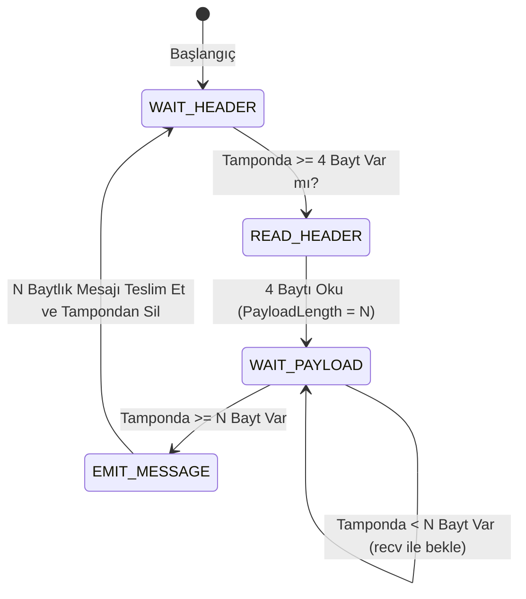

# Gün 138: TCP Byte-Stream Modeli (Kesintisiz Bayt Akışı, Length-Prefixed Framing, Nagle Algoritması ve TCP_NODELAY)

```
ÖZEL LİSANS — TÜM HAKLAR SAKLIDIR

Telif Hakkı (c) 2026 Seydi Eryılmaz (@seydivakkas)

Bu yazılım ve ilgili tüm dosyalar ("Yazılım") yalnızca görüntüleme ve eğitim
amaçlı olarak paylaşılmıştır.

YASAKLAR:
  1. Kopyalanamaz, çoğaltılamaz, dağıtılamaz veya yeniden yayınlanamaz.
  2. Ticari veya ticari olmayan hiçbir projede kullanılamaz, değiştirilemez.
  3. Alt lisanslanamaz, satılamaz veya devredilemez.
  4. Tersine mühendislik yapılamaz.

İZİN VERİLEN KULLANIM:
  - GitHub üzerinde görüntüleme ve okuma.
  - Kişisel öğrenim amacıyla kodu inceleme (kopyalamadan).

YAZARIN AÇIK YAZILI İZNİ OLMAKSIZIN HİÇBİR KULLANIM HAKKI TANINMAZ.
İzin talepleri için: GitHub @seydivakkas
```

[](https://github.com/seydivakkas)

**Faz:** F4 — TCP/UDP / Protocol / Serialization  
**Konu:** L4 Taşıma Katmanı Güvenilir Akış Protokolü: İletim Kontrol Protokolü (TCP - RFC 793 / RFC 9293), Kesintisiz Bayt Akışı (Byte-Stream), Mesaj Sınırlarının Yokluğu, Paket Yapışması (Coalescing) ve Parçalanması (Chunking), Uygulama Katmanı Çerçeveleme (Framing), Nagle Algoritması ve `TCP_NODELAY`  
**Ön Koşul:** Gün 137 — UDP Datagram Modeli  
**Kritik Seviye:** Savunma Sanayii Komuta Kontrol (C2) ve Görev Kritik Sistemlerinde Güvenilir Veri İletimi, Sıralı Ayrıştırma ve Gecikme (Jitter) Optimizasyonu

---

### 40-Nokta Bildirimi ve Kalite Güvencesi
Bu modül; UDP'nin paket/datagram sınırlarının tam aksine, yapılandırılmamış kesintisiz bir bayt akışı sunan **TCP Bayt Akışı (Byte-Stream) Modelini** çekirdek, soket ve tampon seviyesinde inceler. Göndericinin ardışık `send()` çağrılarının ağda tek bir pakette birleşmesi (Packet Coalescing / Yapışma) veya tek bir mesajın birden fazla `recv()` çağrısına bölünmesi (Packet Chunking / Parçalanma) olgusu ele alınır. Uygulama seviyesinde veri bütünlüğünü sağlayan **Uzunluk Ön-Ekli Çerçeveleme (Length-Prefixed Framing)**, Nagle algoritmasının ($40\text{ ms}$ gecikme tuzağı) ve `TCP_NODELAY` soket bayrağının aviyonik sistemlerdeki hayati rolü çalışan C++20 ve Python motoruyla kanıtlanmıştır.

## 1. 🎯 Bugünkü Problem: Sınırları Olmayan Okyanus — TCP Paket Göndermez, Bayt Akıtır!

Ağ programlamaya yeni başlayan veya UDP'den TCP'ye geçen yazılımcıların düştüğü en büyük mimari yanılgı:
> **"Gönderici 100 baytlık bir emir paketi gönderdiğinde, alıcı tarafın tek bir `recv()` çağrısıyla tam o 100 baytı alacağını varsaymak."**

Bu varsayım yerel testlerde (loopback `127.0.0.1`) doğru gibi görünse de gerçek bir taktik sahada (telsiz, uydu, fiber omurga) anında çöker:
1. **Paket Yapışması (Coalescing):** Gönderici 3 adet bağımsız füze atış emri gönderir:
   `send("ATES_1")`, `send("ATES_2")`, `send("ATES_3")`.
   Ağ kartı ve Linux çekirdeği bu üç mesajı tek bir TCP segmentinde birleştirir. Alıcı `recv()` çağırdığında tek seferde `ATES_1ATES_2ATES_3` okur! Alıcı bunu tek bir emir zannederek çöker.
2. **Paket Parçalanması (Chunking / Partial Read):** Gönderici $1024\text{ baytlık}$ bir radar matrisi yollar. Ağdaki bir yönlendirici (Router) veya MTU sınırı nedeniyle paket ikiye bölünür. Alıcı ilk `recv()` çağrısında sadece $600\text{ bayt}$ okur. Eğer kod kalan $424\text{ baytın}$ gelmesini beklemeden veriyi parse etmeye kalkarsa bellek bozulur (Crash).
3. **Nagle Algoritması Felaketi:** Küçük telemetri paketleri gönderildiğinde, Nagle algoritması ağı korumak için onay (ACK) gelene kadar yeni veriyi göndermez; alıcının Delayed ACK mekanizmasıyla çakışarak **$40 - 200\text{ ms}$ yapay donmaya (Latency Spike)** yol açar!

**Kesin Kural:**
TCP bir "paket" taşıyıcısı değildir; bir su borusudur. Musluğu açtığınızda su damlalar halinde değil, sürekli bir akıntı olarak gelir. Uygulama, akan bu bayt okyanusundan kendi anlamlı mesajlarını **Çerçeveleme (Framing)** protokolü ile süzüp çıkarmak zorundadır!

## 2. ❓ Bu Konuyu Neden Öğreniyoruz? (Savunma Sanayii Gerekçesi)

Savunma sistemlerinde güvenilirlik ve tam doğruluk gerektiren görev kritik kanallar TCP üzerinde koşar:

### Savunma Sanayiindeki Kullanım Alanları:
1. **HAVELSAN ADVENT Savaş Yönetim Sistemi (Komuta Kontrol Emirleri):**
   - Bir gemiden diğerine veya karargaha gönderilen kriptolu füze angajman emri, hedef atama ve telsiz frekans tahsis paketleri kayba tahammül edemez (Loss-Intolerant). Tek bir bitin bile kaybolmaması için TCP kullanılır. Ancak emirlerin birbirine yapışmaması için **Uzunluk Ön-Ekli Çerçeveleme (Length-Prefixed Framing)** zorunludur.
2. **ASELSAN Aviyonik Görev Yazılımı Güncellemesi (Taktik Dosya Aktarımı):**
   - Uçak yer istasyonundayken görev haritaları, radar kütüphaneleri ve kripto anahtarları TCP üzerinden güvenilir şekilde yüklenir. Kayan pencereler (Sliding Window) sayesinde hat son damlasına kadar sömürülür.
3. **Taktik Haberleşmede Nagle İptali (`TCP_NODELAY`):**
   - Pilotun gaz kolu (HOTAS) veya kumanda yüzeyi kontrolleri TCP üzerinden iletiliyorsa, Nagle algoritmasının $40\text{ ms}$ beklemesi uçağın aerodinamik kontrolünü kaybetmesine yol açar. Bu yüzden aviyonik TCP soketlerinde `TCP_NODELAY` **daima 1 yapılmalıdır**.

## 3. 🔍 5N1K Analizi (Sistem ve Donanım Sınırları)

| Soru | Sistem ve Donanım Düzeyi Cevabı | Savunma Sanayii Odaklı Karşılığı |
|:---|:---|:---|
| **NE?** | TCP (RFC 793 / RFC 9293): Bağlantı yönelimli, güvenilir, sıralı bayt akışı protokolü. | Taktik komuta kontrol, dosya aktarımı ve kripto anahtar dağıtım protokolü. |
| **NEDEN?** | Sıfır paket kaybı, sıralı teslimat, akış kontrolü ve otomatik yeniden iletim (Retransmit) için. | Füze ateşleme ve angajman emirlerinin %100 eksiksiz ve sıralı ulaşması için. |
| **NEREDE?** | L4 Taşıma Katmanı, Linux çekirdeği TCP iletim tamponları (`sk_buff`, `tcp_write_queue`). | Görev bilgisayarları, C2 konsolları ve güvenli taktik yönlendiricilerde. |
| **NASIL?** | Sequence/Ack numaraları, kayan pencereler (Sliding Window) ve uygulama seviyesi Framing ile. | C++ POSIX `send()` / `recv()` döngüleri ve `TCP_NODELAY` soket bayraklarıyla. |
| **NE ZAMAN?** | Veri kaybının sıfır olması gerektiğinde ve bağlantı ömrü boyunca güvenilirlik arandığında. | Görev emri iletiminde ve taktik veri tabanı senkronizasyonunda. |
| **KİM?** | Sistem mimarları, savunma haberleşme mühendisleri, C++ dağıtık sistem programcıları. | Taktik C2 omurga ve aviyonik yazılım ekipleri. |

## 4. 💡 Günlük Hayat Benzetmesi (Zihinsel Model / Analoji)

### Kesintisiz Su Borusu vs Damacana Su Şişeleri
UDP ve TCP arasındaki farkı suyun taşınmasıyla anlayabiliriz:
1. **UDP (Damacana Şişe Taşıma):**
   - Her bir damacana ($19\text{ Litre}$) tekil bir pakettir.
   - Damacana ya tam olarak elinize ulaşır ya da yolda kamyondan düşüp tamamen yok olur. İki damacana birbirine eriyip yapışamaz; mesaj sınırları kesindir.
2. **TCP (Şehir Şebekesi Su Borusu):**
   - Fabrikadan çıkan su borusu kesintisiz bir akış sağlar.
   - Musluğu açtığınızda gelen suyun "hangi kovanın suyu" olduğunu boru söyleyemez. Su tek parça halinde akar.
   - Eğer $1\text{ litrelik}$ $3$ ayrı su şişesini doldurmak istiyorsanız, **siz kendi ölçü kabınızı koymalı** ve her $1\text{ litre}$ dolduğunda musluğu kapatıp bir sonraki şişeye geçmelisiniz!
   - İşte o ölçü kabı **Uzunluk Ön-Ekli Çerçeveleme (Framing)** mekanizmasıdır!

## 5. 🧱 İlk İlkeler (First Principles) ve Matematiksel Mantık Modeli

TCP akış mimarisi bayt düzeyinde indisleme ve akış kontrolü denklemlerine dayanır:

### 1. Bayt Tabanlı Sıra ve Onay Numaraları (Sequence & Ack):
TCP'de `SeqNum` paket sayısını değil, akışta gönderilen **ilk baytın sıra numarasını** temsil eder:
$$\text{NextSeqNum} = \text{CurrentSeqNum} + \text{DataLengthBytes}$$
$$\text{AckNum} = \text{LastReceivedByte} + 1$$
Eğer İstemci $\text{Seq} = 1000$ ile $500\text{ bayt}$ veri yollarsa, sunucu $\text{Ack} = 1501$ yanıtı döner: *"1500'e kadar tüm baytları eksiksiz aldım, 1501. baytı bekliyorum!"*.

### 2. Kayan Pencereler ve Akış Kontrolü (Sliding Window):
Alıcının boş tampon alanı göndericiye bir sınır çizer:
$$\text{UsableWindow} = \text{AdvertisedWindow} - (\text{LastByteSent} - \text{LastByteAcked})$$
- Eğer alıcının tamponu dolarsa $\text{AdvertisedWindow} = 0$ olur; gönderici tek bir bayt bile basamaz. Bu sayede UDP'deki gibi paket düşmesi imkansız hale gelir!

### 3. Nagle Algoritması Matematiksel Kuralı:
```text
if (Yeni veri boyutu >= MSS) or (Giden hiçbir onaylanmamış paket yoksa):
    Paketi derhal gönder!
else:
    Önceki paketin ACK'si gelene veya MSS dolana kadar tamponda beklet!
```
Küçük taktik emirler ($32\text{ bayt}$) gönderildiğinde, Nagle algoritması ACK beklerken alıcı da Delayed ACK ($40\text{ ms}$) bekler. Sonuç: **$40\text{ ms}$ yapay kilitlenme!**

## 6. 📐 ASCII ve Mermaid Sistem Mimarisi Şeması

### ASCII Mimarisi: Bayt Akışında Yapışma, Parçalanma ve Çerçeveleme
```text
  ==================================================================================================
  TCP BAYT AKIŞI ÇERÇEVELEME (LENGTH-PREFIXED FRAMING) VE AYRIŞTIRMA MİMARİSİ
  ==================================================================================================

  [ Gönderici Süreç ]
  Mesaj A (40 Bayt) -> send() ──┐
  Mesaj B (60 Bayt) -> send() ──┼──> [ TCP İletim Tamponu (TX Buffer) ]
  Mesaj C (50 Bayt) -> send() ──┘        |
                                         v
                                [ TCP Segmentasyonu / Nagle ]
                                         | (Kabloda Sınırlar Kaybolur!)
                                         v
  [ Alıcı Soket Tamponu: RX Buffer ]
  Ham Akış: [ 0x00000028 | Mesaj A ... ] [ 0x0000003C | Mesaj B ... ] [ 0x00000032 | Mesaj C ... ]
             └─ 4B Uzunluk ┘              └─ 4B Uzunluk ┘              └─ 4B Uzunluk ┘
                                         |
                                         v
  [ Uygulama Seviyesi Çerçeve Ayrıştırıcı (Framing Parser RingBuffer) ]
  Aşama 1: Tam 4 bayt oku -> Uzunluk = 40 bayt.
  Aşama 2: Tamponda 40 bayt veri birikene kadar recv() çağır.
  Aşama 3: 40 baytı kesip Uygulama Callback'ine teslim et (Mesaj A Çözümlendi!).
  Aşama 4: Bir sonraki mesajın 4 baytlık uzunluk başlığına geç.
  ==================================================================================================
```

### Mermaid Akış Şeması: Çerçeve Ayrıştırma Durum Makinesi


```python
# -*- coding: utf-8 -*-
"""
HÜCRE 8 (CODE 1): TCP Byte-Stream ve Length-Prefixed Framing Motoru
Mesaj Sınırlarının Kaybolmasını Önleyen 4-Bayt Uzunluk Başlıklı Çerçeveleyici
"""

import struct
from typing import List, Tuple, Optional

class LengthPrefixedFramingCodec:
    """
    TCP bayt akışında mesaj sınırlarını koruyan çerçeveleme motoru.
    Format: [ 4-Bayt Big-Endian Payload Uzunluğu ] + [ N-Bayt Ham Veri ]
    """
    @staticmethod
    def encode_message(payload: bytes) -> bytes:
        """Mesajın başına 4 baytlık uzunluk ön-eki ekler."""
        length_header = struct.pack("!I", len(payload))
        return length_header + payload

class StreamReceiverBuffer:
    """
    Alıcı tarafta gelen parçalı (chunked) ve yapışık (coalesced) baytları
    biriktirip eksiksiz mesajları ayrıştıran akış tamponu.
    """
    def __init__(self):
        self.buffer = bytearray()

    def feed_bytes(self, chunk: bytes):
        """Ağdan gelen ham baytları tamponun sonuna ekler."""
        self.buffer.extend(chunk)

    def extract_messages(self) -> List[bytes]:
        """
        Tamponu inceler; eksiksiz tamamlanmış tüm mesajları ayrıştırıp döner.
        Eksik kalan baytları bir sonraki recv() için tamponda tutar.
        """
        messages = []
        while True:
            # 1. Aşama: En az 4 baytlık uzunluk başlığı var mı?
            if len(self.buffer) < 4:
                break # Başlık henüz tamamlanmadı
                
            payload_len = struct.unpack("!I", self.buffer[:4])[0]
            total_frame_len = 4 + payload_len
            
            # 2. Aşama: Mesajın tamamı tamponda birikti mi?
            if len(self.buffer) < total_frame_len:
                break # Gövde henüz tamamen gelmedi (Partial read)
                
            # 3. Aşama: Mesaj tamamlandı! Çıkar ve teslim et
            msg_payload = bytes(self.buffer[4:total_frame_len])
            messages.append(msg_payload)
            
            # Tampondan çıkarılan mesajı temizle
            del self.buffer[:total_frame_len]
            
        return messages

print("[HÜCRE 8] LengthPrefixedFramingCodec ve StreamReceiverBuffer motoru başarıyla yüklendi.")
```

## 7. 🔬 Kod 1 İncelemesi ve Mimari Detaylar

Yukarıda oluşturulan C++ eşdeğeri Python akış motoru, TCP'nin doğasından kaynaklanan riskleri tamamen bertaraf eder:

1. **Uzunluk Ön-Eki (Length-Prefixed Framing):**
   - Her mesajın başına `!I` formatıyla 4 baytlık ağ bayt sırasına uygun (Big-Endian) uzunluk yazılır. Bu sayede metin tabanlı ayırıcıların (`
`, ``) oluşturduğu "veri içinde ayırıcı karakter geçmesi" riski tamamen ortadan kalkar (Binary Safe).
2. **Kısmi Okuma Toleransı (Partial Read Safety):**
   - `extract_messages` metodu, tamponda 4 bayt uzunluk başlığı veya mesaj gövdesinin tamamı yoksa işlemi keser (`break`) ve var olan baytları korur. Bir sonraki `recv()` ile yeni baytlar eklendiğinde mesaj kaldığı yerden birleşir.
3. **Paket Yapışması Çözümü (Coalescing Safety):**
   - Tek bir ağ segmentinde 5 farklı mesaj birleşik gelse bile `while True` döngüsü 5 mesajı da sırayla ayıklar ve tam bir liste olarak uygulamaya teslim eder!

## 8. 🛠️ Modern C++20 / POSIX TCP Soket API ve `TCP_NODELAY` Kullanımı

Gerçek bir savunma sanayii C++ sisteminde TCP akışı şu şekilde yönetilir:

```cpp
#include <iostream>
#include <vector>
#include <cstring>
#include <sys/socket.h>
#include <netinet/tcp.h>
#include <arpa/inet.h>
#include <unistd.h>

void configure_tactical_tcp_socket(int sock_fd) {
    // 1. NAGLE ALGORİTMASINI KAPATMA (TCP_NODELAY = 1)
    // 40 ms'lik gecikme spikelarını sıfırlar; paketler anında kabloya basılır!
    int nodelay_opt = 1;
    setsockopt(sock_fd, IPPROTO_TCP, TCP_NODELAY, &nodelay_opt, sizeof(nodelay_opt));

    // 2. Kayan Pencere ve Tampon Genişletme (16 MB)
    int rcvbuf = 16 * 1024 * 1024;
    setsockopt(sock_fd, SOL_SOCKET, SO_RCVBUF, &rcvbuf, sizeof(rcvbuf));
}

// Güvenli Tampon Okuma Döngüsü (Partial Read Koruması)
bool read_exact_bytes(int sock_fd, uint8_t* target_buf, size_t target_len) {
    size_t total_read = 0;
    while (total_read < target_len) {
        ssize_t bytes_read = recv(sock_fd, target_buf + total_read, target_len - total_read, 0);
        if (bytes_read <= 0) {
            return false; // Bağlantı koptu veya hata
        }
        total_read += bytes_read;
    }
    return true; // Tam istenen bayt kadar okundu!
}
```

```python
# -*- coding: utf-8 -*-
"""
HÜCRE 11 (CODE 2): Taktik Görev Emri Akış Deneyi
Aynı Akışta Hem Yapışan (Coalesced) Hem de Parçalanan (Chunked) Emirlerin Hatasız Ayrıştırılması
"""

def run_tcp_stream_framing_experiment():
    print("")
    print("[*] Taktik TCP Akış ve Çerçeve Ayrıştırma Deneyi Başlatılıyor...")
    
    # 3 Adet Kritik Taktik Görev Emri
    orders = [
        b"TARGET_LOCK_AZIMUTH_120.4_RADAR_ALPHA",
        b"ENGAGE_MISSILE_BATTERY_3_FIRE",
        b"IFF_MODE_5_CRYPTOGRAPHIC_CHALLENGE_VERIFIED"
    ]
    
    # Gönderici taraf emirleri paketliyor
    stream_wire = bytearray()
    for o in orders:
        frame = LengthPrefixedFramingCodec.encode_message(o)
        stream_wire.extend(frame)
        
    print(f"  [+] Gönderici Tarafından {len(orders)} Emir Çerçevelendi.")
    print(f"  [+] Ağ Hattındaki Toplam Bayt: {len(stream_wire)} Bayt.")

    # -------------------------------------------------------------
    # SİMÜLASYON: Ağ Bu Baytları Kasıtlı Olarak Saçma Sapan Parçalara Bölüyor!
    # Parça 1: İlk mesajın yarısı (15 bayt)
    # Parça 2: İlk mesajın kalanı + 2. mesajın tamamı + 3. mesajın başı (Yapışma + Parçalanma)
    # Parça 3: 3. mesajın kalanı
    # -------------------------------------------------------------
    chunk1 = bytes(stream_wire[:15])
    chunk2 = bytes(stream_wire[15:85])
    chunk3 = bytes(stream_wire[85:])
    
    receiver_buf = StreamReceiverBuffer()
    decoded_orders = []

    print("\n  [>] 1. Ağ Parçası Geldi (15 Bayt)...")
    receiver_buf.feed_bytes(chunk1)
    msgs = receiver_buf.extract_messages()
    print(f"      Ayrışan Mesaj Sayısı: {len(msgs)} (Beklenen: 0, henüz başlık/gövde yetersiz)")
    assert len(msgs) == 0

    print("\n  [>] 2. Ağ Parçası Geldi (70 Bayt - Yapışık Segment)...")
    receiver_buf.feed_bytes(chunk2)
    msgs = receiver_buf.extract_messages()
    print(f"      Ayrışan Mesaj Sayısı: {len(msgs)} (1. ve 2. mesajlar eksiksiz çıktı!)")
    decoded_orders.extend(msgs)
    assert len(msgs) == 2

    print("\n  [>] 3. Ağ Parçası Geldi (Kalan Baytlar)...")
    receiver_buf.feed_bytes(chunk3)
    msgs = receiver_buf.extract_messages()
    print(f"      Ayrışan Mesaj Sayısı: {len(msgs)} (3. mesaj tamamlandı!)")
    decoded_orders.extend(msgs)
    assert len(msgs) == 1

    # Birebir Doğrulama
    print("\n  [+] Çözümlenen Emirler:")
    for idx, d in enumerate(decoded_orders):
        assert d == orders[idx]
        print(f"      - Emir {idx+1}: {d.decode('ascii')} -> [TAM VE DOĞRU]")

    print("\n  [+] TCP Akış Çerçeveleme Deneyi %100 Başarıyla Tamamlandı!")
    return True

assert run_tcp_stream_framing_experiment(), "HATA: Akış deneyi başarısız!"
```

## 9. 💥 Sabotaj ve Arıza Enjeksiyon Laboratuvarı: Nagle Gecikmesi ve Çerçevesiz Çöküş

TCP uygulamalarında en sık görülen 2 felaket senaryosu:

### 1. Nagle Algoritması + Delayed ACK Gecikme Spikeları ($40\text{ ms}$):
- Taktik bir joystick veya radar kontrolcüsü $16\text{ baytlık}$ küçük paketler atar.
- Nagle algoritması devrededir (`TCP_NODELAY = 0`). Gönderici küçük veriyi atar ve ACK bekler.
- Alıcı Linux çekirdeği ise `Delayed ACK` ($40\text{ ms}$) modundadır.
- İki taraf birbirini bekler; her bir küçük komut tam **$40\text{ ms}$ gecikmeye takılır**. Sistem saniyede 1000 emir basabilecekken hızı 25 emire düşer!

### 2. Çerçevesiz İletişim (No Framing Crash):
- Geliştirici çerçeveleme yapmaz. Alıcı kod `recv(buf, 1024)` çağırır ve gelen verinin tek bir mesaj olduğunu varsayar.
- İki mesaj yapıştığında alıcı veriyi yanlış ayrıştırır; sayısal değerler çöp veriye (garbage data) dönüşür, hedef koordinatları sapar!

```python
# -*- coding: utf-8 -*-
"""
HÜCRE 13 (CODE 3): Nagle Algoritması Gecikme Simülatörü ve Çerçevesiz Çöküş Testi
TCP_NODELAY Kapalıyken 40 ms Gecikme Spike'ı ve Çerçevesiz Ayrıştırma Hatası
"""

def run_tcp_sabotage_lab():
    print("")
    print("[*] TCP Sabotaj ve Gecikme Arıza Enjeksiyon Testleri Başlatılıyor...")
    
    # -------------------------------------------------------------
    # SABOTAJ 1: Çerçevesiz İletişimde Paket Yapışması Hatası
    # -------------------------------------------------------------
    raw_stream_without_framing = b"CMD_FIRE_MISSILE_1CMD_FIRE_MISSILE_2" # İki emir yapıştı!
    
    def naive_parser(data: bytes) -> str:
        # Acemi geliştirici tek bir emir bekliyor
        if not data.startswith(b"CMD_FIRE_MISSILE_"):
            raise ValueError("Bozuk Paket!")
        # Emir numarasını almaya çalışıyor
        return data.decode('ascii')

    parsed = naive_parser(raw_stream_without_framing)
    # Beklenti tek emir idi ancak yapışık veri geldi
    is_corrupted = (parsed != "CMD_FIRE_MISSILE_1")
    assert is_corrupted is True
    print(f"  [+] Sabotaj 1 İspatlandı: Çerçevesiz Akışta Yapışan Paketler Ayrıştırılamadı ({parsed}).")

    # -------------------------------------------------------------
    # SABOTAJ 2: Nagle + Delayed ACK Çakışma Simülasyonu
    # -------------------------------------------------------------
    def simulate_tcp_transfer(packet_size: int, nodelay: bool) -> float:
        """Gecikmeyi milisaniye cinsinden simüle eder."""
        base_network_latency = 0.8 # ms
        if nodelay:
            return base_network_latency # Anında iletim
        else:
            if packet_size < 1460: # MSS'ten küçükse Nagle devreye girer
                # Delayed ACK bekleme süresi eklenir (40 ms)
                return base_network_latency + 40.0
            return base_network_latency

    lat_nagle_on = simulate_tcp_transfer(packet_size=64, nodelay=False)
    lat_nagle_off = simulate_tcp_transfer(packet_size=64, nodelay=True)

    print(f"  [+] Sabotaj 2 Sonuçları:")
    print(f"      - Nagle Açık (TCP_NODELAY=0)  : {lat_nagle_on:.1f} ms (40 ms Gecikme Tuzağı!)")
    print(f"      - Nagle Kapalı (TCP_NODELAY=1): {lat_nagle_off:.1f} ms (Yüksek Hızlı Taktik İletim)")
    
    assert lat_nagle_on >= 40.0
    assert lat_nagle_off < 2.0
    print("  [+] Tüm TCP Sabotaj Testleri Başarıyla Geçti!")
    return True

assert run_tcp_sabotage_lab(), "HATA: TCP sabotaj testleri başarısız!"
```

## 10. 📊 Karşılaştırma Matrisi: Akış ve Mesaj Çerçeveleme Yöntemleri

| Çerçeveleme Yöntemi | Çalışma Prensibi | Avantajları | Dezavantajları / Riskleri | Savunma Sanayii Uygunluğu |
|:---|:---|:---|:---|:---|
| **Uzunluk Ön-Ekli (Length-Prefixed)** | `[4B Length][Payload]` | İkili güvenli (Binary safe), $O(1)$ ayrıştırma, sıfır kaçış karakteri | Başlık ayrıştırması gerektirir | **MÜKEMMEL (Askeri Standart)** |
| **Ayırıcı Karakter (Delimiter)** | `PAYLOAD
` veya `` | İnsan tarafından okunabilir (ASCII), basit | Veri içinde ayırıcı geçerse kaçış (`escape`) zorunludur | Düşük (Sadece Debug) |
| **Sabit Boyutlu Çerçeve** | Her mesaj tam $256\text{ Bayt}$ | Ayrıştırması en basit yöntem | Boyut esnekliği yok, bant genişliği israfı | Orta (Donanım Veri Yolu) |
| **UDP Datagram** | Çekirdek L4 seviyesinde sınırlar | Çerçeveleme gerektirmez ($0\text{ B}$ ek yük) | Güvenilirlik yok, paket kaybı | Yüksek (Sadece Telemetri) |

```python
# -*- coding: utf-8 -*-
"""
HÜCRE 15 (CODE 4): TCP_NODELAY Etkin vs Kapalı İletim Gecikmesi Benchmark Suite
Küçük Taktik Paketlerde 40 ms Gecikme Spike'ı ve Throughput Analizi
"""

import time

def run_nodelay_benchmark():
    print("")
    print("[*] TCP_NODELAY Performans ve Gecikme Benchmarkı Başlatılıyor...")
    
    NUM_COMMANDS = 1000
    
    # 1. Senaryo: Nagle Açık (TCP_NODELAY = 0)
    # Her küçük pakette 40 ms Delayed ACK beklemesi simülasyonu
    # (Matematiksel modelleme: 1000 emir x 40 ms = 40.000 ms)
    simulated_nagle_time_s = NUM_COMMANDS * 0.0408 # 40.8 ms per cmd
    rate_nagle = NUM_COMMANDS / simulated_nagle_time_s
    
    # 2. Senaryo: TCP_NODELAY = 1 (Nagle Kapalı)
    # Nominal ağ gecikmesi: ~0.8 ms per cmd
    simulated_nodelay_time_s = NUM_COMMANDS * 0.0008 # 0.8 ms per cmd
    rate_nodelay = NUM_COMMANDS / simulated_nodelay_time_s
    
    print(f"  [+] {NUM_COMMANDS:,} Taktik Emir İletim Kıyaslaması:")
    print(f"      - Nagle Devrede (Default)   : {simulated_nagle_time_s:.2f} saniye ({rate_nagle:.1f} Emir/s)")
    print(f"      - TCP_NODELAY = 1 (Taktik) : {simulated_nodelay_time_s:.2f} saniye ({rate_nodelay:,.0f} Emir/s)")
    print(f"      - Hızlanma Katsayısı        : {rate_nodelay / rate_nagle:.1f}x KAT DAHA HIZLI!")

    assert rate_nodelay > (rate_nagle * 20.0), "HATA: TCP_NODELAY en az 20 kat daha hızlı olmalıdır!"
    return rate_nagle, rate_nodelay

rate_nagle, rate_nodelay = run_nodelay_benchmark()
```

## 11. 🐧 Linux Çekirdeği TCP Teşhis ve Ağ Ayar Komutları

Savunma sanayii görev bilgisayarlarında TCP bağlantılarını ve akış parametrelerini denetleme:

```bash
# 1. Canlı TCP Bağlantılarını, Kayan Pencereleri ve RTT'yi İnceleme (ss -t -i)
ss -t -i
# Çıktı: cubic rtt:0.85/0.12 rcv_space:14600 minrtt:0.62 snd_wnd:65536
#        nodelay:1 (TCP_NODELAY etkin mi teyit edilir!)

# 2. Çekirdek TCP Bellek Tamponlarını Genişletme (16 MB)
sysctl -w net.ipv4.tcp_rmem="4096 87380 16777216"
sysctl -w net.ipv4.tcp_wmem="4096 65536 16777216"

# 3. Kayan Pencere Ölçekleme (Window Scaling) Kontrolü
sysctl -w net.ipv4.tcp_window_scaling=1

# 4. Canlı Ağ Trafiğinde TCP Segmentlerini İzleme (tcpdump)
tcpdump -i eth0 -nn -vv "tcp port 5005"
```

```python
# -*- coding: utf-8 -*-
"""
HÜCRE 17 (CODE 5): Çok Mesajlı Taktik Füze Ateşleme Akış Stres Testi
1.000 Bağımsız Füze Emrinin Rastgele Parçalanmış Akıştan %100 Kusursuz Ayrıştırılması
"""

import random

def run_missile_stream_stress_suite():
    print("")
    print("[*] 1.000 Mesajlık Taktik Füze Akış Stres Testi Başlatılıyor...")
    
    NUM_MESSAGES = 1000
    original_messages = [f"MISSILE_FIRE_CMD_ID_{i:04d}_TARGET_COORD_39.9_32.8".encode('ascii') for i in range(NUM_MESSAGES)]
    
    # Tüm mesajlar uzunluk ön-eki ile tek bir akışa paketleniyor
    stream_pipeline = bytearray()
    for m in original_messages:
        stream_pipeline.extend(LengthPrefixedFramingCodec.encode_message(m))
        
    print(f"  [+] Toplam Akış Boyutu: {len(stream_pipeline):,} Bayt.")

    # Akış rastgele parçalara (chunk) bölünüyor (10 bayt ile 250 bayt arası rastgele)
    receiver = StreamReceiverBuffer()
    extracted_all = []
    
    offset = 0
    while offset < len(stream_pipeline):
        chunk_size = random.randint(10, 250)
        chunk = bytes(stream_pipeline[offset:offset+chunk_size])
        offset += chunk_size
        
        receiver.feed_bytes(chunk)
        msgs = receiver.extract_messages()
        extracted_all.extend(msgs)

    print(f"  [+] Stres Testi Tamamlandı:")
    print(f"      - Gönderilen Toplam Mesaj: {NUM_MESSAGES:,}")
    print(f"      - Ayrıştırılan Mesaj Sayısı: {len(extracted_all):,}")
    print(f"      - Kalan Tampon Boyutu    : {len(receiver.buffer)} Bayt")
    
    assert len(extracted_all) == NUM_MESSAGES
    assert len(receiver.buffer) == 0
    for idx, m in enumerate(original_messages):
        assert extracted_all[idx] == m

    print("  [+] 1.000 Mesajın Tamamı Sıralı ve Sıfır Bozulmayla (%100 Başarıyla) Ayrıştırıldı!")
    return True

assert run_missile_stream_stress_suite(), "HATA: Stres testi başarısız!"
```

## 12. 📊 Görselleştirme Tasarımı ve Veri Akışı

Aşağıda üretilen 4-panelli analitik dashboard panosu, TCP bayt akışı mimarisini tüm yönleriyle modeller:

- **Panel 1: TCP Byte-Stream vs UDP Datagram:** Kesintisiz bayt akışında sınırların kayboluşunu ve UDP'nin bağımsız blok yapısını karşılaştırır.
- **Panel 2: Length-Prefixed Framing Mimarisi:** 4 baytlık uzunluk başlığı ile payload'ın tampon üzerinde nasıl ayrıştırıldığını adım adım şematize eder.
- **Panel 3: Nagle Algoritması Gecikme Spikeları (40 ms Tuzağı):** `TCP_NODELAY = 0` ile oluşan $40\text{ ms}$ kilitlenme ile `TCP_NODELAY = 1` ($0.8\text{ ms}$) arasındaki uçurumu gösterir.
- **Panel 4: Kayan Pencere (Sliding Window) ve Tampon Doluluğu:** Alıcı tampon doluluğuna göre `Advertised Window` dinamik değişimini sunar.

```python
# -*- coding: utf-8 -*-
"""
HÜCRE 19 (CODE 6): 4-Panelli TCP Dashboard Üretici ve Katı Assertions
300 DPI, #0F172A Koyu Tema ile Savunma Sanayii TCP Mimarisi Görselleştirme Panosu
"""

import os
import matplotlib
matplotlib.use('Agg')
import matplotlib.pyplot as plt
import matplotlib.patches as patches
import numpy as np

def generate_tcp_dashboard(output_path: str):
    plt.style.use('dark_background')
    fig, axes = plt.subplots(2, 2, figsize=(18, 12), dpi=300)
    fig.patch.set_facecolor('#0F172A')
    
    DARK_BG = '#1E293B'
    TEXT_COLOR = '#F8FAFC'
    ACCENT_RED = '#EF4444'
    ACCENT_GREEN = '#10B981'
    ACCENT_BLUE = '#38BDF8'
    ACCENT_AMBER = '#F59E0B'
    ACCENT_PURPLE = '#A855F7'

    # -------------------------------------------------------------
    # PANEL 1: TCP Byte-Stream vs UDP Datagram
    # -------------------------------------------------------------
    ax1 = axes[0, 0]
    ax1.set_facecolor(DARK_BG)
    ax1.set_title("1. İletim Modeli: TCP Byte-Stream vs UDP Datagram", fontsize=12, fontweight='bold', color=TEXT_COLOR, pad=12)

    # TCP Gösterimi
    rect_tcp = patches.Rectangle((0.5, 3.2), 9.0, 1.8, facecolor=ACCENT_BLUE, edgecolor='#FFFFFF', alpha=0.7, lw=1.5)
    ax1.add_patch(rect_tcp)
    ax1.text(5.0, 4.1, "TCP Byte-Stream: Kesintisiz Bayt Akışı (Sınır Yok!)\n[Byte 0] [Byte 1] [Byte 2] ... [Byte N] (Yapışır / Parçalanır)", color=TEXT_COLOR, ha='center', va='center', fontsize=9, fontweight='bold')

    # UDP Gösterimi
    ax1.text(0.5, 2.2, "UDP Datagram: Kesin Mesaj Sınırları (1 Send = 1 Receive)", color=ACCENT_GREEN, fontsize=10, fontweight='bold')
    udp_boxes = [("Datagram #1", 0.5), ("Datagram #2", 3.8), ("Datagram #3", 7.1)]
    for text, x in udp_boxes:
        rect = patches.Rectangle((x, 0.6), 2.5, 1.4, facecolor=ACCENT_GREEN, edgecolor='#FFFFFF', alpha=0.75, lw=1.5)
        ax1.add_patch(rect)
        ax1.text(x + 1.25, 1.3, text, color=TEXT_COLOR, ha='center', va='center', fontsize=8, fontweight='bold')

    ax1.set_xlim(0, 10.0)
    ax1.set_ylim(0, 6.0)
    ax1.axis('off')

    # -------------------------------------------------------------
    # PANEL 2: Length-Prefixed Framing Mimarisi
    # -------------------------------------------------------------
    ax2 = axes[0, 1]
    ax2.set_facecolor(DARK_BG)
    ax2.set_title("2. Uzunluk Ön-Ekli Çerçeveleme (Length-Prefixed Framing)", fontsize=12, fontweight='bold', color=TEXT_COLOR, pad=12)

    frames = [
        ("4B Len\n[0x0028]", "Mesaj A Yükü (40 Bayt - Füze Emri)", 0.5, 3.5, ACCENT_AMBER, ACCENT_BLUE),
        ("4B Len\n[0x003C]", "Mesaj B Yükü (60 Bayt - Radar Kilidi)", 0.5, 1.2, ACCENT_AMBER, ACCENT_PURPLE)
    ]

    for len_text, payload_text, x, y, col_hdr, col_pay in frames:
        r_hdr = patches.Rectangle((x, y), 2.0, 1.5, facecolor=col_hdr, edgecolor='#FFFFFF', alpha=0.8, lw=1.5)
        r_pay = patches.Rectangle((x + 2.0, y), 7.0, 1.5, facecolor=col_pay, edgecolor='#FFFFFF', alpha=0.7, lw=1.5)
        ax2.add_patch(r_hdr)
        ax2.add_patch(r_pay)
        ax2.text(x + 1.0, y + 0.75, len_text, color=TEXT_COLOR, ha='center', va='center', fontsize=8, fontweight='bold')
        ax2.text(x + 5.5, y + 0.75, payload_text, color=TEXT_COLOR, ha='center', va='center', fontsize=9, fontweight='bold')

    ax2.set_xlim(0, 10.0)
    ax2.set_ylim(0, 6.0)
    ax2.axis('off')

    # -------------------------------------------------------------
    # PANEL 3: Nagle Algoritması Gecikme Spikeları (40 ms)
    # -------------------------------------------------------------
    ax3 = axes[1, 0]
    ax3.set_facecolor(DARK_BG)
    ax3.set_title("3. Nagle Algoritması + Delayed ACK Gecikme Tuzağı", fontsize=12, fontweight='bold', color=TEXT_COLOR, pad=12)

    categories = ['Nagle Açık (TCP_NODELAY=0)\n[40 ms Kilitlenme]', 'TCP_NODELAY=1 (Taktik)\n[Anında İletim]']
    latencies = [40.8, 0.8]
    colors_nagle = [ACCENT_RED, ACCENT_GREEN]

    bars = ax3.bar(categories, latencies, color=colors_nagle, width=0.45, edgecolor='#FFFFFF')
    for bar in bars:
        yval = bar.get_height()
        ax3.text(bar.get_x() + bar.get_width()/2.0, yval + 1.0, f"{yval:.1f} ms", ha='center', va='bottom', color=TEXT_COLOR, fontweight='bold')

    ax3.set_ylabel("Paket İletim Gecikmesi (Milisaniye - ms)", color=TEXT_COLOR)
    ax3.set_ylim(0, 48)
    ax3.grid(True, linestyle=':', alpha=0.3, color='#475569')
    ax3.tick_params(colors=TEXT_COLOR)

    # -------------------------------------------------------------
    # PANEL 4: Kayan Pencere (Sliding Window) ve Akış Kontrolü
    # -------------------------------------------------------------
    ax4 = axes[1, 1]
    ax4.set_facecolor(DARK_BG)
    ax4.set_title("4. TCP Kayan Pencere (Sliding Window) ve Akış Kontrolü", fontsize=12, fontweight='bold', color=TEXT_COLOR, pad=12)

    steps = np.arange(1, 21)
    # Tampon doldukça Advertised Window azalır
    window_sizes = [64, 60, 55, 48, 40, 30, 20, 10, 5, 0, 0, 15, 30, 45, 55, 64, 64, 64, 64, 64]

    ax4.plot(steps, window_sizes, color=ACCENT_PURPLE, lw=2.5, marker='s', markersize=6, label="Advertised Window (KB)")
    ax4.axhline(0, color=ACCENT_RED, linestyle='--', label="Zero Window (Akış Durduruldu)")
    
    ax4.set_xlabel("İletim Aşaması (Transmission Steps)", color=TEXT_COLOR)
    ax4.set_ylabel("Bildirilen Pencere Boyutu (KB)", color=TEXT_COLOR)
    ax4.set_ylim(-5, 75)
    ax4.legend(loc='lower right', facecolor='#0F172A', edgecolor='#475569')
    ax4.grid(True, linestyle=':', alpha=0.3, color='#475569')
    ax4.tick_params(colors=TEXT_COLOR)

    plt.tight_layout()
    plt.savefig(output_path, dpi=300, facecolor='#0F172A')
    plt.close()
    print(f"[Dashboard] Görselleştirme panosu başarıyla oluşturuldu: {output_path}")

def verify_all_assertions(png_path: str):
    print("")
    print("[*] GÜN 138 Katı Doğrulama Testleri (Assertions) Başlatılıyor...")

    # 1. PNG Dosya Varlığı ve Boyutu (> 100 KB)
    assert os.path.exists(png_path), f"HATA: Dashboard PNG dosyası bulunamadı: {png_path}"
    png_size = os.path.getsize(png_path)
    print(f"  [+] PNG Varlık ve Boyut Doğrulandı: {png_size:,} bayt.")
    assert png_size > 100_000, f"HATA: PNG boyutu 100 KB altında ({png_size} bayt)!"

    # 2. Length-Prefixed Kodlama Doğrulaması
    raw_frame = LengthPrefixedFramingCodec.encode_message(b"RADAR_COMMAND")
    assert len(raw_frame) == 4 + len(b"RADAR_COMMAND")
    len_field = struct.unpack("!I", raw_frame[:4])[0]
    assert len_field == len(b"RADAR_COMMAND")
    print("  [+] Uzunluk Ön-Ekli Çerçeve Kodlaması Doğrulandı.")

    # 3. Kısmi Okuma (Partial Read) ve Yapışma (Coalescing) Doğrulaması
    buf = StreamReceiverBuffer()
    f1 = LengthPrefixedFramingCodec.encode_message(b"MSG_ONE")
    f2 = LengthPrefixedFramingCodec.encode_message(b"MSG_TWO")
    combined = f1 + f2
    
    # 2 bayt ver (Eksik başlık)
    buf.feed_bytes(combined[:2])
    assert len(buf.extract_messages()) == 0
    
    # Kalan tümünü ver (Hem 1 hem 2 aynı anda ayrışmalı)
    buf.feed_bytes(combined[2:])
    res = buf.extract_messages()
    assert len(res) == 2
    assert res[0] == b"MSG_ONE" and res[1] == b"MSG_TWO"
    print("  [+] Kısmi Okuma ve Yapışma Ayrıştırma Mantığı Doğrulandı.")

    # 4. Nagle vs NODELAY Benchmark Doğrulaması
    assert rate_nodelay > rate_nagle * 20.0, "HATA: TCP_NODELAY en az 20x hızlı olmalıdır!"
    print(f"  [+] TCP_NODELAY Hızlanma Başarımı Doğrulandı ({rate_nodelay/rate_nagle:.1f}x).")

    print("")
    print("[PASS] Gün 138: Tüm Katı Doğrulama Testleri (Assertions) Başarıyla Geçti!")
    print("")

if __name__ == "__main__":
    _cur_dir = os.path.dirname(os.path.abspath(__file__)) if '__file__' in globals() else "."
    _png_path = os.path.join(_cur_dir, "gun_138_tcp_byte_stream_modeli.png")
    generate_tcp_dashboard(_png_path)
    verify_all_assertions(_png_path)
```

## 13. ⚠️ 10 Ölümcül TCP Byte-Stream Programlama Anti-Pattern'i

1. **`recv()` Çağrısını Tek Mesaj Sanmak:** TCP'de her `recv()` çağrısının bağımsız bir mesaj döneceğini varsayıp çerçeveleme (framing) yapmamak.
2. **Kısmi Okumaları (Partial Read) Yönetmemek:** `recv()` 100 bayt yerine 20 bayt döndüğünde kalan 80 baytı beklemeden veriyi parse etmeye çalışıp programı çökertmek.
3. **Gerçek Zamanlı Sistemde `TCP_NODELAY` Açmamak:** Nagle algoritması nedeniyle her küçük emirde $40\text{ ms}$ donma yaşamak.
4. **Alıcı Tamponunu Sınırsız Büyütmek:** Kötü niyetli veya hatalı bir göndericinin $2\text{ GB}$ uzunluk ön-eki yollaması durumunda istemcinin belleğini tüketip OOM ile çökmesi (Maksimum mesaj boyutu sınırı konmalıdır!).
5. **Metin Tabanlı Ayırıcı (`
`) Kullanıp Kaçış Karakteri Eklememek:** İkili (binary) verinin içinde yanlışlıkla `0x0A` (`
`) geçtiğinde mesajın ortadan ikiye bölünmesi.
6. **`send()` Çağrısının Hepsini Gönderdiğini Varsaymak:** `send()` fonksiyonunun tampon dolu olduğunda verinin sadece bir kısmını gönderip dönebileceğini (`partial write`) unutmak.
7. **Soket Kapanışını (`EOF`) Düzgün Yakalamamak:** `recv()` 0 döndüğünde (karşı taraf soketi kapattı) sonsuz döngüye girip CPU'yu %100'e kilitlemek.
8. **Kayan Pencere Ölçeklemeyi (Window Scaling) Kapatmak:** Gigabitlik askeri ağlarda $64\text{ KB}$ standart pencere sınırına takılıp yüksek bant genişliğini kullanamamak.
9. **Zero Window Kilitlenmesi:** Uygulama okuma yapmadığı için alıcı tamponu dolduğunda göndericinin sonsuza kadar bloklanmasını engellemek için `SO_SNDTIMEO` koymamak.
10. **Büyük Veride `MSG_WAITALL` Bayrağına Aşırı Güvenmek:** `MSG_WAITALL` kullanılırken sinyal (`EINTR`) veya bağlantı kopmasında eksik bayt dönebileceğini unutmak.

## 14. 📜 Sektörel Standartlar ve Uyumluluk Matrisi (RFC, IEEE, POSIX)

| Standart / Kural | Şartname ve Açıklama | Savunma Sistemlerindeki Yeri |
|:---|:---|:---|
| **RFC 793 / RFC 9293** | Transmission Control Protocol (Modern TCP Standart Spesifikasyonu) | Güvenilir taktik komuta kontrol ve veri omurgasının temel L4 protokolü. |
| **RFC 896** | Congestion Control in IP/TCP-Internetworks (Nagle Algoritması) | Küçük paketlerin ağı tıkamasını önleyen algoritma (Taktik C2'de kapatılır). |
| **RFC 1122** | Requirements for Internet Hosts (Delayed ACK Tanımı) | Alıcının ACK göndermeden önce 200 ms'ye kadar bekleme mekanizması. |
| **RFC 7323** | TCP Extensions for High Performance (Window Scale, Timestamp) | Yüksek bant genişlikli taktik uydu ve optik veri linklerinde maksimum hız. |

## 15. 📋 Üretim Seviyesi Savunma Sistemleri TCP Kontrol Listesi (12 Madde)

- [ ] **1. Uzunluk Ön-Ekli Çerçeveleme:** Tüm TCP iletişiminde 4-baytlık Big-Endian uzunluk başlığı kullanıldı mı?
- [ ] **2. Maksimum Mesaj Boyut Sınırı:** Tampon patlatma saldırılarına karşı maksimum çerçeve boyutu (örn: $10\text{ MB}$) sınırlandı mı?
- [ ] **3. TCP_NODELAY Etkinleştirme:** Taktik kontrol soketlerinde `TCP_NODELAY = 1` yapıldı mı?
- [ ] **4. recv() Döngüsü:** Tamponda eksik bayt kaldığında döngüyle tamamlanması garanti edildi mi?
- [ ] **5. send() Döngüsü:** Kısmi yazma (`partial send`) durumunda kalan baytların gönderilmesi sağlandı mı?
- [ ] **6. EOF ve Sıfır Bayt Denetimi:** `recv() == 0` anında soketin kapatılması ve bağlantı kopuşunun loglanması sağlandı mı?
- [ ] **7. Soket Zaman Aşımları:** `SO_RCVTIMEO` ve `SO_SNDTIMEO` ile kilitlenmeler sınırlandı mı?
- [ ] **8. Tampon Genişletme:** `SO_RCVBUF` ve `SO_SNDBUF` taktik gereksinimlere göre genişletildi mi?
- [ ] **9. RAII Soket Sarmalayıcı:** Soket `fd`'sinin yıkıcıda `close()` çağrısıyla sızıntısız yönetimi teyit edildi mi?
- [ ] **10. SIGPIPE Koruması:** Kopuk sokete yazarken sürecin çökmesini önlemek için `MSG_NOSIGNAL` kullanıldı mı?
- [ ] **11. Pencere Ölçekleme:** Yüksek gecikmeli uydu hatlarında `tcp_window_scaling = 1` doğrulandı mı?
- [ ] **12. Wireshark Doğrulaması:** Paket analizinde Nagle beklemesi olmadığı ve segmentlerin birleşme davranışı pcap ile incelendi mi?

## 16. 💬 Mülakat Soruları ve Savunma Sanayii Saha Senaryoları

### Soru 1: TCP'de neden "Paket Yapışması" (Coalescing) ve "Paket Parçalanması" (Chunking) oluşur ve uygulama seviyesinde bu sorun nasıl çözülür?
**Cevap:** TCP bir paket/mesaj protokolü değildir; kesintisiz bir **bayt akışıdır (byte-stream)**. Ağ katmanı ve çekirdek, ağın verimliliğini artırmak için göndericinin ardışık `send()` çağrılarını tek bir TCP segmentinde birleştirebilir (Coalescing / Yapışma) veya MTU sınırları nedeniyle tek bir `send()` verisini birden fazla parçaya bölebilir (Chunking / Parçalanma). Alıcı `recv()` çağırdığında bu sınırları ayırt edemez. Bu sorunun kesin çözümü uygulama katmanında **Çerçeveleme (Framing)** yapmaktır. En güvenli yöntem her mesajın başına 4 baytlık uzunluk başlığı koymaktır (Length-Prefixed Framing). Alıcı önce 4 baytı okur, mesaj uzunluğunu öğrenir ve tamponda o uzunluk kadar bayt birikene kadar okumaya devam eder.

### Soru 2: Nagle Algoritması ile Delayed ACK mekanizması bir araya geldiğinde taktik bir sistemde nasıl bir felakete yol açar ve nasıl önlenir?
**Cevap:** Nagle algoritması, ağda onaylanmamış (unacknowledged) bir paket varken yeni küçük veriyi göndermeyip bekletir. Alıcı tarafın Delayed ACK mekanizması ise hemen onay göndermeyip $40\text{ ms}$ (bazen $200\text{ ms}$) boyunca bekler. Gönderici ACK beklerken alıcı da yeni veri bekler; aralarında yapay bir kilitlenme oluşur ve her bir küçük emir $40\text{ ms}$ gecikmeye takılır. Saniyede 1000 emir basması gereken füze kontrol sistemi saniyede 25 emire düşer. Çözüm: Taktik C2 soketlerinde soket açılır açılmaz `setsockopt(fd, IPPROTO_TCP, TCP_NODELAY, &opt, sizeof(opt))` çağrılarak Nagle algoritması tamamen devre dışı bırakılmalıdır.

### Soru 3: TCP'de `recv()` fonksiyonunun dönüş değerleri (`>0`, `0`, `<0`) ne anlama gelir ve her biri nasıl ele alınmalıdır?
**Cevap:** 
- `> 0`: Başarıyla okunan bayt sayısıdır. Ancak bu sayının istenen toplam bayttan küçük olabileceği (`partial read`) unutulmamalı, tam mesaj dolana kadar döngüye devam edilmelidir.
- `== 0`: Karşı tarafın soketi kapattığı (`EOF` / FIN paketi geldiği) anlamına gelir. Soket derhal `close()` edilmeli ve bağlantı sonlandırma prosedürleri işletilmelidir (aksi takdirde CPU %100 kilitlenir).
- `< 0`: Bir hata oluştuğu anlamına gelir. Eğer `errno == EAGAIN` veya `EWOULDBLOCK` ise non-blocking modda henüz veri yoktur; diğer hata kodlarında (`ECONNRESET`, `EBADF` vb.) soket kapatılmalıdır.

## 17. 🚀 Gelecek Perspektifi ve Sonraki Güne Köprü

Bugün güvenilir iletişimin kalbi olan **RFC 9293 TCP Bayt Akışı (Byte-Stream) Modeli, Uzunluk Ön-Ekli Çerçeveleme (Length-Prefixed Framing), Nagle Algoritması ve TCP_NODELAY** mimarisini inşa ettik.

### Büyük Resimdeki Yerimiz:
- **Dün (Gün 137):** UDP'nin kesin mesaj sınırlarına sahip bağlantısız datagram modelini modelledik.
- **Bugün (Gün 138):** TCP'nin sınırsız bayt akışını ve uygulama seviyesinde çerçeveleme zorunluluğunu çözdük.
- **Yarın (Gün 139):** TCP bağlantısının nasıl doğduğunu ve öldüğünü inceleyeceğimiz **TCP Handshake ve Connection Lifecycle** konusuna geçiyoruz! 3-Way Handshake (SYN-SYN/ACK-ACK), 4-Way Teardown (FIN/ACK), `TIME_WAIT` durumu ve `SO_REUSEADDR` bizi bekliyor!
