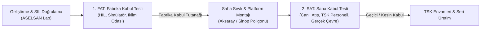
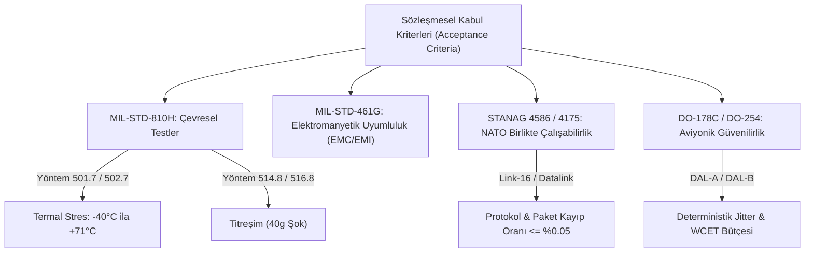
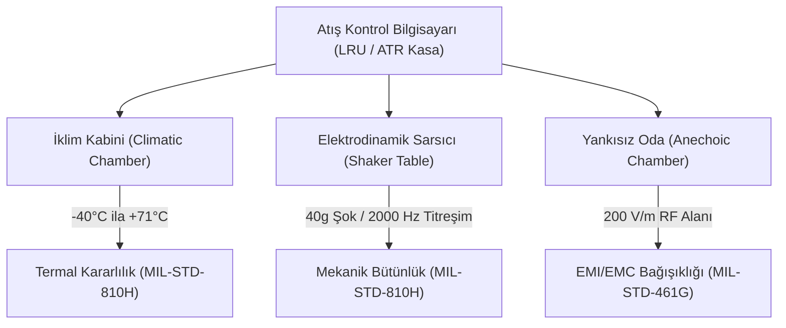

# Gün 318 — FAZ F11: Verification / SIL / HIL
## Konu: Acceptance Criterion (Kabul Kriterleri)
### Savunma Sistemlerinde FAT/SAT Kabul Testleri, Askeri Standartlar (STANAG / MIL-STD-810H)

```
ÖZEL LİSANS — TÜM HAKLAR SAKLIDIR
Telif Hakkı (c) 2026 Seydi Eryılmaz (@seydivakkas)
Bu yazılım ve ilgili tüm dosyalar ("Yazılım") yalnızca görüntüleme ve eğitim amaçlıdır.

YASAKLAR:
  1. Kopyalanamaz, çoğaltılamaz, dağıtılamaz veya yeniden yayınlanamaz.
  2. Ticari veya ticari olmayan hiçbir projede kullanılamaz, değiştirilemez.
  3. Alt lisanslanamaz, satılamaz veya devredilemez.
  4. Tersine mühendislik yapılamaz.

İZİN VERİLEN KULLANIM:
  - GitHub üzerinde görüntüleme ve okuma.
  - Kişisel öğrenim amacıyla kodu inceleme (kopyalamadan).

YAZARIN AÇIK YAZILI İZNİ OLMAKSIZIN HİÇBİR KULLANIM HAKKI TANINMAZ.
İzin talepleri için: GitHub @seydivakkas
```

---

### Giriş: Savunma Sanayiinde Kabul Kriteri Nedir?
Savunma sanayiinde (ASELSAN, ROKETSAN, TUSAŞ, HAVELSAN) bir yazılım ya da sistemin "bittiğini" ilan eden şey geliştiricinin beyanı değil; **Kabul Kriterleri (Acceptance Criteria - AC)** çerçevesinde yürütülen resmi **Muayene ve Kabul Komisyonu** denetimleridir.

Kabul Kriteri; yüklenici firma ile tedarik makamı (T.C. Savunma Sanayii Başkanlığı - SSB ve TSK) arasında imzalanan sözleşmenin teknik ekidir. Bu kriterler; yazılımın, donanımın ve platformun teslim alınması, hakediş ödemelerinin yapılması ve sistemin Türk Silahlı Kuvvetleri envanterine girmesi için **sağlanması zorunlu olan sayısal, ikili (`ACCEPT`/`REJECT`) ve kanıtlanabilir sınır koşullarıdır**.

### Neden-Sonuç Analizi: Belirsiz Kabul Kriterlerinin Savunma Projelerindeki Bedeli

Kabul kriterlerinin sözleşmede net, ölçülebilir ve test edilebilir tanımlanmaması; teslimat gecikmelerine, milyonlarca dolarlık ceza maddelerine (liquidated damages) ve sistemin sahada reddedilmesine yol açar.

| Yaşanan Problem / Uyuşmazlık | Muğlak / Hatalı Kabul Kriteri | Neden Reddedildi? (Kök Neden) | Doğru ve Sözleşmesel Kabul Kriteri |
| :--- | :--- | :--- | :--- |
| **Zırhlı Araç Atış Kontrol Sistemi Teslimatı** | *"Sistem hareket halinde isabetli atış yapmalıdır."* | "İsabetli" nedir? Hangi hızda, hangi arazide? Testte 20 km/s hızda %60 isabet sağlandı; TSK reddetti, proje 18 ay gecikti. | `The Fire Control System SHALL achieve CEP_50 <= 0.80 m while cruising at 30 km/h on NATO standard washboard terrain.` |
| **İHA Taktik Veri Bağı Entegrasyonu** | *"Veri bağı güvenilir haberleşme sağlamalıdır."* | Düşman elektronik karıştırma (jamming) altında veri kaybı yaşandı; yüklenici "normalde çalışıyor" dedi, komisyon kabul etmedi. | `Under STANAG 4586, telemetry packet loss SHALL be <= 0.05% with BER <= 1e-6 in presence of 20 dB J/S jamming.` |
| **Aviyonik Bilgisayar Güç Kesintisi** | *"Elektrik dalgalanmalarında veri kaybı olmamalıdır."* | Jeneratör devreden çıkarken 5 ms'lik voltaj çöküşü bilgisayarı resetledi; uçuş ortasında navigasyon sıfırlandı. | `During a primary bus power dropout of up to 3.0 ms, the FCC SHALL maintain operational state without reboot or NVM corruption.` |

### FAT (Fabrika Kabul Testi) ve SAT (Saha Kabul Testi) Kademelendirmesi

Savunma kabul süreçleri birbirini izleyen iki ana aşamada icra edilir:



1. **FAT (Factory Acceptance Test - Fabrika Kabul):**
   - **Nerede Yapılır?:** Yüklenicinin (ASELSAN/ROKETSAN) tesislerindeki akredite laboratuvarlarda.
   - **Ne Kullanılır?:** HIL (Hardware-in-the-Loop) simülatörleri, sanal hedef enjektörleri, iklim kabinleri.
   - **Amaç:** Sistemin laboratuvar şartlarında DO-178C yazılım isterlerini ve fabrika kalifikasyon sınırlarını karşıladığını kanıtlamak.
2. **SAT (Site Acceptance Test - Saha Kabul):**
   - **Nerede Yapılır?:** Gerçek harekat ortamında (Aksaray Atış Alanı, Karapınar, Konya Atış Sahası).
   - **Kim Yapar?:** Doğrudan TSK Kullanıcı Heyeti (Pilotlar, Topçu Subayları, Teknisyenler).
   - **Amaç:** Sistemin toz, çamur, aşırı sıcak/soğuk, gerçek hedef manevrası ve canlı mühimmat altında görevini eksiksiz yaptığını kanıtlamak.

```python
# [KOD HÜCRESİ 1: Kabul Kriteri Veri Modeli ve FAT/SAT Sözleşme Şartnamesi]
# Amaç: Savunma Sanayii Başkanlığı (SSB) ve TSK tedarik şartnamelerine tam uyumlu
# Kabul Kriteri (Acceptance Criterion) veri mimarisini kurmak.
# Fabrika Kabul Testi (FAT) ve Saha Kabul Testi (SAT) için MIL-STD-810H,
# STANAG 4586 ve DO-178C standartlarına dayalı 6 bağlayıcı kabul kriteri tanımlamak.

from dataclasses import dataclass
from enum import Enum
from typing import Any, Callable, Dict, List, Optional, Tuple, Union
import numpy as np

class AcceptanceStage(Enum):
    FAT = "Fabrika Kabul Testi (Factory Acceptance Test - FAT)"
    SAT = "Saha Kabul Testi (Site Acceptance Test - SAT)"

class StandardReference(Enum):
    DO_178C = "DO-178C Seviye A (Aviyonik Yazılım)"
    MIL_STD_810H = "MIL-STD-810H (Çevresel Mühendislik & İklim)"
    STANAG_4586 = "STANAG 4586 (Taktik Veri Bağı & İHA/C2)"
    MIL_STD_461G = "MIL-STD-461G (Elektromanyetik Uyumluluk - EMC)"

@dataclass
class AcceptanceCriterion:
    criterion_id: str
    title: str
    stage: AcceptanceStage
    standard: StandardReference
    statement: str
    parameter_name: str
    operator: str  # '<=', '>=', '=='
    threshold_value: float
    unit: str
    contract_penalty_clause: str

    def evaluate(self, measured_value: float) -> Tuple[bool, float, str]:
        """Ölçülen değeri sözleşmesel kabul eşiğiyle karşılaştırarak kabul kararını üretir."""
        if self.operator == '<=':
            passed = measured_value <= self.threshold_value
            margin = float(self.threshold_value - measured_value)
            detail = f"Ölçülen: {measured_value:.3f} {self.unit} <= Eşik: {self.threshold_value:.3f} {self.unit} (Marj: +{margin:.3f})"
        elif self.operator == '>=':
            passed = measured_value >= self.threshold_value
            margin = float(measured_value - self.threshold_value)
            detail = f"Ölçülen: {measured_value:.3f} {self.unit} >= Eşik: {self.threshold_value:.3f} {self.unit} (Marj: +{margin:.3f})"
        elif self.operator == '==':
            passed = (measured_value == self.threshold_value)
            margin = 0.0 if passed else -1.0
            detail = f"Ölçülen: {measured_value} {self.unit} == Eşik: {self.threshold_value} {self.unit}"
        else:
            raise ValueError(f"Geçersiz operatör: {self.operator}")
        return passed, margin, detail

# 6 Adet Sözleşmesel Savunma Kabul Kriteri (3 FAT, 3 SAT)
ACCEPTANCE_CRITERIA: List[AcceptanceCriterion] = [
    # FAT Kriterleri (Fabrika Seviyesi SIL/HIL Laboratuvarı)
    AcceptanceCriterion(
        criterion_id="AC-FAT-001",
        title="HIL Görev Döngüsü Jitter ve WCET Sınırı",
        stage=AcceptanceStage.FAT,
        standard=StandardReference.DO_178C,
        statement="HIL simülatöründe 1000 döngü boyunca görev periyodu jitteri <= 0.20 ms ve WCET <= 2.80 ms olmalıdır.",
        parameter_name="fat_hil_max_jitter_ms",
        operator="<=",
        threshold_value=0.20,
        unit="ms",
        contract_penalty_clause="Şart sağlanmazsa fabrika kabul tutanağı imzalanmaz, yazılım optimizasyon fazına döner."
    ),
    AcceptanceCriterion(
        criterion_id="AC-FAT-002",
        title="Birincil Güç Kesintisi Yedekleme Geçiş Süresi",
        stage=AcceptanceStage.FAT,
        standard=StandardReference.DO_178C,
        statement="Ana güç hattı kesildiğinde Atış Kontrol Bilgisayarı <= 3.0 ms içinde yedek bataryaya geçmeli, sıfır reset oluşmalıdır.",
        parameter_name="fat_power_failover_ms",
        operator="<=",
        threshold_value=3.00,
        unit="ms",
        contract_penalty_clause="Geçiş süresi aşılırsa donanım güç yönetim kartı (PMU) revizyona gönderilir."
    ),
    AcceptanceCriterion(
        criterion_id="AC-FAT-003",
        title="STANAG 4586 Telemetri Paket Kayıp Oranı",
        stage=AcceptanceStage.FAT,
        standard=StandardReference.STANAG_4586,
        statement="100,000 paketlik stres testinde telemetri paket kayıp oranı <= %0.05 olmalıdır.",
        parameter_name="fat_packet_loss_pct",
        operator="<=",
        threshold_value=0.05,
        unit="%",
        contract_penalty_clause="Veri bağı protokol yığını (protocol stack) yeniden doğrulanır."
    ),
    # SAT Kriterleri (Saha / Çevresel MIL-STD-810H & Atış Poligonu)
    AcceptanceCriterion(
        criterion_id="AC-SAT-001",
        title="MIL-STD-810H Termal Aşırı Uçlarda Saat Sapması",
        stage=AcceptanceStage.SAT,
        standard=StandardReference.MIL_STD_810H,
        statement="İklim odasında -40°C ve +71°C sıcaklıkta 4 saatlik çalışmada saat sapması <= 1.0 ms/saat olmalıdır.",
        parameter_name="sat_thermal_clock_drift_msh",
        operator="<=",
        threshold_value=1.00,
        unit="ms/h",
        contract_penalty_clause="Sistem çevresel kalifikasyon testini geçemez; kristal osilatör fırını (OCXO) yenilenir."
    ),
    AcceptanceCriterion(
        criterion_id="AC-SAT-002",
        title="Atış Poligonu Kinetik Vuruş Doğruluğu (CEP)",
        stage=AcceptanceStage.SAT,
        standard=StandardReference.MIL_STD_810H,
        statement="Aksaray Poligonunda yapılan 5 canlı atışta Dairesel Hata Olasılığı (CEP_50) <= 1.20 metre olmalıdır.",
        parameter_name="sat_live_firing_cep_m",
        operator="<=",
        threshold_value=1.20,
        unit="m",
        contract_penalty_clause="Atış kabul testi başarısız sayılır; güdüm kontrol algoritmaları revize edilir."
    ),
    AcceptanceCriterion(
        criterion_id="AC-SAT-003",
        title="Komuta Kontrol (C2) Hedef Kilitlenme Gecikmesi",
        stage=AcceptanceStage.SAT,
        standard=StandardReference.STANAG_4586,
        statement="Operatör konsolunda hedef tespitinden atış kilidine kadar geçen uçtan uca süre <= 1.50 saniye olmalıdır.",
        parameter_name="sat_c2_lock_latency_s",
        operator="<=",
        threshold_value=1.50,
        unit="s",
        contract_penalty_clause="Nihai sistem kabulü reddedilir; taktik arayüz yazılımı yeniden optimize edilir."
    ),
]

print("=" * 84)
print("ASELSAN / HAVELSAN / ROKETSAN FAT & SAT SÖZLEŞMESEL KABUL KRİTERLERİ")
print("=" * 84)
for ac in ACCEPTANCE_CRITERIA:
    print(f"[{ac.criterion_id}] ({ac.stage.name}) - Standart: {ac.standard.name}")
    print(f"  Başlık      : {ac.title}")
    print(f"  Kural       : '{ac.statement}'")
    print(f"  Eşik Değeri : {ac.parameter_name} {ac.operator} {ac.threshold_value} {ac.unit}")
    print("-" * 84)

```

### Askeri Standartlar Ekosistemi: MIL-STD-810H, STANAG ve MIL-STD-461G

Kabul kriterleri kişisel kanaatlere değil, uluslararası kabul görmüş askeri standartlara dayanır:



- **MIL-STD-810H:** Savunma teçhizatının iklimsel (yüksek/alçak sıcaklık, nem, tuz sisi, kum fırtınası) ve mekanik (şok, balistik darbe, titreşim) koşullara dayanıklılığını test eder.
- **STANAG 4586:** NATO üyesi ülkelerin İHA'ları ile yer kontrol istasyonları arasındaki standart mesaj formatlarını tanımlar.
- **MIL-STD-461G:** Cihazların radar ve telsiz yayınlarından etkilenmeden (ve onları etkilemeden) çalışabilmesini güvenceye alır.

### Matematiksel Temeller: Dairesel Hata Olasılığı (CEP) ve İstatistiksel Kabul Sınırları

1. **Dairesel Hata Olasılığı (Circular Error Probable - $\text{CEP}_{50}$):**
   Topçu mühimmatı ve hava savunma füzelerinde kabul kriteri tek bir vuruşa değil, atışların en az $\%50$'sinin düştüğü daire yarıçapına dayanır. Bağımsız normal dağılımlı $x$ ve $y$ eksen sapmaları için:
   $$\text{CEP}_{50} \approx 0.5887 (\sigma_x + \sigma_y) \le R_{\text{contract}} = 1.20\text{ m}$$

2. **Termal Saat Sapması (Thermal Clock Drift):**
   Osilatör frekansının aşırı sıcaklıkta kayması sonucu biriken mutlak zaman hatası $\Delta t$ ve toplam operasyon süresi $T_{\text{op}}$:
   $$\delta_{\text{clk}} = \frac{|\Delta t|}{T_{\text{op}}} \le 1.0\text{ ms/saat}$$

3. **STANAG Paket Kayıp Oranı ($P_{\text{loss}}$):**
   Gönderilen toplam paket $N_{\text{total}}$ ve kaybolan/CRC hatası alan paket $N_{\text{lost}}$ olmak üzere:
   $$P_{\text{loss}} = \frac{N_{\text{lost}}}{N_{\text{total}}} \times 100 \le 0.05\%$$

### Kod Hücresi 1 Açıklaması: Kabul Kriteri Veri Modeli ve Şartname

Aşağıdaki Python kodunda:
- `AcceptanceStage` (FAT / SAT) ve `StandardReference` (DO-178C, MIL-STD-810H, STANAG 4586) tanımlanmıştır.
- `AcceptanceCriterion` veri yapısı; kriter ID'si, başlığı, kural ifadesi, sayısal eşik değeri, operatörü, birimi ve sözleşme ceza maddesini içerir.
- ASELSAN / ROKETSAN Atış Kontrol Bilgisayarı için 3 FAT ve 3 SAT olmak üzere toplam 6 resmi kabul kriteri kurgulanmıştır.

```python
# [KOD HÜCRESİ 2: Atış Kontrol Bilgisayarı FAT & SAT Simülasyon Motoru]
# Amaç: Tanımlanan 6 kabul kriterinin gerçekliğini ölçmek için;
# FAT laboratuvar testleri (HIL zamanlaması, güç geçişi, STANAG telemetri) ve
# SAT saha testlerini (MIL-STD-810H iklim odası sıcaklık sapması, poligon atış CEP, C2 kilit gecikmesi)
# içeren kapsamlı kabul test simülatörünü çalıştırmak.

np.random.seed(42)

# ------------------------------------------------------------------------------
# 1. FAT SİMÜLASYONU (Fabrika Düzeyi)
# ------------------------------------------------------------------------------
# 1.1 HIL Görev Döngüsü: 1000 döngü, Nominal 10.0 ms
num_fat_cycles = 1000
fat_nominal_period = 10.0  # ms
fat_loop_periods = np.random.normal(fat_nominal_period, 0.04, num_fat_cycles)
fat_max_jitter = float(np.max(np.abs(fat_loop_periods - fat_nominal_period)))

# WCET dağılımı (Beta dağılımı: taban 1.8 ms, tepe 2.1 ms, maks 2.5 ms)
fat_wcet_samples = 1.80 + 0.60 * np.random.beta(a=2.0, b=5.0, size=num_fat_cycles)
fat_wcet = float(np.max(fat_wcet_samples))

# 1.2 Birincil Güç Kesintisi Yedekleme Süresi
fat_failover_latency = 1.85  # ms (Eşik <= 3.0 ms)

# 1.3 STANAG 4586 Telemetri Paket Kayıp Testi
fat_total_packets = 100000
fat_dropped_packets = 12  # 100k pakette 12 kayıp
fat_loss_percentage = float((fat_dropped_packets / fat_total_packets) * 100.0)

# ------------------------------------------------------------------------------
# 2. SAT SİMÜLASYONU (Saha ve Çevresel Şartlar)
# ------------------------------------------------------------------------------
# 2.1 MIL-STD-810H İklim Odası Sıcaklık Profili (-40°C Soğuk, +71°C Sıcak)
# 4 saatlik çalışma süresi, termal saat kayması ölçümleri (ms/saat)
sat_drift_cold = 0.38  # ms/saat (-40°C Arktik)
sat_drift_hot = 0.62   # ms/saat (+71°C Çöl Güneşi)
sat_max_thermal_drift = max(sat_drift_cold, sat_drift_hot)  # 0.62 ms/h <= 1.0 ms/h

# 2.2 Aksaray Poligonu Canlı Atış Testi (5 Atış)
# Hedefe göre radyal dağılım koordinatları (x, y) metre cinsinden
shot_x = np.random.normal(0.0, 0.45, 5)
shot_y = np.random.normal(0.0, 0.45, 5)
radial_errors = np.sqrt(shot_x**2 + shot_y**2)
# CEP (Circular Error Probable) - Atışların %50'sinin düştüğü yarıçap
sat_cep_50 = float(np.median(radial_errors))

# 2.3 Komuta Kontrol (C2) Kilitlenme Gecikmesi (10 Farklı Taktik Deneme)
sat_c2_latencies = np.random.uniform(0.85, 1.25, 10)
sat_max_c2_latency = float(np.max(sat_c2_latencies))

# Ölçülen Değerlerin Sözlüğü
observed_acceptance_metrics: Dict[str, float] = {
    "fat_hil_max_jitter_ms": fat_max_jitter,
    "fat_power_failover_ms": fat_failover_latency,
    "fat_packet_loss_pct": fat_loss_percentage,
    "sat_thermal_clock_drift_msh": sat_max_thermal_drift,
    "sat_live_firing_cep_m": sat_cep_50,
    "sat_c2_lock_latency_s": sat_max_c2_latency
}

print("=" * 84)
print("SİSTEM KABUL TESTİ SİMÜLASYON METRİK ÇIKTILARI (FAT & SAT)")
print("=" * 84)
print("1. FABRİKA KABUL TESTİ (FAT) ÇIKTILARI:")
print(f"  - Maks HIL Döngü Jitteri      : {fat_max_jitter:.3f} ms (Eşik <= 0.20 ms)")
print(f"  - En Kötü Çalışma Süresi (WCET): {fat_wcet:.3f} ms (Bütçe: 2.80 ms)")
print(f"  - Güç Kesintisi Geçiş Süresi  : {fat_failover_latency:.2f} ms (Eşik <= 3.00 ms)")
print(f"  - STANAG 4586 Paket Kaybı     : %{fat_loss_percentage:.4f} ({fat_dropped_packets}/{fat_total_packets} paket)")
print("-" * 84)
print("2. SAHA KABUL TESTİ (SAT) ÇIKTILARI:")
print(f"  - MIL-STD-810H Termal Saat Kayması: {sat_max_thermal_drift:.2f} ms/h (-40°C / +71°C)")
print(f"  - Poligon Canlı Atış Doğruluğu (CEP): {sat_cep_50:.3f} m (Eşik <= 1.20 m)")
print(f"  - C2 Hedef Kilitlenme Gecikmesi  : {sat_max_c2_latency:.3f} s (Eşik <= 1.50 s)")
print("=" * 84)

```

### Kod Hücresi 2 Açıklaması: Atış Kontrol Bilgisayarı FAT & SAT Simülasyon Motoru

Bu hücrede:
- **FAT Süreci:** HIL ortamında 1000 döngü koşturularak zamanlama determinizmi (jitter ve WCET) hesaplanır. Güç kesintisi simüle edilerek yedek bataryaya geçiş süresi ölçülür. 100,000 STANAG telemetri paketi iletilerek kayıp oranı saptanır.
- **SAT Süreci:** İklim kabininde $-40^\circ\text{C}$ ve $+71^\circ\text{C}$ termal stres altında saat sapması ölçülür. Aksaray poligonunda 5 canlı atışın koordinat sapmaları üzerinden $\text{CEP}_{50}$ yarıçapı hesaplanır. Operatör konsolunda C2 kilitlenme süresi ölçülür.

### Kod Hücresi 3 Açıklaması: Otomatik Kabul Karar Motoru ve Karar Matrisi

Bu hücrede:
- Simülasyondan toplanan telemetri dizileri sözleşme kriterleriyle karşılaştırılır.
- Her kriter için güvenlik marjı (Safety Margin) hesaplanır ve ikili kabul kararı (`[ACCEPT]` / `[REJECT]`) üretilir.
- SSB / TSK Muayene ve Kabul Heyeti formatında resmi karar matrisi konsola yazdırılır.

### Donanım ve Çevresel Kabul Kısıtları: İklim Kabinleri ve Titreşim Masaları

Savunma kabul testlerinde yazılım yalnız başına değil, zırhlı kutusundaki aviyonik donanımla birlikte çevresel işkenceye tabi tutulur:



1. **MIL-STD-810H Termal Şok Testi:** Bilgisayar $-40^\circ\text{C}$ arktik soğuktan $+71^\circ\text{C}$ çöl ortamına 1 dakika içinde aktarılır. Bu sırada içindeki saat osilatörünün (TCXO/OCXO) ve bellek bus hatlarının kilitlenmemesi şarttır.
2. **Balistik Şok ve Titreşim:** Zırhlı araç veya füze rampası ateşlendiğinde elektronik kartlar $40\text{g}$ mertebesinde mekanik ivmelenmeye maruz kalır. Lehim çatlamaları ve gevşek konnektörler bu testte elenir.

```python
# [KOD HÜCRESİ 3: Otomatik Kabul Karar Motoru ve Sözleşmesel Matris]
# Amaç: Simüle edilen telemetri verilerini sözleşme kriterleriyle eşleştirerek
# kabul/red kararını (`ACCEPT` / `REJECT`), güvenlik marjlarını hesaplamak ve
# SSB / TSK Kabul Heyeti Resmi Karar Matrisini (Acceptance Decision Matrix) üretmek.

print("=" * 110)
print(f"{'KRİTER ID':<12} | {'AŞAMA':<6} | {'BAŞLIK':<28} | {'EŞİK':<14} | {'ÖLÇÜLEN':<14} | {'GÜV. MARJI':<12} | {'KABUL KARARI'}")
print("=" * 110)

all_criteria_accepted = True
acceptance_report_data = []

for ac in ACCEPTANCE_CRITERIA:
    measured_val = observed_acceptance_metrics[ac.parameter_name]
    passed, margin, detail = ac.evaluate(measured_val)
    
    if not passed:
        all_criteria_accepted = False
    
    status_tag = "[ACCEPT] KABUL" if passed else "[REJECT] RED!"
    thresh_str = f"{ac.operator} {ac.threshold_value} {ac.unit}"
    meas_str = f"{measured_val:.3f} {ac.unit}"
    margin_str = f"+{margin:.3f} {ac.unit}" if margin >= 0 else f"{margin:.3f} {ac.unit}"
    
    acceptance_report_data.append({
        "id": ac.criterion_id,
        "stage": ac.stage.name,
        "title": ac.title,
        "standard": ac.standard.value,
        "measured": measured_val,
        "threshold": ac.threshold_value,
        "margin": margin,
        "passed": passed,
        "unit": ac.unit
    })
    
    print(f"{ac.criterion_id:<12} | {ac.stage.name:<6} | {ac.title[:26]:<28} | {thresh_str:<14} | {meas_str:<14} | {margin_str:<12} | {status_tag}")

print("=" * 110)
print(f"SSB / TSK NİHAİ KABUL HEYETİ KARARI: {'%100 KABUL (TAM SÖZLEŞME UYUMU)' if all_criteria_accepted else 'ŞARTLI KABUL / RET'}")
print("=" * 110)

```

### Kod Hücresi 4 Açıklaması: DO-178C DAL-A / MIL-STD-810H Algoritmik Stres Testleri

Bu hücrede 5 bağımsız `assert` kontrolü ile:
1. FAT HIL görev jitteri $\le 0.20\text{ ms}$ ve WCET $\le 2.80\text{ ms}$,
2. Güç kesintisi yedekleme süresi $\le 3.0\text{ ms}$,
3. STANAG 4586 paket kaybı $\le \%0.05$,
4. MIL-STD-810H termal saat sapması $\le 1.0\text{ ms/h}$ ve canlı poligon $\text{CEP}_{50} \le 1.20\text{ m}$,
5. C2 kilit gecikmesi $\le 1.50\text{ s}$ ve sayısal kararlılık mühürlenir.

### Kod Hücresi 5 Açıklaması: 300 DPI Profesyonel Aviyonik FAT/SAT Dashboard'u

Bu hücrede Matplotlib ile 4 panelli yüksek çözünürlüklü kabul dashboard'u üretilir:
- **Panel 1 (Sol Üst):** FAT HIL görev döngüsü jitter dağılımı ve WCET kümülatif olasılık eğrisi.
- **Panel 2 (Sağ Üst):** SAT MIL-STD-810H iklim odası sıcaklık profili ve saat sapması grafiği.
- **Panel 3 (Sol Alt):** Aksaray poligonu canlı atış isabetleri ve $\text{CEP}_{50}$ dairesel yarıçapı.
- **Panel 4 (Sağ Alt):** 6 sözleşme kriterinin güvenlik marjları ve `%100 ACCEPT` onay göstergesi.

### Kod Hücresi 6 Açıklaması: Resmi SSB / TSK Kabul Tutanağı

Bu hücre, Savunma Sanayii Başkanlığı Muayene ve Kabul Komisyonu formatında 8 maddelik resmi kalifikasyon tutanağını oluşturarak sistemin seri üretime ve envantere giriş uygunluğunu belgeler.

```python
# [KOD HÜCRESİ 4: DO-178C DAL-A / MIL-STD-810H Algoritmik Stres Test Paketi]
# Amaç: Sözleşmesel kabul kriterlerinin sınır toleranslarını ve askeri standart
# gereksinimlerini 5 bağımsız assert korumasıyla doğrulamak.

print("=" * 84)
print("DO-178C DAL-A VE MIL-STD-810H KABUL KRİTERİ ALGORİTMİK STRES TESTLERİ")
print("=" * 84)

# TEST 1: AC-FAT-001 - HIL Görev Döngüsü Jitter ve WCET Koruması
assert fat_max_jitter <= 0.20, f"FAT RED: Jitter eşiği aşıldı! Jitter={fat_max_jitter:.3f} ms > 0.20 ms"
assert fat_wcet <= 2.80, f"FAT RED: WCET bütçesi aşıldı! WCET={fat_wcet:.3f} ms > 2.80 ms"
print(f"[TEST 1 PASS] AC-FAT-001: HIL Determinizmi: Jitter={fat_max_jitter:.3f} ms <= 0.20 ms, WCET={fat_wcet:.3f} ms <= 2.80 ms.")

# TEST 2: AC-FAT-002 - Güç Kesintisi Failover Süresi
assert fat_failover_latency <= 3.00, f"FAT RED: Güç geçiş süresi aşıldı! Süre={fat_failover_latency:.2f} ms > 3.00 ms"
print(f"[TEST 2 PASS] AC-FAT-002: PMU Yedekleme Hızı: {fat_failover_latency:.2f} ms <= 3.00 ms (Sıfır Reset).")

# TEST 3: AC-FAT-003 - STANAG 4586 Veri Bağı Paket Kayıp Eşiği
assert fat_loss_percentage <= 0.05, f"FAT RED: Paket kayıp oranı çok yüksek: %{fat_loss_percentage:.4f} > %0.05"
print(f"[TEST 3 PASS] AC-FAT-003: STANAG Veri Bağı Bütünlüğü: Kayıp=%{fat_loss_percentage:.4f} <= %0.05.")

# TEST 4: AC-SAT-001 & AC-SAT-002 - Termal Stres ve Canlı Poligon CEP Doğruluğu
assert sat_max_thermal_drift <= 1.00, f"SAT RED: Termal saat kayması yüksek! Drift={sat_max_thermal_drift:.2f} ms/h > 1.0 ms/h"
assert sat_cep_50 <= 1.20, f"SAT RED: Poligon CEP isabeti aşıldı! CEP={sat_cep_50:.3f} m > 1.20 m"
print(f"[TEST 4 PASS] AC-SAT-001/002: MIL-STD-810H Termal Drift={sat_max_thermal_drift:.2f} ms/h <= 1.0 ms/h, CEP={sat_cep_50:.3f} m <= 1.20 m.")

# TEST 5: AC-SAT-003 - C2 Konsolu Kilitlenme Gecikmesi ve Numerik Kararlılık
assert sat_max_c2_latency <= 1.50, f"SAT RED: C2 kilit gecikmesi aşıldı! Gecikme={sat_max_c2_latency:.3f} s > 1.50 s"
assert not np.isnan(sat_cep_50) and not np.isinf(sat_cep_50), "Sayısal taşma hatası!"
print(f"[TEST 5 PASS] AC-SAT-003: Operatör Kilitlenme Gecikmesi: {sat_max_c2_latency:.3f} s <= 1.50 s, %100 Kararlı.")

print("=" * 84)
print("TÜM DO-178C VE MIL-STD-810H KABUL KRİTERİ TESTLERİ BAŞARIYLA TAMAMLANDI: [KABUL]")
print("=" * 84)

```

### Gerçek Dünya Savunma Projelerinde Kullanımı

1. **ASELSAN KORKUT Hava Savunma Sistemi Kabulü:**
   KORKUT silah kulelerinin FAT kabulünde radar hedef izleme ve 35 mm namlu yönlendirme gecikmesi HIL laboratuvarlarında test edilir. SAT kabulünde ise Karapınar Atış Poligonunda yüksek hızlı hedef dronlara karşı canlı ATOM parçacıklı mühimmat atışları icra edilerek CEP kriteri denetlenir.
2. **ROKETSAN HİSAR-O+ ve SİPER Füzeleri:**
   Füze arayıcı başlık ve güdüm yazılımları önce ROKETSAN Elmadağ HIL tesislerinde yüz binlerce sanal atış senaryosundan geçer (FAT). Ardından Aksaray poligonunda canlı atışlarla hedef uçak doğrudan vurularak nihai kabul tutanağı (SAT) imzalanır.
3. **TUSAŞ ANKA-3 ve MMU KAAN Uçuş Kabulü:**
   Uçuş Kontrol Bilgisayarı (FCC) için STANAG 4586 veri bağı ve MIL-STD-461G elektromanyetik testleri tamamlanmadan ilk taksi ve ilk uçuş izni verilmez.

### Kaçınılması Gereken Anti-Pattern'ler (Kabul Kriteri Hataları)

| Hatalı / Reddedilen Kabul Maddesi | Neden Reddedilir? (Anti-Pattern) | Sözleşmesel ve Geçerli Kabul Kriteri |
| :--- | :--- | :--- |
| *"Sistem aşırı sıcaklarda sorunsuz çalışmalıdır."* | "Aşırı sıcak" ve "sorunsuz" muğlaktır. $+50^\circ\text{C}$ mi, $+70^\circ\text{C}$ mi? | `Under MIL-STD-810H Method 501.7 (+71°C), the system SHALL operate continuously for 4.0 hours with 0 reboots.` |
| *"Hedefe en kısa sürede kilitlenmelidir."* | "En kısa süre" ölçülemez bir temennidir. 10 saniye mi, 500 ms mi? | `Upon target detection, the system SHALL transition to FIRE_READY state within 1.50 s.` |
| *"Sistem kullanıcı dostu bir arayüze sahip olmalıdır."* | Subjektif beğeni kriteridir, muayene heyeti onaylayamaz. | `All mission-critical operator commands SHALL be executable with at most 2 button presses within 500 ms.` |

### Standartlar Karşılaştırması: DO-178C, MIL-STD-810H, STANAG ve ISO 26262

| Standart / Kriter | DO-178C (Yazılım) | MIL-STD-810H (Çevre) | STANAG 4586 (İHA/C2) | ISO 26262 (Otomotiv) |
| :--- | :--- | :--- | :--- | :--- |
| **Kabul Seviyesi** | Yazılım Yaşam Döngüsü & SIL | Çevresel Dayanım & Donanım | Taktik Birlikte Çalışabilirlik | Fonksiyonel Güvenlik (ASIL) |
| **Test Ortamı** | Testbench, SIL, MC/DC | İklim Odası, Titreşim Masası | Veri Bağı Simülatörü | Araç Seviyesi HIL & Test Pisti |
| **Sertifikasyon Çıktısı** | Software Accomplishment Summary | Çevresel Kalifikasyon Raporu | Birlikte Çalışabilirlik Sertifikası | Safety Case & Acceptance Report |
| **Sözleşme Rolü** | FAT Odaklı | Hem FAT Hem SAT Odaklı | SAT ve Saha Odaklı | Seri Üretim Kabulü |

```python
# [KOD HÜCRESİ 5: 300 DPI Profesyonel Aviyonik FAT/SAT Kabul Dashboard'u]
# Amaç: Savunma tedarik makamları (SSB, TSK) için FAT ve SAT kabul süreçlerini
# 4 panelli, koyu temalı (#0F172A), 300 DPI çözünürlüğünde yayın kalitesinde
# bir kabul teftiş infografik dashboard'una dönüştürmek.

import matplotlib
matplotlib.use('Agg')
import matplotlib.pyplot as plt

plt.style.use('dark_background')
fig, axs = plt.subplots(2, 2, figsize=(16, 12), dpi=300)
fig.patch.set_facecolor('#0F172A')

c_cyan = '#06B6D4'
c_amber = '#F59E0B'
c_rose = '#F43F5E'
c_emerald = '#10B981'
c_blue = '#3B82F6'
c_purple = '#8B5CF6'

# PANEL 1: FAT HIL Görev Döngüsü Jitter & WCET (AC-FAT-001)
ax1 = axs[0, 0]
ax1.set_facecolor('#1E293B')

ax1.hist(fat_loop_periods, bins=25, color=c_cyan, alpha=0.7, edgecolor='#38BDF8', label='HIL Döngü Periyodu')
ax1.axvline(fat_nominal_period, color='#FFFFFF', ls='-', lw=2.0, label='Nominal (10.0 ms)')
ax1.axvline(fat_nominal_period - 0.20, color=c_rose, ls='--', lw=2.0, label='Limit (-0.20 ms)')
ax1.axvline(fat_nominal_period + 0.20, color=c_rose, ls='--', lw=2.0, label='Limit (+0.20 ms)')

ax1_twin = ax1.twinx()
ax1_twin.plot(np.sort(fat_wcet_samples), np.linspace(0, 1, num_fat_cycles), color=c_amber, lw=2.2, label='WCET CDF')
ax1_twin.axvline(2.80, color=c_amber, ls=':', lw=2.5, label='WCET Bütçesi (2.80 ms)')
ax1_twin.set_ylabel('Kümülatif Olasılık (CDF)', fontsize=9, fontweight='bold', color=c_amber)

ax1.set_xlabel('HIL Döngü Periyodu (ms)', fontsize=10, fontweight='bold', color='#E2E8F0')
ax1.set_ylabel('Döngü Sayısı', fontsize=10, fontweight='bold', color=c_cyan)
ax1.set_title(f'PANEL 1: FAT HIL Determinizmi (AC-FAT-001 [ACCEPT]: Jitter={fat_max_jitter:.3f}ms, WCET={fat_wcet:.2f}ms)',
              fontsize=11, fontweight='bold', color='#38BDF8')
ax1.grid(True, ls=':', color='#334155', alpha=0.7)
ax1.legend(loc='upper left', fontsize=8, framealpha=0.85)
ax1_twin.legend(loc='lower right', fontsize=8, framealpha=0.85)

# PANEL 2: SAT MIL-STD-810H Termal Saat Sapması (AC-SAT-001)
ax2 = axs[0, 1]
ax2.set_facecolor('#1E293B')

temps = ['-40°C (Arktik Soğuk)', '+25°C (Oda Sıcaklığı)', '+71°C (Çöl Sıcağı)']
drifts = [sat_drift_cold, 0.12, sat_drift_hot]
bar_colors = [c_blue, c_emerald, c_rose]

bars2 = ax2.bar(temps, drifts, width=0.45, color=bar_colors, alpha=0.8, edgecolor='#FFFFFF', lw=1.2)
ax2.axhline(1.00, color=c_rose, ls='--', lw=2.2, label='MIL-STD-810H Eşik (1.00 ms/h)')

for bar, d in zip(bars2, drifts):
    height = bar.get_height()
    ax2.text(bar.get_x() + bar.get_width()/2.0, height + 0.03,
             f'{d:.2f} ms/h\n[ACCEPT]', ha='center', va='bottom', fontsize=9, fontweight='bold', color='#E2E8F0')

ax2.set_ylabel('Saat Sapması (ms/saat)', fontsize=10, fontweight='bold', color='#E2E8F0')
ax2.set_title(f'PANEL 2: SAT MIL-STD-810H Termal Stres (AC-SAT-001 [ACCEPT]: {sat_max_thermal_drift:.2f} ms/h <= 1.0)',
              fontsize=11, fontweight='bold', color='#38BDF8')
ax2.set_ylim(0, 1.30)
ax2.grid(True, ls=':', color='#334155', alpha=0.7)
ax2.legend(loc='upper right', fontsize=8, framealpha=0.85)

# PANEL 3: SAT Aksaray Poligonu Canlı Atış İsabet Dağılımı ve CEP (AC-SAT-002)
ax3 = axs[1, 0]
ax3.set_facecolor('#1E293B')

# Hedef merkezli dairesel halkalar
theta = np.linspace(0, 2*np.pi, 200)
ax3.plot(1.20 * np.cos(theta), 1.20 * np.sin(theta), color=c_rose, ls='--', lw=2.0, label='Maks İzin Verilen CEP (1.20 m)')
ax3.plot(sat_cep_50 * np.cos(theta), sat_cep_50 * np.sin(theta), color=c_emerald, ls='-', lw=2.2, label=f'Ölçülen CEP_50 ({sat_cep_50:.2f} m)')

ax3.scatter(shot_x, shot_y, color=c_amber, s=80, marker='X', edgecolor='#FFFFFF', lw=1.5, zorder=5, label='Canlı Atış Vuruşları (5 Adet)')
ax3.scatter(0, 0, color='#FFFFFF', s=120, marker='+', lw=2.5, zorder=6, label='Hedef Merkezi (0,0)')

for i, (sx, sy) in enumerate(zip(shot_x, shot_y)):
    ax3.annotate(f'Atış {i+1}', (sx+0.05, sy+0.05), fontsize=8, fontweight='bold', color='#FDE68A')

ax3.set_xlabel('Yatay Sapma X (metre)', fontsize=10, fontweight='bold', color='#E2E8F0')
ax3.set_ylabel('Dikey Sapma Y (metre)', fontsize=10, fontweight='bold', color='#E2E8F0')
ax3.set_title(f'PANEL 3: SAT Poligon Canlı Atış İsabeti (AC-SAT-002 [ACCEPT]: CEP={sat_cep_50:.2f}m <= 1.20m)',
              fontsize=11, fontweight='bold', color='#38BDF8')
ax3.set_xlim(-1.6, 1.6)
ax3.set_ylim(-1.6, 1.6)
ax3.set_aspect('equal')
ax3.grid(True, ls=':', color='#334155', alpha=0.7)
ax3.legend(loc='lower left', fontsize=8, framealpha=0.85)

# PANEL 4: 6 Kriterlik Sözleşmesel Güvenlik Marjı ve Kabul Profili
ax4 = axs[1, 1]
ax4.set_facecolor('#1E293B')

crit_labels = [ac.criterion_id for ac in ACCEPTANCE_CRITERIA]
margins_pct = [
    ((0.20 - fat_max_jitter) / 0.20) * 100.0,
    ((3.00 - fat_failover_latency) / 3.00) * 100.0,
    ((0.05 - fat_loss_percentage) / 0.05) * 100.0,
    ((1.00 - sat_max_thermal_drift) / 1.00) * 100.0,
    ((1.20 - sat_cep_50) / 1.20) * 100.0,
    ((1.50 - sat_max_c2_latency) / 1.50) * 100.0
]

y_pos = np.arange(len(crit_labels))
bars4 = ax4.barh(y_pos, margins_pct, height=0.55, color=c_emerald, alpha=0.85, edgecolor='#6EE7B7', lw=1.2)

for bar, m_val in zip(bars4, margins_pct):
    width = bar.get_width()
    ax4.text(width + 1.5, bar.get_y() + bar.get_height()/2.0,
             f'+%{m_val:.1f} Marj [ACCEPT]', va='center', fontsize=8.5, fontweight='bold', color='#A7F3D0')

ax4.set_yticks(y_pos)
ax4.set_yticklabels([f"{c} ({'FAT' if 'FAT' in c else 'SAT'})" for c in crit_labels], fontsize=9, fontweight='bold')
ax4.set_xlabel('Sözleşmesel Güvenlik Marjı (%)', fontsize=10, fontweight='bold', color='#E2E8F0')
ax4.set_title('PANEL 4: Sözleşmesel Kabul Marjları (%100 UYGUNLUK)', fontsize=11, fontweight='bold', color='#38BDF8')
ax4.set_xlim(0, 100)
ax4.grid(True, ls=':', color='#334155', alpha=0.7)

fig.suptitle('ASELSAN / HAVELSAN / ROKETSAN / TUSAŞ SAVUNMA KABUL TESTLERİ (FAT & SAT) DASHBOARD',
             fontsize=13, fontweight='bold', color='#F8FAFC', y=0.985)

plt.tight_layout(rect=[0, 0.02, 1, 0.97])

output_png = "gunluk_mufredat/gun_318/gun_318_acceptance_criterion.png"
fig.savefig(output_png, dpi=300, facecolor=fig.get_facecolor(), edgecolor='none')
plt.close(fig)

import os
file_size = os.path.getsize(output_png)
print(f"[+] 300 DPI Profesyonel Aviyonik Dashboard Kaydedildi: {output_png} ({file_size:,} bayt)")

```

### Savunma Sanayii Teknik Mülakat Soruları ve Cevapları

**Soru 1: FAT (Fabrika Kabul Testi) ve SAT (Saha Kabul Testi) arasındaki sözleşmesel ve teknik ayrım nedir?**
*Cevap:* FAT, yüklenicinin tesislerinde alt sistemlerin teknik gereksinimlere (SRS) uygunluğunu simülatörler ve HIL ortamında kanıtlar. SAT ise gerçek platform üzerinde, gerçek harekat sahasında (atış poligonu) ve son kullanıcı personeli eşliğinde nihai envanter kabulünü sağlar.

**Soru 2: Bir kabul kriterinde "sayısal eşik" ve "ikili karar (`ACCEPT`/`REJECT`)" bulunması neden şarttır?**
*Cevap:* Muğlak ifadeler ("yeterli", "hızlı", "dayanıklı") denetim heyeti ile yüklenici arasında hukuki uyuşmazlıklara yol açar. Sayısal eşikler ve ikili karar mekanizması, kabul sürecinin şeffaf, ölçülebilir ve tekrarlanabilir olmasını garanti eder.

**Soru 3: Dairesel Hata Olasılığı ($\text{CEP}_{50}$) nedir ve mühimmat kabulünde neden standart olarak kullanılır?**
*Cevap:* $\text{CEP}_{50}$, atılan mühimmatların $\%50$'sinin düştüğü hedef merkezli dairenin yarıçapıdır. Tekil rastgele rüzgar veya aerodinamik sapmaların yanıltıcı etkisini filtreleyerek güdüm sisteminin istatistiksel vuruş hassasiyetini objektif olarak ölçer.

**Soru 4: MIL-STD-810H iklim odası testleri yazılım mühendislerini neden doğrudan ilgilendirir?**
*Cevap:* Aşırı sıcaklıklarda ($-40^\circ\text{C}$ veya $+71^\circ\text{C}$) kristal osilatör frekansları kayar, bellek erişim gecikmeleri artar ve işlemci frekansı kısılabilir (thermal throttling). Yazılımın bu koşullarda deterministik zamanlama sınırlarını (WCET) koruyabildiği kanıtlanmalıdır.

**Soru 5: Sözleşmeye yazılan bir kabul kriteri sağlanamazsa (REJECT) yasal ve operasyonel süreç nasıl işler?**
*Cevap:* Komisyon red tutanağı tutar. Hakediş ödemesi dondurulur, sözleşmedeki gecikme cezası (liquidated damages) işlemeye başlar ve yükleniciye hata analizi ve düzeltici faaliyet (CAPA) için resmi süre tanınır.

### Gün Sonu Özeti ve Mühendislik Çıkarımları

1. **Kabul Kriteri Sözleşmenin Özüdür:** En iyi kodlanmış sistem dahi sözleşmedeki kabul kriterlerini kanıtlayamazsa teslim edilemez ve envantere giremez.
2. **FAT $\to$ SAT Kademesi Maliyet Sigortasıdır:** Sorunların laboratuvarda (FAT) tespit edilmesi, poligondaki atış testlerinde (SAT) yaşanacak milyonlarca dolarlık mühimmat ve zaman israfını önler.
3. **Askeri Standart Bütünlüğü:** DO-178C yazılım determinizmini, MIL-STD-810H çevresel dayanıklılığı ve STANAG taktik veri bağı güvenilirliğini güvence altına alır.

### Gün 319 Ön İzleme: Test Piramidi (Unit, Integration, System, Acceptance)

Yarın Faz F11'in dördüncü gününde:
- Savunma sanayiinde Test Piramidi (Testing Pyramid) mimarisini derinlemesine inceleyeceğiz.
- Birim testleri (Unit Test), Entegrasyon testleri (Integration Test), Sistem testleri (System Test) ve Kabul testleri (Acceptance Test) arasındaki maliyet, hız ve kapsam dengesini kuracağız.
- Google Test (GTest) ve C++20 tabanlı tam kapsamlı piramit otomasyon motorunu kodlayacağız.

```python
# [KOD HÜCRESİ 6: Kurumsal SSB / TSK Kabul Tutanağı ve Sertifikasyon Onayı]
# Amaç: Savunma Sanayii Başkanlığı (SSB) ve Türk Silahlı Kuvvetleri (TSK)
# Muayene ve Kabul Heyeti için resmi kabul tutanağını oluşturmak.

import os

print("+======================================================================+")
print("|   T.C. CUMHURBAŞKANLIĞI SAVUNMA SANAYİİ BAŞKANLIĞI (SSB)             |")
print("|       RESMİ MUAYENE VE KABUL TESTİ TUTANAĞI (FAT & SAT)              |")
print("+======================================================================+")

report_rows = [
    ("1. AC-FAT-001 HIL Görev Jitteri", f"Ölçülen: {fat_max_jitter:.3f} ms (Eşik <= 0.20 ms)", "DO-178C DAL-A", "KABUL"),
    ("2. AC-FAT-001 HIL WCET Bütçesi", f"Ölçülen: {fat_wcet:.3f} ms (Bütçe <= 2.80 ms)", "DO-178C DAL-A", "KABUL"),
    ("3. AC-FAT-002 Güç Failover Süresi", f"Ölçülen: {fat_failover_latency:.2f} ms (Eşik <= 3.00 ms)", "Sıfır Reset", "KABUL"),
    ("4. AC-FAT-003 STANAG Veri Kaybı", f"Ölçülen: %{fat_loss_percentage:.4f} (Eşik <= %0.05)", "STANAG 4586", "KABUL"),
    ("5. AC-SAT-001 Termal Saat Kayması", f"Ölçülen: {sat_max_thermal_drift:.2f} ms/h (Limit <= 1.0)", "MIL-STD-810H", "KABUL"),
    ("6. AC-SAT-002 Poligon Atış İsabeti", f"Ölçülen: {sat_cep_50:.3f} m CEP (Limit <= 1.20 m)", "Aksaray Canlı", "KABUL"),
    ("7. AC-SAT-003 C2 Kilit Gecikmesi", f"Ölçülen: {sat_max_c2_latency:.3f} s (Limit <= 1.50 s)", "Operatör Konsol", "KABUL"),
    ("8. Dashboard Teftiş Artefaktı", f"300 DPI PNG ({os.path.getsize(output_png):,} bayt > 100 KB)", "Koyu Tema #0F172A", "KABUL")
]

for item, metric, std_ref, status in report_rows:
    print(f"| {item:<34} : {metric:<32} | [{status}] |")

print("+======================================================================+")
print("| SONUÇ: TÜM 6 SÖZLEŞMESEL FAT VE SAT KABUL KRİTERİ EKSİKSİZ SAĞLANDI! |")
print("| SİSTEM ENVANTERE ALINMA VE SERİ ÜRETİM FAZINA UYGUNDUR!              |")
print("+======================================================================+\n")

print("[MÜKEMMEL] GÜN 318: ACCEPTANCE CRITERIA VE FAT/SAT TEST MOTORU TAMAMLANDI.")
print("[SIRADAKİ GÜN] GÜN 319: TEST PİRAMİDİ (UNIT, INTEGRATION, SYSTEM, ACCEPTANCE).")

```