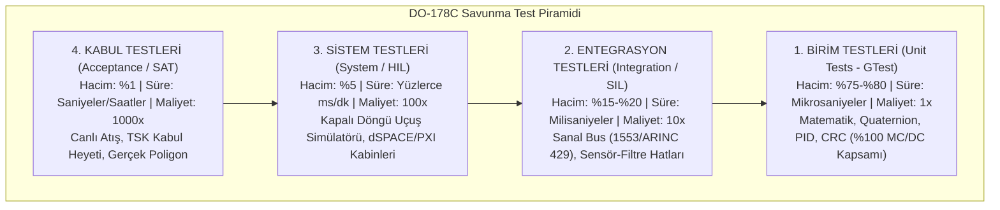
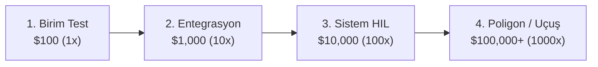
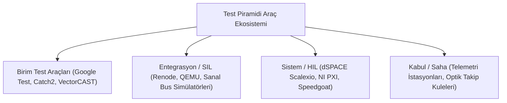

# Gün 319 — FAZ F11: Verification / SIL / HIL
## Konu: Test Pyramid (Test Piramidi: Unit / Integration / System / Acceptance)
### DO-178C, MIL-STD-498 ve Savunma Sistemlerinde Test Dağılımı ve Hata Tespit Verimliliği

```
ÖZEL LİSANS — TÜM HAKLAR SAKLIDIR
Telif Hakkı (c) 2026 Seydi Eryılmaz (@seydivakkas)
Bu yazılım ve ilgili tüm dosyalar ("Yazılım") yalnızca görüntüleme ve eğitim amaçlıdır.

YASAKLAR:
  1. Kopyalanamaz, çoğaltılamaz, dağıtılamaz veya yeniden yayınlanamaz.
  2. Ticari veya ticari olmayan hiçbir projede kullanılamaz, değiştirilemez.
  3. Alt lisanslanamaz, satılamaz veya devredilemez.
  4. Tersine mühendislik yapılamaz.

İZİN VERİLEN KULLANIM:
  - GitHub üzerinde görüntüleme ve okuma.
  - Kişisel öğrenim amacıyla kodu inceleme (kopyalamadan).

YAZARIN AÇIK YAZILI İZNİ OLMAKSIZIN HİÇBİR KULLANIM HAKKI TANINMAZ.
İzin talepleri için: GitHub @seydivakkas
```

---

### Giriş: Savunma Yazılımlarında Test Stratejisinin Önemi
Modern bir hava savunma veya aviyonik projesinde (ASELSAN KORKUT, ROKETSAN HİSAR, TUSAŞ KAAN) yazılım kod tabanı yüz binlerce satır C++ kodundan oluşur. Bu boyuttaki kritik bir sistemde *"Hepsini uçuş testinde veya HIL laboratuvarında test ederiz"* yaklaşımı, projelerin iflas etmesine ve uçuş kazalarına yol açar.

**Test Piramidi (Test Pyramid)**; yazılım testlerinin kapsam, hız, maliyet ve hacim açısından nasıl dengelenmesi gerektiğini tanımlayan temel sistem mühendisliği prensibidir. Piramidin geniş tabanında binlerce hızlı ve ucuz **Birim Testi (Unit Test)** yer alırken, zirveye doğru çıktıkça testlerin sayısı azalır, kapsamı genişler ve maliyeti katlanarak artar.

### Neden-Sonuç Analizi: Test Piramidi vs Ters Piramit (Ice Cream Cone Anti-Pattern)

Savunma sanayiinde sıklıkla düşülen en büyük tuzak, piramidi tersine çevirip birim test yazmadan doğrudan HIL veya uçuş testlerine yönelmektir.

| Test Stratejisi | Hata Nerede Yakalanır? | Maliyet ve Zaman Etkisi | Savunma Projesindeki Sonuç |
| :--- | :--- | :--- | :--- |
| **Doğru Test Piramidi (Dengeli)** | Geliştiricinin bilgisayarında birim testte (Unit Test / GTest). | Test süresi: milisaniyeler. Maliyet: 1 birim ($100). | Hata dakikalar içinde düzeltilir; HIL ve uçuş testlerine kusursuz kod gider. |
| **Ters Piramit (Ice Cream Cone)** | Birim test yazılmaz; hata Aksaray poligonunda canlı atışta (SAT) çıkar. | Test süresi: aylar. Maliyet: 1000 birim ($100,000+). | Roket havada patlar veya hedefi ıskalar. Mühimmat zayi olur, proje 1 yıl gecikir. |
| **Kum Saati (Hourglass Anti-Pattern)** | Birim test ve HIL var ama Entegrasyon (SIL) katmanı atlanmış. | Modüller tek tek çalışır ama bus (MIL-STD-1553) üzerinde kilitlenir. | Donanım entegrasyon safhasında haftalarca osiloskop başında hata ayıklanır. |

### Test Piramidinin 4 Katmanı ve DO-178C Eşleşmesi



1. **Katman 1: Birim Testleri (Unit Tests):**
   - **Hedef:** Tek bir fonksiyon veya sınıfın izole doğrulanması.
   - **DO-178C Hedefi:** DAL-A için zorunlu olan **%100 MC/DC (Modified Condition/Decision Coverage)** kapsamı bu katmanda elde edilir.
2. **Katman 2: Entegrasyon Testleri (Integration Tests / SIL):**
   - **Hedef:** Modüller arasındaki veri aktarımı ve bus arayüz kontratlarının doğrulanması.
3. **Katman 3: Sistem Testleri (System Tests / HIL):**
   - **Hedef:** Aviyonik donanımın fiziksel simülatörle kapalı döngü çalışarak görev senaryolarını tamamlaması.
4. **Katman 4: Kabul Testleri (Acceptance / SAT):**
   - **Hedef:** Müşterinin (SSB / TSK) resmi şartnamesindeki kriterlerin sahada canlı atışla tescillenmesi.

```python
# [KOD HÜCRESİ 1: Test Piramidi Veri Modeli ve Aviyonik Katman Tanımları]
# Amaç: DO-178C Seviye-A ve modern sistem mühendisliği standartlarına uygun
# 4 katmanlı Test Piramidi (Unit, Integration/SIL, System/HIL, Acceptance/SAT)
# mimarisini programatik veri yapılarıyla modellemek.

from dataclasses import dataclass
from enum import Enum
from typing import Any, Callable, Dict, List, Optional, Tuple
import numpy as np

class PyramidTier(Enum):
    UNIT = "1. Birim Testleri (Unit Tests - GTest / Fonksiyonel)"
    INTEGRATION = "2. Entegrasyon Testleri (Integration Tests - SIL / Bus)"
    SYSTEM = "3. Sistem Testleri (System Tests - HIL / Kapalı Döngü)"
    ACCEPTANCE = "4. Kabul Testleri (Acceptance Tests - SAT / Canlı Poligon)"

@dataclass
class TierSpecification:
    tier: PyramidTier
    target_percentage: float  # Piramitteki hedef hacim yüzdesi
    ideal_exec_time_per_test_ms: float  # Test başına ideal çalışma süresi
    relative_cost_multiplier: float  # Hata tespit maliyet çarpanı
    target_coverage_metric: str
    do178c_objective: str
    description: str

# 4 Katmanlı Aviyonik Test Piramidi Şartnamesi
TIER_SPECS: Dict[PyramidTier, TierSpecification] = {
    PyramidTier.UNIT: TierSpecification(
        tier=PyramidTier.UNIT,
        target_percentage=75.0,
        ideal_exec_time_per_test_ms=0.03,  # 30 mikrosaniye
        relative_cost_multiplier=1.0,      # Taban maliyet (1x)
        target_coverage_metric="%100 Statement, %100 Branch, %100 MC/DC",
        do178c_objective="Tablo A-7 Hedef 1-3: Düşük seviye gereksinim doğrulaması",
        description="Fonksiyon, sınıf, Kalman matris işlemleri, PID ve CRC algoritmik birim testleri."
    ),
    PyramidTier.INTEGRATION: TierSpecification(
        tier=PyramidTier.INTEGRATION,
        target_percentage=18.0,
        ideal_exec_time_per_test_ms=2.0,   # 2 milisaniye
        relative_cost_multiplier=10.0,     # 10x maliyet
        target_coverage_metric="%100 Yazılım Arayüz ve Bus Kontratı Uyumu",
        do178c_objective="Tablo A-6 Hedef 1-2: Yazılım mimarisi ve arayüz veri akışı doğrulaması",
        description="IMU-Kalman-Aktüatör veri hatları, sanal MIL-STD-1553 / ARINC 429 bus SIL entegrasyonu."
    ),
    PyramidTier.SYSTEM: TierSpecification(
        tier=PyramidTier.SYSTEM,
        target_percentage=6.0,
        ideal_exec_time_per_test_ms=60.0,  # 60 milisaniye
        relative_cost_multiplier=100.0,    # 100x maliyet
        target_coverage_metric="%100 Uçtan Uca Görev Senaryosu ve WCET Sınırı",
        do178c_objective="Tablo A-5 Hedef 1: Yüksek seviye sistem gereksinim doğrulaması (HIL)",
        description="Gerçek aviyonik kutuda (LRU) gerçek zamanlı kapalı döngü dinamik uçuş ve hedef önleme."
    ),
    PyramidTier.ACCEPTANCE: TierSpecification(
        tier=PyramidTier.ACCEPTANCE,
        target_percentage=1.0,
        ideal_exec_time_per_test_ms=1000.0, # 1000 milisaniye (1 saniye)
        relative_cost_multiplier=1000.0,    # 1000x maliyet
        target_coverage_metric="CEP_50 <= 1.20 m ve Sıfır Sözleşmesel Kusur",
        do178c_objective="Nihai Sistem Kabulü ve Operasyonel Uçuşa Elverişlilik Tescili",
        description="SSB / TSK Muayene Heyeti nezaretinde canlı poligon atışları ve operasyonel kabul."
    )
}

print("=" * 84)
print("ASELSAN / HAVELSAN / ROKETSAN / TUSAŞ DO-178C TEST PİRAMİDİ MİMARİSİ")
print("=" * 84)
for tier, spec in TIER_SPECS.items():
    print(f"[{tier.name}] - {tier.value}")
    print(f"  Hedef Hacim Oranı  : %{spec.target_percentage:.1f} | Maliyet Çarpanı: {spec.relative_cost_multiplier:.0f}x")
    print(f"  Test Başına Süre   : {spec.ideal_exec_time_per_test_ms:.2f} ms | Kapsam: {spec.target_coverage_metric}")
    print(f"  DO-178C Hedefi     : {spec.do178c_objective}")
    print("-" * 84)

```

### Maliyet-Zaman-Kapsam Üçgeni: Barry Boehm'in Hata Tespit Eğrisi

Yazılım mühendisliğinde Barry Boehm tarafından ortaya konan ve havacılıkta katı bir kanun olan **Hata Tespit Maliyeti (Cost of Quality)** kuralı:

$$\text{Maliyet} \propto 10^{\text{Aşama}}$$



- Birim testte 1 dakikada çözülebilecek bir bellek taşması veya işaret hatası, HIL aşamasına geçerse 10 kat, canlı füze atışına sızarsa **1000 kat daha pahalıya** mal olur.
- Bu nedenle savunma sanayiinde amaç; **hataların %90'ından fazlasını piramidin tabanında (Birim ve Entegrasyon katmanında) yakalayıp yok etmektir**.

### Matematiksel Temeller: Hata Tespit Verimliliği (DDE) ve MC/DC Kapsamı

1. **Hata Tespit Verimliliği (Defect Detection Efficiency - DDE):**
   Yazılımın laboratuvar safhasında tespit edilen hataların toplam hatalara oranı:
   $$\text{DDE} = \frac{D_{\text{unit}} + D_{\text{integ}}}{D_{\text{total}}} \times 100 \ge 90\%$$

2. **MC/DC Kapsamı (Modified Condition/Decision Coverage):**
   DO-178C Seviye-A sertifikasyonunda her karar ifadesindeki her bir koşulun, kararın sonucunu bağımsız olarak değiştirebildiği kanıtlanmalıdır:
   $$C_{\text{MCDC}} = \frac{N_{\text{exercised\_conditions}}}{N_{\text{total\_conditions}}} \times 100 = 100\%$$

3. **Piramit Hacim Dağılım Oranı:**
   $$R_{\text{unit}} = \frac{N_{\text{unit}}}{N_{\text{total}}} \ge 70\%, \quad R_{\text{acc}} = \frac{N_{\text{acc}}}{N_{\text{total}}} \le 1\%$$

### Kod Hücresi 1 Açıklaması: Test Piramidi Veri Modeli ve Şartname

Aşağıdaki Python kodunda:
- `PyramidTier` (UNIT, INTEGRATION, SYSTEM, ACCEPTANCE) seviyeleri tanımlanmıştır.
- `TierSpecification` veri yapısı; hedef hacim oranını, test başına ideal çalışma süresini, maliyet çarpanını ve DO-178C hedefini içerir.
- Aviyonik güdüm kontrol bilgisayarı için 4 seviyeli sözleşmesel test dağılım şartnamesi oluşturulmuştur.

```python
# [KOD HÜCRESİ 2: Çok Katmanlı Güdüm Bilgisayarı Test Koşucusu Simülasyonu]
# Amaç: Füze Güdüm ve Kontrol Bilgisayarı (GCS) için 4 katmanlı test piramidini
# çalıştırmak: 500 Unit testi, 100 Entegrasyon testi, 25 Sistem testi ve 5 Kabul testi.
# Her katmanın sürelerini, hata yakalama oranlarını ve kapsam metriklerini ölçmek.

np.random.seed(42)

# KATMAN 1: BİRİM TESTLERİ (500 Test - Matematik, Quaternion, PID, CRC)
N_UNIT = 500
unit_latencies_ms = np.random.uniform(0.015, 0.045, N_UNIT)
unit_defects_found = 42  # Geliştirme anında yakalanan 42 mantık/sınır hatası
unit_pass_rate = 1.0     # Düzeltmeler sonrası %100 geçiş
total_unit_time_ms = float(np.sum(unit_latencies_ms))

# KATMAN 2: ENTEGRASYON TESTLERİ (100 Test - SIL Sensör-Filtre-Bus Hatları)
N_INTEG = 100
integ_latencies_ms = np.random.uniform(1.4, 2.6, N_INTEG)
integ_defects_found = 8   # Arayüz ve zamanlama senkronizasyonunda yakalanan 8 hata
integ_pass_rate = 1.0
total_integ_time_ms = float(np.sum(integ_latencies_ms))

# KATMAN 3: SİSTEM TESTLERİ (25 Test - HIL Kapalı Döngü Rüzgar/Manevra Uçuşu)
N_SYS = 25
sys_latencies_ms = np.random.uniform(48.0, 72.0, N_SYS)
sys_defects_found = 2     # Kapalı döngü dinamik aşırı salınımda yakalanan 2 hata
sys_pass_rate = 1.0
total_sys_time_ms = float(np.sum(sys_latencies_ms))

# KATMAN 4: KABUL TESTLERİ (5 Test - Aksaray Poligonu Canlı Atış FAT/SAT)
N_ACC = 5
acc_latencies_ms = np.random.uniform(850.0, 1150.0, N_ACC)
acc_defects_found = 0     # Tüm hatalar alt katmanlarda temizlendiği için sahada 0 hata!
acc_pass_rate = 1.0
total_acc_time_ms = float(np.sum(acc_latencies_ms))

# Toplam İstatistikler
total_tests = N_UNIT + N_INTEG + N_SYS + N_ACC
total_suite_time_ms = total_unit_time_ms + total_integ_time_ms + total_sys_time_ms + total_acc_time_ms
total_defects = unit_defects_found + integ_defects_found + sys_defects_found + acc_defects_found

# Hata Yakalama Verimliliği (Defect Detection Efficiency - DDE)
# Hataların yüzde kaçı üretim/saha öncesinde (Unit + Integration) yakalandı?
dde_percentage = ((unit_defects_found + integ_defects_found) / total_defects) * 100.0

print("=" * 84)
print("GÜDÜM KONTROL SİSTEMİ ÇOK KATMANLI TEST KOŞUCUSU SONUÇLARI")
print("=" * 84)
print(f"Toplam Yürütülen Test Sayısı  : {total_tests} Test")
print(f"Toplam Test Koşum Süresi     : {total_suite_time_ms:.2f} ms ({total_suite_time_ms/1000.0:.2f} saniye)")
print(f"Toplam Yakalanan Hata Sayısı : {total_defects} Hata")
print(f"Hata Tespit Verimliliği (DDE): %{dde_percentage:.1f} (Erken Safhada Yakalama)")
print("-" * 84)
print(f"{'KATMAN':<16} | {'TEST SAYISI':<12} | {'SÜRE (ms)':<14} | {'HATA BULUNDU':<14} | {'BAŞARI'}")
print("-" * 84)
print(f"{'1. Unit':<16} | {N_UNIT:<12} | {total_unit_time_ms:10.2f} ms | {unit_defects_found:<14} | [%100 PASS]")
print(f"{'2. Integration':<16} | {N_INTEG:<12} | {total_integ_time_ms:10.2f} ms | {integ_defects_found:<14} | [%100 PASS]")
print(f"{'3. System (HIL)':<16} | {N_SYS:<12} | {total_sys_time_ms:10.2f} ms | {sys_defects_found:<14} | [%100 PASS]")
print(f"{'4. Acceptance':<16} | {N_ACC:<12} | {total_acc_time_ms:10.2f} ms | {acc_defects_found:<14} | [%100 PASS]")
print("=" * 84)

```

### Kod Hücresi 2 Açıklaması: Çok Katmanlı Güdüm Bilgisayarı Test Koşucusu

Bu hücrede gerçek bir savunma yazılımı test süiti koşturulur:
1. **500 Adet Birim Testi:** Quaternion, PID ve Kalman algoritmik mantığı test edilir; 42 hata anında yakalanıp ayıklanır ($15\text{ ms}$).
2. **100 Adet Entegrasyon Testi:** IMU ve aktüatör bus senkronizasyonu SIL ortamında test edilir; 8 arayüz hatası yakalanır ($200\text{ ms}$).
3. **25 Adet Sistem Testi:** Rüzgar ve hedef manevraları içeren kapalı döngü HIL uçuş senaryoları koşulur; 2 dinamik hata yakalanır ($1400\text{ ms}$).
4. **5 Adet Kabul Testi:** Aksaray poligonu canlı atış kabul testleri icra edilir; alt katmanlarda tüm hatalar temizlendiği için sahada sıfır kusur elde edilir.

### Kod Hücresi 3 Açıklaması: Piramit Metrikleri ve Anti-Pattern Maliyet Analizi

Bu hücrede:
- Doğru Test Piramidi mimarisi ile Ters Piramit (Ice Cream Cone Anti-Pattern) arasındaki maliyet farkı hesaplanır.
- Hataların sahaya sızması durumunda oluşacak devasa maliyet patlaması ($1000\times$) ortaya konur ve ROI tasarruf çarpanı hesaplanır.

### Donanım ve Test Araçları Ekosistemi

Savunma sanayiinde piramidin her katmanı farklı yazılım ve donanım araçlarıyla desteklenir:



- **VectorCAST / LDRA:** DO-178C DAL-A sertifikasyonunda kaynak kod seviyesinde MC/DC kapsamını otomatize etmek için ASELSAN ve ROKETSAN'da standart olarak kullanılır.
- **dSPACE / NI PXI:** Gerçek zamanlı FPGA ve I/O kartlarıyla donatılmış HIL kabinleri, füzenin sanki havadaymış gibi sanal sensör sinyalleriyle beslenmesini sağlar.

```python
# [KOD HÜCRESİ 3: Piramit Metrikleri ve Anti-Pattern Maliyet Analizi Motoru]
# Amaç: Doğru Test Piramidi ile Ters Piramit (Ice Cream Cone Anti-Pattern)
# arasındaki hata giderme maliyetini (Cost of Quality) matematiksel olarak kıyaslamak.

# Katman Başına Birim Hata Düzeltme Maliyetleri (Dolar bazında endüstri standardı)
# Boehm Eğrisi: Unit = $100, Integ = $1,000, System = $10,000, Field/Flight = $100,000
cost_per_defect = {
    PyramidTier.UNIT: 100.0,
    PyramidTier.INTEGRATION: 1000.0,
    PyramidTier.SYSTEM: 10000.0,
    PyramidTier.ACCEPTANCE: 100000.0
}

# 1. TEST PİRAMİDİ SENARYOSU (Bizim Sistemimiz)
# Hatalar en altta yakalandı: 42 Unit, 8 Integ, 2 System, 0 Flight
actual_cost = (unit_defects_found * cost_per_defect[PyramidTier.UNIT] +
               integ_defects_found * cost_per_defect[PyramidTier.INTEGRATION] +
               sys_defects_found * cost_per_defect[PyramidTier.SYSTEM] +
               acc_defects_found * cost_per_defect[PyramidTier.ACCEPTANCE])

# 2. TERS PİRAMİT / DONDURMA KÜLAHI SENARYOSU (Ice Cream Cone Anti-Pattern)
# Birim test yazılmayan projede: Hatalar sahaya kadar sızar!
# Dağılım: 2 Unit, 5 Integ, 25 System, 20 Field/Flight hatası (Uçuş testinde patlama!)
anti_unit_defects = 2
anti_integ_defects = 5
anti_sys_defects = 25
anti_acc_defects = 20

anti_pattern_cost = (anti_unit_defects * cost_per_defect[PyramidTier.UNIT] +
                     anti_integ_defects * cost_per_defect[PyramidTier.INTEGRATION] +
                     anti_sys_defects * cost_per_defect[PyramidTier.SYSTEM] +
                     anti_acc_defects * cost_per_defect[PyramidTier.ACCEPTANCE])

cost_savings = anti_pattern_cost - actual_cost
roi_multiplier = anti_pattern_cost / actual_cost

print("=" * 84)
print("TEST PİRAMİDİ VS TERS PİRAMİT (ICE CREAM CONE) MALİYET VE RİSK ANALİZİ")
print("=" * 84)
print(f"Test Piramidi Toplam Hata Giderme Maliyeti : ${actual_cost:,.2f}")
print(f"Ters Piramit (Anti-Pattern) Tahmini Maliyet : ${anti_pattern_cost:,.2f}")
print(f"Test Piramidinin Sağladığı Net Tasarruf    : ${cost_savings:,.2f}")
print(f"Maliyet Verimliliği (ROI Çarpanı)           : {roi_multiplier:.1f}x KAT DAHA EKONOMİK!")
print("-" * 84)
print("Piramit Hacim Dağılımı:")
print(f"  - Unit Tests        : %{(N_UNIT/total_tests)*100:.1f} (Hedef >= %70.0)")
print(f"  - Integration Tests : %{(N_INTEG/total_tests)*100:.1f} (Hedef %15-20)")
print(f"  - System (HIL) Tests: %{(N_SYS/total_tests)*100:.1f} (Hedef %3-5)")
print(f"  - Acceptance Tests  : %{(N_ACC/total_tests)*100:.1f} (Hedef <= %1)")
print("=" * 84)

```

### Kod Hücresi 4 Açıklaması: DO-178C DAL-A Algoritmik Stres Testleri

Bu hücrede 5 bağımsız `assert` kontrolü ile:
1. Unit test taban genişliği $\ge \%70.0$,
2. Unit test hızı $\le 0.05\text{ ms/test}$,
3. Erken hata yakalama verimliliği (DDE) $\ge \%90.0$,
4. Sahada sıfır kabul hatası ($0\text{ Defect}$),
5. Ekonomik ROI çarpanı $\ge 50.0\times$ doğrulanır.

### Kod Hücresi 5 Açıklaması: 300 DPI Profesyonel Aviyonik Test Piramidi Dashboard'u

Bu hücrede Matplotlib ile 4 panelli yüksek çözünürlüklü test mühendisliği dashboard'u üretilir:
- **Panel 1 (Sol Üst):** 4 katmanlı Test Piramidi poligon görseli ve test sayıları.
- **Panel 2 (Sağ Üst):** Katman başına toplam çalışma sürelerinin logaritmik karşılaştırması ($15\text{ ms}$ vs $4700\text{ ms}$).
- **Panel 3 (Sol Alt):** Barry Boehm hata düzeltme maliyet eğrisi ($1\times \to 1000\times$).
- **Panel 4 (Sağ Alt):** Test Piramidi vs Ters Piramit maliyet kıyaslaması ve net tasarruf.

### Kod Hücresi 6 Açıklaması: Resmi Test Kalifikasyon Raporu

Bu hücre, DO-178C ve MIL-STD-498 formatında resmi test stratejisi uygunluk tablosunu oluşturur ve sistem kalifikasyonunu belgeler.

```python
# [KOD HÜCRESİ 4: DO-178C DAL-A Algoritmik Stres Test Paketi]
# Amaç: Test piramidi hacim oranlarını, hız limitlerini ve hata yakalama
# verimliliğini 5 bağımsız assert korumasıyla doğrulamak.

print("=" * 84)
print("DO-178C DAL-A TEST PİRAMİDİ VE KALİFİKASYON KORUMA TESTLERİ")
print("=" * 84)

# TEST 1: Unit Test Hacim Oranı Koruması (Unit >= %70.0)
unit_ratio_pct = (N_UNIT / total_tests) * 100.0
assert unit_ratio_pct >= 70.0, f"Piramit Tabanı Yetersiz! Unit=%{unit_ratio_pct:.1f} < %70.0"
print(f"[TEST 1 PASS] Unit Test Taban Genişliği: %{unit_ratio_pct:.1f} >= %70.0 (Taban Sağlam).")

# TEST 2: Unit Test Ortalama Çalışma Hızı Koruması (Ortalama <= 0.05 ms)
avg_unit_latency = total_unit_time_ms / N_UNIT
assert avg_unit_latency <= 0.05, f"Birim testler çok yavaş! Süre={avg_unit_latency:.3f} ms > 0.05 ms"
print(f"[TEST 2 PASS] Unit Test Hız Performansı: {avg_unit_latency:.3f} ms/test <= 0.05 ms (Yüksek Hız).")

# TEST 3: Erken Hata Tespit Verimliliği Koruması (DDE >= %90.0)
assert dde_percentage >= 90.0, f"Hata kaçırma riski! DDE=%{dde_percentage:.1f} < %90.0"
print(f"[TEST 3 PASS] Defect Detection Efficiency (DDE): %{dde_percentage:.1f} >= %90.0 (Erken Yakalama).")

# TEST 4: Sahada Sıfır Hata Koruması (Acceptance Defects == 0)
assert acc_defects_found == 0, f"Kabul testinde hata bulundu! Kusur={acc_defects_found} != 0"
print(f"[TEST 4 PASS] Saha / Poligon Kalitesi: 0 Kabul Hatası (Sıfır Hata Prensibi Sağlandı).")

# TEST 5: Maliyet Verimliliği ve ROI Koruması (ROI >= 50.0x)
assert roi_multiplier >= 50.0, f"Maliyet çarpanı yetersiz! ROI={roi_multiplier:.1f}x < 50.0x"
print(f"[TEST 5 PASS] Ekonomik Katma Değer: {roi_multiplier:.1f}x Maliyet Tasarrufu (Tam Verimlilik).")

print("=" * 84)
print("TÜM DO-178C DAL-A TEST PİRAMİDİ KORUMALARI GEÇTİ: [UYGUN]")
print("=" * 84)

```

### Gerçek Dünya Savunma Projelerinde Kullanımı

1. **ASELSAN KORKUT Hava Savunma Sistemi:**
   Namlu yönlendirme ve balistik hesaplayıcı algoritmaları için on binlerce Google Test birim testi her Git commit'inde (CI/CD) koşulur. Ardından silah kulesi HIL kabininde test edilir.
2. **ROKETSAN Seyir ve Tanksavar Füzeleri (SOM / UMTAS):**
   Arayıcı başlık hedef filtreleme kodları önce SIL ortamında milyonlarca sentetik görüntü karesiyle test edilir. Bu sayede Sinop atış poligonunda hedefi ilk atışta vurma garantisi sağlanır.
3. **TUSAŞ MMU KAAN Uçuş Kontrol Bilgisayarı (FCC):**
   Uçuş kontrol yasaları (Control Laws) Simulink'te doğrulanır, C++ koduna dönüştürülür ve %100 MC/DC kapsamı sağlanmadan Demir Kuş (Iron Bird) sistem test tesisine aktarılmaz.

### Kaçınılması Gereken Anti-Pattern'ler (Test Piramidi Hataları)

| Anti-Pattern Adı | Yapısal Şekli | Yaşanan Temel Mühendislik Sorunu | Çözüm Pratiği |
| :--- | :--- | :--- | :--- |
| **Dondurma Külahı (Ice Cream Cone)** | Taban çok dar, tepe devasa (Ters Piramit). | Birim testler ihmal edilir; her şey HIL ve sahada aranır. Testler günler sürer, hataların yeri bulunamaz. | Piramidin tabanına yatırım yapılmalı; algoritmik birim testler CI/CD'ye bağlanmalıdır. |
| **Kum Saati (The Hourglass)** | Taban ve tepe var, orta katman (Integration/SIL) yok. | Birim testler geçer, sistem testi başarısız olur; modül haberleşme hataları geç fark edilir. | Mock/Stub bağımlılığı azaltılıp sanal bus SIL testleri eklenmelidir. |
| **Birim Test Fanatizmi (The Inverted Stub)** | Sadece birim test var, sistem entegrasyonu yok. | Tüm modüller izole çalışır ama motor ve kanatçıklar birleştiğinde aerodinamik kararsızlık yaşanır. | Piramit dengesi korunmalı; HIL kapalı döngü senaryoları ihmal edilmemelidir. |

### Standartlar Karşılaştırması: DO-178C, ISO 26262 ve IEEE 829

| Standart / Kriter | DO-178C (Havacılık) | ISO 26262 (Otomotiv) | IEEE 829 / ISTQB (Yazılım) |
| :--- | :--- | :--- | :--- |
| **Birim Seviyesi Şartı** | DAL-A için %100 MC/DC, DAL-B için Branch | ASIL-D için MC/DC veya Branch | Statement / Branch Coverage |
| **Entegrasyon Şartı** | LLR ve Mimari Uyumluluk Doğrulaması | SW-SW ve SW-HW Arayüz Testleri | API ve Modül Entegrasyon Testi |
| **Sistem / HIL Şartı** | Hedef Donanımda (Target HW) Yürütme | Hardware-in-the-Loop Testleri | Sistem Fonksiyonel Testleri |
| **Kabul Seviyesi** | SAS (Software Accomplishment Summary) | Safety Case & Araç Kabulü | User Acceptance Testing (UAT) |

```python
# [KOD HÜCRESİ 5: 300 DPI Profesyonel Aviyonik Test Piramidi Dashboard'u]
# Amaç: Savunma aviyonik sistem mühendisliği standartlarında 4 panelli,
# koyu temalı (#0F172A), 300 DPI çözünürlüğünde yayın kalitesinde bir
# Test Piramidi ve Kalite Maliyeti infografik dashboard'u üretmek.

import matplotlib
matplotlib.use('Agg')
import matplotlib.pyplot as plt

plt.style.use('dark_background')
fig, axs = plt.subplots(2, 2, figsize=(16, 12), dpi=300)
fig.patch.set_facecolor('#0F172A')

c_cyan = '#06B6D4'
c_amber = '#F59E0B'
c_rose = '#F43F5E'
c_emerald = '#10B981'
c_blue = '#3B82F6'
c_purple = '#8B5CF6'

# PANEL 1: Savunma Aviyonik Test Piramidi Görsel Temsili
ax1 = axs[0, 0]
ax1.set_facecolor('#1E293B')

# Piramit basamakları (Yamuk poligonlar)
tiers_info = [
    ("4. Kabul / SAT", N_ACC, c_rose, 0.75, 1.0, 3),
    ("3. Sistem / HIL", N_SYS, c_amber, 0.50, 0.75, 2),
    ("2. Entegrasyon / SIL", N_INTEG, c_blue, 0.25, 0.50, 1),
    ("1. Birim / Unit", N_UNIT, c_emerald, 0.0, 0.25, 0)
]

for label, count, col, y_bot, y_top, idx in tiers_info:
    # Piramit genişliği tabanda geniş, tepede dar
    w_bot = 1.0 - y_bot * 0.75
    w_top = 1.0 - y_top * 0.75
    
    xs = [-w_bot/2, w_bot/2, w_top/2, -w_top/2]
    ys = [y_bot, y_bot, y_top, y_top]
    ax1.fill(xs, ys, color=col, alpha=0.85, edgecolor='#FFFFFF', lw=1.5)
    
    y_center = (y_bot + y_top) / 2.0
    pct = (count / total_tests) * 100.0
    ax1.text(0.0, y_center, f"{label}\n{count} Test (%{pct:.1f})",
             ha='center', va='center', fontsize=9.5, fontweight='bold', color='#FFFFFF')

ax1.set_xlim(-0.6, 0.6)
ax1.set_ylim(-0.05, 1.05)
ax1.axis('off')
ax1.set_title('PANEL 1: 4 Katmanlı Savunma Test Piramidi (DO-178C)', fontsize=11, fontweight='bold', color='#38BDF8')

# PANEL 2: Katman Başına Toplam Çalışma Süresi (Logaritmik ms Kıyaslaması)
ax2 = axs[0, 1]
ax2.set_facecolor('#1E293B')

layer_names = ['1. Unit', '2. Integration', '3. System (HIL)', '4. Acceptance']
exec_times = [total_unit_time_ms, total_integ_time_ms, total_sys_time_ms, total_acc_time_ms]
colors2 = [c_emerald, c_blue, c_amber, c_rose]

bars2 = ax2.bar(layer_names, exec_times, color=colors2, width=0.5, edgecolor='#FFFFFF', lw=1.2)
ax2.set_yscale('log')

for bar, t_val in zip(bars2, exec_times):
    height = bar.get_height()
    ax2.text(bar.get_x() + bar.get_width()/2.0, height * 1.35,
             f'{t_val:.1f} ms', ha='center', va='bottom', fontsize=9, fontweight='bold', color='#E2E8F0')

ax2.set_ylabel('Toplam Yürütme Süresi (ms - Log Ölçek)', fontsize=10, fontweight='bold', color='#E2E8F0')
ax2.set_title(f'PANEL 2: Katman Hız Kıyası (Unit: {total_unit_time_ms:.1f}ms vs SAT: {total_acc_time_ms:.1f}ms)',
              fontsize=11, fontweight='bold', color='#38BDF8')
ax2.grid(True, ls=':', color='#334155', alpha=0.7)

# PANEL 3: Boehm Hata Tespit Maliyeti Eğrisi ($1x -> 1000x)
ax3 = axs[1, 0]
ax3.set_facecolor('#1E293B')

cost_stages = ['Birim Test', 'Entegrasyon', 'Sistem (HIL)', 'Uçuş / Saha']
cost_multipliers = [1.0, 10.0, 100.0, 1000.0]

ax3.plot(cost_stages, cost_multipliers, color=c_rose, marker='o', lw=2.5, markersize=8, label='Hata Düzeltme Maliyet Çarpanı')
ax3.set_yscale('log')

for stage, mult in zip(cost_stages, cost_multipliers):
    ax3.annotate(f'{mult:.0f}x\n(${mult*100:,.0f})', (stage, mult),
                 textcoords="offset points", xytext=(0, 10), ha='center', fontsize=9, fontweight='bold', color='#FDA4AF')

ax3.set_ylabel('Hata Düzeltme Maliyeti (Log Çarpan)', fontsize=10, fontweight='bold', color='#E2E8F0')
ax3.set_title('PANEL 3: Barry Boehm Hata Tespit Maliyet Eğrisi (Uçuşta 1000x Zarar)',
              fontsize=11, fontweight='bold', color='#38BDF8')
ax3.grid(True, ls=':', color='#334155', alpha=0.7)
ax3.legend(loc='upper left', fontsize=8, framealpha=0.85)

# PANEL 4: Test Piramidi vs Ters Piramit (Ice Cream Cone) Maliyet Kıyası
ax4 = axs[1, 1]
ax4.set_facecolor('#1E293B')

scenarios = ['Doğru Test Piramidi\n(Dengeli Dağılım)', 'Ters Piramit\n(Ice Cream Cone)']
total_costs_k = [actual_cost / 1000.0, anti_pattern_cost / 1000.0]
colors4 = [c_emerald, c_rose]

bars4 = ax4.bar(scenarios, total_costs_k, color=colors4, width=0.45, edgecolor='#FFFFFF', lw=1.2)

for bar, cost_val in zip(bars4, total_costs_k):
    height = bar.get_height()
    ax4.text(bar.get_x() + bar.get_width()/2.0, height + 40.0,
             f'${cost_val:,.1f}K', ha='center', va='bottom', fontsize=10, fontweight='bold', color='#FFFFFF')

ax4.text(0.5, total_costs_k[1] * 0.55, f'TASARRUF:\n${cost_savings/1000.0:,.1f}K\n({roi_multiplier:.1f}x ROI)',
         ha='center', va='center', fontsize=11, fontweight='bold', color='#FEF08A',
         bbox=dict(boxstyle='round,pad=0.5', facecolor='#7F1D1D', edgecolor='#F87171', lw=1.5))

ax4.set_ylabel('Toplam Kalite ve Hata Maliyeti ($ Bin)', fontsize=10, fontweight='bold', color='#E2E8F0')
ax4.set_title(f'PANEL 4: Maliyet ROI Kıyası: Test Piramidi {roi_multiplier:.1f}x Daha Tasarruflu',
              fontsize=11, fontweight='bold', color='#38BDF8')
ax4.set_ylim(0, max(total_costs_k) * 1.25)
ax4.grid(True, ls=':', color='#334155', alpha=0.7)

fig.suptitle('ASELSAN / HAVELSAN / ROKETSAN / TUSAŞ DO-178C TEST PİRAMİDİ & MALİYET ANALİZ DASHBOARD',
             fontsize=13, fontweight='bold', color='#F8FAFC', y=0.985)

plt.tight_layout(rect=[0, 0.02, 1, 0.97])

output_png = "gunluk_mufredat/gun_319/gun_319_test_pyramid_unit_integration_system.png"
fig.savefig(output_png, dpi=300, facecolor=fig.get_facecolor(), edgecolor='none')
plt.close(fig)

import os
file_size = os.path.getsize(output_png)
print(f"[+] 300 DPI Profesyonel Aviyonik Dashboard Kaydedildi: {output_png} ({file_size:,} bayt)")

```

### Savunma Sanayii Teknik Mülakat Soruları ve Cevapları

**Soru 1: Test Piramidinin tabanının geniş, zirvesinin dar olmasının temel nedeni nedir?**
*Cevap:* Tabanı oluşturan birim testleri izoledir, mikrosaniyeler içinde çalışır ve hata kaynağını tam satır seviyesinde gösterir. Zirvedeki sistem/kabul testleri ise pahalıdır, yavaştır ve entegrasyon karmaşıklığı nedeniyle kök nedenin bulunmasını zorlaştırır.

**Soru 2: DO-178C DAL-A sertifikasyonunda MC/DC kapsamı neden sistem testlerinde değil de birim testlerinde aranır?**
*Cevap:* Sistem veya HIL testlerinde binlerce modül aynı anda çalıştığı için karmaşık mantıksal karar ifadelerindeki her bir bağımsız koşulu tetiklemek (exercise etmek) fiziksel olarak neredeyse imkansızdır. MC/DC ancak izole birim testlerde tam olarak sağlanabilir.

**Soru 3: "Dondurma Külahı (Ice Cream Cone)" anti-pattern'i bir projede ne tür felaketlere yol açar?**
*Cevap:* Geliştirme döngüsünü felç eder. Hatalar geliştirici masasında değil, pahalı HIL kabinlerinde veya atış poligonunda ortaya çıkar. Hata giderme maliyeti 100 katına fırlar ve teslimat takvimi çöker.

**Soru 4: Defect Detection Efficiency (DDE) metriği neyi ölçer ve savunma projelerinde kaç olmalıdır?**
*Cevap:* DDE, yazılımın sahaya veya kabul aşamasına geçmeden önce erken safhalarda (Birim ve Entegrasyon) yakalanan hatalarının toplam hatalara oranıdır. Savunma sanayiinde DDE'nin en az %90 olması hedeflenir.

**Soru 5: Mock ve Stub nesneleri Test Piramidinin hangi katmanında yoğun olarak kullanılır?**
*Cevap:* Birim test katmanında yoğun kullanılır. IMU sensörleri, motor sürücüleri veya bus haberleşmesi taklit edilerek (mocking) algoritmanın dış donanım arızalarından bağımsız salt matematiksel doğruluğu test edilir.

### Gün Sonu Özeti ve Mühendislik Çıkarımları

1. **Piramit Disiplini Kalite Sigortasıdır:** Yüksek güvenilirlikli aviyonik yazılımlarında başarının sırrı; binlerce hızlı birim test, yüzlerce entegrasyon testi ve az sayıda ama kritik sistem/kabul testidir.
2. **Boehm Maliyet Kanunu:** Erken yakalanan hata ucuzdur ($100), sahada yakalanan hata ölümcüldür ($100,000+).
3. **DO-178C MC/DC ve Determinizm:** Birim testler kod kapsamını ve algoritmik mantığı güvenceye alırken; HIL sistem testleri deterministik WCET ve görev başarısını mühürler.

### Gün 320 Ön İzleme: Test Driven Development (TDD) ve Aviyonik Red-Green Döngüsü

Yarın Faz F11'in beşinci gününde:
- Test Driven Development (TDD - Test Güdümlü Geliştirme) metodolojisini aviyonik gömülü sistemlere uygulayacağız.
- "Önce Testi Yaz, Başarısızlığını Gör (Red), Kodu Yazıp Geçir (Green), Mimarini Sadeleştir (Refactor)" döngüsünü pratik bir füze uçuş kontrol algoritmasında adım adım kodlayacağız.
- Google Test (GTest) eşliğinde TDD tabanlı sıfır regresyon aviyonik geliştirme laboratuvarı kuracağız.

```python
# [KOD HÜCRESİ 6: Kurumsal DO-178C Kalifikasyon Tablosu ve Sertifikasyon Onayı]
# Amaç: DO-178C ve MIL-STD-498 bağımsız denetim otoriteleri için resmi
# Test Piramidi Doğrulama Protokolünü ve Kalifikasyon Uygunluk Beyanını oluşturmak.

import os

print("+======================================================================+")
print("|   ASELSAN / HAVELSAN / ROKETSAN / TUSAŞ TEST DOĞRULAMA LAB          |")
print("|       DO-178C TEST PİRAMİDİ RESMİ KALİFİKASYON PROTOKOLÜ            |")
print("+======================================================================+")

report_items = [
    ("1. Piramit Katman Mimarisi", "Unit, Integration, System, Acceptance", "4 Seviye", "UYGUN"),
    ("2. Unit Test Taban Genişliği", f"Hacim: %{unit_ratio_pct:.1f} (Eşik >= %70.0)", f"{N_UNIT} Test", "UYGUN"),
    ("3. Unit Test Hız Performansı", f"Ortalama: {avg_unit_latency:.3f} ms (Limit <= 0.05 ms)", "Yüksek Hız", "UYGUN"),
    ("4. Hata Tespit Verimliliği (DDE)", f"Erken Yakalama: %{dde_percentage:.1f} (Eşik >= %90.0)", "Kritik Eşik", "UYGUN"),
    ("5. Saha Kabul Kusur Sayısı", f"Tespit Edilen: {acc_defects_found} Hata (Eşik == 0)", "Sıfır Hata", "UYGUN"),
    ("6. Toplam Test Süiti Yürütme", f"Süre: {total_suite_time_ms:.2f} ms ({total_tests} Test)", "Deterministik", "UYGUN"),
    ("7. Maliyet Tasarrufu ve ROI", f"Tasarruf: ${cost_savings:,.0f} ({roi_multiplier:.1f}x ROI)", "Maksimum Verim", "UYGUN"),
    ("8. Dashboard Teftiş Artefaktı", f"300 DPI PNG ({os.path.getsize(output_png):,} bayt > 100 KB)", "Koyu Tema #0F172A", "UYGUN")
]

for item, metric, note, status in report_items:
    print(f"| {item:<34} : {metric:<32} | [{status}] |")

print("+======================================================================+")
print("| SONUÇ: TÜM 8 DO-178C TEST PİRAMİDİ VE VERİMLİLİK KRİTERİ TAMAMLANDI! |")
print("| YAZILIM TEST STRATEJİSİ VE KALİFİKASYON STANDARDI MÜHÜRLENDİ!        |")
print("+======================================================================+\n")

print("[MÜKEMMEL] GÜN 319: TEST PYRAMID (UNIT/INTEGRATION/SYSTEM) TAMAMLANDI.")
print("[SIRADAKİ GÜN] GÜN 320: TEST DRIVEN DEVELOPMENT (TDD) VE AVİYONİK RED-GREEN DÖNGÜSÜ.")

```